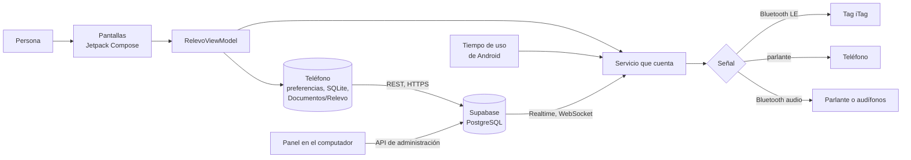

# Cómo funciona Relevo por dentro

**Fecha:** 6 de noviembre de 2026. **Versión descrita:** Android 4.6 (`versionCode` 57), rama `android-4.6`. **Qué es:** el mapa técnico de la app, explicado de forma simple:
- cómo cuenta el tiempo;
- cómo suena y cómo se conecta con el Tag;
- qué guarda en el teléfono;
- cómo envía y recibe datos de Supabase;
- cómo funciona el panel;
- cómo se compila y por qué se hizo cada cosa.

Cada sección dice qué hace la pieza, cómo lo hace y en qué archivo está. Las rutas de código parten de `app/src/main/java/com/example/relevo/`.

**Cómo se hizo este documento:** se leyó el código de la 4.6 (76 archivos Kotlin, unas 15.800 líneas), el manifiesto, el esquema [`base-remota-supabase.sql`](base-remota-supabase.sql) y el panel. Además, se consultó la estructura de la base de datos real el 6 de noviembre de 2026: solo tablas, reglas y vistas, sin leer datos de participantes.

## En una imagen

- **Envío:** la app guarda primero en el teléfono, luego envía a Supabase.
- **Recepción:** lo único que la app recibe de la base son los mensajes del proyecto.
- **El Tag** solo recibe órdenes de pitar y callar, y avisa cuando se aprieta su botón.

## 1. Las piezas

| Capa | Qué hace | Archivos |
| --- | --- | --- |
| Pantallas | Todo lo que se ve, hecho con Jetpack Compose, la forma actual de dibujar interfaces en Android. La navegación es una pila de rutas: bienvenida, consentimiento, pestañas, preparar, señal, decidir, ajustes y otras. | `MainActivity.kt`, `ui/RelevoApp.kt`, `ui/*Screens.kt`, `ui/components/` |
| Estado y lógica | Un solo ViewModel guarda el estado de la app y decide qué pasa: preparar, activar, responder, enviar. Las reglas sin Android, como la activación automática o las horas sin sonar, viven aparte y tienen pruebas. | `ui/RelevoViewModel.kt`, `domain/` |
| Datos en el teléfono | Preferencias en JSON para el relevo, el historial, el perfil y los ajustes. Una base SQLite para el registro de la investigación. Una copia en Documentos/Relevo. | `data/` |
| Servicio que cuenta | Un servicio en primer plano con notificación permanente. Lee qué app está abierta, suma el tiempo y hace sonar la señal. | `monitor/AppUsageMonitorService.kt` y vecinos |
| Señal | Sintetiza el sonido, lo hace sonar en la salida elegida y maneja la conexión con el Tag. | `signal/SignalPlayer.kt`, `signal/FirmaSonora.kt`, `signal/TagLink.kt` |
| Conexión | Envía a Supabase y recibe los mensajes del proyecto. | `data/RemoteSync.kt`, `monitor/MessageStream.kt`, `monitor/ProjectMessages.kt` |
| Arranque y avisos | Retoma el conteo tras reiniciar el teléfono, maneja el aviso de regreso y los permisos. | `monitor/RestoreMonitorReceiver.kt`, `monitor/ReturnNotice.kt`, `monitor/UsageAccess.kt`, `monitor/BackgroundAccess.kt` |

**Tecnología:**
- Kotlin 2.3.20 y Compose BOM 2026.03.01.
- Android 12 o superior (`minSdk` 31), compilada para Android 16 (`targetSdk` 36).
- Dos bibliotecas externas: Haze, para el desenfoque del vidrio, y OkHttp, para la conexión WebSocket de Realtime.
- Para hablar con Supabase la app no usa su SDK. Usa HTTP directo (`HttpURLConnection`), lo que deja la app liviana y cada petición a la vista.

## 2. Permisos, y para qué es cada uno

| Permiso | Para qué |
| --- | --- |
| Tiempo de uso (`PACKAGE_USAGE_STATS`) | Saber qué app está en primer plano. Lo da la persona en Ajustes de Android; la app lo pide en la primera vez. |
| Bluetooth (`BLUETOOTH_SCAN` con `neverForLocation`, `BLUETOOTH_CONNECT`) | Buscar el Tag, conectarse y hacerlo pitar. `neverForLocation` declara que la búsqueda no se usa para ubicar a la persona. |
| Servicio en primer plano (`FOREGROUND_SERVICE`, tipo `specialUse`) | Seguir contando con la app cerrada, con una notificación visible. |
| Notificaciones (`POST_NOTIFICATIONS`) | La notificación permanente, la de la señal, el aviso de regreso y los mensajes. |
| Internet | Enviar a Supabase y recibir los mensajes. |
| Arranque (`RECEIVE_BOOT_COMPLETED`) | Retomar un relevo tras reiniciar el teléfono. |
| Batería (`REQUEST_IGNORE_BATTERY_OPTIMIZATIONS`) | Pedir que Android no detenga el conteo. Se puede rechazar. |
| Vibración | La vibración al tocar acciones importantes. |

`allowBackup` está apagado: los datos de la app no se copian a la nube de Google.

## 3. Un relevo, de principio a fin

Un relevo pasa por seis estados: borrador (`DRAFT`), listo (`READY`), esperando (`WAITING`), sonando (`SIGNALLED`), silenciado (`SILENCED`) y cerrado (`CLOSED`).

1. **Preparar.** La persona elige:
   - la actividad;
   - con qué empieza;
   - dónde;
   - qué apps cuentan;
   - cuánto tiempo;
   - con qué suena.

   Al escribir una actividad propia, el [catastro de palabras clave](textos/catastro-de-palabras-clave.md) reconoce el concepto y sugiere con qué empezar y dónde.
2. **Activar** (`arm()` en el ViewModel).
   - **Requisitos:** el consentimiento vigente y el permiso de Tiempo de uso.
   - **Qué pasa:** el relevo pasa a esperando y entra a la lista de activos. Puede haber varios a la vez (D-158).
   - **Qué se registra:** el evento `armed` y una sesión nueva.
   - **Después:** envía lo pendiente y arranca el servicio que cuenta.
3. **Contar.** Cada segundo, el servicio:
   - lee los eventos de Tiempo de uso desde la última lectura;
   - reconstruye qué app está en primer plano;
   - suma ese segundo a cada relevo que incluye esa app (ver la sección 4).

   Cuando la persona entra o sale de una app elegida, se registra `target_entered` o `target_left`. Además, el servicio hace tres revisiones periódicas:
   - cada 30 s, si sigue el permiso; sin él, pausa con `monitor_paused` y avisa;
   - cada minuto, si hay mensajes;
   - cada 15 minutos, envía lo pendiente.
4. **Revisar el Tag antes de sonar.** A 90 s del final, si el relevo suena en el Tag, el servicio lo busca durante hasta 30 s. Si no responde, la notificación lo dice (4.4).
5. **Sonar.** Cuando un relevo cumple su tiempo, nada más está sonando y no son horas sin sonar, pasa a sonando.
   - **Cómo suena:** unos 30 s (D-078), en la salida elegida.
   - **Si el Tag no responde:** suena en el teléfono, y queda `tag_sin_respuesta` (4.4).
   - **Qué se registra:** `signal_emitted` o `signal_failed`, y el uso de las apps elegidas en los 10 minutos anteriores.
   - **Aviso:** una notificación de alta prioridad.
6. **Terminar la señal.** De una de cuatro formas:
   - sola, a los 30 s (`signal_ended`);
   - porque se perdió la salida (`signal_interrupted`);
   - con el botón del Tag (`silenced_object`);
   - porque la persona respondió en la app.
7. **Responder.** «Comencé», «La dejé para después» o «Cambié de idea» va al historial, con las preguntas de un toque.
   - **Uso posterior:** diez minutos después, `UsageAfterSignal` calcula cuánto siguió la persona en las apps elegidas. Se usa solo para la investigación.
   - **Límite:** Android guarda esos eventos unos días; si nadie abre la app en ese plazo, el dato queda vacío.

## 4. Cómo sabe qué app se está usando

- **De dónde lo saca:** de la API de Tiempo de uso de Android (`UsageStatsManager.queryEvents`), que entrega eventos con el nombre del paquete y la hora. Por ejemplo, «se abrió `com.instagram.android`» o «se apagó la pantalla». La app no ve el contenido de otras apps, solo cuál está adelante.
- **Cómo lo reconstruye:** `ForegroundTracker` sigue tres tipos de evento:
  - `ACTIVITY_RESUMED` marca la app que pasa adelante;
  - `ACTIVITY_PAUSED` la saca;
  - la pantalla apagada corta el conteo.

  Algunos fabricantes informan la pausa de la app anterior después de abrir la siguiente; por eso solo se limpia si corresponde a la app que estaba adelante.
- **El paso máximo:** cada segundo suma como mucho 2 s. Si Android dejó dormido el proceso, ese hueco no se cuenta como uso.
- **Al empezar:** revisa los 15 minutos anteriores, para saber qué app ya estaba abierta.
- **Uso diario** (D-097, `DailyUsage`): cada día guarda cuánto se usó y cuántas veces se abrió cada app elegida alguna vez en Relevo, más el tiempo total de pantalla. De las demás apps solo suma su tiempo al total; su nombre no se guarda. Incluye siete días antes de aceptar, como línea base.

## 5. Cómo suena

### Las tres salidas

| Salida | Cómo suena | En el código |
| --- | --- | --- |
| Tag (`TAG`) | El llavero pita por Bluetooth Low Energy, seguido, hasta 30 s o hasta que se aprieta su botón | `TagLink.kt` |
| Teléfono (`PHONE`) | El sonido de Relevo por el parlante del teléfono, con la notificación | `SignalPlayer.kt` |
| Dispositivo de audio (`BLUETOOTH`) | El mismo sonido en un parlante o unos audífonos Bluetooth (A2DP o audio BLE) | `SignalPlayer.kt` |

### El sonido

- **Se genera en el teléfono:** no es un archivo grabado. `FirmaSonora` lo sintetiza nota por nota, con sus parciales, ataque, caída y un golpe de ruido que ayuda a ubicarlo. Es audio PCM a 44,1 kHz, mono y 16 bits.
- **Cuatro sonidos para elegir** (D-158): la «madera», que es la firma de Relevo (D-071), y otros tres que cambian el ritmo, la altura, el espectro o la envolvente. Todos terminan en una cuarta que baja y duran unos 30 s (D-078). Las fuentes están en [sonido-de-relevo-2026-11-05.md](sonido-de-relevo-2026-11-05.md).
- **Se reproduce** con `AudioTrack`, como audio multimedia.
- **La salida se fija** con `setPreferredDevice`: si la elegida no está, no cambia a otra en silencio. Si la elegida era el Tag, suena en el teléfono.
- **El volumen** suave, medio o fuerte de la app se aplica sobre el volumen multimedia del teléfono.

### El Tag: cómo se conecta y cómo pita

El Tag es un llavero iTag de Bluetooth Low Energy (BLE). El Tag no reproduce audio: la app escribe valores en «características», que son casillas con un número dentro del Tag. El Tag reacciona a esos valores.

| Servicio del Tag | Característica | Qué hace Relevo con ella |
| --- | --- | --- |
| Alerta inmediata (estándar, `0x1802`) | Nivel de alerta (`0x2A06`) | Escribe 2 para pitar (o 1, el nivel que funcionó en la prueba) y 0 para callar |
| Propio del iTag (`0xFFE0`) | `FFE1` | Avisa cada vez que se aprieta el botón: durante la señal, eso la calla |
| Propio del iTag (`0xFFE0`) | `FFE2` | Cambia según el modelo. En el Tag del autor, 1 hace pitar. Relevo lo deja en 0 mientras espera y en 1 solo mientras suena (D-116) |
| Pérdida de enlace (estándar, `0x1803`) | Nivel de alerta | Escribe 0 para apagar la alarma que suena cuando el Tag pierde la conexión |
| Batería (estándar, `0x180F`) | Nivel de batería (`0x2A19`) | Lee la carga, de 0 a 100, y la muestra (D-136) |

**Cómo se maneja la conexión:**

- **Buscar:** un escaneo de 12 s que entrega cada llavero con la fuerza de su señal.
- **Conectar:** una conexión GATT, el protocolo de BLE para leer y escribir características, de hasta unos 30 s.
- **Mantener:** mientras un relevo espera para sonar en el Tag, la conexión se mantiene abierta y, si se corta, se reintenta cada 30 s. Algunos Tag se apagan si nadie se conecta por unos minutos.
- **Una orden a la vez:** Android no acepta otra mientras una espera respuesta. Las órdenes de callar se confirman y se reintentan (D-136).
- **Nunca cortar con la alarma encendida:** desconectar con la alarma de pérdida de enlace activa es justo lo que la hace sonar. Desde la 2.32, la app solo desconecta cuando el Tag confirmó que esa alarma está apagada (D-137).
- **Tag lento:** después de mucho rato quieto, el Tag responde lento. La app pide una conexión rápida, espera hasta 6 s cada respuesta y vuelve a la normal al minuto, para no gastar la pila.

Las fuentes sobre el iTag están en [objetos-que-suenan-2026-09-29.md](../objetos-que-suenan-2026-09-29.md). Una de ellas es la app de código abierto iTag One.

## 6. Qué guarda el teléfono

| Dónde | Qué |
| --- | --- |
| Preferencias de Android, archivos `relevo_*` | El relevo en preparación y los activos, el historial, el perfil, la ruta, las actividades propias, los ajustes, el Tag elegido, la activación automática, la sesión con Supabase y las marcas de experiencia, como la encuesta del rediseño. Se guardan en JSON. |
| SQLite `relevo_research.db` | El registro de la investigación en cinco tablas: `sessions` (un relevo), `events` (sus pasos), `answers` (respuestas), `app_events` (uso de la app) y `daily_usage` (uso diario). Cada fila sabe si ya se envió. |
| Documentos/Relevo | Una copia por código: el registro completo en JSON y tres tablas CSV (relevos, respuestas y uso), sin el nombre. Se actualiza cada vez que la app intenta enviar, aunque no haya internet, y queda aunque se desinstale la app. Se borra al borrar los datos. |

**El código de participación** tiene cuatro caracteres, sin los que se confunden (0, O, 1, I, L, 5, S, 2 ni Z). Con 22 símbolos hay 234.256 códigos posibles. El nombre se guarda aparte, solo con el código (D-089).

## 7. Supabase: qué es y cómo lo usa Relevo

**Qué es:** un servicio en internet que da cuatro cosas:
- una base de datos PostgreSQL;
- un sistema de usuarios;
- una API REST que se crea sola a partir de las tablas (PostgREST);
- avisos en vivo (Realtime).

El proyecto de Relevo es `rwzslwtxabmfofqppgwu`.

### Cómo se conecta la app

1. **La dirección y la clave publicable** están en `relevo.properties` (D-161) y entran a la app al compilar. La clave publicable solo identifica el proyecto. Lo que cada uno puede hacer lo deciden las reglas de la base. No es la clave de servicio, que nunca va en la app.
2. **Una sesión anónima** al aceptar el consentimiento. La app pide un usuario nuevo sin correo ni contraseña (`POST /auth/v1/signup`). Supabase le da:
   - un token de acceso, que dura una hora;
   - un token de renovación, para pedir otro (`/auth/v1/token?grant_type=refresh_token`).

   Sin consentimiento no se abre sesión.
3. **Cada envío** es un `POST /rest/v1/<tabla>` con JSON, la clave publicable y el token.
   - **Sin duplicados:** se usa `on_conflict` con un identificador que crea el teléfono para cada fila (`client_event_id`, `client_answer_id`, `session_id`). Si algo se reenvía, no se duplica.
   - **Errores:** si la base rechaza una fila por sus datos, se reenvía una por una para aislarla. Sin internet, todo queda pendiente.

### Qué se envía, en qué orden y cuándo

- **El orden de cada envío** (`RemoteSync.syncPending`):
  1. el participante, con el nombre aparte;
  2. las sesiones;
  3. los eventos, en lotes de 50;
  4. las respuestas;
  5. los eventos de uso de la app;
  6. el estado del teléfono y el uso diario, como mucho cada 30 minutos.
- **Cuándo se envía:**
  - al aceptar;
  - al activar;
  - al sonar;
  - al responder;
  - al cerrar la app;
  - cada 15 minutos mientras cuenta.

### Las tablas

Las nueve tablas de la base real, revisadas el 6 de noviembre de 2026. Todas tienen RLS: reglas por fila que deciden quién ve y escribe cada una.

| Tabla | Qué guarda |
| --- | --- |
| `relevo_participants` | El código y el nombre, aparte de todo lo demás (D-089) |
| `relevo_sessions` | Cada relevo: actividad, apps, tiempo, salida, si se activó a mano o solo, el resultado y el uso antes y después de la señal |
| `relevo_events` | Cada paso de un relevo: activado, entró o salió de una app, sonó, terminó, se calló con el Tag |
| `relevo_answers` | Las respuestas: preguntas de un toque, opiniones, la encuesta del rediseño |
| `relevo_app_events` | El uso de la app: pantallas, toques, permisos, aperturas |
| `relevo_participant_state` | Una foto del teléfono: perfil sin nombre, ajustes, permisos, modelo y relevo en curso (D-097) |
| `relevo_daily_usage` | El uso diario de las apps elegidas alguna vez y el total (D-097) |
| `relevo_messages` | Los mensajes del proyecto, para todos o para una persona (D-096) |
| `relevo_message_receipts` | Cuándo llegó y cuándo se abrió cada mensaje |

**Las reglas** son las mismas en las tablas de la investigación: cada teléfono solo puede insertar, leer y borrar sus propias filas, porque el usuario de su sesión es el dueño de la fila (`auth.uid() = user_id`). Los mensajes son la excepción: cada teléfono lee los generales y los suyos.

**El esquema `analisis`** tiene seis vistas para el investigador. No se exponen por la API y usan los permisos de quien consulta:
- `relevos`;
- `resumen_por_condicion`;
- `respuestas`;
- `uso`;
- `resumen_de_uso`;
- `participantes`.

**Borrar los datos:** desde «Tus datos», la app borra sus filas de las nueve tablas, comprueba que no quedó ninguna y borra la copia en Documentos/Relevo.

## 8. Cómo recibe datos: los mensajes del proyecto

Es lo único que llega desde la base (D-096).

1. **El autor escribe un mensaje en el panel,** que lo inserta en `relevo_messages`. Sin destinatario, es para todos.
2. **Al instante, por Realtime.** Mientras el servicio cuenta o espera, la app mantiene abierta una conexión WebSocket con Supabase (`wss://…/realtime/v1/websocket`). Es una conexión que queda abierta para que la base avise.
   - **El aviso:** cuando se inserta un mensaje, la base avisa por esa conexión y la app lo busca por REST. Llega en uno o dos segundos.
   - **Cada teléfono recibe solo lo suyo,** porque Realtime respeta las reglas de la tabla.
   - **Mantenimiento:** la conexión envía una señal de vida cada 25 s y se renueva antes de que venza el token.
3. **Respaldo, si no hay conexión abierta:**
   - al abrir la app;
   - cada minuto mientras cuenta o espera;
   - cada 15 minutos en segundo plano, con un trabajo programado de Android que exige conexión. Android puede agruparlo para ahorrar batería.
4. **Se muestra como notificación,** y la app registra en `relevo_message_receipts` cuándo llegó y cuándo se abrió.

## 9. Segundo plano, reinicios y avisos

- **El servicio en primer plano** es lo que permite contar con la app cerrada. Android exige que muestre una notificación permanente.
- **Los canales de notificación:**
  - «Relevo activo», con prioridad baja, para la notificación permanente;
  - «Señal de Relevo», con prioridad alta;
  - estado del relevo;
  - aviso de regreso;
  - mensajes.
- **Tras reiniciar o actualizar:** `RestoreMonitorReceiver` escucha el arranque del teléfono y la actualización de la app. Con eso retoma:
  - el conteo;
  - la activación automática;
  - el aviso de regreso;
  - la revisión de mensajes.
- **La activación automática** (D-095) es opcional. Mientras está encendida, el servicio mira cada 3 s qué app está adelante. Si se abre una del último relevo, lo activa solo.
  - **Pausa:** espera 30 minutos entre un relevo y el siguiente.
  - **No se activa** en horas sin sonar ni si ya hay otro relevo en curso.
- **Horas sin sonar** (4.4): en el tramo elegido, Relevo no suma tiempo ni suena. Las entradas y salidas se siguen registrando.
- **El aviso de regreso** es opcional y llega como máximo una vez por semana, si la persona no abrió Relevo. Es una alarma diaria inexacta, que Android agrupa con otras.
- **Batería:** la app pide quitarle la optimización de batería, porque algunos fabricantes detienen servicios aunque muestren notificación. La persona puede rechazarlo.

## 10. El panel

- **Qué es:** [`panel-relevo.html`](../panel-admin/panel-relevo.html), una página que se abre en el computador del autor ([guía](../panel-admin/README.md), [herramientas](../../HERRAMIENTAS.md)).
- **Con datos reales:** se ejecuta `node servidor.js`, un servidor que solo escucha en ese computador (`127.0.0.1:8765`).
  - **Cómo consulta:** reenvía cada consulta del panel a la API de administración de Supabase (`POST /v1/projects/{ref}/database/query`).
  - **El token:** usa un token personal (`sbp_…`) guardado en `.env.local`, que no se sube al repositorio y nunca llega al navegador.
  - **Protección:** cada arranque crea una clave nueva que el panel debe enviar, para que otra página web no pueda usar el servidor.
- **Sin token:** abre con datos de ejemplo inventados.
- **Qué puede hacer:** como usa la API de administración, el panel ve todas las filas, no solo las de una persona. Desde ahí el autor:
  - revisa a cada participante;
  - envía mensajes;
  - borra datos cuando se lo piden.
- **Una tabla aparte:** `deck_remote`, en la misma base, es del control remoto de la presentación, no de la app.

## 11. Cómo se compila y se entrega

- **Compilación:** con Gradle, la herramienta estándar de Android. La versión optimizada usa R8, que reduce y optimiza el código.
- **Firma:** con la clave de siempre, `firma/relevo-debug.keystore`. Gracias a eso, cada versión se instala encima de la anterior sin perder datos. Desde D-161, la clave y `relevo.properties` están en el repositorio, así que cualquier computador, también el Mac, compila una versión actualizable.
- **Versión de revisión:** `-PrelevoSuffix=.revision` instala una app aparte, que no reemplaza ni envía datos.
- **Antes de entregar cada versión:**
  - el `versionCode` sube;
  - pasan las pruebas unitarias, que hoy son 97;
  - el APK queda en [`releases/`](releases/README.md) con su SHA-256, una huella que permite comprobar que el archivo no cambió.
- **Ramas en GitHub,** sin fusionar con `main`: `android-4.4`, luego `iconos-propios`, luego `android-4.5` y luego `android-4.6`.

## 12. Cómo se hizo cada cosa

| Cuándo | Qué | Decisión |
| --- | --- | --- |
| Sep. 2026 | El sonido suena donde empieza la actividad, con una firma propia | D-071 |
| Sep. 2026 | La señal dura unos 30 segundos y termina sola | D-078 |
| Sep. 2026 | El consentimiento es obligatorio para usar la app | D-084 |
| Sep. 2026 | Datos en Supabase y copia en el teléfono (2.11) | D-086 |
| Sep. 2026 | Actividades de las entrevistas P1–P8 | D-088 |
| Sep. 2026 | El nombre va aparte, solo con el código | D-089 |
| Sep. 2026 | Activación automática opcional | D-095 |
| Sep. 2026 | Panel privado y mensajes del proyecto, con Realtime desde la 2.17 | D-096 |
| Sep. 2026 | Registro completo: estado del teléfono y uso diario | D-097 |
| Oct. 2026 | El llavero iTag como objeto que suena | D-109 |
| Oct. 2026 | El Tag suena seguido en la señal | D-116 |
| Oct. 2026 | Las herramientas, como el panel, funcionan sin claude.ai | D-133 |
| Oct. 2026 | El Tag se calla siempre y muestra su pila (2.31) | D-136 |
| Oct. 2026 | El Tag no se desconecta con la alarma encendida (2.32) | D-137 |
| Nov. 2026 | Rediseño en papel y tinta (4.0 a 4.3), varios relevos a la vez, catastro y sonidos | D-155 a D-158 |
| Nov. 2026 | La 4.4 actualizable: sin la prueba de 21 días; el Tag se busca antes de sonar; horas sin sonar | D-159, D-160 |
| Nov. 2026 | La firma y la configuración de Supabase en el repositorio | D-161 |
| Nov. 2026 | Íconos según lo que pide la app, inspirados en Lucide | D-162 |
| Nov. 2026 | Menos amarillo, el saludo del relevo y 634 palabras clave (4.5) | D-163 |
| Nov. 2026 | La encuesta del rediseño, una vez (4.6) | D-164 |

El detalle de cada decisión está en el [registro de decisiones](../../09_decisiones/registro-de-decisiones.md). El de cada versión, en los documentos `version-*.md` de esta carpeta.

## 13. Límites conocidos

- **Tiempo de uso depende de Android.** Algunos fabricantes informan los eventos tarde o en otro orden. La app lo compensa, pero no lo controla.
- **Los modelos de iTag cambian.** `FFE2` hace cosas distintas según el modelo. La app prueba niveles hasta que la persona escucha el pitido.
- **Android puede detener o retrasar** el servicio y los trabajos programados para ahorrar batería, sobre todo en algunas marcas.
- **Realtime solo está abierto mientras el servicio cuenta o espera.** Con la app cerrada y sin relevo, los mensajes llegan con la revisión periódica.
- **Android guarda los eventos de uso solo unos días.** Si nadie abre la app, el uso posterior a una señal puede quedar vacío.
- **Probada sobre todo en el emulador.** Las versiones 4.x no se han probado en muchos teléfonos reales.

## Registro de cambios (disclaimer)

### 2026-11-06 — Creación

- **Qué cambió:** se documenta por dentro la app 4.6: piezas, permisos, el recorrido de un relevo, cómo cuenta, cómo suena, el Tag por Bluetooth, qué guarda, cómo envía y recibe datos de Supabase, el panel, la compilación y la historia de cada decisión.
- **Cómo estaba antes:** cada parte estaba explicada en su versión, su decisión o el código, pero no había un mapa técnico reunido.
- **Por qué:** el autor pidió analizar y registrar, de forma técnica y simple, cómo funciona la app, cómo se conecta, cómo envía señales, cómo recibe datos, cómo funciona Supabase y cómo se hizo cada cosa.
