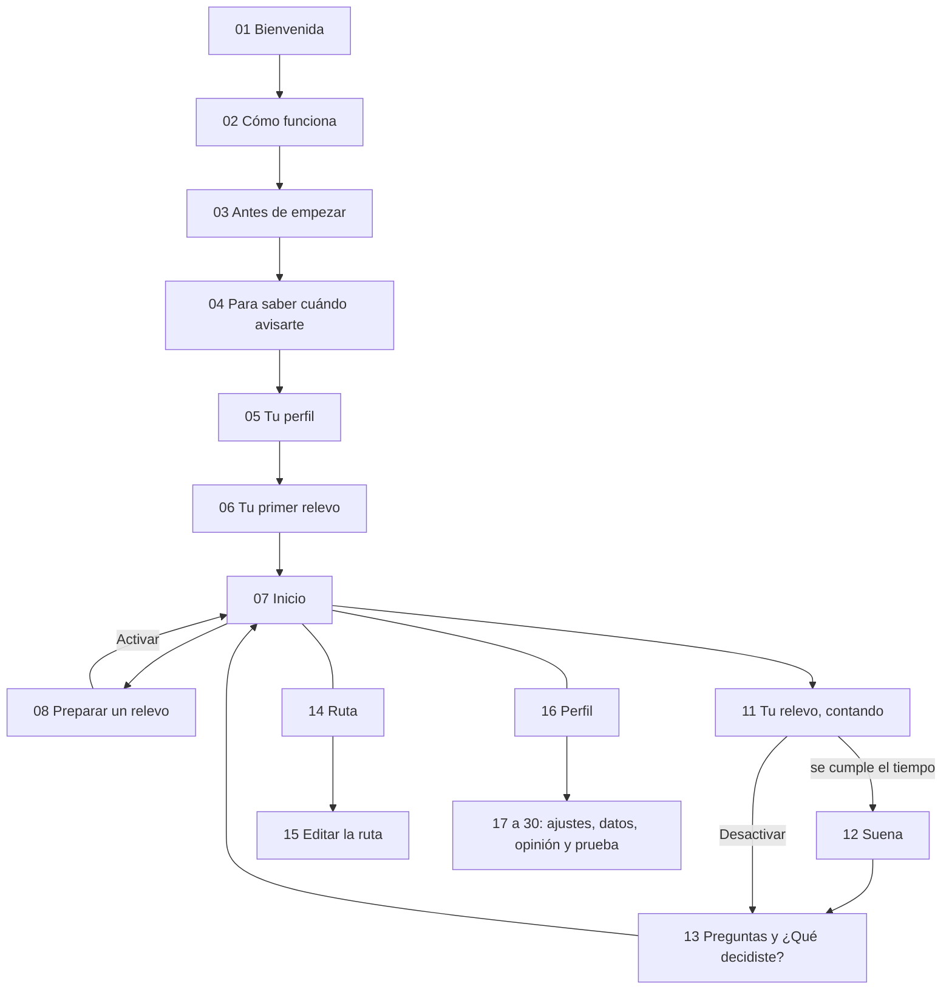

# Pantallas de la app 3.3

> **Qué es:** la descripción escrita de cada pantalla de Relevo 3.3: para qué sirve, cuándo aparece, qué muestra, qué se puede hacer, qué registra y cómo están escritos sus textos.
>
> **Cómo leerlo:** cada pantalla indica sus textos con identificadores (T0001…), que llevan al [inventario](inventario-de-textos.md), donde está cada texto completo con su archivo y línea. Las observaciones de escritura remiten a los puntos R1 a R14 del [estudio de los textos](estudio-escritura-de-interfaces-2026-10-24.md).
>
> **Versión:** 3.3 (ramas `android-2.7` y `main`), leída en el código el 24 de octubre de 2026. Quienes participan usan 2.33, con la interfaz de 2.30; las diferencias de texto están en el [inventario de 2.33](inventario-de-textos-android-2.33.md) y en la sección 4.3 del estudio. Esta descripción no reemplaza una revisión en el teléfono: varias pantallas cambian según el estado del relevo, la semana de la prueba y los permisos. Las pantallas dibujadas están en la [lámina de wireframes](../../relevo-como-sistema-2026-10-18/wireframes-relevo.html) de [Relevo como sistema](../../relevo-como-sistema-2026-10-18/relevo-frontend-y-backend.md).

## Mapa

La app tiene tres pestañas —Inicio, Ruta y Perfil— y pantallas que se abren encima. La primera vez, un recorrido lleva de la bienvenida al primer relevo.

| N.º | Pantalla | Tipo | Textos | Identificadores |
| --- | --- | --- | --- | --- |
| 01 | Bienvenida | Primera vez | 10 | T0001–T0010 |
| 02 | Cómo funciona | Primera vez y Perfil | 32 | T0011–T0042 |
| 03 | Antes de empezar (consentimiento) | Primera vez | 31 | T0043–T0073 |
| 04 | Para saber cuándo avisarte (permisos) | Primera vez | 13 | T0074–T0086 |
| 05 | Tu perfil (primera vez) | Primera vez | 18 | T0087–T0104 |
| 06 | Tu primer relevo | Primera vez | 8 | T0105–T0112 |
| 07 | Inicio | Pestaña | 80 | T0113–T0192 |
| 08 | Preparar un relevo | Pantalla encima | 146 | T0193–T0338 |
| 09 | Cómo usar el Tag | Hoja | 29 | T0339–T0367 |
| 10 | Hojas sobre Inicio | Hojas | 12 | T0368–T0379 |
| 11 | Tu relevo (contando) | Pantalla | 32 | T0380–T0411 |
| 12 | Suena | Estado | 14 | T0412–T0425 |
| 13 | Preguntas y ¿Qué decidiste? | Estado | 27 | T0426–T0452 |
| 14 | Ruta | Pestaña | 22 | T0453–T0474 |
| 15 | Editar la ruta | Pantalla | 22 | T0475–T0496 |
| 16 | Perfil | Pestaña | 45 | T0497–T0541 |
| 17 | Editar el perfil | Pantalla encima | 14 | T0542–T0555 |
| 18 | Avisos y resúmenes | Pantalla | 16 | T0556–T0571 |
| 19 | Apariencia y aura | Pantalla | 16 | T0572–T0587 |
| 20 | Permisos | Pantalla | 15 | T0588–T0602 |
| 21 | Tus relevos | Pantalla | 7 | T0603–T0609 |
| 22 | Tus actividades | Pantalla | 8 | T0610–T0617 |
| 23 | Crear o editar una actividad | Pantalla encima | 28 | T0618–T0645 |
| 24 | Tus datos (Privacidad y datos) | Pantalla | 29 | T0646–T0674 |
| 25 | Lo que aceptaste | Pantalla | 2 | T0675–T0676 |
| 26 | Prueba de 21 días (investigador) | Pantalla oculta | 25 | T0677–T0701 |
| 27 | ¿Cómo te fue esta semana? | Pantalla encima | 16 | T0702–T0717 |
| 28 | Cierre de la prueba | Pantalla encima | 32 | T0718–T0749 |
| 29 | Opinar sobre Relevo | Pantalla encima | 6 | T0750–T0755 |
| 30 | Reportar un problema | Pantalla encima | 8 | T0756–T0763 |
| 31 | Notificaciones | Fuera de la app | 29 | T0764–T0792 |
| 32 | Textos compartidos | Varias pantallas | 32 | T0793–T0824 |
| 33 | Ideas, sugerencias y rutas | Listas | 232 | T0825–T1056 |
| 34 | Piezas de la interfaz | Componentes | 231 | T1057–T1287 |

**Lo que registran todas.** Cada vez que cambia la pantalla, la app anota cuál es («pantalla»); también registra cuándo se abre y se cierra la app y los permisos cuando cambian. El consentimiento informa estos datos (T0060). Las fichas indican solo lo que cada pantalla registra además.

## Primera vez

### 01 Bienvenida

- **Para qué:** presentar Relevo en una frase, sin pedir datos.
- **Cuándo aparece:** al abrir la app por primera vez, antes de aceptar participar.
- **Qué se ve:** la marca sobre el aura y el descriptor «Un recordatorio físico preparado desde el teléfono» (T0005), que viene de la guía de comunicación. El título «Anota algo que quieres hacer.» (T0001) va con la explicación «Relevo te avisa a tiempo, cuando llevas un rato en el teléfono.» (T0002). Tres filas flotan sobre el aura como ejemplo: «Leer», «Abrir el libro» (Tu primer paso) y «En el velador» (Donde empiezas) (T0006–T0010).
- **Acciones:** «Empezar» (T0003) lleva a Cómo funciona.
- **Decisiones:** D-125 a D-128 (marca 3.0 sobre el aura).
- **Escritura:** clara y breve. «Tu primer paso» (T0008) contradice el vocabulario de D-084 (R1). «Donde empiezas» (T0010) va sin tilde porque es relativo; en el resto de la app aparece «Dónde empiezas» como pregunta indirecta: las dos formas son correctas, pero se ven distintas. El título termina en punto (R8).

### 02 Cómo funciona

- **Para qué:** dar el contexto mínimo antes del consentimiento: qué es Relevo, para qué sirve y cómo funciona. Lo demás se aprende haciendo el primer relevo (D-088, D-090).
- **Cuándo aparece:** después de la bienvenida y desde Perfil › «Cómo funciona Relevo».
- **Qué se ve:** cuatro páginas.
  1. «Esto es Relevo», con un video vertical de 30 segundos que empieza sin sonido y tiene controles con nombre: activar o quitar el sonido, pausar, reproducir y ver de nuevo (T0012–T0013, T0036–T0041).
  2. «¿Te ha pasado?», con la escena «Abres una app para descansar.» y «Se pasa el rato y lo que querías hacer queda esperando.» (T0014–T0017).
  3. «Cómo funciona», con cuatro filas: «Cuenta tu tiempo», «Te recuerda tu primer paso», «Suena donde empiezas» y «Tú decides» (T0018–T0027).
  4. «Una última pregunta»: si la persona quiere el aviso semanal, con un ejemplo de la notificación y las respuestas «Sí, avísame» y «No, gracias», sin ninguna marcada (T0028–T0035).
- **Acciones:** «Seguir» (T0033) y «Saltar» (T0032). Desde Perfil no aparece la última pregunta y el botón final dice «Entendido» (T0042).
- **Qué registra:** cuántos segundos del video se vieron, si se vio completo y si tenía sonido; la respuesta sobre el aviso semanal queda como ajuste.
- **Escritura:** el orden escena → propuesta → decisión sigue la guía de comunicación. En la misma página, «Cuenta tu tiempo» (T0020) usa «contar» como sumar minutos y «nos cuentas qué hiciste» (T0019), como narrar (R3). «Te recuerda tu primer paso» (T0022) se aleja de D-084 (R1).

### 03 Antes de empezar (consentimiento)

- **Para qué:** pedir el consentimiento para participar en la prueba de 21 días. En esta versión, usar la app es participar (D-084).
- **Cuándo aparece:** después de Cómo funciona, mientras la persona no haya aceptado.
- **Qué se ve:** el título «Antes de empezar» y el subtítulo «Lee lo que aceptas. Puedes salir cuando quieras.» (T0043–T0044). Una versión breve resume la prueba (T0052). Debajo hay ocho secciones que se despliegan con «Leer» y se cierran con «Ocultar»: «Cómo es», «Tú decides», «Qué guardamos», «Dónde se guarda», «Qué no vemos», «Mensajes», «Tu código» y «Hasta cuándo» (T0055–T0073). Al final, la casilla «Acepto participar durante 21 días.» (T0045).
- **Acciones:** «Aceptar y empezar» (T0046) funciona solo con la casilla marcada; si falta, lo dice (T0048). «No quiero participar» (T0050) explica que no se guardó nada y que la app se puede desinstalar (T0051). Si quedó un borrado de datos pendiente, un aviso lo dice y ofrece «Abrir Privacidad y datos» (T0053–T0054).
- **Qué registra:** la aceptación del consentimiento.
- **Escritura:** honesta y completa: dice qué no se ve y advierte que el código no vuelve anónimos los datos (T0069). Tiene los párrafos más largos de la app, de 120, 94 y 77 palabras (R12). Dice «testeo» donde el resto de la app dice «prueba» (R14) y manda a «Tus datos» en Perfil, donde la fila se llama «Privacidad y datos» (R5). Es texto aceptado: no se cambia durante la prueba.

### 04 Para saber cuándo avisarte (permisos)

- **Para qué:** pedir los permisos con que Relevo cuenta el tiempo y suena.
- **Cuándo aparece:** después de aceptar, hasta tener el permiso necesario.
- **Qué se ve:** el título «Para saber cuándo avisarte» y «Relevo solo cuenta minutos en las apps que elijas. No ve lo que haces en ellas.» (T0074–T0075). Tres filas: «Tiempo de uso», marcada como «Necesario.»; «Notificaciones», «Para avisarte aunque estés en otra app.»; y «Batería», «Para que Relevo siga funcionando aunque pasen días.» (T0078–T0086).
- **Acciones:** «Dar el permiso» lleva a los ajustes de Android y «Activar» pide notificaciones o quita la restricción de batería. Las notificaciones se piden al abrir la pantalla (D-087). Con el permiso de Tiempo de uso dado, la app sigue sola.
- **Escritura:** cada permiso dice para qué sirve, como recomienda Android. «Tiempo de uso» no es el nombre que la persona verá en Android, que es «Acceso a datos de uso» (R6). En batería, el botón dice «Activar» y en Inicio, «Quitar la restricción» (T0140) para la misma acción (R9).

### 05 Tu perfil (primera vez)

- **Para qué:** saber cómo llamar a la persona y qué le gustaría hacer, para armar rutas sugeridas.
- **Cuándo aparece:** después de los permisos, una vez.
- **Qué se ve:** tres pasos con avance («1 de 3»):
  1. «¿Cómo te llamas?», con el campo «Tu nombre», la ayuda «Tu nombre o como te dicen» y la nota «Lo guardamos junto a tu código, aparte de lo que haces en Relevo.» (T0087, T0098–T0100);
  2. «Elige tu emoji», entre 84 emoji en cinco grupos (T0088);
  3. «¿Qué te gustaría hacer más seguido?», con intereses en opciones de un toque y «Otra», que abre «¿Cuál?» con la ayuda «Ej.: tejer» (T0089, T0101–T0104).
- **Acciones:** «Seguir», «Listo» y «Saltar» en los pasos 2 y 3 (T0090–T0095). El nombre es obligatorio (D-089) y las validaciones dicen qué falta (T0092, T0094, T0096, T0097).
- **Qué registra:** el nombre (aparte de los datos, solo con el código), el emoji y los intereses.
- **Escritura:** buena. La nota del nombre explica por qué se guarda aparte. El inventario clasifica «Elige tu emoji» como validación, pero es el título del paso 2.

### 06 Tu primer relevo

- **Para qué:** proponer hacer juntos el primer relevo, con el paso actual de la ruta como ejemplo (D-090).
- **Cuándo aparece:** después del perfil, si la persona eligió intereses.
- **Qué se ve:** el título «Tu primer relevo» y «Te guiamos paso a paso. Toma un par de minutos.» (T0105–T0106). Una tarjeta muestra la actividad sugerida con su foto, «Para empezar» y «Dónde empiezas», y aclara «Puedes cambiar todo antes de activarlo.» (T0109–T0112).
- **Acciones:** «Preparar un relevo» (T0107) abre la preparación con la actividad cargada; «Lo hago después» (T0108) va a Inicio.
- **Qué registra:** si se elige hacerlo después y desde dónde se abrió la preparación.
- **Escritura:** clara y con la carga justa. «Te guiamos» es uno de los «nosotros» de la app (R7).

## Uso diario

### 07 Inicio

- **Para qué:** mostrar lo más próximo —el relevo que cuenta, el regreso después de unos días o el siguiente paso de la ruta— y dar acceso rápido a preparar uno.
- **Cuándo aparece:** es la pestaña principal.
- **Qué se ve, de arriba abajo:**
  - la marca con «Inicio» y la campana de Avisos y resúmenes (T0131, T0149);
  - un saludo en dos tonos: «Hola, [nombre].» y una segunda línea según el estado: «¿Qué quieres hacer hoy?», «Tu relevo está contando.», «Tu relevo está en pausa.» o, después de dos días sin relevos, «Hola de nuevo» y «¿Sigue siendo lo que quieres?» (T0123–T0130);
  - las tarjetas de la prueba: el primer relevo, la condición de la semana con «Entendido», el cierre de semana y el cierre de la prueba con «Responder» (T0172–T0192);
  - la nota de la guía la primera vez: «Empieza aquí: toca «Preparar un relevo». Te acompañamos paso a paso.» (T0132);
  - la opinión rápida después del tercer y del décimo relevo respondidos: «¿Qué tal te va con Relevo?», cinco caras, «Contar más» y «Ahora no» (T0113–T0121);
  - los avisos de activación automática, permiso y batería (T0122, T0133–T0140);
  - la tarjeta principal, que es una de estas cuatro: el relevo que cuenta, con «Contando» o «En pausa», dónde sonará, «cuando sumes [tiempo que falta] más» y «Ver, editar o desactivar» (T0155–T0161); el regreso, con «La última vez», «Preparar de nuevo», «Elegir otra» y «Ahora no» (T0162–T0165); el siguiente paso de la ruta, con «Preparar un relevo con este paso» o «Preparar otro relevo» (T0166–T0171); o, si no hay nada, «¿Tienes algo en mente?» con «Preparar un relevo» (T0141–T0143);
  - debajo, «Ideas» con «Ver todas», «Tus actividades» o la invitación a crearlas, y «La última vez» (T0144–T0151).
- **Después de responder:** un mensaje breve sube y se va solo a los 6 segundos, si la persona no lo apagó (T0810–T0812). Si dijo «Cambié de idea» sobre un paso de la ruta, ofrece «Cambiar la actividad» o «Ahora no» (T0152–T0154).
- **Qué registra:** la opinión rápida o su cierre, el «Ahora no» del regreso y cuándo se vio la instrucción de la semana.
- **Decisiones:** D-131 (composición de 3.2); V1, el regreso que no dice cuántos días pasaron.
- **Escritura:** el saludo de regreso no cuenta días ni sugiere una falta, y las opciones del regreso pesan lo mismo. «Contar más» puede leerse como «sumar más» (R3), «Preparar un relevo con este paso» es largo para un botón (R12) y los saludos terminan en punto (R8).

### 08 Preparar un relevo

- **Para qué:** convertir una intención en un relevo: qué, cómo se empieza, dónde, después de cuánto uso y con qué suena.
- **Cuándo aparece:** desde Inicio, la Ruta, Tus actividades, el primer relevo o la notificación semanal. Al editar un relevo activo, abre en la revisión.
- **Qué se ve:** seis pasos con avance continuo y la actividad elegida arriba, en su cielo (T0198–T0203).
  1. **«¿Qué quieres hacer?»:** el campo «Qué quieres hacer», con la ayuda «Escríbelo o toca una idea», y debajo «Tus pasos», «Tus actividades» e ideas agrupadas por familia (T0250–T0253).
  2. **«¿Cómo empiezas?»:** opciones de un toque y el campo «Para empezar», con la ayuda «O escríbelo aquí», y el consejo «Mientras más pequeño, menos cuesta empezar.» (T0236–T0238).
  3. **«¿Dónde empiezas?»:** lugares de la casa en opciones de un toque y un campo. En la semana B, la pregunta cambia a «¿Dónde dejas lo que suena?» (T0214, T0254–T0256).
  4. **«¿Cuándo suena?»:** las apps que cuentan, elegidas en una hoja con buscador («Elige las apps»); el tiempo, «Después de [duración]», sumando las apps elegidas; y «Probar con 15 segundos». Si falta el permiso, un aviso lo dice (T0257–T0265, T0336–T0338).
  5. **«¿Dónde suena?»:** cuatro salidas —«En tu Tag», «En el parlante», «En el reloj» y «En el teléfono»— con su estado («Conectado por Bluetooth», «Suena como una llamada») y «Probar el sonido» («Así va a sonar.»). La semana de la prueba fija la salida y lo dice (T0268–T0288). Si se elige el Tag, un panel permite buscarlo, probarlo y confirmar si pitó, con avisos para permisos, Bluetooth apagado y aparatos que no son compatibles (T0291–T0335).
  6. **«Todo listo»:** el resumen con cada dato, que se puede tocar para cambiarlo; la casilla «Guardar en tus actividades para la próxima vez»; y «Activar el relevo», o «Guardar y activar» si se está editando (T0203, T0232–T0233, T0239–T0246).
- **Acciones:** «Seguir» siempre en el mismo lugar; si falta algo, una frase dice qué escribir o elegir (T0215–T0229). «Volver» y «Cerrar» (T0230–T0231). La primera vez, cada paso trae una nota de la guía (T0204–T0213).
- **Qué registra:** desde dónde se abrió, cada paso visto, en qué paso se cerró, qué faltaba al tocar «Seguir» (como máximo una vez cada 10 segundos), la salida elegida, las pruebas de sonido, la búsqueda y el vínculo con el Tag y, al activar, el relevo completo.
- **Decisiones:** D-084 (frases y vocabulario fijo), D-093 (el reloj suena como llamada), D-109 (el Tag), D-112 (semana B).
- **Escritura:** es la pantalla con más texto: 146 textos y 975 palabras. Las validaciones dan instrucciones concretas («Escribe cómo empiezas: lo primero que harías.», T0216), pero el resumen usa otro registro («Falta cómo empiezas.», T0227). La forma de empezar aparece como «¿Cómo empiezas?», «Para empezar», «Cómo empiezas» y «El primer paso es…» (R1); el objeto, como «lo que suena» (R4). Los textos del Tag juntan varias instrucciones en un párrafo (R12).

### 09 Cómo usar el Tag

- **Para qué:** enseñar a encender, vincular, dejar, callar, apagar y cuidar el Tag.
- **Cuándo aparece:** sola, la primera vez que se elige el Tag, y desde Perfil › «Cómo usar el Tag».
- **Qué se ve:** una hoja con ocho pasos, cada uno con un dibujo animado del Tag y una frase: «Este es tu Tag», «Enciéndelo», «Búscalo en Relevo», «Déjalo en su lugar», «Para callarlo, un toque», «Para apagarlo», «La pila dura meses» y «Si no aparece o no pita» (T0339–T0362).
- **Acciones:** «Atrás», «Siguiente», «Entendido» y «Cerrar» (T0363–T0367).
- **Decisiones:** D-109.
- **Escritura:** concreta: duraciones («3 segundos · pita dos veces»), el tipo de pila y qué hacer si falla. El último paso tiene 47 palabras con varias soluciones juntas (R12).

### 10 Hojas sobre Inicio

- **Primer relevo activo:** «Tu primer relevo está activo» explica qué pasa ahora, con los datos que eligió la persona, y que se puede ver o desactivar en Inicio. Cierra la guía del primer relevo (T0368–T0371; D-090).
- **Siguiente paso de la ruta:** después de varias respuestas «Comencé la actividad» en el mismo paso, repite lo que dijo la persona («Dijiste que empezaste «[actividad]» tres veces.») y pregunta «¿Quieres probar el siguiente paso?», con «Probar el siguiente paso» y «Seguir en este paso» del mismo peso (T0372–T0375). No afirma que se formó un hábito.
- **Apagar el aviso semanal:** después de dos «Ahora no» seguidos al aviso semanal, pregunta una sola vez «¿Apagar el aviso semanal?», con «Apagarlo» y «Mantenerlo» (T0376–T0379; V2).
- **Qué registran:** la respuesta sobre el aviso semanal y la elección del paso.
- **Escritura:** son de lo mejor de la app en autonomía: preguntan una vez, repiten lo que dijo la persona y ofrecen opciones del mismo peso. El número de veces va con letras y en Perfil con cifras (R10).

### 11 Tu relevo (contando)

- **Para qué:** mostrar el relevo activo y permitir editarlo, desactivarlo o eliminarlo.
- **Cuándo aparece:** desde la tarjeta de Inicio, «Ver, editar o desactivar».
- **Qué se ve:** el aura en toda la pantalla, «Contando» o «En pausa», el tiempo contado en grande, «de [duración] en [apps elegidas]», el primer paso y dónde suena (T0380–T0392). Si se activó solo, lo dice; si falta un permiso o hay restricción de batería, también (T0393–T0398).
- **Acciones:** «Volver al inicio», «Editar este relevo» y «Desactivarlo» (T0383–T0385). Cada una pide confirmación en una hoja que explica qué pasa:
  - **«¿Editar el relevo?»:** mientras se edita no cuenta y luego sigue con el tiempo que llevaba (T0399–T0402);
  - **«¿Desactivar el relevo?»:** deja de contar, no sonará y después se dice qué se decidió (T0407–T0410);
  - **«¿Eliminar este relevo?»:** para cuando se activó por error; no queda en «Tus relevos» (T0403–T0406, T0411).
- **Qué registra:** la edición, la eliminación o la desactivación. La desactivación lleva a «¿Qué decidiste?».
- **Decisiones:** B3 (lámina «Contando»).
- **Escritura:** las confirmaciones dicen la consecuencia antes de actuar, y «Mantenerlo» nombra el resultado de la opción segura. «Tu primer paso» (T0388) choca con D-084 (R1).

### 12 Suena

- **Para qué:** el momento de la señal en la app: qué suena, qué actividad era y cómo empezar.
- **Cuándo aparece:** sola, cuando se cumple el tiempo; también al abrir la notificación.
- **Qué se ve:** el cielo de la actividad, el momento de más color (D-103). Al centro, lo que suena; el Tag, con anillos de tinta y sin luz (D-121). En una tarjeta de vidrio: una etiqueta con el estado («Suena en el Tag», «Ya dejó de sonar» o «No sonó»), el título «Es momento de volver a elegir» y una frase con la actividad, la forma de empezar y el lugar. En la semana B no se dice el lugar (T0413–T0416).
- **Si no sonó:** un aviso «Se cumplió el tiempo» dice por qué pudo fallar y qué revisar, con «Probar otra vez» y, fuera de la prueba, «Sonar en el teléfono». Después dice «Ahora sonó.» o «Todavía no suena.» (T0417–T0422).
- **Acciones:** «Silenciar y continuar» mientras suena y «Continuar» después; con el Tag, «Para callarlo en el Tag, toca su botón una vez.» (T0423–T0425). La señal termina sola a los 30 segundos (D-078). La primera vez, una nota de la guía (T0412).
- **Escritura:** breve y sin culpa: no ordena dejar el teléfono. «Es momento de volver a elegir» es abstracta, pero es la frase del protocolo (R13). «Continuar» convive con «Seguir» en el resto de la app (R9).

### 13 Preguntas y ¿Qué decidiste?

- **Para qué:** saber cómo se percibió la señal y qué decidió la persona, sin juzgarla.
- **Cuándo aparece:** después de silenciar o de que termine la señal, y al desactivar un relevo. Las preguntas aparecen solo si sonó.
- **Qué se ve:** arriba, «Después de la señal» y «Saltar» (T0429–T0430).
  - **«Cuatro preguntas de un toque»** (T0431–T0445): «¿Notaste el aviso apenas sonó?» (Enseguida, Un rato después, No lo noté), «¿Cómo te cayó el sonido?» (caras Bien, Normal, Mal), «Cuando sonó, ¿supiste qué querías hacer antes de leerlo en la pantalla?» (Sí, A medias, No) y «¿Recordaste cómo empezar?» (Sí, No). Termina con «Seguir» (T0432).
  - **«¿Qué decidiste?»** (T0446–T0452): la actividad con su imagen, «Sonó [lugar].» o «Desactivaste el relevo.», y tres respuestas del mismo tamaño, color y lugar: «Comencé la actividad», «La dejé para después» y «Cambié de idea». Tocar una la marca y termina.
- **Qué registra:** la respuesta (comenzó, lo dejó para después, cambió de idea o no respondió) y, si sonó, las cuatro respuestas, junto con el relevo.
- **Decisiones:** protocolo 02; B5. La primera pregunta se agregó en 2.33 (D-138).
- **Escritura:** la nota de la guía dice «No hay respuestas buenas ni malas; todas nos ayudan a mejorar Relevo.» (T0433), y el diseño lo cumple. Las preguntas llaman a la señal «el aviso» y «el sonido» en el mismo grupo (R2), y «¿Cómo te cayó el sonido?» es un modismo chileno (R13). Son preguntas del protocolo: se mantienen durante la prueba.

### 14 Ruta

- **Para qué:** sugerir pasos pequeños hacia lo que la persona quiere hacer más seguido, sin metas ni avance automático (D-074).
- **Cuándo aparece:** es la segunda pestaña.
- **Qué se ve:** el título en dos tonos «Paso a paso» y «hacia lo que te gustaría hacer más seguido.» (T0453–T0454). Si hay varios intereses, un carrusel para elegir uno. Los pasos van en escalera, con «Paso actual», «Hecho», «Siguiente» o «Paso [n]» (T0470–T0474), seguidos de «Agregar un paso» (T0460). Debajo, «Preparar un relevo con este paso» o, si ya hay un relevo activo, una nota (T0461–T0462), y «Editar los pasos» · «Cambiar intereses» (T0467–T0468). Sin intereses, invita a elegirlos (T0455–T0457).
- **Al tocar un paso:** una hoja con «Ahora» o «Paso [n] de [total]», la actividad, cómo empezar, «Preparar un relevo con este paso» y «Pasar a este paso» o «Volver a este paso» (T0463–T0466, T0469).
- **Qué registra:** los cambios de paso y la sugerencia del siguiente.
- **Escritura:** no hay porcentajes, puntos ni niveles. La ruta tiene varios nombres en la app (R4) y el botón principal es largo (R12).

### 15 Editar la ruta

- **Para qué:** cambiar, ordenar, borrar y agregar pasos de un interés.
- **Cuándo aparece:** desde la Ruta, con «Editar los pasos» o «Agregar un paso».
- **Qué se ve:** el nombre de la ruta y «Toca un paso para cambiarlo. Con los tres puntos, puedes moverlo o borrarlo.» (T0475). Cada paso tiene un menú con «Editar», «Subir», «Bajar», «Pasar a este paso» o «Volver a este paso», y «Borrar» en rojo (T0479–T0485). Un paso se edita en una hoja, «Nuevo paso» o «Editar el paso», con tres campos con ejemplo: «Actividad» («Ej.: caminar 30 minutos»), «Para empezar» («Ej.: ponerte las zapatillas») y «Dónde empiezas» («Ej.: junto a la puerta») (T0487–T0496).
- **Acciones:** «Guardar»; si no hay cambios, lo dice (T0477–T0478). «Cancelar» descarta (T0476). Nada se guarda hasta tocar «Guardar».
- **Qué registra:** la ruta guardada.
- **Escritura:** sigue D-084: «Para empezar», «Dónde empiezas» y acciones que dicen qué pasa. Borrar un paso no pide confirmación, pero nada se guarda hasta «Guardar».

## Perfil y ajustes

### 16 Perfil

- **Para qué:** reunir lo de la persona —sus relevos, actividades y pasos—, los ajustes, la ayuda y la prueba.
- **Cuándo aparece:** es la tercera pestaña.
- **Qué se ve:** el emoji en un círculo blanco, el nombre y los intereses; al tocarlos se edita el perfil (T0519–T0521). Debajo, filas en tres grupos (T0497–T0517):
  - «Tu semana», si el resumen semanal está encendido, con una línea de hechos de esta semana (T0522–T0527); «Tus relevos»; «Tus actividades»; «Tus pasos»;
  - «Apariencia y aura», «Avisos y resúmenes», «Permisos» y «Privacidad y datos»;
  - «Cómo funciona Relevo», «Cómo usar el Tag», «Tu opinión» y «Reportar un problema».
- **Al pie:** «Relevo [versión] · Proyecto de Título de Diseño, Universidad Diego Portales» (T0518). Al mantenerlo presionado se abre la configuración de la prueba, solo para el investigador (D-087).
- **«¿Qué te ayudó?»:** quien participa y preparó relevos esta semana puede tocar «Tu semana» y escribir qué le ayudó (T0536–T0541).
- **Qué registra:** la respuesta a «¿Qué te ayudó?».
- **Escritura:** las filas dicen qué hay dentro en una línea. «Privacidad y datos» abre una pantalla titulada «Tus datos» (R5); «Permisos» llama «avisos» a las notificaciones (R2); «Tus pasos» es un nombre más para la ruta (R4). La tarjeta antigua «Tu semana» (T0528–T0535) sigue en el código, pero ya no se muestra.

### 17 Editar el perfil

- **Para qué:** cambiar el emoji, el nombre y los intereses. Cambiar intereses conserva las rutas ya editadas.
- **Qué se ve:** el título «Tu perfil», el emoji con «Cambiar el emoji», el campo «Tu nombre» con la ayuda «Como quieras que te diga Relevo» e «Intereses», con «Elige una o varias.» (T0542–T0555). El emoji se elige en una hoja con «Listo».
- **Acciones:** «Guardar», con validaciones para el nombre, el otro interés y la falta de cambios; «Cancelar».
- **Escritura:** clara. La ayuda del nombre cambia entre la primera vez («Tu nombre o como te dicen») y esta pantalla («Como quieras que te diga Relevo»); las dos funcionan.

### 18 Avisos y resúmenes

- **Para qué:** encender o apagar lo opcional. Todo empieza apagado y se apaga con un toque.
- **Qué se ve:** cinco interruptores con su explicación (T0556–T0571):
  - «Activación automática»: cuando la persona abre las apps de su último relevo, empieza a contar solo (D-095). Muestra qué relevo repetirá y explica que Relevo mira qué app está abierta, solo su nombre, y espera 30 minutos entre activaciones;
  - «Resumen semanal», «Aviso semanal» y «Mensaje después de responder»;
  - «Veces por semana», con un contador de 1 a 7 y «Pausar» o «Retomar».
- **Qué registra:** cada ajuste que cambia.
- **Escritura:** cada subtítulo dice qué pasa cuando está encendido, como recomienda Apple. La nota de la activación automática es transparente sobre lo que observa.

### 19 Apariencia y aura

- **Qué se ve:** una vista previa del aura; «Tu aura», que aparece mientras cuenta un relevo («Es de la pantalla: el Tag no se ilumina.»); «Intensidad» (Suave, Media, Viva); «Tema» (Claro, Oscuro, Automático); y «Letra grande», que «Se suma al tamaño que usas en el teléfono.» (T0572–T0587).
- **Qué registra:** los ajustes que cambian.
- **Escritura:** aclara que el Tag no se ilumina, en línea con la señal solo sonora.

### 20 Permisos

- **Qué se ve:** tres filas con su estado: «Tiempo de uso» (Permitido o Falta), «Notificaciones» (Permitidas o Apagadas) y «Batería» (Sin restricción o Con restricción), y la nota «Tiempo de uso es necesario para contar. Lo demás es opcional.» (T0588–T0602).
- **Acciones:** tocar una fila lleva a darlo.
- **Escritura:** dice para qué sirve cada permiso. Los nombres no coinciden con los de Android (R6).

### 21 Tus relevos

- **Qué se ve:** los relevos terminados, agrupados por día («Hoy», «Ayer» o la fecha), con la actividad, la app, la duración y el resultado («Dijiste que empezaste», «La dejaste para después», «Cambiaste de idea», «Sonó» o «Terminó antes de sonar»). Sin relevos: «Aquí verás los relevos que termines.» (T0603–T0609, T0807–T0809).
- **Escritura:** hechos sin metas ni comparaciones. «Dijiste que empezaste» deja claro que es lo que la persona declaró, no algo que la app comprobó.

### 22 Tus actividades

- **Para qué:** guardar lo que la persona hace seguido para prepararlo en un toque (D-084).
- **Qué se ve:** el título «Tus actividades» y «Lo que haces seguido, listo en un toque.», tarjetas de a dos y «Crear una actividad». Sin actividades: «Todavía no tienes actividades» y para qué sirven (T0610–T0617). Tocar una abre una hoja con «Preparar un relevo» y «Editar».
- **Escritura:** el estado vacío dice qué guardar y dónde volverá a aparecer.

### 23 Crear o editar una actividad

- **Qué se ve:** «Nueva actividad» o «Editar la actividad», la imagen con «Cambiar la imagen» —elegida en una hoja de fotos e iconos— y tres campos: «Actividad», «Para empezar» y «Dónde empiezas», con ejemplos (T0618–T0645).
- **Acciones:** «Guardar», con validaciones para nombre vacío, largo o repetido, y para los otros dos campos; «Borrar la actividad», que pregunta «¿Borrar «[nombre]»?» y aclara que los relevos hechos se mantienen.
- **Qué registra:** la actividad guardada o borrada.
- **Escritura:** buena. Dos textos dicen casi lo mismo con palabras distintas: «Ya existe una actividad con ese nombre.» (T0624) y «Ya tienes una actividad con ese nombre.» (T0632).

### 24 Tus datos (Privacidad y datos)

- **Para qué:** explicar en breve qué se guarda y permitir descargar los datos o borrarlos, lo que también es dejar la prueba (D-084).
- **Qué se ve:** el título «Tus datos» y un párrafo con lo esencial: el código, el nombre aparte, lo que no se ve y la fecha de borrado (T0657, T0659). Después vienen «Tu código», que se copia al tocarlo; «Lo que aceptaste»; «Datos enviados», con el estado del envío; y «Copia en el teléfono» (T0660–T0664, T0646–T0651). Más abajo, «Descargar mis datos» y «Borrar mis datos» (T0665–T0669), con el correo del investigador para dudas o para pedir el borrado (T0670).
- **Acciones:** «Borrar mis datos» pide confirmación y dice qué se borra y dónde (T0671–T0674). Después del borrado, un aviso confirma el resultado y aparece «Volver a comenzar» (T0652–T0654, T0658).
- **Escritura:** honesta sobre los límites, incluso si el borrado falla (T0653). La pantalla se titula «Tus datos», pero se llega desde «Privacidad y datos» (R5). «Detalle técnico: [dato]» muestra el error crudo (R14). En la app aparece el correo del investigador; el inventario lo reemplaza por «[correo del investigador]».

### 25 Lo que aceptaste

- **Qué se ve:** el consentimiento completo, de solo lectura, con «Aceptaste participar con este texto.» (T0675–T0676), y las mismas secciones de la pantalla 03.
- **Escritura:** deja a la vista el texto aceptado; por eso cambiar el consentimiento exige registrar la versión.

### 26 Prueba de 21 días (investigador)

- **Para qué:** que el investigador configure la prueba en la sesión inicial.
- **Cuándo aparece:** al mantener presionado el pie de Perfil (D-087).
- **Qué se ve:** las condiciones con su nombre e instrucción, las secuencias de tres semanas y «Una semana para comparar», que empieza hoy y dura 7 días (D-138). Con la prueba en marcha, muestra el día y la semana, la secuencia, el día 0 y el código, y la opción de terminar la prueba con confirmación (T0677–T0701).
- **Escritura:** es para el investigador, no para quien participa. Su lenguaje es más técnico («Secuencia no válida»), y está bien que lo sea.

### 27 ¿Cómo te fue esta semana?

- **Para qué:** el cierre de cada semana: tres escalas de 1 a 5 y un comentario opcional. En la semana de comparación se agrega una pregunta.
- **Cuándo aparece:** desde la tarjeta de Inicio, al cerrar cada semana.
- **Qué se ve:** «¿Cómo te fue esta semana?», o «¿Cómo te fue hasta ahora?» para las semanas anteriores a la de comparación. Las preguntas son «¿Te costó preparar Relevo?», «¿Te molestó el sonido?» y «¿El sonido tenía que ver con el lugar donde sonó?»; en comparación, además, si esta semana ayudó a recordar más, igual o menos. Al final, un comentario (T0702–T0717).
- **Acciones:** «Enviar», «Saltar» y «Después» (T0705–T0707).
- **Qué registra:** cada respuesta, o que se omitió.
- **Escritura:** neutral y opcional. Preguntas del protocolo: se mantienen durante la prueba.

### 28 Cierre de la prueba

- **Para qué:** las preguntas finales del día 21, o del final de la semana de comparación.
- **Qué se ve:** «¡Terminaste los 21 días!» o «¡Terminaste la prueba!», y «Gracias. Cinco preguntas cortas; puedes saltar las que quieras.» (siete en comparación) (T0718–T0721). Las preguntas son numeradas: si seguiría usando Relevo, qué ayudó más, por qué, con qué le gustaría que sonara, qué molestó, qué cambiaría y dónde quedó el objeto (T0724–T0749).
- **Acciones:** «Enviar» y «Después».
- **Qué registra:** cada respuesta, o que se omitió todo.
- **Decisiones:** D-080, preguntas pendientes de revisión del autor; D-138.
- **Escritura:** agradece antes de preguntar y dice cuánto toma. Es el único lugar con exclamaciones, y están bien usadas. Llama «el objeto» a lo que el resto de la app llama «lo que suena» (R4); es del protocolo.

### 29 Opinar sobre Relevo

- **Qué se ve:** «¿Cómo te resultó Relevo?», estrellas que califican la app y no a la persona, y un comentario con la ayuda «¿Qué cambiarías?» (T0750–T0755).
- **Acciones:** «Enviar», con al menos estrellas o comentario; «Cerrar».
- **Qué registra:** las estrellas y el comentario.
- **Escritura:** se llega desde «Tu opinión» y el título es una pregunta distinta (R5, leve).

### 30 Reportar un problema

- **Qué se ve:** «¿Qué pasó?», con el ejemplo «Ej.: no sonó en el parlante», y la casilla «Adjuntar datos técnicos», que aclara qué incluye: versión, permisos y estado del envío, nada de lo que se hace en las apps (T0756–T0763).
- **Acciones:** «Enviar» y «Cerrar».
- **Qué registra:** el texto y, si se marca, el registro técnico.
- **Escritura:** clara sobre qué datos se adjuntan.

## Fuera de la app y piezas compartidas

### 31 Notificaciones

- **Mientras cuenta:** una notificación permanente, «Relevo está contando tu tiempo en las apps que elegiste», o «Relevo se activará solo» con la activación automática (T0764–T0767).
- **La señal:** el título es la actividad y el texto, «Es momento de volver a elegir. Empieza por [primer paso].». En la semana del teléfono solo dice «Relevo» y «Es momento de volver a elegir», como pide el protocolo. En la pantalla bloqueada siempre se muestra la versión genérica. Si no pudo sonar, dice dónde falló: «No se encontró el Tag. Abre Relevo para revisarlo.» (T0774–T0782).
- **Si deja de contar:** «Relevo dejó de contar», porque falta el permiso (T0768–T0770).
- **Mensajes del investigador:** «Tienes un mensaje nuevo» (T0783–T0785).
- **Aviso semanal:** «¿Sigue en pie [actividad] esta semana?», con «Preparar» y «Ahora no»; como máximo una vez por semana y solo si se encendió (T0786–T0792).
- **Canales de Android:** cada tipo tiene un nombre y una descripción que la persona ve en los ajustes del teléfono, por ejemplo «Una vez por semana como máximo, si no abriste Relevo. Se apaga en Perfil, en Avisos y resúmenes.» (T0771–T0773, T0783, T0787).
- **Escritura:** protege la privacidad en la pantalla bloqueada y el aviso semanal respeta la decisión. Algunos títulos repiten el nombre de la app y algunos textos superan los 40 caracteres que recomienda Android, con lo útil al final (R11).

### 32 Textos compartidos

Frases que arman varias pantallas (T0793–T0824):

- la frase de inicio, «Empieza por [primer paso], [lugar].», que reemplazó los rótulos «Empiezas» y «Lugar» (D-084);
- los nombres de las salidas («El parlante», «El reloj», «El Tag», «El teléfono») y sus mensajes de falla;
- los resultados en «Tus relevos» y los agradecimientos después de responder;
- los nombres de las tres condiciones en palabras de todos los días —«Suena donde empiezas», «Suena en otro lugar», «Suena en el teléfono»— y sus instrucciones semanales.

Como se repiten, un cambio aquí cambia varias pantallas a la vez.

### 33 Ideas, sugerencias y rutas

Listas que la persona elige con un toque (T0825–T1056):

- las ideas de actividades, tomadas solo de lo que apareció en las entrevistas P1–P8 (D-088), con su forma de empezar y su lugar;
- los lugares de la casa, siempre concretos y nunca una habitación entera (2.28);
- los intereses y los tres pasos de cada ruta;
- las familias de cielos: «Moverte», «Leer y aprender», «Crear», «Jugar y disfrutar», «En casa», «Descansar», «Con otras personas» y «Otras».

Usan verbos en infinitivo («Abrir el libro») y lugares con preposición («Junto a la puerta»), lo que permite armar la frase de inicio sin errores.

### 34 Piezas de la interfaz

Textos de los componentes (T1057–T1287): los nombres de los iconos para el lector de pantalla, los nombres de las fotos y de los 84 emoji, los botones de sumar y restar tiempo, los grupos de emoji («Caras», «Animales», «Naturaleza», «Comida», «Actividades») y las pestañas «Inicio», «Ruta» y «Perfil». Algunos nombres de iconos son del sistema de diseño y no aparecen en las pantallas, como «Hipótesis y prueba» o «Sistema phygital».

## Registro de cambios (disclaimer)

### 2026-10-24 — Creación

- **Qué cambió:** se describieron por escrito las 30 pantallas de Relevo 3.3, las notificaciones y las piezas compartidas, con sus identificadores de texto, acciones, registros, decisiones y observaciones de escritura.
- **Cómo estaba antes:** cada versión tenía notas de sus cambios, enlazadas desde el [README de la app](../README.md), pero no había una descripción de todas las pantallas actuales con sus textos.
- **Por qué:** el autor pidió estudiar y documentar cada pantalla de la app antes de actualizar los textos.
