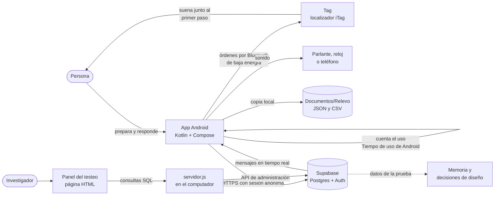
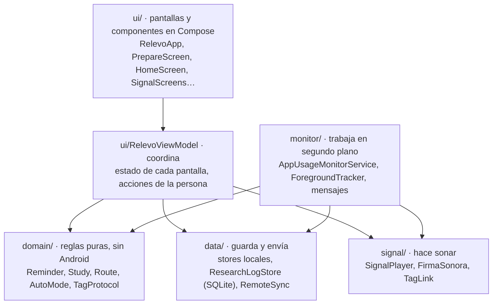
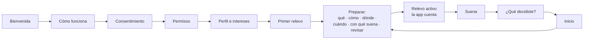
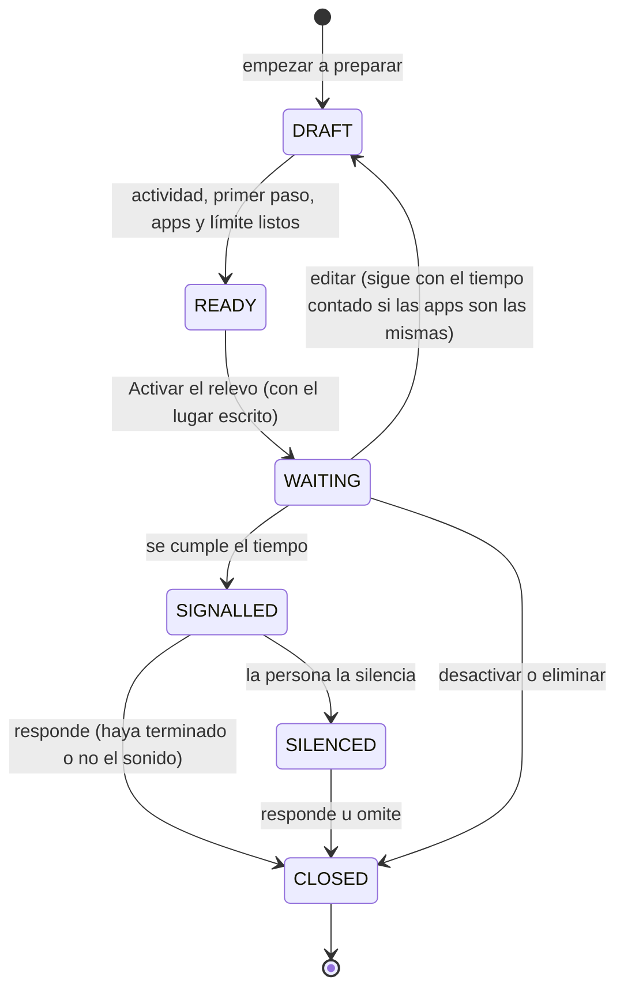

# Relevo como sistema: frontend, backend y proyecto

**Fecha:** 18 de octubre de 2026. **Versiones de referencia:** app Android 2.32, la que usa el testeo (rama `android-2.32`), y 3.2, la línea visual nueva (rama `main`). **Wireframes:** [lámina de las 39 pantallas](wireframes-relevo.html).

Este documento explica Relevo completo: qué es cada parte, cómo funciona, cómo se construyó y en qué se funda cada decisión. Sirve para el autor, para los profesores guía y para otra persona, o para otro Claude, que tenga que continuar el trabajo. Donde algo no se ha comprobado, se dice.

## Cómo leer este documento

Relevo no es solo una aplicación. Es un sistema *phygital*, es decir, físico y digital, con varias partes que trabajan juntas:

- **Frontend:** lo que la persona ve y toca. Aquí incluye la app Android, el objeto que suena (el Tag) y el panel que usa el investigador.
- **Backend:** lo que guarda, protege y mueve los datos detrás de la app. Es la base remota en Supabase, sus reglas de acceso y el servidor local del panel.
- **Proyecto:** la investigación que justifica el diseño, la prueba de 21 días que lo evalúa y la forma de trabajo con que se hizo.

Algunos términos técnicos se explican al primer uso. Los vocabularios de la app y de la memoria no siempre coinciden:

| En la app | En la memoria | Qué es |
| --- | --- | --- |
| Relevo | Ciclo | El periodo en que una intención y su condición están vigentes. |
| Tag | Localizador que sustituye al testigo | El llavero Bluetooth comercial que suena en el prototipo. |
| — | Testigo | El objeto propio que el proyecto propone y que aún no se construye. |
| Primer paso, «para empezar» | Primer paso | La acción breve con que comienza la actividad. |
| La señal | Pulso ambiental | El sonido de unos 30 segundos que se detiene solo. |

## 1. Qué es Relevo y por qué existe

Algunas sesiones de ocio digital se prolongan sin una nueva decisión de continuar, y otra actividad que la persona también quería hacer deja de estar presente cuando todavía podía empezarla. Relevo busca volver a hacer presente esa intención sin bloquear el teléfono ni juzgar lo que la persona decida después ([borrador v5 de la memoria](../../08_memoria/borrador-memoria-v5-2026-10-11.md)).

**Cómo funciona, en una frase.** La persona anota qué quiere hacer y con qué empieza, deja un objeto junto a ese comienzo y elige cuánto tiempo puede pasar en ciertas apps. Cuando lo cumple, el objeto suena desde ese lugar y ella decide qué hacer.

**La hipótesis** que el sistema pone a prueba es esta (D-091):

> Si se diseña un sistema *phygital* que vincula una actividad elegida con el lugar donde comienza, entonces la persona la recordará a tiempo durante el ocio digital, porque una intención se recupera cuando aparece una señal asociada a ella.

Cada parte del sistema existe para cumplir los ocho criterios de diseño de la memoria (capítulo 9). La Tabla 1 resume cómo los implementa el software.

**Tabla 1**

*Criterios de diseño y cómo los cumple el sistema*

| Criterio | Cómo lo implementa Relevo | Dónde |
| --- | --- | --- |
| 1. Partir de una intención propia | La persona escribe o elige la actividad; la app nunca la deduce del uso. | Paso «¿Qué quieres hacer?» |
| 2. Relacionarla con un primer paso | Un paso propio para el primer paso y otro para el lugar donde empieza. | Pasos 2 y 3 de «Preparar» |
| 3. Usar una condición comprensible | Tiempo acumulado en apps que la persona elige, de 1 minuto a 6 horas. | Paso «¿Cuándo suena?» y el servicio que cuenta |
| 4. Abrir una elección, no imponer | La señal termina sola; no bloquea; tres respuestas del mismo peso; sin puntos ni rachas. | Pantallas «Suena» y «¿Qué decidiste?» |
| 5. Saber cuándo no intervenir | Sin relevo activo, la app no hace nada; la activación automática viene apagada. | Inicio y «Avisos y resúmenes» |
| 6. Carga proporcional | Opciones de un toque, actividades guardadas, editar sin borrar. | Pasos de «Preparar» y «Tus actividades» |
| 7. Privacidad y convivencia | Código aleatorio, nombre aparte, borrado desde la app; señal de duración limitada. | «Tus datos» y la base remota |
| 8. Demostrar el valor de lo físico | La prueba compara el objeto junto al primer paso, en otro lugar y el teléfono. | Prueba de 21 días |

## 2. El sistema completo

**Figura 1**

*Partes de Relevo y cómo se comunican*



*Nota.* Elaboración propia. Las flechas punteadas no son conexiones técnicas: indican que los datos alimentan el análisis.

**Tabla 2**

*Componentes, tecnología y ubicación en el repositorio*

| Componente | Qué hace | Tecnología | Carpeta |
| --- | --- | --- | --- |
| App Android | Prepara relevos, cuenta el uso, hace sonar la señal y registra las respuestas. | Kotlin 2.3, Jetpack Compose, Android 12 o posterior | [`app-android/`](../app-android/) |
| Tag | Suena junto al primer paso y su botón calla la señal. | Localizador iTag comercial, Bluetooth de baja energía | Lo controla [`TagLink.kt`](../app-android/app/src/main/java/com/example/relevo/signal/TagLink.kt) |
| Base remota | Guarda sesiones, eventos, respuestas, uso y mensajes, con reglas por persona. | Supabase: Postgres, autenticación anónima, REST y tiempo real | Esquema inicial en [`base-remota-supabase.sql`](../app-android/base-remota-supabase.sql) |
| Panel del testeo | Muestra el estado de cada participante, resultados y mensajes. | Página HTML y JavaScript sin dependencias; servidor Node local | [`panel-admin/`](../panel-admin/) |
| Copia local | Respaldo legible en el teléfono, que la persona puede descargar. | Archivos JSON y CSV | Lo escribe [`ResearchBackup.kt`](../app-android/app/src/main/java/com/example/relevo/data/ResearchBackup.kt) |
| Herramientas de diseño | Íconos, láminas de la app, taller de auras y logo. | HTML autónomo | [`HERRAMIENTAS.md`](../../HERRAMIENTAS.md) |

## 3. En qué se funda

### 3.1 Fundamentos teóricos

El diseño se apoya en tres ámbitos del marco teórico de la memoria (capítulo 6):

- **Memoria prospectiva.** Recordar una intención futura es distinto de recordar el pasado: nadie la pide, y tiene que volver sola en el momento oportuno (McDaniel y Einstein, 2000). Según el marco multiproceso, cuando otra actividad absorbe la atención, la intención vuelve con más probabilidad ante una señal llamativa y muy asociada a la acción (Einstein y McDaniel, 2005). Los recordatorios que aluden a la ocasión y a la acción funcionan mejor que los que solo anuncian la ocasión (Guynn et al., 1998).
  - *En el sistema:* la señal debe asociarse a la actividad, por eso suena desde el lugar donde se empieza, y la persona prepara esa asociación antes.
- **El espacio como apoyo de la mente.** La disposición de los objetos simplifica recordar y decidir, como el rollo de película que se deja junto a la puerta (Kirsh, 1995). El lugar participa en recordar una acción futura (O’Rear y Radvansky, 2019).
  - *En el sistema:* el objeto se deja junto al primer paso y la app pregunta dónde se empieza, con lugares concretos, nunca habitaciones enteras.
- **Descargar una intención en el entorno.** Una nota o un objeto dispuesto son formas de descargar una intención (Gilbert et al., 2023), y el esfuerzo de prepararlas reduce su uso (Chiu y Gilbert, 2024).
  - *En el sistema:* cada paso de la preparación se justifica, con opciones de un toque y actividades guardadas.
- **Intenciones de implementación.** Precisar cuándo, dónde y cómo actuar ayuda a pasar de una meta a la acción (Gollwitzer y Sheeran, 2006).
  - *En el sistema:* se toma solo la precisión del comienzo, no el compromiso de cumplir.
- **Autonomía y gamificación.** Actuar por voluntad propia es una necesidad psicológica básica (Ryan y Deci, 2000). Mantener una racha puede volverse una meta en sí misma, y romperla reduce la conducta (Silverman y Barasch, 2023).
  - *En el sistema:* no hay puntos, niveles ni rachas; todas las respuestas pesan lo mismo y se pueden omitir.
- **Interacción tangible y tecnología calma.** La información digital puede tomar forma en objetos y medios ambientales (Ishii y Ullmer, 1997; Hornecker y Buur, 2006). Lo ideal es informar desde la periferia y pasar al centro solo cuando hace falta (Weiser y Brown, 1997).
  - *En el sistema:* la señal debe irrumpir en alguien absorto en una pantalla, así que dura unos 30 segundos, empieza suave y termina sola.
- **Phygital.** El término nombra sistemas cuyos recorridos pasan de lo físico a lo digital, que se evalúan como uno solo (Waggoner et al., 2026). El proyecto agrega una exigencia propia: probar si la parte física aporta algo frente a una solución solo digital.

### 3.2 Fundamentos técnicos

- **Por qué Android.** Android permite, con permiso de la persona, consultar cuánto se usan otras aplicaciones con `UsageStatsManager` (Google, 2026c). También permite comunicarse con un objeto cercano por Bluetooth de baja energía (Google, 2026a, 2026d).
  - Un sitio web podría hablar con el objeto mediante Web Bluetooth (Beaufort, 2015), pero no consultar el uso de otras apps.
  - En iPhone, esa consulta exige el permiso de Family Controls (Apple Developer, s. f.-b, s. f.-c).
  - Hacer las dos plataformas habría duplicado el trabajo antes de examinar la hipótesis.
- **Por qué Bluetooth de baja energía y no audio.** Entre el teléfono y el Tag viajan órdenes breves, no sonido. El audio de otras apps no puede salir por el objeto, y la señal no depende de qué esté sonando en el teléfono.
- **Por qué Supabase.** Ofrece una base Postgres con autenticación anónima, una API REST lista y reglas de acceso por fila. Así, cada teléfono guarda sus datos sin cuentas ni contraseñas, y solo puede leer o borrar lo suyo.
- **Por qué no un servidor propio.** Una persona sola sostiene el proyecto. Un servicio gestionado evita mantener un servidor, y el panel corre en el computador del investigador.

### 3.3 Fundamentos éticos

- **Consentimiento** antes de cualquier registro, en lenguaje claro y con la opción «No quiero participar» del mismo peso. La versión vigente es la v13, del 6 de octubre de 2026, revisada por los profesores guía según la memoria.
- **Seudonimización:** cada teléfono se identifica con un código aleatorio de 4 caracteres. El nombre se guarda en una tabla aparte. Los datos no son anónimos, porque actividades, lugares y horarios podrían identificar a alguien.
- **Sin patrones oscuros** (D-111): ninguna salida viene marcada de antemano, los botones de aceptar y rechazar pesan lo mismo y la señal no insiste.
- **Borrado** desde la app, local y remoto. Si nadie lo pide antes, los datos se eliminan el 30 de diciembre de 2026.
- **Visibilidad:** mientras Relevo cuenta, Android muestra una notificación permanente. La observación nunca es silenciosa.

## 4. Frontend: la app Android

### 4.1 Tecnologías

**Tabla 3**

*Tecnologías de la app*

| Pieza | Versión | Para qué |
| --- | --- | --- |
| Kotlin | 2.3.20 | Lenguaje de toda la app. |
| Jetpack Compose (BOM 2026.03.01) y Material 3 | — | Interfaz declarativa: cada pantalla es una función que dibuja el estado. |
| Android Gradle Plugin | 9.0.1 | Compilación; versión optimizada con R8 desde la 2.28. |
| SDK | mínimo 31 (Android 12), objetivo y compilación 36 | Las funciones de Tiempo de uso y Bluetooth que se usan existen desde Android 12. |
| Lifecycle y ViewModel | 2.10.0 | Estado que sobrevive a rotaciones y cierres de pantalla. |
| Coroutines | 1.10.2 | Tareas en segundo plano sin bloquear la pantalla. |
| OkHttp | 4.12.0 | Conexión WebSocket para los mensajes en tiempo real. |
| Haze | 1.6.10 | Desenfoque tipo vidrio en la barra de pestañas y las hojas. |
| JUnit | 4.13.2 | Pruebas unitarias. |

La app no usa bibliotecas de Supabase: habla con su API REST mediante `HttpURLConnection`, que ya trae Android. Así tiene menos dependencias y se controla exactamente qué datos salen.

### 4.2 Arquitectura en capas

La app separa lo que se ve de las reglas y de los datos. Cada capa solo conoce a la de abajo.

**Figura 2**

*Capas de la app y sus carpetas*



*Nota.* Elaboración propia a partir del código de la app.

- **`domain/`** contiene las reglas sin depender de Android, para poder probarlas solas. Ejemplos: los estados de un relevo, el calendario de la prueba de 21 días, la ruta de pasos y el protocolo del Tag.
- **`data/`** guarda el estado en el teléfono:
  - Ajustes, perfil, ruta, relevo y Tag, en archivos de preferencias.
  - El registro de investigación, en una base SQLite.
  - El envío a Supabase.
- **`monitor/`** contiene el servicio que sigue funcionando con la app cerrada. Cuenta el uso, entrega la señal, escucha los mensajes del proyecto y se reanuda tras reiniciar el teléfono.
- **`signal/`** produce el sonido en el teléfono, el parlante o el reloj, y controla el Tag.
- **`ui/`** dibuja las pantallas. Un solo `RelevoViewModel` reúne el estado y las acciones, para que todas las pantallas vean lo mismo.

### 4.3 Navegación y pantallas

La navegación es una pila propia: cada pantalla es un valor de `Route` y volver la saca de la pila ([`RelevoApp.kt`](../app-android/app/src/main/java/com/example/relevo/ui/RelevoApp.kt)). Hay cinco grupos de pantallas, que la [lámina de wireframes](wireframes-relevo.html) muestra completos:

1. **Primera vez:** bienvenida, video, cómo funciona, aviso semanal, consentimiento, permisos, nombre, emoji, intereses y primer relevo guiado.
2. **Preparar:** seis pasos (qué, cómo se empieza, dónde, cuándo suena, dónde suena y revisión) y la guía del Tag.
3. **Contar, sonar y decidir:** relevo activo, señal y preguntas.
4. **Pestañas:** Inicio, Ruta y Perfil.
5. **Perfil:** historial, actividades, avisos, apariencia, permisos, datos, opinión, reportes y la configuración de la prueba.

**Figura 3**

*Recorrido principal*



### 4.4 El ciclo de un relevo

Un relevo pasa por seis estados (`ReminderStatus`):

**Figura 4**

*Estados de un relevo*



*Nota.* Elaboración propia a partir de [`Reminder.kt`](../app-android/app/src/main/java/com/example/relevo/domain/Reminder.kt).

Cada relevo tiene un identificador de sesión. Queda asociado al día y a la condición de la semana en que se activó (D-079, D-112), a la salida elegida, a la versión de la app y a si se activó a mano o solo.

### 4.5 Cómo cuenta el tiempo

1. Al activar el relevo, la app inicia un **servicio en primer plano**: un proceso que Android no cierra mientras muestra una notificación visible («Relevo está contando tu tiempo…»).
2. Cada segundo, el servicio lee los eventos de **Tiempo de uso** de Android (`UsageStatsManager`): qué app se abrió, cuál se pausó y cuándo se apagó la pantalla.
3. `ForegroundTracker` reconstruye con esos eventos qué app está en primer plano y suma el tiempo solo si es una de las elegidas. Al empezar revisa 15 minutos hacia atrás, para saber qué app ya estaba abierta.
4. El avance se guarda en cada vuelta. Si el teléfono se reinicia o la app se actualiza, `RestoreMonitorReceiver` reanuda el conteo.
5. Si la persona quita el permiso de Tiempo de uso, el conteo se pausa y aparece un aviso para reactivarlo. No se cuenta a ciegas.
6. Al llegar al límite, el servicio entrega la señal. Guarda además cuánto se usaron las apps elegidas en los 10 minutos anteriores y posteriores (`UsageWindow`), para la prueba.

La app solo conoce el nombre de la app en primer plano y su tiempo, nunca lo que pasa dentro de ella.

### 4.6 Cómo suena

`SignalPlayer` dirige la señal a la salida elegida y **nunca la cambia sin avisar**. Si la salida no responde, el teléfono vibra, aparece una notificación y la señal queda registrada como fallida.

- **Teléfono y parlante.** Suena la firma sonora de Relevo (`FirmaSonora`): dos golpes de timbre de madera en descenso, de 587 a 440 Hz, que duran 2,2 s. La señal la repite siete veces, cada 4,4 s, durante unos 30 s. Las tres primeras van al 40, 60 y 80 % del volumen, para no sobresaltar (D-071, D-078).
- **Reloj.** La señal viaja como audio de llamada hacia un reloj que contesta llamadas por Bluetooth. Es una salida experimental, sin probar con un reloj real (D-093).
- **Tag.** La app le escribe por Bluetooth la orden de alerta y la repite cada segundo durante 30 s, o hasta que se aprieta el botón del Tag (D-109, D-116).
  - El Tag solo tiene su propio pitido, continuo y de volumen fijo. Es un límite del prototipo, no la señal diseñada.
- **Siempre**, al empezar la señal el teléfono vibra una vez y muestra una notificación.

### 4.7 El Tag por dentro

El Tag es un localizador iTag comercial con pila CR2032 y un botón. `TagLink` lo controla con el protocolo que se verificó en código abierto y en el registro de la prueba ([`TagProtocol.kt`](../app-android/app/src/main/java/com/example/relevo/domain/TagProtocol.kt)).

**Tabla 4**

*Servicios Bluetooth del Tag que usa la app*

| Servicio (código) | Característica | Uso en Relevo |
| --- | --- | --- |
| Alerta inmediata (0x1802) | Nivel de alerta (0x2A06) | Encender (nivel 1 o 2) y apagar (0) el pitido. |
| Propio del fabricante (0xFFE0) | FFE1 | Avisa cuando se aprieta el botón: calla la señal. |
| Propio del fabricante (0xFFE0) | FFE2 | Según el modelo, hace pitar o activa la alarma por desconexión; se pone en 1 solo mientras suena. |
| Pérdida de enlace (0x1803) | Nivel de alerta (0x2A06) | Alarma por desconexión; se deja en 0. |
| Batería (0x180F) | Nivel de batería (0x2A19) | Carga de la pila, que la app muestra y registra. |

**Cómo se conecta.**

1. Busca el Tag guardado, primero con filtro y luego sin él, porque así Android aprende qué tipo de dirección usa.
2. Se conecta y pide una conexión rápida.
3. Descubre los servicios del Tag.
4. Lo primero que hace es apagar la alarma por desconexión y la alerta.
5. Después activa el aviso del botón y lee la pila.

**Mientras el relevo espera,** mantiene la conexión abierta y la reabre cada 30 s si se corta, como hace la app del fabricante. Así el Tag no se apaga por falta de conexión.

**Lo que se aprendió con el Tag real** cambió el código varias veces:

**Tabla 5**

*Versiones de la app que cambiaron el control del Tag*

| Versión | Problema observado | Cambio |
| --- | --- | --- |
| 2.26 | El Tag aceptaba la orden, pero no pitaba. | La prueba pregunta si se escuchó; ya no se apaga FFE2 a ciegas. |
| 2.27 | Pitaba en la prueba y no en la señal. | FFE2 en 1 junto con la alerta; pitido continuo con la orden repetida. |
| 2.29 | El nivel alto no pitaba; el medio sí. | La prueba empieza por el nivel medio. |
| 2.31 | Siguió pitando tras la prueba y luego sonó sin parar. | Callarlo con confirmación; desconexión que espera a Android; lectura de la pila (D-136). |
| 2.32 | Tras mucho tiempo sin uso, sonaba lento y sin parar hasta reiniciarlo. | Nunca cortar la conexión con la alarma por desconexión encendida; más paciencia con un Tag lento (D-137). |

La lección general es que **aceptar una orden no prueba que el objeto haya sonado**. Por eso la prueba de sonido pregunta a la persona, y el registro guarda cuánto tardó el Tag en responder y cómo quedó al callarlo.

### 4.8 Datos en el teléfono

- **Preferencias** (archivos XML privados de la app): el relevo en curso y el último, el perfil, la ruta, las actividades propias, los ajustes, la prueba, el Tag elegido y el estado del envío.
- **Base SQLite** `relevo_research.db`, con cinco tablas:
  - `sessions`: cada relevo, con sus datos y su resultado.
  - `events`: los momentos de cada relevo, como activarlo, entrar y salir de las apps, la señal y la respuesta.
  - `answers`: las respuestas.
  - `app_events`: el uso de la propia app, por ejemplo las pantallas y la prueba de sonido.
  - `daily_usage`: el uso diario de las apps elegidas y el tiempo total de pantalla.
- **Copia legible** en `Documentos/Relevo`: un JSON con todo y dos CSV, de relevos y de respuestas. Se reescribe en cada intento de envío y se borra con «Borrar mis datos».

### 4.9 Funciones de continuidad

| Función | Qué hace | Cómo respeta los criterios |
| --- | --- | --- |
| Ruta | Pasos pequeños por interés. Tras tres respuestas «Comencé», ofrece el siguiente. | No hay puntos; el paso siguiente es una oferta. La memoria advierte que contar comienzos se acerca a calificar el cumplimiento. |
| Tus actividades | Guarda actividades propias para preparar en un toque. | Reduce la carga (criterio 6). |
| Editar un relevo activo | Cambia lo elegido sin borrarlo y conserva el tiempo contado si las apps son las mismas (D-120). | Lo pidió una participante. |
| Activación automática | Repite el último relevo al abrir una de sus apps, con 30 minutos de pausa (D-095). | Viene apagada; registra cómo se activó cada relevo. |
| Aviso semanal | Avisa una vez tras una semana sin abrir la app. | Apagado salvo que la persona lo pida. |
| Mensajes del proyecto | El investigador escribe a una persona o a todas (D-096). | Sirve para coordinar; la app registra la llegada y la apertura. |
| Resumen semanal | Lo preparado en la semana, en el perfil. | Se puede apagar. |

### 4.10 Sistema visual

La app tuvo dos líneas visuales sobre las mismas pantallas, decisiones y datos:

- **Línea 2.x (la del testeo, hasta la 2.32):**
  - Marca D-073: letra Schibsted Grotesk.
  - Vidrio, cápsulas y emoji (D-083), y frases claras sin mayúsculas sostenidas (D-084).
  - Íconos con degradado por actividad (D-111, D-113).
  - Desde la 2.31, el ícono de la app y el logotipo de la línea nueva.
- **Línea 3.x (`main`):**
  - Instrument Sans, 72 íconos propios y la paleta 2, con un papel por color (D-124).
  - Siete familias de cielos para las actividades (D-126) y el aura de la pantalla (D-121).
  - El logo de cuatro luces (D-125, D-127).
  - La 3.2 sigue medida por medida la lámina [«Relevo, la app»](../../10_recursos_visuales/rediseno-app-2026-10-11/relevo-la-app.html) (D-131).
  - No conviene instalarla a mitad de la prueba de 21 días.

Los colores se fundan por familia y función, no por asociaciones emocionales (Jonauskaite et al., 2024; International Organization for Standardization [ISO], 2011). El color nunca va solo: lo acompañan un ícono y una palabra, como pide la norma de accesibilidad WCAG 2.2 (World Wide Web Consortium, 2024).

## 5. Backend: datos remotos y panel

### 5.1 Supabase y la sesión anónima

Supabase es un servicio que reúne una base de datos Postgres, autenticación y una API REST generada a partir de las tablas.

1. Cuando la persona acepta participar, la app abre una **sesión anónima**: pide a Supabase un usuario nuevo sin correo ni contraseña.
2. Recibe un identificador (`user_id`) y un token que se renueva solo.
3. Cada fila que envía lleva ese `user_id`.

Sin participar, la app no abre ninguna sesión.

La app usa la **clave publicable** del proyecto, que puede ir en una app instalada porque por sí sola no da acceso a los datos de nadie. La clave de servicio, que lo permite todo, nunca está en la app ni en el repositorio.

### 5.2 Tablas

**Tabla 6**

*Tablas de la base remota*

| Tabla | Qué guarda | Columnas principales |
| --- | --- | --- |
| `relevo_sessions` | Cada relevo. | Actividad, primer paso, lugar, apps, límite, condición y día de la prueba, salida, si sonó, respuesta, segundos hasta responder, uso antes y después, versión, forma de activación. |
| `relevo_events` | Momentos de cada relevo. | Tipo de evento (`armed`, `target_entered`, `signal_emitted`, `responded`…), app y segundos. |
| `relevo_answers` | Respuestas a las preguntas. | Pregunta, respuesta y relevo. |
| `relevo_app_events` | Uso de la propia app. | Evento (pantalla, prueba de sonido, perfil del Tag…), detalle y versión. |
| `relevo_daily_usage` | Uso diario. | Día, app elegida o `_total`, segundos y aperturas. |
| `relevo_participant_state` | Estado del teléfono, en una fila por persona. | Permisos, modelo, ajustes, ruta y relevo actual, en formato JSON. |
| `relevo_participants` | El nombre, aparte. | Código y nombre. |
| `relevo_messages` y `relevo_message_receipts` | Mensajes del proyecto y su recepción. | Destinatario, título, texto, llegada y apertura. |

El esquema **`analisis`** tiene vistas listas para leer: `relevos`, `respuestas`, `resumen_por_condicion`, `uso`, `resumen_de_uso` y `participantes`. Se crearon para no escribir consultas largas cada vez.

El esquema empezó el 22 de septiembre de 2026 (`create_relevo_evaluation_schema`) y suma 16 migraciones. Quince acompañan versiones de la app, por ejemplo la prueba de 21 días, el nombre aparte, la salida del reloj, los mensajes en tiempo real y el llavero; la otra, `deck_remote`, sirve a una presentación y no a la app.

### 5.3 Seguridad: cada persona ve solo lo suyo

Todas las tablas `relevo_*` tienen activada la **seguridad por fila** (RLS, *row level security*): la base revisa cada consulta con una regla.

- **Datos de la persona:** solo puede leerlos, insertarlos, actualizarlos o borrarlos un usuario autenticado cuyo `auth.uid()` coincida con el `user_id` de la fila.
- **Mensajes:** cada teléfono lee los generales y los dirigidos a él.

Por eso un teléfono nunca puede leer los datos de otro, ni siquiera con la clave publicable. El panel no usa esa vía: entra con un token personal de administración, que vive solo en el computador del investigador.

### 5.4 Cómo se envían los datos

`RemoteSync` trabaja como una cola:

1. Cada registro nace en SQLite como **pendiente**.
2. Se envía al activar un relevo, al sonar, al cerrar la app y cada 15 minutos mientras el servicio cuenta. El estado del teléfono y el uso diario se envían cada 30 minutos como máximo.
3. Si la base acepta la fila, queda **enviada**.
4. Si la rechaza de forma definitiva (error 4xx), queda **rechazada** y la cola sigue; antes, una sola fila mala detenía todo.
5. Si falla la red o el servidor, el envío se detiene y se reintenta después.

**Borrar mis datos** primero borra en la base remota. Si no puede, la app deja de guardar datos y conserva los del teléfono para intentarlo otra vez. En el emulador, el borrado se comprobó en las dos copias; en un teléfono real, no consta.

### 5.5 Mensajes en tiempo real

Mientras el servicio cuenta o espera, `MessageStream` mantiene una conexión WebSocket con el canal de tiempo real de Supabase. Cuando el investigador inserta un mensaje, el teléfono lo recibe en menos de un segundo; en el emulador se midieron 0,8 s.

Como respaldo, la app revisa los mensajes al abrirse, cada 60 segundos mientras el servicio corre y cada 15 minutos con una tarea programada de Android. Con la app cerrada del todo, un aviso instantáneo exigiría Firebase Cloud Messaging, que no se implementó.

### 5.6 El panel del testeo

El panel es una página HTML ([`panel-relevo.html`](../panel-admin/panel-relevo.html)) con cuatro pestañas:

1. **Ahora:** qué pasa en este momento y a quién hay que escribirle.
2. **Participantes:** la ficha completa de cada persona, con su uso del teléfono, relevos, respuestas, ajustes y prueba.
3. **Respuestas:** resultados por condición y por día.
4. **Mensajes:** enviar avisos y ver si llegaron.

También permite borrar datos en dos clics y descargar los de una persona ([guía del panel](../panel-admin/README.md)).

Desde D-133 funciona fuera de claude.ai:

- **Con doble clic,** muestra datos de ejemplo inventados (`datos-de-ejemplo.js`).
- **Con `node servidor.js`,** un servidor sin dependencias escucha solo en el computador, en `127.0.0.1:8765`:
  - Exige una clave que cambia en cada arranque.
  - Reenvía cada consulta a la API de administración de Supabase con el token guardado en `.env.local`, un archivo que Git ignora.
- Ningún dato real se guarda en el repositorio.

### 5.7 Qué sale del teléfono y qué no

| Sale, con consentimiento | No sale |
| --- | --- |
| Actividad, primer paso y lugar declarados; apps elegidas y su tiempo; eventos y respuestas; uso diario de las apps elegidas y tiempo total de pantalla; estado del teléfono y permisos; uso de la propia app; descripción técnica del Tag sin su dirección; nombre, en una tabla aparte. | Lo que pasa dentro de otras apps; nombres de apps no elegidas; la dirección Bluetooth del Tag; fotos, contactos o ubicación. |

## 6. Cómo se desarrolló

### 6.1 Método

El proyecto sigue la **investigación a través del diseño**: el diseño integra resultados de investigación en un artefacto, y ese trabajo constituye un aporte (Zimmerman et al., 2007). El prototipo se construyó por iteraciones cortas, cada una motivada por un aprendizaje.

**Tabla 7**

*Hitos del desarrollo, de septiembre a octubre de 2026*

| Fecha | Versión | Qué se agregó |
| --- | --- | --- |
| 21–24 sep. | 1.2–2.6 | Preparar, contar una o varias apps y sonar en un parlante o el teléfono; base remota; borrado. |
| 25 sep. | 2.7 | Señal de unos 30 s que termina sola; condición por semana; preguntas tras cada señal. |
| 26–29 sep. | 2.8–2.14 | Marca D-073, perfil y ruta; vidrio y emoji; participación obligatoria; guía de la primera vez; registro de uso de la app. |
| 30 sep. | 2.15–2.18 | Reloj como salida; activación automática; mensajes en tiempo real; uso diario y estado del teléfono. |
| 5–7 oct. | 2.19–2.29 | Tag como salida y por defecto; semanas A, B y C; opciones de un toque; la prueba pregunta si se escuchó; versión optimizada. |
| 9 oct. | 2.30 | Editar un relevo activo sin borrarlo. Es la versión con que empezó el testeo. |
| 12 oct. | 3.0–3.2 | Línea visual nueva, sin cambiar datos ni lógica. |
| 14 y 17 oct. | 2.31–2.32 | El Tag se calla siempre, muestra su pila y no se corta con la alarma encendida. |

El detalle de cada versión está en sus documentos `version-*.md` de [`app-android/`](../app-android/).

### 6.2 El ciclo de cada cambio

**Figura 5**

*Cómo se hace cada versión*

```mermaid
flowchart LR
  A[Pedido del autor<br/>o reporte de uso] --> B[Registro el mismo día<br/>registro-de-pedidos]
  B --> C[Revisar datos y código<br/>Supabase, registro, fuentes]
  C --> D[Cambiar el código]
  D --> E[Pruebas unitarias<br/>y compilación limpia]
  E --> F[Emulador sin conexión<br/>con respaldo y MD5]
  F --> G[APK firmado<br/>en releases/ con SHA-256]
  G --> H[Documento de versión,<br/>decisión D-xxx, índices]
  H --> I[Commit y push<br/>a la rama y a main]
```



*Nota.* Elaboración propia. Las reglas están en [`CLAUDE.md`](../../CLAUDE.md).

### 6.3 Uso de inteligencia artificial

La app, la base remota, el panel y buena parte de la documentación se programaron y redactaron con Claude Code, desde fines de septiembre de 2026. Antes se usaron otras herramientas, que la memoria tiene por confirmar.

El autor define el problema y los criterios, revisa cada versión en su teléfono o en las láminas, corrige el rumbo y decide. Cada pedido y su resultado quedan anotados el mismo día en el [registro de pedidos](../../00_gobernanza/registro-de-pedidos-a-la-ia.md), y cada decisión de fondo en el [registro de decisiones](../../09_decisiones/registro-de-decisiones.md).

### 6.4 Cómo se verifica

- **Pruebas unitarias:** 86, en 14 archivos. Cubren las reglas puras: estados del relevo, calendario de la prueba, ruta, activación automática, protocolo del Tag, conteo en primer plano, ventana de uso, uso diario, aviso semanal, firma sonora, código de participante y frases de la interfaz.
- **Emulador** (Android 16), con un protocolo fijo:
  1. Respaldar los datos del autor y activar el modo avión, para no enviar datos de prueba a Supabase.
  2. Probar con un perfil limpio.
  3. Restaurar los datos y comprobar con sumas MD5 que quedaron idénticos.
- **Teléfono real:** el autor probó el Tag el 7 de octubre. La participante usa la app desde el 8 de octubre, y su registro en Supabase sirvió para diagnosticar los problemas del Tag (versiones 2.31 y 2.32).
- **Lo que no se puede probar en el emulador:** el emulador no tiene Bluetooth. La conexión real con el Tag, la reconexión y la lectura de la pila solo se ven en un teléfono.

### 6.5 Versiones y distribución

- **Identificador:** `cl.udp.relevo`.
- **Firma:** todas las versiones se firman con la misma clave, así que cada una se instala encima de la anterior sin perder datos.
- **Versión optimizada:** desde la 2.28 se entrega una versión *release*, reducida con R8: el APK pesa 12 MB y antes pesaba 41 MB.
- **Número de versión:** el `versionCode` solo sube. La 2.32 usa el 47, así que la próxima 3.x debe usar el 48 o más.
- **Ramas:**
  - `android-2.7` se publica también como `main` y contiene la línea 3.x.
  - `android-2.31` y `android-2.32` salen de la 2.30 para el testeo.
- **Entregables:** cada APK queda en [`releases/`](../app-android/releases/), con su SHA-256 en su README.

## 7. Cómo se hace: reproducir el sistema

1. **Compilar la app** (Windows, desde PowerShell, en `06_desarrollo_y_factibilidad/app-android`):

   ```powershell
   $env:JAVA_HOME='C:\Program Files\Android\Android Studio\jbr'
   $env:ANDROID_HOME='D:\AndroidSdk'
   $env:RELEVO_BUILD_DIR='D:\AndroidBuild'
   .\gradlew.bat clean :app:testDebugUnitTest :app:assembleDebug :app:assembleRelease --no-configuration-cache
   ```

   En macOS basta con abrir la carpeta en Android Studio ([guía](../app-android/ABRIR-EN-MAC.md)).
2. **Conectar la base remota:**
   - Crear un proyecto en Supabase y activar los usuarios anónimos.
   - Aplicar [`base-remota-supabase.sql`](../app-android/base-remota-supabase.sql) y las migraciones posteriores.
   - Copiar `local.properties.example` como `local.properties`, con la URL y la clave publicable.
   - Sin esto, la app funciona igual, pero solo guarda en el teléfono.
3. **Instalar** el APK en un teléfono con Android 12 o posterior.
4. **Abrir el panel:** doble clic en `panel-relevo.html` muestra datos de ejemplo. Con datos reales, se pone el token en `panel-admin/.env.local` y se ejecuta `node servidor.js` ([HERRAMIENTAS.md](../../HERRAMIENTAS.md)).
5. **Regenerar los wireframes:** en `generador/`, editar las pantallas en `pantallas.js` y ejecutar `node exportar.js` y `node generar-lamina.js`. Se necesita Google Chrome.

## 8. La prueba de 21 días dentro del sistema

La prueba ([protocolo 02](../../07_validacion/protocolo-02-prueba-21-dias.md)) es la razón de varias piezas del software:

- **Tres condiciones**, una por semana:
  - A: el objeto junto al primer paso.
  - B: el objeto en un lugar neutro.
  - C: el teléfono con una notificación genérica.
- **Orden de las condiciones:** se asigna con una de las seis secuencias posibles. El investigador la configura en una pantalla oculta del perfil.
- **Preguntas tras cada señal**, de un toque y omitibles:
  - «¿Supiste qué querías hacer antes de leerlo en la pantalla?»
  - «¿Recordaste cómo empezar?»
  - «¿Qué decidiste?»
- **Tarjeta semanal y cierre** con escalas de 1 a 5.
- **Del teléfono al análisis:** las respuestas llegan a `relevo_sessions` y `relevo_answers`, el panel las agrupa por condición y la memoria las analiza.

Con una sola persona, la prueba informa sobre la asociación y el funcionamiento, no sobre la comparación entre condiciones (memoria, capítulo 13).

## 9. Límites y pendientes

- **Tag:** el control de la 2.31 y la 2.32 no se probó con el Tag real después de horas sin uso. Su volumen es fijo y su botón también lo apaga. Son requisitos pendientes para el testigo propio.
- **Testigo propio:** no se ha construido. Se estudiaron la micro:bit V2, la XIAO nRF52840 y BleenyButton (memoria, capítulo 12).
- **Teléfono real:** faltan el borrado sin conexión, la letra grande y TalkBack, la línea 3.x y el reloj.
- **Notificación de la señal:** nombra la actividad y dice «Empieza por…», una instrucción que el diseño de la señal excluye (memoria, capítulo 11).
- **Datos:** dependen de que el teléfono los envíe. Un teléfono sin conexión se ve desactualizado en el panel.
- **Accesibilidad:** la señal es solo sonora y excluye a personas con baja audición.

## 10. Wireframes

La [lámina de wireframes](wireframes-relevo.html) reúne las 39 pantallas de la 2.32 en muy baja fidelidad, agrupadas por recorrido y con una nota sobre para qué sirve cada una.

**Archivos:**

- **Por pantalla:** cada una está en PNG a 3× (1176 × 2436 px) en [`wireframes-png/`](wireframes-png/), lista para imprimir o insertar en la memoria.
- **Por recorrido:** [`wireframes-png/hojas/`](wireframes-png/hojas/) tiene una hoja para cada uno, con el título y la nota de cada pantalla.

**Cómo se hicieron.**

1. Cada pantalla se recorrió en el emulador con un perfil de prueba y sin conexión. Se guardaron sus textos y el árbol de sus elementos, que queda en [`generador/arbol/`](generador/arbol/) como referencia.
2. Cada pantalla se escribió en [`pantallas.js`](generador/pantallas.js) como una lista de piezas, con los textos reales: título, párrafo, campo, opciones, filas, botón principal, etc.
3. [`wireframes.html`](generador/wireframes.html) dibuja todas con las mismas piezas sobre una retícula de 360 × 780, de modo que nada se superpone.
4. [`exportar.js`](generador/exportar.js) las exporta a PNG con Chrome.

Así los wireframes muestran la estructura real de la app, sin color, fotos ni marca. Los datos de ejemplo («Nombre», «XXXX») no son de ninguna persona.

## Referencias

Apple Developer. (s. f.-b). *Device Activity*. Recuperado el 25 de agosto de 2026, de https://developer.apple.com/documentation/deviceactivity

Apple Developer. (s. f.-c). *Family Controls App and Website Usage*. Recuperado el 25 de agosto de 2026, de https://developer.apple.com/documentation/bundleresources/entitlements/com.apple.developer.family-controls.app-and-website-usage

Beaufort, F. (2015, 21 de julio). *Communicating with Bluetooth devices over JavaScript*. Chrome for Developers. https://developer.chrome.com/docs/capabilities/bluetooth

Chiu, G. y Gilbert, S. J. (2024). Influence of the physical effort of reminder-setting on strategic offloading of delayed intentions. *Quarterly Journal of Experimental Psychology, 77*(6), 1295–1311. https://doi.org/10.1177/17470218231199977

Einstein, G. O. y McDaniel, M. A. (2005). Prospective memory: Multiple retrieval processes. *Current Directions in Psychological Science, 14*(6), 286–290. https://doi.org/10.1111/j.0963-7214.2005.00382.x

Gilbert, S. J., Boldt, A., Sachdeva, C., Scarampi, C. y Tsai, P.-C. (2023). Outsourcing memory to external tools: A review of “intention offloading”. *Psychonomic Bulletin & Review, 30*(1), 60–76. https://doi.org/10.3758/s13423-022-02139-4

Gollwitzer, P. M. y Sheeran, P. (2006). Implementation intentions and goal achievement: A meta-analysis of effects and processes. *Advances in Experimental Social Psychology, 38*, 69–119. https://doi.org/10.1016/S0065-2601(06)38002-1

Google. (2026a, 26 de febrero). *Communicate in the background*. Android Developers. https://developer.android.com/develop/connectivity/bluetooth/ble/background

Google. (2026c, 28 de agosto). *UsageStatsManager*. Android Developers. https://developer.android.com/reference/android/app/usage/UsageStatsManager

Google. (2026d, 1 de octubre). *Companion device pairing*. Android Developers. https://developer.android.com/develop/connectivity/bluetooth/companion-device-pairing

Guynn, M. J., McDaniel, M. A. y Einstein, G. O. (1998). Prospective memory: When reminders fail. *Memory & Cognition, 26*(2), 287–298. https://doi.org/10.3758/BF03201140

Hornecker, E. y Buur, J. (2006). Getting a grip on tangible interaction: A framework on physical space and social interaction. En *Proceedings of the SIGCHI Conference on Human Factors in Computing Systems* (pp. 437–446). Association for Computing Machinery. https://doi.org/10.1145/1124772.1124838

International Organization for Standardization. (2011). *Graphical symbols — Safety colours and safety signs — Part 1: Design principles for safety signs and safety markings* (ISO 3864-1:2011).

Ishii, H. y Ullmer, B. (1997). Tangible bits: Towards seamless interfaces between people, bits and atoms. En *Proceedings of the ACM SIGCHI Conference on Human Factors in Computing Systems* (pp. 234–241). Association for Computing Machinery. https://doi.org/10.1145/258549.258715

Jonauskaite, D., Epicoco, D., Al-Rasheed, A. S., Aruta, J. J. B. R., Bogushevskaya, V., Brederoo, S. G., Corona, V., Fomins, S., Gizdic, A., Griber, Y. A., Havelka, J., Hirnstein, M., John, G., Jopp, D. S., Karlsson, B., Konstantinou, N., Laurent, É., Marquardt, L., Mefoh, P. C., … Mohr, C. (2024). A comparative analysis of colour–emotion associations in 16–88-year-old adults from 31 countries. *British Journal of Psychology, 115*(2), 275–305. https://doi.org/10.1111/bjop.12687

Kirsh, D. (1995). The intelligent use of space. *Artificial Intelligence, 73*(1–2), 31–68. https://doi.org/10.1016/0004-3702(94)00017-U

McDaniel, M. A. y Einstein, G. O. (2000). Strategic and automatic processes in prospective memory retrieval: A multiprocess framework. *Applied Cognitive Psychology, 14*(7), S127–S144. https://doi.org/10.1002/acp.775

O’Rear, A. E. y Radvansky, G. A. (2019). Location-based prospective memory. *Quarterly Journal of Experimental Psychology, 72*(3), 491–507. https://doi.org/10.1177/1747021818758608

Ryan, R. M. y Deci, E. L. (2000). Self-determination theory and the facilitation of intrinsic motivation, social development, and well-being. *American Psychologist, 55*(1), 68–78. https://doi.org/10.1037/0003-066X.55.1.68

Silverman, J. y Barasch, A. (2023). On or off track: How (broken) streaks affect consumer decisions. *Journal of Consumer Research, 49*(6), 1095–1117. https://doi.org/10.1093/jcr/ucac029

Waggoner, J., Lucky, S., Redick, S., Rizki, A. y Yu, J. (2026). Going beyond digital libraries: A literature review of phygital user experience research methods. *International Journal on Digital Libraries, 27*(1), Artículo 1. https://doi.org/10.1007/s00799-025-00436-6

Weiser, M. y Brown, J. S. (1997). The coming age of calm technology. En P. J. Denning y R. M. Metcalfe (Eds.), *Beyond calculation: The next fifty years of computing* (pp. 75–85). Copernicus. https://doi.org/10.1007/978-1-4612-0685-9_6

World Wide Web Consortium. (2024, 12 de diciembre). *Web content accessibility guidelines (WCAG) 2.2*. https://www.w3.org/TR/2024/REC-WCAG22-20241212/

Zimmerman, J., Forlizzi, J. y Evenson, S. (2007). Research through design as a method for interaction design research in HCI. En *Proceedings of the SIGCHI Conference on Human Factors in Computing Systems* (pp. 493–502). Association for Computing Machinery. https://doi.org/10.1145/1240624.1240704

*Nota.* Las letras de Apple Developer y de Google conservan las de la lista de referencias de la memoria v5, para que las citas coincidan con ella.

## Registro de cambios (disclaimer)

### 2026-10-20 — Wireframes rehechos

- **Qué cambió:** los wireframes se dibujan pieza por pieza sobre una retícula común y se entregan en PNG por pantalla y por recorrido.
- **Cómo estaba antes:** se generaban automáticamente desde el árbol de cada pantalla, en SVG, y quedaban con elementos superpuestos y textos cortados.
- **Por qué:** el autor pidió hacerlos bien y en PNG.

### 2026-10-18 — Creación

- **Qué se añadió:** un documento que explica Relevo como sistema y como proyecto: frontend (app, Tag y panel), backend (Supabase, reglas de acceso, envío y servidor del panel), fundamentos teóricos, técnicos y éticos, desarrollo, verificación, reproducción, límites, y 39 wireframes de muy baja fidelidad con su generador.
- **Cómo estaba antes:** la información estaba repartida entre los documentos de cada versión, el README de la app, el del panel, la memoria y HERRAMIENTAS.md, y no había wireframes de la app actual.
- **Por qué:** pedido del autor del 18 de octubre de 2026.
