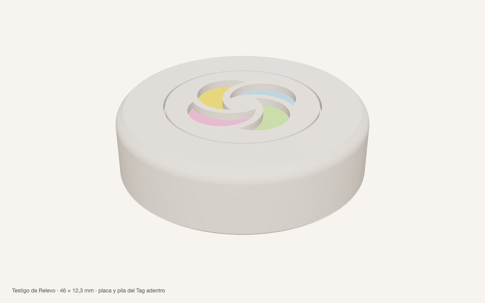
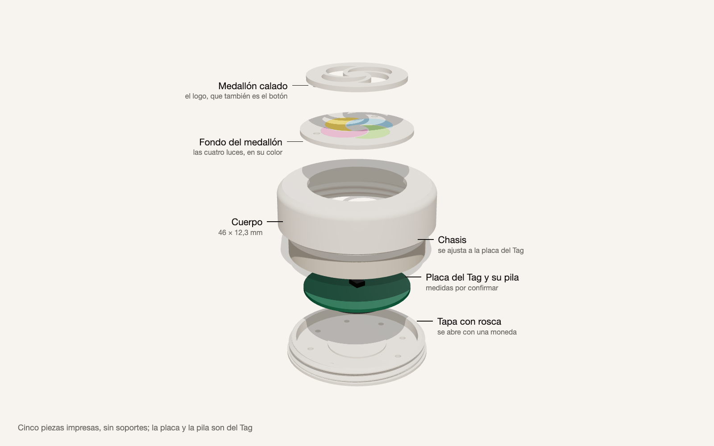
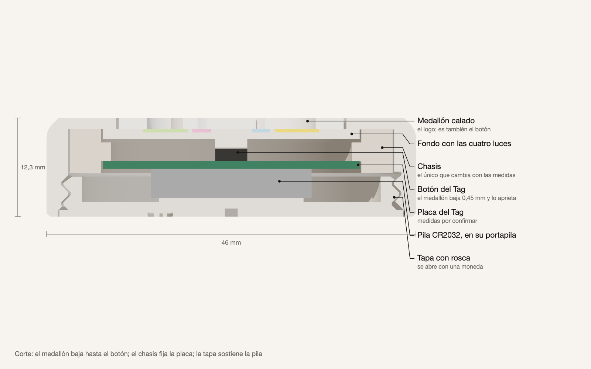
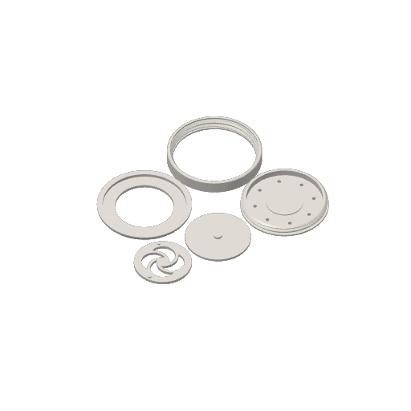
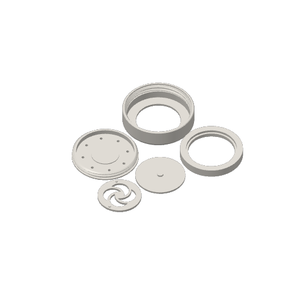
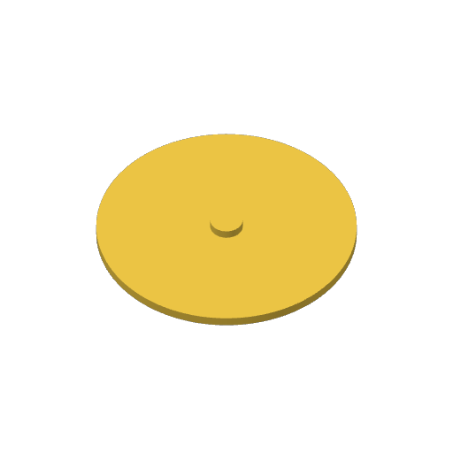
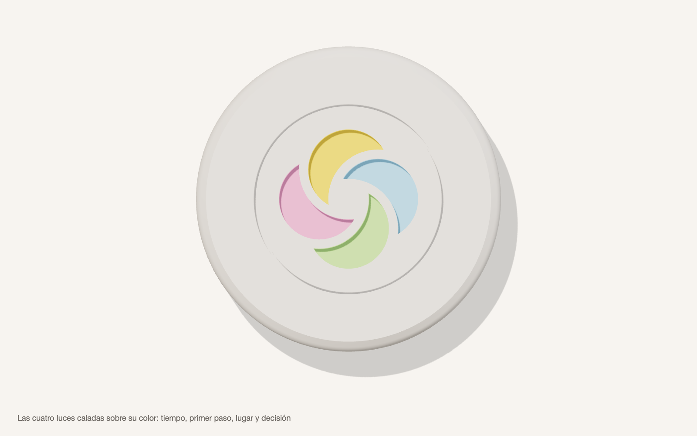

# Testigo de Relevo para impresión 3D

**Versión:** 0, del 28 de octubre de 2026 (D-143). **Estado:** listo para imprimir la prueba de calce; las medidas de la placa del Tag son supuestas y nada se ha impreso todavía.

El testigo es el objeto propio de Relevo: una carcasa impresa que lleva adentro la placa y la pila del Tag. El Tag sigue siendo el hardware —su Bluetooth, su botón y su pitido—, y la forma, el control y la marca pasan a ser diseño propio. Sigue la especificación de la memoria (capítulo 11): planta circular de 42 a 48 mm, de 12 a 16 mm de alto, sin frente, con el botón accesible y la pila cambiable.



## Cómo es

- **46 × 12,3 mm.** Cabe en la mano y en un bolsillo. Usa menos de 15 g de PLA, y a eso se suman la placa y la pila del Tag.
- **El logo es el botón.** Las cuatro luces de la marca atraviesan la placa del medallón y dejan ver, abajo, su color: tiempo, primer paso, lugar y decisión, en el orden de la marca. Al apretar, el medallón baja 0,45 mm y aprieta el botón del Tag. Un tope impide que baje más, y así protege el botón.
- **El sonido sale por el halo**, la ranura de 0,35 mm que rodea el logo, y por ocho agujeros de la tapa.
- **La tapa se abre con una moneda**, como la del Tag: tiene rosca y se cierra girando en el sentido del reloj, mirada desde abajo.
- **El chasis es la única pieza que depende de la placa del Tag.** Si algo no calza, se reimprime solo esa pieza, en unos minutos.





### Por qué es así

- **Calado y no grabado.** Un logo grabado en una cara que se imprime contra la placa deja el fondo de cada luz colgando en el aire, y queda feo. Calado, cada luz es un agujero limpio y el color va en otra pieza, el fondo.
- **Versión chica del logo.** Es la que la marca usa en tamaños pequeños (corte de 6,5): los tabiques entre luces miden 1,37 mm y se imprimen con la boquilla de 0,4 mm. El modelo usa las medidas exactas de la marca: cuatro círculos de radio 29 a 21 del centro, en una unidad de 100.
- **Sin soportes.** Cada pieza se apoya en la placa por su cara plana más grande. Ninguna superficie pasa de 47° desde la vertical, salvo puentes cortos de 1,6 mm o menos (la ranura de la moneda y el grabado de la tapa). Se comprobó en el modelo.
- **Rosca de 2,5 mm de paso, con flancos de 45°.** Se imprime bien de pie y aguanta abrir y cerrar.
- **Sin luz (D-070).** La luz de fábrica del Tag queda tapada.

## Antes de imprimir: medir la placa del Tag

Las medidas de la placa no se conocen. El vendedor da 38 × 7 mm para el Tag completo, y con eso se estimaron las de la placa. Con un pie de metro:

1. Abre el Tag por la ranura del borde, con una uña o una moneda.
2. Saca la placa con su pila puesta. No la dobles ni tires de cables.
3. Mide lo que pide [`medidas.json`](medidas.json): diámetro y grosor de la placa, altura del componente más alto en la cara del botón, altura del botón y grosor bajo la placa con la pila.
4. Fíjate si el zumbador está en la placa. Si es un disco pegado a la carcasa del Tag, con dos cables, el chasis necesita un lugar para él: mídelo y hay que cambiar el modelo.
5. Anota los valores en `medidas.json`, cambia «supuesto» por «medido» y vuelve a generar las piezas (abajo). El alto del testigo se ajusta solo.

## Imprimir en la Bambu Lab X1 Carbon

### Qué imprimir

Son tres impresiones separadas. Cada una es un proyecto de Bambu Studio ya configurado, en [`imprimir/bambu/`](imprimir/bambu/):

| Orden | Archivo | Qué trae | Tiempo | PLA | Cuándo |
| --- | --- | --- | --- | --- | --- |
| 1 | [`1-prueba-de-calce.3mf`](imprimir/bambu/1-prueba-de-calce.3mf) | La boca del cuerpo con la rosca, la tapa, el techo con la ventana y el medallón | ≈ 25 min | ≈ 11 g | Primero: prueba la rosca y el medallón |
| 2 | [`2-testigo-un-color.3mf`](imprimir/bambu/2-testigo-un-color.3mf) | Las cinco piezas del testigo, en un color | ≈ 32 min | ≈ 15 g | Después de medir la placa del Tag y volver a generar: hoy usa las medidas supuestas |
| 3 | [`3-fondo-cuatro-colores.3mf`](imprimir/bambu/3-fondo-cuatro-colores.3mf) | El fondo del medallón con las cuatro luces en su color | ≈ 6 min | ≈ 6 g, con la purga | Opcional, con el AMS: reemplaza el fondo de un color |

Bambu Studio 2.8 calculó los tiempos y los gramos al laminar con los perfiles oficiales de la X1 Carbon.

| 1. Prueba de calce | 2. Testigo | 3. Fondo en cuatro colores |
| --- | --- | --- |
|  |  |  |

En el plato 3, los colores van en la cara de abajo, contra la placa de impresión; desde arriba se ve solo la base.

### Paso a paso

1. **Prepara la impresora.**
   - Pon la placa PEI texturizada, limpia con agua y jabón o con alcohol isopropílico.
   - Carga el PLA: para los proyectos 1 y 2, el color del cuerpo (blanco o marfil mate); para el 3, amarillo, celeste, verde lima y rosado.
2. **Abre el proyecto en Bambu Studio**, con doble clic o en Archivo > Abrir proyecto. Si pregunta, elige «Abrir como proyecto» y no «Importar geometría solo»: así trae los ajustes.
3. **Revisa los ajustes**, arriba a la izquierda:
   - impresora: «Bambu Lab X1 Carbon 0.4 nozzle»;
   - placa: «Placa PEI texturizada» (*Textured PEI Plate*);
   - filamento: «Bambu PLA Matte»;
   - proceso: «0.12mm Fine», que aparece como modificado porque trae los ajustes del testigo.

   No muevas ni gires las piezas: ya están orientadas.
4. **Lamina** con «Laminar placa» (*Slice plate*), arriba a la derecha. Verás el tiempo y los gramos.
5. **Imprime** con «Imprimir placa» (*Print plate*). En la ventana:
   - elige tu impresora;
   - asigna cada color del proyecto al casillero del AMS que tiene ese carrete; sin AMS, elige la bobina externa (solo sirve para los proyectos 1 y 2);
   - deja marcada la «Nivelación de la cama»;
   - pulsa «Enviar».
6. **Retira las piezas** cuando la placa se enfríe: al doblarla un poco, se sueltan. No uses espátula sobre las caras texturadas.

### Revisar la prueba de calce

- **La tapa** debe entrar girando con la mano en la boca de prueba, sin forzar, y quedar a ras. Si cuesta, sube `holguras.rosca` a 0,4; si baila, bájala a 0,2.
- **El medallón**, con la placa calada pegada sobre su fondo, debe moverse libre en la ventana del techo de prueba, con una ranura pareja alrededor.
- Si cambias una holgura, vuelve a generar las piezas y los proyectos (abajo).

### Ajustes que ya traen los proyectos

| Ajuste | Valor | Por qué |
| --- | --- | --- |
| Impresora | Bambu Lab X1 Carbon, boquilla de 0,4 mm | La de serie. |
| Placa | PEI texturizada (*Textured PEI*) | Las caras que se ven se imprimen contra la placa y quedan con una textura mate fina. |
| Filamento | Bambu PLA Matte | Fácil de imprimir y rígido; el mate disimula las capas. PLA Basic también sirve. |
| Proceso | 0,12 mm Fine | Roscas y bordes del logo más finos. |
| Paredes | 3, con el generador Arachne | Paredes macizas y tabiques del logo bien rellenos. |
| Relleno | 15 %, giroide | Casi todo es pared. |
| Soportes | Apagados | Ninguna pieza los necesita. |
| Borde adicional (*brim*) | No | No deja marcas en las caras visibles. |
| Costura | Alineada | Una sola línea en la pared redonda. |
| Compensación de pata de elefante | La de fábrica, 0,15 mm | Mantiene pareja la ranura del halo. |
| Torre de purga | Solo en el proyecto 3 | Limpia la boquilla en cada cambio de color. |

### Las piezas

| Pieza | Sobre la placa de impresión | Color sugerido | PLA |
| --- | --- | --- | --- |
| Cuerpo | La cara de arriba, la de la ventana | Blanco o marfil mate | ≈ 6 g |
| Medallón, placa calada | La cara del logo | El del cuerpo | ≈ 1 g |
| Medallón, fondo | La cara que se ve por las luces | Un color o los cuatro de la marca | ≈ 1 g |
| Chasis | La falda, la cara ancha de abajo | Cualquiera: no se ve | ≈ 3 g |
| Tapa | La cara de afuera, la de la moneda | El del cuerpo | ≈ 4 g |

Las piezas sueltas también están en [`imprimir/`](imprimir/) como STL, ya orientadas, por si quieres armar tus propios platos.

### Los cuatro colores



El proyecto 3 asigna cada luz a su filamento: amarillo para el tiempo, celeste para el primer paso, verde lima para el lugar y rosado para la decisión. Los colores de la marca son #FFD54A, #9DD6F4, #B3E788 y #F6A3CB; usa los carretes más parecidos que tengas. La base usa el amarillo, porque no se ve: bastan cuatro casilleros del AMS. El color solo cambia en las tres primeras capas, y la purga gasta unos pocos gramos.

**Sin AMS:** usa el fondo de un color que viene en el proyecto 2. Las cuatro luces se verán de ese color; por ejemplo, tinta (#141312) sobre el cuerpo marfil.

## Armar

1. **Medallón:** encaja los dos pernos de la placa en los agujeros del fondo; solo calzan en una posición. Pégalos con una gota de pegamento instantáneo, sin que llegue al borde.
2. Con el cuerpo boca abajo, mete el medallón por dentro, con el logo hacia la ventana.
3. Pon el chasis encima, con el rebaje ancho hacia el medallón.
4. Pon la placa del Tag en el chasis, con el botón hacia el medallón y la pila hacia afuera.
5. Atornilla la tapa en el sentido del reloj, mirándola desde abajo, hasta que quede a ras. No la fuerces.

**Probar:**

- Al apretar el logo debe sonar el clic del botón, con un poco de juego antes.
- Si el Tag se apaga o pita solo, el botón queda apretado: sube `holguras.boton`.
- En Relevo, busca el Tag y usa «Probar sonido».
- Mide el volumen a 1 m, como pide la tarea 4 de [Por hacer](../../00_gobernanza/por-hacer.md), y compáralo con el Tag sin carcasa. Si se oye muy poco, se puede ensanchar el halo.

## Cuidados

- **La pila de botón es peligrosa si se traga.** Mantén el testigo lejos de niños y mascotas. La tapa que se abre con moneda ayuda, pero no es un cierre certificado.
- **El PLA se ablanda cerca de los 55 °C:** no lo dejes al sol dentro de un auto.
- No uses filamentos con metal: tapan el Bluetooth.

## Límites

- Las medidas de la placa son supuestas. Esta versión sirve para probar el calce y puede requerir ajustar el chasis o las holguras.
- Ni la impresión ni el montaje se han probado.
- La señal sigue siendo el pitido del Tag, y la carcasa lo atenúa en una medida que no se ha medido. Se declara como límite (memoria, capítulo 11).

## Archivos

| Archivo | Qué es |
| --- | --- |
| [`testigo.py`](testigo.py) | El modelo paramétrico: lee `medidas.json` y escribe todas las piezas. |
| [`medidas.json`](medidas.json) | Las medidas de la placa del Tag y las holguras, cada una con cómo medirla. |
| [`relevo-logotipo.svg`](relevo-logotipo.svg) | La palabra «relevo», grabada bajo la tapa. Es copia del [logotipo oficial](../../10_recursos_visuales/logo-relevo-2026-10-11/relevo-logotipo.svg). |
| [`imprimir/bambu/`](imprimir/bambu/) | Los tres proyectos de Bambu Studio, laminados, con su vista y un resumen de tiempo y gramos. |
| [`preparar-impresiones.py`](preparar-impresiones.py) | Arma y lamina los tres proyectos con el Bambu Studio instalado y sus perfiles oficiales de la X1 Carbon. |
| [`imprimir/`](imprimir/) | Las piezas sueltas en STL, ya orientadas, la carpeta de cuatro colores y las pruebas de calce. |
| [`montaje/testigo-montado.3mf`](montaje/testigo-montado.3mf) | Todo armado, con la placa y la pila del Tag como volúmenes de referencia, para mirarlo en cualquier visor 3D. |
| [`vistas.py`](vistas.py) y [`vistas/`](vistas/) | Las vistas de esta página, hechas con three.js en Chrome. |

**Volver a generar**, con Python 3:

```bash
pip install manifold3d trimesh numpy networkx lxml
```

```bash
python3 testigo.py
```

```bash
python3 vistas.py
```

```bash
python3 preparar-impresiones.py
```

## Registro de cambios (disclaimer)

### 2026-10-28 — Proyectos de Bambu Studio

- **Qué cambió:** se agregaron los tres proyectos laminados con Bambu Studio 2.8 y los perfiles oficiales de la X1 Carbon, el script que los genera y el paso a paso para imprimir. Se quitó el 3MF genérico de un color, que no traía ajustes.
- **Cómo estaba antes:** había solo piezas en STL, un 3MF sin ajustes y una tabla de ajustes para copiar a mano.
- **Por qué:** el autor instaló Bambu Studio y pidió los archivos que debe imprimir, uno por impresión, y cómo imprimirlos.

### 2026-10-28 — Versión 0

- **Qué cambió:** se creó el modelo del testigo: cuerpo, medallón calado de dos piezas, chasis y tapa roscada, con las vistas y esta guía.
- **Cómo estaba antes:** la tarea 4 de Por hacer pedía una carcasa del Tag, sin modelo.
- **Por qué:** el autor pidió el objeto para su impresora X1 Carbon, con la placa y la pila del Tag adentro y el logo de Relevo tallado (D-143).
