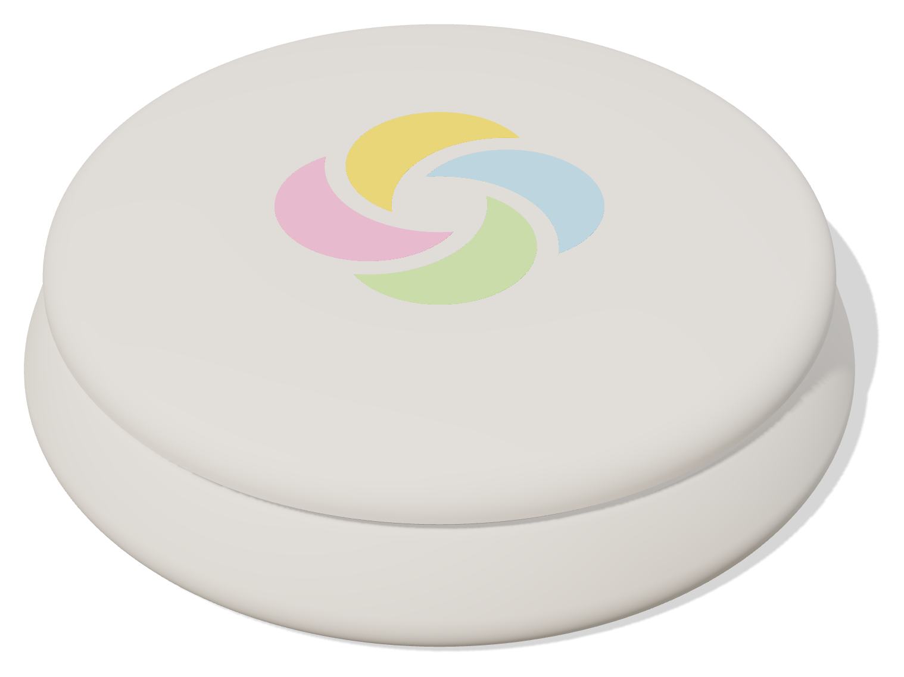
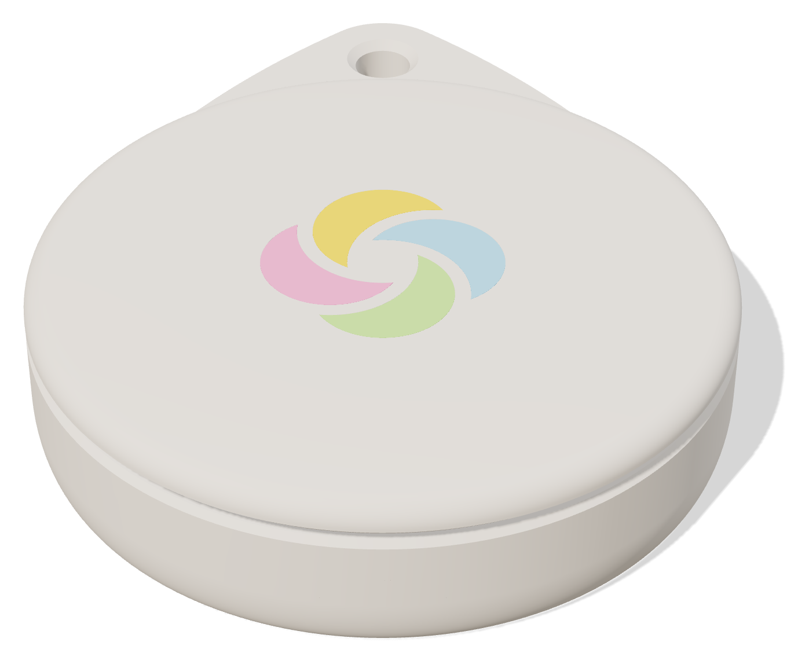
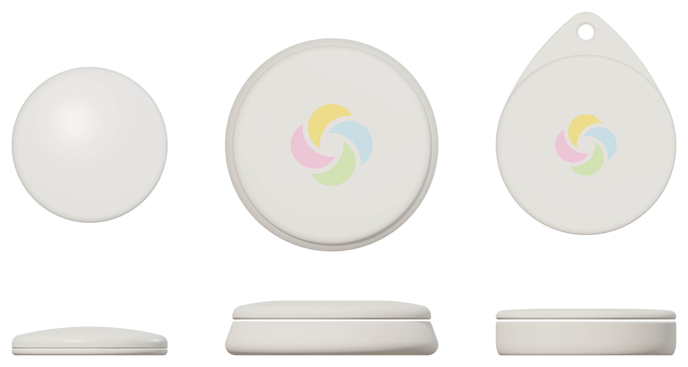
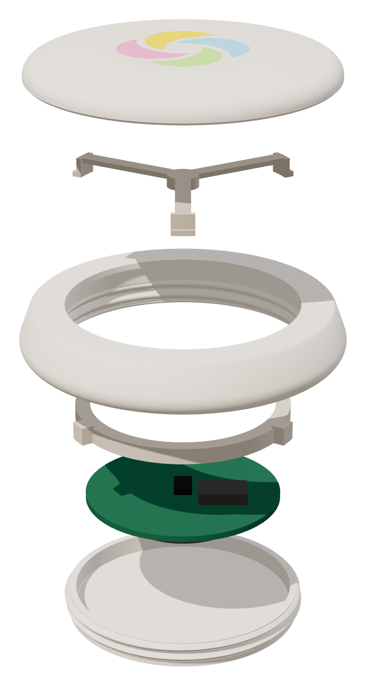
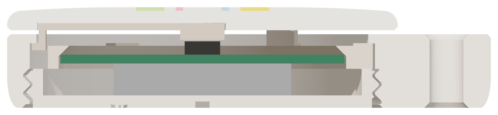

# Relevo Home y Relevo Go

**Versión:** 1, del 10 de noviembre de 2026. **Estado:** propuesta modelada y lista para imprimir; no se imprimirá para la entrega (D-178). Las medidas de la placa del Tag son supuestas, igual que en la [versión 0](../README.md).

Relevo, el objeto, es una carcasa que lleva adentro la placa y la pila del Tag (iTag NEWOTAG-BL, pila CR2032). El Tag aporta el Bluetooth, el botón y el pitido; la forma, el control y la marca son diseño propio. La versión 1 se abre en dos variantes con el mismo núcleo:

- **Relevo Home**, para dejarlo en la casa junto al primer paso de una actividad: 52 × 13,35 mm.
- **Relevo Go**, para llevarlo encima como llavero: una gota de 44 × 54,5 mm en planta y 11,35 mm de alto, con el agujero de la argolla en la punta.

| Relevo Home | Relevo Go |
| --- | --- |
|  |  |



Las imágenes de [`vistas/`](vistas/) son para la memoria: no llevan texto, porque el título y la nota de cada figura los pone la memoria en APA, y van sobre blanco. En todas, el logo se ve como la marca oficial (`relevo-marca-chica.svg`): el amarillo arriba, el celeste a la derecha, el verde abajo y el rosado a la izquierda.

## Qué cambió respecto de la versión 0, y por qué

El 10 de noviembre, el autor revisó la versión 0 y dijo que, con el logo con profundidad, el objeto parecía un ventilador o un aromatizante. Pidió algo más parecido al Tag y propuso dos variantes: una para la casa y otra para llevar consigo. La memoria ya nombraba Relevo Home y Relevo Go como ideas por explorar (capítulo 12).

**Cómo es el Tag.** Las fotos de la prueba ([Figura 18 de la memoria](../../../08_memoria/figuras/figura-4a-relevo-preparado.jpg), [b](../../../08_memoria/figuras/figura-4b-tag-en-un-mueble.jpg) y [c](../../../08_memoria/figuras/figura-4c-tag-en-un-escritorio.jpg)) muestran un disco blanco y brillante, con la cara de arriba apenas abombada y casi plana al centro, el canto redondeado y una junta fina cerca de la base. Arriba no tiene agujeros ni relieves, salvo un punto oscuro pequeño cerca del borde, cuya función no se conoce. Su botón está bajo esa cara lisa y no se ve; una persona de la prueba nunca lo encontró (memoria, capítulo 11).

**El tamaño del Tag no está resuelto.** La versión 0 anotó 38 × 7 mm según el vendedor; la [búsqueda de productos](../../busqueda-productos-terminados-chile-2026-09-11.md) del 11 de septiembre anotó «aproximadamente 30 mm de diámetro» para la misma publicación. No se encontró una ficha del NEWOTAG: Mercado Libre rechaza las consultas automáticas, y la ficha de Netexpertos en Paris.cl (s. f.) da el peso, «menos de 6 g», pero no las medidas. Otros localizadores con pila CR2032 miden unos 32 × 8 mm (AIO.lv, s. f.; Bechtle, s. f.), así que las dos cifras son posibles. Esta versión no elige una: el modelo usa las mismas medidas supuestas de la placa que la versión 0 (32 mm), y la comparación dibuja el Tag con los 38 × 7 mm del vendedor. Como la imagen ya no lleva texto, la nota de la figura en la memoria debe decir que esas medidas no se han medido y que otra ficha dice unos 30 mm.

| | Versión 0 | Versión 1 |
| --- | --- | --- |
| Forma | Disco de lado recto y techo plano, con chaflán | Guijarro: meseta plana al centro, abombado suave, canto redondo y junta perimetral, como el Tag |
| Logo | Calado de 1,4 mm de hondo, con su color debajo | A ras: incrustado en cuatro colores (0,4 mm) o, en un color, en relieve de 0,3 mm |
| Botón | Medallón de 28 mm rodeado de una ranura de 0,35 mm | Toda la cúpula; el logo marca dónde apretar |
| Salida del sonido | La ranura del medallón y ocho agujeros en la tapa | La junta perimetral, que no se ve como abertura |
| Variantes | Una, de 46 × 12,3 mm | Home (52 × 13,35) y Go (gota de 44 × 54,5 × 11,35, con agujero para la argolla) |
| Piezas | Cinco, todas propias de esa forma | Cinco por variante; chasis, pulsador y tapa son las mismas en las dos |
| Rosca de la tapa | Paso 2,5 mm, diente de 0,9 mm | Paso 2 mm, diente de 0,75 mm: ahorra diámetro |

## Cómo funciona





De arriba abajo, en la explosión: cúpula con el logo, pulsador, base, chasis, placa y pila del Tag, y tapa. Se muestra Home porque se lee mejor (es simétrico y nada tapa al pulsador); el núcleo es el mismo en Go. El corte es de Go y pasa por el agujero de la argolla.

- **La cúpula entera es el botón.** Se aprieta sobre el logo. Baja 0,45 mm: los primeros 0,15 mm son juego, y los 0,30 siguientes hunden el botón del Tag (su recorrido supuesto es de 0,25 mm). Al final la junta se cierra y hace de tope, de modo que nadie puede aplastar el botón.
- **El pulsador** es una estrella de tres rayos que va pegada en canales bajo la cúpula, así que no suma alto. Su émbolo central empuja el botón del Tag. Sus tres patas cruzan la repisa de la base, y sus pestañas, de 0,5 mm, retienen la cúpula.
- **El chasis** abraza la placa con 0,2 mm de holgura y la sujeta por el canto con un cono a 45°. Deja una ventana de 30 mm sobre los componentes y apoya tres postes bajo la repisa. Es la única pieza que depende de la placa.
- **La tapa** se enrosca desde abajo, se abre con una moneda y sostiene la pila. Queda a ras cuando toca los postes del chasis, así que aprieta todo el conjunto contra la repisa sin depender del grosor de la pila.
- **El sonido sale por la junta**: una rendija de 0,30 mm en reposo (0,45 mm con la cúpula arriba) en todo el contorno. En Go suma unos 41 mm² de abertura y en Home unos 46 mm²; en la versión 0, la ranura y los agujeros sumaban unos 52 mm². Es un cálculo geométrico: no dice cuánto se oye.

## Relevo Home

| Medida | Valor | Por qué |
| --- | --- | --- |
| Diámetro del pie | 52 mm | Más ancho que la cúpula: queda estable en una mesa, una repisa o junto a un libro o una guitarra. |
| Diámetro en la junta | 48,5 mm | El lado se cierra 20° desde el pie; al imprimir la base boca abajo, es un voladizo de solo 20°. |
| Alto | 13,35 mm | 8,3 mm de base, una junta de 0,45 mm y una cúpula de 4,6 mm. |
| Cúpula | 4,6 mm de alto, abombado de 46 mm de radio y canto de 2,6 mm | Abombado visible, como el del Tag. |
| Meseta y logo | Meseta plana de 23 mm, logo de 20 mm | El logo se ve desde lejos; las formas de color quedan separadas por 1,3 mm. |
| Goma | Rebaje anular de 0,8 mm de hondo, de 42 a 46,8 mm de diámetro | Para una goma antideslizante de 1 mm cortada a medida, que sobresale 0,2 mm. |

## Relevo Go

Go es un llavero, como en el boceto «Portátil» del autor ([`bocetos-objeto-portatil-y-hogar.jpg`](../../../08_memoria/anexos/imagenes/bocetos/bocetos-objeto-portatil-y-hogar.jpg)): una gota continua con la argolla en la punta y el botón redondo adentro. La base es la gota entera, con el mismo alto y el mismo canto en todo el contorno; la cúpula, que es el botón, sigue siendo redonda y ocupa el cuerpo de la gota.

| Medida | Valor | Por qué |
| --- | --- | --- |
| Ancho | 44 mm | El diámetro del cuerpo, el mínimo con la placa supuesta: el fondo de la rosca (40,4 mm) más 1,2 mm de pared, medida a 0,5 mm de la cara de abajo, redondeado a 0,5 mm. |
| Largo | 54,5 mm | Del borde opuesto a la punta hasta la punta: el cuerpo, 5,5 mm hasta el centro del agujero y 5 mm de punta. |
| Alto | 11,35 mm | El mismo núcleo que Home (8,3 mm de base y 0,45 de junta) con una cúpula de 2,6 mm: lo mínimo para un canal de 0,8 mm, el logo de 0,4 mm y 1,4 mm de material entre ambos. La punta tiene el alto de la base, 8,3 mm. |
| Planta de gota | Cuerpo de 44 mm, lados convexos de 60 mm de radio y punta de 5 mm de radio | Todos tangentes entre sí: el contorno no tiene quiebres. Así se lee como una sola pieza y no como un disco con una pestaña pegada. |
| Canto de abajo | Elíptico, de 1,2 × 3,5 mm, en todo el contorno | El lado se ve redondeado, también en la punta, y el objeto entra fácil al bolsillo, sin restar pared a la rosca. |
| Agujero de la argolla | 3,8 mm, con su centro a 27,5 mm del centro del cuerpo | Entra una argolla de llavero o un cordón. Quedan 3 mm de base lisa entre la cúpula y el chaflán del agujero, para que la argolla no apriete la cúpula, 3,1 mm de material hacia la punta y 4,7 mm hasta la rosca. |
| Meseta y logo | Meseta de 18 mm, logo de 15 mm | Las formas de color quedan separadas por 1 mm: lo mínimo que se imprime limpio con boquilla de 0,4 mm. El amarillo apunta a la punta: cuando Go cuelga de la argolla, el logo se ve como la marca oficial. |
| Traba de giro | Dos trabas de 1,2 mm en la repisa, a los lados de una pata del pulsador | La cúpula solo gira ±0,7°, así que el logo queda derecho respecto de la punta. Dejan el mismo juego de 0,25 mm que las demás piezas que se mueven. |

**Go con otra placa.** Las medidas de Go salen de la placa: con una de 24 mm mediría 36 × 46,5 mm; con 27, 39 × 49,5; con 30, 42 × 52,5; con 32, 44 × 54,5, y con 35, 47 × 57,5. Lo calcula [`comprobar.py`](comprobar.py) con la misma regla del modelo. Si el Tag mide 30 mm, su placa no puede medir 32, y Go quedaría más chico.

## El núcleo común: cada medida y su razón

Las medidas de la placa son supuestas (ver [`medidas.json`](medidas.json)). Cada número del modelo sale de ellas y de una holgura o un grosor de impresión.

**De adentro hacia afuera (diámetros):**

| Pieza | Diámetro | Por qué |
| --- | --- | --- |
| Placa del Tag | 32 mm (supuesto) | El mismo valor de la versión 0. |
| Hueco del chasis | 32,4 mm | 0,2 mm de holgura por lado: la placa entra sin forzar y queda centrada. |
| Exterior del chasis | 34,8 mm | Pared de 1,2 mm: tres líneas de la boquilla de 0,4 mm. |
| Patas del pulsador | 35,3 a 36,9 mm | 0,25 mm de juego con el chasis y 0,8 mm de grosor. Con boquilla de 0,4 mm, un juego menor de 0,2 mm suele pegarse. |
| Agujero de la repisa | 37,4 mm | 0,25 mm de juego con las patas. |
| Pestañas y postes | 38,4 mm | Entran 0,5 mm bajo la repisa. |
| Paso libre | 38,9 mm | Pulsador y chasis entran desde abajo, por dentro de la rosca. |
| Rosca de la tapa | 38,3 a 39,8 mm | Paso de 2 mm, diente de 0,75 mm y flancos de 45°, con 0,3 mm de holgura; el fondo de la rosca en la base mide 40,4 mm. |

**De abajo hacia arriba (alturas desde la cara de apoyo):**

| Altura | Qué | Por qué |
| --- | --- | --- |
| 0 | Cara de abajo, con la tapa a ras | |
| 1,4 mm | Piso de la tapa y cara de afuera de la pila | La ranura de la moneda, de 0,7 mm, y 0,7 mm de piso bajo ella: unas seis capas de 0,12 mm. |
| 5,0 y 6,0 mm | Cara de abajo y de arriba de la placa | Pila y portapila de 3,6 mm, y placa de 1 mm (supuestos). |
| 8,0 mm | Componente más alto | 2 mm sobre la placa (supuesto). |
| 8,3 mm | Cara de arriba de la base | Con la cúpula apretada a fondo, los rayos quedan 0,3 mm sobre los componentes. |
| 8,75 mm | Cara de abajo de la cúpula | La junta mide 0,45 mm: lo que baja la cúpula. |
| 11,35 o 13,35 mm | Arriba de Go o de Home | Cúpula de 2,6 o 4,6 mm. |

## Piezas, gramos y costo

| Pieza | Variante | PLA estimado | Cara sobre la placa de impresión | Archivo |
| --- | --- | --- | --- | --- |
| Chasis | Las dos | 0,6 g | La de abajo, de pie | [`imprimir/nucleo/chasis.stl`](imprimir/nucleo/chasis.stl) |
| Pulsador | Las dos | 0,2 g | La que se pega, boca abajo | [`imprimir/nucleo/pulsador.stl`](imprimir/nucleo/pulsador.stl) |
| Tapa | Las dos | 2,6 g | La de afuera | [`imprimir/nucleo/tapa.stl`](imprimir/nucleo/tapa.stl) |
| Base | Home | 7,8 g | La de la junta, boca abajo | [`imprimir/home/base.stl`](imprimir/home/base.stl) |
| Cúpula | Home | 9,0 g | La de abajo, plana | [`imprimir/home/cupula-un-color.stl`](imprimir/home/cupula-un-color.stl) o [cuatro colores](imprimir/home/cupula-cuatro-colores/) |
| Base | Go | 5,1 g | La de la junta, boca abajo | [`imprimir/go/base.stl`](imprimir/go/base.stl) |
| Cúpula | Go | 4,4 g | La de abajo, plana | [`imprimir/go/cupula-un-color.stl`](imprimir/go/cupula-un-color.stl) o [cuatro colores](imprimir/go/cupula-cuatro-colores/) |

**Total por objeto: unos 20 g de PLA en Home y 13 g en Go.** Son estimaciones: el volumen del modelo por 1,24 g/cm³, como si cada pieza fuera maciza. Con el relleno de 15 % usado en la versión 0, el peso real será menor, sobre todo en la cúpula de Home, que es casi toda relleno. La purga del cambio de color en el AMS suma unos gramos que no se estimaron. A los precios del [presupuesto](../../presupuesto-2026-10-27.md) (un rollo de 1 kg, entre 9690 y 13 890 pesos; TodoToner, s. f.), el material cuesta entre 197 y 282 pesos por Home y entre 125 y 179 por Go. No incluye el Tag, que en la prueba costó 10 990 pesos con envío (memoria, Tabla 3), ni el trabajo de impresión.

## Imprimir

Para imprimir en una Bambu Lab X1 Carbon:

- **Ajustes:** boquilla de 0,4 mm, placa PEI texturizada, PLA mate, proceso «0.12mm Fine», 3 paredes, relleno de 15 % y **sin soportes**: los mismos de la versión 0.
- **Orientación:** las piezas ya vienen orientadas. Las caras que se ven, como la junta de la base o la cara de afuera de la tapa, quedan contra la placa texturizada. La cúpula se imprime de pie, sobre su cara plana; si se activa el planchado (*ironing*) de la cara superior, la meseta del logo queda lisa.
- **Cúpula en cuatro colores:** abre juntos los cinco archivos de `cupula-cuatro-colores/`. Cuando Bambu Studio pregunte, cárgalos como un solo objeto con varias partes y asigna a cada parte su filamento: cuerpo en blanco o marfil, y amarillo (#FFD54A), celeste (#9DD6F4), verde lima (#B3E788) y rosado (#F6A3CB) para el tiempo, el primer paso, el lugar y la decisión. Sin AMS, usa `cupula-un-color.stl`, con el logo en relieve.
- **Voladizos que quedan,** todos pequeños: las pestañas del pulsador (0,75 mm), el techo de los canales bajo la cúpula (puentes de 2,7 a 5,3 mm de ancho), la ranura de la moneda (1,6 mm) y la palabra grabada bajo la tapa. Ninguna otra superficie pasa de 47° desde la vertical, tampoco en la gota de Go; lo comprueba `comprobar.py`.
- **Tiempos:** no se laminó en Bambu Studio, así que no hay tiempos calculados. Para armar proyectos ya configurados, se puede adaptar [`preparar-impresiones.py`](../preparar-impresiones.py) de la versión 0.

## Armar y cambiar la pila

1. **Cúpula y pulsador.** Con la base boca abajo, mete el pulsador por la rosca, con los rayos primero, hasta que las pestañas toquen la repisa; en Go, gíralo hasta que una de las patas calce entre las dos trabas de la repisa, del lado opuesto a la punta. Dalo vuelta sin soltarlo, pon una gota de pegamento instantáneo en los canales de la cúpula y apóyala sobre los rayos: solo calza en tres posiciones, una por cada rayo. En Go, elige la que deja el amarillo del logo hacia la punta. Espera a que seque. Esta unión es permanente.
2. **Chasis.** Con la base boca abajo, mete el chasis por la rosca con los postes entre las patas del pulsador.
3. **Placa.** Pon la placa del Tag en el chasis, con el botón hacia la cúpula y la pila hacia afuera.
4. **Tapa.** Enrósca la tapa con una moneda hasta que quede a ras.
5. **Probar.** Al apretar el logo debe oírse el clic del botón. Si el Tag pita solo o se apaga, el botón queda apretado: sube `holguras.boton` en `medidas.json` y vuelve a generar. En Relevo, usa «Probar sonido».

**Cambiar la pila:** con el objeto boca abajo, abre la tapa con una moneda, en contra del reloj mirándola desde abajo. Saca la pila de su portapila y pon la nueva con la misma cara hacia afuera. Cierra la tapa. La cúpula y el pulsador no se desarman. Con la tapa abierta, nada sujeta la placa y el chasis: por eso se trabaja boca abajo.

## Comprobaciones hechas en el modelo

[`comprobar.py`](comprobar.py) se ejecuta al final de `modelo.py` y deja sus resultados en [`comprobaciones.json`](comprobaciones.json).

- **Sólidos cerrados:** los 17 STL son cerrados y tienen sus caras orientadas de forma consistente, según trimesh. Para conseguirlo, la exportación funde los triángulos de grosor casi nulo que dejan las uniones de caras coplanares.
- **Sin choques** entre la base, el chasis, la tapa, la placa, la pila, un componente supuesto y la cúpula con el pulsador, en tres posiciones: arriba, en reposo y apretada a fondo. En Go, con las trabas de giro incluidas.
- **Gota de Go:** el contorno no tiene quiebres: el mayor giro entre dos tramos seguidos es de 1,9°, el mismo paso con que se dibujan los arcos. La traba deja girar la cúpula ±0,7° hacia cada lado.
- **La tapa entra girando:** se la hace bajar por la hélice cada 0,25 mm, desde cerrada hasta afuera, y no choca con la base.
- **Calce con la placa supuesta:** 0,2 mm de holgura radial; el cono toca el canto de la placa en su cara de arriba; quedan 0,3 mm de aire sobre los componentes con la cúpula apretada; el émbolo tiene 0,15 mm de juego y hunde el botón 0,30 mm.
- **Pared de Go:** 1,2 mm entre la rosca y el exterior desde 0,24 mm sobre la cara de abajo; en la arista de abajo, junto al chaflán de entrada, se afina a 0,5 mm.
- **Vistas:** se revisaron y se corrigieron. Go tenía el lado recto, como un disco de hockey, y pasó a tener un canto elíptico. La rosca de la base empezaba sobre la cara de abajo, y la tapa no habría podido entrar; ahora llega hasta abajo, en fase con la de la tapa. En la noche del 10 de noviembre se revisó cada imagen nueva: no tiene ni una letra, nada toca el borde (`vistas.py` falla si algo lo toca) y el logo de Home y Go coincide con `relevo-marca-chica.svg`. También se corrigió un defecto del render: con el suavizado de SwiftShader asomaban líneas de un píxel de los canales ocultos bajo la cúpula de Go; se resolvió con profundidad logarítmica.

**Sin hacer:** imprimir, laminar, medir la placa y medir el sonido.

## Límites

- **La placa no se ha medido.** Todas las medidas internas son supuestas, y el tamaño del Tag es contradictorio: 38 × 7 mm o unos 30 mm. Antes de imprimir, hay que medir con un pie de metro lo que pide `medidas.json` y volver a generar.
- **No se sabe dónde está el zumbador.** Si es un disco pegado a la carcasa del Tag, con cables, y no un componente de la placa, el chasis necesita un lugar para él.
- **El sonido con la carcasa no se ha medido.** Sale solo por una rendija de 0,30 mm. Hay que medirlo a 1 m y compararlo con el Tag sin carcasa; si se oye poco, se puede abrir la junta o sumar salidas por debajo.
- **Dónde apretar.** La cúpula está pensada para apretarse sobre el logo. Si se aprieta en el borde, puede inclinarse y llegar al tope sin hacer clic; eso hay que probarlo.
- **Juego.** La cúpula tiene 0,15 mm de juego vertical. En Go, colgado de un llavero, podría sonar suelta.
- **Borde de Go.** Para no crecer de diámetro, la arista de abajo de Go mide 0,5 mm junto a la entrada de la rosca: es la zona más frágil si se cae.
- **Uniones.** La cúpula y el pulsador van pegados y no se separan sin romperlos. La resistencia de la punta de Go con llaves no se ha probado.
- **Go, más largo y pesado.** La gota mide 54,5 mm de largo (el disco con oreja medía 50,4) y suma unos 1,6 g de PLA en la base, porque la punta tiene el alto entero de la base.
- **Traba de giro de Go.** Funciona si la pata entra entre las trabas con su juego de 0,25 mm. Si la impresión sale justa, la pata puede rozar y la cúpula no volver sola: hay que probarlo al armar y, si roza, lijar la traba.
- **Home gira.** En Home, la cúpula sigue sin traba y puede girar; como Home es redondo, solo cambia hacia dónde mira el logo.
- **Medidas de la memoria.** La memoria describe la versión 0 (46 × 12,3 mm, dentro de 42 a 48 mm de diámetro y 12 a 16 mm de alto). Home mide 52 mm de pie, y Go, 54,5 mm de largo y 11,35 mm de alto: quedan fuera de ese rango.
- **Las vistas son del modelo,** no fotos de un objeto impreso.

## Cuidados

- **La pila de botón es peligrosa si se traga.** Mantén el objeto lejos de niños y mascotas. La tapa que se abre con moneda ayuda, pero no es un cierre certificado.
- El PLA se ablanda cerca de los 55 °C: no lo dejes al sol dentro de un auto.
- No uses filamentos con metal: tapan el Bluetooth.

## Archivos

| Archivo | Qué es |
| --- | --- |
| [`modelo.py`](modelo.py) | El modelo paramétrico: lee `medidas.json` y escribe todas las piezas. |
| [`medidas.json`](medidas.json) | Medidas compartidas: la placa (supuesta), las holguras, el núcleo y cada variante, con el porqué de cada número. |
| [`comprobar.py`](comprobar.py) y [`comprobaciones.json`](comprobaciones.json) | Las comprobaciones y sus resultados. |
| [`imprimir/`](imprimir/) | Piezas en STL, orientadas para imprimir: `nucleo/` (las mismas en las dos variantes), `home/` y `go/`. |
| [`montaje/`](montaje/) | Cada variante armada, en 3MF, con la placa y la pila como volúmenes de referencia, para mirarla en cualquier visor 3D. |
| [`vistas.py`](vistas.py) y [`vistas/`](vistas/) | Las vistas para la memoria, hechas con three.js en Chrome, como en la versión 0, pero sin texto, sobre blanco y recortadas: `relevo-home-vista-principal.png`, `relevo-go-vista-principal.png`, `relevo-home-explosion-nucleo-comun.png`, `relevo-go-corte.png` y `relevo-comparacion-tag-home-go.png`. |
| [`planos.py`](planos.py) | Los planos acotados de Home y Go, en planta y alzado, con sus medidas exteriores en milímetros: `vistas/relevo-planos-home-y-go.svg` y `.png`. Son la Figura H12 de los anexos. Usa los perfiles de `modelo.py` y las medidas de `medidas.json`, así que cambian solos si cambian las medidas. |

El logotipo grabado bajo la tapa se toma de [`../relevo-logotipo.svg`](../relevo-logotipo.svg), copia del logotipo oficial.

**Volver a generar**, con Python 3:

```bash
python3 -m venv venv && venv/bin/pip install manifold3d trimesh numpy networkx lxml pillow
```

```bash
venv/bin/python modelo.py
```

```bash
venv/bin/python vistas.py
```

Las vistas necesitan Google Chrome y conexión a internet, para cargar three.js.

Los planos no necesitan el entorno virtual ni internet, solo Python 3 y Google Chrome, para la imagen:

```bash
python3 planos.py
```

## Fuentes

- AIO.lv. (s. f.). *Finder 4smarts SkyTag Duos set of 4, white* [Ficha de producto]. Recuperado el 10 de noviembre de 2026, de https://aio.lv/en/product--4smarts-541717--11665529.md
- Bechtle. (s. f.). *Verbatim MyFinder Bluetooth tracker 3x* [Ficha de producto]. Recuperado el 10 de noviembre de 2026, de https://bechtle.com/gb/shop/verbatim-myfinder-bluetooth-tracker-3x--4822212--p
- Paris.cl. (s. f.). *Localizador Bluetooth antipérdida llaves objetos newo* [Ficha de producto, vendido por Netexpertos]. Recuperado el 10 de noviembre de 2026, de https://www.paris.cl/localizador-bluetooth-antiperdida-llaves-objetos-MK6ZYUA1PC.html
- TodoToner. (s. f.). Citado en el [presupuesto del 27 de octubre](../../presupuesto-2026-10-27.md).

## Registro de cambios (disclaimer)

### 2026-11-26 — Planos acotados

- **Qué cambió:** se sumó `planos.py`, que dibuja la planta y el alzado de Home y Go con sus medidas exteriores (`vistas/relevo-planos-home-y-go.svg` y `.png`). Las alturas se redondean a una décima, como en la memoria: 13,4 mm en Home y 11,4 mm en Go. Los planos, el corte de Go y las piezas de Home pasaron al Anexo H de la memoria (H.8).
- **Cómo estaba antes:** las vistas no tenían medidas, y las medidas estaban solo en esta guía y en `medidas.json`.
- **Por qué:** el autor pidió una planimetría acotada de Relevo Home y Go para el registro visual, simple y fácil.

### 2026-11-10, noche — Vistas sin texto, logo derecho y Go como llavero

- **Qué cambió:**
  - Las vistas se rehicieron sin ningún texto: sin títulos, pies, rótulos, cotas, barra de escala ni la línea de puntos de 30 mm sobre el Tag. Van sobre blanco puro (#FFFFFF), recortadas con un margen parejo de 40 px y al doble de resolución. Quedan cinco, con nombres claros: Home y Go en vista principal, la explosión de Home con el núcleo común, el corte de Go y la comparación a escala, con el Tag, Home y Go de izquierda a derecha, en planta y alzado. Las imágenes antiguas (`relevo-home-principal.png`, `relevo-go-principal.png`, `relevo-home-explosion.png`, `relevo-go-explosion.png` y `relevo-home-corte.png`) se retiraron de `vistas/`. `vistas.py` ahora lee el lienzo de la página, en vez de capturar la ventana, y falla si algo toca el borde.
  - Home y Go se fotografían con la misma cámara, de frente, y ninguno se gira: en todas las imágenes, el logo se ve como en la marca oficial.
  - Go pasó de disco con oreja a gota. La base es una gota continua: cuerpo de 44 mm, lados convexos de 60 mm de radio y punta de 5 mm de radio, todos tangentes entre sí. Tiene el alto entero de la base y el mismo canto en todo el contorno, y el agujero de la argolla, de 3,8 mm, en la punta. Mide 44 × 54,5 × 11,35 mm. La cúpula sigue redonda. Se sumaron dos trabas en la repisa de Go para que la cúpula no gire y el logo quede derecho respecto de la punta. Chasis, pulsador, tapa y holguras no cambiaron.
  - Se actualizaron `medidas.json` (las secciones `gota` y `traba_de_giro` reemplazan a `pasador`), `comprobar.py` (largo, ancho, holguras del agujero, continuidad del contorno y giro de la cúpula), `comprobaciones.json`, la base de Go en STL, los dos 3MF y esta guía. El costo de Home se alineó con `comprobaciones.json`: entre 197 y 282 pesos.
- **Cómo estaba antes:** las siete vistas tenían títulos, pies, rótulos y medidas escritas, sobre fondo crema (#F7F4F0) y con márgenes amplios. Go se mostraba girado respecto de Home: en la comparación, su logo quedaba 90° corrido. Go era un disco de 44 mm con una oreja de 5,3 mm de grueso pegada al costado, de 50,4 mm de largo, y su cúpula podía girar libre.
- **Por qué:** el autor pidió imágenes sin texto de relleno, porque el título y la nota de cada figura los pone la memoria en APA y las figuras van sobre blanco; el logo con la misma orientación en Home y Go, igual a la marca oficial, y Go como llavero, según su boceto «Portátil»: una gota continua con la argolla en la punta, en vez de un disco con una pestaña pegada. Las trabas no se pidieron: se agregaron porque, sin ellas, la cúpula giraría libre en un llavero y el logo quedaría torcido respecto de la punta. Si no se quieren, basta quitar `traba_de_giro` de `medidas.json`.

### 2026-11-10 — Versión 1: Relevo Home y Relevo Go

- **Qué cambió:** se creó esta carpeta con un modelo paramétrico nuevo y dos variantes, Home y Go, que comparten chasis, pulsador y tapa. Toda la cúpula pasa a ser el botón, el logo queda a ras y el sonido sale por la junta perimetral. Incluye medidas compartidas, STL orientados, montajes, vistas, comprobaciones y esta guía.
- **Cómo estaba antes:** había una sola versión, la 0, del 28 de octubre (D-143): un disco de 46 × 12,3 mm con el logo calado como botón, una ranura alrededor y ocho agujeros en la tapa. Esa versión queda intacta en la carpeta superior.
- **Por qué:** el autor dijo que el logo con profundidad hacía que el objeto pareciera un ventilador o un aromatizante, pidió algo más parecido al Tag y propuso una variante para la casa y otra para llevar consigo. Por D-178, el objeto queda como propuesta modelada y no se imprime para la entrega.
