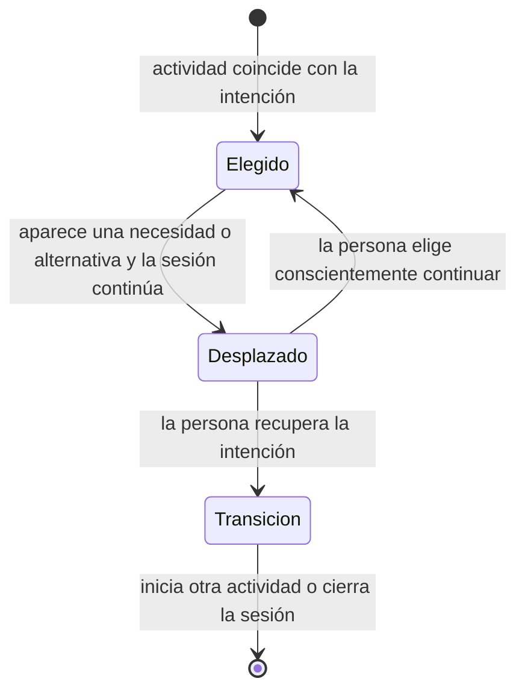

# Anexo A. Entrevistas: pauta, corpus y análisis

> Parte de los [anexos de la memoria](README.md). Se genera con `node construir-anexos.js` desde sus documentos fuente: para corregirlo, se corrige la fuente y se vuelve a generar.

Las ocho entrevistas semiestructuradas se hicieron en Santiago el 11 y el 12 de junio de 2026. Este anexo reúne la pauta y sus condiciones, el corpus anonimizado (P1–P8, Q1–Q13) y los documentos del análisis: el método, el libro de códigos, la reconstrucción de cada caso y la comparación entre casos que sostiene el capítulo 7.

## A.1 Pauta y condiciones del levantamiento

### Resultado confirmado

Se realizaron ocho entrevistas semiestructuradas, habladas y presenciales en Santiago los días 11 y 12 de junio de 2026. Todas las preguntas principales y repreguntas fueron formuladas por el investigador. La transcripción y la regularización académica ocurrieron después de las conversaciones.

La edad fue el único criterio común confirmado para convocar participantes. El reclutamiento se realizó mediante referencias de contactos cercanos hacia personas del rango etario buscado. Las edades observadas fueron 19, 19, 20, 21, 21, 22, 22 y 27 años. No se utilizará la condición de estudiante, la ocupación ni otra característica como criterio compartido si no existe evidencia adicional.

### Ficha metodológica

| Dimensión | Registro vigente |
|---|---|
| Técnica | Entrevista semiestructurada presencial |
| Casos | Ocho participantes, anonimizados como P1–P8 |
| Fechas | 11 y 12 de junio de 2026 |
| Lugar | Santiago, Chile |
| Reclutamiento | Referencias indirectas obtenidas mediante contactos cercanos |
| Criterio común | Edad dentro del rango buscado |
| Rango observado | 19–27 años |
| Consentimiento | Informado y oral |
| Formulación de preguntas | Investigador |
| Procesamiento posterior | Transcripción y normalización académica |
| Duración individual | No registrada en las fuentes disponibles |

Santiago se registra como contexto del levantamiento. No constituye por sí solo un criterio de segmentación ni permite generalizar los resultados a toda la ciudad.

### Secuencia principal aplicada

1. ¿Cómo suelen ser tus tardes o noches entre semana cuando no tienes obligaciones?
2. ¿Qué actividades te ayudan a desconectarte o a descansar?
3. Piensa en la última vez que usaste el teléfono para entretenerte, no para trabajar ni estudiar. ¿Cuándo fue y qué hiciste?
4. ¿Cómo describirías cómo te sentiste mientras realizabas esa actividad?
5. ¿Cómo te sentiste al terminar esa sesión?
6. Si alguien te hubiera preguntado al día siguiente qué hiciste esa tarde, ¿qué le habrías respondido?
7. ¿Ese tiempo contó como descanso para ti? ¿Por qué?
8. ¿Has tenido alguna vez la sensación de pasar tiempo entretenido en el teléfono y luego no poder describir bien qué hiciste?
9. ¿Hay actividades de tiempo libre que te parezcan más válidas que otras? ¿Por qué?
10. ¿Qué tendría que ocurrir para que terminaras una tarde de ocio y sintieras que fue tiempo bien gastado?
11. ¿Hay algo sobre tu tiempo libre o tu relación con el teléfono que no te haya preguntado y consideres relevante?

Las repreguntas de profundización variaron según cada respuesta. Su función fue aclarar significados, obtener ejemplos y reconstruir episodios concretos. Todas fueron formuladas por el investigador durante la conversación.

### Bloque adicional aplicado después de la secuencia principal

12. ¿Alguna vez intentaste descansar sin celular? ¿Qué estrategias usaste?
13. ¿Cómo reaccionarías a la idea de depositar el teléfono en un objeto y luego recibir una señal de ese descanso? ¿Qué tendría que mostrar para que no se sintiera como castigo?

Ambas preguntas fueron realizadas presencialmente. Sus respuestas se registraron originalmente en notas y se integraron después al anexo consolidado. Las notas originales ya no están disponibles.

### Alcance y límites

- El levantamiento es cualitativo y exploratorio; no representa estadísticamente a los adultos jóvenes.
- El reclutamiento por referencias puede concentrar experiencias socialmente próximas.
- No existe un registro disponible de la duración individual ni un formulario separado del consentimiento oral.
- La normalización académica puede alejar el texto de la oralidad literal. Las respuestas sostienen interpretación cualitativa, pero una cita textual debe revisarse con cautela.
- La desaparición de las notas originales limita la verificación independiente de Q12–Q13, aunque su aplicación fue confirmada por el investigador.

## A.2 Corpus anonimizado P1–P8

### Propósito y alcance

Este documento reúne las respuestas utilizadas en el análisis, elimina nombres personales y normaliza los identificadores como P1–P8. No reemplaza los archivos privados: ofrece una versión académica, trazable y suficiente para comprobar el libro de códigos, las reconstrucciones y la matriz.

La redacción conserva el sentido de las conversaciones. Después del levantamiento se transcribió y se regularizaron ortografía, puntuación y continuidad para facilitar la lectura académica. No se añadieron respuestas.

### Procedencia y regla de consolidación

- Q1–Q11 provienen del registro transcrito más temprano de las entrevistas habladas.
- Q12–Q13 provienen del anexo posterior y fueron realizadas presencialmente después de la secuencia principal.
- P2-Q10 conserva el fragmento completo presente en el registro temprano.
- P6 se registra con 27 años, según la aclaración directa del autor.
- Todos los rótulos de profundización se normalizan como **Repregunta**.
- Todas las preguntas y repreguntas fueron formuladas por el investigador.
- Las respuestas vagas o no contestadas se conservan como tales.

La [auditoría de integridad](../../01_contexto_y_fuentes/auditoria-integridad-corpus-entrevistas.md) documenta discrepancias y criterios de resolución. El [instrumento aplicado](../../99_archivo/fuentes-locales/instrumentos/instrumento-aplicado.md) registra fechas, presencialidad, reclutamiento y consentimiento.

### Índice de preguntas

1. **Q1:** tardes o noches sin obligaciones.
2. **Q2:** actividades que ayudan a desconectarse o descansar.
3. **Q3:** última sesión de entretenimiento en el teléfono.
4. **Q4:** experiencia durante esa sesión.
5. **Q5:** experiencia al terminar.
6. **Q6:** forma de describir la tarde al día siguiente.
7. **Q7:** valoración de la sesión como descanso.
8. **Q8:** experiencias difíciles de describir después.
9. **Q9:** jerarquías entre actividades de ocio.
10. **Q10:** condiciones de una tarde bien gastada.
11. **Q11:** aspecto adicional relevante.
12. **Q12:** estrategias utilizadas para descansar sin teléfono.
13. **Q13:** reacción ante depositar el teléfono en un objeto y recibir una señal del descanso.

### P1

**Edad:** 21 años  
**Fecha:** 12 de junio de 2026

#### Q1

Jugar, disfrutar tiempo con sus perros y ver películas o series.

**Repregunta — tiempo con sus perros:** consiste en disfrutar con ellos, porque ellos estarán una parte de su vida, pero para ellos será toda su vida.

#### Q2

Hacer ejercicio y cocinar.

**Repregunta — momento de desconexión:** cuando está concentrado haciendo lo que le gusta; si se desconcentra, algo puede salir mal.

#### Q3

Hace unos días leyó manga en el teléfono.

**Repregunta — decisión de leer:** un momento tranquilo, buscando una dopamina más saludable. Esta expresión pertenece al participante y no se utiliza como concepto científico del análisis.

#### Q4

Feliz, tranquilo y reflexivo.

**Repregunta — reflexión:** depende del manga; algunos contenidos le hacen reflexionar.

#### Q5

Satisfecho con usar su tiempo para cosas mejores.

**Repregunta — cosas mejores:** leer en vez de ocupar el teléfono para TikTok o actividades similares.

#### Q6

Dormir.

#### Q7

Sí, porque ya había hecho cosas temprano.

**Repregunta — actividades previas:** ir a la universidad.

#### Q8

Sí.

#### Q9

Considera que toda actividad libre que haga sentir bien es buen tiempo de ocio.

**Repregunta — sentirse bien:** sentirse feliz y desconectado de las obligaciones.

#### Q10

Hacer ejercicio, ver una película o practicar algún deporte.

**Repregunta — condición del ejercicio:** terminar cansado y adolorido para quedar satisfecho.

#### Q11

No.

#### Q12

Cuando lee manga, cocina o hace ejercicio deja el celular aparte porque, si está cerca, termina mirándolo. A veces lo deja cargando en otra pieza o en silencio.

#### Q13

Le serviría si fuera simple. Valora recibir una marca o imagen que le recuerde que estuvo leyendo, cocinando o con sus perros.

### P2

**Edad:** 22 años  
**Fecha:** 12 de junio de 2026

#### Q1

Descansa, ve videos y revisa redes sociales.

**Repregunta — contenidos:** memes o temas de su interés, generalmente para reírse.

#### Q2

Acostarse a ver videos, jugar en el computador o estar con su pareja.

**Repregunta — videos para desconectarse:** contenidos de humor.

#### Q3

Durante la entrevista se puso a ver memes en Instagram al acostarse.

#### Q4

Se sintió tranquila hasta que tuvo sueño.

**Repregunta — continuidad:** reconoció que era momento de dormir y, aunque tenía mucho sueño, siguió frente a la pantalla.

#### Q5

Más o menos.

#### Q6

Podría relatar con claridad la secuencia: después de clases trabajó en la casa de su pareja, vieron una serie y terminó el día viendo videos o memes en Instagram antes de dormir.

#### Q7

No tanto, porque tenía sueño y aun así decidió seguir en el celular.

#### Q8

A veces, pero muy poco.

#### Q9

Considera más válidas las actividades de interés personal que no consisten en permanecer desplazándose por el celular.

**Repregunta — actividad productiva:** una actividad que permita desconectarse y se sienta plena; menciona manualidades, pintura y dibujo.

#### Q10

No tener obligaciones al llegar a casa para no utilizar tiempo crucial; disponer de los materiales necesarios, desconectarse del celular y hacer lo que tenga ganas de hacer.

**Repregunta — hacer lo que quiere:** realizar sus hobbies en paz.

#### Q11

No por el momento.

#### Q12

Cuando quiere pintar, dibujar o hacer manualidades intenta dejar el teléfono lejos de la cama. También lo pone en silencio para no revisarlo.

#### Q13

Lo usaría si se percibe como una ayuda que le recuerde que hizo otra actividad y no quedó atrapada en el celular.

### P3

**Edad:** 19 años  
**Fecha:** 11 de junio de 2026

#### Q1

Jugar en el computador y practicar artes marciales.

#### Q2

Dormir, ver una serie, jugar en el computador y meditar.

**Repregunta — desconexión al jugar:** disfruta saber que no tiene la presión de hacer algo.

#### Q3

Ese día miró videos humorísticos en Instagram.

#### Q4

Sintió que estaba matando el tiempo sin ser consciente de él.

**Repregunta — conciencia temporal:** no tenía noción del tiempo mientras lo hacía.

#### Q5

No se sintió mal ni bien; pensó que tenía mejores cosas que hacer.

**Repregunta — alternativa:** sentía que perdía parte del día viendo el celular.

#### Q6

Habría dicho la verdad, pero no especificó el contenido del relato.

#### Q7

Sí contó como descanso porque no hizo lo que debía y se despejó de las responsabilidades.

**Repregunta — coexistencia con obligaciones:** sabía que tenía algo pendiente y aun así continuó descansando.

#### Q8

Le suele ocurrir y le provoca sentirse un poco mal consigo mismo.

**Repregunta — razón:** piensa que podría haber hecho algo más productivo.

#### Q9

Considera todas las actividades igualmente válidas, aunque algunas entregan habilidades aplicables a la vida cotidiana.

#### Q10

Invertir el ocio en actividades que le hagan crecer o entreguen un beneficio.

**Repregunta — beneficio:** actividades que le hagan sentirse pleno o sentir que vive.

#### Q11

Considera relevante la normalización de perder tiempo con el celular y luego sentir que podría haber hecho algo mejor.

**Repregunta — situaciones:** permanecer bastante tiempo viendo memes o contenido en TikTok o Instagram.

#### Q12

Cuando entrena, juega en el computador o medita intenta dejar el celular lejos. A veces activa no molestar, pero si está cerca vuelve a tomarlo para revisar Instagram.

#### Q13

Le parece útil una señal tranquila al retirar el teléfono, como una luz o una forma, que ayude a reconocer un descanso real.

### P4

**Edad:** 22 años  
**Fecha:** 11 de junio de 2026

#### Q1

Ver una película o estar en el teléfono.

**Repregunta — teléfono:** revisar redes sociales.

#### Q2

Pasear a su perro y escuchar música tranquila o enérgica.

#### Q3

Ese día jugó sudoku en el teléfono.

#### Q4

Tranquila.

#### Q5

Concentrada y relajada.

**Repregunta — concentración:** el juego exigía atención y, al terminar, pudo enfocarse en su entorno.

#### Q6

Diría que no hizo nada porque considera que jugar es técnicamente una forma de no hacer nada.

#### Q7

Sí contó como descanso: ocupó su mente sin estrés ni mal humor.

#### Q8

Le ocurre muchas veces, especialmente con TikTok.

**Repregunta — dificultad narrativa:** ve muchos videos, pero luego no permanece contenido en su mente.

#### Q9

Considera más válidos caminar o hacer ejercicio porque mantienen el cuerpo activo y dejan tiempo para pensar.

#### Q10

Estudiar, porque le gusta, mantiene su mente ocupada y aprende.

#### Q11

La conversación le hace replantear su relación con el teléfono y piensa que podría existir un uso adictivo. Esta expresión corresponde a una autopercepción y no a un diagnóstico.

#### Q12

Cuando pasea a su perro o quiere concentrarse deja el celular en casa o lo silencia. También ha borrado TikTok temporalmente.

#### Q13

Le daría curiosidad probar el objeto, especialmente respecto de TikTok, y preferiría una señal calmada.

### P5

**Edad:** 20 años  
**Fecha:** 11 de junio de 2026

#### Q1

Pasa tiempo en TikTok, Instagram y Facebook.

#### Q2

Ordenar su pieza, peinar sus muñecas y estar con el celular.

**Repregunta — muñecas:** calma.

#### Q3

Durante la entrevista veía TikTok, específicamente videos de God of War.

#### Q4

Entretenida.

#### Q5

Aburrida, sin nada que hacer.

#### Q6

Nada.

#### Q7

Tal vez sí y tal vez no; no siente que descanse mucho viendo tragedias, en referencia a noticias sobre el gobierno.

#### Q8

Sí.

#### Q9

Considera más válida cualquier actividad distinta de estar en el celular porque permite hacer cosas productivas.

**Repregunta — productividad:** ordenar, hacer ejercicio o algo que ayude a la vida.

#### Q10

Hacer algo productivo y no estar todo el tiempo con el celular.

**Repregunta — actividades:** ordenar, limpiar o aprender algo nuevo.

#### Q11

No.

#### Q12

Cuando ordena su pieza o peina sus muñecas deja el celular en la cama o en otro lugar, pero vuelve a mirarlo. A veces lo pone a cargar para no tenerlo en la mano.

#### Q13

Anticipa que al principio le costaría dejar el celular. Preferiría que la señal mostrara dibujos u otra representación visual.

### P6

**Edad:** 27 años  
**Fecha:** 11 de junio de 2026

#### Q1

Jugar, leer, realizar videollamadas y cenar con su familia.

**Repregunta — juego:** se instala con algo para comer y beber y comprueba si alguien está disponible para jugar.

#### Q2

Escuchar música, armar maquetas y resolver sudoku, principalmente durante la noche.

#### Q3

El día anterior estuvo varias horas en videollamada con una amiga que vive fuera del país.

**Repregunta — contenido:** conversaron sobre su semana, jugaron y planearon otra llamada.

#### Q4

Contenta, porque hacía tiempo que no hablaba con su amiga por videollamada.

**Repregunta — temas:** acontecimientos de la semana y experiencias personales.

#### Q5

Con ganas de repetir la videollamada.

**Repregunta — razón:** emoción y nostalgia.

#### Q6

Diría que estuvo en videollamada con una amiga muy cercana y podría describir temas como universidad, trabajo, viajes y salidas.

#### Q7

Sí contó como descanso: fue un momento de relajo sin preocupación ni límite de tiempo, con una persona de confianza.

#### Q8

Sí le ha ocurrido no poder describir bien otros usos del teléfono.

#### Q9

Algunas actividades parecen más válidas porque puede sentir que desaprovechó horas en acciones rutinarias que realiza todos los días.

**Repregunta — ejemplos:** revisar redes sociales o escuchar música en la cama.

#### Q10

No pensar en trabajo ni estudios y concentrarse por completo en leer, construir u otra actividad.

#### Q11

No.

#### Q12

Cuando lee o arma maquetas, el sonido del teléfono cercano le resulta molesto.

#### Q13

Usaría el objeto principalmente en momentos en que permanece mirando redes sin pensar.

### P7

**Edad:** 21 años  
**Fecha:** 11 de junio de 2026

#### Q1

Jugar videojuegos o salir en bicicleta según factores como lluvia y frío.

#### Q2

Jugar fútbol, por el ambiente competitivo y la simplicidad material del juego.

#### Q3

Media hora antes de la entrevista veía en YouTube un podcast de fútbol mientras comía.

#### Q4

Se sintió normal y a veces complacido por comentarios humorísticos espontáneos.

#### Q5

Normal, sin una emoción predominante.

#### Q6

Diría que no hizo nada interesante, entendido como nada fuera de lo común; recuerda que vio YouTube mientras comía.

#### Q7

Sí contó como descanso porque no tenía obligaciones y estaba enfocado en YouTube y en comer, sin otra actividad en mente.

#### Q8

No experimenta una laguna mental después de usar el teléfono.

#### Q9

Defiende que cada persona utilice su tiempo libre como quiera, aunque reconoce que algunos pasatiempos pueden afectar la salud o ser socialmente invalidados.

#### Q10

Considera bien gastada cualquier tarde de ocio sin obligaciones pendientes.

#### Q11

Propone considerar cómo el teléfono afecta la convivencia familiar: facilita la comunicación, pero puede reducir el tiempo compartido.

#### Q12

Cuando sale en bicicleta o juega fútbol el teléfono permanece guardado. En casa a veces lo deja en el comedor o activa no molestar, pero no es una rutina fija.

#### Q13

No sabe si lo necesitaría diariamente, aunque lo probaría. Exige una señal discreta, sin nota ni comparación entre días.

### P8

**Edad:** 19 años  
**Fecha:** 11 de junio de 2026

#### Q1

Jugar en el computador o dormir; su rutina varía poco.

#### Q2

Estar en el computador, jugar, escuchar música, leer o dormir.

#### Q3

Durante la entrevista estaba mirando Instagram y consumía lo primero que aparecía en el feed.

#### Q4

Tranquilidad, entendida como relajarse porque no tenía algo que hacer.

#### Q5

Relajada o normal, sin una sensación específica.

#### Q6

Diría que se quedó viendo videos o Instagram y recuerda contenidos variados como noticias, memes y videoblogs.

#### Q7

Sí contó como descanso porque hacía algo que le gusta sin sentir que faltaba una obligación; esa condición aparece cuando está al día con sus tareas.

#### Q8

Sí le cuesta describirlo porque la rutina termina siendo siempre la misma: videos e Instagram.

#### Q9

No considera unas actividades universalmente más válidas que otras; las personas tienen cantidades distintas de tiempo libre y hacen el hobby que pueden realizar.

#### Q10

Haber terminado sus deberes y poder avanzar en actividades deseadas, como completar un juego, una lectura o un dibujo.

#### Q11

En lugar de responder, pregunta si las personas tienen hoy más o menos tiempo libre que antes. Se registra como respuesta no contestada.

#### Q12

Cuando juega en el computador o lee, el celular puede permanecer cerca sin que siempre lo mire. Si tiene tareas, lo silencia o guarda para no abrir Instagram sin advertirlo.

#### Q13

Le resultaría extraño al principio, pero podría ayudar a interrumpir el hábito de revisar Instagram. Preferiría una imagen o luz tranquila.

### Límites de uso

- El corpus no permite generalización estadística.
- No se debe interpretar una respuesta breve como ausencia del fenómeno.
- Las expresiones autodiagnósticas o coloquiales no constituyen categorías clínicas.
- Las omisiones se mantienen como omisiones.
- Las paráfrasis analíticas deben enlazar P y Q.
- El corpus sostiene paráfrasis analíticas. Una cita textual directa requiere cautela porque el registro fue normalizado después de la conversación y las notas originales de Q12–Q13 ya no están disponibles.

## A.3 Método de análisis

### Condiciones del corpus

El método responde a seis condiciones:

1. existen ocho entrevistas, por lo que el objetivo es exploratorio y no representativo;
2. el levantamiento fue semiestructurado, hablado y presencial;
3. la transcripción consolidada es el corpus operativo disponible;
4. todas las preguntas y repreguntas fueron realizadas por el investigador;
5. se necesita comparar a cada participante como caso completo y también observar patrones entre casos;
6. el resultado solicitado es una tipología de dos usuarios que luego debe traducirse a herramientas de diseño.

La transcripción y la regularización académica se realizaron después de las conversaciones. Esta condición exige cautela frente a pasajes ambiguos, pero no excluye ninguna respuesta por procedencia. El análisis no utilizará entonación ni rasgos conversacionales que la transcripción no conserve.

### Decisión metodológica

Se utilizará una secuencia de cuatro capas. Cada capa debe cerrarse antes de abrir la siguiente.

#### Capa 1 — Análisis Framework

El análisis Framework es una forma comparativa de análisis cualitativo que organiza categorías en una matriz de casos y temas. Goldsmith (2021) describe cinco momentos:

1. familiarización con los datos;
2. identificación del marco analítico;
3. indexación o aplicación de códigos;
4. elaboración de la matriz;
5. mapeo e interpretación.

Para Relevo, las filas corresponderán a P1–P8. Las columnas se desarrollarán de forma inductiva y deductiva. La parte deductiva se limitará a dimensiones necesarias para responder la pregunta, como:

- carácter elegido o automático de la sesión;
- percepción del tiempo;
- capacidad de recordar o describir lo realizado;
- existencia de una intención o alternativa valorada;
- conflicto o ausencia de conflicto posterior;
- contexto y desencadenantes;
- estrategias previas;
- reacción ante una intervención física;
- autonomía, molestia o posible rechazo;
- evidencia que contradiga la hipótesis del proyecto.

Estas dimensiones son un punto de partida, no temas definitivos. Los códigos nuevos que aparezcan durante la lectura deberán incorporarse y quedar registrados en el libro de códigos.

#### Capa 2 — Análisis de tipos ideales

Un **tipo ideal** es una construcción analítica que reúne un patrón coherente de características observado en varios casos. No describe a una persona promedio ni afirma que todas las personas encajen de manera perfecta.

Stapley, O’Keeffe y Midgley (2022) proponen siete pasos:

1. familiarizarse con el conjunto de datos;
2. redactar una reconstrucción de cada caso;
3. construir tipos provisionales;
4. identificar los casos que mejor expresan cada patrón;
5. redactar las descripciones de los tipos;
6. comprobar su credibilidad;
7. comparar los tipos.

La aplicación tendrá las siguientes reglas:

- cada tipo debe estar respaldado por más de una pieza de evidencia;
- un participante puede aproximarse a un tipo sin coincidir completamente;
- se registrarán casos mixtos y evidencia contradictoria;
- el número dos responde al requerimiento proyectual, pero no autoriza a forzar todos los casos dentro de dos categorías;
- si la evidencia exige un tercer patrón o deja un caso fuera, se registrará como hallazgo y se decidirá si corresponde ampliar el levantamiento;
- los tipos serán provisionales y revisables.

### Unidad de análisis

Se utilizarán tres unidades relacionadas:

1. **caso:** la entrevista completa de P1–P8;
2. **episodio:** una sesión o situación concreta de ocio digital;
3. **fragmento de evidencia:** respuesta o paráfrasis que respalda un código.

La construcción de tipos se realizará sobre casos y episodios, no sobre frases aisladas.

### Niveles de confianza

| Nivel | Condición | Uso permitido |
|---|---|---|
| Alto | Dato confirmado por el autor o contenido explícito y contextualizado en la transcripción consolidada | Análisis y redacción |
| Medio | Interpretación respaldada por más de un fragmento o por versiones concordantes, pero que requiere síntesis | Hallazgo analítico con evidencia P1–P8 |
| Bajo | Pasaje ambiguo, contradicción no resuelta o inferencia sin respuesta directa | Hipótesis, memo o pregunta; no conclusión |

Ningún fragmento se excluye por los rótulos heredados de versiones previas: el autor confirmó que todas las preguntas y repreguntas fueron formuladas durante las conversaciones. Los rótulos que atribuían esas intervenciones a una herramienta se consideran errores de edición y no categorías del corpus.

### Protocolo de calidad

- Conservar un libro de códigos con definición, inclusión, exclusión, ejemplo y fecha de cambio.
- Registrar un memo reflexivo sobre las expectativas del investigador respecto de Relevo.
- Mantener vínculo entre cada síntesis y su evidencia P1–P8.
- Buscar activamente casos que contradigan la propuesta.
- No interpretar cantidad de menciones como prevalencia poblacional.
- No calcular porcentajes para presentar hallazgos cualitativos como representativos.
- Diferenciar ausencia de mención de ausencia del fenómeno.
- Verificar cualquier cita textual contra la transcripción consolidada, conservar el identificador P1–P8 y considerar la normalización posterior.
- Informar posibles errores de transcripción o regularización sin atribuir a ese procesamiento preguntas o respuestas.
- Revisar los tipos contra todas las reconstrucciones, no solo contra el caso que mejor los ilustra.
- Someter las descripciones finales a una revisión del autor y, si es posible, a reflexión posterior con participantes o nuevas personas del público de interés.

## A.4 Libro de códigos

### Propósito

Este libro define las categorías utilizadas para analizar los ocho casos sin reducirlos a una oposición entre mucho y poco uso del teléfono. La codificación busca reconocer cómo se relacionan el tipo de actividad, la intención previa, la continuidad de la sesión, el recuerdo posterior, la valoración del ocio y la disposición frente a una intervención phygital.

El libro acompaña al [método de análisis](../../03_usuarios/metodo-de-analisis.md). Los códigos pueden coexistir dentro de un mismo episodio y una misma persona puede expresar patrones diferentes según la situación.

### Unidades de análisis

- **Caso:** entrevista completa de P1–P8.
- **Episodio:** situación concreta narrada por la persona.
- **Fragmento:** respuesta o repregunta que sustenta uno o más códigos.
- **Contraste interno:** diferencia entre dos episodios de la misma persona.
- **Caso negativo:** evidencia que contradice una interpretación dominante.

Las preguntas base se identifican como Q1–Q11. Q12 corresponde a estrategias para descansar sin teléfono y Q13 a la reacción ante el concepto del objeto.

### Reglas de codificación

1. Codificar lo dicho, no una causa psicológica supuesta.
2. Usar el contexto de la respuesta y no frases aisladas.
3. Diferenciar uso digital dirigido, uso de continuidad y uso relacional.
4. No equiparar recuerdo débil con malestar ni recuerdo claro con una experiencia valiosa.
5. No inferir intención desplazada si no existe una meta, necesidad o alternativa reconocible.
6. Registrar simultáneamente tensión y descanso cuando la persona expresa ambas cosas.
7. Conservar los casos que no necesitan intervención.
8. Tratar los juicios de productividad como una norma expresada por la persona, no como una verdad del análisis.
9. Indicar P y Q en cada síntesis.
10. Revisar el código si un fragmento cabe solo mediante una explicación inventada.

### Códigos

#### Contexto

| Código | Definición | Incluir cuando | Excluir cuando | Ejemplo de evidencia |
|---|---|---|---|---|
| C-OBL-PEND | Existe una obligación, necesidad corporal o meta que compite con la sesión. | La persona menciona dormir, estudiar, trabajar, convivir o realizar otra actividad y continúa en el teléfono. | Solo existe un juicio abstracto de productividad sin una alternativa concreta. | P2-Q4/Q7: tenía sueño y siguió mirando el celular. |
| C-OBL-CERR | La persona considera que no tiene obligaciones pendientes y legitima el ocio desde esa condición. | Declara estar al día, haber cumplido antes o no tener nada pendiente. | Se desconoce si había obligaciones. | P7-Q7/Q10; P8-Q7. |
| C-PROX | La cercanía o disponibilidad del teléfono favorece revisarlo o retomar su uso. | La persona declara que lo mira o toma si permanece cerca. | El teléfono está presente, pero no se atribuye efecto a su cercanía. | P1-Q12; P3-Q12; P5-Q12. |

#### Forma del episodio

| Código | Definición | Incluir cuando | Excluir cuando | Ejemplo de evidencia |
|---|---|---|---|---|
| E-DIR | Actividad digital con contenido, propósito o cierre reconocible. | Leer manga, resolver sudoku, ver un contenido elegido o jugar con atención dirigida. | Navegación definida solo por lo que aparece a continuación. | P1-Q3/Q4; P4-Q3–Q5. |
| E-CONT | Consumo digital de continuidad, guiado por un feed o una rutina sin cierre elegido claramente. | Aparece scroll, videos sucesivos, contenido que llega primero o revisión rutinaria. | La duración es larga, pero la actividad tiene un propósito claro. | P3-Q3/Q4; P5-Q3–Q5; P8-Q3/Q8. |
| E-REL | Uso digital cuyo valor principal es una relación o interacción con otras personas. | Videollamadas, juego compartido o comunicación significativa. | Consumo individual de contenidos sobre otras personas. | P6-Q3–Q7. |
| E-ALT | Actividad alternativa que la persona valora y podría realizar si la intención se vuelve disponible. | Se identifican manualidades, deporte, cocinar, leer, dibujar, dormir u otra acción deseada. | Lista genérica sin relación con una necesidad o deseo del caso. | P2-Q9/Q10; P3-Q5/Q10; P8-Q10. |

#### Intención, tiempo y recuerdo

| Código | Definición | Incluir cuando | Excluir cuando | Ejemplo de evidencia |
|---|---|---|---|---|
| X-INT-CLA | La sesión coincide con una elección reconocible de la persona. | Puede explicar qué quiso hacer y el episodio mantiene ese sentido. | Solo puede nombrar la aplicación abierta. | P1-Q3/Q4; P6-Q3–Q7. |
| X-INT-DES | Durante la sesión aparece una intención, necesidad o alternativa que la persona reconoce pero no ejecuta. | Sabe que quiere detenerse, dormir o hacer otra cosa y continúa. | La persona elige ocio sin obligaciones y no declara conflicto. | P2-Q4/Q7; P3-Q5/Q7. |
| X-TEMP | Disminuye la conciencia de la duración o del paso del tiempo. | La persona declara no tener noción del tiempo o que se fueron horas sin advertirlo. | Solo dice que una actividad fue larga. | P3-Q4; P3-Q11. |
| X-REC-CLA | El episodio puede narrarse con contenido, secuencia o contexto específico. | Se recuerdan acciones, temas, compañía o circunstancias. | Solo se nombra una aplicación o una categoría general. | P2-Q6; P6-Q3/Q6. |
| X-REC-DEB | El episodio queda reducido a una fórmula general, una rutina o una dificultad explícita para describirlo. | La persona dice que no recuerda, que no quedó nada, que hizo lo mismo o que no sabría explicarlo. | Dice que no hizo nada interesante, pero describe la sesión con claridad y sin laguna. | P4-Q8; P8-Q8. |

#### Cierre y valoración

| Código | Definición | Incluir cuando | Excluir cuando | Ejemplo de evidencia |
|---|---|---|---|---|
| X-CIER-POS | El episodio termina con satisfacción, descanso, conexión, concentración o deseo de repetirlo. | La valoración positiva corresponde al episodio descrito. | Solo se declara entretenimiento durante la sesión y aburrimiento al terminar. | P1-Q5; P4-Q5/Q7; P6-Q5/Q7. |
| X-CIER-AMBNEG | El cierre es neutro, ambivalente o negativo y aparece aburrimiento, pérdida, autocrítica o descanso incompleto. | La persona expresa más o menos, nada, aburrimiento, tiempo perdido o mejores cosas que hacer. | La neutralidad es aceptada y no existe conflicto ni malestar. | P2-Q5/Q7; P3-Q5; P5-Q5–Q7. |

#### Normas sobre el ocio

| Código | Definición | Incluir cuando | Excluir cuando | Ejemplo de evidencia |
|---|---|---|---|---|
| N-PROD | La persona jerarquiza el ocio según productividad, aprendizaje, salud o beneficio. | Contrasta el teléfono con actividades que ayudan a la vida o hacen crecer. | Reconoce beneficios posibles, pero defiende que cada persona elija su ocio. | P3-Q9/Q10; P5-Q9/Q10. |
| N-AUT | La persona considera legítimo el ocio elegido y rechaza una jerarquía universal. | Defiende usar el tiempo libre como se quiera o reconoce diversidad de condiciones. | Solo dice que una actividad le gusta personalmente. | P7-Q9/Q10; P8-Q9. |

#### Estrategias actuales

| Código | Definición | Incluir cuando | Excluir cuando | Ejemplo de evidencia |
|---|---|---|---|---|
| S-FIS | Separación material entre persona y teléfono. | Dejarlo en otra pieza, guardarlo, ponerlo a cargar o salir sin él. | Mantenerlo al lado, aunque no se use. | P1-Q12; P2-Q12; P7-Q12. |
| S-DIG | Configuración o modificación digital orientada a reducir revisiones. | Silencio, no molestar, ocultar o borrar una aplicación. | Simplemente cerrar una aplicación. | P3-Q12; P4-Q12; P8-Q12. |
| S-FRAG | La estrategia no se sostiene o depende de una situación excepcional. | La persona vuelve a mirar, toma el teléfono si está cerca o declara que no es rutina. | La estrategia funciona de modo estable en el episodio. | P3-Q12; P5-Q12; P7-Q12. |

#### Relación con la propuesta

| Código | Definición | Incluir cuando | Excluir cuando | Ejemplo de evidencia |
|---|---|---|---|---|
| O-ACEPT-COND | Disposición a probar o usar el objeto bajo condiciones explícitas. | La aceptación depende de simplicidad, discreción, ayuda o tono no punitivo. | Aprobación abstracta sin condiciones. | P1-Q13; P2-Q13; P7-Q13. |
| O-NOINTERV | La persona delimita situaciones en que el objeto no sería necesario. | Rechaza uso diario o diferencia episodios elegidos de consumo inercial. | Solo expresa duda inicial sobre depositar el teléfono. | P6-Q13; P7-Q13. |
| O-TRAZA | Preferencia por una señal breve que haga perceptible el descanso sin evaluarlo. | Pide luz, imagen, forma, marca o recordatorio tranquilo. | Solicita una nota, ranking o comparación. | P1-Q13; P3-Q13; P8-Q13. |
| O-FRIC | Riesgo de rechazo, dificultad o ansiedad ante separar el teléfono. | Declara que costaría, sería raro o podría generar ansiedad. | Curiosidad sin malestar anticipado. | P5-Q13; P8-Q13. |

### Distinciones críticas

#### Recuerdo débil no equivale a usuario principal

P8 reconoce que su rutina en Instagram es difícil de describir, pero también afirma que descansa cuando está al día y no expresa arrepentimiento. El código X-REC-DEB no basta para concluir necesidad de intervención.

#### Recuerdo claro no elimina el conflicto

P2 recuerda el episodio con detalle y, aun así, permaneció en el teléfono después de reconocer que debía dormir. X-REC-CLA puede coexistir con X-INT-DES.

#### Uso digital no equivale a continuidad inercial

Manga, sudoku, una videollamada y un podcast elegido muestran formas digitales dirigidas o relacionales. E-DIR y E-REL impiden clasificar toda pantalla como problema.

#### Productividad no se adopta como criterio del proyecto

P3 y P5 usan productividad para evaluar su ocio; P7 y P8 defienden su autonomía. El análisis registra ambas posiciones y no convierte la primera en norma del sistema.

### Memo reflexivo inicial

El proyecto parte de la expectativa de que ciertas sesiones de ocio digital dificultan recuperar una intención o construir un cierre reconocible. Esa expectativa puede inducir a privilegiar respuestas de culpa, olvido o tiempo perdido. Para reducir ese sesgo, la codificación deberá buscar activamente:

- episodios digitales recordados y valorados;
- personas que no experimentan una laguna;
- ocio neutro pero legítimo;
- conflictos producidos por obligaciones, no por la aplicación;
- situaciones en que una señal adicional sería innecesaria o invasiva.

### Estado de los códigos

Versión 1.0, preparada para la primera matriz completa. Los códigos podrán fusionarse, dividirse o descartarse después de revisar los ocho casos. Todo cambio deberá indicar qué fragmentos modifica y por qué.

## A.5 Reconstrucción de cada caso

### Propósito

Reconstruir cada entrevista como un caso antes de comparar categorías entre personas. Cada síntesis distingue datos, interpretación y límites. Los identificadores Q1–Q13 remiten al corpus anonimizado; Q12 aborda estrategias para descansar sin teléfono y Q13 la reacción ante el concepto del objeto.

Los casos no son todavía tipos de usuario. Una misma persona puede aportar evidencia a más de un patrón.

### P1 — Ocio digital dirigido con contraste frente al feed

**Datos básicos:** 21 años; entrevista del 12 de junio de 2026.

#### Evidencia

P1 describe una rutina diversa: juegos, tiempo con sus perros, películas y series. El ejercicio y la cocina le permiten concentrarse y desconectarse (Q1–Q2). Su episodio reciente fue leer manga en el teléfono. Lo presenta como un momento tranquilo, reflexivo y satisfactorio, y lo contrapone al consumo de TikTok (Q3–Q5).

Sin embargo, al preguntarle qué habría contado al día siguiente responde dormir, y reconoce que en otras ocasiones ha pasado tiempo en el teléfono sin poder explicar bien qué hizo (Q6/Q8). Considera válido el ocio que produce bienestar, aunque sus ejemplos de tiempo bien gastado privilegian ejercicio, deporte o una película (Q9–Q10).

Cuando busca leer, cocinar o ejercitarse, separa el teléfono porque su cercanía favorece que lo mire. Aceptaría el objeto si fuera simple y devolviera una señal relacionada con lo que hizo, sin castigo (Q12–Q13).

#### Interpretación

El caso distingue entre **actividad digital dirigida** y **continuidad de feed**. El teléfono no es problemático por sí mismo: la lectura digital conserva intención, contenido y valoración positiva. La dificultad aparece en otros episodios menos delimitados.

#### Tensión interna

El episodio de manga es significativo, pero la respuesta sobre el recuerdo de la tarde es mínima. No es posible concluir si existe una laguna del episodio, una interpretación distinta de la pregunta o una reducción narrativa de toda la tarde.

#### Códigos principales

E-DIR, E-ALT, X-INT-CLA, X-REC-DEB, X-CIER-POS, N-AUT, C-PROX, S-FIS, O-ACEPT-COND y O-TRAZA.

#### Confianza

Media-alta. La diferencia entre manga y feed está explícita; el significado de Q6 permanece ambiguo.

### P2 — Continuidad reconocida que desplaza el sueño

**Datos básicos:** 22 años; entrevista del 12 de junio de 2026.

#### Evidencia

P2 utiliza videos, redes sociales, juegos de computador y tiempo con su pareja para descansar (Q1–Q2). Su episodio reciente ocurrió al acostarse: abrió Instagram para ver memes, se sintió tranquila y luego sintió sueño. Reconoció que era momento de dormir, pero continuó mirando el teléfono (Q3–Q4/Q7).

Recuerda con claridad la secuencia del día y la sesión, pero evalúa el cierre como más o menos y no considera que ese tiempo haya contado plenamente como descanso (Q5–Q7). Valora manualidades, pintura y dibujo como actividades que permiten desconectarse y expresa el deseo de realizar sus hobbies sin obligaciones pendientes ni presencia dominante del celular (Q9–Q10).

Ha intentado dejar el teléfono lejos de la cama y silenciarlo. Usaría el objeto si operara como ayuda para reconocer que hizo otra actividad, no como evaluación (Q12–Q13).

#### Interpretación

El rasgo crítico no es el olvido: P2 conserva un recuerdo detallado. El conflicto surge porque la continuidad digital desplaza una necesidad corporal ya reconocida. Es evidencia fuerte de que Relevo no debe definirse exclusivamente por memoria débil.

#### Tensión interna

La sesión fue tranquila y entretenida durante parte de su desarrollo; el problema aparece cuando cambia la necesidad y la conducta no cambia con ella.

#### Códigos principales

E-CONT, E-ALT, X-REC-CLA, X-INT-DES, C-OBL-PEND, X-CIER-AMBNEG, N-PROD, C-PROX, S-FIS, S-DIG y O-ACEPT-COND.

#### Confianza

Alta. La secuencia intención–continuidad–evaluación está descrita de forma explícita.

### P3 — Pérdida de noción temporal y conflicto con una alternativa

**Datos básicos:** 19 años; entrevista del 11 de junio de 2026.

#### Evidencia

P3 alterna computador, artes marciales, series, sueño y meditación para descansar (Q1–Q2). En su episodio reciente vio videos humorísticos en Instagram y lo describe como matar el tiempo sin conciencia de su transcurso (Q3–Q4). Al terminar no se sintió bien ni mal, pero consideró que tenía mejores cosas que hacer y que perdía parte del día (Q5).

La sesión contó como descanso porque le permitió apartarse de responsabilidades, aunque sabía que debía hacer algo. Declara que suele no poder describir este tipo de consumo y que eso le provoca autocrítica. Relaciona el tiempo bien gastado con actividades que aportan crecimiento o una sensación de plenitud (Q7–Q11).

Ha intentado alejar el teléfono y activar no molestar, pero si permanece cerca vuelve a tomarlo. Considera útil una señal tranquila al finalizar (Q12–Q13).

#### Interpretación

P3 concentra continuidad de feed, pérdida de noción temporal, intención desplazada, recuerdo débil y evaluación negativa. Es un caso fuerte para explorar una intervención, pero también muestra que el descanso y el conflicto pueden coexistir.

#### Tensión interna

El episodio sí cumple una función de pausa frente a responsabilidades. Una intervención que lo califique solo como pérdida negaría esa función y reforzaría la culpa que el proyecto pretende evitar.

#### Códigos principales

E-CONT, E-ALT, X-INT-DES, X-TEMP, X-REC-DEB, X-CIER-AMBNEG, C-OBL-PEND, N-PROD, C-PROX, S-FIS, S-DIG, S-FRAG, O-ACEPT-COND y O-TRAZA.

#### Confianza

Alta para el conflicto; media para atribuir el recuerdo débil al episodio específico, porque parte de la respuesta se formula como experiencia recurrente.

### P4 — Contraste interno entre concentración y continuidad de TikTok

**Datos básicos:** 22 años; entrevista del 11 de junio de 2026.

#### Evidencia

P4 descansa mediante películas, teléfono, paseos con su perro y música (Q1–Q2). Su episodio reciente fue sudoku en el teléfono: se sintió tranquila, concentrada y relajada, y declaró que la actividad contó como descanso (Q3–Q7).

Al narrar la tarde dice que no hizo nada porque jugar le parece una forma de no hacer nada. En contraste, declara que muchas veces no puede describir lo visto en TikTok porque consume numerosos videos sin que permanezcan en su mente. Al final de la entrevista se pregunta si su relación con el teléfono podría ser adictiva (Q6/Q8/Q11).

Ha probado dejar el teléfono en casa o en silencio y borrar TikTok temporalmente. Probaría el objeto sobre todo en relación con TikTok y prefiere una señal calmada (Q12–Q13).

#### Interpretación

P4 demuestra que el mecanismo depende del episodio, no del dispositivo. El sudoku digital tiene propósito, exigencia atencional y cierre; TikTok aparece como continuidad difícil de narrar. El caso respalda una intervención selectiva.

#### Tensión interna

La frase no hice nada desvaloriza incluso un ocio que P4 experimenta como restaurador. El sistema no debería reforzar esa jerarquía ni convertir descanso en productividad.

#### Códigos principales

E-DIR, E-CONT, X-INT-CLA, X-REC-DEB, X-CIER-POS, N-PROD, S-FIS, S-DIG, O-ACEPT-COND y O-TRAZA.

#### Confianza

Alta. El contraste entre dos actividades digitales surge dentro del mismo caso.

### P5 — Continuidad habitual, cierre vacío y estrategias frágiles

**Datos básicos:** 20 años; entrevista del 11 de junio de 2026.

#### Evidencia

P5 declara que gran parte de su tiempo libre transcurre en TikTok, Instagram y Facebook. También encuentra calma al ordenar su pieza y peinar sus muñecas (Q1–Q2). Durante la entrevista estaba viendo TikTok: se sintió entretenida mientras lo usaba y aburrida al terminar. Si tuviera que describir la tarde diría nada y duda de que la sesión haya contado como descanso (Q3–Q7).

Reconoce que le ha ocurrido no poder explicar lo visto y valora como productivas las actividades que ayudan a su vida, como ordenar, limpiar, ejercitarse o aprender (Q8–Q10).

Cuando realiza otra actividad deja el teléfono en la cama, en otro lugar o cargando, pero vuelve a mirarlo. Anticipa que depositarlo en el objeto le costaría al principio y preferiría una señal visual (Q12–Q13).

#### Interpretación

P5 muestra una secuencia de entretenimiento inmediato y cierre vacío, junto con estrategias físicas que no siempre sostienen la separación. Es un caso fuerte para investigar apoyo situacional, siempre que el sistema no transforme su autocrítica productivista en castigo.

#### Tensión interna

La actividad proporciona entretenimiento durante la sesión. Describirla solo como fracaso borraría ese valor inmediato y simplificaría el caso.

#### Códigos principales

E-CONT, E-ALT, X-REC-DEB, X-CIER-AMBNEG, N-PROD, C-PROX, S-FIS, S-FRAG, O-ACEPT-COND, O-TRAZA y O-FRIC.

#### Confianza

Alta para la valoración ambivalente y la fragilidad de la estrategia; media para intención desplazada, porque no formula una meta competidora concreta durante el episodio.

### P6 — Ocio digital relacional y criterio selectivo de intervención

**Datos básicos:** 27 años; entrevista del 11 de junio de 2026.

#### Evidencia

P6 combina juegos, lectura, videollamadas, vida familiar, música, maquetas y sudoku (Q1–Q2). Su episodio reciente fue una videollamada extensa con una amiga cercana que vive fuera del país. Recuerda temas, contexto y emociones; terminó con nostalgia, entusiasmo y deseo de repetirla. Considera que fue descanso porque pudo conversar sin preocupación ni límite temporal (Q3–Q7).

También reconoce que algunas horas rutinarias en redes sociales o escuchando música en la cama pueden sentirse desaprovechadas. Para valorar el ocio necesita dejar de pensar en trabajo y estudios y concentrarse en lo que hace (Q8–Q10).

Cuando lee o arma maquetas, el sonido del teléfono cercano le resulta molesto. En Q13 reserva el uso hipotético del objeto para momentos de navegación automática (Q12–Q13).

#### Interpretación

P6 ofrece el límite más claro: una sesión prolongada en el teléfono puede ser elegida, memorable, relacional y valiosa. La duración o la pantalla no justifican intervenir. A la vez, la persona reconoce otro patrón de uso rutinario para el que sí consideraría apoyo.

#### Tensión interna

P6 no pertenece de forma estable a un único tipo. Su propia distinción entre videollamada y redes sustenta una tipología de episodios.

#### Códigos principales

E-REL, E-CONT, X-INT-CLA, X-REC-CLA, X-CIER-POS, E-ALT, O-NOINTERV y O-ACEPT-COND.

#### Confianza

Alta. El criterio selectivo es explícito y la edad fue confirmada por el autor.

### P7 — Autonomía del ocio y ausencia de laguna

**Datos básicos:** 21 años; entrevista del 11 de junio de 2026.

#### Evidencia

P7 elige entre videojuegos, bicicleta y fútbol según el contexto (Q1–Q2). Su episodio reciente fue ver un podcast de fútbol en YouTube mientras comía. Lo recuerda, se sintió normal y considera que contó como descanso porque no tenía obligaciones y estaba concentrado en dos actividades concretas (Q3–Q7).

Declara que no experimenta lagunas al usar el teléfono. Defiende que cada persona utilice su tiempo libre como quiera, aunque reconoce efectos posibles sobre salud y convivencia. Para él, una tarde sin obligaciones puede ser tiempo bien gastado (Q8–Q11).

Durante actividades deportivas el teléfono queda guardado; en casa a veces lo deja en otra habitación o activa no molestar, pero no es una rutina fija. No cree necesitar el objeto diariamente, aunque lo probaría si fuera discreto y evitara notas o comparaciones (Q12–Q13).

#### Interpretación

P7 es un caso límite de no intervención: hay uso digital, neutralidad afectiva y rutina, pero no aparecen intención desplazada, recuerdo débil ni valoración negativa. Su reacción delimita además condiciones éticas del objeto.

#### Tensión interna

Reconoce que el teléfono puede afectar la convivencia. Esto abre una situación distinta a la sesión narrada y no permite afirmar ausencia total de conflicto.

#### Códigos principales

E-DIR, X-INT-CLA, X-REC-CLA, C-OBL-CERR, N-AUT, X-CIER-POS, S-FIS, S-DIG, O-NOINTERV y O-ACEPT-COND.

#### Confianza

Alta para el episodio y su postura sobre autonomía; media para otros contextos apenas mencionados.

### P8 — Rutina difícil de narrar sin malestar declarado

**Datos básicos:** 19 años; entrevista del 11 de junio de 2026.

#### Evidencia

P8 suele jugar en el computador, ver videos, escuchar música, leer o dormir (Q1–Q2). Su episodio reciente fue revisar Instagram y consumir lo primero que apareciera en el feed. Se sintió tranquila y luego normal, y considera que el tiempo contó como descanso porque estaba al día con sus tareas (Q3–Q7).

Reconoce que su rutina digital se repite tanto que luego cuesta describirla, pero no expresa culpa o deseo de haber actuado de otra manera en ese episodio. Rechaza una jerarquía universal del ocio y reconoce que las posibilidades dependen del tiempo disponible. Cuando dispone de tiempo, valora avanzar en juegos, lecturas o dibujos que ya deseaba completar (Q8–Q10).

Si tiene tareas, silencia o guarda el teléfono para evitar abrir Instagram sin advertirlo. El objeto le parecería extraño al principio, pero podría ayudar a interrumpir el hábito; prefiere una imagen o luz tranquila (Q12–Q13).

#### Interpretación

P8 separa recuerdo débil de malestar. La rutina y la dificultad narrativa existen, pero no bastan para convertir el episodio en problema. La pertinencia de Relevo dependería de que la persona declare una intención alternativa, no de detectar Instagram desde fuera.

#### Tensión interna

El caso contiene una apertura a interrumpir el hábito, aunque la sesión narrada se valora como descanso legítimo. La intervención solo sería coherente si la persona activa previamente ese propósito.

#### Códigos principales

E-CONT, X-REC-DEB, X-CIER-POS, C-OBL-CERR, N-AUT, E-ALT, S-DIG, O-ACEPT-COND, O-TRAZA y O-FRIC.

#### Confianza

Alta para la ausencia de malestar en el episodio; media para la necesidad futura del objeto.

### Síntesis transversal provisional

Las reconstrucciones muestran cuatro hallazgos que deberán comprobarse en la matriz:

1. El feed continuo aparece asociado con pérdida de noción, dificultad narrativa o cierre ambivalente en varios casos, pero no siempre con malestar.
2. Las actividades digitales dirigidas o relacionales pueden ser recordadas, restauradoras y coherentes con la intención.
3. El conflicto más relevante ocurre cuando una intención ya reconocida pierde capacidad de orientar la acción.
4. La aceptación del objeto depende de que sea selectivo, simple, tranquilo y no punitivo.

Esta síntesis no constituye todavía la decisión sobre los dos tipos.

## A.6 Comparación entre casos y tipos de usuario

### Decisión

Se utilizarán dos tipos situacionales:

1. **Usuario principal — continuidad digital con intención desplazada.**
2. **Usuario límite — ocio digital elegido y coherente.**

Un tipo situacional es un patrón de experiencia que puede aparecer en personas distintas y también en momentos diferentes de una misma persona. No es un segmento demográfico ni una identidad estable.

El término **usuario límite** designa el patrón que establece cuándo la propuesta no debería intervenir. Su función no es representar a una persona secundaria, sino proteger el alcance ético y funcional del proyecto.

### Alternativas comparadas

#### Alternativa A — Dos variantes dentro del público objetivo

Una posibilidad era dividir el público potencial, por ejemplo, entre quienes experimentan olvido y culpa y quienes reconocen una actividad alternativa pero no logran iniciarla.

#### Alternativa B — Usuario principal y usuario límite

La segunda posibilidad era definir un patrón que justifica apoyo y otro que delimita situaciones de ocio digital legítimo donde intervenir sería innecesario o contraproducente.

### Evaluación

| Criterio | Dos variantes del público objetivo | Usuario principal más usuario límite |
|---|---|---|
| Ajuste a P1–P8 | Separa tensiones que suelen coexistir en un mismo caso | Explica el contraste entre episodios con y sin conflicto |
| Distinción | Olvido, culpa y dificultad de cambio se superponen | La presencia o ausencia de intención desplazada establece una diferencia operativa |
| Casos contradictorios | Tiende a excluir P6, P7 y parte de P8 | Integra esos casos como evidencia de no intervención |
| Utilidad para diseñar | Permite imaginar funciones, pero no define cuándo callar | Define tanto la oportunidad como el límite del sistema |
| Riesgo ético | Puede convertir todo ocio digital en problema | Reduce paternalismo y falsos positivos |
| Evolución futura | Requeriría crear más subvariantes | Admite ampliar matices dentro de cada patrón sin perder la frontera principal |
| Relación con el corpus | Favorece clasificar personas | Respeta que P4 y P6 contienen ambos patrones según el episodio |

### Razón de la elección

La intención desplazada explica mejor la pertinencia del proyecto que el tiempo de pantalla, la aplicación utilizada o el recuerdo por separado.

- P2 conserva un recuerdo claro y, aun así, continúa después de reconocer que necesita dormir.
- P8 reconoce una rutina difícil de describir, pero valora la sesión como descanso y no expresa conflicto.
- P6 mantiene una videollamada extensa, memorable y significativa; la duración no constituye un problema.
- P4 diferencia dentro del mismo teléfono un sudoku dirigido y un consumo de TikTok difícil de recuperar.

Estos contrastes muestran que el sistema no puede decidir desde fuera que una pantalla es problemática. Relevo tendría valor cuando ayuda a recuperar una intención que ya pertenece a la persona.

### Tipo U1 — Continuidad digital con intención desplazada

#### Definición

Patrón en el que una sesión de ocio digital comienza o continúa mientras una intención, necesidad o alternativa valorada pierde capacidad de orientar la acción. La persona puede reconocer que quiere dormir, hacer otra actividad, atender una obligación o simplemente cerrar la sesión, pero la continuidad disponible en el teléfono sostiene el comportamiento actual.

No requiere que exista olvido. Tampoco implica que todo el episodio haya sido desagradable.

#### Evidencia central

- **P2:** reconoce sueño y deseo de dormir, recuerda la sesión con claridad y continúa en Instagram.
- **P3:** pierde noción del tiempo, reconoce mejores cosas por hacer y evalúa la sesión como una porción perdida del día.
- **P5:** pasa del entretenimiento al aburrimiento, resume la tarde como nada y sus intentos de separación son frágiles.

#### Evidencia complementaria

- P4 describe TikTok como una sucesión de videos que no permanece en la mente.
- P6 reservaría el objeto para momentos en que mira redes sin pensar.
- P8 reconoce el hábito de abrir Instagram sin darse cuenta cuando tiene tareas.
- P1 separa el teléfono porque su cercanía favorece que lo revise durante otras actividades.

#### Condiciones de entrada

El patrón se considera presente cuando convergen, con evidencia suficiente:

1. una sesión digital en continuidad;
2. una intención, necesidad o alternativa reconocible;
3. dificultad para convertir esa intención en una transición;
4. una consecuencia relevante para la persona, como cierre ambivalente, malestar, pérdida temporal o estrategia fallida.

No todos los elementos deben expresarse con la misma intensidad, pero no basta con observar una aplicación o una duración.

#### Necesidades

- Recuperar en el momento una intención ya formulada.
- Crear una transición breve entre reconocer y actuar.
- Mantener capacidad de elegir continuar sin sanción.
- Reducir la dependencia de fuerza de voluntad o configuraciones frágiles.
- Distinguir descanso elegido de continuidad no deliberada.
- Recibir una señal comprensible que no convierta el ocio en rendimiento.

#### Puntos de dolor

- Saber que quiere cambiar de actividad y continuar igualmente.
- Tener el teléfono al alcance y volver a revisarlo.
- Percibir después aburrimiento, tiempo perdido o falta de cierre.
- Asociar el ocio con culpa o productividad.
- Abandonar estrategias porque requieren repetición o autocontrol constante.
- Sentir fricción o ansiedad inicial ante la separación.

#### Deseos y criterios de valor

- Dormir cuando aparece sueño.
- Retomar hobbies, ejercicio, lectura, dibujo, cocina o actividades sociales.
- Descansar sin pensar en obligaciones.
- Poder reconocer que el ocio ocurrió y tuvo sentido.
- Elegir sin comparaciones entre días, notas o castigo.

#### Oportunidad preliminar para Relevo

El proyecto podría apoyar una transición que la persona haya definido previamente: hacer perceptible una intención, ofrecer un lugar físico para el teléfono y devolver una señal breve de cierre. La investigación todavía debe determinar el momento, el canal y la forma exactos.

#### Qué no debe asumir el sistema

- Que toda sesión larga es indeseada.
- Que toda red social produce conflicto.
- Que la persona desea ser interrumpida cada vez.
- Que una actividad no productiva carece de valor.
- Que recuerdo débil significa daño.
- Que continuar siempre es un error.

### Tipo U2 — Ocio digital elegido y coherente

#### Definición

Patrón en el que una actividad digital coincide con la intención actual de la persona o cumple una función aceptada de descanso, relación, concentración o entretenimiento. No existe una necesidad competidora suficientemente reconocida, o la persona decide continuar de manera coherente con sus prioridades.

El episodio puede ser largo, cotidiano, emocionalmente neutro o incluso difícil de resumir. La ausencia de conflicto pesa más que una norma externa sobre cómo debería usar su tiempo.

#### Evidencia central

- **P6:** la videollamada prolongada es relacional, memorable y deseada; en Q13 reserva el uso hipotético del objeto para momentos de navegación automática.
- **P7:** el podcast en YouTube es una actividad elegida, recordada y legítima porque no hay obligaciones pendientes; no experimenta lagunas.

#### Evidencia complementaria

- P1 valora la lectura de manga en el teléfono como reflexiva y satisfactoria.
- P4 experimenta el sudoku digital como concentración y descanso.
- P8 considera Instagram un descanso legítimo cuando está al día, aunque la rutina sea difícil de describir.

#### Condiciones de entrada

1. existe una elección o aceptación suficiente del episodio;
2. no aparece una intención competidora que la persona quiera recuperar;
3. el uso cumple una función reconocida o no genera conflicto relevante;
4. una interrupción externa aportaría poco o podría deteriorar la experiencia.

#### Necesidades

- Conservar autonomía sobre el ocio.
- No ser juzgado por duración, aplicación o productividad.
- Mantener continuidad en actividades relacionales o concentradas.
- Poder desactivar, ignorar o posponer cualquier señal.
- Evitar comparaciones y clasificaciones de desempeño.

#### Puntos de dolor frente a una intervención inadecuada

- Interrupción de una conversación, juego, lectura o contenido significativo.
- Falsa alarma basada solo en tiempo o aplicación.
- Conversión del descanso en una tarea medible.
- Sensación de vigilancia o paternalismo.
- Pérdida de confianza en el sistema.
- Refuerzo de la culpa que el proyecto busca reducir.

#### Deseos y criterios de valor

- Que el tiempo libre pueda ser neutral y aun así legítimo.
- Elegir la tecnología por su valor social, narrativo o recreativo.
- Recibir apoyo solo cuando lo solicita o configura.
- Mantener señales discretas y reversibles.
- No comparar su descanso con días anteriores ni con otras personas.

#### Implicación preliminar para Relevo

El comportamiento correcto del sistema puede ser **no actuar**. Si la persona no ha declarado una intención alternativa o decide continuar, el objeto debería permanecer silencioso, permitir descartar la señal y evitar inferencias morales.

### Relación dinámica entre ambos tipos

El cambio de estado depende de la intención de la persona, no de una clasificación automática de la aplicación.

### Comparación resumida

| Dimensión | U1 — Intención desplazada | U2 — Ocio elegido |
|---|---|---|
| Relación con la sesión | Quiere o necesita cambiar, pero continúa | Quiere continuar o acepta la actividad |
| Recuerdo | Puede ser claro o débil | Puede ser claro o débil |
| Afecto | Puede haber entretenimiento y luego ambivalencia | Puede ser positivo o neutral |
| Obligación | Puede existir una necesidad o alternativa activa | No existe o ya fue resuelta |
| Estrategia | Suele ser frágil o dependiente de autocontrol | Puede no necesitar estrategia |
| Papel de Relevo | Hacer recuperable una intención y apoyar la transición | Permanecer silencioso o disponible bajo demanda |
| Riesgo principal | No actuar cuando la persona pide apoyo | Interrumpir, juzgar o convertir descanso en rendimiento |

### Preguntas abiertas para validar los perfiles y el escenario futuro

Los tipos permiten construir perfiles situacionales sin añadir biografía, ocupación, vivienda o rasgos emocionales estables. Las siguientes preguntas no impiden describir necesidades y recorridos actuales, pero deben resolverse mediante prototipos y validación antes de cerrar la interacción:

- cómo y cuándo se formula una intención antes de una sesión;
- qué señal resulta perceptible sin sentirse intrusiva;
- cuánto cambia la pertinencia según cama, escritorio, comedor u otro contexto;
- cómo se descarta o pospone una señal;
- qué grado de separación física es aceptable;
- si una persona entiende y adopta la distinción entre continuar por elección y continuar por inercia;
- qué datos necesita el sistema y cuáles no debería registrar.

## Referencias

Goldsmith, L. J. (2021). Using framework analysis in applied qualitative research. *The Qualitative Report, 26*(6), 2061–2076. https://doi.org/10.46743/2160-3715/2021.5011

Stapley, E., O’Keeffe, S. y Midgley, N. (2022). Developing typologies in qualitative research: The use of ideal-type analysis. *International Journal of Qualitative Methods, 21*, Artículo 16094069221100633. https://doi.org/10.1177/16094069221100633

## Registro de cambios (disclaimer)

### 2026-10-24 — Creación

- **Qué cambió:** el anexo se arma desde sus documentos fuente, con el resto de los anexos A–I de la memoria v5.
- **Cómo estaba antes:** la carpeta de anexos solo tenía un README de la v4, con cinco anexos y sin su contenido.
- **Por qué:** el autor pidió elegir un pendiente de prioridad alta y terminarlo; la memoria v5 remite a nueve anexos que no estaban armados.
