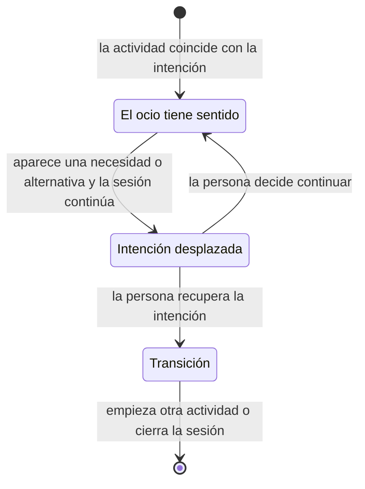

# Anexo A. Entrevistas: pauta, corpus y análisis

Ocho entrevistas semiestructuradas, hechas en persona en Santiago el 11 y el 12 de junio de 2026, con personas de 19 a 27 años. Este anexo reúne la pauta, la síntesis anonimizada de cada entrevista y el análisis que sostiene el capítulo 7: el método, el libro de 23 códigos, la lectura de cada caso y la comparación que dio los dos tipos de usuario.

## A.1 Pauta y condiciones

**Tabla A1**

*Ficha del levantamiento*

| Dimensión | Registro |
| --- | --- |
| Técnica | Entrevista semiestructurada, hablada y presencial |
| Participantes | Ocho personas, anonimizadas como Persona 1 a Persona 8 |
| Fechas y lugar | 11 y 12 de junio de 2026, en Santiago de Chile |
| Edades | 19, 19, 20, 21, 21, 22, 22 y 27 años |
| Convocatoria | Por referencias de contactos cercanos; el único criterio común fue la edad |
| Consentimiento | Informado y oral |
| Preguntas | Todas las formuló el investigador, también las repreguntas |
| Registro | Transcripción posterior, con ortografía y puntuación regularizadas |

*Nota.* Elaboración propia.

La pauta se escribió cuando el proyecto trabajaba sobre una idea anterior: un objeto donde dejar el teléfono, que después mostraría una señal del descanso. Por eso no pregunta directamente por otra actividad que la persona quisiera hacer; esa categoría surgió en el análisis.

### Secuencia principal

1. ¿Cómo suelen ser tus tardes o noches entre semana cuando no tienes obligaciones?
2. ¿Qué actividades te ayudan a desconectarte o a descansar?
3. Piensa en la última vez que usaste el teléfono para entretenerte, no para trabajar ni estudiar. ¿Cuándo fue y qué hiciste?
4. ¿Cómo describirías cómo te sentiste mientras realizabas esa actividad?
5. ¿Cómo te sentiste al terminar esa sesión?
6. Si alguien te hubiera preguntado al día siguiente qué hiciste esa tarde, ¿qué le habrías respondido?
7. ¿Ese tiempo contó como descanso para ti? ¿Por qué?
8. ¿Has tenido alguna vez la sensación de pasar tiempo entretenido en el teléfono y luego no poder describir bien qué hiciste?
9. ¿Hay actividades de tiempo libre que te parezcan más válidas que otras? ¿Por qué?
10. ¿Qué tendría que ocurrir para que terminaras una tarde de ocio y sintieras que fue tiempo bien gastado?
11. ¿Hay algo sobre tu tiempo libre o tu relación con el teléfono que no te haya preguntado y consideres relevante?

### Bloque final

12. ¿Alguna vez intentaste descansar sin celular? ¿Qué estrategias usaste?
13. ¿Cómo reaccionarías a la idea de depositar el teléfono en un objeto y luego recibir una señal de ese descanso? ¿Qué tendría que mostrar para que no se sintiera como castigo?

Las repreguntas cambiaron según cada respuesta: sirvieron para aclarar significados, pedir ejemplos y reconstruir episodios concretos. Las respuestas a las preguntas 12 y 13 se registraron en notas y se integraron después al registro.

**Alcance.** Es un levantamiento cualitativo y exploratorio: describe ocho casos y no representa a los adultos jóvenes. Como la transcripción se regularizó y las notas originales de las preguntas 12 y 13 ya no están disponibles, las respuestas se usan como paráfrasis y no como citas textuales.

## A.2 Síntesis de las entrevistas

Cada respuesta está resumida en tercera persona, sin nombres y con el número de su pregunta; cuando el investigador repreguntó, la respuesta sigue en la misma línea. Las respuestas breves o no contestadas se conservan como tales. Las expresiones coloquiales o de autodiagnóstico, como «dopamina» o «uso adictivo», son de las personas y no categorías del análisis.

### Persona 1 · 21 años · 12 de junio

**1.** Jugar, disfrutar tiempo con sus perros y ver películas o series. Al repreguntarle por el tiempo con sus perros, explicó que consiste en disfrutar con ellos, porque ellos estarán una parte de su vida, pero para ellos será toda su vida.

**2.** Hacer ejercicio y cocinar. Al repreguntarle cuándo se desconecta, respondió que cuando está concentrado haciendo lo que le gusta; si se desconcentra, algo puede salir mal.

**3.** Hace unos días leyó manga en el teléfono. Al repreguntarle por qué decidió leer, lo describió como un momento tranquilo, buscando una dopamina más saludable.

**4.** Feliz, tranquilo y reflexivo. Al repreguntarle por la reflexión, dijo que depende del manga: algunos contenidos le hacen reflexionar.

**5.** Satisfecho con usar su tiempo para cosas mejores. Al repreguntarle cuáles, mencionó leer, en vez de ocupar el teléfono para TikTok o actividades similares.

**6.** Dormir.

**7.** Sí, porque ya había hecho cosas temprano. Al repreguntarle qué había hecho, mencionó ir a la universidad.

**8.** Sí.

**9.** Considera que toda actividad libre que haga sentir bien es buen tiempo de ocio. Al repreguntarle qué es sentirse bien, lo definió como sentirse feliz y desconectado de las obligaciones.

**10.** Hacer ejercicio, ver una película o practicar algún deporte. Al repreguntarle por el ejercicio, precisó que necesita terminar cansado y adolorido para quedar satisfecho.

**11.** No.

**12.** Cuando lee manga, cocina o hace ejercicio deja el celular aparte porque, si está cerca, termina mirándolo. A veces lo deja cargando en otra pieza o en silencio.

**13.** Le serviría si fuera simple. Valora recibir una marca o imagen que le recuerde que estuvo leyendo, cocinando o con sus perros.

### Persona 2 · 22 años · 12 de junio

**1.** Descansa, ve videos y revisa redes sociales. Al repreguntarle por los contenidos, dijo que son memes o temas de su interés, generalmente para reírse.

**2.** Acostarse a ver videos, jugar en el computador o estar con su pareja. Al repreguntarle qué videos la desconectan, mencionó los de humor.

**3.** Durante la entrevista se puso a ver memes en Instagram al acostarse.

**4.** Se sintió tranquila hasta que tuvo sueño. Al repreguntarle si siguió en el teléfono, reconoció que era momento de dormir y, aunque tenía mucho sueño, siguió frente a la pantalla.

**5.** Más o menos.

**6.** Podría relatar con claridad la secuencia: después de clases trabajó en la casa de su pareja, vieron una serie y terminó el día viendo videos o memes en Instagram antes de dormir.

**7.** No tanto, porque tenía sueño y aun así decidió seguir en el celular.

**8.** A veces, pero muy poco.

**9.** Considera más válidas las actividades de interés personal que no consisten en permanecer desplazándose por el celular. Al repreguntarle qué actividad le parece productiva, la describió como una que permita desconectarse y se sienta plena, y mencionó manualidades, pintura y dibujo.

**10.** No tener obligaciones al llegar a casa para no utilizar tiempo crucial; disponer de los materiales necesarios, desconectarse del celular y hacer lo que tenga ganas de hacer. Al repreguntarle qué es hacer lo que quiere, lo definió como realizar sus *hobbies* en paz.

**11.** No por el momento.

**12.** Cuando quiere pintar, dibujar o hacer manualidades intenta dejar el teléfono lejos de la cama. También lo pone en silencio para no revisarlo.

**13.** Lo usaría si se percibe como una ayuda que le recuerde que hizo otra actividad y no quedó atrapada en el celular.

### Persona 3 · 19 años · 11 de junio

**1.** Jugar en el computador y practicar artes marciales.

**2.** Dormir, ver una serie, jugar en el computador y meditar. Al repreguntarle por la desconexión al jugar, dijo que disfruta saber que no tiene la presión de hacer algo.

**3.** Ese día miró videos humorísticos en Instagram.

**4.** Sintió que estaba matando el tiempo sin ser consciente de él. Al repreguntarle si notó el paso del tiempo, dijo que no tenía noción del tiempo mientras lo hacía.

**5.** No se sintió mal ni bien; pensó que tenía mejores cosas que hacer. Al repreguntarle por esas otras cosas, dijo que sentía que perdía parte del día viendo el celular.

**6.** Habría dicho la verdad, pero no especificó el contenido del relato.

**7.** Sí contó como descanso porque no hizo lo que debía y se despejó de las responsabilidades. Al repreguntarle por sus obligaciones, dijo que sabía que tenía algo pendiente y aun así continuó descansando.

**8.** Le suele ocurrir y le provoca sentirse un poco mal consigo mismo. Al repreguntarle por qué, dijo que piensa que podría haber hecho algo más productivo.

**9.** Considera todas las actividades igualmente válidas, aunque algunas entregan habilidades aplicables a la vida cotidiana.

**10.** Invertir el ocio en actividades que le hagan crecer o entreguen un beneficio. Al repreguntarle por el beneficio, habló de actividades que le hagan sentirse pleno o sentir que vive.

**11.** Considera relevante la normalización de perder tiempo con el celular y luego sentir que podría haber hecho algo mejor. Al repreguntarle en qué situaciones, mencionó permanecer bastante tiempo viendo memes o contenido en TikTok o Instagram.

**12.** Cuando entrena, juega en el computador o medita intenta dejar el celular lejos. A veces activa no molestar, pero si está cerca vuelve a tomarlo para revisar Instagram.

**13.** Le parece útil una señal tranquila al retirar el teléfono, como una luz o una forma, que ayude a reconocer un descanso real.

### Persona 4 · 22 años · 11 de junio

**1.** Ver una película o estar en el teléfono. Al repreguntarle qué hace en el teléfono, mencionó revisar redes sociales.

**2.** Pasear a su perro y escuchar música tranquila o enérgica.

**3.** Ese día jugó sudoku en el teléfono.

**4.** Tranquila.

**5.** Concentrada y relajada. Al repreguntarle por la concentración, explicó que el juego exigía atención y que, al terminar, pudo enfocarse en su entorno.

**6.** Diría que no hizo nada porque considera que jugar es técnicamente una forma de no hacer nada.

**7.** Sí contó como descanso: ocupó su mente sin estrés ni mal humor.

**8.** Le ocurre muchas veces, especialmente con TikTok. Al repreguntarle por qué le cuesta contarlo, dijo que ve muchos videos, pero luego no permanece contenido en su mente.

**9.** Considera más válidos caminar o hacer ejercicio porque mantienen el cuerpo activo y dejan tiempo para pensar.

**10.** Estudiar, porque le gusta, mantiene su mente ocupada y aprende.

**11.** La conversación le hace replantear su relación con el teléfono y piensa que podría existir un uso adictivo.

**12.** Cuando pasea a su perro o quiere concentrarse deja el celular en casa o lo silencia. También ha borrado TikTok temporalmente.

**13.** Le daría curiosidad probar el objeto, especialmente respecto de TikTok, y preferiría una señal calmada.

### Persona 5 · 20 años · 11 de junio

**1.** Pasa tiempo en TikTok, Instagram y Facebook.

**2.** Ordenar su pieza, peinar sus muñecas y estar con el celular. Al repreguntarle por sus muñecas, las asoció con la calma.

**3.** Durante la entrevista veía TikTok, específicamente videos de God of War.

**4.** Entretenida.

**5.** Aburrida, sin nada que hacer.

**6.** Nada.

**7.** Tal vez sí y tal vez no; no siente que descanse mucho viendo tragedias, en referencia a noticias sobre el gobierno.

**8.** Sí.

**9.** Considera más válida cualquier actividad distinta de estar en el celular porque permite hacer cosas productivas. Al repreguntarle qué es productivo, mencionó ordenar, hacer ejercicio o algo que ayude a la vida.

**10.** Hacer algo productivo y no estar todo el tiempo con el celular. Al repreguntarle qué actividades, mencionó ordenar, limpiar o aprender algo nuevo.

**11.** No.

**12.** Cuando ordena su pieza o peina sus muñecas deja el celular en la cama o en otro lugar, pero vuelve a mirarlo. A veces lo pone a cargar para no tenerlo en la mano.

**13.** Anticipa que al principio le costaría dejar el celular. Preferiría que la señal mostrara dibujos u otra representación visual.

### Persona 6 · 27 años · 11 de junio

**1.** Jugar, leer, realizar videollamadas y cenar con su familia. Al repreguntarle cómo juega, contó que se instala con algo para comer y beber y comprueba si alguien está disponible para jugar.

**2.** Escuchar música, armar maquetas y resolver sudoku, principalmente durante la noche.

**3.** El día anterior estuvo varias horas en videollamada con una amiga que vive fuera del país. Al repreguntarle qué hicieron, contó que conversaron sobre su semana, jugaron y planearon otra llamada.

**4.** Contenta, porque hacía tiempo que no hablaba con su amiga por videollamada. Al repreguntarle de qué hablaron, mencionó los acontecimientos de la semana y experiencias personales.

**5.** Con ganas de repetir la videollamada. Al repreguntarle por qué, habló de emoción y nostalgia.

**6.** Diría que estuvo en videollamada con una amiga muy cercana y podría describir temas como universidad, trabajo, viajes y salidas.

**7.** Sí contó como descanso: fue un momento de relajo sin preocupación ni límite de tiempo, con una persona de confianza.

**8.** Sí le ha ocurrido no poder describir bien otros usos del teléfono.

**9.** Algunas actividades parecen más válidas porque puede sentir que desaprovechó horas en acciones rutinarias que realiza todos los días. Al repreguntarle por ejemplos, mencionó revisar redes sociales o escuchar música en la cama.

**10.** No pensar en trabajo ni estudios y concentrarse por completo en leer, construir u otra actividad.

**11.** No.

**12.** Cuando lee o arma maquetas, el sonido del teléfono cercano le resulta molesto.

**13.** Usaría el objeto principalmente en momentos en que permanece mirando redes sin pensar.

### Persona 7 · 21 años · 11 de junio

**1.** Jugar videojuegos o salir en bicicleta según factores como lluvia y frío.

**2.** Jugar fútbol, por el ambiente competitivo y la simplicidad material del juego.

**3.** Media hora antes de la entrevista veía en YouTube un podcast de fútbol mientras comía.

**4.** Se sintió normal y a veces complacido por comentarios humorísticos espontáneos.

**5.** Normal, sin una emoción predominante.

**6.** Diría que no hizo nada interesante, entendido como nada fuera de lo común; recuerda que vio YouTube mientras comía.

**7.** Sí contó como descanso porque no tenía obligaciones y estaba enfocado en YouTube y en comer, sin otra actividad en mente.

**8.** No experimenta una laguna mental después de usar el teléfono.

**9.** Defiende que cada persona utilice su tiempo libre como quiera, aunque reconoce que algunos pasatiempos pueden afectar la salud o ser socialmente invalidados.

**10.** Considera bien gastada cualquier tarde de ocio sin obligaciones pendientes.

**11.** Propone considerar cómo el teléfono afecta la convivencia familiar: facilita la comunicación, pero puede reducir el tiempo compartido.

**12.** Cuando sale en bicicleta o juega fútbol el teléfono permanece guardado. En casa a veces lo deja en el comedor o activa no molestar, pero no es una rutina fija.

**13.** No sabe si lo necesitaría diariamente, aunque lo probaría. Exige una señal discreta, sin nota ni comparación entre días.

### Persona 8 · 19 años · 11 de junio

**1.** Jugar en el computador o dormir; su rutina varía poco.

**2.** Estar en el computador, jugar, escuchar música, leer o dormir.

**3.** Durante la entrevista estaba mirando Instagram y consumía lo primero que aparecía en el *feed*.

**4.** Tranquilidad, entendida como relajarse porque no tenía algo que hacer.

**5.** Relajada o normal, sin una sensación específica.

**6.** Diría que se quedó viendo videos o Instagram y recuerda contenidos variados como noticias, memes y videoblogs.

**7.** Sí contó como descanso porque hacía algo que le gusta sin sentir que faltaba una obligación; esa condición aparece cuando está al día con sus tareas.

**8.** Sí le cuesta describirlo porque la rutina termina siendo siempre la misma: videos e Instagram.

**9.** No considera unas actividades universalmente más válidas que otras; las personas tienen cantidades distintas de tiempo libre y hacen el *hobby* que pueden realizar.

**10.** Haber terminado sus deberes y poder avanzar en actividades deseadas, como completar un juego, una lectura o un dibujo.

**11.** En lugar de responder, pregunta si las personas tienen hoy más o menos tiempo libre que antes. Se registra como respuesta no contestada.

**12.** Cuando juega en el computador o lee, el celular puede permanecer cerca sin que siempre lo mire. Si tiene tareas, lo silencia o guarda para no abrir Instagram sin advertirlo.

**13.** Le resultaría extraño al principio, pero podría ayudar a interrumpir el hábito de revisar Instagram. Preferiría una imagen o luz tranquila.

## A.3 Método de análisis

El análisis buscó dos cosas: comparar a cada persona como un caso completo y encontrar patrones entre casos, sin reducirlos a mucho o poco uso del teléfono. Siguió cuatro capas, cada una cerrada antes de abrir la siguiente:

1. **Análisis Framework** (Goldsmith, 2021). Una matriz con las ocho personas en las filas y los temas en las columnas, armada en cinco momentos: familiarización, marco analítico, indexación, matriz e interpretación. Los temas combinaron dimensiones fijadas de antemano —si la sesión fue decidida o automática, la percepción del tiempo, el recuerdo, la existencia de una alternativa valorada, el conflicto posterior, el contexto, las estrategias previas, la reacción ante una intervención física y la autonomía— con códigos que surgieron de la lectura.
2. **Tipos ideales** (Stapley et al., 2022). Un tipo ideal reúne un patrón coherente observado en varios casos; no describe a una persona promedio. Se reconstruyó cada caso, se armaron tipos provisionales, se identificaron los casos que mejor los expresan, se describieron, se comprobó su credibilidad y se compararon. Cada tipo exige más de una evidencia y registra los casos mixtos y la evidencia contraria.
3. **Perfiles situacionales.** Cada tipo se tradujo en condiciones, necesidades y límites que pueden aparecer en momentos distintos de una misma persona, sin nombre, fotografía ni biografía.
4. **Recorridos.** La experiencia actual, sin Relevo, y un escenario con Relevo, planteado como hipótesis de diseño.

El análisis usó tres unidades: el caso, que es la entrevista completa; el episodio, una sesión o situación concreta, y el fragmento, la respuesta que respalda un código. Los tipos se construyeron sobre casos y episodios, no sobre frases sueltas.

**Tabla A2**

*Niveles de confianza*

| Nivel | Cuándo se asigna | Cómo se usa |
| --- | --- | --- |
| Alto | Contenido explícito y en contexto en la transcripción, o dato confirmado por el autor | En el análisis y la redacción |
| Medio | Interpretación respaldada por más de un fragmento, que requiere síntesis | Como hallazgo, siempre con la persona y la pregunta que lo respaldan |
| Bajo | Pasaje ambiguo, contradicción no resuelta o inferencia sin respuesta directa | Como pregunta o memo, nunca como conclusión |

*Nota.* Elaboración propia.

Cinco reglas acompañaron todo el análisis:

- cada código tiene definición, criterio de inclusión y de exclusión, ejemplo y fecha de cambio;
- un memo registró lo que el investigador esperaba encontrar, para buscar activamente los casos que contradicen la propuesta;
- cada síntesis remite a su persona y su pregunta;
- la cantidad de menciones no se lee como frecuencia en la población, y no se calculan porcentajes;
- la ausencia de una mención no se lee como ausencia del fenómeno.

## A.4 Libro de códigos

El libro define 23 códigos para reconocer cómo se relacionan el tipo de actividad, la intención previa, la continuidad de la sesión, el recuerdo, la valoración del ocio y la disposición ante una intervención *phygital*. Los códigos pueden coexistir en un mismo episodio, y una misma persona puede mostrar patrones distintos según la situación. Se agrupan en seis familias: el contexto, la forma del episodio, la intención y cómo termina —el tiempo, el recuerdo y el cierre—, las normas sobre el ocio, las estrategias actuales y la relación con la propuesta.

Se codificó con ocho reglas:

1. Codificar lo dicho, no una causa psicológica supuesta.
2. Leer cada respuesta en su contexto, no como una frase aislada.
3. Distinguir el uso digital dirigido, el de continuidad y el relacional.
4. No equiparar recuerdo débil con malestar, ni recuerdo claro con una experiencia valiosa.
5. No inferir una intención desplazada sin una meta, necesidad o alternativa reconocible.
6. Registrar tensión y descanso a la vez cuando la persona expresa ambas cosas.
7. Conservar los casos que no necesitan intervención.
8. Tratar los juicios de productividad como una norma de la persona, no como una verdad del análisis.

**Tabla A3**

*Libro de códigos*

| Código | Qué marca | Evidencia |
| --- | --- | --- |
| **Contexto** | | |
| Obligación pendiente | Una obligación, necesidad corporal o meta compite con la sesión. | Persona 2, preguntas 4 y 7: tenía sueño y siguió mirando el celular. |
| Sin obligaciones pendientes | La persona no tiene obligaciones pendientes y legitima el ocio desde ahí. | Persona 7, preguntas 7 y 10; Persona 8, pregunta 7. |
| Teléfono cerca | La cercanía del teléfono favorece revisarlo o retomarlo. | Personas 1, 3 y 5, pregunta 12. |
| **Forma del episodio** | | |
| Uso dirigido | Actividad digital con contenido, propósito o cierre reconocible. | Persona 1, preguntas 3 y 4; Persona 4, preguntas 3 a 5. |
| Uso de continuidad | Consumo guiado por un *feed* o una rutina, sin un final que decida la persona. | Persona 3, preguntas 3 y 4; Persona 5, preguntas 3 a 5; Persona 8, preguntas 3 y 8. |
| Uso relacional | Uso digital cuyo valor principal es la relación con otras personas. | Persona 6, preguntas 3 a 7. |
| Alternativa valorada | Actividad que la persona valora y podría hacer si la intención vuelve a estar disponible. | Persona 2, preguntas 9 y 10; Persona 3, preguntas 5 y 10; Persona 8, pregunta 10. |
| **Intención, tiempo, recuerdo y cierre** | | |
| Intención clara | La sesión coincide con una decisión reconocible de la persona. | Persona 1, preguntas 3 y 4; Persona 6, preguntas 3 a 7. |
| Intención desplazada | Aparece una intención, necesidad o alternativa que la persona reconoce y no ejecuta. | Persona 2, preguntas 4 y 7; Persona 3, preguntas 5 y 7. |
| Pérdida de la noción del tiempo | Disminuye la conciencia del paso del tiempo. | Persona 3, preguntas 4 y 11. |
| Recuerdo claro | El episodio se narra con contenido, secuencia o contexto específicos. | Persona 2, pregunta 6; Persona 6, preguntas 3 y 6. |
| Recuerdo débil | El episodio queda reducido a una fórmula general, una rutina o una dificultad explícita para describirlo. | Personas 4 y 8, pregunta 8. |
| Cierre positivo | El episodio termina con satisfacción, descanso, conexión, concentración o ganas de repetirlo. | Persona 1, pregunta 5; personas 4 y 6, preguntas 5 y 7. |
| Cierre ambivalente o negativo | El cierre es neutro, ambivalente o negativo: aburrimiento, pérdida, autocrítica o descanso incompleto. | Persona 2, preguntas 5 y 7; Persona 3, pregunta 5; Persona 5, preguntas 5 a 7. |
| **Normas sobre el ocio** | | |
| Ocio medido por su productividad | La persona jerarquiza el ocio según productividad, aprendizaje, salud o beneficio. | Personas 3 y 5, preguntas 9 y 10. |
| Autonomía del ocio | La persona considera legítimo su ocio y rechaza una jerarquía universal. | Persona 7, preguntas 9 y 10; Persona 8, pregunta 9. |
| **Estrategias actuales** | | |
| Separación física | Separación material entre la persona y el teléfono. | Personas 1, 2 y 7, pregunta 12. |
| Ajuste digital | Un ajuste digital para revisar menos: silencio, no molestar, ocultar o borrar una app. | Personas 3, 4 y 8, pregunta 12. |
| Estrategia frágil | La estrategia no se sostiene o depende de una situación excepcional. | Personas 3, 5 y 7, pregunta 12. |
| **Relación con la propuesta** | | |
| Aceptación con condiciones | Disposición a probar el objeto con condiciones explícitas: simple, discreto, de ayuda y sin castigo. | Personas 1, 2 y 7, pregunta 13. |
| Sin necesidad de intervenir | La persona delimita situaciones en que el objeto no haría falta. | Personas 6 y 7, pregunta 13. |
| Señal breve | Preferencia por una señal breve que haga perceptible el descanso sin evaluarlo. | Personas 1, 3 y 8, pregunta 13. |
| Dificultad para separar el teléfono | Riesgo de rechazo, dificultad o ansiedad ante separar el teléfono. | Personas 5 y 8, pregunta 13. |

*Nota.* Elaboración propia.

### Cuatro distinciones

- **Recuerdo débil no es usuario principal.** La Persona 8 reconoce que su rutina en Instagram es difícil de describir, pero descansa cuando está al día y no expresa arrepentimiento.
- **Recuerdo claro no elimina el conflicto.** La Persona 2 recuerda el episodio con detalle y, aun así, siguió en el teléfono después de reconocer que debía dormir.
- **Uso digital no es continuidad inercial.** Leer manga, resolver un sudoku, hablar por videollamada o ver un pódcast son usos digitales dirigidos o relacionales.
- **La productividad no es un criterio del proyecto.** Las personas 3 y 5 la usan para evaluar su ocio; las personas 7 y 8 defienden su autonomía. El análisis registra ambas posiciones.

## A.5 Cada caso

Cada entrevista se leyó primero como un caso completo, antes de comparar entre personas. Un caso no es todavía un tipo: una misma persona puede aportar a más de un patrón.

**Persona 1. Ocio digital dirigido, en contraste con el *feed*.** Leer manga en el teléfono fue tranquilo, reflexivo y satisfactorio, y lo contrapone a TikTok. Cuando lee, cocina o hace ejercicio separa el teléfono, porque si está cerca lo mira. El teléfono no es el problema: la dificultad aparece en episodios menos delimitados. Queda abierto qué quiso decir al resumir la tarde como dormir (pregunta 6). *Códigos:* uso dirigido, alternativa valorada, intención clara, recuerdo débil, cierre positivo, autonomía del ocio, teléfono cerca, separación física, aceptación con condiciones y señal breve. *Confianza:* media-alta.

**Persona 2. La continuidad desplaza el sueño.** Abrió Instagram al acostarse, reconoció que debía dormir y siguió. Recuerda la sesión con detalle y la evalúa como más o menos: el conflicto no viene del olvido, sino de una necesidad reconocida que no cambia la conducta. Es la evidencia más clara de que Relevo no debe definirse solo por un recuerdo débil. *Códigos:* uso de continuidad, alternativa valorada, recuerdo claro, intención desplazada, obligación pendiente, cierre ambivalente o negativo, ocio medido por su productividad, teléfono cerca, separación física, ajuste digital y aceptación con condiciones. *Confianza:* alta.

**Persona 3. Pierde la noción del tiempo y reconoce otra cosa que hacer.** Vio videos humorísticos sin conciencia del tiempo, sintió que perdía parte del día y que tenía mejores cosas que hacer; aun así, la sesión le sirvió de pausa. Reúne continuidad, pérdida de la noción del tiempo, intención desplazada, recuerdo débil y una valoración negativa. Una intervención que califique ese rato solo como pérdida reforzaría la culpa que el proyecto quiere evitar. *Códigos:* uso de continuidad, alternativa valorada, intención desplazada, pérdida de la noción del tiempo, recuerdo débil, cierre ambivalente o negativo, obligación pendiente, ocio medido por su productividad, teléfono cerca, separación física, ajuste digital, estrategia frágil, aceptación con condiciones y señal breve. *Confianza:* alta para el conflicto; media para atribuir el recuerdo débil a ese episodio.

**Persona 4. Concentración en el sudoku, continuidad en TikTok.** El sudoku en el teléfono fue tranquilo, la concentró y le sirvió de descanso; TikTok, en cambio, es una sucesión de videos que no le quedan en la mente. El mecanismo depende del episodio, no del aparato, y eso respalda una intervención selectiva. Que resuma el juego como no hacer nada muestra una jerarquía del ocio que el sistema no debe reforzar. *Códigos:* uso dirigido, uso de continuidad, intención clara, recuerdo débil, cierre positivo, ocio medido por su productividad, separación física, ajuste digital, aceptación con condiciones y señal breve. *Confianza:* alta.

**Persona 5. Entretenimiento que termina en vacío.** Se entretuvo en TikTok y terminó aburrida; resumiría la tarde como nada. Para ordenar su pieza o peinar sus muñecas deja el teléfono en otro lugar, pero vuelve a mirarlo. Es un caso fuerte para un apoyo situado, siempre que el sistema no convierta su autocrítica en castigo. *Códigos:* uso de continuidad, alternativa valorada, recuerdo débil, cierre ambivalente o negativo, ocio medido por su productividad, teléfono cerca, separación física, estrategia frágil, aceptación con condiciones, señal breve y dificultad para separar el teléfono. *Confianza:* alta para la valoración ambivalente y la estrategia frágil; media para la intención desplazada, porque no nombra una meta concreta durante el episodio.

**Persona 6. Ocio relacional y un criterio selectivo.** Pasó horas en videollamada con una amiga que vive fuera del país: lo recuerda con detalle, terminó con ganas de repetirlo y lo valoró como descanso. Una sesión larga en el teléfono puede ser deseada, memorable y valiosa; la duración no justifica intervenir. Reserva el objeto para cuando mira redes sin pensar, así que su propia distinción sostiene una tipología de episodios, no de personas. *Códigos:* uso relacional, uso de continuidad, intención clara, recuerdo claro, cierre positivo, alternativa valorada, sin necesidad de intervenir y aceptación con condiciones. *Confianza:* alta.

**Persona 7. Autonomía del ocio, sin lagunas.** Vio un pódcast de fútbol mientras comía, lo recuerda y lo considera descanso porque no tenía obligaciones. No experimenta lagunas al usar el teléfono y defiende que cada persona use su tiempo libre como quiera. Es el caso límite de no intervención, y fija condiciones éticas: probaría el objeto si fuera discreto, sin notas ni comparaciones entre días. *Códigos:* uso dirigido, intención clara, recuerdo claro, sin obligaciones pendientes, autonomía del ocio, cierre positivo, separación física, ajuste digital, sin necesidad de intervenir y aceptación con condiciones. *Confianza:* alta para el episodio; media para otros contextos apenas mencionados.

**Persona 8. Una rutina difícil de narrar, sin malestar.** Revisó Instagram consumiendo lo primero que aparecía; le cuesta describirlo porque siempre es lo mismo, pero lo valora como descanso porque estaba al día. Separa el recuerdo débil del malestar: Relevo solo tendría sentido si la persona declara antes otra intención. *Códigos:* uso de continuidad, recuerdo débil, cierre positivo, sin obligaciones pendientes, autonomía del ocio, alternativa valorada, ajuste digital, aceptación con condiciones, señal breve y dificultad para separar el teléfono. *Confianza:* alta para la ausencia de malestar; media para la necesidad futura del objeto.

Los ocho casos dejan cuatro hallazgos:

1. El *feed* continuo aparece con pérdida de la noción del tiempo, dificultad para narrar o un cierre ambivalente, pero no siempre con malestar.
2. Las actividades digitales dirigidas o relacionales pueden recordarse, descansar y coincidir con la intención.
3. El conflicto que importa ocurre cuando una intención ya reconocida deja de orientar la acción.
4. La aceptación del objeto depende de que sea selectivo, simple, tranquilo y sin castigo.

## A.6 Dos tipos de usuario

La comparación entre casos definió dos tipos situacionales: patrones de experiencia que pueden aparecer en personas distintas y en momentos distintos de una misma persona. No son segmentos demográficos.

1. **Usuario principal: continuidad digital con intención desplazada.**
2. **Usuario límite: el ocio digital tiene sentido.** Marca cuándo la propuesta no debe intervenir y protege el alcance ético y funcional del proyecto.

Se compararon dos estructuras: dividir el público en dos variantes —por ejemplo, olvido y culpa frente a no lograr empezar— o definir un patrón que justifica apoyo y otro que delimita cuándo no intervenir. Se eligió la segunda (Tabla A4).

**Tabla A4**

*Las dos estructuras comparadas*

| Criterio | Dos variantes del público | Usuario principal y usuario límite |
| --- | --- | --- |
| Ajuste a las ocho entrevistas | Separa tensiones que suelen coexistir en un mismo caso | Explica el contraste entre episodios con y sin conflicto |
| Casos contradictorios | Tiende a dejar fuera a las personas 6 y 7, y en parte a la 8 | Los integra como evidencia de no intervención |
| Utilidad para diseñar | Imagina funciones, pero no dice cuándo callar | Define la oportunidad y el límite del sistema |
| Riesgo ético | Puede convertir todo ocio digital en un problema | Reduce el paternalismo y las falsas alarmas |
| Relación con el corpus | Clasifica personas | Respeta que las personas 4 y 6 tienen ambos patrones, según el episodio |

*Nota.* Elaboración propia.

La intención desplazada explica la pertinencia del proyecto mejor que el tiempo de pantalla, la app usada o el recuerdo por separado:

- La Persona 2 recuerda con claridad y, aun así, sigue después de reconocer que necesita dormir.
- La Persona 8 tiene una rutina difícil de describir, pero la valora como descanso y no expresa conflicto.
- La Persona 6 mantiene una videollamada extensa, memorable y significativa: la duración no es el problema.
- La Persona 4 distingue, en el mismo teléfono, un sudoku dirigido de un TikTok difícil de recordar.

El sistema no puede decidir desde fuera que una pantalla es un problema. Relevo tiene valor cuando ayuda a recuperar una intención que ya es de la persona.

### Usuario principal: continuidad digital con intención desplazada

Una sesión de ocio digital empieza o continúa mientras una intención, necesidad o alternativa valorada deja de orientar la acción: la persona sabe que quiere dormir, hacer otra cosa o cerrar la sesión, y la continuidad del teléfono sostiene lo que ya está haciendo. No requiere olvido, ni que el episodio haya sido desagradable.

- **Evidencia central:** Persona 2, que reconoce su sueño y sigue; Persona 3, que pierde la noción del tiempo y tiene mejores cosas que hacer, y Persona 5, que pasa del entretenimiento al aburrimiento, con estrategias frágiles.
- **Evidencia complementaria:** Persona 4 con TikTok; Persona 6 cuando mira redes sin pensar; Persona 8 cuando abre Instagram sin darse cuenta teniendo tareas, y Persona 1 cuando el teléfono queda cerca.
- **Cuándo está presente:** convergen una sesión en continuidad, una intención o alternativa reconocible, la dificultad para convertirla en una transición y una consecuencia que importa a la persona, como un cierre ambivalente, malestar, tiempo perdido o una estrategia fallida. No basta con observar una app o una duración.
- **Lo que necesita:** recuperar a tiempo una intención ya formulada, una transición breve entre reconocer y actuar, poder seguir sin sanción, depender menos de la fuerza de voluntad y una señal comprensible que no convierta el ocio en rendimiento.
- **Lo que puede hacer Relevo:** apoyar una transición que la persona definió antes, haciendo perceptible su intención.
- **Lo que el sistema no debe suponer:** que toda sesión larga es indeseada, que toda red social produce conflicto, que la persona quiere ser interrumpida cada vez, que una actividad no productiva no vale, que el recuerdo débil es un daño o que seguir es siempre un error.

### Usuario límite: el ocio digital tiene sentido

La actividad digital coincide con lo que la persona quiere o cumple una función aceptada: descanso, relación, concentración o entretenimiento. No hay otra necesidad reconocida, o la persona decide seguir de acuerdo con sus prioridades. El episodio puede ser largo, cotidiano, neutro o difícil de resumir: pesa más la ausencia de conflicto que una norma externa sobre cómo usar el tiempo.

- **Evidencia central:** Persona 6, con la videollamada, y Persona 7, con el pódcast sin obligaciones pendientes.
- **Evidencia complementaria:** Persona 1 con el manga, Persona 4 con el sudoku y Persona 8 con Instagram cuando está al día.
- **Lo que necesita:** conservar la autonomía sobre su ocio, no ser juzgado por la duración, la app o la productividad, poder desactivar, ignorar o posponer cualquier señal y ninguna comparación de desempeño.
- **Lo que le haría daño:** que se interrumpa una conversación, un juego o una lectura; una falsa alarma por tiempo o por app; convertir el descanso en una tarea medible, y la sensación de vigilancia.
- **Lo que implica para Relevo:** el comportamiento correcto puede ser no actuar. Sin una intención declarada, o si la persona decide seguir, el sistema calla y no juzga.

**Figura A1**

*Cómo pasa una persona de un tipo a otro*

*Nota.* Elaboración propia. El cambio depende de la intención de la persona, no de una clasificación automática de la app.

**Tabla A5**

*Los dos tipos, comparados*

| Dimensión | Usuario principal | Usuario límite |
| --- | --- | --- |
| Relación con la sesión | Quiere o necesita cambiar, pero continúa | Quiere continuar o acepta la actividad |
| Recuerdo | Claro o débil | Claro o débil |
| Afecto | Entretenimiento y luego ambivalencia | Positivo o neutro |
| Obligación | Hay una necesidad o alternativa activa | No hay, o ya se resolvió |
| Estrategia | Frágil o dependiente del autocontrol | Puede no necesitar ninguna |
| Qué hace Relevo | Devolver la intención y apoyar la transición | Callar, o quedar disponible si se pide |
| Riesgo principal | No actuar cuando la persona pide apoyo | Interrumpir, juzgar o convertir el descanso en rendimiento |

*Nota.* Elaboración propia.

## Referencias

Goldsmith, L. J. (2021). Using framework analysis in applied qualitative research. *The Qualitative Report, 26*(6), 2061–2076. https://doi.org/10.46743/2160-3715/2021.5011

Stapley, E., O’Keeffe, S. y Midgley, N. (2022). Developing typologies in qualitative research: The use of ideal-type analysis. *International Journal of Qualitative Methods, 21*, Artículo 16094069221100633. https://doi.org/10.1177/16094069221100633

## Registro de cambios (disclaimer)

### 2026-11-08 — Extranjerismos en cursiva

- **Qué cambió:** *wireframes*, *feed* y *hobbies* van en cursiva, como en la memoria.
- **Cómo estaba antes:** iban en redonda.
- **Por qué:** el autor pidió corregir los errores de formato (D-170).

### 2026-11-08 — Repreguntas en frases

- **Qué cambió:** las 31 repreguntas se escriben como frases —por ejemplo, «Al repreguntarle si notó el paso del tiempo, dijo que no tenía noción del tiempo mientras lo hacía»—, con el tema registrado en el corpus y sin inventar la pregunta textual, que no se conservó.
- **Cómo estaba antes:** cada repregunta llevaba un rótulo con su tema, como «Repregunta — conciencia temporal:», que no se entendía.
- **Por qué:** el autor pidió poner bien las repreguntas y hablar de lo visual con terminología de diseñador: tipografía y paleta cromática, no letras, fuentes ni texto (D-170).

### 2026-11-08 — Correcciones del autor

- **Qué cambió:** las personas entrevistadas se nombran Persona 1 a Persona 8; las respuestas llevan el número de su pregunta; el libro de códigos usa nombres en vez de siglas, agrupados en sus seis familias, con la evidencia escrita en palabras; los dos tipos se llaman usuario principal y usuario límite, como en la memoria; menos «elegido», y sin la nota que remitía al repositorio.
- **Cómo estaba antes:** las personas eran P1 a P8; las preguntas, Q1 a Q13; los códigos, siglas como C-OBL-PEND, con evidencia del tipo «P2-Q4/Q7»; los tipos, U1 y U2.
- **Por qué:** el autor revisó los anexos y pidió un texto sin códigos ni menciones al repositorio, con palabras claras y la declaración de IA corregida (D-170).

### 2026-11-08 — Anexo recopilado y listo para Word

- **Qué cambió:** el anexo pasa a ser una recopilación directa y es, desde ahora, la fuente que el constructor lee para armar el HTML, el PDF y el Word. Conserva la ficha, la pauta completa y la síntesis de las ocho entrevistas, con el texto del corpus en un párrafo por pregunta; el método queda en pasado y en sus cuatro capas; el libro de 23 códigos, en una tabla de tres columnas; cada caso, en un párrafo, y los dos tipos, con sus tablas. Las tablas y la figura se numeran A1 a A5 y Figura A1.
- **Cómo estaba antes:** copiaba completos seis documentos fuente, unas 9700 palabras, con un encabezado por pregunta, el método en futuro, una mención a «cuatro capas» que solo mostraba dos y advertencias repetidas en cada sección.
- **Por qué:** el autor pidió revisar todos los anexos y dejarlos listos para Word: directos, sin sobreexplicar, con su forma de escribir y con lo más relevante (D-168).

### 2026-10-24 — Creación

- **Qué cambió:** el anexo se arma desde sus documentos fuente, con el resto de los anexos A–I de la memoria v5.
- **Cómo estaba antes:** la carpeta de anexos solo tenía un README de la v4, con cinco anexos y sin su contenido.
- **Por qué:** el autor pidió elegir un pendiente de prioridad alta y terminarlo; la memoria v5 remite a nueve anexos que no estaban armados.
