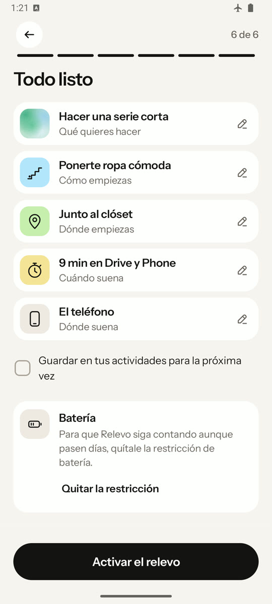
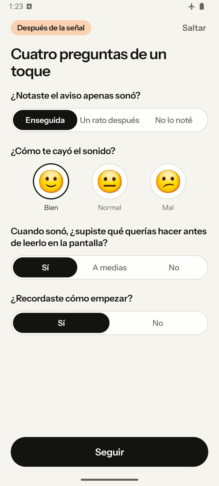
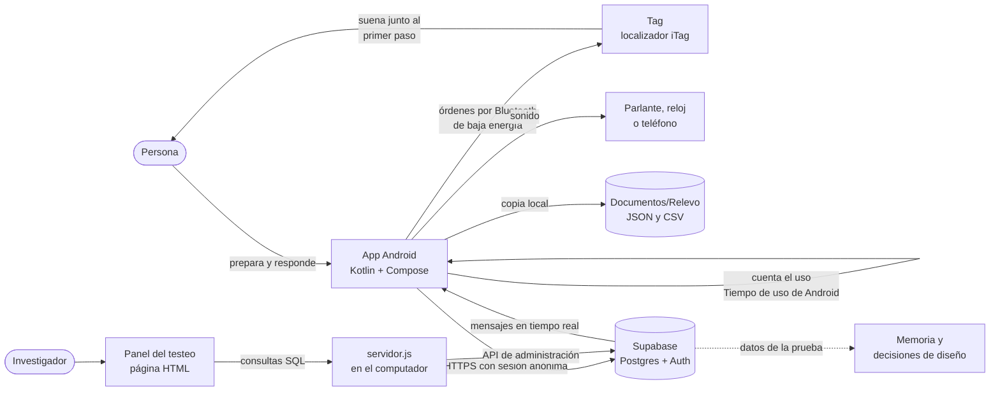
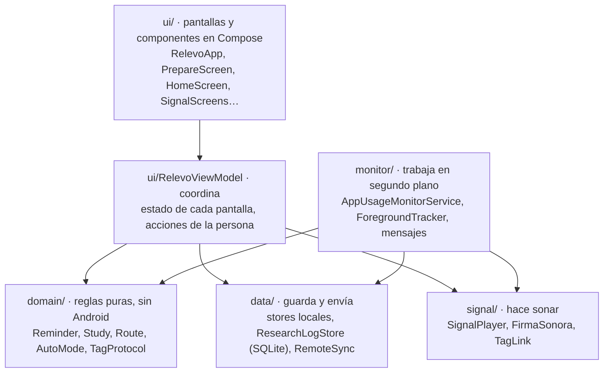
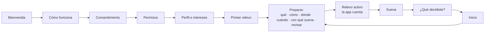
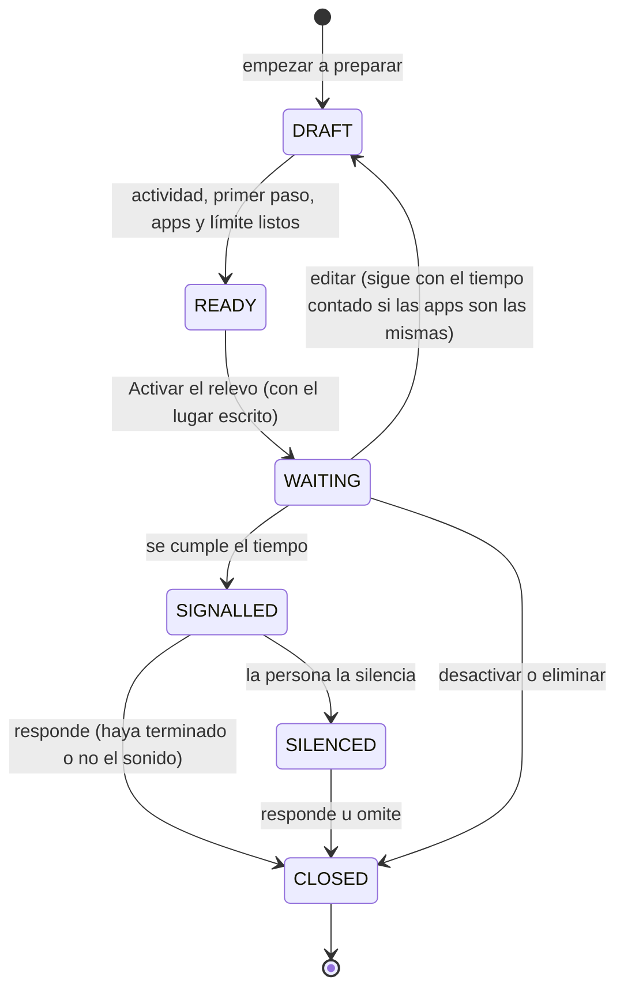

# Anexo G. Prototipo Android y registro de versiones

> Parte de los [anexos de la memoria](README.md). Se genera con `node construir-anexos.js` desde sus documentos fuente: para corregirlo, se corrige la fuente y se vuelve a generar.

Describe el prototipo funcional: la app Android, su conexión con el Tag, la base de datos de la prueba y el panel, con el registro de las versiones desde la 2.7, la primera preparada para la prueba de 21 días. La descripción técnica es la del 18 de octubre de 2026; la versión 3.3 suma la semana para comparar sobre la misma arquitectura.

## G.1 La app en la versión 3.3

Capturas de la app en un teléfono Android: elegir qué hacer, dejar el relevo listo, la señal, las preguntas de un toque y la decisión.

| Inicio | Todo listo | Suena | Cuatro preguntas | ¿Qué decidiste? |
| --- | --- | --- | --- | --- |
|  |  |  |  |  |

## G.2 El sistema completo

**Figura G1**

*Partes de Relevo y cómo se comunican*

*Nota.* Elaboración propia. Las flechas punteadas no son conexiones técnicas: indican que los datos alimentan el análisis.

**Tabla G1**

*Componentes, tecnología y ubicación en el repositorio*

| Componente | Qué hace | Tecnología | Carpeta |
| --- | --- | --- | --- |
| App Android | Prepara relevos, cuenta el uso, hace sonar la señal y registra las respuestas. | Kotlin 2.3, Jetpack Compose, Android 12 o posterior | [`app-android/`](../../06_desarrollo_y_factibilidad/app-android) |
| Tag | Suena junto al primer paso y su botón calla la señal. | Localizador iTag comercial, Bluetooth de baja energía | Lo controla [`TagLink.kt`](../../06_desarrollo_y_factibilidad/app-android/app/src/main/java/com/example/relevo/signal/TagLink.kt) |
| Base remota | Guarda sesiones, eventos, respuestas, uso y mensajes, con reglas por persona. | Supabase: Postgres, autenticación anónima, REST y tiempo real | Esquema inicial en [`base-remota-supabase.sql`](../../06_desarrollo_y_factibilidad/app-android/base-remota-supabase.sql) |
| Panel del testeo | Muestra el estado de cada participante, resultados y mensajes. | Página HTML y JavaScript sin dependencias; servidor Node local | [`panel-admin/`](../../06_desarrollo_y_factibilidad/panel-admin) |
| Copia local | Respaldo legible en el teléfono, que la persona puede descargar. | Archivos JSON y CSV | Lo escribe [`ResearchBackup.kt`](../../06_desarrollo_y_factibilidad/app-android/app/src/main/java/com/example/relevo/data/ResearchBackup.kt) |
| Herramientas de diseño | Íconos, láminas de la app, taller de auras y logo. | HTML autónomo | [`HERRAMIENTAS.md`](../../HERRAMIENTAS.md) |

## G.3 La app

### 4.1 Tecnologías

**Tabla G2**

*Tecnologías de la app*

| Pieza | Versión | Para qué |
| --- | --- | --- |
| Kotlin | 2.3.20 | Lenguaje de toda la app. |
| Jetpack Compose (BOM 2026.03.01) y Material 3 | — | Interfaz declarativa: cada pantalla es una función que dibuja el estado. |
| Android Gradle Plugin | 9.0.1 | Compilación; versión optimizada con R8 desde la 2.28. |
| SDK | mínimo 31 (Android 12), objetivo y compilación 36 | Las funciones de Tiempo de uso y Bluetooth que se usan existen desde Android 12. |
| Lifecycle y ViewModel | 2.10.0 | Estado que sobrevive a rotaciones y cierres de pantalla. |
| Coroutines | 1.10.2 | Tareas en segundo plano sin bloquear la pantalla. |
| OkHttp | 4.12.0 | Conexión WebSocket para los mensajes en tiempo real. |
| Haze | 1.6.10 | Desenfoque tipo vidrio en la barra de pestañas y las hojas. |
| JUnit | 4.13.2 | Pruebas unitarias. |

La app no usa bibliotecas de Supabase: habla con su API REST mediante `HttpURLConnection`, que ya trae Android. Así tiene menos dependencias y se controla exactamente qué datos salen.

### 4.2 Arquitectura en capas

La app separa lo que se ve de las reglas y de los datos. Cada capa solo conoce a la de abajo.

**Figura G2**

*Capas de la app y sus carpetas*

*Nota.* Elaboración propia a partir del código de la app.

- **`domain/`** contiene las reglas sin depender de Android, para poder probarlas solas. Ejemplos: los estados de un relevo, el calendario de la prueba de 21 días, la ruta de pasos y el protocolo del Tag.
- **`data/`** guarda el estado en el teléfono:
  - Ajustes, perfil, ruta, relevo y Tag, en archivos de preferencias.
  - El registro de investigación, en una base SQLite.
  - El envío a Supabase.
- **`monitor/`** contiene el servicio que sigue funcionando con la app cerrada. Cuenta el uso, entrega la señal, escucha los mensajes del proyecto y se reanuda tras reiniciar el teléfono.
- **`signal/`** produce el sonido en el teléfono, el parlante o el reloj, y controla el Tag.
- **`ui/`** dibuja las pantallas. Un solo `RelevoViewModel` reúne el estado y las acciones, para que todas las pantallas vean lo mismo.

### 4.3 Navegación y pantallas

La navegación es una pila propia: cada pantalla es un valor de `Route` y volver la saca de la pila ([`RelevoApp.kt`](../../06_desarrollo_y_factibilidad/app-android/app/src/main/java/com/example/relevo/ui/RelevoApp.kt)). Hay cinco grupos de pantallas, que la [lámina de wireframes](../../06_desarrollo_y_factibilidad/relevo-como-sistema-2026-10-18/wireframes-relevo.html) muestra completos:

1. **Primera vez:** bienvenida, video, cómo funciona, aviso semanal, consentimiento, permisos, nombre, emoji, intereses y primer relevo guiado.
2. **Preparar:** seis pasos (qué, cómo se empieza, dónde, cuándo suena, dónde suena y revisión) y la guía del Tag.
3. **Contar, sonar y decidir:** relevo activo, señal y preguntas.
4. **Pestañas:** Inicio, Ruta y Perfil.
5. **Perfil:** historial, actividades, avisos, apariencia, permisos, datos, opinión, reportes y la configuración de la prueba.

**Figura G3**

*Recorrido principal*

### 4.4 El ciclo de un relevo

Un relevo pasa por seis estados (`ReminderStatus`):

**Figura G4**

*Estados de un relevo*

*Nota.* Elaboración propia a partir de [`Reminder.kt`](../../06_desarrollo_y_factibilidad/app-android/app/src/main/java/com/example/relevo/domain/Reminder.kt).

Cada relevo tiene un identificador de sesión. Queda asociado al día y a la condición de la semana en que se activó (D-079, D-112), a la salida elegida, a la versión de la app y a si se activó a mano o solo.

### 4.5 Cómo cuenta el tiempo

1. Al activar el relevo, la app inicia un **servicio en primer plano**: un proceso que Android no cierra mientras muestra una notificación visible («Relevo está contando tu tiempo…»).
2. Cada segundo, el servicio lee los eventos de **Tiempo de uso** de Android (`UsageStatsManager`): qué app se abrió, cuál se pausó y cuándo se apagó la pantalla.
3. `ForegroundTracker` reconstruye con esos eventos qué app está en primer plano y suma el tiempo solo si es una de las elegidas. Al empezar revisa 15 minutos hacia atrás, para saber qué app ya estaba abierta.
4. El avance se guarda en cada vuelta. Si el teléfono se reinicia o la app se actualiza, `RestoreMonitorReceiver` reanuda el conteo.
5. Si la persona quita el permiso de Tiempo de uso, el conteo se pausa y aparece un aviso para reactivarlo. No se cuenta a ciegas.
6. Al llegar al límite, el servicio entrega la señal. Guarda además cuánto se usaron las apps elegidas en los 10 minutos anteriores y posteriores (`UsageWindow`), para la prueba.

La app solo conoce el nombre de la app en primer plano y su tiempo, nunca lo que pasa dentro de ella.

### 4.6 Cómo suena

`SignalPlayer` dirige la señal a la salida elegida y **nunca la cambia sin avisar**. Si la salida no responde, el teléfono vibra, aparece una notificación y la señal queda registrada como fallida.

- **Teléfono y parlante.** Suena la firma sonora de Relevo (`FirmaSonora`): dos golpes de timbre de madera en descenso, de 587 a 440 Hz, que duran 2,2 s. La señal la repite siete veces, cada 4,4 s, durante unos 30 s. Las tres primeras van al 40, 60 y 80 % del volumen, para no sobresaltar (D-071, D-078).
- **Reloj.** La señal viaja como audio de llamada hacia un reloj que contesta llamadas por Bluetooth. Es una salida experimental, sin probar con un reloj real (D-093).
- **Tag.** La app le escribe por Bluetooth la orden de alerta y la repite cada segundo durante 30 s, o hasta que se aprieta el botón del Tag (D-109, D-116).
  - El Tag solo tiene su propio pitido, continuo y de volumen fijo. Es un límite del prototipo, no la señal diseñada.
- **Siempre**, al empezar la señal el teléfono vibra una vez y muestra una notificación.

### 4.7 El Tag por dentro

El Tag es un localizador iTag comercial con pila CR2032 y un botón. `TagLink` lo controla con el protocolo que se verificó en código abierto y en el registro de la prueba ([`TagProtocol.kt`](../../06_desarrollo_y_factibilidad/app-android/app/src/main/java/com/example/relevo/domain/TagProtocol.kt)).

**Tabla G3**

*Servicios Bluetooth del Tag que usa la app*

| Servicio (código) | Característica | Uso en Relevo |
| --- | --- | --- |
| Alerta inmediata (0x1802) | Nivel de alerta (0x2A06) | Encender (nivel 1 o 2) y apagar (0) el pitido. |
| Propio del fabricante (0xFFE0) | FFE1 | Avisa cuando se aprieta el botón: calla la señal. |
| Propio del fabricante (0xFFE0) | FFE2 | Según el modelo, hace pitar o activa la alarma por desconexión; se pone en 1 solo mientras suena. |
| Pérdida de enlace (0x1803) | Nivel de alerta (0x2A06) | Alarma por desconexión; se deja en 0. |
| Batería (0x180F) | Nivel de batería (0x2A19) | Carga de la pila, que la app muestra y registra. |

**Cómo se conecta.**

1. Busca el Tag guardado, primero con filtro y luego sin él, porque así Android aprende qué tipo de dirección usa.
2. Se conecta y pide una conexión rápida.
3. Descubre los servicios del Tag.
4. Lo primero que hace es apagar la alarma por desconexión y la alerta.
5. Después activa el aviso del botón y lee la pila.

**Mientras el relevo espera,** mantiene la conexión abierta y la reabre cada 30 s si se corta, como hace la app del fabricante. Así el Tag no se apaga por falta de conexión.

**Lo que se aprendió con el Tag real** cambió el código varias veces:

**Tabla G4**

*Versiones de la app que cambiaron el control del Tag*

| Versión | Problema observado | Cambio |
| --- | --- | --- |
| 2.26 | El Tag aceptaba la orden, pero no pitaba. | La prueba pregunta si se escuchó; ya no se apaga FFE2 a ciegas. |
| 2.27 | Pitaba en la prueba y no en la señal. | FFE2 en 1 junto con la alerta; pitido continuo con la orden repetida. |
| 2.29 | El nivel alto no pitaba; el medio sí. | La prueba empieza por el nivel medio. |
| 2.31 | Siguió pitando tras la prueba y luego sonó sin parar. | Callarlo con confirmación; desconexión que espera a Android; lectura de la pila (D-136). |
| 2.32 | Tras mucho tiempo sin uso, sonaba lento y sin parar hasta reiniciarlo. | Nunca cortar la conexión con la alarma por desconexión encendida; más paciencia con un Tag lento (D-137). |

La lección general es que **aceptar una orden no prueba que el objeto haya sonado**. Por eso la prueba de sonido pregunta a la persona, y el registro guarda cuánto tardó el Tag en responder y cómo quedó al callarlo.

### 4.8 Datos en el teléfono

- **Preferencias** (archivos XML privados de la app): el relevo en curso y el último, el perfil, la ruta, las actividades propias, los ajustes, la prueba, el Tag elegido y el estado del envío.
- **Base SQLite** `relevo_research.db`, con cinco tablas:
  - `sessions`: cada relevo, con sus datos y su resultado.
  - `events`: los momentos de cada relevo, como activarlo, entrar y salir de las apps, la señal y la respuesta.
  - `answers`: las respuestas.
  - `app_events`: el uso de la propia app, por ejemplo las pantallas y la prueba de sonido.
  - `daily_usage`: el uso diario de las apps elegidas y el tiempo total de pantalla.
- **Copia legible** en `Documentos/Relevo`: un JSON con todo y dos CSV, de relevos y de respuestas. Se reescribe en cada intento de envío y se borra con «Borrar mis datos».

### 4.9 Funciones de continuidad

| Función | Qué hace | Cómo respeta los criterios |
| --- | --- | --- |
| Ruta | Pasos pequeños por interés. Tras tres respuestas «Comencé», ofrece el siguiente. | No hay puntos; el paso siguiente es una oferta. La memoria advierte que contar comienzos se acerca a calificar el cumplimiento. |
| Tus actividades | Guarda actividades propias para preparar en un toque. | Reduce la carga (criterio 6). |
| Editar un relevo activo | Cambia lo elegido sin borrarlo y conserva el tiempo contado si las apps son las mismas (D-120). | Lo pidió una participante. |
| Activación automática | Repite el último relevo al abrir una de sus apps, con 30 minutos de pausa (D-095). | Viene apagada; registra cómo se activó cada relevo. |
| Aviso semanal | Avisa una vez tras una semana sin abrir la app. | Apagado salvo que la persona lo pida. |
| Mensajes del proyecto | El investigador escribe a una persona o a todas (D-096). | Sirve para coordinar; la app registra la llegada y la apertura. |
| Resumen semanal | Lo preparado en la semana, en el perfil. | Se puede apagar. |

### 4.10 Sistema visual

La app tuvo dos líneas visuales sobre las mismas pantallas, decisiones y datos:

- **Línea 2.x (la del testeo, hasta la 2.32):**
  - Marca D-073: letra Schibsted Grotesk.
  - Vidrio, cápsulas y emoji (D-083), y frases claras sin mayúsculas sostenidas (D-084).
  - Íconos con degradado por actividad (D-111, D-113).
  - Desde la 2.31, el ícono de la app y el logotipo de la línea nueva.
- **Línea 3.x (`main`):**
  - Instrument Sans, 72 íconos propios y la paleta 2, con un papel por color (D-124).
  - Siete familias de cielos para las actividades (D-126) y el aura de la pantalla (D-121).
  - El logo de cuatro luces (D-125, D-127).
  - La 3.2 sigue medida por medida la lámina [«Relevo, la app»](../../10_recursos_visuales/rediseno-app-2026-10-11/relevo-la-app.html) (D-131).
  - No conviene instalarla a mitad de la prueba de 21 días.

Los colores se fundan por familia y función, no por asociaciones emocionales (Jonauskaite et al., 2024; International Organization for Standardization [ISO], 2011). El color nunca va solo: lo acompañan un ícono y una palabra, como pide la norma de accesibilidad WCAG 2.2 (World Wide Web Consortium, 2024).

## G.4 Los datos y el panel

### 5.1 Supabase y la sesión anónima

Supabase es un servicio que reúne una base de datos Postgres, autenticación y una API REST generada a partir de las tablas.

1. Cuando la persona acepta participar, la app abre una **sesión anónima**: pide a Supabase un usuario nuevo sin correo ni contraseña.
2. Recibe un identificador (`user_id`) y un token que se renueva solo.
3. Cada fila que envía lleva ese `user_id`.

Sin participar, la app no abre ninguna sesión.

La app usa la **clave publicable** del proyecto, que puede ir en una app instalada porque por sí sola no da acceso a los datos de nadie. La clave de servicio, que lo permite todo, nunca está en la app ni en el repositorio.

### 5.2 Tablas

**Tabla G5**

*Tablas de la base remota*

| Tabla | Qué guarda | Columnas principales |
| --- | --- | --- |
| `relevo_sessions` | Cada relevo. | Actividad, primer paso, lugar, apps, límite, condición y día de la prueba, salida, si sonó, respuesta, segundos hasta responder, uso antes y después, versión, forma de activación. |
| `relevo_events` | Momentos de cada relevo. | Tipo de evento (`armed`, `target_entered`, `signal_emitted`, `responded`…), app y segundos. |
| `relevo_answers` | Respuestas a las preguntas. | Pregunta, respuesta y relevo. |
| `relevo_app_events` | Uso de la propia app. | Evento (pantalla, prueba de sonido, perfil del Tag…), detalle y versión. |
| `relevo_daily_usage` | Uso diario. | Día, app elegida o `_total`, segundos y aperturas. |
| `relevo_participant_state` | Estado del teléfono, en una fila por persona. | Permisos, modelo, ajustes, ruta y relevo actual, en formato JSON. |
| `relevo_participants` | El nombre, aparte. | Código y nombre. |
| `relevo_messages` y `relevo_message_receipts` | Mensajes del proyecto y su recepción. | Destinatario, título, texto, llegada y apertura. |

El esquema **`analisis`** tiene vistas listas para leer: `relevos`, `respuestas`, `resumen_por_condicion`, `uso`, `resumen_de_uso` y `participantes`. Se crearon para no escribir consultas largas cada vez.

El esquema empezó el 22 de septiembre de 2026 (`create_relevo_evaluation_schema`) y suma 16 migraciones. Quince acompañan versiones de la app, por ejemplo la prueba de 21 días, el nombre aparte, la salida del reloj, los mensajes en tiempo real y el llavero; la otra, `deck_remote`, sirve a una presentación y no a la app.

### 5.3 Seguridad: cada persona ve solo lo suyo

Todas las tablas `relevo_*` tienen activada la **seguridad por fila** (RLS, *row level security*): la base revisa cada consulta con una regla.

- **Datos de la persona:** solo puede leerlos, insertarlos, actualizarlos o borrarlos un usuario autenticado cuyo `auth.uid()` coincida con el `user_id` de la fila.
- **Mensajes:** cada teléfono lee los generales y los dirigidos a él.

Por eso un teléfono nunca puede leer los datos de otro, ni siquiera con la clave publicable. El panel no usa esa vía: entra con un token personal de administración, que vive solo en el computador del investigador.

### 5.4 Cómo se envían los datos

`RemoteSync` trabaja como una cola:

1. Cada registro nace en SQLite como **pendiente**.
2. Se envía al activar un relevo, al sonar, al cerrar la app y cada 15 minutos mientras el servicio cuenta. El estado del teléfono y el uso diario se envían cada 30 minutos como máximo.
3. Si la base acepta la fila, queda **enviada**.
4. Si la rechaza de forma definitiva (error 4xx), queda **rechazada** y la cola sigue; antes, una sola fila mala detenía todo.
5. Si falla la red o el servidor, el envío se detiene y se reintenta después.

**Borrar mis datos** primero borra en la base remota. Si no puede, la app deja de guardar datos y conserva los del teléfono para intentarlo otra vez. En el emulador, el borrado se comprobó en las dos copias; en un teléfono real, no consta.

### 5.5 Mensajes en tiempo real

Mientras el servicio cuenta o espera, `MessageStream` mantiene una conexión WebSocket con el canal de tiempo real de Supabase. Cuando el investigador inserta un mensaje, el teléfono lo recibe en menos de un segundo; en el emulador se midieron 0,8 s.

Como respaldo, la app revisa los mensajes al abrirse, cada 60 segundos mientras el servicio corre y cada 15 minutos con una tarea programada de Android. Con la app cerrada del todo, un aviso instantáneo exigiría Firebase Cloud Messaging, que no se implementó.

### 5.6 El panel del testeo

El panel es una página HTML ([`panel-relevo.html`](../../06_desarrollo_y_factibilidad/panel-admin/panel-relevo.html)) con cuatro pestañas:

1. **Ahora:** qué pasa en este momento y a quién hay que escribirle.
2. **Participantes:** la ficha completa de cada persona, con su uso del teléfono, relevos, respuestas, ajustes y prueba.
3. **Respuestas:** resultados por condición y por día.
4. **Mensajes:** enviar avisos y ver si llegaron.

También permite borrar datos en dos clics y descargar los de una persona ([guía del panel](../../06_desarrollo_y_factibilidad/panel-admin/README.md)).

Desde D-133 funciona fuera de claude.ai:

- **Con doble clic,** muestra datos de ejemplo inventados (`datos-de-ejemplo.js`).
- **Con `node servidor.js`,** un servidor sin dependencias escucha solo en el computador, en `127.0.0.1:8765`:
  - Exige una clave que cambia en cada arranque.
  - Reenvía cada consulta a la API de administración de Supabase con el token guardado en `.env.local`, un archivo que Git ignora.
- Ningún dato real se guarda en el repositorio.

### 5.7 Qué sale del teléfono y qué no

| Sale, con consentimiento | No sale |
| --- | --- |
| Actividad, primer paso y lugar declarados; apps elegidas y su tiempo; eventos y respuestas; uso diario de las apps elegidas y tiempo total de pantalla; estado del teléfono y permisos; uso de la propia app; descripción técnica del Tag sin su dirección; nombre, en una tabla aparte. | Lo que pasa dentro de otras apps; nombres de apps no elegidas; la dirección Bluetooth del Tag; fotos, contactos o ubicación. |

## G.5 Registro de versiones

Cada versión tiene su documento en la carpeta de la app, con lo que cambió, por qué y cómo se probó. Desde la 2.7 hay 31 versiones: la línea 2 sostuvo la prueba en los teléfonos de las personas, y la línea 3, desde el 12 de octubre de 2026, aplica la identidad nueva sin cambiar los datos.

| Versión | Fecha | Qué trae | Decisión |
| --- | --- | --- | --- |
| [2.7](../../06_desarrollo_y_factibilidad/app-android/version-2.7-prueba-21-dias-2026-09-25.md) | 25 sep. | La app que pide el protocolo 02 | — |
| [2.8](../../06_desarrollo_y_factibilidad/app-android/version-2.8-rediseno-perfil-y-ruta-2026-09-26.md) | 26 sep. | Sistema de marca D-073, perfil, ruta y regreso | — |
| [2.9](../../06_desarrollo_y_factibilidad/app-android/version-2.9-vidrio-y-emoji-2026-09-27.md) | 27 sep. | Vidrio, formas redondeadas, emoji y textos naturales | D-083 |
| [2.10](../../06_desarrollo_y_factibilidad/app-android/version-2.10-participacion-y-claridad-2026-09-27.md) | 27 sep. | Participación en la prueba, textos claros, tono de las fotos y más emoji | D-084 |
| [2.11](../../06_desarrollo_y_factibilidad/app-android/version-2.11-primer-testeo-2026-09-28.md) | 28 sep. | «Cómo funciona», video vertical y datos guardados en dos lugares | — |
| [2.12](../../06_desarrollo_y_factibilidad/app-android/version-2.12-mas-simple-y-mas-datos-2026-09-29.md) | 29 sep. | Más simple para la persona y más datos para el proyecto | — |
| [2.13](../../06_desarrollo_y_factibilidad/app-android/version-2.13-guia-intereses-y-nombre-2026-09-29.md) | 29 sep. | Guía de la primera vez, intereses concretos y nombre guardado aparte | — |
| [2.14](../../06_desarrollo_y_factibilidad/app-android/version-2.14-guia-y-primer-relevo-2026-09-29.md) | 29 sep. | Guía con contexto y primer relevo acompañado | — |
| [2.15](../../06_desarrollo_y_factibilidad/app-android/version-2.15-reloj-como-llamada-2026-09-29.md) | 29 sep. | El reloj como objeto que suena (experimental) | D-093 |
| [2.16](../../06_desarrollo_y_factibilidad/app-android/version-2.16-activacion-automatica-y-mensajes-2026-09-30.md) | 30 sep. | Activación automática y mensajes del proyecto | D-095, D-096 |
| [2.17](../../06_desarrollo_y_factibilidad/app-android/version-2.17-mensajes-al-instante-2026-09-30.md) | 30 sep. | Mensajes al instante | D-096 |
| [2.18](../../06_desarrollo_y_factibilidad/app-android/version-2.18-registro-completo-y-avisos-2026-09-30.md) | 30 sep. | Registro completo, relevos que se pueden eliminar y avisos de campos faltantes | D-097 |
| [2.19](../../06_desarrollo_y_factibilidad/app-android/version-2.19-llavero-itag-2026-10-05.md) | 5 oct. | El llavero iTag como objeto que suena | D-109 |
| [2.20](../../06_desarrollo_y_factibilidad/app-android/version-2.20-eleccion-libre-2026-10-06.md) | 6 oct. | La persona elige dónde suena | D-110 |
| [2.21](../../06_desarrollo_y_factibilidad/app-android/version-2.21-iconos-y-sin-sugerencias-2026-10-06.md) | 6 oct. | Iconos con degradado y nada elegido por la persona de antemano | D-111 |
| [2.22](../../06_desarrollo_y_factibilidad/app-android/version-2.22-comparar-y-lenguaje-claro-2026-10-06.md) | 6 oct. | Volver a comparar y lenguaje claro | D-112, D-110 |
| [2.23](../../06_desarrollo_y_factibilidad/app-android/version-2.23-colores-y-opciones-listas-2026-10-07.md) | 7 oct. | Degradados de varios colores, más actividades y opciones listas | D-113 |
| [2.24](../../06_desarrollo_y_factibilidad/app-android/version-2.24-tutorial-del-llavero-2026-10-07.md) | 7 oct. | Cómo usar el llavero | D-109 |
| [2.25](../../06_desarrollo_y_factibilidad/app-android/version-2.25-tag-y-guia-paso-a-paso-2026-10-07.md) | 7 oct. | El Tag y su guía paso a paso | D-114 |
| [2.26](../../06_desarrollo_y_factibilidad/app-android/version-2.26-el-tag-pita-2026-10-07.md) | 7 oct. | El Tag pita y la prueba pregunta si se escuchó | D-115 |
| [2.27](../../06_desarrollo_y_factibilidad/app-android/version-2.27-el-tag-suena-en-la-senal-2026-10-07.md) | 7 oct. | El Tag suena en la señal, seguido | D-116 |
| [2.28](../../06_desarrollo_y_factibilidad/app-android/version-2.28-tag-por-defecto-y-fluidez-2026-10-07.md) | 7 oct. | El Tag por defecto, lugares concretos y una app más fluida | D-117 |
| [2.29](../../06_desarrollo_y_factibilidad/app-android/version-2.29-nivel-medio-primero-2026-10-07.md) | 7 oct. | La prueba del Tag empieza por la forma que pita | D-119 |
| [2.30](../../06_desarrollo_y_factibilidad/app-android/version-2.30-editar-sin-borrar-2026-10-09.md) | 9 oct. | Editar un relevo sin borrarlo | D-120 |
| [2.31](../../06_desarrollo_y_factibilidad/app-android/version-2.31-el-tag-se-calla-2026-10-14.md) | 14 oct. | El Tag se calla siempre | D-136 |
| [2.32](../../06_desarrollo_y_factibilidad/app-android/version-2.32-el-tag-no-se-corta-2026-10-17.md) | 17 oct. | El Tag no se corta con la alarma encendida | D-137 |
| [2.33](../../06_desarrollo_y_factibilidad/app-android/version-2.33-semana-de-comparacion-2026-10-20.md) | 20 oct. | Semana de comparación y preguntas de la experiencia | D-138 |
| [3.0](../../06_desarrollo_y_factibilidad/app-android/version-3.0-la-linea-nueva-2026-10-12.md) | 12 oct. | La línea nueva, sin perder nada | D-129, D-128 |
| [3.1](../../06_desarrollo_y_factibilidad/app-android/version-3.1-las-pantallas-de-la-lamina-2026-10-12.md) | 12 oct. | Las pantallas de «Relevo, la app» | D-130 |
| [3.2](../../06_desarrollo_y_factibilidad/app-android/version-3.2-igual-a-la-lamina-2026-10-12.md) | 12 oct. | Igual a «Relevo, la app» | D-131 |
| [3.3](../../06_desarrollo_y_factibilidad/app-android/version-3.3-semana-de-comparacion-2026-10-20.md) | 20 oct. | La línea nueva con la semana para comparar | D-138 |

## Referencias

International Organization for Standardization. (2011). *Graphical symbols — Safety colours and safety signs — Part 1: Design principles for safety signs and safety markings* (ISO 3864-1:2011).

Jonauskaite, D., Epicoco, D., Al-Rasheed, A. S., Aruta, J. J. B. R., Bogushevskaya, V., Brederoo, S. G., Corona, V., Fomins, S., Gizdic, A., Griber, Y. A., Havelka, J., Hirnstein, M., John, G., Jopp, D. S., Karlsson, B., Konstantinou, N., Laurent, É., Marquardt, L., Mefoh, P. C., … Mohr, C. (2024). A comparative analysis of colour–emotion associations in 16–88-year-old adults from 31 countries. *British Journal of Psychology, 115*(2), 275–305. https://doi.org/10.1111/bjop.12687

World Wide Web Consortium. (2024, 12 de diciembre). *Web content accessibility guidelines (WCAG) 2.2*. https://www.w3.org/TR/2024/REC-WCAG22-20241212/

## Registro de cambios (disclaimer)

### 2026-10-24 — Creación

- **Qué cambió:** el anexo se arma desde sus documentos fuente, con el resto de los anexos A–I de la memoria v5.
- **Cómo estaba antes:** la carpeta de anexos solo tenía un README de la v4, con cinco anexos y sin su contenido.
- **Por qué:** el autor pidió elegir un pendiente de prioridad alta y terminarlo; la memoria v5 remite a nueve anexos que no estaban armados.
