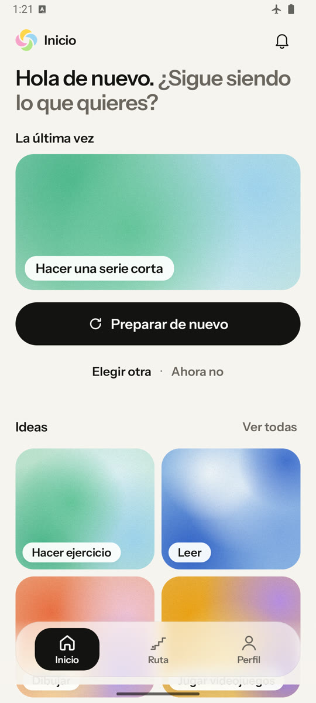
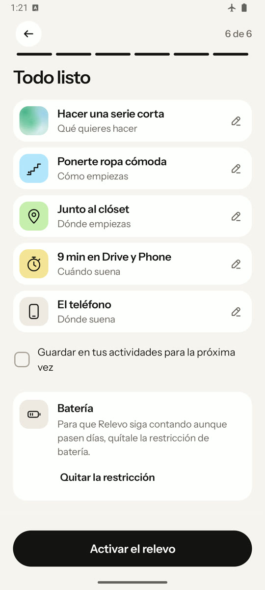
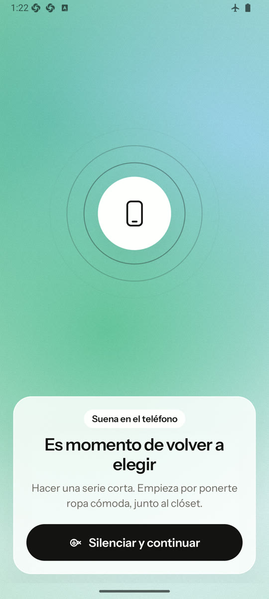
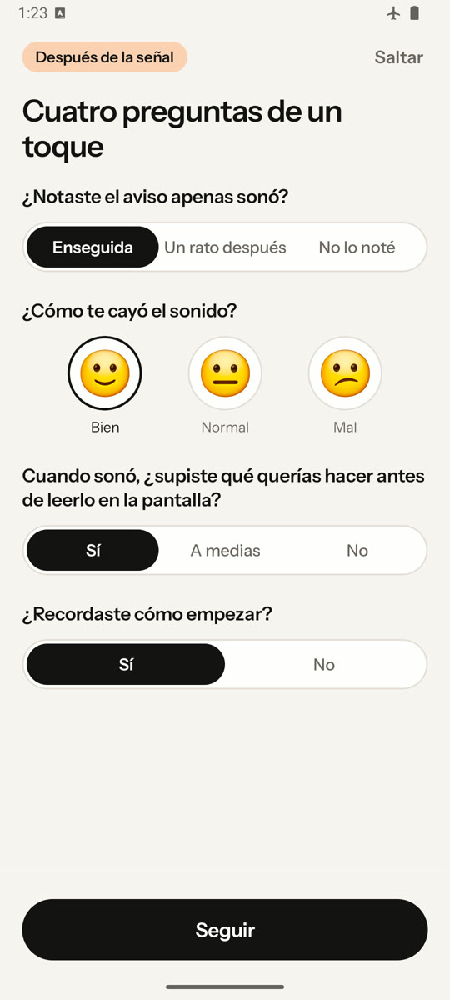
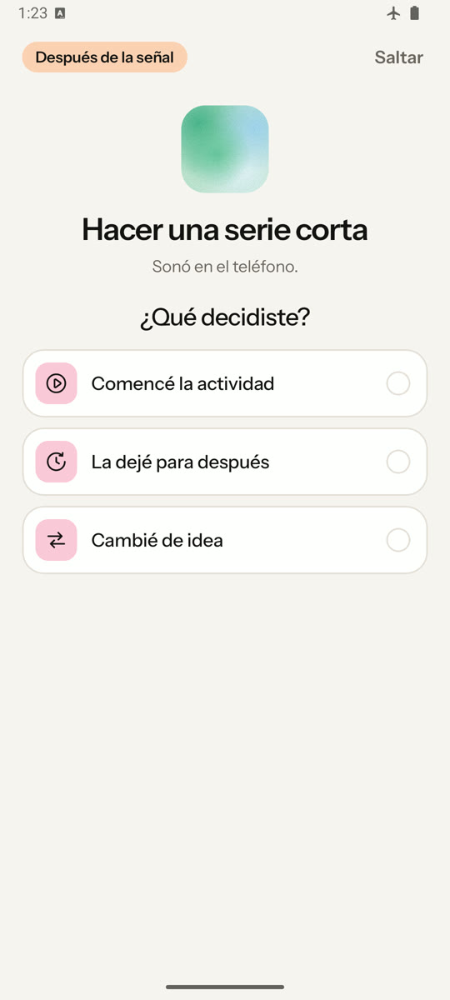
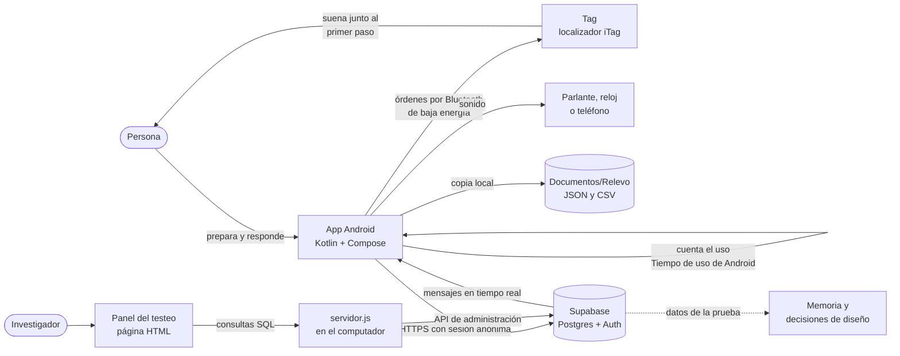
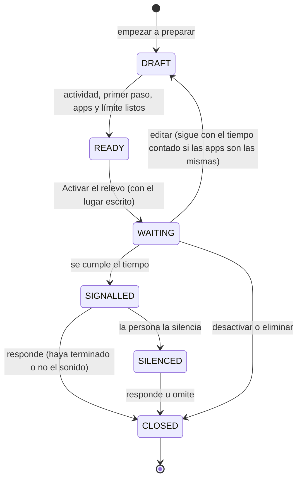

# Anexo G. Prototipo Android y registro de versiones

Describe el prototipo funcional de la prueba: la app Android, su conexión con el Tag, la base de datos y el panel, con el registro de las versiones desde la 2.7, la primera preparada para la prueba. La descripción técnica corresponde a la app que se usó en los hogares, de la versión 2.32 a la 3.3; el registro suma las versiones posteriores, hasta la 4.6.3, y las palabras clave con que la app reconoce cada actividad desde la 4.3.

## G.1 La app en la versión 3.3

**Figura G1**

*La app en un teléfono Android*

| Inicio | Todo listo | Suena | Cuatro preguntas | ¿Qué decidiste? |
| --- | --- | --- | --- | --- |
|  |  |  |  |  |

*Nota.* Capturas de la versión 3.3: la actividad en Inicio, el relevo listo, la señal, las preguntas de un toque y la decisión.

## G.2 El sistema completo

**Figura G2**

*Partes de Relevo y cómo se comunican*

*Nota.* Elaboración propia. La flecha punteada no es una conexión técnica: indica que los datos alimentan el análisis.

**Tabla G1**

*Componentes del sistema*

| Componente | Qué hace | Tecnología |
| --- | --- | --- |
| App Android | Prepara relevos, cuenta el uso, hace sonar la señal y registra las respuestas. | Kotlin 2.3 y Jetpack Compose, para Android 12 o posterior |
| Tag | Suena junto al primer paso, y su botón calla la señal. | Localizador iTag comercial, con Bluetooth de baja energía |
| Base remota | Guarda sesiones, eventos, respuestas, uso y mensajes, con reglas por persona. | Supabase: Postgres, autenticación anónima, REST y tiempo real |
| Panel del testeo | Muestra el estado de cada participante, los resultados y los mensajes. | Página HTML y JavaScript, con un servidor Node local |
| Copia local | Respaldo legible en el teléfono, que la persona puede descargar. | Archivos JSON y CSV |
| Herramientas de diseño | Íconos, *wireframes* de la app, taller de auras y logo. | Páginas HTML autónomas |

*Nota.* Elaboración propia.

## G.3 La app

### Tecnologías

**Tabla G2**

*Tecnologías de la app*

| Pieza | Versión | Para qué |
| --- | --- | --- |
| Kotlin | 2.3.20 | El lenguaje de toda la app. |
| Jetpack Compose y Material 3 | BOM 2026.03.01 | La interfaz: cada pantalla es una función que dibuja el estado. |
| Android Gradle Plugin | 9.0.1 | La compilación, optimizada con R8 desde la 2.28. |
| SDK de Android | Mínimo 31 (Android 12); objetivo y compilación, 36 | Las funciones de Tiempo de uso y Bluetooth que usa la app existen desde Android 12. |
| Lifecycle y ViewModel | 2.10.0 | Un estado que sobrevive a rotaciones y cierres de pantalla. |
| Coroutines | 1.10.2 | Tareas en segundo plano sin bloquear la pantalla. |
| OkHttp | 4.12.0 | La conexión WebSocket de los mensajes en tiempo real. |
| Haze | 1.6.10 | El desenfoque de vidrio de la barra de pestañas y las hojas. |
| JUnit | 4.13.2 | Las pruebas unitarias. |

*Nota.* Elaboración propia a partir del código de la app.

La app no usa bibliotecas de Supabase: habla con su API REST mediante `HttpURLConnection`, que ya trae Android. Así tiene menos dependencias y se controla exactamente qué datos salen.

### Cómo está organizada

La app separa lo que se ve de las reglas y de los datos, y cada capa conoce solo a la de abajo:

- **`domain`**, las reglas, sin depender de Android para poder probarlas solas: los estados de un relevo, el calendario de la prueba, la ruta de pasos y el protocolo del Tag.
- **`data`**, lo que se guarda: los ajustes, el perfil, la ruta, el relevo y el Tag en archivos de preferencias; el registro de investigación en una base SQLite, y el envío a Supabase.
- **`monitor`**, el servicio que sigue con la app cerrada: cuenta el uso, entrega la señal, escucha los mensajes del proyecto y se reanuda al reiniciar el teléfono.
- **`signal`**, el sonido: en el teléfono, el parlante o el reloj, y el control del Tag.
- **`ui`**, las pantallas, con un solo `RelevoViewModel` que reúne el estado y las acciones para que todas vean lo mismo.

### El ciclo de un relevo

**Figura G3**

*Estados de un relevo*

*Nota.* Elaboración propia a partir del código de la app.

Cada relevo tiene un identificador de sesión y queda asociado al día y a la condición de la semana en que se activó, a la salida de sonido, a la versión de la app y a si se activó a mano o solo.

### Cómo cuenta el tiempo

1. Al activar un relevo, la app inicia un servicio en primer plano: un proceso que Android no cierra mientras muestra una notificación visible.
2. Cada segundo, el servicio lee los eventos de Tiempo de uso de Android (`UsageStatsManager`): qué app se abrió, cuál se pausó y cuándo se apagó la pantalla.
3. Con esos eventos reconstruye qué app está en primer plano, y suma el tiempo solo si es una de las seleccionadas. Al empezar revisa 15 minutos hacia atrás, para saber qué app ya estaba abierta.
4. El avance se guarda en cada vuelta: si el teléfono se reinicia o la app se actualiza, el conteo se reanuda. Si la persona quita el permiso, el conteo se pausa y aparece un aviso para reactivarlo.
5. Al llegar al límite, el servicio entrega la señal y guarda cuánto se usaron las apps seleccionadas en los 10 minutos anteriores y posteriores.

La app conoce solo el nombre de la app en primer plano y su tiempo, nunca lo que pasa dentro de ella.

### Cómo suena

La señal va a la salida que define la persona y nunca cambia de salida sin avisar. Si la salida no responde, el teléfono vibra, aparece una notificación y la señal queda registrada como fallida.

- **Teléfono y parlante:** la firma sonora de Relevo, dos golpes de un timbre de madera que bajan de 587 a 440 Hz y duran 2,2 s. Se repite siete veces, cada 4,4 s, durante unos 30 s, y las tres primeras van al 40, 60 y 80 % del volumen, para no sobresaltar.
- **Reloj:** la señal viaja como audio de llamada hacia un reloj que contesta llamadas por Bluetooth. Es una salida experimental, que no se probó con un reloj real.
- **Tag:** la app le escribe la orden de alerta por Bluetooth y la repite cada segundo durante 30 s, o hasta que se aprieta su botón. El Tag tiene solo su propio pitido, continuo y de volumen fijo.
- **Siempre**, al empezar la señal, el teléfono vibra una vez y muestra una notificación.

### El Tag

El Tag es un localizador iTag comercial, con una pila CR2032 y un botón. La app lo controla con un protocolo verificado en código abierto y en los registros de la prueba.

**Tabla G3**

*Servicios Bluetooth del Tag que usa la app*

| Servicio (código) | Característica | Uso en Relevo |
| --- | --- | --- |
| Alerta inmediata (0x1802) | Nivel de alerta (0x2A06) | Encender el pitido, en nivel 1 o 2, y apagarlo, en 0. |
| Propio del fabricante (0xFFE0) | FFE1 | Avisa cuando se aprieta el botón: calla la señal. |
| Propio del fabricante (0xFFE0) | FFE2 | Según el modelo, hace pitar o activa la alarma por desconexión; se pone en 1 solo mientras suena. |
| Pérdida de enlace (0x1803) | Nivel de alerta (0x2A06) | La alarma por desconexión, que se deja en 0. |
| Batería (0x180F) | Nivel de batería (0x2A19) | La carga de la pila, que la app muestra y registra. |

*Nota.* Elaboración propia a partir del código de la app.

Al conectarse, la app busca el Tag guardado, pide una conexión rápida, descubre sus servicios, apaga primero la alarma por desconexión y la alerta, y después activa el aviso del botón y lee la pila. Mientras el relevo espera, mantiene la conexión abierta y la reabre cada 30 s si se corta, como la app del fabricante, para que el Tag no se apague por falta de conexión.

**Tabla G4**

*Lo que enseñó el Tag real*

| Versión | Lo que pasó | Lo que cambió |
| --- | --- | --- |
| 2.26 | El Tag aceptaba la orden, pero no pitaba. | La prueba de sonido pregunta si se escuchó, y ya no se apaga FFE2 a ciegas. |
| 2.27 | Pitaba en la prueba y no en la señal. | FFE2 en 1 junto con la alerta, y un pitido continuo con la orden repetida. |
| 2.29 | El nivel alto no pitaba y el medio sí. | La prueba empieza por el nivel medio. |
| 2.31 | Siguió pitando tras la prueba y, más tarde, sonó sin parar. | Callarlo con confirmación, una desconexión que espera a Android y la lectura de la pila. |
| 2.32 | Tras mucho tiempo sin uso, sonaba lento y sin parar hasta reiniciarlo. | Nunca cortar la conexión con la alarma por desconexión encendida, y más paciencia con un Tag lento. |

*Nota.* Elaboración propia a partir de los documentos de cada versión.

La lección general: que el objeto acepte una orden no prueba que haya sonado. Por eso la prueba de sonido le pregunta a la persona, y el registro guarda cuánto tardó el Tag en responder y cómo quedó al callarlo.

### Lo que guarda el teléfono

- **Preferencias**, en archivos privados de la app: el relevo en curso y el último, el perfil, la ruta, las actividades propias, los ajustes, la prueba, el Tag vinculado y el estado del envío.
- **Una base SQLite** con cinco tablas: cada relevo y su resultado (`sessions`); sus momentos, como activarlo, entrar y salir de las apps, la señal y la respuesta (`events`); las respuestas (`answers`); el uso de la propia app (`app_events`), y el uso diario de las apps seleccionadas y el tiempo total de pantalla (`daily_usage`).
- **Una copia legible** en `Documentos/Relevo`: un JSON con todo y dos CSV, de relevos y de respuestas. Se reescribe en cada envío y se borra con «Borrar mis datos».

### Funciones de continuidad

**Tabla G5**

*Funciones que acompañan el uso*

| Función | Qué hace | Cómo respeta los criterios |
| --- | --- | --- |
| Ruta | Pasos pequeños por interés; tras tres respuestas «Comencé», ofrece el siguiente. | Sin puntos: el paso siguiente es una oferta. |
| Tus actividades | Guarda actividades propias para preparar en un toque. | Reduce el esfuerzo de prepararlo (criterio 6). |
| Editar un relevo activo | Cambia lo preparado sin borrarlo y conserva el tiempo contado si las apps son las mismas. | Lo pidió una persona de la prueba. |
| Activación automática | Repite el último relevo al abrir una de sus apps, con 30 minutos de pausa. | Viene apagada, y la app registra cómo se activó cada relevo. |
| Aviso semanal | Avisa una vez tras una semana sin abrir la app. | Apagado, salvo que la persona lo pida. |
| Mensajes del proyecto | El investigador escribe a una persona o a todas. | Sirven para coordinar; la app registra la llegada y la apertura. |
| Resumen semanal | Lo preparado en la semana, en el perfil. | Se puede apagar. |

*Nota.* Elaboración propia a partir del código de la app.

## G.4 Los datos y el panel

**La sesión anónima.** Supabase reúne una base de datos Postgres, autenticación y una API REST. Cuando la persona acepta participar, la app pide a Supabase un usuario nuevo, sin correo ni contraseña, y recibe un identificador (`user_id`) y un token que se renueva solo; cada fila que envía lleva ese identificador. Sin participar, la app no abre ninguna sesión. Usa la clave publicable del proyecto, que por sí sola no da acceso a los datos de nadie; la clave de servicio nunca está en la app.

**Tabla G6**

*Tablas de la base remota*

| Tabla | Qué guarda | Columnas principales |
| --- | --- | --- |
| `relevo_sessions` | Cada relevo. | Actividad, primer paso, lugar, apps, límite, condición y día de la prueba, salida, si sonó, respuesta, segundos hasta responder, uso antes y después, versión y forma de activación. |
| `relevo_events` | Los momentos de cada relevo. | Tipo de evento, como `armed`, `target_entered`, `signal_emitted` o `responded`, la app y los segundos. |
| `relevo_answers` | Las respuestas. | Pregunta, respuesta y relevo. |
| `relevo_app_events` | El uso de la propia app. | Evento, como una pantalla, la prueba de sonido o el perfil del Tag, su detalle y la versión. |
| `relevo_daily_usage` | El uso diario. | Día, app seleccionada o `_total`, segundos y aperturas. |
| `relevo_participant_state` | El estado del teléfono, en una fila por persona. | Permisos, modelo, ajustes, ruta y relevo actual, en JSON. |
| `relevo_participants` | El nombre, aparte. | Código y nombre. |
| `relevo_messages` y `relevo_message_receipts` | Los mensajes del proyecto y su recepción. | Destinatario, título, texto, llegada y apertura. |

*Nota.* Elaboración propia. El esquema empezó el 22 de septiembre de 2026 y suma 16 migraciones; el esquema `analisis` tiene vistas listas para leer los relevos, las respuestas, el resumen por condición, el uso y los participantes.

**Cada persona ve solo lo suyo.** Todas las tablas `relevo_*` tienen seguridad por fila: la base revisa cada consulta con una regla. Solo un usuario cuyo identificador coincide con el de la fila puede leerla, insertarla, actualizarla o borrarla, y cada teléfono lee los mensajes generales y los dirigidos a él. Así, un teléfono nunca puede leer los datos de otro, ni siquiera con la clave publicable. El panel entra con un token personal de administración, que vive solo en el computador del investigador.

**Cómo se envían los datos.** Cada registro nace en SQLite como pendiente y se envía al activar un relevo, al sonar, al cerrar la app y cada 15 minutos mientras el servicio cuenta; el estado del teléfono y el uso diario, cada 30 minutos como máximo. Si la base acepta la fila, queda enviada; si la rechaza de forma definitiva, queda rechazada y la cola sigue, y si falla la red, se reintenta después. «Borrar mis datos» borra primero en la base remota; si no puede, la app deja de guardar y conserva lo del teléfono para intentarlo otra vez. El borrado se comprobó en el emulador, en las dos copias.

**Mensajes en tiempo real.** Mientras el servicio cuenta o espera, la app mantiene una conexión WebSocket con el canal de tiempo real de Supabase: un mensaje del investigador llega en menos de un segundo, y en el emulador se midieron 0,8 s. Como respaldo, la app revisa los mensajes al abrirse, cada 60 segundos mientras el servicio corre y cada 15 minutos con una tarea programada de Android.

**El panel del testeo.** Una página HTML con cuatro pestañas: **Ahora**, con lo que pasa en el momento y a quién escribirle; **Participantes**, con la ficha de cada persona, su uso, relevos, respuestas, ajustes y prueba; **Respuestas**, con los resultados por condición y por día, y **Mensajes**, para enviar avisos y ver si llegaron. Permite borrar los datos de una persona en dos clics y descargarlos. Con doble clic muestra datos de ejemplo inventados; con `node servidor.js`, un servidor sin dependencias que escucha solo en el computador, con una clave que cambia en cada arranque, consulta la base real. Ningún dato real se guarda junto al código del panel.

**Tabla G7**

*Qué sale del teléfono y qué no*

| Sale, con consentimiento | No sale |
| --- | --- |
| La actividad, el primer paso y el lugar declarados; las apps seleccionadas y su tiempo; los eventos y las respuestas; el uso diario de las apps seleccionadas y el tiempo total de pantalla; el estado del teléfono y los permisos; el uso de la propia app; una descripción técnica del Tag, sin su dirección, y el nombre, en una tabla aparte. | Lo que pasa dentro de otras apps; los nombres de las apps no elegidas; la dirección Bluetooth del Tag; fotos, contactos o ubicación. |

*Nota.* Elaboración propia.

## G.5 Registro de versiones

Cada versión tiene su documento en la carpeta de la app, con lo que cambió, por qué y cómo se probó. Desde la 2.7 hasta la 3.3 hay 31 versiones: la línea 2 sostuvo la prueba en los teléfonos de las personas, y la línea 3, desde el 12 de octubre de 2026, aplica la identidad nueva sin cambiar los datos.

**Tabla G8**

*Versiones de la app, de la 2.7 a la 3.3*

| Versión | Fecha | Qué trae |
| --- | --- | --- |
| 2.7 | 25 sep. | La app que pide el protocolo de la prueba |
| 2.8 | 26 sep. | Sistema de marca «Vuelve a lo que querías hacer», perfil, ruta y regreso |
| 2.9 | 27 sep. | Vidrio, formas redondeadas, emoji y textos naturales |
| 2.10 | 27 sep. | Participación en la prueba, textos claros, tono de las fotos y más emoji |
| 2.11 | 28 sep. | «Cómo funciona», video vertical y datos guardados en dos lugares |
| 2.12 | 29 sep. | Más simple para la persona y más datos para el proyecto |
| 2.13 | 29 sep. | Guía de la primera vez, intereses concretos y nombre guardado aparte |
| 2.14 | 29 sep. | Guía con contexto y primer relevo acompañado |
| 2.15 | 29 sep. | El reloj como objeto que suena, experimental |
| 2.16 | 30 sep. | Activación automática y mensajes del proyecto |
| 2.17 | 30 sep. | Mensajes al instante |
| 2.18 | 30 sep. | Registro completo, relevos que se pueden eliminar y avisos de campos faltantes |
| 2.19 | 5 oct. | El llavero iTag como objeto que suena |
| 2.20 | 6 oct. | La persona elige dónde suena |
| 2.21 | 6 oct. | Íconos con degradado y nada marcado de antemano |
| 2.22 | 6 oct. | Volver a comparar y lenguaje claro |
| 2.23 | 7 oct. | Degradados de varios colores, más actividades y opciones listas |
| 2.24 | 7 oct. | Cómo usar el llavero |
| 2.25 | 7 oct. | El Tag y su guía paso a paso |
| 2.26 | 7 oct. | El Tag pita, y la prueba pregunta si se escuchó |
| 2.27 | 7 oct. | El Tag suena en la señal, seguido |
| 2.28 | 7 oct. | El Tag por defecto, lugares concretos y una app más fluida |
| 2.29 | 7 oct. | La prueba del Tag empieza por la forma que pita |
| 2.30 | 9 oct. | Editar un relevo sin borrarlo |
| 2.31 | 14 oct. | El Tag se calla siempre |
| 2.32 | 17 oct. | El Tag no se corta con la alarma encendida |
| 2.33 | 20 oct. | Semana de comparación y preguntas de la experiencia |
| 3.0 | 12 oct. | La línea nueva, sin perder nada |
| 3.1 | 12 oct. | Las pantallas de «Relevo, la app» |
| 3.2 | 12 oct. | Igual a «Relevo, la app» |
| 3.3 | 20 oct. | La línea nueva con la semana para comparar |

*Nota.* Elaboración propia a partir de la documentación de cada versión. Fechas de 2026.

Después de la prueba, la app siguió en versiones propias. La 1.0.0, del 4 de noviembre, quitó la prueba de 21 días y pasó el consentimiento a la versión 14. La línea 4 rediseñó la interfaz; la 4.4 la volvió actualizable sobre la app instalada y sumó lo de la 1.0.0, y la 4.6.3, del 7 de noviembre de 2026, es la versión más reciente.

**Tabla G9**

*Versiones posteriores a la prueba*

| Versión | Fecha | Qué trae |
| --- | --- | --- |
| 4.0 | 5 nov. | Rediseño de la interfaz |
| 4.1 | 5 nov. | Anillos simétricos, textos con función, sin viudas y movimiento al tacto |
| 4.2 | 5 nov. | Un solo comentario, las preguntas de cada actividad, predefinidas primero, el borde como en iOS e Inicio con color |
| 4.2.1 | 5 nov. | Preparar desde una idea abre lo que falta, no un relevo desde cero |
| 4.3 | 5 nov. | Sugerencias que corresponden, varios relevos a la vez, sonido fundamentado y una app más clara |
| 4.4 | 5 nov. | La 4.3, actualizable, con lo de la 1.0.0 |
| 4.5 | 6 nov. | Menos amarillo, el saludo del relevo y más palabras |
| 4.6 | 6 nov. | La encuesta del rediseño |
| 4.6.1 | 7 nov. | Revisión de la primera vez, la encuesta y la accesibilidad |
| 4.6.2 | 7 nov. | Textos que dicen qué cuentan y el Bluetooth solo al buscar el Tag |
| 4.6.3 | 7 nov. | El pulido y la señal que sonaba dos veces |

*Nota.* Elaboración propia a partir de la documentación de cada versión. Fechas de 2026.

## G.6 Palabras clave y sugerencias

Desde la versión 4.3, cuando la persona escribe su propia actividad, la app reconoce de qué se trata por sus palabras. Con eso elige el ícono de la actividad y sugiere, para elegir con un toque, con qué empezar y dónde dejar el Tag: «tocar guitarra» sugiere sacarla del estuche, y nunca un libro. Antes, las sugerencias se mezclaban por el ícono y por partes de palabras, y «Leer un capítulo de manga» podía contar como una película. La versión 4.5 sumó palabras y frases del español de Chile, como «pichanga», «carioca», «once» o «carrete»: la app reconoce 34 actividades en siete familias, con 634 palabras, 121 frases y 31 palabras débiles, y sugiere 91 primeros pasos y 61 lugares.

**Cómo reconoce una actividad.**

1. Pasa el texto a minúsculas y sin tildes: «Película» y «pelicula» son lo mismo.
2. Compara cada palabra entera. Algunas valen también con lo que sigue, como «dibuj…», que reconoce dibujar, dibujo y dibujando.
3. Suma puntos por actividad: cada palabra suma 1; cada frase completa, 2, y cada palabra débil, medio punto, porque sola no decide, como «ver», «jugar» o «tocar».
4. Elige la actividad con más puntos, si suma al menos 1; ante un empate, la que va primero en la lista. Si ninguna llega a 1, no sugiere nada.

Las frases resuelven los casos dudosos: «maratón de series» es de películas y no de correr; «leer una novela gráfica», de manga y no de leer, y «dar una vuelta en bici», de bicicleta y no de caminar. Ninguna palabra pertenece a dos actividades. Las sugerencias nombran un objeto concreto, como «Elegir la película» o «Elegir el libro», y no algo abierto, como «Elegir qué ver»; si la actividad es una de las ideas de la app o un paso de una ruta, primero aparecen sus propias sugerencias, y se muestran hasta cinco.

**Tabla G10**

*Las 34 actividades que reconoce la app*

| Actividad | Palabras clave, por ejemplo | Con qué empezar | Dónde |
| --- | --- | --- | --- |
| **Moverte** | | | |
| Pasear al perro | perro, perrito, cachorro, quiltro, mascota, correa | Tomar la correa; Sacar su pelota; Llenar su botella de agua | Junto a la puerta; Donde está la correa |
| Correr | correr, trotar, trote, running, maratón, trail | Ponerte las zapatillas; Ponerte ropa deportiva; Llenar la botella de agua | Junto a la puerta; Junto a las zapatillas |
| Caminar | caminar, caminata, pasear, cerro, parque, trekking | Ponerte las zapatillas; Llenar la botella de agua; Elegir el recorrido | Junto a la puerta; Junto a las zapatillas |
| Andar en bicicleta | bici, bicicleta, pedalear, ciclismo, ciclovía, cicletada | Sacar la bici; Inflar las ruedas; Ponerte el casco | Junto a la puerta; Junto a la bici |
| Hacer ejercicio | ejercicio, gimnasio, pesas, calistenia, boxeo, bailar | Ponerte ropa deportiva; Estirar la colchoneta; Preparar el bolso | Junto al clóset; Donde guardas la colchoneta; Junto a la puerta |
| Yoga y estirar | yoga, estirar, elongar, pilates, movilidad, colchoneta | Desenrollar la colchoneta; Ponerte ropa cómoda | Donde guardas la colchoneta; Junto a la cama |
| Nadar | nadar, natación, piscina, acuagym, brazadas | Preparar el traje de baño; Echar la toalla al bolso | Junto a la puerta; Junto al bolso |
| Deportes con pelota | fútbol, pichanga, básquetbol, vóleibol, tenis, pádel | Preparar las zapatillas; Inflar la pelota; Avisar al equipo | Junto a la puerta |
| Cuidar las plantas | plantas, regar, jardín, huerto, suculentas, compost | Llenar la regadera; Ponerte los guantes | Junto a las plantas; Junto a la regadera |
| **Leer y aprender** | | | |
| Manga y cómics | manga, manhwa, cómic, historieta, tomo, webtoon | Sacar el tomo del estante; Abrir el tomo donde quedaste | Junto al estante; En el velador |
| Leer | leer, libro, novela, cuento, poesía, audiolibro | Elegir el libro; Abrir el libro en el marcador; Dejar el libro a la vista | En el velador; En el sillón; Junto al estante |
| Estudiar | estudiar, apuntes, certamen, ramo, preu, PAES | Abrir los apuntes; Despejar el escritorio; Abrir el cuaderno en la tarea | En el escritorio |
| Idiomas | inglés, idioma, francés, japonés, vocabulario, Duolingo | Abrir el cuaderno de vocabulario; Abrir el libro del curso | En el escritorio |
| Escribir | escribir, diario, journaling, carta, poema, guion | Abrir el cuaderno; Dejar un lápiz sobre el cuaderno | En el escritorio; En el velador |
| **Crear** | | | |
| Dibujar | dibujar, dibujo, boceto, ilustración, croquis, lettering | Sacar el cuaderno y un lápiz; Abrir el cuaderno en ese dibujo; Sacar los lápices | En el escritorio; En la mesa |
| Pintar | pintar, acuarela, óleo, acrílico, pincel, mural | Preparar las acuarelas; Llenar un vaso con agua; Sacar los pinceles | En la mesa; En el escritorio |
| Tejer y coser | tejer, crochet, bordar, coser, lana, amigurumi | Sacar el tejido; Enhebrar la aguja; Dejar la lana a mano | En el sillón; En la mesa |
| Maquetas | maqueta, modelismo, lego, miniatura, gunpla | Abrir la caja de la maqueta; Dejar la pieza a la vista; Ordenar las piezas | En la mesa; En la mesa de trabajo |
| Manualidades | manualidades, collage, origami, cerámica, greda, mostacillas | Sacar los materiales; Despejar la mesa; Dejar la tijera y el pegamento a mano | En la mesa de trabajo; En la mesa |
| Fotografía | foto, fotografía, cámara, rollo, analógica, revelado | Cargar la batería de la cámara; Sacar la cámara del estuche | Junto a la puerta; En el escritorio |
| **Jugar y disfrutar** | | | |
| Piano | piano, órgano, sintetizador | Abrir la tapa del piano; Dejar la partitura a la vista | Junto al piano |
| Otro instrumento | guitarra, ukelele, violín, charango, flauta, batería | Sacar el instrumento del estuche; Afinar el instrumento; Dejar la partitura a la vista | Junto al instrumento |
| Cantar | cantar, canto, coro, karaoke, vocalizar | Elegir la canción; Tomar un vaso de agua | En el sillón |
| Música | música, disco, playlist, vinilo, pódcast, audífonos | Ponerte los audífonos; Elegir el disco | En el sillón; Junto a los discos |
| Videojuegos | videojuegos, consola, PlayStation, Nintendo, Minecraft, gamear | Encender la consola; Dejar el control cargado; Avisar a quien juega contigo | Junto a la tele; Junto al computador |
| Películas y series | película, serie, anime, dorama, documental, teleserie | Elegir la película; Elegir el capítulo; Preparar cabritas; Avisar a quien ve contigo | Junto a la tele; En el sillón |
| Cartas | cartas, naipes, carioca, póker, truco, brisca | Sacar el mazo; Despejar la mesa; Avisar a quien juega contigo | En la mesa |
| Juegos de mesa | ajedrez, rompecabezas, dominó, ludo, Catan, sudoku | Sacar la caja; Despejar la mesa; Avisar a quien juega contigo | En la mesa |
| **En casa** | | | |
| Cocinar | cocinar, receta, hornear, queque, empanadas, sopaipillas | Reunir los ingredientes; Dejar la receta a la vista; Lavar la tabla de picar | En el mesón de la cocina |
| Ordenar y limpiar | ordenar, limpiar, aseo, trapear, loza, clóset | Juntar la ropa en el canasto; Vaciar el cajón sobre la cama; Abrir la ventana | Junto al cajón; Junto al canasto; Junto a la cama |
| **Descansar** | | | |
| Dormir | dormir, acostarme, siesta, descansar, sueño | Dejar el teléfono cargando lejos de la cama; Apagar la luz grande; Ponerte el pijama | Junto al cargador; Junto a la cama |
| Meditar | meditar, respirar, mindfulness, relajarme, rezar, qigong | Sentarte en el cojín; Apagar la luz grande | Junto al cojín; Junto a la cama |
| **Con otras personas** | | | |
| Llamar | llamar, llamada, videollamada, FaceTime, conversar | Buscar su número; Escribirle que vas a llamar | En el sillón |
| Compartir | visitar, juntarme, carrete, asado, abuela, polola | Avisar que vas; Preparar algo para llevar; Poner la mesa | Junto a la puerta; En la mesa del comedor |

*Nota.* Elaboración propia a partir del código de la versión 4.6.3, que tiene las mismas palabras y sugerencias que la 4.5. En «Otro instrumento», la app nombra el que escribió la persona: con «guitarra», sugiere «Sacar la guitarra del estuche» y «Junto a la guitarra».

## Registro de cambios (disclaimer)

### 2026-11-08 — Extranjerismos en cursiva

- **Qué cambió:** *wireframes*, *feed* y *hobbies* van en cursiva, como en la memoria.
- **Cómo estaba antes:** iban en redonda.
- **Por qué:** el autor pidió corregir los errores de formato (D-170).

### 2026-11-08 — Palabras clave y sugerencias

- **Qué cambió:** se suma la parte G.6, con cómo la app reconoce una actividad por sus palabras clave desde la versión 4.3 y la Tabla G10, con las 34 actividades, ejemplos de sus palabras y lo que sugiere para empezar y dónde dejar el Tag. Sale de leer el código de la versión 4.6.3.
- **Cómo estaba antes:** el anexo no mencionaba las palabras clave.
- **Por qué:** el autor pidió incluir en el anexo que la app asocia palabras clave a actividades y sugerencias (D-170).

### 2026-11-08 — Correcciones del autor

- **Qué cambió:** sin códigos de decisión, sin ramas ni carpetas del repositorio y sin nombres de archivos de código; las tablas de versiones pierden la columna «Decisión»; menos «elegido».
- **Cómo estaba antes:** citaba decisiones como D-109, las ramas android-4.x, las carpetas del repositorio y archivos como Reminder.kt.
- **Por qué:** el autor revisó los anexos y pidió un texto sin códigos ni menciones al repositorio, con palabras claras y la declaración de IA corregida (D-170).

### 2026-11-08 — Anexo recopilado y listo para Word

- **Qué cambió:** la descripción técnica se condensa en lo que explica el prototipo: componentes, organización, ciclo, conteo, sonido, el Tag y lo aprendido con él, los datos, la seguridad y el panel. Salen dos diagramas, el de las capas y el del recorrido, que repetían lo que dicen el texto y el Anexo F, y la sección del sistema visual, que está en el Anexo H. Las figuras y tablas se numeran G1 a G9. El registro suma la Tabla G9, con las versiones 4.0 a 4.6.3, leídas de sus documentos en la rama `android-4.6`, sin fusionar. Desde ahora este archivo es la fuente del anexo.
- **Cómo estaba antes:** copiaba tres secciones del documento técnico del 18 de octubre, con su numeración propia (4.1 a 5.7), y el registro terminaba en la 3.3.
- **Por qué:** el autor pidió revisar todos los anexos y dejarlos listos para Word: directos, sin sobreexplicar, con su forma de escribir y con lo más relevante; la versión más reciente de la app es la 4.6.3 (D-168).

### 2026-10-24 — Creación

- **Qué cambió:** el anexo se arma desde sus documentos fuente, con el resto de los anexos A–I de la memoria v5.
- **Cómo estaba antes:** la carpeta de anexos solo tenía un README de la v4, con cinco anexos y sin su contenido.
- **Por qué:** el autor pidió elegir un pendiente de prioridad alta y terminarlo; la memoria v5 remite a nueve anexos que no estaban armados.
