# Anexo G. Prototipo Android y registro de versiones

La app Android es la parte del prototipo que la persona tiene en la mano: con ella prepara cada relevo, y la app cuenta el tiempo y hace sonar el Tag cuando corresponde. Este anexo explica cómo funciona la app que se usó en la prueba, qué datos guarda y cómo los cuida, cómo cambió entre septiembre y noviembre de 2026 y con qué palabras reconoce cada actividad.

## G.1 Pantallas de la app

El recorrido es corto: la persona elige una actividad, prepara el relevo y sigue en el teléfono; cuando se cumple el tiempo, Relevo suena, pregunta con un toque y deja decidir (Figura G1).

**Figura G1**

*Pantallas de la app en octubre de 2026*

| Inicio | Relevo listo | Señal | Cuatro preguntas | Decisión |
| --- | --- | --- | --- | --- |
| 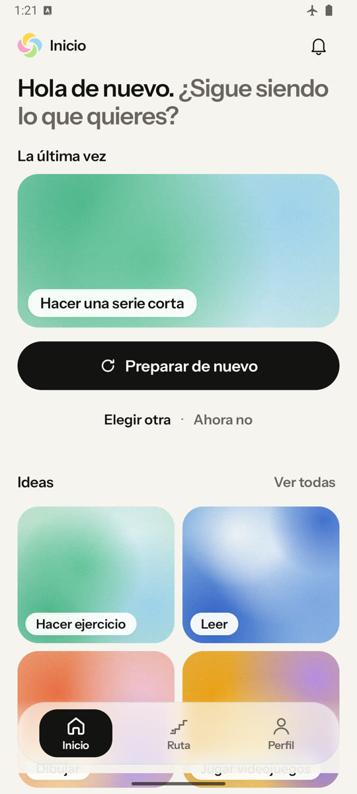 | 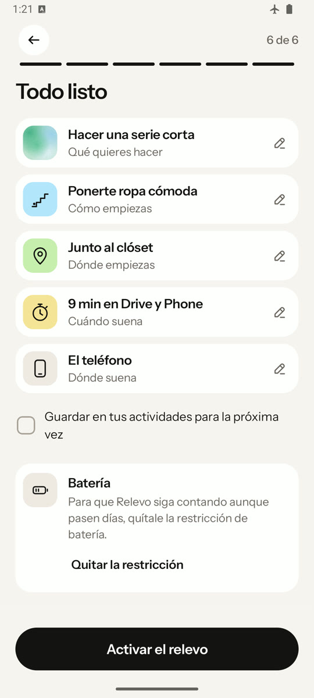 | 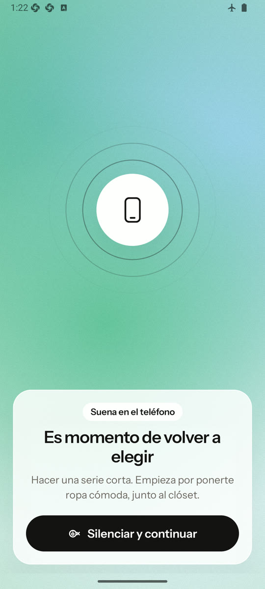 | 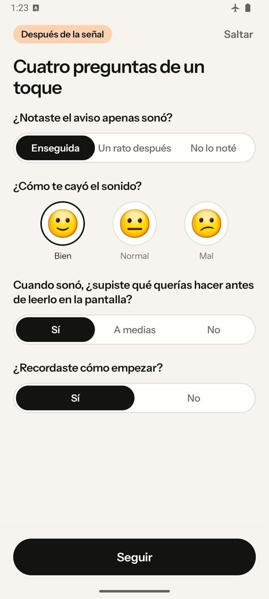 | 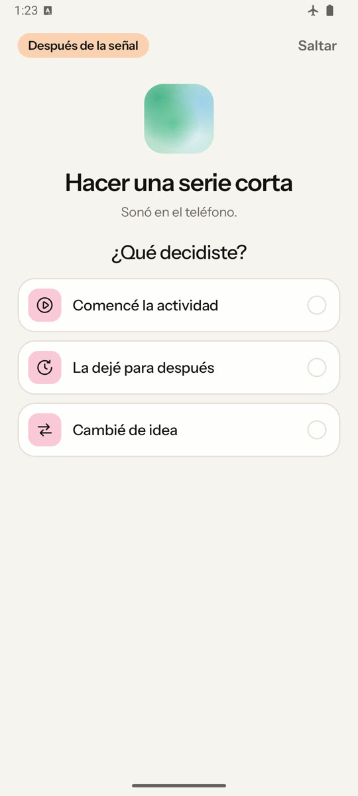 |

*Nota.* Capturas de la versión 3.3, del 20 de octubre de 2026, con los mismos pasos que la app de la prueba y la identidad visual nueva: la actividad en Inicio, el relevo listo, la señal, las preguntas de un toque y la decisión.

## G.2 Arquitectura del sistema

Relevo no es solo la app. Para funcionar necesita el Tag, el registro de tiempo de uso que lleva Android, una base de datos remota y un panel para seguir la prueba (Figura G2).

**Figura G2**

*Componentes de Relevo y su comunicación*

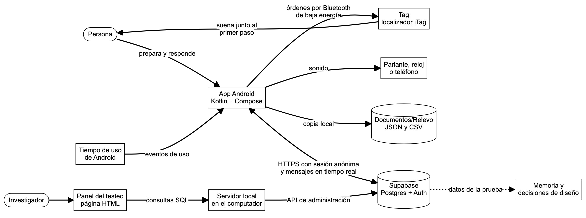

*Nota.* Elaboración propia. La flecha punteada no es una conexión técnica: indica que los datos alimentan el análisis.

La Tabla G1 dice qué hace cada pieza y con qué está hecha.

**Tabla G1**

*Componentes del sistema*

| Componente | Función | Tecnología |
| --- | --- | --- |
| App Android | Prepara relevos, cuenta el uso, hace sonar la señal y registra las respuestas. | Kotlin y Jetpack Compose, para Android 12 o posterior |
| Tag | Suena junto al primer paso, y su botón calla la señal. | Localizador iTag comercial, con Bluetooth de baja energía |
| Base remota | Guarda los relevos, sus momentos, las respuestas, el uso y los mensajes, con reglas por persona. | Supabase, una base de datos en línea con sesiones anónimas y mensajes en tiempo real |
| Panel del testeo | Muestra el estado de cada participante, los resultados y los mensajes. | Página web, con un servidor local en el computador del investigador |
| Copia local | Respaldo legible en el teléfono, que la persona puede descargar. | Un archivo con todo el registro y dos planillas |

*Nota.* Elaboración propia.

## G.3 Funcionamiento de la app

La app está escrita en Kotlin, el lenguaje de Android, con Jetpack Compose para la interfaz, y funciona desde Android 12, la primera versión del sistema con las funciones de tiempo de uso y de Bluetooth que necesita. Habla con la base de datos con lo que ya trae Android, sin bibliotecas adicionales: así depende de menos piezas y se controla exactamente qué datos salen del teléfono.

El código separa lo que se ve de las reglas y de los datos. Las reglas —los estados de un relevo, el calendario de la prueba, la ruta de pasos y la forma de hablarle al Tag— no dependen de Android, así que se pueden probar solas. Un servicio sigue funcionando con la app cerrada: cuenta el uso, entrega la señal, recibe los mensajes del proyecto y se reanuda si el teléfono se reinicia. Todas las pantallas leen un mismo estado, para mostrar siempre lo mismo.

### Ciclo de un relevo

Un relevo pasa por seis estados, del borrador al cierre (Figura G3).

**Figura G3**

*Estados de un relevo*

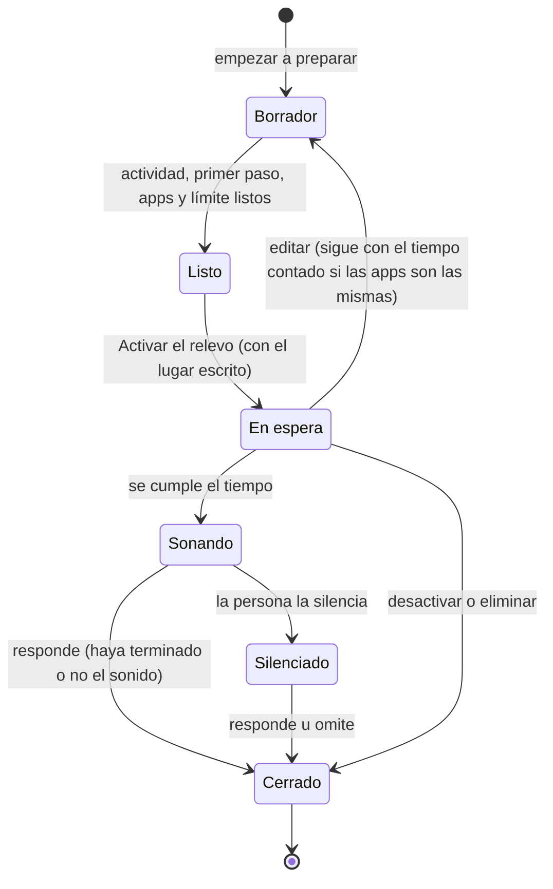

*Nota.* Elaboración propia a partir del código de la app.

Cada relevo queda registrado con el día y la semana de la prueba en que se activó, dónde sonó y si se activó a mano o solo.

### Conteo del tiempo

Que la señal llegue a tiempo depende de contar bien, y la app lo hace en cinco pasos:

1. Al activar un relevo, la app inicia un servicio en primer plano: un proceso que Android no cierra mientras muestra una notificación visible.
2. Cada segundo, ese servicio lee el registro de tiempo de uso de Android: qué app se abrió, cuál se pausó y cuándo se apagó la pantalla.
3. Con eso reconstruye qué app está en primer plano y suma el tiempo solo si es una de las seleccionadas. Al empezar mira los últimos 15 minutos, para saber qué app ya estaba abierta.
4. Guarda el avance en cada vuelta: si el teléfono se reinicia o la app se actualiza, el conteo sigue donde iba. Si la persona quita el permiso, el conteo se pausa y aparece un aviso para reactivarlo.
5. Al llegar al límite, entrega la señal y guarda cuánto se usaron las apps seleccionadas en los 10 minutos anteriores y posteriores.

La app conoce solo el nombre de la app en primer plano y su tiempo, nunca lo que pasa dentro de ella.

### Señal sonora

La señal suena donde la persona decidió, y nunca cambia de salida sin avisar. Si esa salida no responde, el teléfono vibra, aparece una notificación y la señal queda registrada como fallida.

- **Teléfono y parlante:** el sonido de Relevo, dos golpes de un timbre de madera que bajan de tono. Se repite siete veces en unos 30 segundos, y las tres primeras van subiendo de volumen, para no sobresaltar.
- **Reloj:** la señal viaja como audio de llamada hacia un reloj que contesta llamadas por Bluetooth. Es una salida experimental, que no se probó con un reloj real.
- **Tag:** la app le envía la orden de alerta y la repite cada segundo durante 30 segundos, o hasta que se aprieta su botón. El Tag solo tiene su propio pitido, continuo y de volumen fijo.
- **Siempre**, al empezar la señal, el teléfono vibra una vez y muestra una notificación.

### Tag

El Tag es un localizador iTag comercial, con una pila de botón y un botón. La app le habla por Bluetooth de baja energía con funciones que el Tag ya trae: una alerta que lo hace pitar, el aviso de su botón, que calla la señal, y la lectura de su pila. Su alarma por desconexión, que suena cuando pierde la conexión con el teléfono, se deja siempre apagada, y un interruptor propio del fabricante —que, según el modelo, lo hace pitar o enciende esa alarma— se activa solo mientras suena. Mientras un relevo espera, la app mantiene la conexión con el Tag y la retoma si se corta, como hace la app del fabricante, para que el Tag no se apague.

Ese funcionamiento se aprendió usando el Tag. El 7 de octubre, con el Tag real, se vio que aceptaba la orden pero no pitaba, que pitaba en la prueba de sonido y no en la señal, y que su nivel de alerta alto no sonaba, pero el medio sí: desde entonces, la prueba de sonido pregunta si se escuchó y empieza por el nivel medio, y la señal enciende el interruptor del fabricante junto con la alerta y repite la orden, para que el pitido sea continuo. Durante la prueba aparecieron dos fallas más. El 14 de octubre, el Tag siguió pitando después de una prueba de sonido y, más tarde, sonó sin parar, así que la app pasó a callarlo con confirmación, a esperar a Android antes de desconectarse y a leer su pila; el 17 de octubre, tras mucho tiempo sin uso, sonaba lento y sin parar hasta reiniciarlo, y la app dejó de cortar la conexión con la alarma por desconexión encendida y empezó a esperar más a un Tag lento. La lección general es que el objeto acepte una orden no prueba que haya sonado: por eso la prueba de sonido le pregunta a la persona, y el registro guarda cuánto tardó el Tag en responder y cómo quedó al callarlo.

### Funciones de continuidad

Además del ciclo, la app tiene funciones que ayudan a seguir usándola sin volverla una obligación (Tabla G2).

**Tabla G2**

*Funciones de continuidad*

| Función | Descripción | Relación con los criterios |
| --- | --- | --- |
| Ruta | Pasos pequeños por interés; después de tres respuestas «Comencé», ofrece el siguiente. | Sin puntos: el paso siguiente es una oferta. |
| Actividades propias | Guarda actividades propias para prepararlas en un toque. | Reduce el esfuerzo de prepararlo (criterio 6). |
| Editar un relevo activo | Cambia lo preparado sin borrarlo y conserva el tiempo contado si las apps son las mismas. | Lo pidió una persona de la prueba. |
| Activación automática | Repite el último relevo al abrir una de sus apps, con 30 minutos de pausa. | Viene apagada, y la app registra cómo se activó cada relevo. |
| Aviso semanal | Avisa una vez tras una semana sin abrir la app. | Apagado, salvo que la persona lo pida. |
| Mensajes del proyecto | El investigador escribe a una persona o a todas. | Sirven para coordinar; la app registra la llegada y la apertura. |
| Resumen semanal | Lo preparado en la semana, en el perfil. | Se puede apagar. |

*Nota.* Elaboración propia a partir del código de la app.

## G.4 Datos y su cuidado

Lo que una persona prepara y responde es personal. Por eso la app guarda lo justo, lo identifica con un código en lugar del nombre y deja borrarlo.

**Datos en el teléfono.** La app guarda en archivos privados lo preparado —el relevo en curso y el último, el perfil, la ruta, las actividades propias, los ajustes, la prueba y el Tag vinculado— y, en una base de datos local, el registro de la prueba: cada relevo y su resultado, sus momentos, las respuestas, el uso de la propia app y el uso diario de las apps seleccionadas, con el tiempo total de pantalla. Además deja una copia legible en la carpeta Documentos del teléfono, con un archivo que reúne todo y dos planillas, de relevos y de respuestas; se reescribe en cada envío y se borra con «Borrar mis datos».

**Sesión anónima.** La base remota es Supabase, que reúne la base de datos, la autenticación y el acceso desde la app. Cuando la persona acepta participar, la app abre una sesión anónima, sin correo ni contraseña, y cada dato que envía lleva el identificador de esa sesión; sin participar, no abre ninguna. La app solo lleva la clave pública del proyecto, que por sí sola no da acceso a los datos de nadie; la clave de administración nunca está en el teléfono.

**Datos en la base remota.** Cada relevo se guarda con lo preparado, su resultado y sus momentos —activarlo, entrar y salir de las apps, la señal y la respuesta—, junto con las respuestas a sus preguntas. Aparte quedan el uso de la propia app, el uso diario, el estado del teléfono, los mensajes del proyecto y, en una tabla separada, el nombre de la persona con su código. La base, creada el 22 de septiembre de 2026, tiene vistas listas para analizar los relevos, las respuestas, los resultados por condición, el uso y los participantes.

**Acceso a los datos propios.** Una regla de la base revisa cada consulta: un teléfono solo puede leer, guardar, cambiar o borrar las filas que llevan su propio identificador, además de los mensajes generales y los dirigidos a él. Así, un teléfono nunca puede leer los datos de otro, ni siquiera con la clave pública. El panel entra con una clave personal de administración, que está solo en el computador del investigador.

**Envío y borrado.** Cada registro nace en el teléfono como pendiente y se envía al activar un relevo, al sonar, al cerrar la app y cada 15 minutos mientras el servicio cuenta; el estado del teléfono y el uso diario, cada 30 minutos como máximo. Si la base acepta el dato, queda enviado; si lo rechaza, queda marcado y la cola sigue, y si falla la red, se reintenta después. «Borrar mis datos» borra primero en la base remota; si no puede, la app deja de guardar y conserva lo del teléfono para intentarlo otra vez. El borrado se comprobó en el emulador, en las dos copias.

**Mensajes en tiempo real.** Mientras el servicio cuenta o espera, la app mantiene abierta una conexión con la base, y un mensaje del proyecto llega en menos de un segundo. Como respaldo, la app revisa los mensajes al abrirse y cada cierto tiempo, por si la conexión se cortó.

**Panel del testeo.** Es una página web con cuatro pestañas: **Ahora**, con lo que pasa en el momento y a quién escribirle; **Participantes**, con la ficha de cada persona, su uso, relevos, respuestas, ajustes y prueba; **Respuestas**, con los resultados por condición y por día, y **Mensajes**, para enviar avisos y ver si llegaron. Permite borrar los datos de una persona en dos clics y descargarlos. Abierto directamente, muestra datos de ejemplo inventados; con su servidor local, que funciona solo en el computador del investigador y cambia su clave en cada arranque, consulta la base real. Ningún dato real se guarda junto al código del panel.

La Tabla G3 resume qué sale del teléfono y qué no.

**Tabla G3**

*Datos que salen del teléfono y datos que no salen*

| Salen, con consentimiento | No salen |
| --- | --- |
| La actividad, el primer paso y el lugar declarados; las apps seleccionadas y su tiempo; los eventos y las respuestas; el uso diario de las apps seleccionadas y el tiempo total de pantalla; el estado del teléfono y los permisos; el uso de la propia app; una descripción técnica del Tag, sin su dirección, y el nombre, en una tabla aparte. | Lo que pasa dentro de otras apps; los nombres de las apps no elegidas; la dirección Bluetooth del Tag; fotos, contactos o ubicación. |

*Nota.* Elaboración propia.

## G.5 Iteraciones del prototipo

El prototipo cambió casi a diario entre el 21 de septiembre y el 9 de noviembre de 2026, y cada cambio respondió a algo aprendido al desarrollarlo o al usarlo. Las primeras vueltas resolvieron el recorrido antes de tener un objeto, y las de octubre respondieron a lo que contaron las personas de la prueba. La Tabla G4 reúne esas iteraciones, con su motivo; los párrafos siguientes cuentan cada etapa completa, también la de noviembre.

**Tabla G4**

*Iteraciones del prototipo*

| Fecha (2026) | Cambio | Motivo |
| --- | --- | --- |
| 21–24 de septiembre | Preparar un relevo, contar el tiempo de una o varias aplicaciones y sonar en un parlante o en el teléfono. | El recorrido podía probarse antes de tener un objeto propio. |
| 25 de septiembre | Una señal de unos 30 segundos que termina sola, y preguntas después de cada señal. | Una señal que no se detiene insiste, y una de 3 segundos no se oiría. |
| 27 de septiembre | Las pautas de diseño de Apple como referencia visual. | Una interfaz bien diseñada, expresiva y fácil, sin sobrediseñar ni sobreexplicar. |
| 30 de septiembre | Activación automática de un relevo, de forma opcional. | Preparar un relevo cada vez añadía esfuerzo. |
| 5 de octubre | Sonar en un localizador Bluetooth. | Se buscaba un objeto barato y ya fabricado. |
| 6–7 de octubre | Opciones de un toque para cómo y dónde empezar. | Escribir añadía esfuerzo extra. |
| 7 de octubre | Prueba de sonido con confirmación, y el Tag como salida. | Que el Tag reciba la orden no asegura que haya sonado. |
| 9 de octubre | Editar un relevo activo. | Una persona de la prueba pidió corregirlo sin borrarlo. |
| 12 de octubre | Identidad visual nueva en toda la interfaz. | Fundamentos del diseño de la aplicación. |
| 14 de octubre | El Tag se calla con confirmación y muestra la carga de su pila. | Una persona contó que el Tag siguió sonando después de la prueba de sonido, y pensó que fallaba la pila. |
| 17 de octubre | Relevo espera más a un Tag que responde lento. | Después de horas sin uso, el Tag sonaba lento y sin parar. |
| 20 de octubre | Una semana con la señal solo en el teléfono. | Hacía falta comparar el objeto con el teléfono. |

*Nota.* Elaboración propia.

**Septiembre: una app para probar.** Entre el 21 y el 24 de septiembre, la primera app ya preparaba un relevo, contaba el tiempo de una o varias apps y sonaba en un parlante o en el teléfono. El 25 se ajustó a lo que pedía el protocolo de la prueba (Anexo I), y en los días siguientes sumó un sistema de marca, el perfil, una ruta de pasos, textos más claros y las pautas de Apple como referencia visual. El 28 y el 29 llegaron un video de «Cómo funciona», una guía para la primera vez, intereses concretos tomados de las entrevistas, un primer relevo acompañado y el reloj como salida experimental, y el 30, la activación automática, los mensajes del proyecto al instante y un registro completo de cada relevo.

**Octubre: el Tag y la prueba.** El 5 de octubre, Relevo empezó a sonar en un llavero iTag, el Tag. El 6 se probó dejar que la persona eligiera dónde suena, y ese mismo día se volvió a las semanas para comparar, con un lenguaje más claro y sin opciones marcadas de antemano. El 7, el día en que empezó la prueba, la app se preparó para el Tag —una guía paso a paso, una prueba de sonido que pregunta si se escuchó, el Tag como salida por defecto y opciones de un toque para el primer paso y el lugar— y sumó más actividades. Lo que contaron las personas se convirtió en cambios: editar un relevo sin borrarlo, el 9 de octubre, y las dos correcciones del Tag, el 14 y el 17. El 20 de octubre se sumó la semana para comparar con el teléfono. En paralelo, desde el 12 de octubre, la identidad visual nueva se aplicó a toda la interfaz en una línea aparte, sin cambiar los datos; las personas de la prueba siguieron con la interfaz que conocían, para no cambiarla a mitad de camino.

**Noviembre: el rediseño.** El 4 de noviembre, una versión aparte quitó de la app la prueba de 21 días y actualizó el consentimiento. El 5 llegó el rediseño: la interfaz en blanco cálido y negro, las actividades en anillos de color, tres pestañas —Inicio, Actividades y Perfil—, textos que cumplen una función, sugerencias según lo que la persona escribe (G.6), varios relevos a la vez y cuatro sonidos para elegir. Ese mismo día, la app pasó a instalarse como actualización sobre la anterior, sin perder datos, y sumó nueve de los cambios que dejó la prueba (Anexo D). Del 6 al 9 de noviembre vinieron los ajustes finos: los once íconos rehechos (Anexo H), menos amarillo, un saludo en el color del relevo activo, más palabras del español de Chile, una encuesta sobre el rediseño para las personas de la prueba, una revisión de la primera vez y de la accesibilidad, textos que dicen qué cuentan, el Bluetooth encendido solo al buscar el Tag y la corrección de una señal que sonaba dos veces. La Figura G4 muestra la app del 9 de noviembre, la más reciente.

**Figura G4**

*Pantallas de la app en noviembre de 2026*

| Bienvenida | Actividad | Relevo listo | Inicio |
| --- | --- | --- | --- |
| 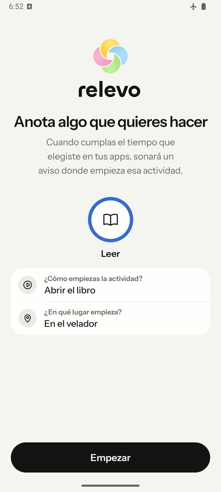 | 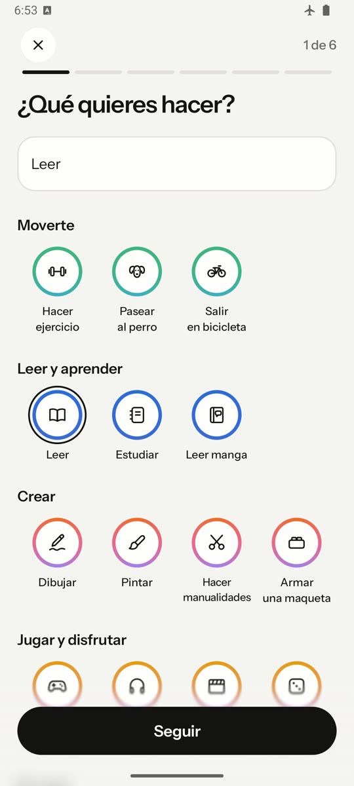 | 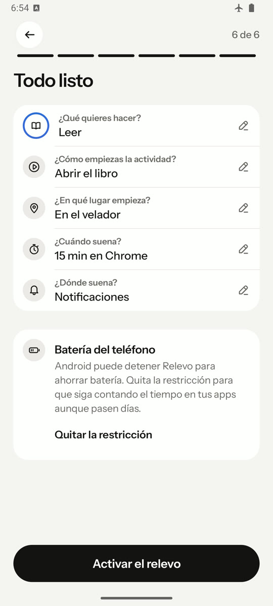 | 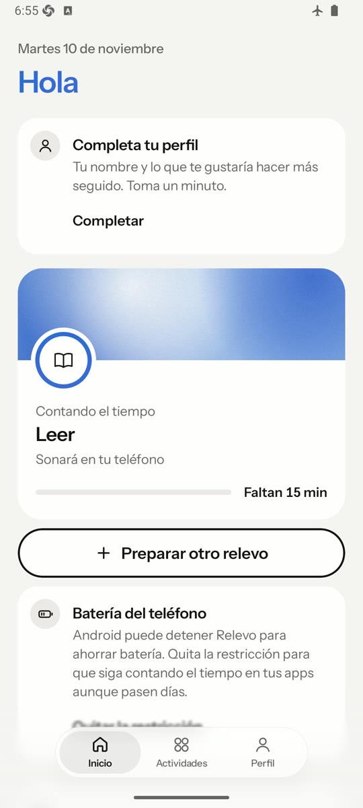 |

| Señal | Cuatro preguntas | Decisión | |
| --- | --- | --- | --- |
| 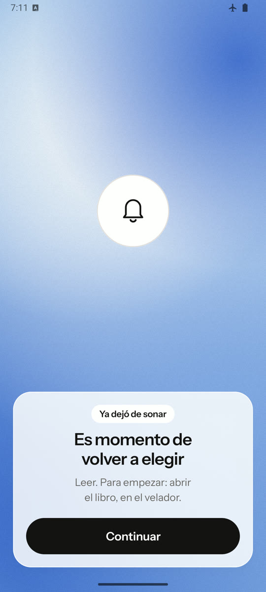 | 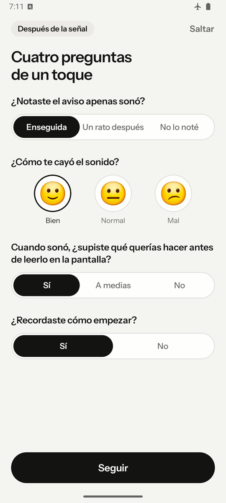 | 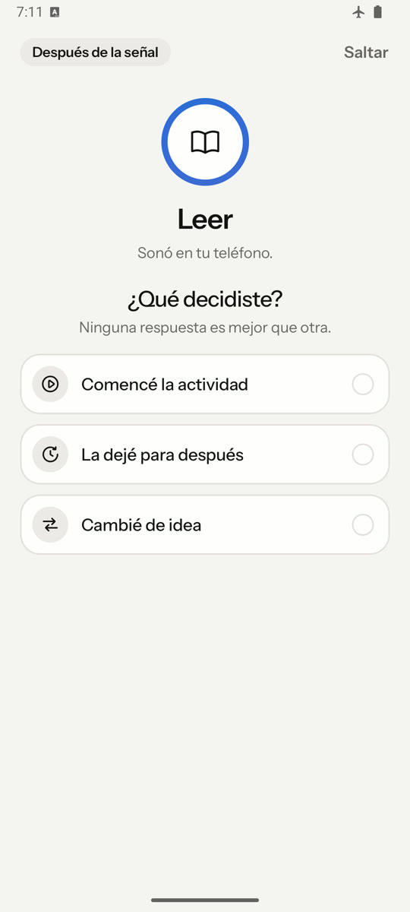 |

*Nota.* Capturas de la versión 4.7.2, tomadas el 10 de noviembre de 2026 en un teléfono Android emulado, con un relevo de ejemplo que suena en el teléfono: la bienvenida, la actividad, el relevo listo, Inicio mientras cuenta, la señal, las preguntas de un toque y la decisión.

## G.6 Palabras clave y sugerencias

Desde el rediseño del 5 de noviembre, cuando la persona escribe su propia actividad, la app reconoce de qué se trata por sus palabras. Con eso elige el ícono de la actividad y sugiere, para elegir con un toque, con qué empezar y dónde dejar el Tag: «tocar guitarra» sugiere sacarla del estuche, y nunca un libro. Antes, las sugerencias se mezclaban por el ícono y por partes de palabras, y «Leer un capítulo de manga» podía contar como una película. El 6 de noviembre se sumaron palabras y frases del español de Chile, como «pichanga», «carioca», «once» o «carrete». Hoy la app reconoce 34 actividades en siete familias, con 634 palabras y 121 frases, y sugiere 91 primeros pasos y 61 lugares.

**Reconocimiento de una actividad.**

1. Pasa el texto a minúsculas y sin tildes: «Película» y «pelicula» son lo mismo.
2. Compara cada palabra entera. Algunas valen también con lo que sigue, como «dibuj…», que reconoce dibujar, dibujo y dibujando.
3. Suma puntos por actividad: cada palabra suma 1; cada frase completa, 2, y cada palabra débil, medio punto, porque sola no decide, como «ver», «jugar» o «tocar».
4. Elige la actividad con más puntos, si suma al menos 1; ante un empate, la que va primero en la lista. Si ninguna llega a 1, no sugiere nada.

Las frases resuelven los casos dudosos: «maratón de series» es de películas y no de correr; «leer una novela gráfica», de manga y no de leer, y «dar una vuelta en bici», de bicicleta y no de caminar. Ninguna palabra pertenece a dos actividades. Las sugerencias nombran un objeto concreto, como «Elegir la película» o «Elegir el libro», y no algo abierto, como «Elegir qué ver»; si la actividad es una de las ideas de la app o un paso de una ruta, primero aparecen sus propias sugerencias, y se muestran hasta cinco (Tabla G5).

**Tabla G5**

*Actividades reconocidas por la app*

| Actividad | Palabras clave, por ejemplo | Primer paso sugerido | Lugar sugerido |
| --- | --- | --- | --- |
| **Moverse** |  |  |  |
| Pasear al perro | perro, perrito, cachorro, quiltro, mascota, correa | Tomar la correa; Sacar su pelota; Llenar su botella de agua | Junto a la puerta; Donde está la correa |
| Correr | correr, trotar, trote, running, maratón, trail | Ponerte las zapatillas; Ponerte ropa deportiva; Llenar la botella de agua | Junto a la puerta; Junto a las zapatillas |
| Caminar | caminar, caminata, pasear, cerro, parque, trekking | Ponerte las zapatillas; Llenar la botella de agua; Elegir el recorrido | Junto a la puerta; Junto a las zapatillas |
| Andar en bicicleta | bici, bicicleta, pedalear, ciclismo, ciclovía, cicletada | Sacar la bici; Inflar las ruedas; Ponerte el casco | Junto a la puerta; Junto a la bici |
| Hacer ejercicio | ejercicio, gimnasio, pesas, calistenia, boxeo, bailar | Ponerte ropa deportiva; Estirar la colchoneta; Preparar el bolso | Junto al clóset; Donde guardas la colchoneta; Junto a la puerta |
| Yoga y estirar | yoga, estirar, elongar, pilates, movilidad, colchoneta | Desenrollar la colchoneta; Ponerte ropa cómoda | Donde guardas la colchoneta; Junto a la cama |
| Nadar | nadar, natación, piscina, acuagym, brazadas | Preparar el traje de baño; Echar la toalla al bolso | Junto a la puerta; Junto al bolso |
| Deportes con pelota | fútbol, pichanga, básquetbol, vóleibol, tenis, pádel | Preparar las zapatillas; Inflar la pelota; Avisar al equipo | Junto a la puerta |
| Cuidar las plantas | plantas, regar, jardín, huerto, suculentas, compost | Llenar la regadera; Ponerte los guantes | Junto a las plantas; Junto a la regadera |
| **Leer y aprender** |  |  |  |
| Manga y cómics | manga, manhwa, cómic, historieta, tomo, webtoon | Sacar el tomo del estante; Abrir el tomo donde quedaste | Junto al estante; En el velador |
| Leer | leer, libro, novela, cuento, poesía, audiolibro | Elegir el libro; Abrir el libro en el marcador; Dejar el libro a la vista | En el velador; En el sillón; Junto al estante |
| Estudiar | estudiar, apuntes, certamen, ramo, preu, PAES | Abrir los apuntes; Despejar el escritorio; Abrir el cuaderno en la tarea | En el escritorio |
| Idiomas | inglés, idioma, francés, japonés, vocabulario, Duolingo | Abrir el cuaderno de vocabulario; Abrir el libro del curso | En el escritorio |
| Escribir | escribir, diario, journaling, carta, poema, guion | Abrir el cuaderno; Dejar un lápiz sobre el cuaderno | En el escritorio; En el velador |
| **Crear** |  |  |  |
| Dibujar | dibujar, dibujo, boceto, ilustración, croquis, lettering | Sacar el cuaderno y un lápiz; Abrir el cuaderno en ese dibujo; Sacar los lápices | En el escritorio; En la mesa |
| Pintar | pintar, acuarela, óleo, acrílico, pincel, mural | Preparar las acuarelas; Llenar un vaso con agua; Sacar los pinceles | En la mesa; En el escritorio |
| Tejer y coser | tejer, crochet, bordar, coser, lana, amigurumi | Sacar el tejido; Enhebrar la aguja; Dejar la lana a mano | En el sillón; En la mesa |
| Maquetas | maqueta, modelismo, lego, miniatura, gunpla | Abrir la caja de la maqueta; Dejar la pieza a la vista; Ordenar las piezas | En la mesa; En la mesa de trabajo |
| Manualidades | manualidades, collage, origami, cerámica, greda, mostacillas | Sacar los materiales; Despejar la mesa; Dejar la tijera y el pegamento a mano | En la mesa de trabajo; En la mesa |
| Fotografía | foto, fotografía, cámara, rollo, analógica, revelado | Cargar la batería de la cámara; Sacar la cámara del estuche | Junto a la puerta; En el escritorio |
| **Jugar y disfrutar** |  |  |  |
| Piano | piano, órgano, sintetizador | Abrir la tapa del piano; Dejar la partitura a la vista | Junto al piano |
| Otro instrumento | guitarra, ukelele, violín, charango, flauta, batería | Sacar el instrumento del estuche; Afinar el instrumento; Dejar la partitura a la vista | Junto al instrumento |
| Cantar | cantar, canto, coro, karaoke, vocalizar | Elegir la canción; Tomar un vaso de agua | En el sillón |
| Música | música, disco, playlist, vinilo, pódcast, audífonos | Ponerte los audífonos; Elegir el disco | En el sillón; Junto a los discos |
| Videojuegos | videojuegos, consola, PlayStation, Nintendo, Minecraft, gamear | Encender la consola; Dejar el control cargado; Avisar a quien juega contigo | Junto a la tele; Junto al computador |
| Películas y series | película, serie, anime, dorama, documental, teleserie | Elegir la película; Elegir el capítulo; Preparar cabritas; Avisar a quien ve contigo | Junto a la tele; En el sillón |
| Cartas | cartas, naipes, carioca, póker, truco, brisca | Sacar el mazo; Despejar la mesa; Avisar a quien juega contigo | En la mesa |
| Juegos de mesa | ajedrez, rompecabezas, dominó, ludo, Catan, sudoku | Sacar la caja; Despejar la mesa; Avisar a quien juega contigo | En la mesa |
| **En casa** |  |  |  |
| Cocinar | cocinar, receta, hornear, queque, empanadas, sopaipillas | Reunir los ingredientes; Dejar la receta a la vista; Lavar la tabla de picar | En el mesón de la cocina |
| Ordenar y limpiar | ordenar, limpiar, aseo, trapear, loza, clóset | Juntar la ropa en el canasto; Vaciar el cajón sobre la cama; Abrir la ventana | Junto al cajón; Junto al canasto; Junto a la cama |
| **Descansar** |  |  |  |
| Dormir | dormir, acostarme, siesta, descansar, sueño | Dejar el teléfono cargando lejos de la cama; Apagar la luz grande; Ponerte el pijama | Junto al cargador; Junto a la cama |
| Meditar | meditar, respirar, mindfulness, relajarme, rezar, qigong | Sentarte en el cojín; Apagar la luz grande | Junto al cojín; Junto a la cama |
| **Con otras personas** |  |  |  |
| Llamar | llamar, llamada, videollamada, FaceTime, conversar | Buscar su número; Escribirle que vas a llamar | En el sillón |
| Compartir | visitar, juntarme, carrete, asado, abuela, polola | Avisar que vas; Preparar algo para llevar; Poner la mesa | Junto a la puerta; En la mesa del comedor |

*Nota.* Elaboración propia a partir del código de la app de noviembre de 2026. Las sugerencias se transcriben tal como las muestra la app. En «Otro instrumento», la app nombra el que escribió la persona: con «guitarra», sugiere «Sacar la guitarra del estuche» y «Junto a la guitarra».

## Registro de cambios (disclaimer)

### 2026-11-24 — Figura G4 con sus capturas

- **Qué cambió:** la Figura G4 se divide en dos tablas de imágenes, una por fila, con las mismas siete capturas y los mismos nombres. El texto no cambia.
- **Cómo estaba antes:** era una sola tabla con una fila de nombres en negrita y una celda vacía. El constructor no la reconocía como galería, así que el Word y el PDF mostraban los nombres sin las capturas.
- **Por qué:** al regenerar los anexos el 24 de noviembre, para sumar las pantallas de la 4.7.2 al Anexo F, la figura salía vacía.

### 2026-11-18 — Texto del PDF de anexos del Pase

- **Qué cambió:** el anexo pasó a ser el del PDF de anexos del Pase, reescrito en lenguaje menos técnico: cambiaron 63 de sus 130 párrafos, ítems y filas de tabla. Las partes son ahora «G.1 Pantallas de la app», «G.4 Datos y su cuidado» y «G.5 Iteraciones del prototipo»; salen las tablas de tecnologías, servicios Bluetooth, aprendizajes del Tag, tablas de la base remota y versiones, y entra la Tabla G4, «Iteraciones del prototipo». La Figura G2 es la imagen del PDF, distinta del diagrama anterior, y la Figura G4 muestra siete pantallas, sin la de la entrevista de cierre. El texto se copió tal como está en el PDF, con sus erratas; los errores y las mejoras están en la [tarea 15 de Por hacer](../../00_gobernanza/por-hacer.md#15-errores-y-mejoras-de-la-memoria-y-los-anexos-del-pase).
- **Cómo estaba antes:** este Markdown tenía la versión del 10 de noviembre; el texto siguió cambiando fuera del repositorio hasta el PDF del Pase, que entregó el autor el 18 de noviembre.
- **Por qué:** el autor pidió que el repositorio coincida con la memoria y los anexos en PDF del Pase, con sus errores.

### 2026-11-10 — Versión 4.7.2 y sus pantallas

- **Qué cambió:** el registro llega a la versión 4.7.2, con las filas de la 4.7, la 4.7.1 y la 4.7.2 en la Tabla G9, y la Figura G4 muestra sus pantallas, capturadas el 10 de noviembre en una copia de prueba.
- **Cómo estaba antes:** el registro terminaba en la 4.6.3 y solo había capturas de la 3.3.
- **Por qué:** el autor pidió capturas de la versión más reciente de la app.

### 2026-11-09 — Títulos formales

- **Qué cambió:** los títulos de las secciones, tablas, figuras y columnas son formales; las pantallas de la Figura G1 y los estados de la Figura G3 tienen nombres en español; el servidor local ya no se nombra por su archivo, y la Tabla G10 aclara que las sugerencias se transcriben como las muestra la app.
- **Cómo estaba antes:** había títulos como «La app», «Cómo suena» o «Lo que guarda el teléfono», estados en inglés y el nombre del archivo del servidor.
- **Por qué:** el autor pidió títulos formales: sin artículo al comienzo ni segunda persona (D-172).

### 2026-11-09 — Sin aura

- **Qué cambió:** las herramientas de diseño ya no nombran el «taller de auras», sino exploraciones de color.
- **Cómo estaba antes:** decía «taller de auras».
- **Por qué:** el autor pidió eliminar de la marca las referencias a luz y aura, y explicar más cómo se construye el logo y en qué se basa (D-171).

### 2026-11-08 — Extranjerismos en cursiva

- **Qué cambió:** *wireframes*, *feed* y *hobbies* van en cursiva, como en la memoria.
- **Cómo estaba antes:** iban en redonda.
- **Por qué:** el autor pidió corregir los errores de formato (D-170).

### 2026-11-08 — Palabras clave y sugerencias

- **Qué cambió:** se suma la parte G.6, con cómo la app reconoce una actividad por sus palabras clave desde la versión 4.3 y la Tabla G10, con las 34 actividades, ejemplos de sus palabras y lo que sugiere para empezar y dónde dejar el Tag. Sale de leer el código de la versión 4.6.3.
- **Cómo estaba antes:** el anexo no mencionaba las palabras clave.
- **Por qué:** el autor pidió incluir en el anexo que la app asocia palabras clave a actividades y sugerencias (D-170).

### 2026-11-08 — Correcciones del autor

- **Qué cambió:** sin códigos de decisión, sin ramas ni carpetas del repositorio y sin nombres de archivos de código; las tablas de versiones pierden la columna «Decisión»; menos «elegido».
- **Cómo estaba antes:** citaba decisiones como D-109, las ramas android-4.x, las carpetas del repositorio y archivos como Reminder.kt.
- **Por qué:** el autor revisó los anexos y pidió un texto sin códigos ni menciones al repositorio, con palabras claras y la declaración de IA corregida (D-170).

### 2026-11-08 — Anexo recopilado y listo para Word

- **Qué cambió:** la descripción técnica se condensa en lo que explica el prototipo: componentes, organización, ciclo, conteo, sonido, el Tag y lo aprendido con él, los datos, la seguridad y el panel. Salen dos diagramas, el de las capas y el del recorrido, que repetían lo que dicen el texto y el Anexo F, y la sección del sistema visual, que está en el Anexo H. Las figuras y tablas se numeran G1 a G9. El registro suma la Tabla G9, con las versiones 4.0 a 4.6.3, leídas de sus documentos en la rama `android-4.6`, sin fusionar. Desde ahora este archivo es la fuente del anexo.
- **Cómo estaba antes:** copiaba tres secciones del documento técnico del 18 de octubre, con su numeración propia (4.1 a 5.7), y el registro terminaba en la 3.3.
- **Por qué:** el autor pidió revisar todos los anexos y dejarlos listos para Word: directos, sin sobreexplicar, con su forma de escribir y con lo más relevante; la versión más reciente de la app es la 4.6.3 (D-168).

### 2026-10-24 — Creación

- **Qué cambió:** el anexo se arma desde sus documentos fuente, con el resto de los anexos A–I de la memoria v5.
- **Cómo estaba antes:** la carpeta de anexos solo tenía un README de la v4, con cinco anexos y sin su contenido.
- **Por qué:** el autor pidió elegir un pendiente de prioridad alta y terminarlo; la memoria v5 remite a nueve anexos que no estaban armados.
