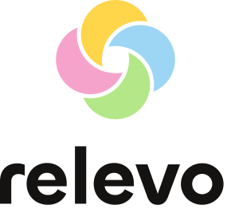
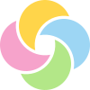
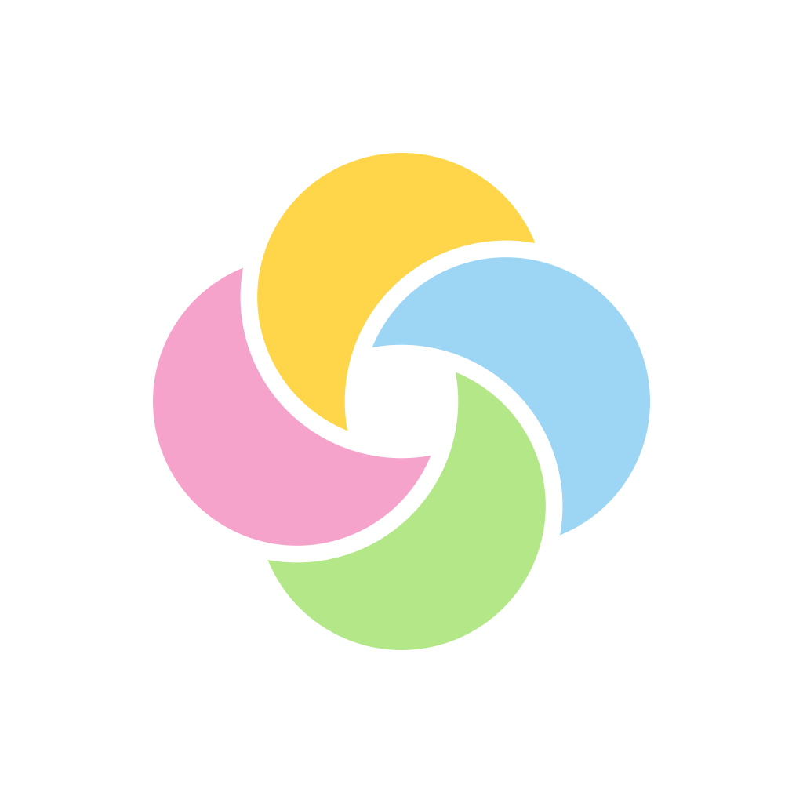

# Anexo H. Identidad visual y sistema de marca

> Parte de los [anexos de la memoria](README.md). Se genera con `node construir-anexos.js` desde sus documentos fuente: para corregirlo, se corrige la fuente y se vuelve a generar.

Documenta la identidad aprobada en octubre de 2026 y cómo se llegó a ella: el logo de cuatro luces, las dos letras, los 72 íconos propios y el color por función, cada decisión con su fuente; lo que se mantiene de la marca del 16 de septiembre, y las propuestas anteriores.

## H.1 El logo

| Vertical | Marca, desde 24 px | Marca chica, de 16 a 23 px | Luz, desde 48 px | Una tinta | Sobre fondo oscuro | Ícono de la app |
| --- | --- | --- | --- | --- | --- | --- |
|  |  |  |  |  |  |  |

| Luz | Color | Papel |
| --- | --- | --- |
| Arriba | `#FFD54A` | Tu tiempo |
| Derecha | `#9DD6F4` | Tu primer paso |
| Abajo | `#B3E788` | El lugar donde empiezas |
| Izquierda | `#F6A3CB` | Lo que decides |

### Concepto

Cuatro luces que se pasan el turno. Cada luz es un peldaño de Relevo, en el sentido del reloj desde arriba:

| Luz | Color | Papel |
| --- | --- | --- |
| Arriba | `#FFD54A` amarillo | Tu tiempo |
| Derecha | `#9DD6F4` celeste | Tu primer paso |
| Abajo | `#B3E788` lima | El lugar donde empiezas (antes, el Tag: ver D-127) |
| Izquierda | `#F6A3CB` rosa | Lo que decides |

Cada luz queda bajo la siguiente, como el testigo que pasa de mano en una carrera de relevos. El centro queda abierto: es el momento del traspaso, de la pantalla a lo que la persona quería hacer.

### Construcción

- Cuatro círculos iguales de radio 29, a 21 del centro, en una unidad de 100.
- Cada luz se recorta con el círculo siguiente agrandado: un corte de 3,4 en tamaño normal, 6,5 en tamaños chicos y 7 en la notificación de 24 dp.
- Cada luz es un trazado plano de dos arcos: sin máscaras, sin transparencias y sin mezclas. Funciona igual en cualquier programa y en una sola tinta.
- Reemplaza a la marca de D-122, que mezclaba las luces oscureciendo: en el centro, los cuatro colores juntos daban un tono turbio.

### Versiones y reglas de uso

| Archivo | Uso |
| --- | --- |
| `relevo-logo-horizontal.svg` | La versión principal |
| `relevo-logo-vertical.svg` | Espacios cuadrados y portadas |
| `relevo-marca.svg` | La marca sola, desde 24 px |
| `relevo-marca-chica.svg` | La marca de 16 a 23 px, con el corte más ancho |
| `relevo-marca-tinta.svg` y `relevo-logo-horizontal-tinta.svg` | Una sola tinta: impresión, sellos, fotocopias |
| `relevo-marca-blanca.svg`, `relevo-logo-horizontal-blanco.svg` y `relevo-logotipo-blanco.svg` | Sobre fondos oscuros |
| `relevo-logotipo.svg` | El nombre solo |
| `relevo-icono-app.svg` | Ícono de la app: superelipse blanca, con la marca al 62 % |
| `relevo-notificacion.svg` | Ícono de notificación de Android: silueta blanca de 24 dp |

- **Espacio libre:** alrededor del logo queda libre al menos la mitad del ancho de la marca.
- **Tamaños mínimos:** la marca, 16 px con su versión chica; el logo horizontal, 96 px de ancho.
- **Composición horizontal:** la marca mide 1,18 veces la altura de la «l» y se centra en ella. La separación es 0,30 del cuerpo de la letra.
- **Color del logotipo:** siempre en minúsculas, y en tinta o en blanco, nunca de colores.
- **Logo blanco:** solo sobre fondos oscuros. Sobre el aura clara se pierde.
- **Con degradado (D-127):** desde 48 px se puede usar la versión «Luz» (`*-degradado.svg`): cada luz es más clara afuera y más intensa hacia el centro.
- **Prohibido:** girarlo, rellenar el centro, cambiar el orden de las luces o agregarle sombras o brillos.

### Fundamento

La marca representa con cuatro círculos los cuatro componentes de un relevo:

- la condición que activa la señal (tu tiempo);
- el primer paso;
- el lugar donde comienza la actividad;
- la decisión de la persona.

Los círculos se leen en el sentido del reloj desde arriba, y cada uno pasa bajo el siguiente, como el testigo en una carrera de relevos. El orden y los componentes provienen del modelo del proyecto (Figura 2 de la memoria). Ese modelo se apoya en dos razones:

- Los recordatorios eficaces aluden a la vez a la ocasión y a la acción prevista (Guynn et al., 1998).
- Que el lugar donde comienza la actividad aporte a esa señal es la hipótesis que el proyecto pone a prueba.

La tercera luz representa el lugar y no el localizador Bluetooth empleado en el prototipo. El localizador es un sustituto provisional del testigo. La marca nombra el concepto que se estudia, no el objeto elegido para probarlo, y así seguirá siendo válida si el objeto cambia.

La forma de la marca responde a tres antecedentes:

- **Formas circulares:** en cinco experimentos, las formas circulares activaron con más frecuencia atributos de suavidad y cuidado, y las angulosas, de dureza (Jiang et al., 2016). Un sistema que no pretende vigilar ni presionar requiere lo primero.
- **Un logo que describe:** los logotipos que describen lo que hace la marca se evalúan mejor, sobre todo en marcas nuevas (Luffarelli et al., 2019). Por eso la marca representa el funcionamiento del sistema y se acompaña del descriptor del proyecto donde Relevo aún no es conocido.
- **Formas planas:** los círculos se cruzan con cortes y colores planos, sin transparencias, de modo que la marca se reproduce igual en cualquier medio y en una sola tinta. Esto atiende a una lección del rediseño de Slack en 2019: su logotipo anterior, de once colores superpuestos, resultaba fácil de reproducir mal (Slack, 2019).

Un degradado sutil dentro de cada círculo se evalúa como variante para tamaños grandes. La versión plana se mantiene como referencia.

## H.2 Las dos letras

La identidad usa dos letras sin serifa: una para el nombre y otra para todo lo demás.

| Letra | Uso | Autoría y licencia | Por qué |
| --- | --- | --- | --- |
| **Chillax Semibold** | El logotipo, convertido a trazos. | Indian Type Foundry, en Fontshare; ITF Free Font License. | Sus formas son redondas como las luces y en tamaño chico no pierde la forma. |
| **Instrument Sans** | La app, la memoria, estos anexos y las láminas. | Rodrigo Fuenzalida, diseñador radicado en Santiago, y Jordan Egstad; Google Fonts, SIL Open Font License. | Una grotesca con ejes de peso y ancho, legible en pantalla y en papel; el trazo de los íconos se midió sobre su asta. |

### Cómo se eligió la letra del logotipo

- **Chillax Semibold**, de Indian Type Foundry, distribuida por Fontshare.
- Se compararon 20 letras sin serifa de Fontshare y llegaron cinco al final: Chillax 600 y 700, Cabinet Grotesk 800, Pally 700 y Panchang 600, con Instrument Sans 700 de referencia.
- Ganó Chillax porque sus formas son redondas como las luces:
  - Su «o» es casi un círculo: ancho y alto 1,03.
  - La «e» y la «r» terminan en curvas abiertas.
  - En chico no pierde la forma (altura x de 0,495 del cuerpo).
- No es de Google Fonts, como pide la regla del autor para el logotipo. Instrument Sans sigue siendo la letra de la app.
- **Licencia:** ITF Free Font License. Permite el uso personal y comercial. Un logo hecho con la letra no es obra derivada y pertenece a quien lo crea.
- **Archivos:**
  - El logotipo va convertido a trazos con opentype.js, con un interletrado de −0,02.
  - El archivo de la fuente no se guarda en el repositorio.

## H.3 Los íconos

Los 72 íconos propios, en una retícula de 24 con trazo de 1,6 ([archivos SVG](../../10_recursos_visuales/iconos-relevo-2026-10-11/svg)).

| Abrir | Advertencia | Agregar | Ajustes | Apps elegidas | Aura | Avance | Avisos |
| --- | --- | --- | --- | --- | --- | --- | --- |
|  |  |  |  |  |  |  |  |

| Ayuda | Pila | Salir en bicicleta | Borrar | Buscar | Calendario | Cambié de idea | Caminar |
| --- | --- | --- | --- | --- | --- | --- | --- |
|  |  |  |  |  |  |  |  |

| Cerrar | Cocinar | Comentario | Conexión | Contando | Contraer | Decidir | Descargar |
| --- | --- | --- | --- | --- | --- | --- | --- |
|  |  |  |  |  |  |  |  |

| Después | Dibujar | Dormir | Editar | Hacer ejercicio | Empecé | Enviar | Error |
| --- | --- | --- | --- | --- | --- | --- | --- |
|  |  |  |  |  |  |  |  |

| Escribir | Favorita | Estudiar | Expandir | Sacar fotos | Tocar guitarra | Información | Inicio |
| --- | --- | --- | --- | --- | --- | --- | --- |
|  |  |  |  |  |  |  |  |

| Jugar un juego de mesa | Leer | Listo | Llamar a alguien | Lugar | Hacer manualidades | Armar una maqueta | Más opciones |
| --- | --- | --- | --- | --- | --- | --- | --- |
|  |  |  |  |  |  |  |  |

| Meditar | Escuchar música | Ordenar tu pieza | Parlante | Pasear al perro | Pausar | Ver una película | Perfil |
| --- | --- | --- | --- | --- | --- | --- | --- |
|  |  |  |  |  |  |  |  |

| Permiso | Pintar | Cuidar las plantas | Primer paso | Privacidad | Reintentar | Reproducir | Ruta |
| --- | --- | --- | --- | --- | --- | --- | --- |
|  |  |  |  |  |  |  |  |

| Siguiente | Silenciar | Suena | Tag | Teléfono | Tiempo | Jugar videojuegos | Volver |
| --- | --- | --- | --- | --- | --- | --- | --- |
|  |  |  |  |  |  |  |  |

### Cómo se eligieron

Se contó qué íconos usa hoy la app: 80 del kit D-073, en pestañas, filas, avisos y la preparación del relevo. Se revisaron además sus tres pestañas (Inicio, Ruta y Perfil) y las 21 ideas de actividad del código, cada una con su fuente en el corpus. El set cubre esos usos y suma uno que no existía: **Suena**, el Tag con sus anillos, para la fila «Suena» de la preparación, que hoy usa la campana de avisos.

### Construcción

| Decisión | Por qué | Fuente |
| --- | --- | --- |
| Retícula de 24 y área viva de 20 | Se alinean en listas, botones y barras, con 2 de margen | Google, Material Design, íconos de sistema |
| Cuatro formas de base: círculo (r 9), cuadrado (16), vertical (14 × 18) y horizontal (18 × 14) | Así un ícono redondo y uno con esquinas miden lo mismo a la vista | Google, Material Design, keylines |
| Trazo 1,6 | Se midió el asta de Instrument Sans Medium: 0,105 de su tamaño. Junto a texto de 15 px, el de las fichas, da 1,6: el ícono pesa lo mismo que su palabra | Apple, SF Symbols; medición propia del 11 de octubre |
| Tamaños ópticos: 16 → 2,0; 20 → 1,8; 24 → 1,6; 32 → 1,4; 48 → 1,3 | Se ve igual de firme en una lista que en una lámina | Google, eje de tamaño óptico de Material Symbols |
| Puntas y uniones redondas | Conversan con las cápsulas y las fichas de la interfaz; a tamaño chico no dejan picos | Coherencia con «Relevo con aura» |
| Un solo peso; solo se rellenan puntos que marcan algo | El punto del primer peldaño («estás aquí»), la argolla del Tag | Decisión de este sistema |
| Siempre con una palabra | Casi ningún ícono tiene un significado único; la app ya los muestra con texto | Harley, Nielsen Norman Group |

**Metáforas:**
- **Lo propio de Relevo se dibuja con su objeto y sus ideas.** El Tag como es (redondo, con su botón y la argolla); el sonido como anillos, nunca luz (D-122); el primer paso como un punto en el primer peldaño; el tiempo como cronómetro, porque se cuentan minutos de uso.
- **Lo que hace cualquier app usa formas conocidas,** como volver, borrar o buscar: lo que la gente reconoce de otras apps le ahorra aprender.
- **Dos actividades se rehicieron tras verlas a 16 px.** «Caminar» pasó de zapatilla, que parecía una bota, a dos huellas. «Primer paso» perdió un «+» que se confundía con «Agregar».

## H.4 El color

Seis fichas claras, una por papel, y los colores de base.

| Papel | Ficha | Color |
| --- | --- | --- |
| Tu tiempo | Mantequilla | `#F4E496` |
| Tu primer paso | Cielo | `#B3E5FC` |
| El lugar | Lima | `#C6EEAE` |
| Lo que decides | Rubor | `#FAC8D9` |
| Tu aura | Lila | `#DFD1FC` |
| Después | Durazno | `#FBD1B3` |

| Base | Uso | Color |
| --- | --- | --- |
| Papel | Fondo | `#F7F4F0` |
| Piedra | Superficies y el medio | `#EEE9E3` |
| Línea | Bordes | `#E4DED6` |
| Grafito | Texto secundario | `#6B655F` |
| Tinta | Texto y selección | `#141312` |
| Error | Solo errores, con ícono y texto | `#B3261E` |

### El color como función

El color de Relevo se decidió por la función que cumple en la interfaz y no por un efecto emocional esperado. La revisión de Elliot y Maier (2014) advierte que la investigación sobre psicología del color se encuentra en una etapa inicial y que sus efectos dependen del contexto. El significado de un color varía, además, según el producto en que aparece (Kauppinen-Räisänen y Luomala, 2010). En consecuencia, el color no se emplea para inducir un estado de ánimo, sino para distinguir de forma estable tres tipos de información:

- las partes de un relevo;
- las actividades de cada persona;
- los momentos del ciclo.

### Evidencia sobre asociaciones entre color y emoción

La asignación de colores a funciones consideró la evidencia sobre asociaciones entre color y emoción, entendidas como tendencias compartidas y no como efectos sobre la conducta.

- **Entre países:** en 30 países, las asociaciones resultaron muy similares (similitud media r = 0,88), y más aún entre países que comparten lengua o cercanía geográfica (Jonauskaite et al., 2020).
- **Las más frecuentes:** en 31 países, las asociaciones elegidas por el 40 % o más de los participantes vinculan:
  - el rojo con el amor (69,2 %) y la rabia (55,2 %);
  - el amarillo con la alegría (55,7 %);
  - el rosa con el amor (53,2 %);
  - el negro con la tristeza (53,7 %) y el miedo (48,7 %);
  - el gris con la tristeza (47,7 %);
  - el naranja con la alegría (44,6 %) y la diversión (41,0 %) (Jonauskaite et al., 2024).
- **Lo que no alcanza el umbral:** ninguna emoción llega a ese umbral con el verde, el azul ni el morado.
- **Luminosidad y saturación:** los colores más claros se asocian con emociones más positivas (Jonauskaite et al., 2024). Al observar colores, la saturación y el brillo elevan la activación declarada y la fisiológica, y la activación crece del azul y el verde hacia el rojo (Wilms y Oberfeld, 2018).

No se encontró un estudio sobre color y emoción realizado solo con población chilena. La evidencia regional disponible es de otro tipo:

- **Encuesta con Chile:** se aplicó a 1066 personas de México, Argentina y Chile. El miedo se asoció sobre todo con el negro (52,4 %), el rojo (13,5 %) y el gris (8,9 %). El celeste claro y el magenta fueron los colores menos asociados con el miedo. Por tratarse de un boletín de prensa sobre una ponencia, sin revisión por pares, se usa solo como apoyo (Universidad Nacional Autónoma de México [UNAM], 2023).
- **Medellín:** en 2400 universitarios, el verde se asoció con naturaleza y esperanza; el azul, con el mar y el cielo; el rosa, con ternura y delicadeza; el morado, con luto y dolor; y el gris, con mal tiempo y tristeza (Restrepo Betancur, 2022).
- **Ecuador:** en 260 universitarios, los conceptos con raíz sensorial o cultural obtuvieron colores consistentes. Los abstractos, como «creativo», se dispersaron (Sánchez-Borrero et al., 2026).

Dada la influencia de la lengua y la geografía, es razonable suponer que las tendencias de la población chilena se parecen a las de México, Colombia y España. Se trata, con todo, de una inferencia y no de un dato.

### Criterios de diseño

De esa evidencia se derivaron seis criterios:

1. **Familias, no tonos exactos.** La evidencia describe familias de color, luminosidad y saturación; ningún tono preciso produce por sí mismo una emoción.
2. **Papeles claros y poco saturados.** Lo que acompaña a la persona no debería elevar la activación. Esto concuerda con el ideal de la tecnología calma: informar desde la periferia de la atención (Weiser y Brown, 1997).
3. **Sin negro, gris ni rojo en los estados de la persona.** Son los colores más asociados con el miedo y la tristeza en la región y entre países. El rojo pleno queda reservado para los errores.
4. **Redundancia.** Ningún dato se comunica solo con color, sino también con ícono y palabra (World Wide Web Consortium, 2024, criterio 1.4.1).

   La simulación de las deficiencias de visión del color (Machado et al., 2009) mostró dos pares que se confunden: el celeste y el lila con deuteranopia, y el rosa y el durazno con tritanopia.
5. **Contraste medido.** Se exigieron dos umbrales (World Wide Web Consortium, 2024):
   - 4,5:1 para el texto (criterio 1.4.3);
   - 3:1 para los gráficos que transmiten información (criterio 1.4.11).
6. **Un color, un papel.** Cada color significa siempre lo mismo. El color es difícil de apropiar como elemento distintivo de una marca (Ward et al., 2020). Su aporte está en la coherencia interna del sistema más que en el reconocimiento externo.

### Los papeles de Relevo

Seis colores claros, de luminosidad perceptual equivalente (OKLCH entre 0,88 y 0,91; Ottosson, 2020), distinguen las partes de un relevo (Tabla H1). La asignación se apoya, donde existe, en la convención de la señalética de seguridad. La norma ISO 3864-1 asigna:

- al rojo, la prohibición;
- al amarillo, la precaución;
- al azul, la acción obligatoria;
- al verde, la condición segura. Sus señales típicas indican dónde está una salida o un botiquín (International Organization for Standardization [ISO], 2011).

**Tabla H1**

*Colores de los papeles de Relevo*

| Papel | Color | Fundamento |
| --- | --- | --- |
| Tu tiempo, la condición que activa la señal | Amarillo claro `#F4E496` | Es el color más asociado con la alegría. En señalética pide atención sin prohibir. Baja saturación, para no elevar la activación |
| Tu primer paso | Celeste `#B3E5FC` | Indica una acción en la señalética. Está entre los colores menos asociados con el miedo |
| El lugar donde se empieza | Verde claro `#C6EEAE` | En la señalética, el verde indica dónde está algo. En Medellín se asocia con naturaleza y esperanza |
| Lo que decide la persona | Rosa `#FAC8D9` | Conserva el amor y la alegría del rojo sin su asociación con la rabia, para que la decisión no se juzgue |
| El aura, la personalización | Lila `#DFD1FC` | Sin una asociación emocional compartida. Se mantiene claro para alejarse del morado del luto |
| Después de la señal | Durazno `#FBD1B3` | El naranja se asocia con la alegría y la diversión |

*Nota.* La tinta sobre cualquiera de los seis colores alcanza un contraste de 12,7:1 a 14,5:1.

Los siete cielos de las actividades, como los dibuja la app: un color de base y cuatro o cinco luces.

| Familia | Base | Luces |
| --- | --- | --- |
| Moverte | `#BFE7D3` | `#3FB487` `#E6F7FF` `#9ED6F4` `#5FC79A` |
| Leer y aprender | `#8DB9EA` | `#2559C9` `#E9F3FF` `#7EA9E8` `#F7FBFF` `#3B6BD2` |
| Crear | `#F3B38E` | `#F06A3B` `#F7C6DD` `#B9A4F2` `#FFE6A6` |
| Jugar y disfrutar | `#E9B85C` | `#F2A20C` `#B78BEF` `#F7D27A` `#9C7BE8` |
| En casa | `#F28A4A` | `#E8501E` `#F9B36B` `#FFE0B8` `#C9370F` |
| Descansar | `#2B3A66` | `#0F1A3D` `#5E7BD8` `#A9B8F5` `#1E2B5C` |
| Con otras personas | `#F4C9D2` | `#C8325A` `#F7A9BE` `#FFFFFF` `#E0617F` |

### Las actividades

Las actividades que la persona quiere retomar se representan con cielos: degradados con grano y volumen, agrupados en siete familias (Tabla H2). Son un material distinto de las fichas planas de los papeles, para que el color de una actividad no se confunda con el de una función. La asignación privilegia la raíz sensorial de cada actividad, que según Sánchez-Borrero et al. (2026) produce asociaciones más consistentes. Crear, que es un concepto abstracto, recibe un cielo de varios tonos.

**Tabla H2**

*Familias de color de las actividades*

| Familia | Cielo | Fundamento |
| --- | --- | --- |
| Moverse y aire libre | Menta | Verde: naturaleza y esperanza (Restrepo Betancur, 2022). Activa menos que el rojo |
| Leer y aprender | Cielo | Azul: el mar y el cielo. Activa menos que el rojo (Wilms y Oberfeld, 2018) |
| Crear | Atardecer | Concepto abstracto sin color propio (Sánchez-Borrero et al., 2026): un cielo de varios tonos |
| Jugar y disfrutar | Ámbar | Amarillo y naranja: alegría y diversión (Jonauskaite et al., 2024) |
| La casa | Brasa | El naranja del fuego y la cocina, sin llegar al rojo |
| Descansar | Noche | Azul profundo con raíz sensorial, sin negro, el color más asociado con el miedo (UNAM, 2023) |
| Personas | Rosa | Rosa: amor y ternura. Como una parte lo rechaza, se puede cambiar |

*Nota.* Cada persona puede cambiar el color de una actividad.

El texto blanco sobre los cielos claros no alcanzó el contraste de 4,5:1: se midieron valores entre 2,6:1 y 3,7:1. Por eso el nombre de la actividad se presenta en una cápsula blanca con letra de tinta, que alcanza entre 15:1 y 17,8:1 sobre cualquier cielo. El cielo aparece solo donde está la actividad. Cubre la pantalla completa en el momento de la señal, cuando la interfaz debe hacer visible la actividad elegida.

### Verificación y límites

**Mediciones:**

- La luminosidad y la saturación se midieron en el espacio OKLCH.
- El contraste se calculó según las WCAG 2.2.
- El contraste del texto sobre los cielos se midió en capturas, sobre el píxel más desfavorable del fondo.
- Las deficiencias de visión del color se simularon con el modelo de Machado et al. (2009).

**Límites:**

- Ninguna decisión de color se ha probado con personas.
- Las asociaciones citadas son tendencias por familia de color, no efectos garantizados.
- No existe evidencia exclusivamente chilena.
- La encuesta que incluye a Chile no fue revisada por pares.
- Antes de un uso comercial de la marca habría que verificar su registrabilidad.

## H.5 Lo que se mantiene de la marca del 16 de septiembre

### Nombre

**Relevo** es el nombre definitivo para el proyecto de título.

Se elige por ser breve, pronunciable y capaz de adquirir asociaciones propias mediante el uso. No se presentará como una metáfora literal sobre el traspaso de una intención. Su significado se construirá a partir de la experiencia: algo que la persona quería hacer vuelve a participar en su decisión.

Una eventual comercialización requerirá revisar disponibilidad jurídica, dominios y coincidencias comerciales. Esa comprobación queda fuera del cierre académico del nombre.

### Frase de marca

> **Hazle lugar a lo que quieres hacer.**

La frase relaciona dos dimensiones del producto. `Hacer lugar` significa reservar un espacio físico para la señal y volver a considerar una actividad dentro de la decisión. No obliga a realizarla ni presenta el teléfono como enemigo.

La frase se utiliza en portadas, presentación, sitio o piezas de introducción. No se repite dentro de pantallas operativas, instrucciones técnicas o mensajes de error.

### Descriptor funcional

> **Un recordatorio físico preparado desde el teléfono.**

El descriptor acompaña al nombre cuando la audiencia todavía no conoce el producto. Su función es aclarar, no emocionar.

## H.6 Propuestas anteriores

La identidad se buscó en propuestas sucesivas, revisadas por el autor. Cada una dejó algo en la identidad final.

| Fecha | Propuesta | Qué proponía | Qué pasó |
| --- | --- | --- | --- |
| 16 sep. | Sistema de marca del proyecto (D-062) | Nombre, descriptor, frase, letra, paleta y logotipo. | Se mantienen el nombre, el descriptor y la frase; la letra, la paleta y el logotipo se reemplazaron en octubre. |
| 25 sep. | Punto y pulso (D-067) | Una identidad a partir de un punto que late. | Reemplazada el mismo día por pedido del autor. |
| 25 sep. | «Antes de que sea después» (D-072) | Una plataforma de marca sobre el momento en que aún se puede elegir. | Reemplazada por D-073: el autor la juzgó confusa para la comisión. |
| 25 sep. | «Vuelve a lo que querías hacer» (D-073) | El mismo centro, en palabras directas. | Se aplicó en la app de la 2.8 a la 2.30. |
| 27 sep. | Sistema de marca 2.0 en Figma (D-085) | Variables, componentes y pantallas en Figma. | Superada por las propuestas de fines de septiembre. |
| 30 sep. | El subrayado (D-098) | Una identidad alrededor de un renglón azul. | Decidida en parte; el renglón quedó como línea de escritura. |
| 2 oct. | Sistema de diseño 3.1 (D-099) | Un renglón que hace lugar, dos voces y los colores de la casa. | Base de las propuestas 3.2 a 3.5. |
| 3 oct. | Relevo vivo, Volver a enfocar, Las ganas estaban y Cuándo va color (D-100 a D-103) | Color vivo, letra manuscrita, serif y reglas de cuándo usar color. | El autor descartó la letra manuscrita y la serif; quedó la regla de cuándo va color. |
| 3 oct. | El traspaso (D-104) | La marca como el paso del testigo. | La idea del traspaso sigue en el logo de cuatro luces. |
| 4 oct. | Letras para el logotipo (D-105 a D-108) | Una búsqueda amplia de letras display. | Llevó a elegir Chillax en el logo del 11 de octubre (D-125). |
| 10–11 oct. | Relevo con aura (D-121 a D-127) | Aura, fichas por papel, íconos propios, cielos y el logo de cuatro luces. | **Aprobada:** es la identidad actual, aplicada en la app desde la 3.0. |

## H.7 Referencias visuales del autor

| Referencia | Qué enseña | Qué se tomó | Qué no |
| --- | --- | --- | --- |
| Dafi (Mambo Mambo) | Íconos de línea sobre cuadrados de color, fichas en escalera, aura | Las fichas con ícono de línea, ahora con un papel por color | Sus dibujos: los 72 se trazaron de nuevo |
| DAYO | Personajes que nacen de cuatro estados emocionales, ordenados con el modelo de valencia y activación | Fundamentar el color en estudios de emoción, con datos de 31 países y la saturación como activación | El volumen peludo en 3D: a 16 px se pierde; el volumen de Relevo vive en el aura |
| Biceps Grotesk | Una letra modular de cuadrados y triángulos en una retícula de 30 px, en rojos y rosas | La construcción modular: las mismas formas de base y una sola retícula; de sus rojos, el lado rosa | La letra para la interfaz: es para lucirse en grande |

## Referencias del anexo

Elliot, A. J. y Maier, M. A. (2014). Color psychology: Effects of perceiving color on psychological functioning in humans. *Annual Review of Psychology, 65*, 95–120. https://doi.org/10.1146/annurev-psych-010213-115035

Guynn, M. J., McDaniel, M. A. y Einstein, G. O. (1998). Prospective memory: When reminders fail. *Memory & Cognition, 26*(2), 287–298. https://doi.org/10.3758/BF03201140

International Organization for Standardization. (2011). *Graphical symbols — Safety colours and safety signs — Part 1: Design principles for safety signs and safety markings* (ISO 3864-1:2011).

Jiang, Y., Gorn, G. J., Galli, M. y Chattopadhyay, A. (2016). Does your company have the right logo? How and why circular- and angular-logo shapes influence brand attribute judgments. *Journal of Consumer Research, 42*(5), 709–726. https://doi.org/10.1093/jcr/ucv049

Jonauskaite, D., Abu-Akel, A., Dael, N., Oberfeld, D., Abdel-Khalek, A. M., Al-Rasheed, A. S., Antonietti, J., Bogushevskaya, V., Chamseddine, A., Chkonia, E., Corona, V., Fonseca-Pedrero, E., Griber, Y. A., Grimshaw, G., Hasan, A. A., Havelka, J., Hirnstein, M., Karlsson, B. S. A., Laurent, E., … Mohr, C. (2020). Universal patterns in color-emotion associations are further shaped by linguistic and geographic proximity. *Psychological Science, 31*(10), 1245–1260. https://doi.org/10.1177/0956797620948810

Jonauskaite, D., Epicoco, D., Al-Rasheed, A. S., Aruta, J. J. B. R., Bogushevskaya, V., Brederoo, S. G., Corona, V., Fomins, S., Gizdic, A., Griber, Y. A., Havelka, J., Hirnstein, M., John, G., Jopp, D. S., Karlsson, B., Konstantinou, N., Laurent, É., Marquardt, L., Mefoh, P. C., … Mohr, C. (2024). A comparative analysis of colour–emotion associations in 16–88-year-old adults from 31 countries. *British Journal of Psychology, 115*(2), 275–305. https://doi.org/10.1111/bjop.12687

Kauppinen-Räisänen, H. y Luomala, H. T. (2010). Exploring consumers’ product-specific colour meanings. *Qualitative Market Research: An International Journal, 13*(3), 287–308. https://doi.org/10.1108/13522751011053644

Luffarelli, J., Mukesh, M. y Mahmood, A. (2019). Let the logo do the talking: The influence of logo descriptiveness on brand equity. *Journal of Marketing Research, 56*(5), 862–878. https://doi.org/10.1177/0022243719845000

Machado, G. M., Oliveira, M. M. y Fernandes, L. A. F. (2009). A physiologically-based model for simulation of color vision deficiency. *IEEE Transactions on Visualization and Computer Graphics, 15*(6), 1291–1298. https://doi.org/10.1109/TVCG.2009.113

Ottosson, B. (2020). *A perceptual color space for image processing*. https://bottosson.github.io/posts/oklab/

Restrepo Betancur, L. F. (2022). Preferencia por los colores en universitarios de la ciudad de Medellín, Colombia. *Anuario Electrónico de Estudios en Comunicación Social «Disertaciones», 15*(1), 1–15. https://doi.org/10.12804/revistas.urosario.edu.co/disertaciones/a.10455

Sánchez-Borrero, G., Quelal-Moncayo, S. y Bustos-Cevallos, S. (2026). Asociaciones culturales latinoamericanas del color: estudio desde la psicología cromática en estudiantes universitarios de la Pontificia Universidad Católica del Ecuador. *Kepes, 23*(33), 105–145. https://doi.org/10.17151/kepes.2026.23.33.5

Slack. (2019, 16 de enero). *Say hello, new logo*. https://slack.com/blog/news/say-hello-new-logo

Universidad Nacional Autónoma de México. (2023, 16 de abril). *Relacionamos nuestros miedos con los colores* (Boletín UNAM-DGCS-273). Dirección General de Comunicación Social. https://www.dgcs.unam.mx/boletin/bdboletin/2023_273.html

Ward, E., Yang, S., Romaniuk, J. y Beal, V. (2020). Building a unique brand identity: Measuring the relative ownership potential of brand identity element types. *Journal of Brand Management, 27*(4), 393–407. https://doi.org/10.1057/s41262-020-00187-6

Weiser, M. y Brown, J. S. (1997). The coming age of calm technology. En P. J. Denning y R. M. Metcalfe (Eds.), *Beyond calculation: The next fifty years of computing* (pp. 75–85). Copernicus. https://doi.org/10.1007/978-1-4612-0685-9_6

Wilms, L. y Oberfeld, D. (2018). Color and emotion: Effects of hue, saturation, and brightness. *Psychological Research, 82*(5), 896–914. https://doi.org/10.1007/s00426-017-0880-8

World Wide Web Consortium. (2024, 12 de diciembre). *Web content accessibility guidelines (WCAG) 2.2*. https://www.w3.org/TR/2024/REC-WCAG22-20241212/

## Registro de cambios (disclaimer)

### 2026-10-24 — Creación

- **Qué cambió:** el anexo se arma desde sus documentos fuente, con el resto de los anexos A–I de la memoria v5.
- **Cómo estaba antes:** la carpeta de anexos solo tenía un README de la v4, con cinco anexos y sin su contenido.
- **Por qué:** el autor pidió elegir un pendiente de prioridad alta y terminarlo; la memoria v5 remite a nueve anexos que no estaban armados.
