# Anexo H. Identidad visual y sistema de marca

La identidad de Relevo quedó definida el 11 de octubre de 2026, después de más de veinte propuestas. Este anexo muestra cómo se construye cada pieza y en qué se funda —el logo, con las variantes que se probaron el 23 de noviembre, la tipografía, los íconos y la paleta cromática—, qué se mantiene de la marca del 16 de septiembre y qué dejó cada propuesta anterior.

## H.1 Logo

**Figura H1**

*Logo, versiones y círculos*

<!-- lamina: LOGO -->
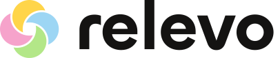

| Vertical | Marca, desde 24 px | Marca chica, de 16 a 23 px | Degradado, desde 48 px | Una tinta | Sobre fondo oscuro | Ícono de la app |
| --- | --- | --- | --- | --- | --- | --- |
| 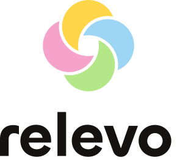 | 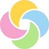 |  |  |  |  | 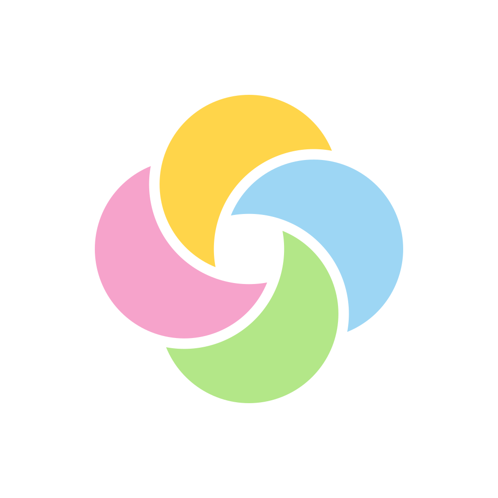 |

| Círculo | Color | Significado |
| --- | --- | --- |
| Arriba | `#FFD54A` | Tiempo |
| Derecha | `#9DD6F4` | Primer paso |
| Abajo | `#B3E788` | Lugar de inicio |
| Izquierda | `#F6A3CB` | Decisión |
<!-- /lamina -->

*Nota.* Elaboración propia.

**Concepto.** El logo dibuja un relevo: cuatro círculos que se pasan el turno, en el sentido del reloj desde arriba. Cada uno es una de las cuatro partes de un relevo, en el orden del modelo del proyecto (capítulo 11): el tiempo, en amarillo; el primer paso, en celeste; el lugar donde empieza la actividad, en verde, y la decisión de la persona, en rosa. Cada círculo queda bajo el siguiente, como el traspaso en una carrera de relevos, y el centro queda abierto: es el paso de la pantalla a lo que la persona quería hacer.

**Bocetos.** El logo se buscó primero a mano, en tres hojas. La primera prueba la R de Relevo, el gesto de una mano que le pasa algo a otra y el infinito del desplazamiento por la pantalla (Figura H2).

**Figura H2**

*Bocetos del logo: letra, gesto y desplazamiento*

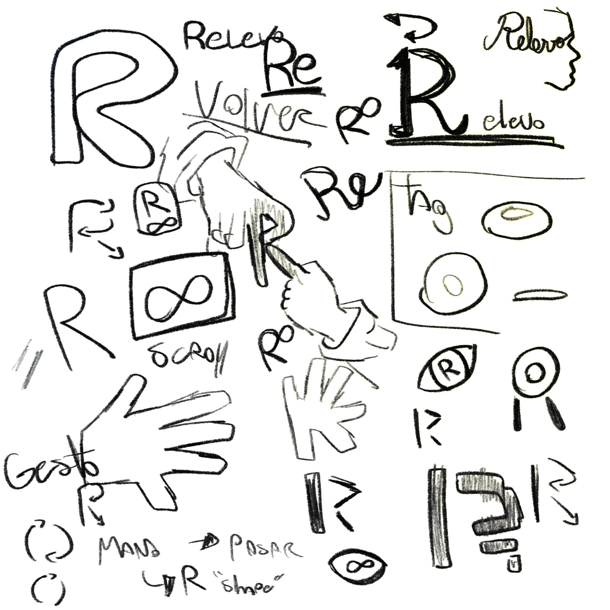

*Nota.* Elaboración propia.

La segunda prueba formas simples —círculos que se cruzan, el infinito, el marcador de un lugar— y anota lo que reúne un relevo: la decisión, la persona, el lugar, el objeto y la actividad (Figura H3).

**Figura H3**

*Bocetos del logo: formas y lugar*

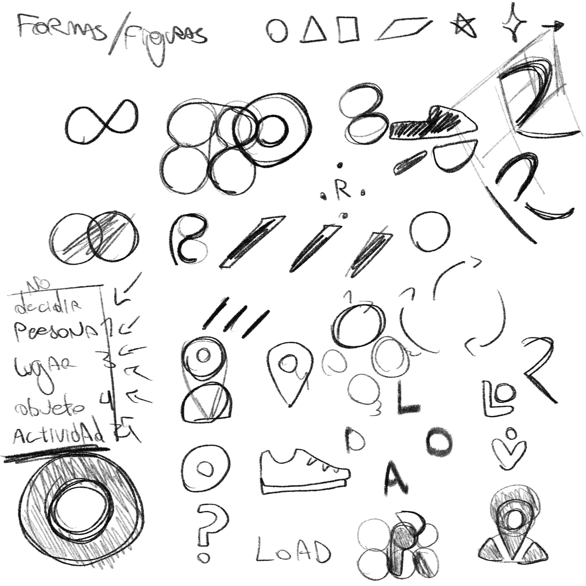

*Nota.* Elaboración propia.

En la tercera aparece el concepto: los cuatro pasos de un relevo se vuelven cuatro círculos que giran alrededor de un centro y se pasan el turno (Figura H4).

**Figura H4**

*Bocetos del logo: cuatro pasos y cuatro círculos*

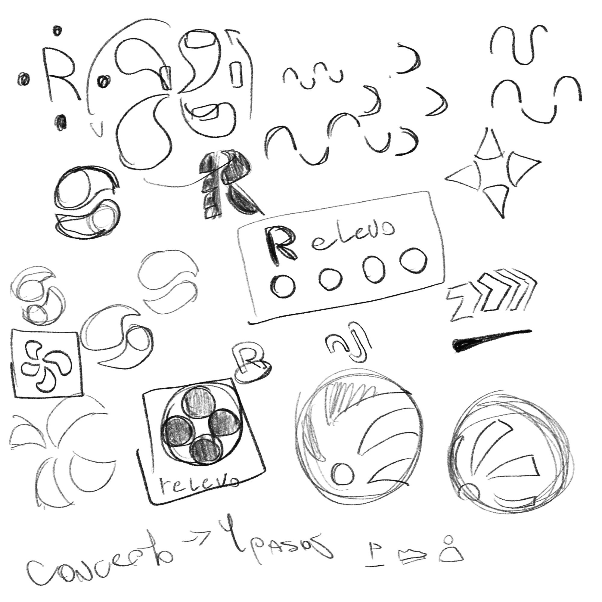

*Nota.* Elaboración propia.

**Construcción.** Del boceto, el logo pasó a una geometría exacta: se dibuja solo con círculos y sus cortes, sin trazos a mano. La Figura H5 muestra los círculos, el corte y la marca terminada:

1. Una retícula de 100 × 100 unidades, con su centro marcado.
2. Cuatro círculos iguales, de radio 29, con sus centros a 21 del centro: arriba, a la derecha, abajo y a la izquierda. Juntos ocupan exactamente el cuadrado de 100.
3. Cada círculo se recorta con el siguiente, en el sentido del reloj, agrandado en 3,4 unidades. El corte deja una línea blanca que separa las formas y hace que cada círculo parezca pasar bajo el siguiente.
4. Como el centro queda dentro de los cuatro círculos, los cortes lo dejan vacío: ese centro abierto es el traspaso.
5. Cada forma es un trazado plano de dos arcos, sin máscaras, transparencias ni mezclas, así que funciona igual en cualquier programa y en una sola tinta.
6. En tamaños chicos, el corte se ensancha para que la línea blanca no se cierre: 6,5 unidades en la marca chica y 7 en el ícono de las notificaciones.
7. Cada círculo lleva el color de su parte en la paleta cromática, en su versión más intensa.

**Figura H5**

*Construcción del logo*

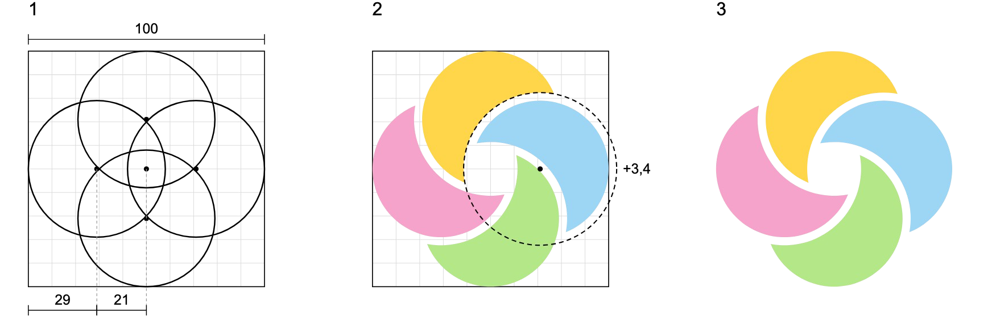

*Nota.* Elaboración propia, a partir de los trazados del logo.

**Logotipo y composición.** «relevo» va siempre en minúsculas, en Chillax Semibold convertida a trazos (H.2). En la versión horizontal, la marca mide 1,18 veces la altura de la «l», se centra en ella y se separa del nombre por 0,30 del cuerpo tipográfico; en la vertical, la marca va sobre el nombre.

**Versiones.** Cada versión responde a un uso (Figura H1):

- **Horizontal:** la principal.
- **Vertical:** espacios cuadrados y portadas.
- **Marca sola:** desde 24 px; entre 16 y 23 px, la versión chica, con el corte más ancho.
- **Con degradado:** desde 48 px; cada círculo es más claro afuera y más intenso hacia el centro.
- **Una tinta y blanca:** impresión, sellos y fondos oscuros.
- **Ícono de la app:** la marca sobre una superelipse blanca.
- **Notificación:** la silueta blanca de la marca.

**Reglas de uso.**

- Alrededor del logo queda libre al menos la mitad del ancho de la marca.
- Tamaños mínimos: la marca, 16 px con su versión chica; el logo horizontal, 96 px de ancho.
- El logotipo va siempre en minúsculas, en negro o en blanco, nunca de colores; el blanco, solo sobre fondos oscuros.
- No se gira, no se rellena el centro, no se cambia el orden de los círculos y no se le agregan sombras ni brillos.

**Fundamentos.** Cada decisión del logo tiene una razón:

- **Modelo del proyecto.** La marca representa con cuatro círculos las cuatro partes de un relevo. Ese modelo se apoya en que los recordatorios eficaces aluden a la vez a la ocasión y a la acción prevista (Guynn et al., 1998): el tiempo es la ocasión, y el primer paso, la acción. El tercer círculo es el lugar, la hipótesis del proyecto —que el sitio donde comienza la actividad aporte a la señal—, y no el localizador del prototipo, así que la marca sigue valiendo si el objeto cambia.
- **Nombre.** Un relevo es el paso de algo de una mano a otra. La forma lo muestra con círculos que se pasan el turno y un centro que no pertenece a ninguno.
- **Círculos.** En cinco experimentos, las formas circulares activaron más atributos de suavidad y cuidado, y las angulosas, de dureza (Jiang et al., 2016). Un sistema que no quiere vigilar ni presionar necesita lo primero.
- **Logo descriptivo.** Los logotipos que muestran lo que hace la marca se evalúan mejor, sobre todo en marcas nuevas (Luffarelli et al., 2019). Por eso la marca dibuja cómo funciona el sistema, y donde Relevo todavía no se conoce va con su descriptor.
- **Formas planas.** Slack rehízo su logo en 2019 con su equipo de diseño y con Michael Bierut, de Pentagram: el anterior tenía once colores, solo podía ir sobre blanco y con una inclinación exacta de 18°, y era muy fácil de hacer mal; el nuevo usa una paleta más simple y escala con facilidad (Slack, 2019). Relevo toma esa lección: cortes y colores planos, sin transparencias, para que la marca se reproduzca igual en pantalla, en papel y en una sola tinta. Por eso reemplazó a una marca anterior cuyos círculos se mezclaban y daban un centro turbio.

**Variantes.** El 23 de noviembre de 2026, el logo se revisó para probar degradados sutiles en los colores de la marca y color en el logotipo, que hasta entonces iba en negro o en blanco. Los trazados son los mismos; cambian los rellenos y el fondo, y cada degradado va del tono claro de un color de la marca a su color original, sin oscurecerlo. Son 18 variantes: el logo vigente, para comparar; cuatro con otros degradados en la marca; cinco con el logotipo de color sobre fondo claro; seis sobre fondo negro, con el logotipo en blanco o de color, y dos con la marca en blanco sobre un fondo de color (Figura H6). Sobre fondo claro, el logotipo de color se lee menos que en negro, con un contraste de 1,3:1 a 1,7:1: sirve en tamaño grande, como en una portada, y en tamaño chico conviene el negro o un fondo oscuro, sobre el que los cuatro colores se leen muy bien. Son variantes para elegir: el logo vigente, el de la Figura H1, no cambia hasta que el autor escoja una.

**Animaciones.** El logo también tiene versiones animadas, en GIF y en video, que cuentan que el turno pasa de un círculo al siguiente: la marca se despliega y el logotipo aparece letra por letra, o la marca gira y el círculo que sigue sube a tomar el turno. Un documento impreso no puede mostrarlas.

**Figura H6**

*Variantes del logo con degradados sutiles y color en el logotipo*

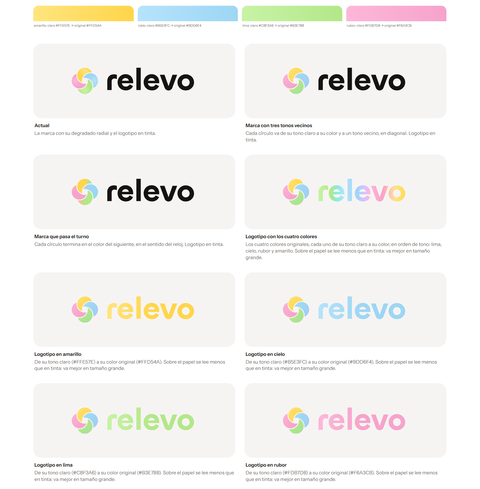

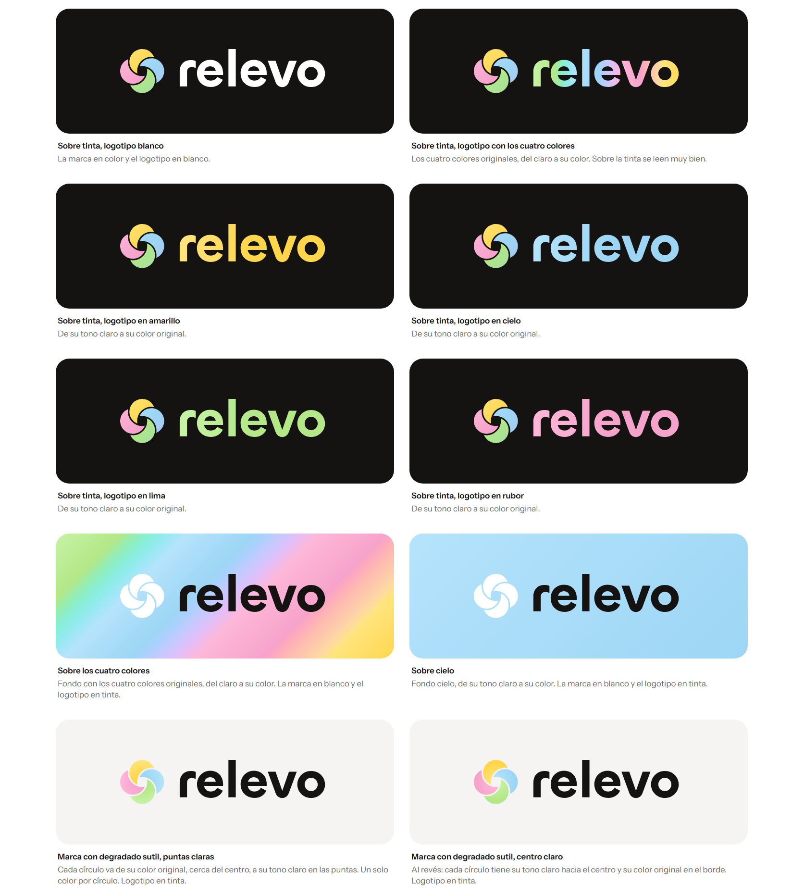

*Nota.* Elaboración propia, 23 de noviembre de 2026. En la lámina, «papel» es el fondo claro; «tinta», el negro, y cielo, lima y rubor, el celeste, el verde y el rosa.

## H.2 Tipografía

La identidad usa dos tipografías sin serifa: una para el nombre y otra para todo lo demás (Tabla H1).

**Tabla H1**

*Familias tipográficas*

| Tipografía | Uso | Autoría y licencia | Fundamento |
| --- | --- | --- | --- |
| **Chillax Semibold** | Logotipo, convertido a trazos. | Indian Type Foundry, en Fontshare; ITF Free Font License. | Sus formas son redondas como los círculos del logo, y en tamaño chico no pierde la forma. |
| **Instrument Sans** | App y memoria. | Rodrigo Fuenzalida, diseñador radicado en Santiago, y Jordan Egstad; Google Fonts, SIL Open Font License. | Una grotesca con ejes de peso y ancho, legible en pantalla y en papel; el trazo de los íconos se midió sobre su asta. |

*Nota.* Elaboración propia.

**Selección de la tipografía del logotipo.** Para el logotipo se compararon 20 tipografías sin serifa de Fontshare. Pasaron a la final Chillax, en dos pesos, Cabinet Grotesk, Pally y Panchang, con Instrument Sans como referencia, y ganó Chillax Semibold porque sus formas conversan con los círculos del logo: su «o» es casi un círculo; la «e» y la «r» terminan en curvas abiertas, que hacen amable la palabra, y su altura x, de casi la mitad del cuerpo, la mantiene legible en tamaño chico. Además, no es de Google Fonts, una condición que se fijó para el logotipo. Su licencia, la ITF Free Font License, permite el uso personal y comercial, y un logo hecho con ella no es obra derivada. El logotipo va convertido a trazos, con el interletrado levemente cerrado.

## H.3 Iconografía

Los íconos de Relevo son propios: 118 dibujos de línea en una retícula de 24, de un solo color y siempre acompañados de su palabra. Siguen las reglas de construcción de Lucide, un conjunto abierto de íconos de línea, pero los dibujos son de Relevo, porque lo que la app tiene que mostrar —el Tag, la señal y las actividades que nombraron las personas entrevistadas— no está en ningún conjunto o está solo en una forma genérica (Figura H7).

**Figura H7**

*Conjunto de 118 íconos de la app*

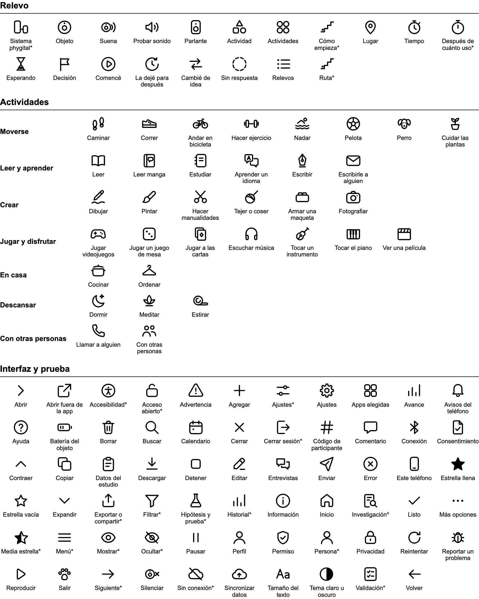

*Nota.* Elaboración propia, con los dibujos, el trazo y el centro óptico de la app de noviembre de 2026. Las actividades van en sus siete familias de color; la agrupación de los demás es de esta figura. Los íconos con asterisco no aparecen en ninguna pantalla.

**Conjunto.** El conjunto creció con la app. Empezó con los íconos de la identidad del 11 de octubre; el rediseño del 5 de noviembre sumó los de la navegación, como la tuerca de los ajustes y los cuatro anillos de Actividades, y trece actividades, como nadar, tejer o tocar el piano, y el 6 de noviembre se rehicieron once, después de revisar qué pide la app de cada uno. Hoy se reúnen en tres grupos: 19 propios de Relevo —el objeto, la señal, el ciclo de un relevo y la decisión—; 34 actividades, en siete familias de color, que reúnen las ideas que salen de las entrevistas y las que la app reconoce en lo que escribe cada persona, y 65 de la interfaz y la prueba. La app usa 97; los otros 21 se conservan, aunque ninguna pantalla los muestra.

**Tamaños en la app.** Un mismo ícono aparece chico en las filas, los botones y la barra de pestañas, y grande dentro del anillo de una actividad: va de unos 16 px a casi 48. Como una actividad puede verse a unos 17 px, cada dibujo tiene que leerse en ese tamaño. La Tabla H2 resume cómo se construyen, junto a las reglas de Lucide.

**Tabla H2**

*Reglas de construcción de los íconos, comparadas con Lucide*

| Regla | Relevo | Lucide | Origen y fundamento |
| --- | --- | --- | --- |
| Retícula y margen | Retícula de 24 con un área viva de 20: ningún trazo entra en los 2 de margen. | Lienzo de 24, con el trazo a 1 o más del borde. | Material Design limita el ícono a un área viva de 20, con 2 de margen (Google, s. f.-b). |
| Formas base | Un círculo de radio 9, un cuadrado de 16 y dos rectángulos de 14 × 18, uno vertical y otro horizontal. | Un peso visual parecido al de su círculo y su cuadrado, que se compara desenfocándolos. | Las formas base de Material Design, algo más chicas (Google, s. f.-b): un ícono redondo y uno con esquinas miden lo mismo a la vista. |
| Trazo | 1,6 en el tamaño base de 24. | 2, en todos los tamaños. | En Instrument Sans Medium, el asta mide una décima del cuerpo, según una medición propia: 1,56 en un cuerpo de 15, casi el trazo de un ícono de 24. Así, el ícono pesa lo mismo que su palabra. SF Symbols también alinea sus símbolos con la tipografía (Apple, s. f.). |
| Tamaños ópticos | El trazo se afina a medida que el ícono crece: 2,0 en los más chicos y 1,3 en los más grandes. | Un solo trazo. | El eje de tamaño óptico de Material Symbols ajusta el trazo al tamaño (Google, s. f.-a): el ícono se ve igual de firme en una fila que en un anillo grande. |
| Puntas y uniones | Redondas, con el trazo centrado en la línea. | Igual. | A tamaño chico no dejan picos, y conversan con los círculos del logo y los anillos de las actividades. |
| Esquinas | Radios de 1 a 3,6, según la forma. | 2 en las formas de 8 o más y 1 en las menores. | Unificarlas como Lucide queda pendiente. |
| Equilibrio | Centro óptico: la app corre cada dibujo un poco hacia donde pesa su tinta; se ajustan 100 de los 118. | Centrados a la vista; los asimétricos se corren un poco. | Un dibujo más pesado abajo no se ve caído, y uno simétrico no se mueve. |
| Detalle | Se quita lo que no se distingue en el tamaño más chico. | Poco detalle. | Las actividades se ven desde unos 17 px. |
| Color y relleno | Un solo color. Se rellenan los puntos, como la argolla del Tag o los ojos del perro, y las partes cuyo relleno es el significado: la mitad del signo de contraste, las estrellas y las teclas negras del piano. | Contorno, en el color del texto. | El color queda para las actividades, en su anillo. |
| Palabra | Cada ícono va con su palabra; los botones que solo llevan ícono, como volver, tienen su nombre para los lectores de pantalla. | No lo define. | Casi ningún ícono tiene un significado único, y su palabra aclara qué significa en ese contexto (Harley, 2014). |

*Nota.* Elaboración propia. Las medidas de Relevo son las de la app; las de Lucide, las de su especificación (Lucide Contributors, s. f.-a, s. f.-b).

**Construcción.** Cada ícono parte de la geometría y termina en un ajuste a ojo. La Figura H8 sigue cinco pasos con Suena, un concepto propio de Relevo, arriba, y Leer, una actividad, abajo:

1. **Retícula.** 24 × 24, con un área viva de 20 y cuatro formas base —un círculo, un cuadrado y dos rectángulos— que igualan el peso de un ícono redondo y el de uno con esquinas.
2. **Geometría.** Suena dibuja el Tag como es, con su botón y su argolla, y dos arcos de sonido que nacen de su eje; Leer, dos páginas reflejadas en el lomo, con los bordes en curva.
3. **Trazo.** 1,6, centrado en la línea, con terminaciones y uniones redondas; solo se rellena lo que es un punto, como la argolla.
4. **Centro óptico.** El dibujo se corre hacia donde pesa su tinta: los dos suben menos de media unidad, lo justo para no verse caídos.
5. **Tamaños ópticos.** El trazo se afina a medida que el ícono crece —de 2,0 en 16 px a 1,3 en 48 px— para que pese lo mismo en una fila que en un anillo grande.

**Figura H8**

*Construcción de dos íconos: Suena y Leer*

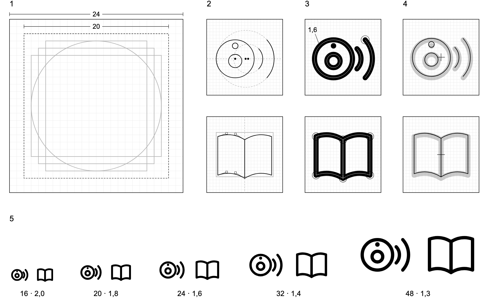

*Nota.* Elaboración propia, con las medidas de la app. Las cotas están en unidades de la retícula; en el paso 5, cada par indica el tamaño del ícono y su trazo.

**Referentes.** Antes de dibujar se revisaron los sistemas de íconos más usados. De Material Design se tomaron la retícula, el área viva y las formas base (Google, s. f.-b); de Material Symbols, los tamaños ópticos (Google, s. f.-a); de SF Symbols, un peso ligado a la tipografía (Apple, s. f.), y de Nielsen Norman Group, acompañar cada ícono con su palabra (Harley, 2014). La inspiración del dibujo es Lucide, un conjunto abierto de íconos de línea que continúa Feather, con licencia ISC, que permite usarlos y modificarlos con su aviso de autoría (Lucide Contributors, 2026). Relevo sigue sus reglas publicadas (Lucide Contributors, s. f.-a, s. f.-b) y dibuja sus propios íconos (Figura H9). La razón no fue que faltaran: al revisar su lista, el 5 de noviembre de 2026, Material Symbols ya tenía equivalentes genéricos de casi todas las actividades. Fueron otras:

- **Lo propio de Relevo no está en ningún conjunto.** El Tag se dibuja como el objeto que la persona tiene en la mano, y un dibujo directo de un objeto conocido se entiende más rápido (Hou y Pan, 2025; Shen et al., 2018).
- **Cerca de lo que la persona nombró.** Un conjunto general nombra categorías; Relevo dibuja cada actividad con el objeto con que empieza, como lo sugiere la app: el tomo para leer manga, el colgador para ordenar, una pieza para armar una maqueta.
- **Una sola voz.** Mezclar conjuntos daría dos trazos y dos geometrías en la misma pantalla.

**Figura H9**

*Mismo concepto en Lucide y en Relevo*

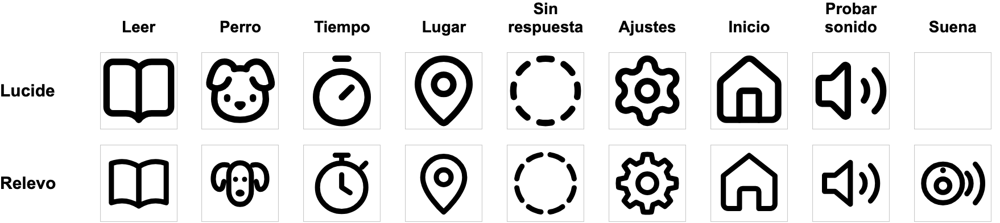

*Nota.* Elaboración propia. Los íconos de Lucide se reproducen sin cambios, con licencia ISC (Lucide Contributors, 2026); son, en orden, book-open, dog, timer, map-pin, circle-dashed, settings, house y volume-2. Los de Relevo son los de la app. Cada ícono va en su lienzo de 24; el lienzo vacío corresponde a Suena.

**Reglas tomadas y dibujos propios.** La comparación muestra qué se tomó de Lucide y qué es de Relevo (Figura H9):

- **Las reglas, no los dibujos.** De Lucide se tomaron la retícula de 24, las puntas y uniones redondas, el trazo centrado, el poco detalle, el peso parejo y un solo color. El trazo, en cambio, es más fino y ligado a Instrument Sans, así que junto a Lucide Relevo se ve más liviano; probar el trazo de 2 junto a la tipografía de la app queda pendiente.
- **Signos que la gente ya conoce.** En Sin respuesta, Lugar, Tiempo, Ajustes, Inicio y Probar sonido, Relevo usa el mismo signo que Lucide —un círculo punteado, un marcador, un cronómetro, una tuerca, una casa y un parlante—, con su propia geometría: el círculo punteado es algo más chico, el marcador es más angosto, el cronómetro suma la perilla lateral y dos manecillas, la tuerca tiene dientes rectos y la casa lleva la puerta en el mismo trazo.
- **Dibujos propios.** Leer curva los bordes de sus páginas, donde Lucide dibuja dos rectángulos unidos por el lomo; Perro es una cabeza larga, con las orejas caídas y separadas de ella para leerse en tamaño chico, donde Lucide dibuja una cara ancha con las orejas unidas, y Suena dibuja el Tag con su botón y su argolla, que no tiene equivalente en Lucide.

**Metáforas.** Los íconos hablan en tres registros:

- **Conceptos propios de Relevo,** dibujados con su objeto y sus ideas: el sonido como anillos que se abren desde el Tag; el tiempo como un cronómetro, porque se cuentan minutos de uso; la decisión como una bandera, y un relevo sin respuesta como un círculo punteado, sin juicio. El primer paso usa el mismo triángulo en un círculo que la respuesta «Comencé».
- **Acciones comunes a cualquier app,** con formas conocidas, como volver, borrar o buscar: lo que la gente reconoce de otras apps le ahorra aprender.
- **Un significado, un dibujo.** El 6 de noviembre se rehicieron once íconos: tres significados compartían el mismo lápiz —Actividad, Editar y Dibujar—; Meditar y Estirar eran iguales; varios dibujos decían otra cosa, como los destellos de Apariencia, que se leían como inteligencia artificial, o el cubo de Armar una maqueta, que se leía como un paquete, y cuatro actividades no se leían en su tamaño más chico: Leer manga, Perro, Aprender un idioma y Tejer. Entre los íconos sin uso quedan dos pares iguales: Historial, igual a Avance, y Cómo empieza, igual a Ruta.

## H.4 Paleta cromática

**Figura H10**

*Paleta cromática: colores de las partes y colores de base*

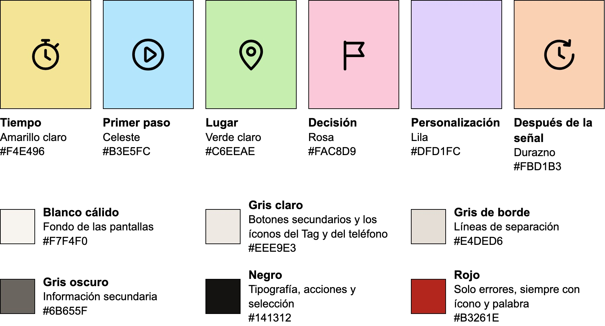

*Nota.* Elaboración propia.

**Paleta por función.** La paleta cromática se decidió por la función que cumple cada color en la interfaz, no por un efecto emocional esperado: la investigación sobre psicología del color está en una etapa inicial y sus efectos dependen del contexto (Elliot y Maier, 2014), y el significado de un color cambia según el producto en que aparece (Kauppinen-Räisänen y Luomala, 2010). El color distingue de forma estable tres cosas: las partes de un relevo, las actividades de cada persona y los momentos del ciclo. Los seis colores de las partes tienen casi la misma luminosidad percibida, así que pesan lo mismo: distinguen sin jerarquizar.

**Evidencia.** Las asociaciones entre color y emoción son tendencias compartidas, no efectos sobre la conducta, y en Relevo sirvieron sobre todo para descartar:

- En 30 países, las asociaciones resultaron muy parecidas, y más aún entre países que comparten lengua o cercanía geográfica (Jonauskaite et al., 2020).
- En 31 países, las asociaciones que comparten al menos cuatro de cada diez personas unen el rojo con el amor y la rabia; el amarillo, con la alegría; el rosa, con el amor; el negro, con la tristeza y el miedo; el gris, con la tristeza, y el naranja, con la alegría y la diversión. El verde, el azul y el morado no llegan a ese umbral con ninguna emoción, y los colores más claros se asocian con emociones más positivas (Jonauskaite et al., 2024).
- La saturación y el brillo elevan la activación, que crece del azul y el verde hacia el rojo (Wilms y Oberfeld, 2018).
- No se encontró un estudio solo con población chilena. En una encuesta a 1066 personas de México, Argentina y Chile, el miedo se asoció sobre todo con el negro, en más de la mitad de las respuestas, y muy por detrás con el rojo y el gris, mientras el celeste claro y el magenta fueron los colores menos asociados con el miedo; es un boletín de prensa sobre una ponencia, sin revisión por pares (Universidad Nacional Autónoma de México [UNAM], 2023). En Medellín, con 2400 universitarios, el verde se asoció con la naturaleza y la esperanza; el azul, con el mar y el cielo; el rosa, con la ternura; el morado, con el luto, y el gris, con el mal tiempo y la tristeza (Restrepo Betancur, 2022). En Ecuador, con 260 universitarios, los conceptos con raíz sensorial o cultural recibieron colores consistentes, y los abstractos, como «creativo», se dispersaron (Sánchez-Borrero et al., 2026).

**Seis criterios para la paleta.** De esa evidencia salen seis criterios:

1. **Familias, no tonos exactos.** Ningún tono preciso produce por sí mismo una emoción.
2. **Colores claros y poco saturados,** para no elevar la activación, como propone la *calm technology* (Weiser y Brown, 1997): informar desde la periferia de la atención.
3. **Sin negro, gris ni rojo en los estados de la persona.** El rojo queda para los errores.
4. **Redundancia.** Ningún dato se comunica solo con color, siempre también con ícono y palabra (World Wide Web Consortium, 2024, criterio 1.4.1). La simulación de las deficiencias de visión del color (Machado et al., 2009) mostró dos pares que se confunden: el celeste y el lila con deuteranopia, y el rosa y el durazno con tritanopia.
5. **Contraste medido:** 4,5:1 para la tipografía (criterio 1.4.3) y 3:1 para los gráficos que informan (criterio 1.4.11; World Wide Web Consortium, 2024).
6. **Un color, un significado.** Cada color significa siempre lo mismo. El color es difícil de apropiar como rasgo de una marca (Ward et al., 2020), así que su aporte está en la coherencia del sistema.

**Colores de las partes.** Seis colores claros, de luminosidad percibida equivalente, medida en el espacio de color OKLCH (Ottosson, 2020), distinguen las partes de un relevo (Tabla H3). Donde existe, la asignación sigue la convención de la señalética de seguridad: la norma ISO 3864-1 asigna el rojo a la prohibición, el amarillo a la precaución, el azul a la acción obligatoria y el verde a la condición segura, como una salida o un botiquín (International Organization for Standardization [ISO], 2011).

**Tabla H3**

*Colores de las partes de un relevo*

| Parte | Color | Evidencia |
| --- | --- | --- |
| Tiempo, la condición que activa la señal | Amarillo claro | El color más asociado con la alegría; en la señalética pide atención sin prohibir. Poco saturado, para no elevar la activación. |
| Primer paso | Celeste | En la señalética indica una acción, y está entre los colores menos asociados con el miedo. |
| Lugar donde empieza la actividad | Verde claro | En la señalética, el verde indica dónde está algo; en Medellín se asocia con la naturaleza y la esperanza. |
| Decisión | Rosa | Conserva el amor y la alegría del rojo sin su asociación con la rabia, para que la decisión no se juzgue. |
| Personalización | Lila | Sin una asociación emocional compartida; claro, para alejarse del morado del luto. |
| Después de la señal | Durazno | El naranja se asocia con la alegría y la diversión. |

*Nota.* Elaboración propia. Los códigos de cada color están en la Figura H10. La tipografía negra sobre cualquiera de los seis colores alcanza un contraste de al menos 12,7:1, muy por sobre el 4,5:1 que piden las WCAG.

**Degradados de las actividades.** Cada actividad se representa con un degradado con grano y volumen, en siete familias. Son un material distinto de los colores planos de las partes, para que el color de una actividad no se confunda con el de una función. La asignación privilegia la raíz sensorial de cada actividad, que produce asociaciones más consistentes (Sánchez-Borrero et al., 2026); crear, un concepto abstracto, recibe un degradado de varios tonos (Figura H11 y Tabla H4).

**Figura H11**

*Degradados de las siete familias de actividades*

<!-- lamina: CIELOS -->
Siete familias, cada una con un color de base y cuatro o cinco manchas de color.

| Familia | Base | Manchas de color |
| --- | --- | --- |
| Moverse | `#BFE7D3` | `#3FB487` `#E6F7FF` `#9ED6F4` `#5FC79A` |
| Leer y aprender | `#8DB9EA` | `#2559C9` `#E9F3FF` `#7EA9E8` `#F7FBFF` `#3B6BD2` |
| Crear | `#F3B38E` | `#F06A3B` `#F7C6DD` `#B9A4F2` `#FFE6A6` |
| Jugar y disfrutar | `#E9B85C` | `#F2A20C` `#B78BEF` `#F7D27A` `#9C7BE8` |
| En casa | `#F28A4A` | `#E8501E` `#F9B36B` `#FFE0B8` `#C9370F` |
| Descansar | `#2B3A66` | `#0F1A3D` `#5E7BD8` `#A9B8F5` `#1E2B5C` |
| Con otras personas | `#F4C9D2` | `#C8325A` `#F7A9BE` `#FFFFFF` `#E0617F` |
<!-- /lamina -->

*Nota.* Elaboración propia. Cada degradado combina un color de base con cuatro o cinco manchas de color, tomados de la app.

**Tabla H4**

*Familias de color de las actividades*

| Familia | Degradado | Fundamento |
| --- | --- | --- |
| Moverse | Menta | El verde se asocia con la naturaleza y la esperanza (Restrepo Betancur, 2022) y activa menos que el rojo. |
| Leer y aprender | Azul | El azul, con el mar y el cielo; activa menos que el rojo (Wilms y Oberfeld, 2018). |
| Crear | Atardecer | Un concepto abstracto, sin color propio (Sánchez-Borrero et al., 2026): un degradado de varios tonos. |
| Jugar y disfrutar | Ámbar | El amarillo y el naranja, con la alegría y la diversión (Jonauskaite et al., 2024). |
| En casa | Brasa | El naranja del fuego y la cocina, sin llegar al rojo. |
| Descansar | Noche | Un azul profundo, con raíz sensorial y sin el negro, el color más asociado con el miedo (UNAM, 2023). |
| Con otras personas | Rosa | El rosa, con el amor y la ternura. Como una parte de las personas lo rechaza, se puede cambiar. |

*Nota.* Elaboración propia. Cada persona puede cambiar el color de una actividad.

Sobre los degradados claros, la tipografía blanca no alcanzaba el contraste mínimo de 4,5:1, así que el nombre de la actividad va en una cápsula blanca con tipografía negra, que lo supera con holgura sobre cualquier degradado. El degradado aparece solo donde está la actividad y cubre la pantalla completa en el momento de la señal, cuando la interfaz debe hacer visible la actividad.

**Verificación.** La luminosidad y la saturación se midieron en OKLCH, y el contraste, según las WCAG 2.2; el de la tipografía sobre los degradados, en capturas, sobre el píxel más desfavorable del fondo. Las deficiencias de visión del color se simularon con el modelo de Machado et al. (2009).

## H.5 Nombre, frase y descriptor

El sistema se completa con tres piezas verbales.

**Nombre.** Un relevo es el momento en que algo pasa de una mano a otra, como en una carrera de relevos. El nombre cuenta lo que busca el sistema: que la atención pase de la pantalla a lo que la persona quería hacer, sin que nadie se la quite. Es breve, se pronuncia sin trabas en español y viene del mundo de los traspasos y los turnos, no de las prohibiciones. Una comercialización exigiría revisar antes la disponibilidad jurídica del nombre, los dominios y las coincidencias comerciales.

**Frase de marca.** «Hazle lugar a lo que quieres hacer.» Hacer lugar es reservar un espacio físico para la señal y volver a considerar una actividad dentro de la decisión, sin obligar a hacerla ni presentar el teléfono como enemigo. Va en portadas, presentaciones y piezas de introducción, no en las pantallas de uso ni en los mensajes de error. Quedó confirmada como definitiva el 10 de noviembre de 2026.

**Descriptor.** «Un recordatorio físico preparado desde el teléfono.» Acompaña al nombre cuando quien lo lee todavía no conoce el producto: su función es aclarar, no emocionar.

## H.6 Propuestas anteriores

Entre septiembre y octubre de 2026 se exploraron más de veinte propuestas de identidad, y cada una dejó algo en la final (Tabla H5).

**Tabla H5**

*Propuestas anteriores y su aporte a la identidad final*

| Fecha | Propuesta | Planteamiento | Resultado |
| --- | --- | --- | --- |
| 16 sep. | Sistema de marca del proyecto | Nombre, descriptor, frase, tipografía, paleta cromática y logotipo. | Se mantienen el nombre, el descriptor y la frase; la tipografía, la paleta cromática y el logotipo se reemplazaron en octubre. |
| 25 sep. | Punto y pulso | Una identidad a partir de un punto que late. | Se reemplazó el mismo día. |
| 25 sep. | «Antes de que sea después» | Una plataforma de marca sobre el momento en que aún se puede elegir. | Se descartó porque podía confundir a la comisión, y la reemplazó «Vuelve a lo que querías hacer». |
| 25 sep. | «Vuelve a lo que querías hacer» | El mismo centro, en palabras directas. | Se aplicó en la app del 26 de septiembre al 9 de octubre. |
| 27 sep. | Sistema de marca en Figma | Variables, componentes y pantallas en Figma. | La superaron las propuestas de fines de septiembre. |
| 30 sep. | Subrayado | Una identidad alrededor de un renglón azul. | Se descartó porque no decía qué hace Relevo; el renglón quedó como línea de escritura. |
| 2 oct. | Sistema de diseño | Un renglón que hace lugar, dos voces y los colores de la casa. | Fue la base de las propuestas del 3 de octubre. |
| 3 oct. | Relevo vivo, Volver a enfocar, Las ganas estaban y Cuándo va color | Color vivo, tipografía manuscrita, serifa y reglas de cuándo usar color. | Se descartaron la tipografía manuscrita y la serifa; quedó la regla de cuándo va color. |
| 3 oct. | Traspaso | La marca como un traspaso de mano en mano. | La idea del traspaso sigue en el logo de cuatro círculos. |
| 4 oct. | Tipografías para el logotipo | Una búsqueda amplia de tipografías display. | Llevó a elegir Chillax para el logo del 11 de octubre. |
| 10 y 11 oct. | Identidad final | Fichas por color, íconos propios, degradados y el logo de cuatro círculos. | **Cerrada el 11 de octubre:** es la identidad de la memoria, aplicada en la app desde el 12 de octubre. |
| 5 nov. | Rediseño de la app | La interfaz en blanco cálido y negro, con las actividades en anillos. | Es la base de la app actual. |
| 6 nov. | Íconos según lo que pide la app | Un inventario de los íconos que usa la app, con cinco reglas: un significado por dibujo, cada actividad con el objeto con que empieza, legible en su tamaño más chico, neutro donde la app no juzga y la construcción de siempre. | Se rehicieron once íconos, que usa la app actual. |

*Nota.* Elaboración propia. Fechas de 2026.

## H.7 Referentes visuales

Tres referentes visuales dejaron algo en la identidad, y también algo que se descartó (Tabla H6).

**Tabla H6**

*Aportes de cada referente*

| Referente | Aporte | Elementos incorporados | Elementos descartados |
| --- | --- | --- | --- |
| Dafi (Mambo Mambo) | Íconos de línea sobre cuadrados de color y fichas en escalera. | Las fichas con ícono de línea, ahora con un color por parte del relevo. | Sus dibujos: los íconos de Relevo se trazaron de nuevo. |
| DAYO | Personajes que nacen de cuatro estados emocionales, ordenados con el modelo de valencia y activación. | Fundamentar el color en estudios de emoción, con datos de 31 países y la saturación como activación. | El volumen peludo en 3D, que a 16 px se pierde; el volumen de Relevo está en sus degradados. |
| Biceps Grotesk | Una tipografía modular de cuadrados y triángulos en una retícula de 30 px, en rojos y rosas. | La construcción modular: las mismas formas de base y una sola retícula; de sus rojos, el lado rosa. | La tipografía para la interfaz, que es para lucirse en grande. |

*Nota.* Elaboración propia.

## Referencias

Apple. (s. f.). *SF Symbols*. Apple Developer. Recuperado el 10 de noviembre de 2026, de https://developer.apple.com/sf-symbols/

Elliot, A. J. y Maier, M. A. (2014). Color psychology: Effects of perceiving color on psychological functioning in humans. *Annual Review of Psychology, 65*, 95–120. https://doi.org/10.1146/annurev-psych-010213-115035

Google. (s. f.-a). *Material Symbols guide*. Google for Developers. Recuperado el 10 de noviembre de 2026, de https://developers.google.com/fonts/docs/material_symbols

Google. (s. f.-b). *System icons*. Material Design. Recuperado el 10 de noviembre de 2026, de https://m2.material.io/design/iconography/system-icons.html

Guynn, M. J., McDaniel, M. A. y Einstein, G. O. (1998). Prospective memory: When reminders fail. *Memory & Cognition, 26*(2), 287–298. https://doi.org/10.3758/BF03201140

Harley, A. (2014, 27 de julio). *Icon usability*. Nielsen Norman Group. https://www.nngroup.com/articles/icon-usability/

Hou, G. y Pan, Y. (2025). What’s behind the graphic? The impact of pictogram-semantic mapping structure on icon understanding. *International Journal of Human–Computer Interaction, 41*(20), 12959–12969. https://doi.org/10.1080/10447318.2025.2466063

International Organization for Standardization. (2011). *Graphical symbols — Safety colours and safety signs — Part 1: Design principles for safety signs and safety markings* (Norma ISO n.º 3864-1:2011). https://www.iso.org/standard/51021.html

Jiang, Y., Gorn, G. J., Galli, M. y Chattopadhyay, A. (2016). Does your company have the right logo? How and why circular- and angular-logo shapes influence brand attribute judgments. *Journal of Consumer Research, 42*(5), 709–726. https://doi.org/10.1093/jcr/ucv049

Jonauskaite, D., Abu-Akel, A., Dael, N., Oberfeld, D., Abdel-Khalek, A. M., Al-Rasheed, A. S., Antonietti, J.-P., Bogushevskaya, V., Chamseddine, A., Chkonia, E., Corona, V., Fonseca-Pedrero, E., Griber, Y. A., Grimshaw, G., Hasan, A. A., Havelka, J., Hirnstein, M., Karlsson, B. S. A., Laurent, E., … Mohr, C. (2020). Universal patterns in color-emotion associations are further shaped by linguistic and geographic proximity. *Psychological Science, 31*(10), 1245–1260. https://doi.org/10.1177/0956797620948810

Jonauskaite, D., Epicoco, D., Al-Rasheed, A. S., Aruta, J. J. B. R., Bogushevskaya, V., Brederoo, S. G., Corona, V., Fomins, S., Gizdic, A., Griber, Y. A., Havelka, J., Hirnstein, M., John, G., Jopp, D. S., Karlsson, B., Konstantinou, N., Laurent, É., Marquardt, L., Mefoh, P. C., … Mohr, C. (2024). A comparative analysis of colour–emotion associations in 16–88-year-old adults from 31 countries. *British Journal of Psychology, 115*(2), 275–305. https://doi.org/10.1111/bjop.12687

Kauppinen-Räisänen, H. y Luomala, H. T. (2010). Exploring consumers’ product-specific colour meanings. *Qualitative Market Research: An International Journal, 13*(3), 287–308. https://doi.org/10.1108/13522751011053644

Lucide Contributors. (s. f.-a). *Icon design specification*. Lucide. Recuperado el 10 de noviembre de 2026, de https://lucide.dev/contribute/icons/specification

Lucide Contributors. (s. f.-b). *Lucide design language*. Lucide. Recuperado el 10 de noviembre de 2026, de https://lucide.dev/contribute/icons/design-principles

Lucide Contributors. (2026). *Lucide* (Versión 1.71.0) [Software]. GitHub. https://github.com/lucide-icons/lucide

Luffarelli, J., Mukesh, M. y Mahmood, A. (2019). Let the logo do the talking: The influence of logo descriptiveness on brand equity. *Journal of Marketing Research, 56*(5), 862–878. https://doi.org/10.1177/0022243719845000

Machado, G. M., Oliveira, M. M. y Fernandes, L. A. F. (2009). A physiologically-based model for simulation of color vision deficiency. *IEEE Transactions on Visualization and Computer Graphics, 15*(6), 1291–1298. https://doi.org/10.1109/TVCG.2009.113

Ottosson, B. (2020, 23 de diciembre). *A perceptual color space for image processing*. https://bottosson.github.io/posts/oklab/

Restrepo Betancur, L. F. (2022). Preferencia por los colores en universitarios de la ciudad de Medellín, Colombia. *Anuario Electrónico de Estudios en Comunicación Social «Disertaciones», 15*(1), 1–15. https://doi.org/10.12804/revistas.urosario.edu.co/disertaciones/a.10455

Sánchez-Borrero, G., Quelal-Moncayo, S. y Bustos-Cevallos, S. (2026). Asociaciones culturales latinoamericanas del color: estudio desde la psicología cromática en estudiantes universitarios de la Pontificia Universidad Católica del Ecuador. *Kepes, 23*(33), 105–145. https://doi.org/10.17151/kepes.2026.23.33.5

Shen, Z., Xue, C. y Wang, H. (2018). Effects of users’ familiarity with the objects depicted in icons on the cognitive performance of icon identification. *i-Perception, 9*(3), Artículo 2041669518780807. https://doi.org/10.1177/2041669518780807

Slack. (2019, 16 de enero). *Say hello, new logo*. https://slack.com/blog/news/say-hello-new-logo

Universidad Nacional Autónoma de México. (2023, 16 de abril). *Relacionamos nuestros miedos con los colores* (Boletín UNAM-DGCS-273). Dirección General de Comunicación Social. https://www.dgcs.unam.mx/boletin/bdboletin/2023_273.html

Ward, E., Yang, S., Romaniuk, J. y Beal, V. (2020). Building a unique brand identity: Measuring the relative ownership potential of brand identity element types. *Journal of Brand Management, 27*(4), 393–407. https://doi.org/10.1057/s41262-020-00187-6

Weiser, M. y Brown, J. S. (1997). The coming age of calm technology. En P. J. Denning y R. M. Metcalfe (Eds.), *Beyond calculation: The next fifty years of computing* (pp. 75–85). Copernicus. https://doi.org/10.1007/978-1-4612-0685-9_6

Wilms, L. y Oberfeld, D. (2018). Color and emotion: Effects of hue, saturation, and brightness. *Psychological Research, 82*(5), 896–914. https://doi.org/10.1007/s00426-017-0880-8

World Wide Web Consortium. (2024, 12 de diciembre). *Web content accessibility guidelines (WCAG) 2.2*. https://www.w3.org/TR/2024/REC-WCAG22-20241212/

## Registro de cambios (disclaimer)

### 2026-11-24 — Variantes del logo

- **Qué cambió:** H.1 suma las [variantes del logo del 23 de noviembre](../../10_recursos_visuales/logo-relevo-variantes-2026-11-23/README.md): un párrafo sobre qué son, por qué se hicieron y cuándo sirven, otro sobre sus animaciones, que un PDF no puede mostrar, y la Figura H6, con la lámina de las 18 variantes. La lámina se copió a `imagenes/` en dos partes (`logo-variantes-2026-11-23-parte-1.png` y `-parte-2.png`), sin su título ni su bajada, que repiten el título de la figura y el párrafo: entera, al alto de una página, sus notas no se leerían. Las dos partes llevan un margen blanco a los lados y ocupan el 88 % del ancho del texto, para que «H.2 Tipografía» empiece bajo la segunda y la figura de los íconos no deje una página casi vacía. Las figuras siguientes pasan de H6–H10 a H7–H11, con sus menciones en el texto, y la introducción nombra las variantes. Las animaciones se mencionan sin nombrar el repositorio ni sus carpetas, como pide D-170.
- **Cómo estaba antes:** H.1 terminaba en los fundamentos del logo, y los íconos, su construcción, la comparación con Lucide, la paleta cromática y los degradados eran las Figuras H6 a H10.
- **Por qué:** el autor avisó que se agregaron variantes al logo de Relevo; el logo vigente no cambia hasta que elija una.

### 2026-11-18 — Texto del PDF de anexos del Pase

- **Qué cambió:** el anexo pasó a ser el del PDF de anexos del Pase: cambiaron 101 de sus 178 párrafos, ítems y filas de tabla. Suma los bocetos del logo (Figuras H2 a H4, los mismos de la Figura 19 de la memoria), la construcción de dos íconos y su comparación con Lucide (Figuras H7 y H8, y Tabla H2), y el conjunto pasa de 72 a 118 íconos (Figura H6); «H.7 Referentes visuales del autor» pasa a ser «H.7 Referentes visuales». La construcción del logo, los íconos y la paleta cromática son ahora las imágenes del PDF, porque cambiaron respecto de las láminas que armaba el constructor; el logo y los degradados siguen como láminas. El texto se copió tal como está en el PDF, con sus erratas; los errores y las mejoras están en la [tarea 15 de Por hacer](../../00_gobernanza/por-hacer.md#15-errores-y-mejoras-de-la-memoria-y-los-anexos-del-pase).
- **Cómo estaba antes:** este Markdown tenía la versión del 10 de noviembre; el texto siguió cambiando fuera del repositorio hasta el PDF del Pase, que entregó el autor el 18 de noviembre.
- **Por qué:** el autor pidió que el repositorio coincida con la memoria y los anexos en PDF del Pase, con sus errores.

### 2026-11-10 — Frase de marca definitiva

- **Qué cambió:** la frase de marca se declara definitiva.
- **Cómo estaba antes:** no decía si estaba confirmada.
- **Por qué:** el autor confirmó el 10 de noviembre de 2026 la frase «Hazle lugar a lo que quieres hacer».

### 2026-11-10 — Versión 4.7.2

- **Qué cambió:** la línea del rediseño dice que es la base hasta la 4.7.2.
- **Cómo estaba antes:** decía hasta la 4.6.3.
- **Por qué:** la versión más reciente de la app es la 4.7.2.

### 2026-11-09 — Referencias en APA 7

- **Qué cambió:** la norma ISO 3864-1 indica su tipo y su dirección; la entrada de Ottosson tiene su fecha de publicación, y Jonauskaite et al. (2020) escribe «Antonietti, J.-P.».
- **Cómo estaba antes:** la norma no tenía dirección, Ottosson solo tenía el año y el nombre compuesto aparecía como «J.».
- **Por qué:** revisión de las referencias en APA 7 contra la página de la norma, la del artículo y Crossref (D-173).

### 2026-11-09 — Títulos formales

- **Qué cambió:** los títulos son formales («Logo», «Tipografía», «Iconografía», «Paleta cromática»), y las partes de un relevo se nombran sin segunda persona: tiempo, primer paso, lugar y decisión; la familia «Moverte» se nombra «Moverse» y el ícono «Ordenar tu pieza», «Ordenar la pieza».
- **Cómo estaba antes:** decían «El logo», «Las dos tipografías», «Tu tiempo», «Tu primer paso», «El lugar donde empiezas» y «Lo que decides».
- **Por qué:** el autor pidió títulos formales: sin artículo al comienzo ni segunda persona (D-172).

### 2026-11-09 — Sin luz ni aura; cómo se construye el logo

- **Qué cambió:** la marca ya no habla de luces ni de aura: el logo son cuatro círculos, su versión con degradado deja de llamarse «Luz», el color lila es el de la personalización y los degradados combinan manchas de color. H.1 explica paso a paso cómo se construye el logo, con la nueva Figura H2, su logotipo y su composición, sus versiones y en qué se basa, con Slack (2019) como referente de las formas planas. Las figuras siguientes pasan a H3, H4 y H5.
- **Cómo estaba antes:** hablaba de «cuatro luces», de la versión «Luz», de «Tu aura» y de la propuesta «Relevo con aura», y la construcción del logo cabía en tres puntos.
- **Por qué:** el autor pidió eliminar de la marca las referencias a luz y aura, y explicar más cómo se construye el logo y en qué se basa (D-171).

### 2026-11-08 — Terminología de diseño

- **Qué cambió:** lo visual usa términos de diseño: «tipografía» en vez de «letra», «paleta cromática» en vez de «el color», «cuerpo tipográfico» e «información secundaria»; la tipografía, y no «el texto», va sobre los colores y los degradados.
- **Cómo estaba antes:** decía «las dos letras», «la letra del logotipo», «el color», «texto secundario» y «el texto sobre los degradados».
- **Por qué:** el autor pidió poner bien las repreguntas y hablar de lo visual con terminología de diseñador: tipografía y paleta cromática, no letras, fuentes ni texto (D-170).

### 2026-11-08 — Correcciones del autor

- **Qué cambió:** los «papeles» pasan a ser los colores de las partes de un relevo, con nombres de color claros; los colores de base dicen para qué sirven (piedra era «superficies y el medio»); los cielos se llaman degradados; los referentes visuales dejan de llamarse fuentes; la *calm technology* se nombra con su término original; el autor diseñó la identidad; sin «testigo», sin códigos de decisión y sin menciones al repositorio.
- **Cómo estaba antes:** hablaba de papeles, cielos, piedra, tinta y grafito, decía «tecnología calma», «la identidad que el autor aprobó» y citaba decisiones y carpetas del repositorio.
- **Por qué:** el autor revisó los anexos y pidió un texto sin códigos ni menciones al repositorio, con palabras claras y la declaración de IA corregida (D-170).

### 2026-11-08 — Anexo recopilado y listo para Word

- **Qué cambió:** el logo, las letras, los íconos y el color quedan con su lámina, sus reglas y su fundamento, sin la tabla de las luces repetida dos veces ni la lista de archivos. El color se presenta como en la memoria v6: se decidió por su función, y las asociaciones con emociones sirvieron sobre todo para descartar; por eso la columna de los papeles se llama «Lo que dice la evidencia». El nombre toma la explicación de la memoria v6, la del relevo como traspaso, en vez de la nota del 16 de septiembre que evitaba esa metáfora. La tabla de propuestas suma el rediseño de la app 4.0 (D-155). Las figuras y tablas se numeran H1 a H6. Desde ahora este archivo es la fuente del anexo.
- **Cómo estaba antes:** copiaba secciones de los documentos 14, 39, 40 y 41, con remisiones a la Figura 2 de la memoria v5 y una lista de límites que repetía lo dicho.
- **Por qué:** el autor pidió revisar todos los anexos y dejarlos listos para Word: directos, sin sobreexplicar, con su forma de escribir y con lo más relevante (D-168).

### 2026-10-24 — Creación

- **Qué cambió:** el anexo se arma desde sus documentos fuente, con el resto de los anexos A–I de la memoria v5.
- **Cómo estaba antes:** la carpeta de anexos solo tenía un README de la v4, con cinco anexos y sin su contenido.
- **Por qué:** el autor pidió elegir un pendiente de prioridad alta y terminarlo; la memoria v5 remite a nueve anexos que no estaban armados.
