# Anexo H. Identidad visual y sistema de marca

Documenta la identidad que diseñó el autor, cerrada el 11 de octubre de 2026, y cómo llegó a ella: el logo de cuatro luces, las dos letras, los 72 íconos propios y el color por función, cada decisión con su fundamento; lo que se mantiene de la marca del 16 de septiembre, y las propuestas anteriores.

## H.1 El logo

**Figura H1**

*El logo, sus versiones y sus cuatro luces*

<!-- lamina: LOGO -->

| Vertical | Marca, desde 24 px | Marca chica, de 16 a 23 px | Luz, desde 48 px | Una tinta | Sobre fondo oscuro | Ícono de la app |
| --- | --- | --- | --- | --- | --- | --- |
| 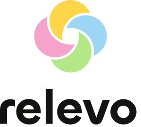 | 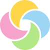 |  |  |  |  | 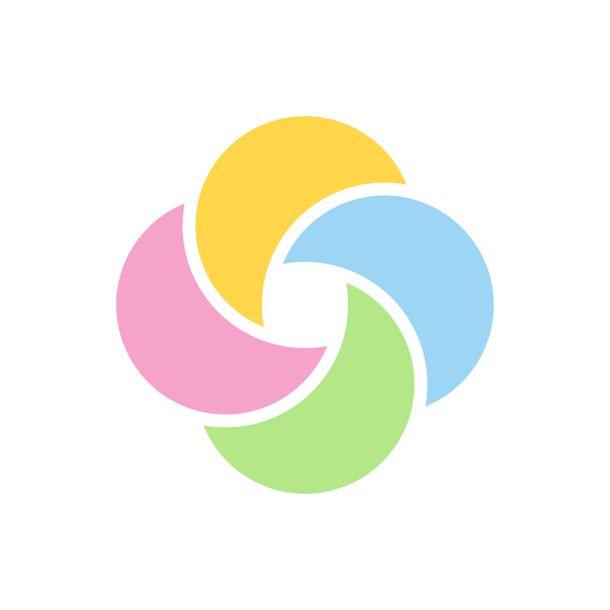 |

| Luz | Color | Qué representa |
| --- | --- | --- |
| Arriba | `#FFD54A` | Tu tiempo |
| Derecha | `#9DD6F4` | Tu primer paso |
| Abajo | `#B3E788` | El lugar donde empiezas |
| Izquierda | `#F6A3CB` | Lo que decides |
<!-- /lamina -->

*Nota.* Elaboración propia.

**Concepto.** Cuatro luces que se pasan el turno, en el sentido del reloj desde arriba: el tiempo, en amarillo; el primer paso, en celeste; el lugar donde empieza la actividad, en lima, y lo que decide la persona, en rosa. Cada luz queda bajo la siguiente, como el traspaso de una carrera de relevos, y el centro queda abierto: es el paso de la pantalla a lo que la persona quería hacer.

**Construcción.**

- Cuatro círculos iguales, de radio 29 y a 21 del centro, en una unidad de 100.
- Cada luz se recorta con el círculo siguiente agrandado: un corte de 3,4 en tamaño normal, de 6,5 en tamaños chicos y de 7 en la notificación de 24 dp.
- Cada luz es un trazado plano de dos arcos, sin máscaras, transparencias ni mezclas, así que funciona igual en cualquier programa y en una sola tinta. Reemplazó a una marca anterior cuyas luces se mezclaban y daban un centro turbio.

**Reglas de uso.**

- Alrededor del logo queda libre al menos la mitad del ancho de la marca.
- Tamaños mínimos: la marca, 16 px con su versión chica; el logo horizontal, 96 px de ancho.
- En la composición horizontal, la marca mide 1,18 veces la altura de la «l» y se centra en ella, con una separación de 0,30 del cuerpo de la letra.
- El logotipo va siempre en minúsculas, en negro o en blanco, nunca de colores; el blanco, solo sobre fondos oscuros.
- Desde 48 px se puede usar la versión «Luz», con cada luz más clara afuera y más intensa hacia el centro.
- No se gira, no se rellena el centro, no se cambia el orden de las luces y no se le agregan sombras ni brillos.

**Fundamento.** La marca representa con cuatro círculos los cuatro componentes de un relevo, en el orden del modelo del proyecto (capítulo 11). Ese modelo se apoya en que los recordatorios eficaces aluden a la vez a la ocasión y a la acción prevista (Guynn et al., 1998), y en la hipótesis del proyecto: que el lugar donde comienza la actividad aporte a esa señal. La tercera luz representa el lugar y no el localizador del prototipo, así que la marca sigue valiendo si el objeto cambia. Su forma responde a tres antecedentes:

- **Círculos.** En cinco experimentos, las formas circulares activaron más atributos de suavidad y cuidado, y las angulosas, de dureza (Jiang et al., 2016). Un sistema que no quiere vigilar ni presionar necesita lo primero.
- **Un logo que describe.** Los logotipos que describen lo que hace la marca se evalúan mejor, sobre todo en marcas nuevas (Luffarelli et al., 2019). Por eso la marca muestra el funcionamiento del sistema, y donde Relevo todavía no se conoce va con su descriptor.
- **Formas planas.** Cortes y colores planos, sin transparencias, para que la marca se reproduzca igual en cualquier medio y en una sola tinta, como enseñó el rediseño de Slack en 2019: su logotipo anterior, de once colores superpuestos, era fácil de reproducir mal (Slack, 2019).

## H.2 Las dos letras

La identidad usa dos letras sin serifa: una para el nombre y otra para todo lo demás.

**Tabla H1**

*Las dos letras*

| Letra | Uso | Autoría y licencia | Por qué |
| --- | --- | --- | --- |
| **Chillax Semibold** | El logotipo, convertido a trazos. | Indian Type Foundry, en Fontshare; ITF Free Font License. | Sus formas son redondas como las luces, y en tamaño chico no pierde la forma. |
| **Instrument Sans** | La app y la memoria. | Rodrigo Fuenzalida, diseñador radicado en Santiago, y Jordan Egstad; Google Fonts, SIL Open Font License. | Una grotesca con ejes de peso y ancho, legible en pantalla y en papel; el trazo de los íconos se midió sobre su asta. |

*Nota.* Elaboración propia.

**Cómo se eligió la letra del logotipo.** Se compararon 20 letras sin serifa de Fontshare, y llegaron cinco a la final: Chillax 600 y 700, Cabinet Grotesk 800, Pally 700 y Panchang 600, con Instrument Sans 700 como referencia. Ganó Chillax Semibold porque sus formas son redondas como las luces: su «o» es casi un círculo, con un ancho y un alto de 1,03; la «e» y la «r» terminan en curvas abiertas, y en tamaño chico no pierde la forma, con una altura x de 0,495 del cuerpo. No es de Google Fonts, como buscaba el autor para el logotipo. Su licencia, la ITF Free Font License, permite el uso personal y comercial, y un logo hecho con ella no es obra derivada. El logotipo va convertido a trazos, con un interletrado de −0,02.

## H.3 Los íconos

**Figura H2**

*Los 72 íconos propios*

<!-- lamina: ICONOS -->
Los 72 íconos propios, en una retícula de 24 con trazo de 1,6 ([archivos SVG](../../10_recursos_visuales/iconos-relevo-2026-10-11/svg)).

| Abrir | Advertencia | Agregar | Ajustes | Apps elegidas | Aura | Avance | Avisos |
| --- | --- | --- | --- | --- | --- | --- | --- |
| 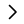 | 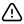 |  | 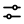 | 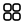 | 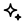 | 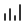 | 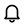 |

| Ayuda | Pila | Salir en bicicleta | Borrar | Buscar | Calendario | Cambié de idea | Caminar |
| --- | --- | --- | --- | --- | --- | --- | --- |
| 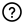 | 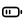 | 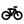 | 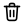 | 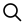 |  | 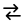 | 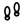 |

| Cerrar | Cocinar | Comentario | Conexión | Contando | Contraer | Decidir | Descargar |
| --- | --- | --- | --- | --- | --- | --- | --- |
| 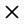 | 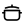 | 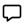 | 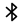 | 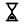 |  |  | 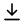 |

| Después | Dibujar | Dormir | Editar | Hacer ejercicio | Empecé | Enviar | Error |
| --- | --- | --- | --- | --- | --- | --- | --- |
| 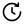 |  | 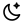 | 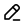 | 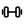 | 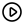 | 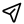 | 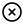 |

| Escribir | Favorita | Estudiar | Expandir | Sacar fotos | Tocar guitarra | Información | Inicio |
| --- | --- | --- | --- | --- | --- | --- | --- |
| 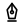 | 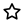 | 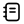 | 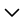 | 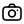 | 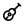 | 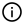 | 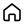 |

| Jugar un juego de mesa | Leer | Listo | Llamar a alguien | Lugar | Hacer manualidades | Armar una maqueta | Más opciones |
| --- | --- | --- | --- | --- | --- | --- | --- |
| 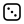 | 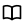 | 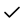 | 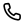 | 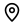 | 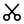 | 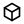 | 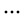 |

| Meditar | Escuchar música | Ordenar tu pieza | Parlante | Pasear al perro | Pausar | Ver una película | Perfil |
| --- | --- | --- | --- | --- | --- | --- | --- |
| 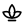 | 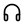 | 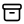 | 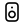 |  |  |  |  |

| Permiso | Pintar | Cuidar las plantas | Primer paso | Privacidad | Reintentar | Reproducir | Ruta |
| --- | --- | --- | --- | --- | --- | --- | --- |
|  |  |  |  |  |  |  |  |

| Siguiente | Silenciar | Suena | Tag | Teléfono | Tiempo | Jugar videojuegos | Volver |
| --- | --- | --- | --- | --- | --- | --- | --- |
|  |  |  |  |  |  |  |  |
<!-- /lamina -->

*Nota.* Elaboración propia. Retícula de 24 y trazo de 1,6.

**Cómo se eligieron.** Se contaron los íconos que usaba la app: 80 del kit de la marca anterior, en pestañas, filas, avisos y la preparación del relevo. Se revisaron además sus tres pestañas, Inicio, Ruta y Perfil, y las 21 ideas de actividad del código, cada una con su origen en las entrevistas. El conjunto cubre esos usos y suma uno que no existía: Suena, el Tag con sus anillos, para la fila «Suena» de la preparación.

**Tabla H2**

*Cómo se construyeron*

| Decisión | Por qué | Referentes |
| --- | --- | --- |
| Retícula de 24 y área viva de 20 | Se alinean en listas, botones y barras, con 2 de margen. | Google, Material Design: íconos de sistema |
| Cuatro formas de base: círculo (r 9), cuadrado (16), vertical (14 × 18) y horizontal (18 × 14) | Un ícono redondo y uno con esquinas miden lo mismo a la vista. | Google, Material Design: keylines |
| Trazo de 1,6 | El asta de Instrument Sans Medium mide 0,105 de su tamaño; junto a un texto de 15 px, el de las fichas, da 1,6: el ícono pesa lo mismo que su palabra. | Apple, SF Symbols, y medición propia del 11 de octubre |
| Tamaños ópticos: 16 → 2,0; 20 → 1,8; 24 → 1,6; 32 → 1,4; 48 → 1,3 | Se ve igual de firme en una lista que en tamaño grande. | Google, eje de tamaño óptico de Material Symbols |
| Puntas y uniones redondas | Conversan con las cápsulas y las fichas, y a tamaño chico no dejan picos. | Coherencia con «Relevo con aura» |
| Un solo peso; solo se rellenan los puntos que marcan algo | El punto del primer peldaño y la argolla del Tag. | Decisión propia |
| Siempre con una palabra | Casi ningún ícono tiene un significado único, y la app ya los muestra con texto. | Harley, Nielsen Norman Group |

*Nota.* Elaboración propia.

**Metáforas.**

- **Lo propio de Relevo se dibuja con su objeto y sus ideas:** el Tag como es, redondo, con su botón y su argolla; el sonido como anillos, nunca como luz; el primer paso como un punto en el primer peldaño, y el tiempo como un cronómetro, porque se cuentan minutos de uso.
- **Lo que hace cualquier app usa formas conocidas,** como volver, borrar o buscar: lo que la gente reconoce de otras apps le ahorra aprender.
- **Dos íconos se rehicieron tras verlos a 16 px.** «Caminar» pasó de una zapatilla, que parecía una bota, a dos huellas, y «Primer paso» perdió un «+» que se confundía con «Agregar».

## H.4 El color

**Figura H3**

*Los colores de las partes de un relevo y los colores de base*

<!-- lamina: PALETA -->
Seis colores claros, uno por parte de un relevo, y los colores de base.

| Parte | Nombre | Color |
| --- | --- | --- |
| Tu tiempo | Amarillo claro | `#F4E496` |
| Tu primer paso | Celeste | `#B3E5FC` |
| El lugar | Verde claro | `#C6EEAE` |
| Lo que decides | Rosa | `#FAC8D9` |
| Tu aura | Lila | `#DFD1FC` |
| Después | Durazno | `#FBD1B3` |

| Color | Uso | Código |
| --- | --- | --- |
| Blanco cálido | Fondo de las pantallas | `#F7F4F0` |
| Gris claro | Botones secundarios y los íconos del Tag y del teléfono | `#EEE9E3` |
| Gris de borde | Líneas de separación | `#E4DED6` |
| Gris oscuro | Texto secundario | `#6B655F` |
| Negro | Texto, acciones y selección | `#141312` |
| Rojo | Solo errores, siempre con ícono y texto | `#B3261E` |
<!-- /lamina -->

*Nota.* Elaboración propia.

**El color como función.** El color se decidió por la función que cumple en la interfaz, no por un efecto emocional esperado: la investigación sobre psicología del color está en una etapa inicial y sus efectos dependen del contexto (Elliot y Maier, 2014), y el significado de un color cambia según el producto en que aparece (Kauppinen-Räisänen y Luomala, 2010). El color distingue de forma estable tres cosas: las partes de un relevo, las actividades de cada persona y los momentos del ciclo. Los seis colores de las partes tienen casi la misma luminosidad percibida, así que pesan lo mismo: distinguen sin jerarquizar.

**Lo que dice la evidencia.** Las asociaciones entre color y emoción son tendencias compartidas, no efectos sobre la conducta, y en Relevo sirvieron sobre todo para descartar.

- En 30 países, las asociaciones resultaron muy similares, con una similitud media de r = 0,88, y más aún entre países que comparten lengua o cercanía geográfica (Jonauskaite et al., 2020).
- En 31 países, las asociaciones que escogió el 40 % o más de las personas vinculan el rojo con el amor (69,2 %) y la rabia (55,2 %); el amarillo, con la alegría (55,7 %); el rosa, con el amor (53,2 %); el negro, con la tristeza (53,7 %) y el miedo (48,7 %); el gris, con la tristeza (47,7 %), y el naranja, con la alegría (44,6 %) y la diversión (41,0 %). Ninguna emoción llega a ese umbral con el verde, el azul ni el morado, y los colores más claros se asocian con emociones más positivas (Jonauskaite et al., 2024).
- La saturación y el brillo elevan la activación, que crece del azul y el verde hacia el rojo (Wilms y Oberfeld, 2018).
- No se encontró un estudio solo con población chilena. En una encuesta a 1066 personas de México, Argentina y Chile, el miedo se asoció sobre todo con el negro (52,4 %), el rojo (13,5 %) y el gris (8,9 %), y el celeste claro y el magenta fueron los colores menos asociados con el miedo; es un boletín de prensa sobre una ponencia, sin revisión por pares (Universidad Nacional Autónoma de México [UNAM], 2023). En Medellín, con 2400 universitarios, el verde se asoció con la naturaleza y la esperanza; el azul, con el mar y el cielo; el rosa, con la ternura; el morado, con el luto, y el gris, con el mal tiempo y la tristeza (Restrepo Betancur, 2022). En Ecuador, con 260 universitarios, los conceptos con raíz sensorial o cultural recibieron colores consistentes, y los abstractos, como «creativo», se dispersaron (Sánchez-Borrero et al., 2026).

**Seis criterios.**

1. **Familias, no tonos exactos.** Ningún tono preciso produce por sí mismo una emoción.
2. **Colores claros y poco saturados,** para no elevar la activación, como propone la *calm technology* (Weiser y Brown, 1997): informar desde la periferia de la atención.
3. **Sin negro, gris ni rojo en los estados de la persona.** El rojo queda para los errores.
4. **Redundancia.** Ningún dato se comunica solo con color, siempre también con ícono y palabra (World Wide Web Consortium, 2024, criterio 1.4.1). La simulación de las deficiencias de visión del color (Machado et al., 2009) mostró dos pares que se confunden: el celeste y el lila con deuteranopia, y el rosa y el durazno con tritanopia.
5. **Contraste medido:** 4,5:1 para el texto (criterio 1.4.3) y 3:1 para los gráficos que informan (criterio 1.4.11; World Wide Web Consortium, 2024).
6. **Un color, un significado.** Cada color significa siempre lo mismo. El color es difícil de apropiar como rasgo de una marca (Ward et al., 2020), así que su aporte está en la coherencia del sistema.

**Los colores de las partes.** Seis colores claros, de luminosidad perceptual equivalente —entre 0,88 y 0,91 en OKLCH (Ottosson, 2020)—, distinguen las partes de un relevo (Tabla H3). Donde existe, la asignación sigue la convención de la señalética de seguridad: la norma ISO 3864-1 asigna el rojo a la prohibición, el amarillo a la precaución, el azul a la acción obligatoria y el verde a la condición segura, como una salida o un botiquín (International Organization for Standardization [ISO], 2011).

**Tabla H3**

*Los colores de las partes de un relevo*

| Parte | Color | Lo que dice la evidencia |
| --- | --- | --- |
| Tu tiempo, la condición que activa la señal | Amarillo claro, `#F4E496` | El color más asociado con la alegría; en la señalética pide atención sin prohibir. Poco saturado, para no elevar la activación. |
| Tu primer paso | Celeste, `#B3E5FC` | En la señalética indica una acción, y está entre los colores menos asociados con el miedo. |
| El lugar donde empiezas | Verde claro, `#C6EEAE` | En la señalética, el verde indica dónde está algo; en Medellín se asocia con la naturaleza y la esperanza. |
| Lo que decides | Rosa, `#FAC8D9` | Conserva el amor y la alegría del rojo sin su asociación con la rabia, para que la decisión no se juzgue. |
| El aura, la personalización | Lila, `#DFD1FC` | Sin una asociación emocional compartida; claro, para alejarse del morado del luto. |
| Después de la señal | Durazno, `#FBD1B3` | El naranja se asocia con la alegría y la diversión. |

*Nota.* Elaboración propia. El texto negro sobre cualquiera de los seis colores alcanza un contraste de 12,7:1 a 14,5:1.

**Los degradados de las actividades.** Cada actividad se representa con un degradado con grano y volumen, en siete familias. Son un material distinto de los colores planos de las partes, para que el color de una actividad no se confunda con el de una función. La asignación privilegia la raíz sensorial de cada actividad, que produce asociaciones más consistentes (Sánchez-Borrero et al., 2026); crear, un concepto abstracto, recibe un degradado de varios tonos.

**Figura H4**

*Los degradados de las siete familias de actividades*

<!-- lamina: CIELOS -->
Los degradados de las siete familias: un color de base y cuatro o cinco luces.

| Familia | Base | Luces |
| --- | --- | --- |
| Moverte | `#BFE7D3` | `#3FB487` `#E6F7FF` `#9ED6F4` `#5FC79A` |
| Leer y aprender | `#8DB9EA` | `#2559C9` `#E9F3FF` `#7EA9E8` `#F7FBFF` `#3B6BD2` |
| Crear | `#F3B38E` | `#F06A3B` `#F7C6DD` `#B9A4F2` `#FFE6A6` |
| Jugar y disfrutar | `#E9B85C` | `#F2A20C` `#B78BEF` `#F7D27A` `#9C7BE8` |
| En casa | `#F28A4A` | `#E8501E` `#F9B36B` `#FFE0B8` `#C9370F` |
| Descansar | `#2B3A66` | `#0F1A3D` `#5E7BD8` `#A9B8F5` `#1E2B5C` |
| Con otras personas | `#F4C9D2` | `#C8325A` `#F7A9BE` `#FFFFFF` `#E0617F` |
<!-- /lamina -->

*Nota.* Elaboración propia. Cada degradado combina un color de base con cuatro o cinco luces, tomados del código de la app.

**Tabla H4**

*Familias de color de las actividades*

| Familia | Degradado | Fundamento |
| --- | --- | --- |
| Moverse y aire libre | Menta | El verde se asocia con la naturaleza y la esperanza (Restrepo Betancur, 2022) y activa menos que el rojo. |
| Leer y aprender | Azul | El azul, con el mar y el cielo; activa menos que el rojo (Wilms y Oberfeld, 2018). |
| Crear | Atardecer | Un concepto abstracto, sin color propio (Sánchez-Borrero et al., 2026): un degradado de varios tonos. |
| Jugar y disfrutar | Ámbar | El amarillo y el naranja, con la alegría y la diversión (Jonauskaite et al., 2024). |
| La casa | Brasa | El naranja del fuego y la cocina, sin llegar al rojo. |
| Descansar | Noche | Un azul profundo, con raíz sensorial y sin el negro, el color más asociado con el miedo (UNAM, 2023). |
| Con otras personas | Rosa | El rosa, con el amor y la ternura. Como una parte de las personas lo rechaza, se puede cambiar. |

*Nota.* Elaboración propia. Cada persona puede cambiar el color de una actividad.

El texto blanco sobre los degradados claros no alcanzó 4,5:1 —se midieron entre 2,6:1 y 3,7:1—, así que el nombre de la actividad va en una cápsula blanca con letra negra, que alcanza entre 15:1 y 17,8:1 sobre cualquier degradado. El degradado aparece solo donde está la actividad y cubre la pantalla completa en el momento de la señal, cuando la interfaz debe hacer visible la actividad.

**Cómo se verificó.** La luminosidad y la saturación se midieron en OKLCH, y el contraste, según las WCAG 2.2; el del texto sobre los degradados, en capturas, sobre el píxel más desfavorable del fondo. Las deficiencias de visión del color se simularon con el modelo de Machado et al. (2009).

## H.5 Nombre, frase y descriptor

**Nombre.** Un relevo es el momento en que algo pasa de una mano a otra, como en una carrera de relevos. El nombre cuenta lo que busca el sistema: que la atención pase de la pantalla a lo que la persona quería hacer, sin que nadie se la quite. Es breve, se pronuncia sin trabas en español y viene del mundo de los traspasos y los turnos, no de las prohibiciones. Una comercialización exigiría revisar antes la disponibilidad jurídica del nombre, los dominios y las coincidencias comerciales.

**Frase de marca.** «Hazle lugar a lo que quieres hacer.» Hacer lugar es reservar un espacio físico para la señal y volver a considerar una actividad dentro de la decisión, sin obligar a hacerla ni presentar el teléfono como enemigo. Va en portadas, presentaciones y piezas de introducción, no en las pantallas de uso ni en los mensajes de error.

**Descriptor.** «Un recordatorio físico preparado desde el teléfono.» Acompaña al nombre cuando quien lo lee todavía no conoce el producto: su función es aclarar, no emocionar.

## H.6 Propuestas anteriores

Entre septiembre y octubre de 2026, el autor exploró más de veinte propuestas de identidad, y cada una dejó algo en la final.

**Tabla H5**

*Las propuestas y lo que quedó de cada una*

| Fecha | Propuesta | Qué proponía | Qué pasó |
| --- | --- | --- | --- |
| 16 sep. | Sistema de marca del proyecto | Nombre, descriptor, frase, letra, paleta y logotipo. | Se mantienen el nombre, el descriptor y la frase; la letra, la paleta y el logotipo se reemplazaron en octubre. |
| 25 sep. | Punto y pulso | Una identidad a partir de un punto que late. | Se reemplazó el mismo día. |
| 25 sep. | «Antes de que sea después» | Una plataforma de marca sobre el momento en que aún se puede elegir. | El autor la juzgó confusa para la comisión, y la reemplazó «Vuelve a lo que querías hacer». |
| 25 sep. | «Vuelve a lo que querías hacer» | El mismo centro, en palabras directas. | Se aplicó en la app de la 2.8 a la 2.30. |
| 27 sep. | Sistema de marca 2.0 en Figma | Variables, componentes y pantallas en Figma. | La superaron las propuestas de fines de septiembre. |
| 30 sep. | El subrayado | Una identidad alrededor de un renglón azul. | Se descartó porque no decía qué hace Relevo; el renglón quedó como línea de escritura. |
| 2 oct. | Sistema de diseño 3.1 | Un renglón que hace lugar, dos voces y los colores de la casa. | Fue la base de las propuestas 3.2 a 3.5. |
| 3 oct. | Relevo vivo, Volver a enfocar, Las ganas estaban y Cuándo va color | Color vivo, letra manuscrita, serifa y reglas de cuándo usar color. | El autor descartó la letra manuscrita y la serifa; quedó la regla de cuándo va color. |
| 3 oct. | El traspaso | La marca como un traspaso de mano en mano. | La idea del traspaso sigue en el logo de cuatro luces. |
| 4 oct. | Letras para el logotipo | Una búsqueda amplia de letras display. | Llevó a elegir Chillax para el logo del 11 de octubre. |
| 10 y 11 oct. | Relevo con aura | Aura, fichas por color, íconos propios, degradados y el logo de cuatro luces. | **Aprobada el 11 de octubre:** es la identidad de la memoria, aplicada en la app desde la 3.0. |
| 5 nov. | Rediseño de la app 4.0 | La interfaz en blanco cálido y negro, con las actividades en anillos y sin aura. | Es la base de las versiones 4.0 a 4.6.3 de la app. |

*Nota.* Elaboración propia. Fechas de 2026.

## H.7 Referentes visuales del autor

**Tabla H6**

*Lo que se tomó de cada referente*

| Referente | Qué enseña | Qué se tomó | Qué no |
| --- | --- | --- | --- |
| Dafi (Mambo Mambo) | Íconos de línea sobre cuadrados de color, fichas en escalera y aura. | Las fichas con ícono de línea, ahora con un color por parte del relevo. | Sus dibujos: los 72 íconos se trazaron de nuevo. |
| DAYO | Personajes que nacen de cuatro estados emocionales, ordenados con el modelo de valencia y activación. | Fundamentar el color en estudios de emoción, con datos de 31 países y la saturación como activación. | El volumen peludo en 3D, que a 16 px se pierde; el volumen de Relevo vive en el aura. |
| Biceps Grotesk | Una letra modular de cuadrados y triángulos en una retícula de 30 px, en rojos y rosas. | La construcción modular: las mismas formas de base y una sola retícula; de sus rojos, el lado rosa. | La letra para la interfaz, que es para lucirse en grande. |

*Nota.* Elaboración propia.

## Referencias

Elliot, A. J. y Maier, M. A. (2014). Color psychology: Effects of perceiving color on psychological functioning in humans. *Annual Review of Psychology, 65*, 95–120. https://doi.org/10.1146/annurev-psych-010213-115035

Guynn, M. J., McDaniel, M. A. y Einstein, G. O. (1998). Prospective memory: When reminders fail. *Memory & Cognition, 26*(2), 287–298. https://doi.org/10.3758/BF03201140

International Organization for Standardization. (2011). *Graphical symbols — Safety colours and safety signs — Part 1: Design principles for safety signs and safety markings* (ISO 3864-1:2011).

Jiang, Y., Gorn, G. J., Galli, M. y Chattopadhyay, A. (2016). Does your company have the right logo? How and why circular- and angular-logo shapes influence brand attribute judgments. *Journal of Consumer Research, 42*(5), 709–726. https://doi.org/10.1093/jcr/ucv049

Jonauskaite, D., Abu-Akel, A., Dael, N., Oberfeld, D., Abdel-Khalek, A. M., Al-Rasheed, A. S., Antonietti, J., Bogushevskaya, V., Chamseddine, A., Chkonia, E., Corona, V., Fonseca-Pedrero, E., Griber, Y. A., Grimshaw, G., Hasan, A. A., Havelka, J., Hirnstein, M., Karlsson, B. S. A., Laurent, E., … Mohr, C. (2020). Universal patterns in color-emotion associations are further shaped by linguistic and geographic proximity. *Psychological Science, 31*(10), 1245–1260. https://doi.org/10.1177/0956797620948810

Jonauskaite, D., Epicoco, D., Al-Rasheed, A. S., Aruta, J. J. B. R., Bogushevskaya, V., Brederoo, S. G., Corona, V., Fomins, S., Gizdic, A., Griber, Y. A., Havelka, J., Hirnstein, M., John, G., Jopp, D. S., Karlsson, B., Konstantinou, N., Laurent, É., Marquardt, L., Mefoh, P. C., … Mohr, C. (2024). A comparative analysis of colour–emotion associations in 16–88-year-old adults from 31 countries. *British Journal of Psychology, 115*(2), 275–305. https://doi.org/10.1111/bjop.12687

Kauppinen-Räisänen, H. y Luomala, H. T. (2010). Exploring consumers’ product-specific colour meanings. *Qualitative Market Research: An International Journal, 13*(3), 287–308. https://doi.org/10.1108/13522751011053644

Luffarelli, J., Mukesh, M. y Mahmood, A. (2019). Let the logo do the talking: The influence of logo descriptiveness on brand equity. *Journal of Marketing Research, 56*(5), 862–878. https://doi.org/10.1177/0022243719845000

Machado, G. M., Oliveira, M. M. y Fernandes, L. A. F. (2009). A physiologically-based model for simulation of color vision deficiency. *IEEE Transactions on Visualization and Computer Graphics, 15*(6), 1291–1298. https://doi.org/10.1109/TVCG.2009.113

Ottosson, B. (2020). *A perceptual color space for image processing*. https://bottosson.github.io/posts/oklab/

Restrepo Betancur, L. F. (2022). Preferencia por los colores en universitarios de la ciudad de Medellín, Colombia. *Anuario Electrónico de Estudios en Comunicación Social «Disertaciones», 15*(1), 1–15. https://doi.org/10.12804/revistas.urosario.edu.co/disertaciones/a.10455

Sánchez-Borrero, G., Quelal-Moncayo, S. y Bustos-Cevallos, S. (2026). Asociaciones culturales latinoamericanas del color: estudio desde la psicología cromática en estudiantes universitarios de la Pontificia Universidad Católica del Ecuador. *Kepes, 23*(33), 105–145. https://doi.org/10.17151/kepes.2026.23.33.5

Slack. (2019, 16 de enero). *Say hello, new logo*. https://slack.com/blog/news/say-hello-new-logo

Universidad Nacional Autónoma de México. (2023, 16 de abril). *Relacionamos nuestros miedos con los colores* (Boletín UNAM-DGCS-273). Dirección General de Comunicación Social. https://www.dgcs.unam.mx/boletin/bdboletin/2023_273.html

Ward, E., Yang, S., Romaniuk, J. y Beal, V. (2020). Building a unique brand identity: Measuring the relative ownership potential of brand identity element types. *Journal of Brand Management, 27*(4), 393–407. https://doi.org/10.1057/s41262-020-00187-6

Weiser, M. y Brown, J. S. (1997). The coming age of calm technology. En P. J. Denning y R. M. Metcalfe (Eds.), *Beyond calculation: The next fifty years of computing* (pp. 75–85). Copernicus. https://doi.org/10.1007/978-1-4612-0685-9_6

Wilms, L. y Oberfeld, D. (2018). Color and emotion: Effects of hue, saturation, and brightness. *Psychological Research, 82*(5), 896–914. https://doi.org/10.1007/s00426-017-0880-8

World Wide Web Consortium. (2024, 12 de diciembre). *Web content accessibility guidelines (WCAG) 2.2*. https://www.w3.org/TR/2024/REC-WCAG22-20241212/

## Registro de cambios (disclaimer)

### 2026-11-08 — Correcciones del autor

- **Qué cambió:** los «papeles» pasan a ser los colores de las partes de un relevo, con nombres de color claros; los colores de base dicen para qué sirven (piedra era «superficies y el medio»); los cielos se llaman degradados; los referentes visuales dejan de llamarse fuentes; la *calm technology* se nombra con su término original; el autor diseñó la identidad; sin «testigo», sin códigos de decisión y sin menciones al repositorio.
- **Cómo estaba antes:** hablaba de papeles, cielos, piedra, tinta y grafito, decía «tecnología calma», «la identidad que el autor aprobó» y citaba decisiones y carpetas del repositorio.
- **Por qué:** el autor revisó los anexos y pidió un texto sin códigos ni menciones al repositorio, con palabras claras y la declaración de IA corregida (D-170).

### 2026-11-08 — Anexo recopilado y listo para Word

- **Qué cambió:** el logo, las letras, los íconos y el color quedan con su lámina, sus reglas y su fundamento, sin la tabla de las luces repetida dos veces ni la lista de archivos. El color se presenta como en la memoria v6: se decidió por su función, y las asociaciones con emociones sirvieron sobre todo para descartar; por eso la columna de los papeles se llama «Lo que dice la evidencia». El nombre toma la explicación de la memoria v6, la del relevo como traspaso, en vez de la nota del 16 de septiembre que evitaba esa metáfora. La tabla de propuestas suma el rediseño de la app 4.0 (D-155). Las figuras y tablas se numeran H1 a H6. Desde ahora este archivo es la fuente del anexo.
- **Cómo estaba antes:** copiaba secciones de los documentos 14, 39, 40 y 41, con remisiones a la Figura 2 de la memoria v5 y una lista de límites que repetía lo dicho.
- **Por qué:** el autor pidió revisar todos los anexos y dejarlos listos para Word: directos, sin sobreexplicar, con su forma de escribir y con lo más relevante (D-168).

### 2026-10-24 — Creación

- **Qué cambió:** el anexo se arma desde sus documentos fuente, con el resto de los anexos A–I de la memoria v5.
- **Cómo estaba antes:** la carpeta de anexos solo tenía un README de la v4, con cinco anexos y sin su contenido.
- **Por qué:** el autor pidió elegir un pendiente de prioridad alta y terminarlo; la memoria v5 remite a nueve anexos que no estaban armados.
