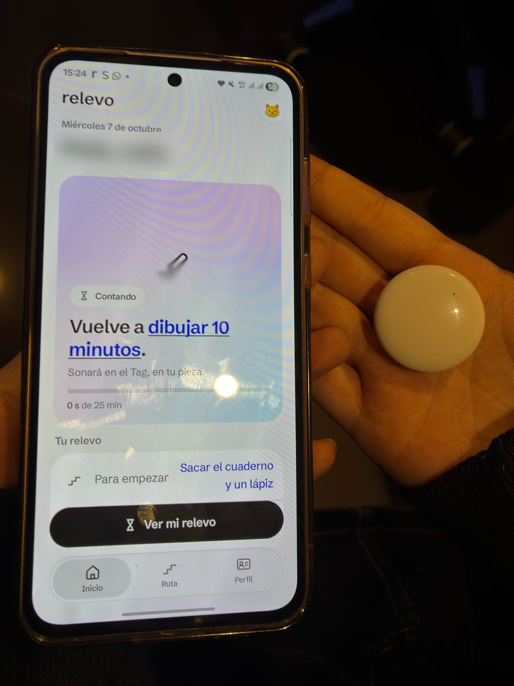
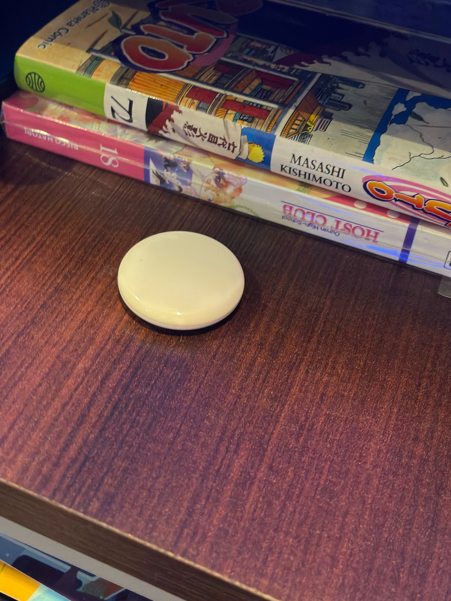

Universidad Diego Portales

Facultad de Arquitectura, Arte y Diseño

Escuela de Diseño

# Relevo

Sistema *phygital* para recuperar intenciones personales durante el ocio digital

Memoria para optar al título de [CONFIRMAR: denominación oficial del título y mención, según la Escuela]

Johan Yantén [CONFIRMAR: nombre legal completo]

Profesores guía: Sergio Majluf y Simón Gallardo

Santiago, Chile

2026

# Agradecimientos

A mi familia, que hizo posible este proyecto.

A mi mamá, por estar siempre presente, por apoyarme y por darme todo lo que he necesitado para cumplir mis metas.

A mi abuela, por educarme y por enseñarme a soñar y a explorar.

A las dos, por permitir que la creatividad, el arte y la entretención fueran parte de mi vida diaria.

# Resumen

Algunas sesiones de ocio digital se prolongan sin una nueva decisión de continuar, y otra actividad también deseada deja de estar presente cuando aún es posible comenzarla. El proyecto buscó diseñar y evaluar formativamente un sistema *phygital* (físico y digital) que ayude a recuperar esa intención —volver a tenerla presente— sin bloquear el teléfono ni juzgar la decisión posterior. La investigación combinó una revisión bibliográfica, ocho entrevistas semiestructuradas analizadas con el método Framework, una encuesta de 53 respuestas y una comparación de herramientas. Los resultados indican que la duración no basta para valorar una sesión, que la mayoría de las herramientas revisadas actúa sobre el uso del teléfono y no sobre la actividad desplazada, y que no corresponde intervenir cuando el ocio digital conserva sentido. De ellos se derivaron ocho criterios de diseño y Relevo: una aplicación Android y un objeto, el testigo, que se deja junto al primer paso de la actividad elegida —por ejemplo, junto al libro— y suena al cumplirse una condición definida por la persona. Para probar la relación entre señal y lugar antes de fabricar el testigo, el prototipo hace sonar un localizador Bluetooth comercial. Tres personas lo usan en su hogar desde el 7 de octubre de 2026; hasta el 19, el ciclo completo funcionó en los tres hogares: el localizador sonó en 23 de 24 ciclos y, en 19 de 21 respuestas, la persona supo qué quería hacer antes de leerlo en la pantalla; en las 21 recordó cómo empezar, y en 10 decidió empezar. Esta etapa validó el ciclo; la comparación con un lugar neutro y con el teléfono, ya implementada, es el paso siguiente para contrastar la hipótesis. El proyecto aporta, además, un prototipo funcional y un procedimiento para comparar señales situadas con sus alternativas antes de fabricar un objeto.

*Palabras clave:* ocio digital, memoria prospectiva, diseño *phygital*

# Abstract

Some digital leisure sessions go on without a new decision to continue, and another activity, also desired, fades from view while it can still be started. The project sought to design and formatively evaluate a phygital (physical and digital) system that helps people retrieve that intention—bring it back to mind—without blocking the phone or judging the decision that follows. The research combined a literature review, eight semistructured interviews analyzed with the Framework method, a survey with 53 responses, and a comparison of tools. The results indicate that duration alone is not enough to assess a session, that most of the tools reviewed act on phone use, not on the displaced activity, and that no intervention is called for when digital leisure remains meaningful. Eight design criteria were derived from these results, along with Relevo: an Android application and an object, the *testigo*, left next to the first step of the chosen activity (for example, next to a book), which sounds once a condition defined by the person is met. To test the relationship between signal and place before building the *testigo*, the prototype sounds a commercial Bluetooth tracker. Three people have used it at home since October 7, 2026; up to October 19, the full cycle worked in all three homes: the tracker sounded in 23 of 24 cycles, and in 19 of 21 responses the person knew what they wanted to do before reading it on the screen; in all 21 they remembered how to start, and in 10 they chose to start. This stage validated the cycle; the comparison with a neutral place and with the phone, already implemented, is the next step toward testing the hypothesis. The project also contributes a working prototype and a procedure for comparing situated signals with their alternatives before building an object.

*Keywords:* digital leisure, prospective memory, phygital design

# Índice

- 1. Motivación personal
- 2. Introducción
- 3. Planteamiento del problema
- 4. Justificación
- 5. Antecedentes y estado de la cuestión
- 6. Marco teórico por ámbitos
- 7. Usuario, contexto y hallazgos de entrevistas
- 8. Estado del arte y referentes
- 9. Criterios de diseño
- 10. Formulación
- 11. Bajada proyectual
- 12. Factibilidad y límites
- 13. Plan de desarrollo y validación
- 14. Conclusiones
- Referencias
- Glosario
- Anexos

## Índice de tablas

- Tabla 1. Participantes y función analítica de cada entrevista
- Tabla 2. Familias de herramientas y sus límites frente al problema
- Tabla 3. Actores y responsabilidades
- Tabla 4. Fases del proyecto, objetivos, técnicas y productos
- Tabla 5. Momentos del recorrido y su estado en el prototipo
- Tabla 6. Estados del ciclo y salidas disponibles
- Tabla 7. Iteraciones del prototipo y aprendizajes que las motivaron
- Tabla 8. Soporte requerido en cada momento de la experiencia
- Tabla 9. Presupuesto del prototipo académico
- Tabla 10. Condiciones de la prueba de 21 días y diferencias entre ellas
- Tabla 11. Estado de los objetivos al cierre de este documento

## Índice de figuras

- Figura 1. Episodios recientes de ocio digital según la encuesta
- Figura 2. Relación entre intención, lugar, condición y decisión
- Figura 3. Pantallas del prototipo Android al preparar un ciclo
- Figura 4. El Tag durante la prueba en el hogar
- Figura 5. Diseño de la prueba de 21 días
- Figura 6. Primeros resultados de la prueba de uso

# 1. Motivación personal

Me ocurre con frecuencia abrir una aplicación para descansar unos minutos y quedarme en ella más tiempo del que imaginaba. Al cerrarla, descubro que otras cosas que también quería hacer —dibujar, leer, caminar o cocinar con calma— dejaron de estar presentes. No decidí abandonarlas; dejaron de participar en lo que hacía.

No pienso que todo uso del teléfono sea negativo. Muchas veces encuentro en él entretención, conversación, información o un descanso que valoro. Me inquieta la diferencia entre elegir seguir y darme cuenta, después, de que no volví a considerar lo demás.

Me interesa estudiar ese momento sin convertirlo en un juicio sobre disciplina o productividad: por qué una intención personal pierde presencia, qué condiciones lo favorecen y cómo el diseño podría ayudar a que vuelva a ser considerada. La pregunta nace de mi experiencia; lo que esta memoria afirma sobre otras personas proviene de la investigación. Parte de un límite claro: descansar, cambiar de actividad o seguir frente al teléfono pueden ser decisiones igualmente válidas.

# 2. Introducción

Los teléfonos inteligentes reúnen comunicación, información, trabajo y entretenimiento en un mismo dispositivo. Han cambiado la forma de organizar el tiempo y de descansar: una persona puede conversar, escuchar música, jugar, mirar una serie o recorrer una red social sin cambiar de soporte. Esa diversidad impide tratar el uso del teléfono como una sola experiencia y vuelve insuficiente cualquier evaluación basada solo en la duración.

Aquí se entienden por *ocio digital* las actividades que una persona realiza a través de dispositivos en su tiempo disponible para descansar, entretenerse, satisfacer su curiosidad o vincularse con otros. No se opone a otras formas de ocio ni necesita justificarse por su utilidad. Una sesión extensa puede ser satisfactoria y coherente con lo que alguien desea; una breve puede sentirse inoportuna si desplaza algo que la persona consideraba importante. La diferencia depende del propósito, el contexto y la valoración de quien vive la experiencia (Lukoff et al., 2018; Meier y Reinecke, 2021).

Al comenzar una actividad digital, la persona puede tener presente otra intención: salir a caminar, leer, dibujar, ordenar su pieza, dormir o llamar a alguien. Aun así, la sesión continúa y esa alternativa deja de orientar el paso siguiente; cuando la persona vuelve a considerarla, la ocasión puede haber cambiado o quedar menos tiempo. La situación adopta dos formas: en una, la otra actividad deja de estar presente y se recuerda tarde; en la otra, sigue presente y aun así no se inicia. El proyecto se dirige a la primera; queda abierto si acercar el comienzo de la actividad ayuda también en la segunda.

Algunas interfaces favorecen esa continuidad. El *desplazamiento infinito* carga contenido nuevo a medida que la persona avanza, sin un final de página reconocible; la reproducción automática, al terminar un contenido, inicia otro sin exigir una elección nueva. Estos patrones no determinan la conducta, pero reducen los *puntos de cierre* —momentos en que algo termina y hay que elegir si seguir— y mantienen disponible la acción actual (de Segovia Vicente et al., 2024; Montag et al., 2019).

Las herramientas de bienestar digital más comunes, pensadas para regular el propio uso del teléfono, miden el tiempo, fijan límites o bloquean aplicaciones, y algunas introducen una pausa antes de abrirlas (Apple, s. f.; Google, s. f.-a; Lyngs et al., 2019). Son útiles cuando alguien quiere reducir una conducta concreta, pero detener la actividad presente no devuelve aquello que se quería hacer: un bloqueo puede cerrar una aplicación y dejar igualmente ausente la otra intención, o interrumpir una conversación o un descanso que la persona sí quería mantener.

La *memoria prospectiva* ayuda a precisar la primera forma. Designa la capacidad de recordar una acción que se quiere realizar en el futuro cuando aparece la ocasión adecuada (McDaniel y Einstein, 2000). Recordar al final del día que se quería leer no equivale a recuperar esa intención cuando todavía era posible abrir el libro; el problema es encontrar una señal que la traiga de vuelta a tiempo. En la segunda forma no hay nada que recordar: dos actividades valoradas compiten, y un recordatorio no basta para resolver esa tensión.

Esta investigación indaga qué condiciones pueden ayudar a que una persona vuelva a considerar, mientras la sesión continúa, una actividad que ella misma eligió, y cómo puede el diseño ofrecerlas sin prohibir la actividad actual ni decidir qué forma de descanso vale más; el capítulo 10 formula la pregunta con precisión. El proyecto combinó una revisión bibliográfica exploratoria, ocho entrevistas semiestructuradas y una comparación de herramientas. Con esa base se derivaron criterios de diseño —contrastados después con una encuesta en línea—, se formuló una propuesta, se desarrolló un prototipo y se evaluó con tres personas en sus hogares.

Los capítulos 3 a 8 plantean y sitúan el problema y presentan las entrevistas, la encuesta y las herramientas disponibles; de ellos se derivan los criterios del capítulo 9, y solo a partir de ellos se presentan la propuesta *phygital* (10), su desarrollo (11), su factibilidad (12) y su plan de validación, con su estado de avance (13). El capítulo 14 reúne las conclusiones.

# 3. Planteamiento del problema

En 2025, el 96,6 % de los hogares encuestados en Chile declaró tener acceso propio y pagado a internet, y entre los hogares conectados el teléfono inteligente fue el dispositivo de acceso más extendido, presente en el 99,1 % (Subsecretaría de Telecomunicaciones, 2025). Estas cifras describen un entorno conectado, no el valor de cada experiencia digital. Para comprender la situación estudiada importa la relación entre la actividad presente, otras intenciones y el momento de elegir. El problema se organiza en tres aristas, que evitan atribuirlo a una sola causa.

## Arista experiencial y cognitiva

Una persona puede iniciar una actividad digital con un propósito claro y mantener otras intenciones para ese periodo. El conflicto aparece cuando la sesión se prolonga y alguna de esas alternativas deja de orientar la acción inmediata. Recordarla más tarde muestra que no desapareció de la memoria, pero que no se recuperó cuando podía participar en la decisión.

En un estudio con 1315 personas adultas, de Segovia Vicente et al. (2024) analizaron el desplazamiento sin propósito por contenidos (*mindless scrolling*), combinando breves cuestionarios repetidos durante el día con registros del uso del teléfono. Cuanto más se prolongaba ese desplazamiento, más culpa declaraban, y el conflicto con otras metas explicaba parte de esa relación. El estudio es observacional y midió conflicto y culpa, no olvido: no establece causas ni distingue si la otra actividad había dejado de estar presente o seguía presente sin iniciarse. Indica que la relación con otras intenciones se asocia con cómo se vive la experiencia.

La dificultad no es un daño a la memoria ni una incapacidad permanente: aparece en momentos concretos, lo que permite estudiarla sin diagnosticar a la persona ni suponer que necesita dejar el teléfono.

## Arista tecnológica

Las sesiones digitales ocurren en interfaces diseñadas. A diferencia de un capítulo, una canción o una página, que tienen un final reconocible, el desplazamiento infinito y la reproducción automática mantienen abierta la secuencia y ofrecen la acción siguiente con poco esfuerzo (Montag et al., 2019).

La interfaz no actúa sola: el propósito, el contexto y los hábitos de cada persona también se asocian con cómo vive una sesión (Lukoff et al., 2018). Pero explicar la experiencia solo como falta de disciplina omite que el diseño organiza cierres, transiciones y oportunidades de elección: pedir confirmación, introducir una pausa o continuar sin interrupciones cambia las condiciones en que la persona decide. Las herramientas de bienestar digital son también decisiones de diseño, y la mayoría de las que revisaron Lyngs et al. (2019) bloquea o quita distracciones: actúa sobre la actividad presente.

## Arista evaluativa

El ocio no se valora solo por su duración o contenido; también pesan las expectativas con que se interpreta ese tiempo. Tonietto et al. (2021) observaron que considerar el ocio como una pérdida de tiempo disminuía su disfrute, especialmente cuando la actividad se realizaba como un fin en sí mismo. El estudio no trata del teléfono, pero sugiere por qué una intervención que presente el ocio como tiempo improductivo podría reducir el disfrute que pretende apoyar: bastó inducir esa creencia para disminuir el disfrute de una actividad.

En el sentido de una sesión pesa también la relación que cada persona reconoce entre lo que hace y lo que quería hacer (de Segovia Vicente et al., 2024; Lukoff et al., 2018). Por eso el problema no se resuelve imponiendo productividad. Recuperar una intención significa devolverla a la decisión, no transformarla en obligación.

Durante algunos episodios de ocio digital una actividad continúa mientras otra intención valorada deja de orientar la decisión. El desafío de diseño es apoyar la recuperación de esa intención sin bloquear la actividad actual, sin decidir por la persona y sin intervenir cuando el ocio digital conserva sentido.

# 4. Justificación

El tema es relevante porque el teléfono participa constantemente en la vida cotidiana y reúne actividades que no pueden evaluarse con una sola regla. Las mediciones de tiempo informan cuánto se usó, pero no si una sesión respondió al propósito de la persona ni si desplazó otra intención. Una respuesta más precisa debe reconocer tanto el derecho a cambiar de actividad como el de seguir en un descanso elegido.

Cuando las alternativas se reducen a bloquear, contabilizar o comparar, una herramienta de apoyo puede convertirse en una nueva fuente de presión. Fijar una intención no debería crear una deuda con el sistema: ignorar una señal, cambiar de idea o permanecer en la actividad digital son resultados legítimos. Este criterio traduce en decisiones de diseño la autonomía, una necesidad psicológica básica según la teoría de la autodeterminación (Ryan y Deci, 2000), y evita confundir ayuda con obediencia.

El problema involucra variables propias del diseño: continuidad, cierre, momento, canal, jerarquía, legibilidad, esfuerzo y control. La psicología aporta conceptos para entender el recuerdo de acciones futuras y el conflicto entre metas, y la ingeniería permite programar las condiciones y la comunicación entre dispositivos; al diseño le corresponde unir ambos conocimientos en una experiencia clara, situada y respetuosa de quien la usa.

El tema también corresponde al diseño porque permite repartir una interacción entre componentes físicos y digitales: una experiencia *phygital*, de *physical* y *digital* (Waggoner et al., 2026). La interacción tangible estudia cómo los objetos y el espacio físico participan en la relación con información digital (Hornecker y Buur, 2006; Ishii y Ullmer, 1997); un recordatorio ubicado en el entorno podría devolver una intención desde fuera de la pantalla que concentra la atención. El aporte se espera en dos planos: criterios para diseñar ayudas que acompañen una decisión sin presionarla, y un procedimiento para comparar, antes de fabricar un objeto propio, una señal situada donde comienza la actividad con la misma señal en otro lugar y con una notificación en el teléfono.

# 5. Antecedentes y estado de la cuestión

Este capítulo revisa la investigación previa; los productos disponibles se comparan en el capítulo 8.

## De la duración al sentido de la experiencia

Las herramientas integradas en los teléfonos registran tiempos de uso, aperturas y desbloqueos (Apple, s. f.; Google, s. f.-a), pero no el propósito ni el significado de cada sesión. En el estudio de Lukoff et al. (2018), usar el teléfono por hábito para pasar el tiempo, entretenerse o mirar redes sociales pasivamente se asoció con menos sentido y, en sus entrevistas, con una pérdida de autonomía; aun así, algunas personas lo valoraban como una breve evasión de situaciones difíciles.

Meier y Reinecke (2021) reunieron 34 revisiones sobre comunicación digital y salud mental: la asociación entre uso de redes sociales y salud mental fue, en general, negativa y pequeña, y varió según el aspecto del uso y el indicador estudiados. Radtke et al. (2022) revisaron intervenciones de desconexión digital y encontraron resultados positivos, nulos y negativos. Reducir el uso no aparece como una solución válida para todos; importa la relación entre lo que la persona hace y lo que quería hacer, estudiada como conflicto entre metas (de Segovia Vicente et al., 2024).

## Pausas, límites y separación del teléfono

Las herramientas de bienestar digital, también llamadas de autocontrol digital, recurren a bloqueos, temporizadores, demoras y mensajes. De 367 aplicaciones y extensiones de navegador analizadas por Lyngs et al. (2019), tres de cada cuatro bloqueaban o quitaban distracciones y alrededor de un tercio ayudaba a avanzar hacia una meta, por ejemplo recordándola.

Biedermann et al. (2021) revisaron 28 intervenciones y encontraron resultados variables, con una confianza baja por muestras pequeñas, estudios breves y contextos poco claros; las que solo buscaban aumentar la conciencia del uso apenas tuvieron efecto. En los 43 estudios de evaluación que revisaron Monge Roffarello y De Russis (2023), la mediana de duración fue de 21 días y solo cinco superaron los 2 meses. Su metaanálisis de siete estudios estimó un efecto entre pequeño y mediano sobre el tiempo de uso (*g* = 0,47), medida que los autores consideran demasiado gruesa para el bienestar.

Otra línea introduce una pausa. Grüning et al. (2023) estudiaron one sec, que demora la apertura de una aplicación y pide reconsiderarla: en un experimento de campo de 6 semanas, 280 personas desistieron en el 36 % de los intentos; en otro, en línea, la opción explícita de desistir tuvo el mayor efecto, la demora también redujo el consumo y el mensaje de reflexión, por sí solo, no fue eficaz. Los registros de 1039 personas que ya usaban esa aplicación sugieren que el efecto no persiste al suspender la intervención (Haliburton et al., 2024). Entre los autores de ambos trabajos figura el creador del producto, lo que exige cautela.

Una variante sustituye la demora por una pregunta. MindPhone planteaba, al desbloquear el teléfono, para qué se iba a usar o qué se haría después fuera de él. En un estudio de campo de 2 semanas con 28 personas, la segunda pregunta redujo el uso distraído y favoreció volver antes al entorno; la primera aumentó la conciencia de los motivos de uso (Terzimehić et al., 2022). Es el antecedente revisado más próximo al problema, aunque actúa en la pantalla y al comienzo de la sesión.

La intervención también puede trasladarse al espacio: alejar el teléfono, guardarlo o condicionar su acceso a una llave física aumenta, por su propio mecanismo, el esfuerzo de volver a él y apoya una restricción elegida.

## Recordar mediante señales y recursos externos

Usar agendas, notas, alarmas u objetos para recordar acciones futuras es una forma de *descarga cognitiva*: recurrir a una acción física para reducir la demanda cognitiva de una tarea (Risko y Gilbert, 2016); cuando se confía una acción futura a un recurso externo, se habla de *descarga de intenciones* (Gilbert et al., 2023). Preparar un recordatorio tiene un costo: en dos experimentos, se fijaron menos recordatorios cuando hacerlo exigía más esfuerzo físico (Chiu y Gilbert, 2024).

Algunos recordatorios se basan en la ubicación. Place-Its asociaba notas a lugares en teléfonos móviles; en su estudio exploratorio, 19 de 89 recordatorios se fijaron de nuevo porque llegaron en el lugar equivocado o cuando no se podían atender (Sohn et al., 2005). En un centro comercial virtual, las claves de lugar favorecieron el recuerdo de tareas asociadas a cada tienda (O’Rear y Radvansky, 2019).

Otros trabajos llevaron el recordatorio a objetos físicos. The Tangible Reminder representaba cada compromiso con un objeto cotidiano y mostraba la cercanía del plazo mediante un cambio de color (Hermann et al., 2007); servía a compromisos con plazo definido, como citas o tomas de medicamentos, no a intenciones que la persona puede decidir no realizar. Wobble sirvió para investigar, en el hogar, recordatorios periféricos, que no reclaman la atención, y, según sus autores, conviene a intenciones que no exigen actuar inmediatamente (Zekveld et al., 2017); una señal así puede pasar inadvertida (Lee et al., 2023).

Keppel et al. (2025) compararon durante 9 semanas, con 24 personas, un artefacto físico y uno digital que mostraban en el hogar datos de actividad física: ambos sirvieron de recordatorio y el físico generó más involucramiento. Ninguno de estos trabajos trata el ocio digital.

## Alcance de los antecedentes

Las métricas describen el uso; los bloqueos modifican el acceso; las pausas abren una reconsideración; y los recordatorios apoyan el recuerdo. Ninguno asegura que una intención alternativa vuelva a orientar la decisión: queda abierta la pregunta de bajo qué condiciones puede hacerlo mientras la sesión continúa.

La revisión es exploratoria, no sistemática: priorizó publicaciones desde 2019, mantuvo las anteriores que definen sus conceptos, y sus fuentes académicas están en inglés. Una exploración de patentes, no exhaustiva ni profesional, identificó cuatro documentos con coincidencias parciales: recordatorios asociados a un área, a la posición de un objeto o a un aparato situado donde comienza una acción, y un objeto próximo que modifica el funcionamiento del teléfono. No permiten concluir sobre patentabilidad.

# 6. Marco teórico por ámbitos

El marco teórico relaciona tres ámbitos: cómo vive cada persona el ocio digital, las interfaces que organizan su continuidad y los objetos y recursos que apoyan el recuerdo. Al cruzarlos se estudia cuándo una intención deja de orientar la decisión y qué condiciones debería respetar una ayuda.

## La experiencia del ocio digital

La valoración del ocio digital depende de la relación entre propósito y experiencia. El sentido de una sesión se asocia con el motivo y el tipo de uso (Lukoff et al., 2018), y las asociaciones con la salud mental cambian según qué aspecto del uso se estudie (Meier y Reinecke, 2021); no conviene deducir bienestar o malestar del tiempo de pantalla. La unidad relevante es el *episodio*: una situación concreta con un inicio, una actividad, un propósito, otras intenciones posibles y una valoración posterior.

El *conflicto entre metas* aparece cuando una actividad dificulta otra también valorada, sin establecer cuál debería prevalecer. Este conflicto explicaba parte de la culpa asociada al desplazamiento prolongado (de Segovia Vicente et al., 2024), lo que vincula el malestar con la distancia respecto de otras intenciones. La palabra «meta» se reserva aquí para las fuentes que la usan; lo que la persona se propone hacer se llama intención.

La culpa, sin embargo, no sirve como indicador automático. Tonietto et al. (2021) no la midieron, pero mostraron que creer que el ocio es una pérdida de tiempo —creencia que relacionan con el énfasis social en la productividad— reduce el disfrute de actividades hechas por placer. Por analogía, el malestar tras un episodio puede reflejar esa creencia y no un conflicto con otra intención, y diseñar a partir de él puede reforzar una exigencia ajena. Es más preciso preguntar si existía otra intención que la persona quería mantener disponible.

Una elección inicial deliberada no implica que cada momento posterior responda a una nueva decisión. En esta memoria se llama *decisión renovada* al momento en que la persona vuelve a considerar si desea continuar, cambiar o detenerse; puede surgir ante el final de un contenido, una pausa o una señal del entorno. La distinción describe la continuidad sin suponer pérdida de conciencia o control.

## El diseño de la atención

Una interfaz define acciones, esfuerzos y puntos de cierre. Patrones como el desplazamiento infinito o la reproducción automática (Montag et al., 2019) forman lo que aquí se llama *arquitectura de atención*: un conjunto de decisiones de interfaz que orienta lo que se percibe y cómo avanza la interacción. Seguir con un gesto mínimo exige menos preparación que levantarse, reunir materiales o cambiar de espacio.

Algunas interfaces introducen *fricción*, un esfuerzo adicional como esperar o confirmar, que puede abrir una ocasión de reconsiderar (Grüning et al., 2023; Haliburton et al., 2024); si es excesiva, cabe esperar que frustre actividades legítimas.

La *autonomía* se entiende aquí en el sentido de la teoría de la autodeterminación: actuar por voluntad propia es, junto con la competencia y la relación con otros, una necesidad psicológica básica (Ryan y Deci, 2000). En términos de diseño, depende de comprender la intervención y poder aceptarla, ajustarla o rechazarla: una ayuda difícil de detener puede presionar aunque no bloquee el teléfono, y un tono amable no reemplaza la posibilidad real de elegir. En un experimento con 526 personas sobre una intervención digital de salud, ofrecer opciones mejoró su evaluación y cambiar solo el lenguaje no produjo diferencias significativas (Smit et al., 2019). El estudio midió percepciones, no conducta, y el grupo con opciones recibió además más retroalimentación personalizada; sugiere que ofrecer decisiones efectivas pesa más que un lenguaje respetuoso.

Las *intenciones de implementación* son planes que especifican de antemano cuándo, dónde y cómo actuar: si se presenta cierta situación, se inicia una respuesta (Gollwitzer y Sheeran, 2006). De ellas interesa aquí precisar cómo y dónde comienza una actividad, no el compromiso de ejecutarla: la persona debe poder recordar su intención y decidir no seguirla.

Recordar una intención, iniciar una actividad y adquirir un hábito son resultados distintos. Formar un hábito supone que una conducta se vuelva más automática en un contexto recurrente, y medir su frecuencia o registrar una señal no basta para demostrarlo (Gardner et al., 2012; Lally et al., 2010). Las *rachas* —series de tres o más repeticiones consecutivas de una conducta— favorecen su continuidad mientras el registro las muestra intactas, porque mantenerlas se vuelve una meta en sí misma; cuando se rompen, la conducta se repite menos (Silverman y Barasch, 2023). Mecánicas de gamificación como rachas, puntos y premios no se cuestionan aquí por lúdicas —un juego puede ser una actividad elegida—, sino porque califican el cumplimiento. Por eso el proyecto estudia cómo acompañar una decisión y no atribuye a una señal la creación de hábitos.

## Recordar con objetos y lugares

La memoria prospectiva se distingue del recuerdo de acontecimientos pasados porque nadie pide explícitamente recordar: la intención debe volver por sí misma en el momento oportuno, cuando todavía es posible actuar (McDaniel y Einstein, 2000). Para evaluar una ayuda conviene separar cuatro pasos —percibir la señal, identificar su origen, recordar la actividad y recordar cómo comenzarla— y saber en cuál falla sin exigir que la persona actúe.

El *marco multiproceso* explica cómo vuelve una intención (McDaniel y Einstein, 2000): la persona puede vigilar el entorno esperando el momento indicado, o un evento puede traerla de vuelta de forma espontánea, sin que la esté buscando (Einstein y McDaniel, 2005). Cuando la actividad en curso absorbe la atención, como puede ocurrir en una sesión de ocio digital, la persona deja de estar atenta a lo que quería hacer; recordarlo depende, entre otros factores, de que la señal sea llamativa y esté fuertemente asociada a la acción.

Este marco describe eventos que la persona encuentra mientras hace otra cosa; no garantiza que un recordatorio programado funcione. Guynn et al. (1998) observaron que los recordatorios más eficaces aludían a la vez a la ocasión y la acción prevista, y que los que solo anunciaban la ocasión no mejoraban el recuerdo. Los estudios sobre el lugar evalúan intenciones que se recuperan al estar en un sitio (O’Rear y Radvansky, 2019; Sohn et al., 2005), no un sonido que llega desde ese sitio mientras la persona está en otro.

De ahí se desprende una hipótesis: una señal que proviene del lugar donde comienza la actividad podría indicar, sin texto, qué hacer y con qué empezar, y distinguirse de las notificaciones de la pantalla. También es posible que, con una sola intención vigente, cualquier señal convenida baste para recordarla; el aporte del lugar estaría entonces en acortar el paso entre recordar y empezar.

Una nota, un libro dispuesto sobre la mesa o una alarma son formas de descarga de intenciones (Gilbert et al., 2023). Exigen preparar una señal y encontrarla a tiempo, y el esfuerzo de prepararla puede reducir su uso (Chiu y Gilbert, 2024); cada paso de preparación debe justificarse. Todo recordatorio reúne una señal, que avisa que hay algo que recordar, y un mensaje, que dice qué es (Norman, 1988/1990, p. 73); la señal no necesita contener el mensaje si su relación con la intención se comprende, y si es ambigua obliga a consultar otra fuente.

Kirsh (1995) explica que la disposición de los objetos puede simplificar la elección, la percepción y el cálculo mental, con el ejemplo de un rollo de película dejado junto a la puerta para no salir sin recordar que se quería revelarlo; añade que los recordatorios suelen apoyarse en elementos que captan la atención, como un color sorprendente o un sonido inesperado. Recordar en el lugar indicado no equivale a actuar, y una intención amplia debe distinguirse de su comienzo: hacer ejercicio puede empezar al preparar las zapatillas; dibujar, al disponer los materiales.

El espacio impone también límites de percepción, privacidad y convivencia: los objetos pueden moverse o quedar cubiertos, y una señal puede molestar a otros. Situar una interacción exige estudiar las condiciones de cada hogar y permitir cambiar la asociación.

La *interacción tangible* da forma física a la información digital. Su formulación inicial propuso acoplar esa información con objetos y superficies cotidianos, y distinguió dos planos: objetos que se manipulan en el centro de la atención y medios ambientales —luz, sonido, corrientes de aire— que informan desde la periferia (Ishii y Ullmer, 1997). Hornecker y Buur (2006) reunieron las definiciones anteriores bajo ese nombre, que designa sistemas basados en la interacción corporal, la manipulación tangible, la representación física de datos y su inserción en el espacio real. Para el problema estudiado importan el plano periférico y el espacio: un objeto puede significar por el lugar donde se deja más que por su manipulación.

La noción de *tecnología calma* describe el ideal de esas señales: informar desde la periferia de la atención y pasar fácilmente al centro y de vuelta (Weiser y Brown, 1997). Una señal sonora dirigida a alguien absorto en una pantalla tensiona ese ideal, porque debe irrumpir en el centro: el sonido se percibe aunque la atención esté en otra parte, y por eso mismo es intrusivo (Norman, 1988/1990, p. 103). Los antecedentes señalan ambos riesgos: una señal ambiental puede pasar inadvertida (Lee et al., 2023), y un recordatorio que reclama la atención es difícil de ignorar, pueda o no actuar la persona (Zekveld et al., 2017). La duración y la intensidad de una señal así, y la posibilidad de silenciarla, deben justificarse y probarse.

En esta memoria, *phygital* (Waggoner et al., 2026) nombra el tipo de sistema; el análisis se apoya en la interacción tangible. La revisión de estos autores, centrada en los métodos de investigación de experiencia de usuario en bibliotecas, concluye que los métodos establecidos siguen siendo aplicables, pero deben adaptarse a recorridos que pasan de lo físico a lo digital. De ahí se toma el criterio de evaluar los componentes físicos y digitales como un solo sistema. Se añade una exigencia que esa revisión no plantea y que Gembali (2023, p. 56) sí propone: comprobar si el componente físico aporta valor frente a una solución solo digital.

## Conclusiones del marco teórico

Los tres ámbitos explican una misma tensión: una sesión puede tener sentido y, a la vez, coincidir con otra intención que deja de orientar la decisión. La interfaz sostiene la continuidad, y la memoria prospectiva explica que, cuando la persona está absorta, recordar a tiempo es más probable ante una señal llamativa y asociada a la acción. De aquí surgen las preguntas que orientan el trabajo con usuarios y referentes: cómo se recupera una intención, qué separa recordarla de reconocer que se puede empezar y qué papel cumplen el contexto, la autonomía y el esfuerzo.

# 7. Usuario, contexto y hallazgos de entrevistas

## Método, participantes y alcance del estudio

Se realizó un estudio cualitativo exploratorio. Las ocho entrevistas semiestructuradas, presenciales, se hicieron en Santiago el 11 y el 12 de junio de 2026, cuando el proyecto trabajaba sobre una idea anterior: un objeto donde se depositaría el teléfono y que luego mostraría una señal del descanso realizado. Por eso la pauta no pregunta directamente por otra actividad que la persona quisiera hacer; la categoría de intención alternativa se construyó en el análisis.

Participaron ocho personas de 19 a 27 años, siete de ellas de 19 a 22 (Tabla 1). El reclutamiento, por referencias de personas cercanas al investigador, pudo concentrar experiencias socialmente próximas; no se confirmó otro criterio común que la edad, dentro de una convocatoria de 18 a 30 años. El consentimiento informado fue oral, sin registro escrito.

La pauta (véase el Anexo A) tiene 11 preguntas principales y dos adicionales (Q1 a Q13); las personas se identifican de P1 a P8. Q1 y Q2 tratan del tiempo libre; Q3 a Q7, de la última sesión de entretenimiento en el teléfono, de cómo se vivió y de si contó como descanso; Q8 a Q10, de los usos difíciles de describir después y la valoración del ocio; Q11 es abierta. Q12 pregunta por los intentos de descansar sin el teléfono, y Q13, por la reacción ante la idea anterior y por lo que el objeto debería mostrar para no sentirse como un castigo. Propósito, continuidad y percepción del tiempo surgieron en repreguntas.

Las conversaciones se transcribieron después con apoyo de una herramienta automática [CONFIRMAR: si hubo grabación de audio y con qué se transcribió] y se regularizaron ortografía, puntuación y continuidad sin añadir respuestas. El corpus resultante es una síntesis en tercera persona: sostiene paráfrasis, no citas textuales. Las notas originales de Q12 y Q13 se perdieron, y esas respuestas no pueden verificarse independientemente. Una remisión como «(P2, Q3–Q7)» indica las respuestas que apoyan una afirmación y permite contrastarla con el corpus anonimizado y los documentos de análisis (véase el Anexo A).

El análisis se hizo entre el 23 y el 30 de agosto de 2026, con un solo analista y tres unidades: el caso (la entrevista), el episodio y el fragmento (la respuesta que respalda un código). Siguió el método Framework, que resume el material codificado en una matriz de unidades de análisis y temas para identificar patrones dentro de cada caso y entre casos (Goldsmith, 2021): se elaboró un libro de 23 códigos, se reconstruyó cada caso y se compararon los ocho.

De las semejanzas y los contrastes entre episodios surgieron *tipos ideales*, agrupaciones analíticas de casos semejantes que no pretenden coincidir del todo con la realidad (Stapley et al., 2022). Ambos métodos se usaron de forma adaptada, sobre un corpus condensado: mientras Stapley et al. (2022) agrupan participantes, en muestras de unos 30 casos o más, y comprueban la credibilidad de los tipos con otra persona, aquí se tipificaron episodios de ocho entrevistas sin esa comprobación. Como el proyecto requería dos tipos, entre dos estructuras posibles —dos variantes de un mismo público, o un usuario principal y uno límite— se eligió la segunda, que integraba los contraejemplos.

Los relatos son retrospectivos y de una sola conversación por persona, de duración no registrada; no se observaron conductas, y lo que se dice puede diferir de lo que se hace (Sanders y Stappers, 2012, p. 69). Tres preguntas sugerían parte de la respuesta (Q8, Q9 y Q13). Los hallazgos permiten reconocer patrones y contraejemplos, no estimar frecuencias, causas ni la eficacia de una solución.

**Tabla 1**

*Participantes y función analítica de cada entrevista*

| Código | Edad | Aporte principal al análisis |
| --- | ---: | --- |
| P1 | 21 | Lectura valorada frente a usos difíciles de describir. |
| P2 | 22 | Sueño reconocido y continuidad en el teléfono. |
| P3 | 19 | Pérdida de la noción del tiempo y obligaciones pendientes. |
| P4 | 22 | Desplazamiento rutinario frente a un sudoku que exige concentración. |
| P5 | 20 | Entretenimiento inmediato, aburrimiento posterior y estrategias frágiles. |
| P6 | 27 | Videollamada extensa, significativa y recordada. |
| P7 | 21 | Actividad elegida sin reconocimiento de un problema. |
| P8 | 19 | Rutina difícil de describir y descanso aceptado. |

*Nota.* La edad de P6 difería entre dos registros (24 y 27 años); se usa la confirmada por el investigador. No se registraron de forma sistemática ocupación, convivencia ni tipo de vivienda.

Como contraste posterior se aplicó una encuesta en línea de 16 preguntas (Google Forms), con 53 respuestas analizadas, de personas de 19 a 30 años (mediana de 22) [CONFIRMAR: fecha, convocatoria y relación con la encuesta de 70 participantes registrada el 2 de septiembre]. Se incorporó el 29 de septiembre de 2026, cuando ya existía la propuesta del capítulo 10: sirve para contrastar los criterios de diseño, no para explicar su origen. El formulario informaba el propósito académico y el uso anónimo de las respuestas. Preguntó por el episodio más reciente en que la persona siguió en una aplicación de entretenimiento más tiempo del que quería, por la otra actividad que deseaba hacer, por cómo la habría empezado y por sus estrategias; después describió una versión de la propuesta en que la señal sonaba en un parlante —no en el objeto que el prototipo usa hoy por defecto— y pidió opiniones sobre ella.

El investigador corrigió, resumió u ordenó las respuestas antes de exportarlas [CONFIRMAR: alcance de esa edición]; por eso se informan como recuentos y categorías, sin citas textuales. Las preguntas cerradas se contaron directamente; las respuestas abiertas sobre estrategias, usos que se querían mantener, comprensión, lugar y motivos de descarte las clasificó una herramienta de inteligencia artificial con reglas escritas, y la revisión del investigador está pendiente [CONFIRMAR: fecha de revisión y códigos corregidos], de modo que las cifras de esas cinco preguntas son provisionales. La muestra no es representativa, y las opiniones sobre la propuesta provienen de personas que leyeron una descripción, sin usar la aplicación ni escuchar el sonido (véase el Anexo B).

## Hallazgos, contrastes y estrategias cotidianas

P2 relató que abrió Instagram al acostarse, reconoció que tenía sueño y aun así siguió; recordaba claramente la sesión, pero dudó de que hubiera sido un descanso. El episodio muestra una tensión entre una intención alternativa —dormir— y la continuidad de la actividad (P2, Q3–Q7). P3 describió una sesión de videos humorísticos en que perdió la noción del tiempo y reconoció que tenía cosas mejores que hacer, pero que le sirvió como pausa frente a sus responsabilidades (P3, Q3–Q8): una actividad puede ofrecer descanso y competir con otra intención a la vez.

P5 habló de un entretenimiento inmediato seguido de aburrimiento, sin formular una meta concreta: no toda insatisfacción indica una intención que recuperar (P5, Q3–Q10). P1 y P4 distinguieron usos dirigidos —leer manga, resolver un sudoku— de otros más rutinarios: el problema no puede atribuirse a una persona permanentemente (P1, Q3–Q5 y Q8; P4, Q3–Q8).

Otras experiencias conservaron sentido: P6 relató una videollamada de varias horas, valorada por el vínculo con una amiga (P6, Q3–Q9); P7, un pódcast elegido mientras comía, sin nada que corregir (P7, Q3–Q10), y P8 mostró que una rutina difícil de describir puede coincidir con un descanso aceptable (P8, Q3–Q10). Ni la duración ni la categoría de aplicación bastan para decidir una intervención: una señal activada solo por el tiempo de uso podría interrumpir una conversación, una actividad concentrada o una pausa deliberada.

Ante Q12, siete personas mencionaron alejar el teléfono, guardarlo, silenciarlo, activar el modo No molestar o, en un caso, desinstalar temporalmente una aplicación, casi siempre para proteger otra actividad (P1–P5, P7 y P8, Q12). Son estrategias declaradas, de episodios distintos del relatado en Q3 a Q7. Tres contaron que, si el teléfono queda cerca, vuelven a mirarlo (P1, P3 y P5, Q12). Como interpretación propia, la distancia y el silencio reducen la disponibilidad del teléfono sin hacer presente la otra actividad.

Ante la idea anterior, seis personas pidieron señales simples, calmadas, discretas o visuales (P1, P3–P5, P7 y P8, Q13), y una rechazó las calificaciones y comparaciones entre días (P7, Q13). Ninguna pidió una señal sonora, y a P6 le molesta el sonido del teléfono cercano cuando lee o arma maquetas (P6, Q12). Dos anticiparon que al principio les costaría o les resultaría extraño dejar el teléfono (P5 y P8, Q13). Son reacciones a un concepto, no a una experiencia de uso: orientan criterios generales de tono y discreción.

En la encuesta (Figura 1), de 45 personas que informaron un número de días, 39 siguieron en una aplicación más tiempo del que querían al menos un día de la última semana. De 47 episodios descritos, 43 incluían otra actividad deseada: no comenzó en 21, comenzó —a veces mucho más tarde— en 14, y en los ocho restantes la persona cambió de idea, no podía empezarla o no lo recordaba. En 42 de esos 43 casos se nombró un *primer paso*, la acción breve y concreta con que la actividad comienza, como abrir el libro o ponerse las zapatillas. Entre las estrategias habituales, 11 personas alejan, guardan o silencian el teléfono, 10 usan una alarma, un límite o una nota, ocho bloquean o borran la aplicación y ocho dejan preparado el comienzo de la actividad. Entre los usos que querían mantener, 18 mencionaron aprender o resolver algo, a menudo para la misma actividad, y 15, conversar.

**Figura 1**

*Episodios recientes de ocio digital según la encuesta*

[FIGURA POR INSERTAR: cinco datos en tarjetas: 39 de 45, personas que siguieron en una aplicación más tiempo del que querían al menos un día de la última semana; 43 de 47, episodios que incluían otra actividad deseada; 42 de 43, casos en que se nombró un primer paso; 44 de 47, episodios que ocurrieron en casa; 41 de 53, personas que preferirían un sonido de 15 segundos o menos]

*Nota.* Recuentos de la encuesta en línea (53 respuestas). Cada total corresponde a quienes respondieron esa pregunta.

Tras leer la descripción de la propuesta, 49 de 53 personas explicaron correctamente su funcionamiento y dos entendieron que bloqueaba las aplicaciones o que sonaba al cerrarlas. En una escala de 1 a 5, la disposición a probarla tuvo una mediana de 3: 23 marcaron 4 o 5, y 11 marcaron 1 o 2. Ubicarían el parlante junto a la actividad 36 personas y siete en un lugar general de la casa; 10 no lo usarían o no sabrían dónde ponerlo. Los motivos de descarte más citados fueron que sonara en un mal momento (8), el esfuerzo de prepararla y mantenerla (7) y el ruido o la convivencia (7). Sobre la duración, 41 preferirían un sonido de 15 segundos o menos, tres eligieron de 16 a 30 segundos y siete preferirían que no sonara.

## Dos situaciones de uso

Los hallazgos permiten distinguir dos tipos ideales de situación, que por convención se nombran como usuarios. No son identidades ni segmentos comerciales.

Se llama *usuario principal* a quien se encuentra en la primera: la sesión continúa sin una decisión renovada y una intención alternativa deja de orientar el paso siguiente. Esta situación tiene las dos formas descritas en el capítulo 2: la actividad que se recuerda tarde y la que sigue presente y no se inicia. Las entrevistas respaldan principalmente la segunda —P2 sabía que tenía sueño y siguió (P2, Q4 y Q7)— y solo en parte la primera: P3 perdió la noción del tiempo, aunque sabía que tenía algo pendiente (P3, Q4 y Q7). En ambos relatos lo desplazado fue una necesidad corporal o una obligación sin precisar.

La situación a la que se dirige la propuesta —una actividad elegida, con un comienzo conocido, que no se inicia— la respalda principalmente la encuesta; en las entrevistas solo la sugiere P2, que asoció una tarde bien aprovechada con tener a mano los materiales (P2, Q10). Ni las entrevistas ni la encuesta permiten saber qué forma predomina. Una señal que trae de vuelta la intención responde a la primera; en la segunda solo aportaría si acercar el primer paso facilitara el cambio. Como derivación de diseño, la necesidad de este usuario es volver a considerar a tiempo una alternativa propia.

Se llama *usuario límite* a quien se encuentra en la segunda situación: la actividad digital es elegida, relacional, concentrada o reparadora, o no existe una intención alternativa que apoyar. P6 y P7 ofrecen los contrastes más claros; P4, P6 y P8 muestran que la posición cambia en una misma persona. Su necesidad principal, que los participantes no formularon con estas palabras, es conservar la autonomía: una intervención equivocada podría convertir una actividad legítima en un problema, exponer una intención privada o interrumpir a otras personas. Son riesgos inferidos, no observados. Poder no activar, ignorar o detener la señal importa aquí tanto como poder recibirla.

Como decisión de alcance, la primera versión de la propuesta se dirige a personas de 18 a 30 años que usan un teléfono con Android 12 o posterior, pueden nombrar una actividad que quieren hacer en casa y disponen de un lugar donde dejar un objeto junto al primer paso. El recorte corresponde al grupo al que el investigador tuvo acceso y a la plataforma del prototipo.

## Recorridos, contexto y necesidades de diseño

El recorrido del usuario principal comienza con una sesión elegida o tolerada como descanso; la sucesión de contenidos la sostiene mientras una intención alternativa no logra orientar el cambio, y el episodio se valora después con sentimientos mezclados. En el del usuario límite, la actividad se elige con un propósito, conserva sentido aunque sea extensa y termina sin necesidad de corrección; cualquier ayuda debe dejarlo continuar.

El hogar se eligió como contexto inicial porque varias intenciones y estrategias relatadas dependen de objetos, superficies y distancias; la encuesta, posterior, situó en casa 44 de 47 episodios. No se observaron viviendas, convivencia, ruido ni privacidad. Un objeto puede desplazarse, y un sonido puede no oírse, molestar o revelar información personal; P7 pidió considerar cómo el teléfono afecta la convivencia familiar (P7, Q11).

De ambos recorridos se desprenden necesidades comunes: intención explícita, configuración voluntaria, posibilidad de cambio, señal discreta, salida inmediata y ausencia de sanciones. Las entrevistas y la encuesta no definen la forma de la solución; precisan el momento que debe abordarse y cuándo intervenir sería un error, y dejan abiertas dos tensiones: la preferencia por señales visuales y breves, y el riesgo de sonar en un mal momento.

# 8. Estado del arte y referentes

## Método y criterios de comparación

El estado del arte compara productos y servicios disponibles, y la evidencia publicada sobre ellos, con seis preguntas: qué problema declara abordar cada referente; qué mecanismo utiliza; dónde ocurre la interacción principal; qué exige configurar y mantener; cómo conserva o limita la autonomía, y qué evidencia existe sobre sus resultados.

La búsqueda, exploratoria, se cerró el 24 de agosto de 2026; las páginas de los referentes principales se verificaron de nuevo el 26 de agosto, y las consultas posteriores constan en la fecha de recuperación de cada referencia, a la que corresponden los precios y compatibilidades citados. Entre el 7 de septiembre y el 5 de octubre se añadió una consulta sobre localizadores Bluetooth, por la elección del objeto del prototipo. El 25 de octubre se buscaron memorias de título chilenas en el Repositorio Académico de la Universidad de Chile. El Anexo C reúne el registro metodológico —pregunta, términos, criterios de inclusión y exclusión, límites— y las fichas. No es una revisión sistemática: no se guardaron las consultas exactas ni el número de resultados.

Hay nueve fichas comparativas (Digital Wellbeing y Pause Point comparten una); kSafe, Place-Its, MindPhone y Wobble se suman como antecedentes de mecanismo, y los localizadores, como familia de soporte. Las fuentes comerciales describen funciones, compatibilidad y modelo de negocio; no demuestran eficacia. No se estudió la participación de mercado ni la disponibilidad en Chile; la exploración de patentes descrita en el capítulo 5 consta en el mismo anexo.

## Herramientas digitales de medición y pausa

Apple Screen Time y Google Digital Wellbeing ofrecen mediciones de uso, límites de tiempo para aplicaciones y horarios en que estas dejan de estar disponibles; Digital Wellbeing permite además pausar aplicaciones y sus notificaciones (Apple, s. f.; Google, s. f.-a). Están integradas en el teléfono, lo que reduce costos y aprendizaje, pero sus registros no distinguen el propósito de cada sesión (capítulo 5).

Las aplicaciones de pausa llevan la reconsideración al momento de la apertura: one sec la interrumpe con un ejercicio breve, como una respiración profunda, y su sitio declaraba además funciones de bloqueo completo y seguimiento de intenciones (one sec, s. f.). Su evidencia, descrita en el capítulo 5, no informa qué hace la persona después de desistir (Grüning et al., 2023; Haliburton et al., 2024).

Pause Point, anunciado por Google en 2026, incorpora la pausa al sistema del teléfono: al abrir una aplicación distractora, introduce una espera de 10 segundos con opciones como respirar o pasar a otra aplicación sugerida, y desactivarlo exige reiniciar el teléfono (Sanders, 2026). Según la ayuda oficial de Pixel, está disponible en la serie Pixel 11 con Android 17 o posterior (Google, s. f.-a): no consta como función general de Android.

MindPhone, descrito en el capítulo 5, preguntaba por el propósito al desbloquear el teléfono (Terzimehić et al., 2022). En todas estas herramientas la intervención ocurre en la pantalla que concentra la atención y, aun cuando hace presente una intención, no la relaciona con el lugar donde la actividad puede comenzar.

## Proyectos de título de diseño en Chile

Dos memorias recientes de diseño de la Universidad de Chile pusieron a prueba la gamificación en aplicaciones de bienestar. Riveros Oltra (2023) diseñó para Betterfly, aplicación chilena de bienestar, una función de hábitos saludables con misiones, rachas y recompensas en la moneda virtual de la aplicación. La probó durante ocho semanas con 357 personas de la propia empresa y concluyó que la gamificación no garantizó la retención y que las recompensas no parecieron motivar de manera significativa: el número de usuarios activos semanales aumentó en promedio un 6,4 %, frente a una meta del 20 %. Venegas Álvarez (2026), en cambio, evitó puntos y niveles: basó en la teoría de la autodeterminación y en el diseño emocional una aplicación de diario de gratitud cuyo universo visual evoluciona con lo que la persona escribe. En un mes de prueba de su versión web, con 36 personas registradas, quienes respondieron el cuestionario de experiencia de usuario la encontraron estimulante y novedosa, pero poco eficiente, y Venegas Álvarez reconoció que la evidencia reunida no demuestra que la aplicación resuelva la baja adherencia. Ambas buscan que la persona vuelva a la aplicación; Relevo procura que deje la pantalla para retomar otra actividad, y el caso de Betterfly es coherente con su decisión de excluir rachas y premios (criterio 4). Desde la sociología, Cortés Concha (2016) describió el ocio de jóvenes chilenos en redes sociales como una experiencia social en la que se consiguen intereses y se construyen proyectos propios, lo que respalda no tratar toda sesión prolongada como un problema.

## Objetos que restringen o alejan el teléfono

Brick vincula una aplicación con un dispositivo físico que activa o revierte modos de bloqueo: para recuperar el acceso hay que volver al objeto o usar una vía de emergencia. Declaraba compatibilidad con Android 12 e iOS 17, o posteriores, y un precio de 59 dólares estadounidenses (USD; Brick LLC, s. f.-a). Combina distancia y *precompromiso*: una decisión previa que restringe deliberadamente las opciones futuras. Brick Zone traslada esa lógica a la proximidad: según el fabricante, que no documenta alcance ni precisión, este dispositivo Bluetooth de USD 99 bloquea automáticamente las aplicaciones donde se deja (Brick LLC, s. f.-b); el lugar opera allí como condición de restricción, no como recordatorio. Unpluq usa una etiqueta NFC —comunicación de campo cercano— con horarios, barreras digitales, estadísticas y una suscripción (Unpluq, s. f.). Screenless Breaker ofrece una llave NFC para reabrir aplicaciones bloqueadas; su sitio se contradecía sobre la compatibilidad con Android (Screenless, s. f.). En todos, el objeto hace visible el compromiso, pero añade costos de compra, compatibilidad y aprendizaje.

Una restricción semejante se logra sin conexión con el teléfono en kSafe, un contenedor con cierre temporizado donde puede guardarse el teléfono (Kitchen Safe, s. f.): revertir la decisión antes del plazo es difícil sin dañar el contenedor, incluso ante una llamada importante. Alejar o silenciar el teléfono, como relataron las entrevistas, es más reversible y no tiene costo.

## Objetos de foco y recordatorios situados

Focusaur combina un dispositivo físico con una aplicación, etiquetas NFC, sonidos, funciones de hábito y recompensas; mostraba un precio promocional de USD 129, frente a USD 169 de referencia, en una tienda que despachaba solo a Estados Unidos (Focusaur, s. f.). El objeto deja aquí de ser una llave y participa de un ritual de inicio, pero sus recompensas pueden llevar a actuar para cumplir con el sistema, y su orientación a la productividad lo aleja del ocio.

Otros objetos recuerdan una acción sin restringir el teléfono. The Tangible Reminder (Hermann et al., 2007) y Wobble (Zekveld et al., 2017), descritos en el capítulo 5, no dependen de lo que ocurre en el teléfono. Place-Its asociaba recordatorios a lugares y los entregaba en el teléfono (Sohn et al., 2005), pero una ubicación detectada técnicamente no equivale a una relación personal con el espacio.

Una última familia resuelve el soporte, no el uso del teléfono: los localizadores Bluetooth y llaveros antipérdida, objetos pequeños que suenan cuando la persona los busca desde el teléfono [CONFIRMAR: fuente citable del localizador usado y de un referente de la familia]. Se incluyen porque el prototipo descrito en el capítulo 11 emplea uno. En un localizador, la persona pide el sonido para encontrar una pertenencia; en la situación estudiada, el sonido tendría que llegar al cumplirse una condición fijada de antemano y remitir a una actividad. Muestran que una señal sonora cabe en un objeto pequeño y autónomo.

## Comparación de aportes y límites

La evidencia es desigual: los estudios sobre herramientas digitales suelen ser breves y de muestras pequeñas (Biedermann et al., 2021) y miden principalmente tiempo de uso y accesos (Monge Roffarello y De Russis, 2023); sobre los objetos comerciales revisados no se localizó ninguna evaluación independiente. En otro estudio, 63 de 138 personas que habían desactivado los avisos de una herramienta de autocontrol digital aceptaron reconfigurarlos (Peña-Albert et al., 2026): una regla puede dejar de servir, y ajustarla forma parte de la experiencia. La Tabla 2 resume cada familia.

**Tabla 2**

*Familias de herramientas y sus límites frente al problema*

| Familia y mecanismo | Referentes | Tipo de evidencia | Fortaleza | Límite frente al problema estudiado |
| --- | --- | --- | --- | --- |
| Medición del uso | Screen Time, Digital Wellbeing. | Comercial. | Hace visible el patrón general. | No distingue el sentido de la sesión ni recupera una intención. |
| Pausa antes de abrir | Pause Point, one sec. | Académica (one sec) y comercial. | Abre una ocasión de reconsideración. | Mantiene señal y significado dentro del teléfono. |
| Intención preguntada en pantalla | MindPhone. | Académica. | Hace presente una intención sin otro objeto. | Ocurre en la pantalla, sin relación con un lugar. |
| Bloqueo con llave física o por proximidad | Brick, Brick Zone, Unpluq, Screenless Breaker. | Comercial. | Sostiene un precompromiso elegido. | Actúa solo sobre la actividad presente. |
| Separación física del teléfono | Estrategias cotidianas, kSafe. | Comercial (kSafe) y entrevistas propias. | Reduce la disponibilidad del teléfono. | No conserva la actividad que se quería comenzar. |
| Objeto de foco, hábito y recompensa | Focusaur. | Comercial. | Puede formar un ritual de inicio. | Tiende a productividad, control o recompensa. |
| Recordatorio tangible o situado | The Tangible Reminder, Wobble, Place-Its. | Académica. | Lleva un recordatorio al entorno o al lugar. | No aborda el ocio digital ni la decisión de continuar. |
| Localizador que suena a pedido | Localizadores Bluetooth genéricos. | Ninguna. | Señal sonora en un objeto pequeño y autónomo. | No guarda una intención ni responde al uso del teléfono. |

*Nota.* Clasificación propia a partir de Apple (s. f.), Brick LLC (s. f.-a, s. f.-b), Focusaur (s. f.), Google (s. f.-a), Grüning et al. (2023), Haliburton et al. (2024), Hermann et al. (2007), Kitchen Safe (s. f.), one sec (s. f.), Sanders (2026), Screenless (s. f.), Sohn et al. (2005), Terzimehić et al. (2022), Unpluq (s. f.) y Zekveld et al. (2017). «Comercial»: solo documentación del fabricante o de la plataforma.

## Oportunidad y exigencia de comparación

En las fuentes revisadas no se encontró un producto ni un prototipo que reúna cinco elementos: una intención formulada por la persona, un primer paso concreto, una condición digital comprensible, una señal emitida por un objeto situado donde comienza la actividad y una decisión posterior que queda abierta. Tampoco se encontró un estudio que compare esa señal con una notificación en el teléfono. Son dos ausencias distintas: de diseño y de evidencia.

Cada elemento tiene antecedentes parciales. La intención ya se hace presente en pantalla: con la pregunta de MindPhone (Terzimehić et al., 2022), las funciones de intención que declaraba one sec (one sec, s. f.) y la aplicación alternativa que sugiere Pause Point (Sanders, 2026). El objeto asociado a un espacio existe como condición de bloqueo (Brick LLC, s. f.-b) y como etiqueta NFC que se deja donde ocurre un hábito (Focusaur, s. f.), y los recordatorios tangibles, para compromisos e intenciones cotidianas (Hermann et al., 2007; Zekveld et al., 2017). Un artefacto físico situado en el hogar ya se comparó con uno digital, para promover la actividad física (Keppel et al., 2025). El objeto que suena a pedido es un producto corriente, y las patentes exploradas ya relacionan recordatorios, objetos y lugares. Ni el aparato ni esa relación general pueden presentarse como nuevos.

La oportunidad es una pregunta de diseño: si una intención propia, asociada al lugar donde comienza y devuelta por una señal desde ese lugar, se recupera mejor que con una notificación, sin dificultar el acceso al teléfono. De ahí la exigencia: si una notificación, una pausa con intención o la alarma, el límite o la nota que ya usan 10 de las 53 personas encuestadas ofrecen el mismo apoyo con menor carga, el componente físico no se justifica.

# 9. Criterios de diseño

Los criterios de diseño son las condiciones que una propuesta debe cumplir para responder al problema, y sirven después para evaluarla; formularlos es parte de la síntesis, que traduce una oportunidad en criterios específicos (Kolko, 2011, p. 40). Los ocho provienen de la revisión bibliográfica, las entrevistas y la comparación de herramientas; la encuesta permitió contrastar varios. Se agrupan en tres responsabilidades: conservar una intención comprensible (criterios 1 y 2), respetar la decisión de la persona (3 a 5) y justificar el esfuerzo del sistema (6 a 8). El Anexo D relaciona cada uno con su evidencia y lo que falta probar.

## Intención propia y comienzo concreto

**Criterio 1: Partir de una intención propia.** La actividad debe elegirla la persona, no deducirse del tiempo de uso o la aplicación abierta. El sentido atribuido a una sesión se asocia con el motivo y el tipo de uso (Lukoff et al., 2018), y el tiempo de pantalla no basta para estimar la relación entre uso y salud mental (Meier y Reinecke, 2021). Lo ilustra el contraste de P2 y P3 con P6, P7 y P8: sin una intención formulada no hay nada que recuperar.

**Criterio 2: Relacionar la intención con un primer paso.** El *primer paso* es una acción breve, concreta y disponible con la que comienza la actividad; sin él, una intención amplia no dice cómo empezar. Las intenciones de implementación favorecen pasar de la meta a la acción (Gollwitzer y Sheeran, 2006). De ellas se toma solo precisar con qué y dónde se empieza, no el compromiso de actuar; por eso no cabe esperar su efecto. P2 asoció una tarde bien aprovechada con tener sus materiales a mano (P2, Q10) y, en la encuesta, 42 de las 43 personas que deseaban otra actividad nombraron un primer paso.

## Activación comprensible y decisión autónoma

**Criterio 3: Usar una condición comprensible.** La activación debe depender de un evento que la persona pueda entender, fijar y modificar. Android permite consultar, con autorización, cuánto se usa cada aplicación (Google, 2026c), pero ese dato no informa lo que la persona siente: el tiempo es una condición que ella fija de antemano, no una inferencia del sistema. En la encuesta, 18 de 53 personas valoraron usar el teléfono para aprender o resolver algo, uso que un conteo de tiempo no distingue. La condición debe explicarse con ejemplos.

**Criterio 4: Abrir una elección, no imponer una conducta.** La señal devuelve la intención al presente sin bloquear el teléfono: ignorarla, detenerla, cambiar de intención o seguir en la actividad digital son respuestas válidas. La evidencia sobre periodos de desconexión es dispar (Radtke et al., 2022); una pausa breve conserva la posibilidad de continuar (Grüning et al., 2023). El sistema puede reconocer lo que la persona declara, pero no felicitar por lo que no observó; rachas, puntajes y premios quedan fuera, porque mantener una racha puede volverse una meta en sí misma (Silverman y Barasch, 2023).

**Criterio 5: Reconocer cuándo no intervenir.** Una actividad digital elegida, relacional, concentrada o reparadora no requiere corrección; tratar el ocio como una pérdida de tiempo reduce su disfrute (Tonietto et al., 2021). La videollamada de P6 y el pódcast que P7 eligió conservaron sentido, y P4, P6 y P8 mostraron que la necesidad de ayuda cambia en una misma persona. Sin una intención alternativa, la propuesta debe permanecer inactiva, y una regla puede perder vigencia sin que sea un error.

## Carga de uso, convivencia y aporte físico

**Criterio 6: Mantener una carga proporcional.** Preparar el recordatorio, vincular el objeto y situarlo agregan esfuerzo. En tareas experimentales, un mayor esfuerzo físico para fijar un recordatorio redujo su uso (Chiu y Gilbert, 2024); extenderlo a un objeto doméstico es una inferencia propia. Los productos revisados suman costos de compra y aprendizaje, y preparar y mantener el sistema fue el principal motivo de descarte para 7 de 53 personas encuestadas. Si la carga supera el beneficio, la propuesta debe simplificarse.

**Criterio 7: Proteger la privacidad y la convivencia.** Una señal en el hogar no debe exponer su contenido ni molestar a quienes comparten el espacio. Ante una idea anterior del proyecto, seis personas entrevistadas pidieron señales calmadas, discretas o visuales y ninguna pidió sonido (P1, P3–P5, P7 y P8, Q13). En la encuesta, el ruido y la convivencia fueron el principal motivo de descarte para 7 de 53 personas, y 12 aceptarían solo un registro local o ninguno. Intensidad, duración y ubicación se ajustan mediante pruebas.

**Criterio 8: Demostrar el valor de la capa física.** Un objeto añade costo y mantenimiento (capítulo 8) y solo se justifica por la ayuda que ofrece. El lugar puede participar en el recuerdo de una acción futura (O’Rear y Radvansky, 2019), pero de ello no se sigue que la persona comprenda una señal ni actúe; The Tangible Reminder se evaluó solo con una revisión heurística, sin medir el recuerdo (Hermann et al., 2007). El objeto debe aportar una asociación con el lugar que una notificación no produzca igual: compararlos es condición central de la evaluación.

# 10. Formulación

## Problema de diseño y pregunta de investigación

El estado del arte mostró que medir, pausar o restringir la actividad presente no devuelve necesariamente una intención alternativa ni indica dónde comenzarla. El problema de diseño es volver a hacer presente una intención formulada por la persona, sin bloquear el teléfono, evaluar su conducta ni intervenir cuando la actividad digital conserva sentido. La propuesta se dirige a quien ya eligió una actividad, sabe cómo comenzarla y está dispuesto a preparar ese comienzo, pero necesita mantenerla disponible durante ciertos episodios de ocio digital. Si la preparación resulta demasiado costosa, será un hallazgo sobre el diseño, no sobre la persona.

La pregunta de investigación es:

> ¿Qué condiciones pueden ayudar a que una persona vuelva a considerar una actividad elegida cuando, durante una sesión de ocio digital, esa intención deja de orientar su decisión inmediata?

La pregunta se divide en dos. La primera —qué requisitos debe cumplir una ayuda así— la responden la investigación y los criterios del capítulo 9. La segunda —si aporta algo situar la señal donde comienza la actividad, frente a un lugar neutro o al teléfono— la abordan la hipótesis y la prueba de 21 días.

Volver a considerar una actividad significa reconocer la intención y recordar cómo comenzarla; no equivale a dejar el teléfono, completar la actividad ni reducir el tiempo de uso, y puede evaluarse sin exigir que la persona siga la señal.

## Definición y alcance de Relevo

Relevo es un sistema *phygital* compuesto por una aplicación Android y un objeto físico, el *testigo*, que se sitúa junto al primer paso de una actividad elegida. La aplicación registra la intención y su primer paso, y configura una condición de activación; cuando esta se cumple, el testigo emite una señal, y la persona puede considerar la intención, seguir con la actividad digital o detener la señal. El testigo es el componente propuesto; para probar la relación entre señal y lugar antes de fabricarlo, el prototipo usa un localizador Bluetooth comercial, que la aplicación llama Tag. Un prototipo puede usar medios más simples que el diseño final si conservan lo esencial de la interacción (Nielsen, 1993, pp. 96–97).

El *pulso ambiental* es la señal diseñada de Relevo: un sonido de unos 30 segundos, más prolongado que una notificación y más breve que una alarma, que comienza gradualmente, se detiene solo y llama la atención sin dar una instrucción. Su significado proviene de la asociación creada antes entre intención, objeto y lugar. El Tag emite su propio pitido, continuo y de volumen fijo: con él, la prueba examina el lugar y la asociación, y el sonido queda para el testigo.

La señal es solo sonora por una razón de percepción: debe alcanzar a alguien que mira una pantalla, quizá desde otra habitación, sin pasar por esa pantalla. Una luz exige línea de visión y una vibración, contacto. La luz, prevista al comienzo, se dejó fuera también por plazo. El costo es que el sonido alcanza a quienes comparten el espacio, excluye a personas con baja audición y tensiona la evidencia propia, que prefería señales discretas y breves (capítulos 7 y 9). Por eso la duración es un parámetro de la prueba.

El alcance considera una persona, una intención activa, un primer paso, una o varias aplicaciones cuyo uso se suma bajo un mismo límite, un objeto y un lugar doméstico que ella elige. El sistema no deduce emociones, no juzga si una sesión es adecuada ni observa si la actividad se realiza. La propuesta mantiene su carácter *phygital*, pero el componente físico puede cambiar si otra relación con los objetos responde mejor al problema.

## Hipótesis y objetivos

La hipótesis es:

> Si se diseña un sistema *phygital* que vincula una actividad elegida con el lugar donde comienza, entonces la persona la recordará a tiempo durante el ocio digital, porque una intención se recupera cuando aparece una señal asociada a ella.

Su fundamento es teórico: cuando una actividad absorbe la atención, es más probable que una intención vuelva si aparece una señal llamativa y fuertemente asociada a la acción (McDaniel y Einstein, 2000), y el lugar donde debe realizarse una acción puede ofrecer esa asociación (Kirsh, 1995; O’Rear y Radvansky, 2019). El respaldo es más firme para la señal que para el lugar, y la comparación debe establecer la ventaja de un objeto sobre un medio digital. La hipótesis se descompone en tres supuestos contrastables:

1. Asociación: al percibir la señal, la persona la atribuye a Relevo y recuerda la actividad y su primer paso sin consultar el teléfono. Sin comparador; se observa en la sesión inicial.
2. Lugar: el objeto junto al primer paso (condición A) favorece ese recuerdo más que el mismo objeto en un *lugar neutro*, visible pero sin relación con la actividad (B). Indicador: respuestas de un toque tras cada señal y valoración semanal.
3. Soporte: la condición A iguala o supera al teléfono con una notificación genérica (C) en esas respuestas, sin más carga ni molestia.

«A tiempo» significa que, al sonar la señal —cuando se cumple el límite que la persona fijó—, ella declara saber qué quería hacer y cómo empezar antes de leerlo en la pantalla. La prueba no mide si la actividad aún era posible ni si se realizó. La hipótesis se debilita si la persona necesita el teléfono para comprender la señal, si A no supera a B o si queda por debajo de C. Los casos en curso informan sobre el primer supuesto; la comparación, ya implementada, aborda los otros dos.

El objetivo general es diseñar y evaluar formativamente un sistema *phygital* que ayude a recuperar una intención personal durante episodios de ocio digital, mediante una señal ubicada junto al primer paso de la actividad y sin bloquear ni juzgar la decisión posterior. La evaluación formativa busca identificar dificultades y orientar mejoras dentro de un proceso iterativo (Nielsen, 1993, p. 170). Los objetivos específicos son:

1. Caracterizar la relación entre ocio digital, continuidad, intención alternativa y contexto mediante revisión bibliográfica, entrevistas, encuesta y análisis de referentes.
2. Traducir los hallazgos en una experiencia *phygital* que reúna configuración digital, señal física, lugar y control de la persona.
3. Comparar la señal ubicada junto al primer paso con la misma señal en un lugar neutro y con una notificación en el teléfono, para establecer si el lugar y el objeto físico aportan una diferencia reconocible.
4. Evaluar comprensión, percepción, autonomía, funcionamiento técnico, convivencia y carga de uso mediante prototipos cada vez más completos.

## Actores y responsabilidades

El proyecto lo condujo una sola persona. La Tabla 3 distingue a quienes participaron de las funciones que requeriría una etapa posterior.

**Tabla 3**

*Actores y responsabilidades*

| Actor | Responsabilidad | En este proyecto |
| --- | --- | --- |
| Usuario principal | Formula la intención, sitúa el objeto e interpreta la señal. | Descrito con entrevistas y encuesta; la prueba considera tres personas. |
| Usuario límite | Usa el teléfono en una actividad que conserva sentido. | Descrito con entrevistas; fija cuándo no intervenir. |
| Convivientes | Comparten el espacio de la señal. | Sin consulta directa. |
| Autor | Investiga, diseña, dirige el desarrollo y evalúa. | Todas las etapas y decisiones. |
| Herramientas de inteligencia artificial | Programan, redactan borradores, buscan fuentes y analizan la encuesta. | Bajo instrucción y revisión del autor, que responde por el resultado. |
| Profesores guía | Orientan y revisan. | Dos profesores. |
| Electrónica, fabricación, accesibilidad y protección de datos | Construir el testigo y revisar el sistema. | Sin participación; etapa posterior. |

## Enfoque metodológico y plan de trabajo

El proyecto sigue un enfoque de investigación a través del diseño, en que el diseñador integra resultados de investigación en un artefacto y ese trabajo constituye un aporte (Zimmerman et al., 2007). Es exploratorio y principalmente cualitativo, con recuentos descriptivos: orienta decisiones de diseño. La Tabla 4 resume sus fases.

**Tabla 4**

*Fases del proyecto, objetivos, técnicas y productos*

| Fase y fechas (2026) | Objetivo específico | Técnicas | Productos |
| --- | --- | --- | --- |
| Investigación (Seminario de Título, primer semestre) | 1 | Revisión bibliográfica; ocho entrevistas (11 y 12 de junio). | Antecedentes, marco teórico y corpus. |
| Análisis (agosto) | 1 | Método Framework y tipos ideales (23 al 30 de agosto); referentes (búsqueda cerrada el 24 de agosto). | Situaciones de usuario y criterios. |
| Formulación y diseño (agosto y septiembre) | 1 y 2 | Recorrido y estados; marca (16 de septiembre); encuesta (incorporada el 29 de septiembre). | Pregunta, hipótesis, objetivos, recorrido y marca. |
| Prototipo (21 de septiembre al 12 de octubre) | 2 y 4 | Desarrollo iterativo; pruebas en emulador; prueba del Tag en un teléfono (7 de octubre). | Aplicación Android 3.2, base remota y panel. |
| Evaluación (desde el 7 de octubre) | 3 y 4 | Prueba de uso en el hogar, con tres personas, en curso. | Registros de 31 ciclos de las tres personas al 19 de octubre. |
| Cierre (noviembre y diciembre) | Todos | Análisis y redacción. | Pase de Examen (25 de noviembre), memoria (2 de diciembre) y examen (14 al 18 de diciembre). |

### Uso de inteligencia artificial

El proyecto empleó ampliamente herramientas de inteligencia artificial generativa; la principal fue Claude Code, desde fines de septiembre de 2026 [CONFIRMAR: herramientas usadas antes de esa fecha —la documentación del proyecto menciona ChatGPT y Codex— y las de transcripción y apoyo al análisis, con sus versiones]. Con ellas se programaron la aplicación, la base remota y el panel; se generaron alternativas visuales e imágenes; se ordenó la documentación; se redactaron y revisaron borradores de esta memoria, incluido este; se buscaron y verificaron fuentes y referentes, y se analizó la encuesta: los recuentos y la clasificación de las respuestas abiertas, que el autor aún debe revisar. Las entrevistas las realizó el autor; su transcripción tuvo apoyo automático. El autor definió el problema, fijó los criterios, aprobó, corrigió o rechazó las propuestas —incluidas las variantes de la hipótesis— y responde por el contenido. Desde el 29 de septiembre, cada pedido y su decisión se anotaron el mismo día; lo anterior se reconstruyó en parte (véase el Anexo E).

# 11. Bajada proyectual

## Aplicación, testigo y relación con el lugar

Relevo distribuye funciones entre una aplicación, que conserva la información y configura la condición; un objeto, que marca el lugar donde comienza la actividad y emite la señal; y el entorno, que relaciona esa señal con una acción posible. La persona reúne esas partes mediante una asociación que ella misma decide (Figura 2).

**Figura 2**

*Relación entre intención, lugar, condición y decisión*

[FIGURA POR INSERTAR: diagrama horizontal de seis nodos unidos por flechas —intención personal, primer paso, lugar elegido, condición configurada, pulso ambiental y decisión de la persona—; del último salen tres ramas de igual peso: considerar la intención, seguir en el teléfono y silenciar la señal]

*Nota.* La secuencia termina en una decisión abierta, no en una acción obligatoria.

La aplicación permite nombrar una actividad en lenguaje cotidiano, convertirla en un primer paso —para hacer ejercicio, ponerse las zapatillas— y declarar el lugar donde empieza, que el sistema no detecta (Figura 3). También configura la condición de activación, vincula el objeto y muestra los estados del *ciclo*, el periodo en que una intención y su condición están vigentes, que la interfaz llama «relevo».

**Figura 3**

*Pantallas del prototipo Android al preparar un ciclo*

[FIGURA POR INSERTAR: seis capturas de la versión 3.2 en el orden de la preparación: «¿Qué quieres hacer?», «¿Cómo empiezas?», «¿Dónde empiezas?», «¿Cuándo suena?», «¿Dónde suena?» y «Todo listo»]

*Nota.* Capturas del autor.

El *testigo* es el componente físico propuesto: un objeto pequeño y portátil, sin frente definido, que se deja junto al primer paso, suena cuando se cumple la condición y tiene un control para silenciarlo.

En el prototipo lo sustituye, por defecto, el Tag: un llavero antipérdida circular, con pila de botón y un solo botón (Figura 4). Comparte con el testigo el tamaño reducido, la portabilidad y la planta sin frente definido. No comparte el sonido, que es su propio pitido, sin comienzo gradual; ni el control, porque su botón también puede apagarlo; ni el aspecto, propio de un producto existente [CONFIRMAR: medidas y peso del Tag]. En esta etapa, el diseño de la capa física está en su comportamiento: dónde se deja el objeto, cuándo suena, cuánto dura la señal y cómo se silencia.

**Figura 4**

*El Tag durante la prueba en el hogar*

  

*Nota.* En a, la pantalla muestra la actividad, el primer paso y el lugar donde sonará el Tag. Se difuminó el nombre de la persona y se recortaron otras pantallas y objetos. El Tag sustituye al testigo y no representa su forma. [CONFIRMAR: autoría de las fotografías, autorización de las personas para publicarlas y de quién es el lugar de c]

La forma del testigo está especificada: planta circular, 42–48 mm de diámetro y 12–16 mm de grosor, con espacio para montaje y reparación. Maquetas, materiales y peso corresponden a la etapa siguiente, si la comparación indica que un objeto situado aporta.

El lugar lo elige la persona —junto al libro para leer o a los materiales para dibujar—; la aplicación sugiere lugares concretos, nunca habitaciones enteras. Cada reubicación exige probar de nuevo la señal, que puede oírse peor, pasar inadvertida o conservar una asociación anterior.

## Preparación, señal y cierre del ciclo

El recorrido previsto comprende nueve momentos. La Tabla 5 indica qué hace la persona en cada uno y su estado en la versión 3.2 del prototipo (12 de octubre de 2026; Android 12 o posterior).

**Tabla 5**

*Momentos del recorrido y su estado en el prototipo*

| Momento | Qué hace la persona | Estado en la versión 3.2 |
| --- | --- | --- |
| Formular | Elige o escribe una actividad y su primer paso. | Implementado |
| Configurar | Elige una o varias aplicaciones y un límite de 1 minuto a 6 horas. | Implementado |
| Revisar | Comprueba y corrige lo preparado. | Implementado |
| Situar | Declara el lugar, elige con qué suena y deja allí el objeto. | Implementado; el lugar lo declara la persona |
| Probar | Hace sonar una prueba y confirma si la oyó. | Implementado, con confirmación en el Tag |
| Activar | Confirma el ciclo. | Implementado en la aplicación; el testigo sumaría un control físico |
| Esperar | Usa el teléfono; puede editar o eliminar el ciclo. | Implementado |
| Recibir y decidir | Percibe la señal; puede reconsiderar, continuar, ignorarla o silenciarla. | Implementado |
| Cerrar | El ciclo termina sin evaluar; otro exige prepararlo de nuevo. | Implementado, con una excepción opcional |

*Nota.* «Implementado»: la función existe en la versión 3.2 y en la 2.30, cuya interfaz usa la prueba; con ella, las tres personas recorrieron el ciclo completo con el Tag.

El prototipo se aparta del diseño en tres puntos: el ciclo se activa desde la aplicación, no con un control físico; el botón del Tag solo silencia; y, al sonar la señal, el teléfono muestra una notificación que, salvo en la semana de prueba del teléfono (capítulo 13), nombra la actividad y añade «Es momento de volver a elegir. Empieza por…», una instrucción que el diseño de la señal excluye.

La condición de activación sigue abierta entre continuidad de uso, tiempo acumulado y franja horaria. El prototipo usa provisionalmente el tiempo que las aplicaciones elegidas pasan en primer plano (abiertas en la pantalla), porque es fácil de explicar y ajustar. En las intervenciones por tiempo, la duración sirve para deducir que una sesión es un problema, lo que el criterio 1 descarta; aquí es un umbral que la persona fija de antemano para un ciclo en que ya declaró otra actividad. Subsiste una objeción: el conteo no distingue una conversación o un tutorial de un desplazamiento rutinario. Por eso la persona elige qué aplicaciones cuentan y cada ciclo emite una sola señal.

La activación es manual; existe una opción automática, apagada por defecto, que repite el último ciclo cuando la persona abre una de las aplicaciones elegidas, con 30 minutos de pausa. Reduce el esfuerzo de preparar (criterio 6), pero tensiona los criterios 1 y 5: la actividad deja de elegirse en el momento y la señal puede llegar durante un uso que la persona quería mantener. Por eso cada ciclo registra cómo se activó.

Al cumplirse el límite, el teléfono vibra una vez y la señal suena en la salida elegida: el Tag, propuesto por defecto; un parlante Bluetooth; un reloj que recibe audio de llamada, salida experimental; o el propio teléfono, que sirve de comparación y no es una experiencia *phygital*. En el parlante y el teléfono, la señal es un motivo de dos notas repetido siete veces durante unos 30 segundos, con comienzo suave; en el Tag, su pitido continuo, hasta unos 30 segundos o hasta presionar el botón, que puede resultar más molesto. Después, la aplicación hace preguntas de un toque, que pueden saltarse: las de recuerdo provienen del protocolo de la prueba; la de la decisión —«¿Qué decidiste?»— cierra cada ciclo y, aunque sus tres respuestas pesan lo mismo, tensiona el criterio 4.

## Funcionamiento y recuperación de fallos

La condición se comprueba en el teléfono, con permiso de la persona. Mientras el ciclo espera, la aplicación mantiene con el Tag una conexión de Bluetooth de baja energía —inalámbrica y de corto alcance— y la reabre si se corta; al cumplirse la condición, le ordena sonar mediante el servicio estándar de alerta inmediata y, al terminar la señal o si se presiona el botón, callar. El Tag no recibe audio ni el texto de la intención.

En la unidad comprada, la orden estándar se aceptaba sin que el Tag sonara, y hubo que añadir una característica propia del fabricante (Anexo G); la compatibilidad con otros modelos no puede darse por supuesta. El Tag acepta una sola conexión a la vez, puede conservar una alarma propia, que sonaría si el teléfono se alejara mientras un ciclo espera, y solo responde dentro del alcance de Bluetooth: en la prueba sonó en todos los ciclos que se activaron en casa.

Si el Tag no confirma la orden, la aplicación insiste en la misma conexión y solo abre otra si la conexión se perdió; si la salida no responde, registra la señal como fallida, vibra y lo informa con una notificación, sin cambiar de salida por su cuenta. El uso en el hogar llevó a dos mejoras, las versiones 2.31 y 2.32 (Tabla 7); la segunda sonó en los seis ciclos en que se usó. La Tabla 6 resume los estados del ciclo y cómo salir de cada uno; el Anexo F reúne la cobertura completa.

**Tabla 6**

*Estados del ciclo y salidas disponibles*

| Estado | Qué ocurre | Salida disponible |
| --- | --- | --- |
| Sin intención | No existe un ciclo vigente. | Crear una intención o permanecer inactivo. |
| Preparación | Se definen actividad, primer paso, aplicaciones y límite. | Guardar, editar o cancelar. |
| Vinculación | Se elige, conecta y prueba el objeto. | Reintentar, cambiar de salida o abandonar. |
| Situado | El lugar fue elegido y la señal probada. | Reubicar, editar o continuar. |
| Activo | La condición está vigente. | Editar o eliminar. |
| Señal activa | El objeto emite la señal. | Silenciar, ignorar o actuar. |
| Fallo técnico | Falla el permiso, la condición o la conexión. | Revisar, reintentar o eliminar. |
| Ciclo cerrado | La señal terminó. | Preparar otro ciclo o no hacer nada. |

*Nota.* La cobertura completa comprende 35 estados —nueve de la ruta principal y 26 de comprobación previa, salida voluntaria, fallo técnico o estado límite— definidos en agosto de 2026 para un testigo con control físico; describen la estructura del recorrido, no resultados de uso.

El prototipo se ajustó por iteraciones (Tabla 7; véase el Anexo G); el capítulo 13 detalla qué se comprobó de él y qué no.

**Tabla 7**

*Iteraciones del prototipo y aprendizajes que las motivaron*

| Versión y fecha (2026) | Cambio | Aprendizaje que lo motivó |
| --- | --- | --- |
| Hasta la 2.6, 21–24 de septiembre | Preparación, conteo de una o varias aplicaciones y tono por parlante o teléfono. | El recorrido podía ensayarse sin un objeto propio. |
| 2.7, 25 de septiembre | Señal de unos 30 segundos que termina sola; condición de prueba por semana; preguntas tras cada señal. | Una señal que no se detiene insiste; una de 3 segundos no se oiría. |
| 2.16, 30 de septiembre | Activación automática opcional. | Preparar cada ciclo añadía esfuerzo. |
| 2.19, 5 de octubre | Salida por localizador Bluetooth. | Se buscaba un objeto barato y ya fabricado; el parlante, además, puede reproducir el audio de otras aplicaciones. |
| 2.22–2.23, 6–7 de octubre | Se restablece la comparación por semanas, que la 2.20 había sustituido por elección libre; opciones de un toque. | La elección libre impedía comparar lugares; escribir añadía carga. |
| 2.26–2.29, 7 de octubre | Confirmación en la prueba de sonido; pitido continuo; Tag por defecto. | Que el Tag acepte la orden no prueba que haya sonado. |
| 2.30, 9 de octubre | Edición de un ciclo activo. | Una de las personas participantes pidió corregir un ciclo sin borrarlo. |
| 3.0–3.2, 12 de octubre | Identidad visual nueva en toda la interfaz, sin cambiar datos ni lógica. | El autor aprobó una identidad nueva (Anexo H). |
| 2.31, 14 de octubre | Sobre la interfaz de la 2.30, que usa la prueba: el Tag se calla con confirmación, y la aplicación muestra y registra la carga de su pila. | Una de las personas participantes contó que el Tag siguió sonando después de la prueba de sonido y, más tarde, sin parar. |
| 2.32, 17 de octubre | La aplicación nunca corta la conexión con la alarma del Tag encendida y espera más a un Tag que responde lento. | Después de horas sin uso, el Tag sonaba lento y sin parar hasta que la persona le sacaba la pila. |
| 2.33, 20 de octubre | Una semana para comparar con el teléfono, con sus propias preguntas. | Sin condición asignada, la aplicación no hacía las preguntas semanales ni las de cierre. |
| 3.3, 20 de octubre | La línea visual nueva suma las correcciones del Tag y esa semana. | Lo aprendido debía llegar a la versión que se presente. |

## Autonomía, privacidad y accesibilidad

El prototipo guarda en el teléfono la actividad, el primer paso, el lugar declarado, las aplicaciones elegidas y el tiempo en cada una, los eventos de cada ciclo —con la salida usada y si la activación fue manual o automática—, las respuestas tras cada señal y las semanales, las opiniones sobre la aplicación y el uso de sus pantallas. Para describir el uso antes y durante la prueba, registra el uso diario de las aplicaciones elegidas y el tiempo total de pantalla desde 7 días antes de aceptar, sin el nombre de las demás aplicaciones. Guarda también el modelo del teléfono, la versión de Android y los permisos; los intereses y ajustes del perfil; una descripción técnica del Tag, sin su dirección; y la llegada y apertura de los mensajes de coordinación del investigador. Una copia queda en la carpeta de documentos del teléfono y, con consentimiento, otra se envía a Supabase, un servicio remoto, identificada con un código aleatorio. El nombre se guarda en una tabla aparte: los datos están seudonimizados, no anónimos, porque actividades, lugares y horarios podrían identificar a la persona. El investigador los consulta en un panel privado, que muestra los nombres, y desde él envía esos mensajes.

La persona puede retirar el consentimiento y eliminar desde la aplicación los datos locales y remotos; desde el panel, el borrado alcanza solo a la base remota. La eliminación se comprobó en emulador; no consta en un teléfono real. El marco legal y los plazos se tratan en el capítulo 13.

No responder a la señal no produce repeticiones ni reproches. Las funciones que recuerdan el sistema son opcionales: la notificación tras una semana sin abrir la aplicación está apagada por defecto, y el resumen semanal del perfil viene encendido y puede apagarse. El prototipo incluye funciones de continuidad: mensajes breves que reconocen lo declarado; una «ruta» de pasos editables que, tras tres respuestas «Comencé la actividad», ofrece el paso siguiente; y una frecuencia semanal que la persona puede fijarse. No hay puntos, niveles ni rachas, pero contar comienzos y proponer una frecuencia se acerca a calificar el cumplimiento (criterio 4) y a promover un hábito, que el proyecto no se propone.

Ningún canal sirve para todas las personas. El diseño pide volumen regulable y un control que no exija movimientos precisos; el Tag no cumple ninguna de las dos condiciones, porque su volumen es fijo y su botón distingue un toque, que silencia, de una presión sostenida, que lo apaga y deja sin sonido las señales siguientes. Ambos límites quedan como requisitos del testigo propio. Una alternativa visual o táctil se estudiaría como adaptación si las pruebas mostraran que el sonido excluye a alguien. En la aplicación, los estados deben explicarse con lenguaje claro y, como piden las Pautas de Accesibilidad para el Contenido Web (WCAG) 2.2, no depender solo del color (World Wide Web Consortium, 2024).

## Continuidad de la experiencia y soporte

Un mapa de servicio, o *service blueprint*, relaciona las acciones de la persona con los puntos de contacto —cada momento en que se encuentra con el servicio— y con los procesos internos que las sostienen (Gibbons, 2017). La Tabla 8 lo aplica a Relevo e indica qué soporte está resuelto.

**Tabla 8**

*Soporte requerido en cada momento de la experiencia*

| Momento | Qué necesita la persona | Soporte que debe estar resuelto | Estado |
| --- | --- | --- | --- |
| Conocer y aceptar | Entender propósito, límites y condiciones de participación. | Explicación consistente y consentimiento revisado. | Guía inicial y consentimiento en la aplicación, revisado por los profesores guía (capítulo 13). |
| Preparar | Formular la intención, configurar y verificar objeto y lugar. | Objeto disponible, conexión y explicación de permisos. | Implementado con el Tag; las tres personas confirmaron haber oído la prueba de sonido al primer intento. |
| Recibir y cerrar | Percibir la señal y conservar una salida local. | Señal que se repita igual y termine sin insistir. | Implementado; el Tag sonó en 23 de los 24 ciclos completados por las tres personas (versiones 2.29 a 2.32). |
| Recuperar un fallo | Saber si el ciclo sigue vigente y poder detenerlo. | Separar incidente técnico y respuesta de la persona; restablecer el sistema. | Reconexión, reintento y registro de la señal fallida, implementados. En el uso real, un ciclo activado lejos del Tag registró la señal como fallida y el teléfono vibró, como prevé el diseño; la reconexión con el Tag queda por comprobar. |
| Mantener o retirar | Cambiar la pila, reubicar o dejar de usar el sistema. | Guía de mantenimiento y eliminación de datos. | Guía del Tag en la aplicación; registro de la carga de la pila desde la versión 2.31; eliminación comprobada en emulador. |

## Nombre y comunicación del propósito

Para posicionar una marca hay que aclarar con qué la comparará el público, qué comparte con esas alternativas y qué la distingue de forma relevante y creíble (Keller et al., 2002). Relevo se presenta con el descriptor «Un recordatorio físico preparado desde el teléfono»: relaciona una actividad elegida con una señal sonora situada donde comienza, sin bloquear el teléfono ni evaluar la respuesta. La estrategia de marca se vuelve experiencia cuando se traduce en orientaciones aplicables a las interacciones, no en una descripción vaga de valores (Motta-Filho, 2021); por eso la aplicación no declara que «no presiona»: lo muestra en una señal que termina sola y en respuestas del mismo peso.

De lo decidido el 16 de septiembre de 2026 se mantienen el nombre Relevo, ese descriptor y la frase «Hazle lugar a lo que quieres hacer» [CONFIRMAR: frase de marca definitiva]; la tipografía, la paleta y el logotipo de entonces se reemplazaron. El nombre es breve y deja espacio para asociaciones propias —la identidad de una marca es el conjunto de asociaciones que aspira a crear o mantener (Aaker, 1996)—; comparte con «testigo» la imagen de la carrera de relevos, que explica el vocabulario y no el mecanismo. Robertson (1989) recomienda, entre otros rasgos, nombres simples, distintivos y legalmente protegibles; como «relevo» también evoca deporte, turnos o reemplazos, su registro tendría que comprobarse si llegara a venderse.

La versión 3.2 aplica la identidad aprobada en octubre de 2026: la tipografía Instrument Sans, íconos propios y un logotipo de cuatro círculos que se pasan el turno —la condición, el primer paso, el lugar y la decisión—; el tercero representa el lugar, no el objeto provisional del prototipo. El color no se eligió por asociaciones emocionales, porque sus efectos dependen del contexto y del producto (Elliot y Maier, 2014; Kauppinen-Räisänen y Luomala, 2010), sino por su función: seis colores claros de igual luminosidad distinguen la condición, el primer paso, el lugar, la decisión, la personalización y el después, y siete familias de color agrupan las actividades. Las asignaciones siguen tendencias compartidas entre 31 países (Jonauskaite et al., 2024), la convención de la señalética (International Organization for Standardization [ISO], 2011) y estudios de la región, ninguno exclusivamente chileno (Restrepo Betancur, 2022; Sánchez-Borrero et al., 2026; Universidad Nacional Autónoma de México [UNAM], 2023); por eso ningún estado de la persona usa negro, gris ni rojo. El color nunca va solo: lo acompañan un ícono y una palabra, y el texto cumple el contraste de 4,5:1 de las WCAG 2.2 (World Wide Web Consortium, 2024). Como el color es difícil de apropiar como identificador de marca (Ward et al., 2020), su aporte está en la coherencia del sistema.

El proceso que llevó a esta identidad, con las propuestas descartadas, consta en el Anexo H. La marca aún no se ha probado con personas.

La interfaz y esta memoria usan vocabularios distintos, como ocurre con «relevo» y «Tag»: la aplicación pregunta «¿Cómo empiezas?» por el primer paso, concepto analítico que no aparece como expresión de los participantes.

# 12. Factibilidad y límites

## Plataforma y arquitectura técnica

El prototipo se desarrolló para Android 12 o posterior porque este sistema ofrece, con documentación oficial, las dos capacidades necesarias: consultar, con permiso de la persona, cuánto se usan otras aplicaciones mediante la función UsageStatsManager (Google, 2026c), y vincularse y comunicarse con un objeto cercano por Bluetooth de baja energía (Google, 2026a, 2026d). Web Bluetooth permite a ciertos navegadores comunicarse con dispositivos Bluetooth de baja energía cercanos (Beaufort, 2015), pero un sitio web, más fácil de distribuir, no podría consultar el uso de otras aplicaciones. En iPhone, Device Activity permite supervisar ese uso con autorización expresa y el permiso de Family Controls, y Core Bluetooth, comunicarse con accesorios cercanos tras declarar ese uso (Apple Developer, s. f.-a, s. f.-b, s. f.-c). Abarcar los dos sistemas habría duplicado programación y pruebas antes de examinar la hipótesis.

En la arquitectura vigente (capítulo 11), entre el teléfono y el Tag viajan datos de control, no audio: el audio de otras aplicaciones no puede salir por él. En las salidas alternativas —un parlante Bluetooth multimedia o el propio teléfono—, la aplicación reproduce su motivo sonoro: puede indicar a Android la salida que prefiere y consultar, mientras suena, por cuál sale, pero la documentación advierte que el dispositivo preferido no necesariamente coincide con el usado (Google, 2026b). Esa interfaz gobierna solo el sonido de la propia aplicación y no permite reservar el parlante para Relevo.

UsageStatsManager exige un permiso especial que se concede desde los ajustes (Google, 2026c), y Android cierra la conexión Bluetooth si el sistema termina el proceso de la aplicación (Google, 2026a).

Para un testigo propio se estudiaron varias plataformas; tres quedaron como referencia. La micro:bit V2, una placa programable de uso educativo, incluye Bluetooth de baja energía, un emisor de sonido integrado y dos botones programables (Micro:bit Educational Foundation, s. f.-a, s. f.-b); en septiembre de 2026 se escribió para ella un programa que recibe una orden por Bluetooth, compilado y nunca instalado. La XIAO nRF52840 reúne Bluetooth de baja energía y control de carga de la batería en 21 × 17,8 mm (Seeed Studio, 2026), y BleenyButton, un botón de diseño abierto, admite esa placa con batería, pulsador y carcasa atornillada (AsTeRICS Foundation, 2026); ambos se estudiaron solo en su documentación.

## Fabricación, mantenimiento y costos

El prototipo no exigió fabricación: su componente físico es un producto terminado. Un testigo propio comenzaría con carcasa impresa y placas de prueba, que no representan fabricación industrial ni costo en serie, y debería permitir separar y reemplazar batería, placa y emisor de sonido. El mantenimiento del Tag se reduce a cambiar su pila CR2032, cuya duración —entre 2 y 8 meses, según los vendedores— no se midió con la conexión que Relevo mantiene durante cada ciclo.

Se separan cuatro montos: el costo del prototipo académico; el trabajo profesional de investigación, diseño, programación y electrónica; el costo de producción, logística y soporte; y el posible precio. La Tabla 9 detalla el primero. Para el segundo sirve una referencia pública: quienes se titulan de Diseño en universidades chilenas reciben entre 1 035 131 pesos brutos al mes el primer año y 1 525 896 el quinto, en pesos de septiembre de 2025 (Ministerio de Educación, s. f.); repartidos en las 180 horas que suma al mes una jornada ordinaria de 42 horas semanales, vigente desde abril de 2026 (Ley 21561, 2023), equivalen a entre 5750 y 8480 pesos por hora. Es un ingreso de trabajo dependiente, así que un honorario sería más alto: sirve como piso verificable. El repositorio del proyecto registra 114 horas de trabajo entre el 23 de agosto y el 27 de octubre de 2026 —34 en la aplicación y el objeto, 27 en la memoria, 20 en la identidad visual y el resto en gestión, validación y propuesta—, que a ese valor equivalen a entre 656 000 y 967 000 pesos. La cifra es un piso: cuenta solo el trabajo que quedó registrado y deja fuera el del primer semestre. Los dos últimos montos solo podrán cotizarse si la prueba justifica un testigo propio.

**Tabla 9**

*Presupuesto del prototipo académico*

| Ítem | Valor (CLP) | Fecha y fuente |
| --- | --- | --- |
| Tag con pila CR2032 | 10 990 | Una unidad comprada en octubre de 2026: 7990 el producto y 3000 el envío. |
| Teléfono Android | Sin costo | No se compró: quienes participaron usaron sus propios teléfonos. |
| Servicio remoto de datos | Sin costo | Plan gratuito de Supabase, que cubre la escala de la prueba (Supabase, s. f.). |
| Herramientas de inteligencia artificial | unos 171 000 | Entre marzo y octubre de 2026, cinco meses de ChatGPT Plus a 19 990 (OpenAI, s. f.) y tres de Claude Pro a 20 dólares más impuestos (Anthropic, s. f.), al dólar observado del 27 de octubre (Mindicador, 2026). |
| Placas micro:bit V2 y XIAO nRF52840 | No adquiridas | 24 990 y 16 590 el 7 de septiembre de 2026 (MCI Electronics, s. f.-b; MechatronicStore, s. f.); la primera, 22 990 el 11 de octubre. |
| Total desembolsado | unos 182 000 | — |

*Nota.* CLP = pesos chilenos. Los montos de las suscripciones son aproximados: usan los precios de lista vigentes y, para Claude, el dólar observado del 27 de octubre de 2026, porque los cargos se hicieron entre marzo y octubre. Las placas no se compraron y su valor es el precio publicado en la fecha indicada.

## Modelo de gestión

El modelo se plantea en tres etapas; cada una se inicia solo si la anterior entrega evidencia.

La primera es el proyecto académico, de agosto a diciembre de 2026. El autor conduce investigación, diseño y desarrollo, con la retroalimentación de los profesores guía y la colaboración de quienes participan en la prueba (Tabla 3). Sus recursos y costos son los de la Tabla 9, más el trabajo del autor; los financió él mismo con ingresos de su trabajo a tiempo parcial. Su resultado es conocimiento, no un bien en venta.

La segunda, un piloto, parte de lo que la prueba ya mostró en tres hogares (capítulo 13): el ciclo completo es factible y la señal se comprende; las escalas semanales dirán si la carga es aceptable. El piloto tendría que establecer si situar la señal aporta. Ampliaría la prueba a las seis personas previstas, con un localizador por hogar, e incorporaría revisión especializada en accesibilidad, protección de datos y electrónica. Con precios de octubre de 2026, cada hogar supondría entre 10 100 y 12 150 pesos: el localizador, entre 5930 y 7990; una pila CR2032 de repuesto, 1690 (MCI Electronics, s. f.-a); y la carcasa impresa, unos 2470, que resultan de repartir entre seis el mínimo de 14 800 por trabajo que publica un servicio nacional (Rabbit Hole, s. f.). El material es marginal —un rollo de PLA de un kilo cuesta entre 9690 y 13 890 pesos (TodoToner, s. f.) y una carcasa de este tamaño usa unos gramos—, de modo que las seis unidades sumarían entre 60 500 y 72 900 pesos. Esa cifra es un mínimo de servicio y no una cotización, que exige el modelo terminado. A ella se añaden las horas de esos especialistas; el financiamiento no está definido.

La tercera, el producto, se abriría solo si el piloto alcanzara los umbrales previstos para seis personas, y admite dos vías. La de menor costo es distribuir la aplicación y recomendar un localizador compatible: no requiere fabricación, pero deja fuera del diseño el sonido, la forma y el control, y depende de modelos que varían entre fabricantes; integrar un dispositivo existente obliga a aceptar funciones que no se ajustan del todo (Gembali, 2023, p. 53). La otra es un testigo propio en series cortas, que se justificaría por lo que el localizador no permite diseñar y obliga a cotizar circuito, carcasa, batería, ensamblaje, ensayos, distribución y soporte. Elegir entre ambas, y entre venta, suscripción o distribución institucional, requiere datos de una etapa posterior: costo unitario, costo de cumplir la normativa y disposición a pagar.

## Seguridad y condiciones de distribución

Un testigo propio sería un equipo de radio nuevo, sujeto a la normativa chilena de equipos de alcance reducido: desde el 22 de febrero de 2026 estos equipos ya no se certifican caso a caso, pero requieren un informe de ensayo de un laboratorio con acreditación internacional, una declaración de conformidad y un código QR que remita a su información técnica en español (Subsecretaría de Telecomunicaciones, 2026). Un localizador comercial ya circula en el mercado y, en principio, esa exigencia corresponde a quien lo fabrica o importa; aun así, recomendarlo obligaría a verificar que el modelo la cumple, lo que no se hizo para la unidad usada.

La aplicación se distribuye hoy como archivo instalable fuera de la tienda, firmado con una clave de depuración. Publicarla en Google Play exigiría declarar el uso de su servicio en primer plano —la tarea que sigue contando con la aplicación oculta—, con una descripción y un video que lo muestre (Google, s. f.-b), y revisar las políticas sobre permisos que dan acceso a información sensible; estas condiciones cambian y deberán verificarse antes de publicar.

## Gestión y límites de factibilidad

El papel del autor fue decidir qué debía ocurrir y traducirlo en especificaciones verificables (capítulo 10); la colaboración interdisciplinaria fue indirecta: la literatura, la documentación técnica y la orientación de los profesores guía.

Quedan para la etapa siguiente la condición de activación; el sonido, la forma y el control de un testigo propio; la autonomía del localizador y el consumo en el teléfono; los materiales y los costos de producción. El alcance excluye adicción, tratamiento clínico, control parental, vigilancia, productividad general y reducción universal del tiempo de pantalla.

# 13. Plan de desarrollo y validación

El desarrollo avanza desde la asociación básica entre intención, señal y lugar hacia un prototipo integrado y su uso cotidiano; en cada etapa aumenta la *fidelidad* del prototipo (su semejanza con el uso previsto). La evaluación usa un objeto comercial —por defecto, el Tag— y examina la relación entre señal, lugar e intención, no la forma del objeto.

## Estado de avance y verificación técnica

El uso de las personas participantes comprobó el ciclo completo en sus teléfonos, con las versiones 2.29 a 2.32 (véase «Resultados»), y en las siete pruebas de sonido registradas oyeron el Tag al primer intento. Una persona registró un ciclo que dejó de contar sin haber quitado permisos, quizá por el ahorro de batería del teléfono. Las versiones vigentes pasan sus pruebas automáticas: 87 la 3.3 y la 2.33, y 86 la 2.32. En el emulador se recorrieron la mayoría de las versiones, incluida la línea 3.x, y se verificaron el envío y la eliminación de registros; el parlante y el reloj quedan como salidas alternativas, sin uso real.

La prueba comenzó el miércoles 7 de octubre de 2026: ese día, una de las personas preparó un relevo con el Tag (Figura 4a) y las versiones 2.26 a 2.29 aseguraron que sonara (Tabla 7). Las tres aceptaron el consentimiento en la aplicación, y sus registros comienzan el 8, el 9 y el 10 de octubre (véase el Anexo I). [CONFIRMAR: fecha en que los profesores guía revisaron el consentimiento y si hubo sesión inicial presencial] Las tres conservan la interfaz de la versión 2.30, para no cambiarla a mitad de la prueba (Tabla 7).

## Asociación y comparación con alternativas

La prueba (Figura 5) comienza con una sesión presencial en el hogar. La persona formula una intención y su primer paso, deja el objeto junto a ese primer paso y configura un límite de 8 minutos —un parámetro de la prueba, no el momento ideal para intervenir— en una aplicación que usará mientras espera. Cuando suena la señal, el investigador registra cuatro momentos sin dar pistas: si la persona la percibe, si la atribuye a Relevo, si nombra la intención y si describe el primer paso. La asociación es completa cuando ocurren los cuatro sin consultar el teléfono. Aparte se comprueba la autonomía: reconocer al menos dos opciones —seguir, silenciar, empezar o cambiar de idea— sin considerar obligatoria ninguna.

**Figura 5**

*Diseño de la prueba de 21 días*

[FIGURA POR INSERTAR: línea de tiempo. Día 0: sesión inicial en el hogar (límite de 8 minutos, cuatro momentos observados, comprobación de autonomía). Días 1–7, 8–14 y 15–21: una condición por semana, con preguntas tras cada señal y escalas semanales. Día 21: preguntas de cierre y entrevista.]

*Nota.* El orden de las condiciones depende de la secuencia asignada.

En las 3 semanas siguientes, la persona usa Relevo con una condición de prueba distinta por semana (Tabla 10), en el orden de una de las seis secuencias posibles: el objeto junto al primer paso (A); el mismo objeto en un lugar neutro (B); y el teléfono (C). Se sugieren al menos tres ciclos por semana. Tras cada señal, la aplicación pregunta con un toque cómo recibió la persona el sonido, si supo qué quería hacer antes de leerlo en la pantalla, si recordó cómo empezar y qué decidió. Cada semana cierra con tres escalas de 1 a 5 —costo de preparar, molestia del sonido y relación del sonido con el lugar—, y el día 21, con cinco preguntas y una entrevista de 15 minutos. Toda pregunta puede omitirse.

**Tabla 10**

*Condiciones de la prueba de 21 días y diferencias entre ellas*

| Aspecto | A. Junto al primer paso | B. Lugar neutro | C. Teléfono |
| --- | --- | --- | --- |
| Objeto que suena | Tag (por defecto), parlante o reloj | El mismo | El teléfono |
| Lugar | Donde se realiza el primer paso | Visible, a más de un metro del primer paso y fuera de su recorrido | Donde esté el teléfono |
| Sonido | Con el Tag, pitido continuo | El mismo | Motivo de dos notas repetido |
| Notificación en pantalla | Actividad y «Es momento de volver a elegir. Empieza por…» con el primer paso | La misma | Genérica: «Relevo · Es momento de volver a elegir» |
| Vibración del teléfono | Sí | Sí | Sí |

*Nota.* Corresponde a la versión 2.30, cuya interfaz usan las personas participantes. Con el parlante, A y B usan el mismo motivo que C. Para la pantalla de bloqueo, la aplicación define siempre una versión genérica.

## Alcance de la prueba y amenazas a la validez

La prueba se diseñó para seis personas, una por secuencia de condiciones. Esta primera etapa, con tres personas que usan el Tag junto al primer paso sin condición asignada, valida el uso real del ciclo: si es factible en un hogar, si la señal se comprende, cuánta carga supone y qué fallos aparecen. Como evaluación formativa (capítulo 10), conviene repetirla en rondas pequeñas, de unas tres personas, una por iteración (Nielsen, 1993, p. 173). El aporte del lugar y del soporte corresponde a la comparación. Los teléfonos de dos de las personas no enviaron datos a la base remota: ellas entregaron sus registros, en parte como archivos y en parte como capturas o mensajes, y el investigador los reunió en una planilla, un paso más en que pueden introducirse errores. Desde el 20 de octubre, una de las tres prueba una semana con la señal solo en el teléfono, que la versión 2.33 prepara con preguntas propias. Esa semana permite comparar con sus días con el Tag, pero sin *contrabalanceo* —el reparto del orden de las condiciones entre personas—: el orden y la costumbre se confunden con el soporte. Las tres condiciones quedan implementadas para una etapa con más personas, en que el contrabalanceo evitaría esa confusión.

La asociación se conoce por autoinforme y, con una sola intención activa, es esperable un efecto techo; tampoco se distingue «no la oí» de «la ignoré», ni si la señal devolvió la actividad o esta seguía presente (capítulo 7), ni un primer paso sugerido por la aplicación de uno redactado. La notificación del teléfono muestra la actividad y el primer paso, lo mismo que se pregunta si la persona recordó. [CONFIRMAR: si se unificó a notificación genérica] Los mensajes que el investigador envía por la aplicación quedan registrados. Y la cercanía entre el investigador y la persona puede inclinar las respuestas.

Para la etapa comparativa quedan dos advertencias: con el Tag, A y B no suenan igual que C, de modo que la comparación más limpia es A frente a B; y queda fuera el rival digital más fuerte, una notificación con la intención escrita, porque los recordatorios más eficaces nombran a la vez la ocasión y la actividad prevista (Guynn et al., 1998).

## Consideraciones éticas y protección de datos

La participación es voluntaria y sin pago. Participan tres personas reclutadas por cercanía [CONFIRMAR: que las tres son mayores de edad], que pueden omitir preguntas, silenciar la señal o dejar la prueba sin dar razones; quien no acepta el consentimiento no puede usar la aplicación de prueba y no se registra nada suyo. El consentimiento vigente en la aplicación, del 6 de octubre de 2026, explica el propósito académico, los datos registrados, la molestia que el sonido puede causar y cómo retirarse; los profesores guía lo revisaron antes de la prueba. No hubo comité de ética. [CONFIRMAR: si la Escuela exige alguna instancia de revisión ética]

Los registros descritos en el capítulo 11 son datos seudonimizados, no anónimos, y su copia remota se aloja en Canadá; el consentimiento declara la lectura del uso desde 7 días antes de aceptar. El panel privado del investigador operaba hasta el 13 de octubre de 2026 sobre una plataforma de inteligencia artificial (claude.ai) y desde entonces puede correr en su computador: el consentimiento nombra Supabase, pero no el panel. Tampoco se prevé informar a quienes conviven con la persona, que también oyen la señal.

El tratamiento se rige por la Ley 19628 (1999), con las modificaciones de la Ley 21719 (2024) desde el 1 de diciembre de 2026. Los registros se eliminan cuando la persona lo pide y, a más tardar, el 30 de diciembre de 2026. Como la eliminación desde el panel alcanza solo al servicio remoto (capítulo 11), al cierre deberá comprobarse que no quede copia en el teléfono.

## Forma, integración y piloto doméstico

La prueba registra si la duración y el pitido del Tag molestan, y la señal podrá acortarse (capítulo 7). Tres semanas bastan para un fin formativo —observar preparación, reubicación, convivencia y abandono—, no para observar la formación de un hábito: en un estudio de 12 semanas, el tiempo estimado para que una conducta diaria alcanzara el 95 % de su automatismo máximo tuvo una mediana de 66 días, entre 18 y 254 (Lally et al., 2010), y estimarlo requiere un instrumento específico (Gardner et al., 2012).

## Registro de evidencia y criterios de decisión

La medida principal es el número de señales tras las cuales la persona responde «Sí» a la pregunta de si supo qué quería hacer, sobre el total de señales válidas. Las secundarias son el recuerdo del primer paso, la decisión declarada, el tiempo de respuesta, las escalas semanales y la entrevista de cierre. Las preguntas completan el registro automático, que muestra qué hizo la persona pero no por qué (Nielsen, 1993, p. 221). Un fallo de conexión, del objeto o de la aplicación excluye esa señal; los ciclos automáticos, editados o eliminados se informan aparte. El uso de las aplicaciones se describe como contexto, no como resultado, porque reducir el tiempo de pantalla no es un objetivo del sistema. El análisis es descriptivo: recuentos, sin porcentajes ni pruebas estadísticas.

Para la etapa con seis personas, el protocolo fija umbrales antes de ver los datos: en la sesión inicial, continuar con al menos cinco asociaciones completas, modificar con tres o cuatro y detener la configuración con dos o menos tras una corrección; en la comparación, mantener el objeto junto al primer paso si iguala o supera al teléfono y supera al lugar neutro en más de la mitad de las personas, sin aumentar la carga. Con tres casos, la lectura es cualitativa: la propuesta se mantiene si la señal se relaciona con la intención y la persona entiende sus opciones, y se modifica si falla una parte específica. Un fallo crítico de autonomía, privacidad, seguridad o accesibilidad impide avanzar.

## Resultados

Entre el 8 y el 19 de octubre de 2026, el ciclo completo funcionó en los hogares de las tres personas (Figura 6). La señal sonó en 23 de los 24 ciclos que alcanzaron su límite, y en las 21 respuestas posteriores a una señal la persona recordó cómo empezar su actividad; en 19 supo qué quería hacer antes de leerlo en la pantalla, y en 2, a medias.

Las tres activaron 31 ciclos, todos con el Tag; siete se eliminaron o editaron antes de sonar. Cada persona repitió sus actividades en un mismo lugar:

- **Primera persona, desde el 8 de octubre:** estudiar, ordenar su pieza o dibujar, con el Tag en su escritorio y un límite de 15 minutos (30 en uno) sobre Instagram, X o YouTube; siete ciclos completados.
- **Segunda, desde el 9:** tocar guitarra, con el Tag junto a la guitarra y un límite de 45 minutos, que bajó a 35 el 15 de octubre, sobre Instagram, YouTube y Reddit; ocho ciclos.
- **Tercera, desde el 10:** dibujar en su croquera, con el Tag en su escritorio y un límite de 25 minutos de TikTok; nueve ciclos.

El sonido les pareció bueno en 10 respuestas, neutro en 9 y malo en 2. La señal se calló desde el teléfono en nueve ciclos y con el botón del Tag en cinco; sonó completa en siete y quedó interrumpida en dos.

Dos hallazgos orientan el diseño. El primero es que la señal situada pertenece al lugar de la actividad: el único ciclo sin sonido se activó fuera de casa, con el Tag fuera de alcance; el teléfono vibró, la aplicación registró la señal como fallida y, según el protocolo, esa señal se excluye. El segundo es que recordar no obliga a empezar, porque una señal lleva a actuar solo si coincide con la motivación y la capacidad del momento (Fogg, 2009, p. 1): tras la señal, las personas empezaron la actividad en 10 respuestas, la dejaron para después en 9 y cambiaron de idea en 2, con diferencias entre ellas —la primera empezó en cinco de siete; la segunda y la tercera, en tres y en dos de siete—. Es lo que pide el criterio 4: la señal devuelve la intención y la decisión sigue siendo de la persona.

Los comentarios abiertos apuntan a la señal y al límite, y dos ya cambiaron el prototipo. La primera persona pidió poder corregir un ciclo sin borrarlo, lo que originó la edición de ciclos activos, y su reporte de un problema con el Tag originó las versiones 2.31 y 2.32 (Tabla 7). La segunda encontró el pitido demasiado fuerte, como una alarma —quien comparte su departamento preguntó qué sonaba—, y juzgó largo el límite de 45 minutos, porque al sonar ya estaba inmersa en un video. Sus comentarios respaldan el volumen regulable que pide el diseño (capítulo 11) y que la persona pueda ajustar el límite, como hizo al bajarlo a 35 minutos. La tercera contó que la señal le sirvió cuando estaba en el escritorio, pero que de noche la oye desde la cama y no se levanta.

**Figura 6**

*Primeros resultados de la prueba de uso*

[FIGURA POR INSERTAR: cuatro datos en tarjetas: 23 de 24, ciclos completados en que sonó el Tag; 19 de 21, respuestas en que la persona supo qué quería hacer antes de leerlo, y 2 a medias; 21 de 21, respuestas en que recordó el primer paso; 10 de 21, respuestas en que declaró haber empezado la actividad]

*Nota.* Las tres personas, del 8 al 19 de octubre de 2026; la prueba continúa.

Los límites de estos datos se detallan en «Alcance de la prueba y amenazas a la validez». [CONFIRMAR: actualizar al cierre con la semana con el teléfono, las escalas semanales y la entrevista de cierre]

# 14. Conclusiones

El proyecto redefinió el problema: lo desplazó del tiempo de pantalla a la presencia oportuna de una actividad elegida y formuló una regla explícita de no intervención. Derivó ocho criterios de diseño, cada uno trazable a su evidencia (véase el Anexo D). Construyó un prototipo funcional: una aplicación Android que prepara el ciclo, cuenta el uso de las aplicaciones elegidas, envía la orden de sonar a un localizador comercial y gestiona el consentimiento y el borrado de los datos; en los hogares de las tres personas que lo usan, el localizador sonó en 23 de los 24 ciclos completados hasta el 19 de octubre, y los fallos que ellas reportaron se atendieron en dos versiones. Definió un procedimiento de evaluación que compara la señal situada con un lugar neutro y con el teléfono, con reglas de decisión fijadas antes de ver los datos. Y abrió un camino de bajo costo: ese localizador permite ensayar la relación entre señal y lugar antes de fabricar un objeto propio. La Tabla 11 resume el estado de cada objetivo.

**Tabla 11**

*Estado de los objetivos al cierre de este documento*

| Objetivo | Producto que lo demuestra | Estado |
| --- | --- | --- |
| 1. Caracterizar la relación entre ocio digital, continuidad, intención alternativa y contexto | Antecedentes, marco teórico, dos situaciones de usuario y comparación de referentes (capítulos 5 a 8) | Cumplido |
| 2. Traducir los hallazgos en una experiencia *phygital* | Ocho criterios, recorrido del ciclo y prototipo Android con un Tag (capítulos 9 a 11) | Cumplido con un objeto comercial; el testigo propio, especificado |
| 3. Comparar la señal junto al primer paso con un lugar neutro y con el teléfono | Protocolo de tres condiciones, implementado en la aplicación (capítulo 13) | En curso: una primera semana con el teléfono comenzó el 20 de octubre |
| 4. Evaluar comprensión, percepción, autonomía, funcionamiento técnico, convivencia y carga | Recorridos en emulador y uso de tres personas en sus hogares (capítulo 13) | Avanzado: funcionamiento, comprensión y uso continuado en tres hogares; escalas y entrevista de cierre en curso |

*Nota.* El objetivo general está cumplido en el diseño, con un objeto comercial en lugar del testigo, y avanza en la evaluación formativa: el ciclo está validado en tres hogares.

La pregunta de investigación se responde en dos partes. La primera —qué condiciones debe cumplir una ayuda— tiene una respuesta de diseño que ya funciona en uso real. La revisión bibliográfica, las entrevistas, la encuesta y la comparación de referentes coinciden, con respaldo desigual: la ayuda debe partir de una intención que la persona formula, vincularla con un primer paso reconocible, activarse con una condición que ella entiende y puede cambiar, y dejar abierta la posibilidad de ignorarla; y, cuando el ocio digital conserva sentido o no existe otra intención, lo adecuado es no intervenir. Construido con esas condiciones, Relevo funcionó en tres hogares: en todas sus respuestas, las personas recordaron cómo empezar su actividad, y en cada una decidieron si empezarla, dejarla para después o cambiar de idea. La segunda parte —si situar la señal donde comienza la actividad aporta algo frente a un lugar neutro o al teléfono— es el paso que sigue: esta etapa validó el ciclo, y la comparación entre lugares y soportes ya está implementada.

El aporte del proyecto al diseño es haber convertido una tensión cotidiana en decisiones de diseño verificables —qué se recuerda, cuándo, dónde y con qué opciones—, sin reducirla a una cuestión de disciplina.

## Alcances y proyecciones

Los alcances de la investigación y la prueba se detallan en los capítulos 7, 8 y 13. El trabajo sigue en cuatro pasos: completar la prueba e informar los casos; ampliarla a más personas, con la notificación igualada y una cuarta condición con la intención escrita; diseñar el sonido y acortar la señal, como sugieren la encuesta y los comentarios de uso; y construir un testigo propio si la señal situada supera al lugar neutro e iguala o supera al teléfono, sin añadir carga. Si no lo hace, la relación *phygital* deberá reformularse.

# Referencias

Aaker, D. A. (1996). *Building strong brands*. Free Press.

Anthropic. (s. f.). *Planes y precios*. Claude. Recuperado el 27 de octubre de 2026, de https://claude.com/es/pricing

Apple. (s. f.). *Set up Screen Time for yourself on iPhone*. Apple Support. Recuperado el 25 de septiembre de 2026, de https://support.apple.com/en-ie/guide/iphone/iphbfa595995/ios

Apple Developer. (s. f.-a). *Core Bluetooth*. Recuperado el 25 de agosto de 2026, de https://developer.apple.com/documentation/corebluetooth

Apple Developer. (s. f.-b). *Device Activity*. Recuperado el 25 de agosto de 2026, de https://developer.apple.com/documentation/deviceactivity

Apple Developer. (s. f.-c). *Family Controls App and Website Usage*. Recuperado el 25 de agosto de 2026, de https://developer.apple.com/documentation/bundleresources/entitlements/com.apple.developer.family-controls.app-and-website-usage

AsTeRICS Foundation. (2026). *BleenyButton* [Repositorio de código]. GitHub. https://github.com/asterics/BleenyButton

Beaufort, F. (2015, 21 de julio). *Communicating with Bluetooth devices over JavaScript*. Chrome for Developers. https://developer.chrome.com/docs/capabilities/bluetooth

Biedermann, D., Schneider, J. y Drachsler, H. (2021). Digital self-control interventions for distracting media multitasking: A systematic review. *Journal of Computer Assisted Learning, 37*(5), 1217–1231. https://doi.org/10.1111/jcal.12581

Brick LLC. (s. f.-a). *Brick — Take back control of your screen time*. Recuperado el 24 de agosto de 2026, de https://getbrick.com/

Brick LLC. (s. f.-b). *Brick Zone*. Recuperado el 24 de agosto de 2026, de https://getbrick.com/pages/brick-zone

Chiu, G. y Gilbert, S. J. (2024). Influence of the physical effort of reminder-setting on strategic offloading of delayed intentions. *Quarterly Journal of Experimental Psychology, 77*(6), 1295–1311. https://doi.org/10.1177/17470218231199977

Cortés Concha, O. S. (2016). *Ocio digital y vida cotidiana: alcances de la experiencia social de ocio en las social media por parte de jóvenes nativos y nativas digitales* [Memoria de título, Universidad de Chile]. Repositorio Académico de la Universidad de Chile. https://repositorio.uchile.cl/handle/2250/164071

de Segovia Vicente, D., Van Gaeveren, K., Murphy, S. L. y Vanden Abeele, M. M. P. (2024). Does mindless scrolling hamper well-being? Combining ESM and log-data to examine the link between mindless scrolling, goal conflict, guilt, and daily well-being. *Journal of Computer-Mediated Communication, 29*(1), Artículo zmad056. https://doi.org/10.1093/jcmc/zmad056

Einstein, G. O. y McDaniel, M. A. (2005). Prospective memory: Multiple retrieval processes. *Current Directions in Psychological Science, 14*(6), 286–290. https://doi.org/10.1111/j.0963-7214.2005.00382.x

Elliot, A. J. y Maier, M. A. (2014). Color psychology: Effects of perceiving color on psychological functioning in humans. *Annual Review of Psychology, 65*, 95–120. https://doi.org/10.1146/annurev-psych-010213-115035

Focusaur. (s. f.). *Focusaur: The phone-free focus device for deep work & habits*. Recuperado el 24 de agosto de 2026, de https://www.focusaur.com/products/focusaur-the-phone-free-focus-device-for-deep-work-habits

Fogg, B. J. (2009). A behavior model for persuasive design. En *Proceedings of the 4th International Conference on Persuasive Technology* (Artículo 40). Association for Computing Machinery. https://doi.org/10.1145/1541948.1541999

Gardner, B., Abraham, C., Lally, P. y de Bruijn, G.-J. (2012). Towards parsimony in habit measurement: Testing the convergent and predictive validity of an automaticity subscale of the Self-Report Habit Index. *International Journal of Behavioral Nutrition and Physical Activity, 9*, Artículo 102. https://doi.org/10.1186/1479-5868-9-102

Gembali, S. (2023). *Phygital transformation: Adding physical devices to digital products to improve the user experience* [Tesis de maestría, Massachusetts Institute of Technology]. DSpace@MIT. https://hdl.handle.net/1721.1/151254

Gibbons, S. (2017, 27 de agosto). *Service blueprints: Definition*. Nielsen Norman Group. https://www.nngroup.com/articles/service-blueprints-definition/

Gilbert, S. J., Boldt, A., Sachdeva, C., Scarampi, C. y Tsai, P.-C. (2023). Outsourcing memory to external tools: A review of “intention offloading”. *Psychonomic Bulletin & Review, 30*(1), 60–76. https://doi.org/10.3758/s13423-022-02139-4

Goldsmith, L. J. (2021). Using framework analysis in applied qualitative research. *The Qualitative Report, 26*(6), 2061–2076. https://doi.org/10.46743/2160-3715/2021.5011

Gollwitzer, P. M. y Sheeran, P. (2006). Implementation intentions and goal achievement: A meta-analysis of effects and processes. *Advances in Experimental Social Psychology, 38*, 69–119. https://doi.org/10.1016/S0065-2601(06)38002-1

Google. (s. f.-a). *Manage how you spend time on your Pixel phone or Pixel tablet with Digital Wellbeing*. Pixel Phone Help. Recuperado el 11 de octubre de 2026, de https://support.google.com/pixelphone/answer/9137850?hl=en

Google. (s. f.-b). *Understanding foreground service and full-screen intent requirements*. Play Console Help. Recuperado el 25 de septiembre de 2026, de https://support.google.com/googleplay/android-developer/answer/13392821?hl=en

Google. (2026a, 26 de febrero). *Communicate in the background*. Android Developers. https://developer.android.com/develop/connectivity/bluetooth/ble/background

Google. (2026b, 3 de agosto). *AudioRouting*. Android Developers. https://developer.android.com/reference/android/media/AudioRouting

Google. (2026c, 28 de agosto). *UsageStatsManager*. Android Developers. https://developer.android.com/reference/android/app/usage/UsageStatsManager

Google. (2026d, 1 de octubre). *Companion device pairing*. Android Developers. https://developer.android.com/develop/connectivity/bluetooth/companion-device-pairing

Grüning, D. J., Riedel, F. y Lorenz-Spreen, P. (2023). Directing smartphone use through the self-nudge app one sec. *Proceedings of the National Academy of Sciences, 120*(8), Artículo e2213114120. https://doi.org/10.1073/pnas.2213114120

Guynn, M. J., McDaniel, M. A. y Einstein, G. O. (1998). Prospective memory: When reminders fail. *Memory & Cognition, 26*(2), 287–298. https://doi.org/10.3758/BF03201140

Haliburton, L., Grüning, D. J., Riedel, F., Schmidt, A. y Terzimehić, N. (2024). A longitudinal in-the-wild investigation of design frictions to prevent smartphone overuse. En *Proceedings of the CHI Conference on Human Factors in Computing Systems* (Artículo 243). Association for Computing Machinery. https://doi.org/10.1145/3613904.3642370

Hermann, M., Mahler, T., de Melo, G. y Weber, M. (2007). The Tangible Reminder. En *3rd IET International Conference on Intelligent Environments (IE 07)* (pp. 144–151). Institution of Engineering and Technology. https://doi.org/10.1049/cp:20070359

Hornecker, E. y Buur, J. (2006). Getting a grip on tangible interaction: A framework on physical space and social interaction. En *Proceedings of the SIGCHI Conference on Human Factors in Computing Systems* (pp. 437–446). Association for Computing Machinery. https://doi.org/10.1145/1124772.1124838

International Organization for Standardization. (2011). *Graphical symbols — Safety colours and safety signs — Part 1: Design principles for safety signs and safety markings* (ISO 3864-1:2011).

Ishii, H. y Ullmer, B. (1997). Tangible bits: Towards seamless interfaces between people, bits and atoms. En *Proceedings of the ACM SIGCHI Conference on Human Factors in Computing Systems* (pp. 234–241). Association for Computing Machinery. https://doi.org/10.1145/258549.258715

Jonauskaite, D., Epicoco, D., Al-Rasheed, A. S., Aruta, J. J. B. R., Bogushevskaya, V., Brederoo, S. G., Corona, V., Fomins, S., Gizdic, A., Griber, Y. A., Havelka, J., Hirnstein, M., John, G., Jopp, D. S., Karlsson, B., Konstantinou, N., Laurent, É., Marquardt, L., Mefoh, P. C., … Mohr, C. (2024). A comparative analysis of colour–emotion associations in 16–88-year-old adults from 31 countries. *British Journal of Psychology, 115*(2), 275–305. https://doi.org/10.1111/bjop.12687

Kauppinen-Räisänen, H. y Luomala, H. T. (2010). Exploring consumers’ product-specific colour meanings. *Qualitative Market Research: An International Journal, 13*(3), 287–308. https://doi.org/10.1108/13522751011053644

Keller, K. L., Sternthal, B. y Tybout, A. M. (2002). Three questions you need to ask about your brand. *Harvard Business Review, 80*(9), 80–86, 125. https://hbr.org/2002/09/three-questions-you-need-to-ask-about-your-brand

Keppel, J., Strauss, M., Haliburton, L., Weingärtner, H., Dominiak, J., Faltaous, S., Gruenefeld, U., Mayer, S., Woźniak, P. W. y Schneegass, S. (2025). Situated artifacts amplify engagement in physical activity. En *Proceedings of the 2025 ACM Designing Interactive Systems Conference* (pp. 2959–2974). Association for Computing Machinery. https://doi.org/10.1145/3715336.3735690

Kirsh, D. (1995). The intelligent use of space. *Artificial Intelligence, 73*(1–2), 31–68. https://doi.org/10.1016/0004-3702(94)00017-U

Kitchen Safe. (s. f.). *kSafe by Kitchen Safe: The time lock safe*. Recuperado el 25 de septiembre de 2026, de https://www.thekitchensafe.com/

Kolko, J. (2011). *Exposing the magic of design: A practitioner’s guide to the methods and theory of synthesis*. Oxford University Press.

Lally, P., van Jaarsveld, C. H. M., Potts, H. W. W. y Wardle, J. (2010). How are habits formed: Modelling habit formation in the real world. *European Journal of Social Psychology, 40*(6), 998–1009. https://doi.org/10.1002/ejsp.674

Lee, J. G. W., Lee, B. y Choe, E. K. (2023). Decorative, evocative, and uncanny: Reactions on ambient-to-disruptive health notifications via plant-mimicking shape-changing interfaces. En *Proceedings of the 2023 CHI Conference on Human Factors in Computing Systems* (Artículo 320). Association for Computing Machinery. https://doi.org/10.1145/3544548.3581486

Ley 19628. (1999, 28 de agosto). Sobre protección de la vida privada. Biblioteca del Congreso Nacional de Chile. https://www.bcn.cl/leychile/navegar?idNorma=141599

Ley 21561. (2023, 26 de abril). Modifica el Código del Trabajo con el objeto de reducir la jornada laboral. Biblioteca del Congreso Nacional de Chile. https://www.bcn.cl/leychile/navegar?idNorma=1191554

Ley 21719. (2024, 13 de diciembre). Regula la protección y el tratamiento de los datos personales y crea la Agencia de Protección de Datos Personales. Biblioteca del Congreso Nacional de Chile. https://www.bcn.cl/leychile/navegar?idNorma=1209272

Lukoff, K., Yu, C., Kientz, J. y Hiniker, A. (2018). What makes smartphone use meaningful or meaningless? *Proceedings of the ACM on Interactive, Mobile, Wearable and Ubiquitous Technologies, 2*(1), Artículo 22. https://doi.org/10.1145/3191754

Lyngs, U., Lukoff, K., Slovak, P., Binns, R., Slack, A., Inzlicht, M., Van Kleek, M. y Shadbolt, N. (2019). Self-control in cyberspace: Applying dual systems theory to a review of digital self-control tools. En *Proceedings of the 2019 CHI Conference on Human Factors in Computing Systems* (Artículo 131). Association for Computing Machinery. https://doi.org/10.1145/3290605.3300361

McDaniel, M. A. y Einstein, G. O. (2000). Strategic and automatic processes in prospective memory retrieval: A multiprocess framework. *Applied Cognitive Psychology, 14*(7), S127–S144. https://doi.org/10.1002/acp.775

MCI Electronics. (s. f.-a). *Pila botón CR2032 de lithium para reloj*. Recuperado el 27 de octubre de 2026, de https://mcielectronics.cl/shop/product/pila-boton-cr2032-de-lithium-para-reloj-9838/

MCI Electronics. (s. f.-b). *Placa BBC micro:bit V2*. Recuperado el 7 de septiembre de 2026, de https://mcielectronics.cl/shop/product/bbc-microbit-v2-placa-unica/

MechatronicStore. (s. f.). *Seeed Studio XIAO nRF52840*. Recuperado el 7 de septiembre de 2026, de https://www.mechatronicstore.cl/seed-studio-xiao-nrf52840/

Meier, A. y Reinecke, L. (2021). Computer-mediated communication, social media, and mental health: A conceptual and empirical meta-review. *Communication Research, 48*(8), 1182–1209. https://doi.org/10.1177/0093650220958224

Micro:bit Educational Foundation. (s. f.-a). *Bluetooth*. micro:bit developer community and technical resources. Recuperado el 7 de septiembre de 2026, de https://tech.microbit.org/bluetooth/

Micro:bit Educational Foundation. (s. f.-b). *2.2x micro:bit revision*. micro:bit developer community and technical resources. Recuperado el 11 de octubre de 2026, de https://tech.microbit.org/hardware/2-2-revision/

Mindicador. (2026). *Dólar observado* [Serie del Banco Central de Chile]. Recuperado el 27 de octubre de 2026, de https://mindicador.cl/api/dolar

Ministerio de Educación. (s. f.). *Estadísticas por carrera: Diseño*. Mi Futuro, Servicio de Información de Educación Superior. Recuperado el 27 de octubre de 2026, de https://www.mifuturo.cl/buscador-de-estadisticas-por-carrera/

Monge Roffarello, A. y De Russis, L. (2023). Achieving digital wellbeing through digital self-control tools: A systematic review and meta-analysis. *ACM Transactions on Computer-Human Interaction, 30*(4), Artículo 53. https://doi.org/10.1145/3571810

Montag, C., Lachmann, B., Herrlich, M. y Zweig, K. (2019). Addictive features of social media/messenger platforms and freemium games against the background of psychological and economic theories. *International Journal of Environmental Research and Public Health, 16*(14), Artículo 2612. https://doi.org/10.3390/ijerph16142612

Motta-Filho, M. A. (2021). Brand experience manual: Bridging the gap between brand strategy and customer experience. *Review of Managerial Science, 15*(5), 1173–1204. https://doi.org/10.1007/s11846-020-00399-9

Nielsen, J. (1993). *Usability engineering*. Academic Press.

Norman, D. A. (1990). *The design of everyday things*. Doubleday/Currency. (Obra original publicada en 1988)

one sec. (s. f.). *Cut your screen time in half*. Recuperado el 24 de agosto de 2026, de https://one-sec.app/

OpenAI. (s. f.). *Planes y precios*. ChatGPT. Recuperado el 27 de octubre de 2026, de https://chatgpt.com/es-419/pricing/

O’Rear, A. E. y Radvansky, G. A. (2019). Location-based prospective memory. *Quarterly Journal of Experimental Psychology, 72*(3), 491–507. https://doi.org/10.1177/1747021818758608

Peña-Albert, A. K., Ingram, S., Khazaal, Y., Litrico, L., Farah, J. C. y Gillet, D. (2026). Restoring engagement in digital self-control tools using nudge reconfiguration prompts: Quasi-experimental study. *JMIR Formative Research, 10*, Artículo e85349. https://doi.org/10.2196/85349

Rabbit Hole. (s. f.). *Impresión 3D en Chile: resina SLA y FDM*. Recuperado el 27 de octubre de 2026, de https://rabbithole.cl/

Radtke, T., Apel, T., Schenkel, K., Keller, J. y von Lindern, E. (2022). Digital detox: An effective solution in the smartphone era? A systematic literature review. *Mobile Media & Communication, 10*(2), 190–215. https://doi.org/10.1177/20501579211028647

Restrepo Betancur, L. F. (2022). Preferencia por los colores en universitarios de la ciudad de Medellín, Colombia. *Anuario Electrónico de Estudios en Comunicación Social «Disertaciones», 15*(1), 1–15. https://doi.org/10.12804/revistas.urosario.edu.co/disertaciones/a.10455

Risko, E. F. y Gilbert, S. J. (2016). Cognitive offloading. *Trends in Cognitive Sciences, 20*(9), 676–688. https://doi.org/10.1016/j.tics.2016.07.002

Riveros Oltra, J. (2023). *BetterHumans: explorando la gamificación y la formación de hábitos en la retención de usuarios: un estudio de caso de Betterfly* [Memoria de título, Universidad de Chile]. Repositorio Académico de la Universidad de Chile. https://doi.org/10.58011/khxf-cq52

Robertson, K. (1989). Strategically desirable brand name characteristics. *Journal of Consumer Marketing, 6*(4), 61–71. https://doi.org/10.1108/EUM0000000002563

Ryan, R. M. y Deci, E. L. (2000). Self-determination theory and the facilitation of intrinsic motivation, social development, and well-being. *American Psychologist, 55*(1), 68–78. https://doi.org/10.1037/0003-066X.55.1.68

Sánchez-Borrero, G., Quelal-Moncayo, S. y Bustos-Cevallos, S. (2026). Asociaciones culturales latinoamericanas del color: estudio desde la psicología cromática en estudiantes universitarios de la Pontificia Universidad Católica del Ecuador. *Kepes, 23*(33), 105–145. https://doi.org/10.17151/kepes.2026.23.33.5

Sanders, E. B.-N. y Stappers, P. J. (2012). *Convivial toolbox: Generative research for the front end of design*. BIS Publishers.

Sanders, S. (2026, 12 de mayo). *Reclaim your time with Pause Point*. Google. https://blog.google/products-and-platforms/platforms/android/pause-point/

Screenless. (s. f.). *Screenless Breaker*. Recuperado el 24 de agosto de 2026, de https://screenlessapp.com/en/products/screenless-breaker-v1

Seeed Studio. (2026, 16 de septiembre). *Getting started with Seeed Studio XIAO nRF52840 series*. Seeed Studio Wiki. https://wiki.seeedstudio.com/XIAO_BLE/

Silverman, J. y Barasch, A. (2023). On or off track: How (broken) streaks affect consumer decisions. *Journal of Consumer Research, 49*(6), 1095–1117. https://doi.org/10.1093/jcr/ucac029

Smit, E. S., Zeidler, C., Resnicow, K. y de Vries, H. (2019). Identifying the most autonomy-supportive message frame in digital health communication: A 2x2 between-subjects experiment. *Journal of Medical Internet Research, 21*(10), Artículo e14074. https://doi.org/10.2196/14074

Sohn, T., Li, K. A., Lee, G., Smith, I., Scott, J. y Griswold, W. G. (2005). Place-Its: A study of location-based reminders on mobile phones. En M. Beigl, S. Intille, J. Rekimoto y H. Tokuda (Eds.), *Lecture notes in computer science: Vol. 3660. UbiComp 2005: Ubiquitous computing* (pp. 232–250). Springer. https://doi.org/10.1007/11551201_14

Stapley, E., O’Keeffe, S. y Midgley, N. (2022). Developing typologies in qualitative research: The use of ideal-type analysis. *International Journal of Qualitative Methods, 21*, Artículo 16094069221100633. https://doi.org/10.1177/16094069221100633

Subsecretaría de Telecomunicaciones. (2025). *Informe final: Estudio duodécima encuesta sobre acceso, usos y usuarios de internet en Chile*. Ministerio de Transportes y Telecomunicaciones. https://www.subtel.gob.cl/wp-content/uploads/2026/02/Informe-Final-Acceso-y-Uso-Internet-2025_03.pdf

Subsecretaría de Telecomunicaciones. (2026, 15 de enero). *Equipos de alcance reducido*. https://www.subtel.gob.cl/equipos-de-alcance-reducido/

Supabase. (s. f.). *Pricing*. Recuperado el 27 de octubre de 2026, de https://supabase.com/pricing

Terzimehić, N., Haliburton, L., Greiner, P., Schmidt, A., Hussmann, H. y Mäkelä, V. (2022). MindPhone: Mindful reflection at unlock can reduce absentminded smartphone use. En *Proceedings of the 2022 ACM Designing Interactive Systems Conference* (pp. 1818–1830). Association for Computing Machinery. https://doi.org/10.1145/3532106.3533575

TodoToner. (s. f.). *Filamentos*. Recuperado el 27 de octubre de 2026, de https://www.todotoner.cl/filamentos

Tonietto, G. N., Malkoc, S. A., Reczek, R. W. y Norton, M. I. (2021). Viewing leisure as wasteful undermines enjoyment. *Journal of Experimental Social Psychology, 97*, Artículo 104198. https://doi.org/10.1016/j.jesp.2021.104198

Universidad Nacional Autónoma de México. (2023, 16 de abril). *Relacionamos nuestros miedos con los colores* (Boletín UNAM-DGCS-273). Dirección General de Comunicación Social. https://www.dgcs.unam.mx/boletin/bdboletin/2023_273.html

Unpluq. (s. f.). *Unpluq: Stop scrolling. Reduce distractions. Reduce screentime*. Recuperado el 24 de agosto de 2026, de https://www.unpluq.com/

Venegas Álvarez, S. A. (2026). *Gratitud digitalizada: un enfoque en el diseño de aplicaciones para fomentar la gratitud a través de la gamificación narrativa* [Memoria de título, Universidad de Chile]. Repositorio Académico de la Universidad de Chile. https://repositorio.uchile.cl/handle/2250/216623

Waggoner, J., Lucky, S., Redick, S., Rizki, A. y Yu, J. (2026). Going beyond digital libraries: A literature review of phygital user experience research methods. *International Journal on Digital Libraries, 27*(1), Artículo 1. https://doi.org/10.1007/s00799-025-00436-6

Ward, E., Yang, S., Romaniuk, J. y Beal, V. (2020). Building a unique brand identity: Measuring the relative ownership potential of brand identity element types. *Journal of Brand Management, 27*(4), 393–407. https://doi.org/10.1057/s41262-020-00187-6

Weiser, M. y Brown, J. S. (1997). The coming age of calm technology. En P. J. Denning y R. M. Metcalfe (Eds.), *Beyond calculation: The next fifty years of computing* (pp. 75–85). Copernicus. https://doi.org/10.1007/978-1-4612-0685-9_6

World Wide Web Consortium. (2024, 12 de diciembre). *Web content accessibility guidelines (WCAG) 2.2*. https://www.w3.org/TR/2024/REC-WCAG22-20241212/

Zekveld, J., Bakker, S., Zijlema, A. y van den Hoven, E. (2017). Wobble: Shaping unobtrusive reminders for prospective memories in the home context. En *Proceedings of the Eleventh International Conference on Tangible, Embedded, and Embodied Interaction* (pp. 31–35). Association for Computing Machinery. https://doi.org/10.1145/3024969.3024984

Zimmerman, J., Forlizzi, J. y Evenson, S. (2007). Research through design as a method for interaction design research in HCI. En *Proceedings of the SIGCHI Conference on Human Factors in Computing Systems* (pp. 493–502). Association for Computing Machinery. https://doi.org/10.1145/1240624.1240704

# Glosario

**Activación automática.** Opción del prototipo, apagada por defecto, que repite el último ciclo cuando la persona abre una de las aplicaciones elegidas, con 30 minutos de pausa. Reduce el esfuerzo de preparar, pero la actividad deja de elegirse en el momento.

**Activar y desactivar.** Confirmar que un ciclo queda vigente para emitir la señal, o retirarlo antes de que suene. En el prototipo se hace desde la aplicación; el diseño original preveía confirmarlo con un control físico.

**Arquitectura de atención.** En esta memoria, conjunto de decisiones de interfaz que orienta lo que se percibe y cómo avanza la interacción, como el desplazamiento infinito o la reproducción automática.

**Autoinforme.** Dato que proviene de lo que la propia persona declara, no de la observación de su conducta.

**Autonomía.** En el sentido de la teoría de la autodeterminación, actuar por voluntad propia. En términos de diseño, depende de comprender la intervención y poder aceptarla, ajustarla o rechazarla.

**Bluetooth de baja energía.** Comunicación inalámbrica de corto alcance y bajo consumo. En el prototipo lleva órdenes de la aplicación al Tag, no audio.

**Ciclo.** Periodo en que una intención y su condición de activación están vigentes. La interfaz de la aplicación lo llama «relevo».

**Condición de activación.** Evento que el teléfono puede comprobar y que la persona entiende, fija y puede modificar; cuando se cumple, suena la señal. En el prototipo es un límite, de 1 minuto a 6 horas, para el tiempo que las aplicaciones elegidas suman en primer plano.

**Condición de prueba.** Cada una de las tres disposiciones que compara la prueba de 21 días: A, el objeto junto al primer paso; B, el mismo objeto en un lugar neutro; C, el teléfono con una notificación genérica.

**Conflicto entre metas.** Tensión que aparece cuando una actividad dificulta otra también valorada, sin establecer cuál debería prevalecer.

**Contrabalanceo.** Reparto del orden de las condiciones de prueba entre varias personas, para que el efecto del orden no se confunda con el de cada condición.

**Criterio de diseño.** Condición que una propuesta debe cumplir para responder al problema y que sirve después para evaluarla. Esta memoria formula ocho.

**Datos seudonimizados.** Datos registrados con un código en lugar del nombre, que se guarda aparte. No son anónimos, porque su contenido —actividades, lugares y horarios— podría permitir identificar a la persona.

**Decisión renovada.** Momento en que la persona vuelve a considerar si desea continuar, cambiar o detenerse.

**Descarga cognitiva.** Recurso a una acción física, como anotar o disponer un objeto, para reducir la demanda cognitiva de una tarea (Risko y Gilbert, 2016).

**Descarga de intenciones.** Forma de descarga cognitiva en que se confía a un recurso externo, como una nota o una alarma, el recuerdo de una acción futura (Gilbert et al., 2023).

**Desplazamiento infinito.** Patrón de interfaz que carga contenido nuevo a medida que la persona avanza, sin un final de página reconocible.

**Efecto techo.** Situación en que casi todas las respuestas alcanzan el valor más alto de una medida, de modo que esta deja de distinguir entre condiciones.

**Emulador.** Programa que reproduce en un computador el funcionamiento de un teléfono para probar la aplicación sin el equipo real. El usado en el proyecto no dispone de Bluetooth.

**Episodio.** Unidad de análisis: una situación concreta de ocio digital, con un inicio, una actividad, un propósito, otras intenciones posibles y una valoración posterior.

**Evaluación formativa.** Evaluación que busca identificar dificultades y orientar mejoras del diseño, no medir su eficacia (Nielsen, 1993).

**Fidelidad.** Grado de semejanza de un prototipo con el uso previsto.

**Fricción.** Esfuerzo adicional introducido en una interfaz, como esperar o confirmar, que puede abrir una ocasión de reconsiderar.

**Gamificación.** Uso de mecánicas propias de los juegos, como rachas, puntos y premios, en actividades que no son juegos.

**Herramienta de autocontrol digital.** Aplicación o función con la que una persona regula su propio uso de dispositivos mediante mediciones, límites, bloqueos, demoras o mensajes. También se la llama herramienta de bienestar digital.

**Intención.** Lo que la persona se propone hacer; su contenido es la actividad elegida. Se llama intención alternativa a la que la persona mantiene para el mismo periodo en que transcurre una sesión de ocio digital.

**Intención de implementación.** Plan que especifica de antemano cuándo, dónde y cómo actuar: si se presenta cierta situación, se inicia una respuesta (Gollwitzer y Sheeran, 2006).

**Interacción tangible.** Campo que estudia cómo los objetos y el espacio físico participan en la relación con la información digital. Abarca sistemas basados en la interacción corporal, la manipulación de objetos, la representación física de datos y su inserción en el espacio real (Hornecker y Buur, 2006; Ishii y Ullmer, 1997).

**Investigación a través del diseño.** Enfoque en que quien diseña integra resultados de investigación en un artefacto, y ese trabajo constituye un aporte (Zimmerman et al., 2007).

**Localizador Bluetooth.** Objeto pequeño y autónomo, vendido también como llavero antipérdida, que suena cuando la persona lo busca desde el teléfono. El prototipo usa uno comercial, circular, con pila de botón y un solo botón.

**Lugar neutro.** Ubicación visible de la casa, a más de un metro del primer paso y sin relación con la actividad elegida. En la prueba se compara con el lugar junto al primer paso.

**Mapa de servicio (_service blueprint_).** Herramienta que relaciona las acciones de la persona con los puntos de contacto y con los procesos internos que las sostienen.

**Marco multiproceso.** Explicación de la memoria prospectiva según la cual una intención puede volver porque la persona vigila el entorno o porque un evento la trae de vuelta de forma espontánea. Cuando la actividad en curso absorbe la atención, lo segundo es más probable si la señal es llamativa y está fuertemente asociada a la acción (Einstein y McDaniel, 2005; McDaniel y Einstein, 2000).

**Memoria prospectiva.** Capacidad de recordar una acción que se quiere realizar en el futuro cuando aparece la ocasión adecuada (McDaniel y Einstein, 2000).

**Método Framework.** Método de análisis cualitativo que resume el material codificado en una matriz de unidades de análisis y temas, para identificar patrones dentro de cada caso y entre casos.

**NFC (comunicación de campo cercano).** Tecnología inalámbrica de muy corto alcance. Una etiqueta NFC se lee al acercarle el teléfono.

**Ocio digital.** Actividades que una persona realiza a través de dispositivos en su tiempo disponible para descansar, entretenerse, satisfacer su curiosidad o vincularse con otros.

**_Phygital_.** Término formado por *physical* y *digital* que designa experiencias que integran lo físico y lo digital (Waggoner et al., 2026). En esta memoria nombra el tipo de sistema.

**Precompromiso.** Decisión previa que restringe deliberadamente las opciones futuras, como bloquear aplicaciones hasta volver a un objeto.

**Primer paso.** Acción breve, concreta y disponible con la que comienza una actividad elegida, como abrir el libro o ponerse las zapatillas; la aplicación lo pregunta con «¿Cómo empiezas?». «Junto al primer paso» significa en el lugar donde ese paso se realiza.

**Primer plano.** Estado de una aplicación abierta en la pantalla. El prototipo suma el tiempo que las aplicaciones elegidas pasan en ese estado.

**Pruebas automáticas.** Comprobaciones programadas que verifican, sin intervención de una persona, que partes del código de la aplicación funcionan como se espera.

**Pulso ambiental.** Nombre de la señal diseñada de Relevo: un sonido de unos 30 segundos, más prolongado que una notificación y más breve que una alarma, que comienza gradualmente, se detiene solo y llama la atención sin dar una instrucción. El prototipo lo implementa en el parlante y en el teléfono; el Tag emite en su lugar su propio pitido.

**Punto de cierre.** Momento en que algo termina y hay que elegir si seguir, como el final de un capítulo, una canción o una página.

**Racha.** Serie de tres o más repeticiones consecutivas de una conducta, que un registro muestra como intacta o rota.

**Relevo.** Sistema *phygital* propuesto en esta memoria, compuesto por una aplicación Android y un objeto físico, el testigo. En la interfaz, «relevo» nombra además cada ciclo.

**Reproducción automática.** Patrón de interfaz en que, al terminar un contenido, comienza otro sin exigir una elección nueva.

**Salida.** Medio por el que suena la señal en el prototipo: el Tag, propuesto por defecto; un parlante Bluetooth; un reloj, de forma experimental; o el propio teléfono, que sirve de comparación.

**Señal.** Término general para el estímulo con que el sistema devuelve la intención al presente. Se distingue de la notificación, que en esta memoria designa solo el aviso visual del teléfono.

**Servicio de alerta inmediata.** Función estándar de Bluetooth de baja energía que permite pedir a un dispositivo cercano que emita una alerta. Con ella y, en la unidad usada, con una característica propia del fabricante, la aplicación ordena al Tag que suene o que se silencie.

**Servicio en primer plano.** En Android, tarea de una aplicación que sigue funcionando aunque esta no se vea en la pantalla. En el prototipo es la que sigue contando el tiempo de uso.

**Tag.** Nombre que la aplicación da al localizador Bluetooth comercial que sustituye al testigo en el prototipo. Emite su propio pitido, continuo y de volumen fijo, y no representa la forma del testigo.

**Tecnología calma.** Ideal de diseño según el cual una tecnología informa desde la periferia de la atención y pasa con facilidad al centro y de vuelta (Weiser y Brown, 1997).

**Testigo.** Componente físico propuesto de Relevo: un objeto pequeño y portátil que se deja junto al primer paso, suena cuando se cumple la condición de activación y tiene un control para silenciarlo. En el prototipo lo sustituye el Tag, un localizador comercial.

**Tipo ideal.** Agrupación analítica de casos semejantes que no pretende coincidir del todo con la realidad (Stapley et al., 2022). En esta memoria agrupa situaciones, no personas.

**Usuario principal y usuario límite.** Tipos ideales de situación, no de persona: en la primera, la sesión continúa sin una decisión renovada y una intención alternativa deja de orientar el paso siguiente; en la segunda, el ocio digital conserva sentido o no existe otra intención, y no corresponde intervenir.

**WCAG (Pautas de Accesibilidad para el Contenido Web).** Recomendación del World Wide Web Consortium que fija criterios verificables de accesibilidad, como el contraste mínimo del texto o no depender solo del color.

# Anexos

- **Anexo A.** Pauta de entrevista, corpus anonimizado y documentos de análisis: las 13 preguntas de la pauta (Q1–Q13), la síntesis anonimizada de las ocho entrevistas (P1–P8) y los documentos del análisis (libro de 23 códigos, reconstrucción de cada caso y comparación entre casos).
- **Anexo B.** Encuesta: las 16 preguntas del formulario, las categorías y la codificación de las respuestas abiertas, los recuentos y los límites del instrumento (53 respuestas).
- **Anexo C.** Registro metodológico y fichas del estudio de referentes: pregunta, términos, criterios de inclusión y exclusión y límites de la búsqueda; fichas comparativas de los referentes, y exploración acotada de patentes (cuatro documentos).
- **Anexo D.** Matriz de trazabilidad de los criterios: cada uno de los ocho criterios de diseño con la evidencia que lo sustenta, cómo lo aplica el prototipo, lo que mostró la prueba y lo que falta probar.
- **Anexo E.** Declaración y trazabilidad del uso de inteligencia artificial: herramientas empleadas, tareas en que intervinieron y registro de cada pedido y de la decisión del autor (diario desde el 29 de septiembre de 2026; lo anterior, reconstruido en parte).
- **Anexo F.** Estados del ciclo y *wireframes*: cobertura completa de 35 estados (nueve de la ruta principal y 26 de comprobación previa, salida voluntaria, fallo técnico o estado límite) con sus esquemas de pantalla, definidos en agosto de 2026 para un testigo con control físico, y los *wireframes* de las 39 pantallas de la aplicación, de octubre de 2026.
- **Anexo G.** Documentación del prototipo Android y registro de versiones: capturas de la versión 3.3, descripción del sistema, de la aplicación y de sus datos, y registro de las versiones desde la 2.7, la primera preparada para la prueba de 21 días.
- **Anexo H.** Investigación visual y sistema de marca: la identidad aprobada en octubre de 2026 (logotipo, tipografía, íconos y color, con su fundamento), lo decidido el 16 de septiembre de 2026 y las propuestas descartadas.
- **Anexo I.** Protocolo de la prueba de 21 días, consentimiento e instrumentos: condiciones y secuencias, sesión inicial, preguntas tras cada señal, escalas semanales, preguntas y entrevista de cierre, semana para comparar, fichas de registro, umbrales de decisión y texto del consentimiento vigente (6 de octubre de 2026).
