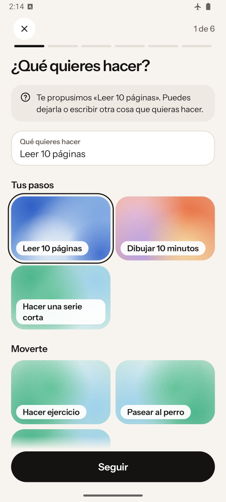
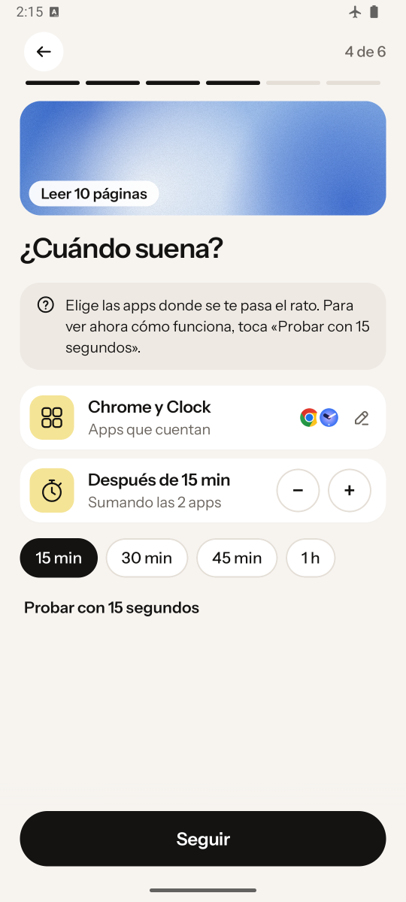
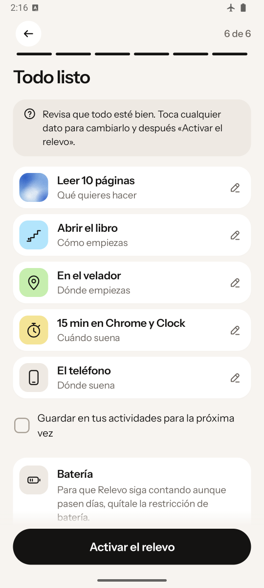
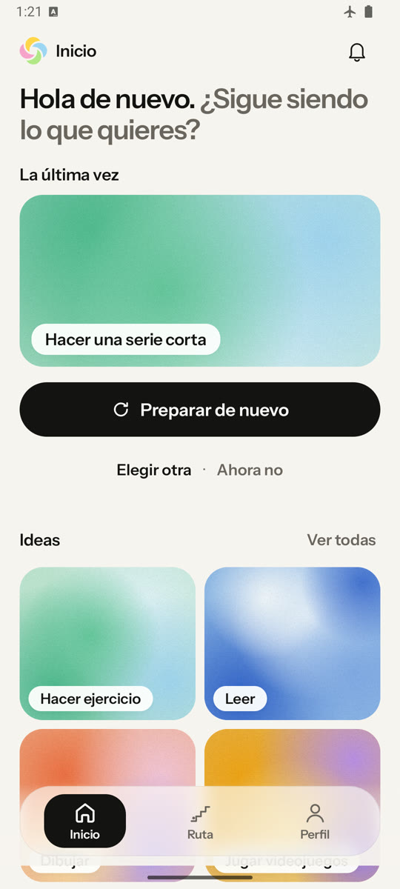
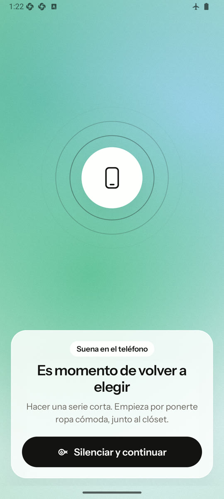
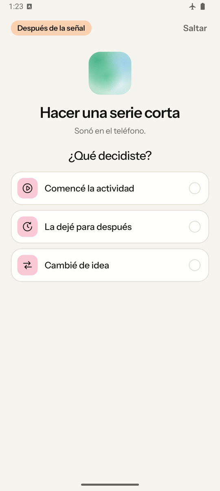

Universidad Diego Portales

Facultad de Arquitectura, Arte y Diseño

Escuela de Diseño

# Relevo

Sistema *phygital* para recuperar intenciones personales durante el ocio digital

Memoria para optar al título profesional de Diseñador, mención Diseño Gráfico

Johan Maximiliano Yantén Acevedo

Profesores guía: Sergio Majluf y Simón Gallardo

Modalidad: Taller de Titulación

Santiago, Chile, diciembre de 2026

# Agradecimientos

A mi familia, que hizo posible este proyecto.

A mi mamá, por estar siempre presente, por apoyarme y por darme todo lo que he necesitado para cumplir mis metas.

A mi abuela, por educarme y por enseñarme a soñar y a explorar.

A las dos, por permitir que la creatividad, el arte y la entretención fueran parte de mi vida diaria.

# Resumen

Algunas sesiones de ocio digital se prolongan sin una nueva decisión de continuar, y otra actividad también deseada deja de estar presente cuando aún es posible comenzarla. El proyecto buscó diseñar y evaluar formativamente un sistema *phygital* (físico y digital) que ayude a recuperar esa intención —volver a tenerla presente— sin bloquear el teléfono ni juzgar la decisión posterior. La investigación combinó una revisión bibliográfica, ocho entrevistas semiestructuradas analizadas con el método Framework, una encuesta de 53 respuestas y una comparación de herramientas. Los resultados indican que la duración no basta para valorar una sesión, que la mayoría de las herramientas revisadas actúa sobre el uso del teléfono y no sobre la actividad desplazada, y que no corresponde intervenir cuando el ocio digital conserva sentido. De ellos se derivaron ocho criterios de diseño y Relevo: una aplicación Android y un objeto que se deja junto al primer paso de lo que la persona quiere hacer —por ejemplo, junto al libro— y suena al cumplirse una condición definida por la persona. Para probar la relación entre señal y lugar antes de fabricar un objeto propio, el prototipo hace sonar un localizador Bluetooth comercial. Tres personas lo usan en su hogar desde el 7 de octubre de 2026; hasta el 19, el ciclo completo funcionó en los tres hogares: el localizador sonó en 23 de 24 ciclos y, en 19 de 21 respuestas, la persona supo qué quería hacer antes de leerlo en la pantalla; en las 21 recordó cómo empezar, y en 10 decidió empezar. Esta etapa validó el ciclo; la comparación con una notificación en el teléfono termina el 30 de octubre, y la comparación con un lugar neutro queda para una etapa siguiente. El proyecto aporta, además, un prototipo funcional y un procedimiento para comparar señales situadas con sus alternativas antes de fabricar un objeto.

*Palabras clave:* ocio digital, memoria prospectiva, diseño *phygital*

# Abstract

Some digital leisure sessions go on without a new decision to continue, and another activity, also desired, fades from view while it can still be started. The project sought to design and formatively evaluate a phygital (physical and digital) system that helps people retrieve that intention—bring it back to mind—without blocking the phone or judging the decision that follows. The research combined a literature review, eight semistructured interviews analyzed with the Framework method, a survey with 53 responses, and a comparison of tools. The results indicate that duration alone is not enough to assess a session, that most of the tools reviewed act on phone use, not on the displaced activity, and that no intervention is called for when digital leisure remains meaningful. Eight design criteria were derived from these results, along with Relevo: an Android application and an object left next to the first step of the chosen activity (for example, next to a book), which sounds once a condition defined by the person is met. To test the relationship between signal and place before building a custom object, the prototype sounds a commercial Bluetooth tracker. Three people have used it at home since October 7, 2026; up to October 19, the full cycle worked in all three homes: the tracker sounded in 23 of 24 cycles, and in 19 of 21 responses the person knew what they wanted to do before reading it on the screen; in all 21 they remembered how to start, and in 10 they chose to start. This stage validated the cycle; the comparison with a phone notification ends on October 30, and the comparison with a neutral place is left for a later stage. The project also contributes a working prototype and a procedure for comparing situated signals with their alternatives before building an object.

*Keywords:* digital leisure, prospective memory, phygital design

# Índice

- 1. Motivación personal
- 2. Introducción
- 3. Planteamiento del problema
- 4. Justificación
- 5. Antecedentes y estado de la cuestión
- 6. Marco teórico por ámbitos
- 7. Usuario, contexto y hallazgos de entrevistas
- 8. Estado del arte y referentes
- 9. Criterios de diseño
- 10. Formulación
- 11. Bajada proyectual: las decisiones de diseño
- 12. Factibilidad y límites
- 13. Plan de desarrollo y validación
- 14. Conclusiones
- Referencias
- Glosario
- Anexos

## Índice de tablas

- Tabla 1. Las decisiones de diseño de Relevo
- Tabla 2. Iteraciones del prototipo
- Tabla 3. Presupuesto del prototipo académico
- Tabla 4. Lo que mostró la prueba y cómo se itera

## Índice de figuras

- Figura 1. Una intención que vuelve tarde
- Figura 2. Dos caminos para que vuelva una intención
- Figura 3. La señal y el mensaje de un recordatorio
- Figura 4. La señal pasa del segundo plano al primero
- Figura 5. Lo que dicen y lo que hacen las personas
- Figura 6. La última vez que siguieron en el teléfono, según la encuesta
- Figura 7. Opiniones sobre la propuesta
- Figura 8. Dos situaciones de uso
- Figura 9. Qué hace cada herramienta y dónde
- Figura 10. Los ocho criterios de diseño, en tres grupos
- Figura 11. El proceso del proyecto, de marzo a octubre de 2026
- Figura 12. El recorrido del usuario, en cuatro momentos
- Figura 13. Flujo de la aplicación, de preparar a decidir
- Figura 14. Arquitectura de información de la aplicación
- Figura 15. La voz de Relevo
- Figura 16. Sistema de identidad de Relevo
- Figura 17. El Tag durante la prueba en el hogar
- Figura 18. Relevo: una carcasa propia con la placa del Tag adentro
- Figura 19. Las etapas del proyecto, del prototipo al producto
- Figura 20. La prueba en los hogares
- Figura 21. Lo que ocurrió en los 24 relevos que alcanzaron su límite
- Figura 22. Qué decidió cada persona después de la señal
- Figura 23. Recordar no basta para empezar

# 1. Motivación personal

Me ocurre con frecuencia abrir una aplicación para descansar unos minutos y quedarme en ella más tiempo del que imaginaba. Al cerrarla, descubro que otras cosas que también quería hacer —dibujar, leer, caminar o cocinar con calma— dejaron de estar presentes. No decidí abandonarlas; dejaron de participar en lo que hacía.

No pienso que todo uso del teléfono sea negativo. Muchas veces encuentro en él entretención, conversación, información o un descanso que valoro. Me inquieta la diferencia entre elegir seguir y darme cuenta, después, de que no volví a considerar lo demás.

Me interesa estudiar ese momento sin convertirlo en un juicio sobre disciplina o productividad: por qué una intención personal pierde presencia, qué condiciones lo favorecen y cómo el diseño podría ayudar a que vuelva a ser considerada. La pregunta nace de mi experiencia; lo que esta memoria afirma sobre otras personas proviene de la investigación. Parte de un límite claro: descansar, cambiar de actividad o seguir frente al teléfono pueden ser decisiones igualmente válidas.

# 2. Introducción

Los teléfonos inteligentes reúnen en un mismo dispositivo la comunicación, la información, el trabajo y el entretenimiento. Con ellos cambió la forma de organizar el tiempo y de descansar: una persona puede conversar, escuchar música, jugar, mirar una serie o recorrer una red social sin cambiar de soporte. Esa variedad impide tratar el uso del teléfono como una sola experiencia y vuelve insuficiente cualquier juicio basado solo en cuánto tiempo se usa.

Aquí se entiende por *ocio digital* el conjunto de actividades que una persona realiza a través de dispositivos en su tiempo disponible para descansar, entretenerse, satisfacer su curiosidad o vincularse con otros. No se opone a otras formas de ocio ni necesita justificarse por su utilidad. Una sesión larga puede ser satisfactoria; una breve puede sentirse inoportuna si desplaza algo que la persona consideraba importante. La diferencia depende del propósito, del contexto y de la valoración de quien la vive (Lukoff et al., 2018).

El problema aparece en un momento preciso. Al comenzar una sesión, la persona puede tener presente otra actividad que también quiere hacer: leer, dibujar, salir a caminar, ordenar su pieza o llamar a alguien. La sesión continúa y esa intención deja de orientar el paso siguiente; cuando vuelve a pensar en ella, la ocasión puede haber cambiado o queda menos tiempo. La situación tiene dos formas: en una, la otra actividad deja de estar presente y se recuerda tarde; en la otra, sigue presente y aun así no se inicia. El proyecto se dirige a la primera; queda abierto si también puede ayudar en la segunda.

Ese momento no ocurre en el vacío. Muchas aplicaciones están diseñadas para que la actividad continúe: el *desplazamiento infinito* carga contenido nuevo sin un final reconocible, y la reproducción automática inicia un contenido apenas termina otro. Estos patrones no determinan la conducta, pero reducen los *puntos de cierre*, los momentos en que algo termina y hay que elegir si seguir (Montag et al., 2019).

Las respuestas más difundidas actúan sobre la actividad presente. Las herramientas de bienestar digital miden el tiempo, fijan límites, bloquean aplicaciones o ponen una pausa antes de abrirlas (Lyngs et al., 2019). Sirven cuando alguien quiere reducir una conducta concreta, pero detener lo que se está haciendo no devuelve lo que se quería hacer: un bloqueo puede cerrar una aplicación y dejar igualmente ausente la otra intención, o cortar un descanso que la persona sí quería mantener.

La psicología ofrece un concepto para precisar la situación. La *memoria prospectiva* es la capacidad de recordar una acción que se quiere realizar cuando llega la ocasión de hacerla (McDaniel y Einstein, 2000). Recordar al final del día que se quería leer no equivale a recuperar esa intención cuando todavía era posible abrir el libro. Así planteado, el desafío no es frenar el uso del teléfono, sino lograr que una intención vuelva a tiempo, sin convertirse en una obligación.

Este proyecto aborda ese desafío desde el diseño. Busca que una persona vuelva a considerar, mientras la sesión continúa, una actividad que ella misma eligió, sin prohibir la actividad actual ni decidir por ella qué forma de descanso vale más. Para comprender la experiencia, la investigación combina una revisión bibliográfica, entrevistas, una encuesta y el análisis de herramientas y referentes. Para intervenir en ella, propone un sistema *phygital* —físico y digital— que vincula lo que la persona quiere hacer con el lugar donde eso comienza: la persona prepara en una aplicación su intención y su primer paso, y un objeto ubicado donde empieza esa actividad suena cuando se cumple una condición que ella define. La propuesta se prueba en el uso cotidiano, en el hogar, para observar si esa señal ayuda a recuperar la intención y si la decisión sigue siendo de quien la recibe.

# 3. Planteamiento del problema

En Chile, el teléfono es la puerta principal a internet: en 2025, el 96,6 % de los hogares encuestados declaró tener acceso propio y pagado, y entre los hogares conectados el teléfono inteligente fue el dispositivo más extendido, presente en el 99,1 % (Subsecretaría de Telecomunicaciones, 2025). Esas cifras describen un entorno conectado, pero no dicen si cada momento frente a la pantalla fue elegido. Este capítulo precisa cuándo ese uso se vuelve un problema y cuándo no.

## El problema

Una persona abre una aplicación para descansar unos minutos antes de dibujar, algo que quería hacer desde la tarde. Media hora después la cierra, y ya es tarde para empezar. No decidió abandonar el dibujo: mientras la sesión seguía, el dibujo no volvió a aparecer. Que lo recuerde después muestra que la intención no se perdió; lo que faltó fue que volviera a tiempo, cuando todavía podía orientar la decisión (Figura 1).

**Figura 1**

*Una intención que vuelve tarde*

[FIGURA POR INSERTAR: (columna) esquema de problema: Antes | Hay algo que la persona quiere hacer | Dibujar en la tarde; Durante | Abre una aplicación para descansar | La sesión sigue, El dibujo no vuelve a aparecer; Después | Media hora más tarde | Lo recuerda, Ya es tarde para empezar]

*Nota.* Elaboración propia a partir del ejemplo del texto.

El problema puede formularse así: **durante algunas sesiones de ocio digital, una actividad que la persona también quería realizar deja de estar presente y vuelve cuando la ocasión ya pasó.** No se trata de cuánto tiempo se usa el teléfono, sino de la relación entre la actividad presente y otra cosa que la persona también quería hacer.

## Por qué ocurre

**La atención está ocupada.** Recordar una acción futura exige que la intención vuelva por sí misma en el momento oportuno; cuando la actividad presente absorbe la atención, esa vuelta depende más de una señal del entorno que del esfuerzo de recordar (McDaniel y Einstein, 2000). En un estudio con 1315 personas adultas, que combinó cuestionarios breves durante el día con registros del uso del teléfono, cuanto más se prolongaba el desplazamiento sin propósito por contenidos, más culpa declaraban las personas, y el conflicto con otras metas explicaba parte de esa relación (de Segovia Vicente et al., 2024). El estudio es observacional y no distingue el olvido de la postergación, pero muestra que la relación con otras intenciones pesa en cómo se vive una sesión.

**La interfaz sostiene la continuidad.** Un capítulo, una canción o una página tienen un final reconocible; el desplazamiento infinito y la reproducción automática, en cambio, mantienen abierta la secuencia y ofrecen la acción siguiente con poco esfuerzo (Montag et al., 2019). La interfaz no actúa sola, pero organiza cuándo aparecen los cierres y las ocasiones de elegir.

**El ocio se juzga con la vara de la productividad.** Tonietto et al. (2021) observaron que considerar el ocio una pérdida de tiempo disminuye su disfrute, sobre todo cuando la actividad se realiza como un fin en sí misma. El estudio no trata del teléfono, pero advierte que una ayuda que presente el descanso como tiempo perdido puede dañar lo que pretende cuidar.

## El desafío de diseño

De ahí se desprende el desafío: **ayudar a que la persona recuerde a tiempo algo que quería hacer, sin bloquear lo que está haciendo, sin decidir por ella y sin intervenir cuando el ocio digital conserva sentido.** Recuperar una intención significa devolverla a la decisión, no convertirla en obligación.

# 4. Justificación

El tema es relevante porque el teléfono participa constantemente en la vida cotidiana y reúne actividades que no pueden evaluarse con una sola regla. Las mediciones de tiempo informan cuánto se usó, pero no si una sesión respondió al propósito de la persona ni si desplazó otra intención. Una respuesta más precisa debe reconocer tanto el derecho a cambiar de actividad como el de seguir en un descanso elegido.

Cuando las alternativas se reducen a bloquear, contabilizar o comparar, una herramienta de apoyo puede convertirse en una nueva fuente de presión. Fijar una intención no debería crear una deuda con el sistema: ignorar una señal, cambiar de idea o permanecer en la actividad digital son resultados legítimos. Este criterio traduce en decisiones de diseño la autonomía, una necesidad psicológica básica según la teoría de la autodeterminación (Ryan y Deci, 2000), y evita confundir ayuda con obediencia.

El problema involucra variables propias del diseño: continuidad, cierre, momento, canal, jerarquía, legibilidad, esfuerzo y control. La psicología aporta conceptos para entender el recuerdo de acciones futuras y el conflicto entre metas, y la ingeniería permite programar las condiciones y la comunicación entre dispositivos; al diseño le corresponde unir ambos conocimientos en una experiencia clara, situada y respetuosa de quien la usa.

El tema también corresponde al diseño porque permite repartir una interacción entre componentes físicos y digitales: una experiencia *phygital*, de *physical* y *digital* (Waggoner et al., 2026). La interacción tangible estudia cómo los objetos y el espacio físico participan en la relación con información digital (Ishii y Ullmer, 1997); un recordatorio ubicado en el entorno podría devolver una intención desde fuera de la pantalla que concentra la atención. El aporte se espera en dos planos: criterios para diseñar ayudas que acompañen una decisión sin presionarla, y un procedimiento para comparar, antes de fabricar un objeto propio, una señal situada donde comienza la actividad con la misma señal en otro lugar y con una notificación en el teléfono.

# 5. Antecedentes y estado de la cuestión

Antes de proponer una respuesta, conviene saber qué se ha estudiado. Esta revisión priorizó publicaciones recientes y las que definen los conceptos del proyecto.

## Uso del teléfono y sentido de la experiencia

Meier y Reinecke (2021) reunieron 34 revisiones sobre comunicación digital y salud mental: la asociación entre uso de redes sociales y salud mental fue, en general, negativa y pequeña, y varió según el aspecto del uso y el indicador estudiados. Radtke et al. (2022) revisaron intervenciones de desconexión digital y encontraron resultados positivos, nulos y negativos. Reducir el uso no es una solución válida para todos; importa la relación entre lo que la persona hace y lo que quería hacer (de Segovia Vicente et al., 2024).

## Bloqueos, límites y pausas

Lyngs et al. (2019) analizaron 367 aplicaciones y extensiones de navegador: tres de cada cuatro bloqueaban o quitaban distracciones y alrededor de un tercio ayudaba a avanzar hacia una meta, por ejemplo recordándola. En los 43 estudios de evaluación que revisaron Monge Roffarello y De Russis (2023), la mediana de duración fue de 21 días y solo cinco superaron los 2 meses; su metaanálisis de siete estudios estimó un efecto entre pequeño y mediano sobre el tiempo de uso (*g* = 0,47), medida que consideran demasiado gruesa para el bienestar.

Otra línea introduce una pausa. En un experimento de campo de 6 semanas con one sec, que demora la apertura de una aplicación y pide reconsiderarla, 280 personas desistieron en el 36 % de los intentos; en otro, en línea, la opción explícita de desistir tuvo el mayor efecto y el mensaje de reflexión, por sí solo, no fue eficaz (Grüning et al., 2023). Los registros de 1039 personas que ya usaban la aplicación sugieren que el efecto no persiste al suspender la intervención (Haliburton et al., 2024). El creador del producto figura entre los autores de ambos trabajos, lo que exige cautela. MindPhone, en cambio, preguntaba al desbloquear el teléfono para qué se iba a usar o qué se haría después fuera de él: en un estudio de campo de 2 semanas con 28 personas, la segunda pregunta redujo el uso distraído y favoreció volver antes al entorno, y la primera aumentó la conciencia de los motivos de uso (Terzimehić et al., 2022).

## Recordatorios, lugares y objetos

Confiar un recuerdo a un recurso externo tiene un costo: en dos experimentos, se fijaron menos recordatorios cuando hacerlo exigía más esfuerzo físico (Chiu y Gilbert, 2024). Place-Its asociaba notas a lugares en teléfonos móviles; en su estudio exploratorio, 19 de 89 recordatorios se fijaron de nuevo porque llegaron en el lugar equivocado o cuando no se podían atender (Sohn et al., 2005). En un centro comercial virtual, las claves de lugar favorecieron el recuerdo de tareas asociadas a cada tienda (O’Rear y Radvansky, 2019).

Otros trabajos llevaron el recordatorio a objetos. The Tangible Reminder representaba cada compromiso con un objeto cotidiano que cambiaba de color al acercarse el plazo (Hermann et al., 2007); servía a citas o tomas de medicamentos, no a intenciones que la persona puede decidir no realizar. Wobble sirvió para investigar, en el hogar, recordatorios periféricos, que no reclaman la atención, y, según sus autores, conviene a intenciones que no exigen actuar de inmediato (Zekveld et al., 2017). Keppel et al. (2025) compararon durante 9 semanas, con 24 personas, un artefacto físico y uno digital que mostraban en el hogar datos de actividad física: ambos sirvieron de recordatorio y el físico generó más involucramiento. Ninguno de estos trabajos trata el ocio digital.

## Alcance de los antecedentes

Las métricas describen el uso, los bloqueos modifican el acceso, las pausas abren una reconsideración y los recordatorios apoyan el recuerdo; ninguna línea muestra bajo qué condiciones lo que la persona quería hacer vuelve a orientar su decisión mientras la sesión continúa.

# 6. Marco teórico por ámbitos

Los antecedentes dicen qué se ha intentado, pero no por qué una intención deja de orientar lo que se hace. Tres ámbitos ayudan a entenderlo: la experiencia del ocio digital, las interfaces que sostienen su continuidad y los objetos y lugares que apoyan el recuerdo. Juntos indican qué condiciones debería respetar una ayuda.

## La experiencia del ocio digital

El sentido de una sesión se asocia con el motivo y el tipo de uso (Lukoff et al., 2018), por eso conviene mirar cada vez concreta en que alguien usa el teléfono —cuándo empezó, qué hacía, para qué y qué más quería hacer— y no el total de horas.

El *conflicto entre metas* aparece cuando una actividad dificulta otra también valorada, sin establecer cuál debería prevalecer; vincula el malestar con la distancia respecto de otras intenciones (de Segovia Vicente et al., 2024).

Una elección inicial deliberada no implica que cada momento posterior responda a una nueva decisión. Se llama *decisión renovada* al momento en que la persona vuelve a considerar si desea continuar, cambiar o detenerse; puede surgir ante el final de un contenido, una pausa o una señal del entorno.

## El diseño de la atención

Patrones de interfaz como el desplazamiento infinito o la reproducción automática (Montag et al., 2019) forman lo que aquí se llama *arquitectura de atención*: un conjunto de decisiones de interfaz que orienta lo que se percibe y cómo avanza la interacción. Seguir con un gesto mínimo exige menos preparación que levantarse, reunir materiales o cambiar de espacio. La *fricción*, un esfuerzo adicional como esperar o confirmar, puede abrir una ocasión de reconsiderar (Grüning et al., 2023), pero si es excesiva frustra actividades legítimas.

La *autonomía* se entiende en el sentido de la teoría de la autodeterminación (Ryan y Deci, 2000): en términos de diseño, depende de comprender la intervención y poder aceptarla, ajustarla o rechazarla. Una ayuda difícil de detener puede presionar aunque no bloquee el teléfono.

Las *intenciones de implementación* son planes que especifican de antemano cuándo, dónde y cómo actuar: si se presenta cierta situación, se inicia una respuesta (Gollwitzer y Sheeran, 2006).

## Recordar con objetos y lugares

La memoria prospectiva se distingue del recuerdo de acontecimientos pasados porque nadie pide explícitamente recordar: la intención debe volver por sí misma cuando todavía es posible actuar (McDaniel y Einstein, 2000).

El *marco multiproceso* explica cómo vuelve una intención: la persona puede vigilar el entorno esperando el momento indicado, o un evento puede traerla de vuelta de forma espontánea (McDaniel y Einstein, 2000; Figura 2). Cuando la actividad en curso absorbe la atención, como en una sesión de ocio digital, lo segundo es más probable si la señal es llamativa y está fuertemente asociada a la acción. Los recordatorios más eficaces aludían a la vez a la ocasión y la acción prevista, y los que solo anunciaban la ocasión no mejoraban el recuerdo (Guynn et al., 1998). Los estudios sobre el lugar evalúan intenciones que se recuperan al estar en el sitio, no un sonido que llega desde él (O’Rear y Radvansky, 2019). De ahí una hipótesis: una señal que proviene del lugar donde comienza la actividad podría indicar, sin texto, qué hacer y con qué empezar.

**Figura 2**

*Dos caminos para que vuelva una intención*

[FIGURA POR INSERTAR: (columna) esquema de caminos: Vigilar | La persona revisa si llegó el momento | Exige atención constante, Falla si otra actividad la absorbe; Recuperar ante una señal | Algo del entorno trae de vuelta la intención | Funciona aunque la atención esté en otra parte, Es el camino que busca Relevo]

*Nota.* Elaboración propia a partir de McDaniel y Einstein (2000).

Una nota, un libro dispuesto sobre la mesa o una alarma son formas de *descarga cognitiva*, la acción física que reduce la demanda cognitiva de una tarea (Risko y Gilbert, 2016). Todo recordatorio reúne una señal, que avisa que hay algo que recordar, y un mensaje, que dice qué es (Norman, 1988/1990, p. 73; Figura 3); la señal no necesita contener el mensaje si su relación con la intención se comprende, y si es ambigua obliga a consultar otra fuente.

**Figura 3**

*La señal y el mensaje de un recordatorio*

[FIGURA POR INSERTAR: (columna) esquema de recordatorio: Señal | Avisa que hay algo que recordar | En Relevo, el sonido del objeto; Mensaje | Dice qué es | En Relevo, el lugar donde suena y el primer paso que está ahí]

*Nota.* Elaboración propia a partir de Norman (1988/1990, p. 73).

Kirsh (1995) explica que la disposición de los objetos puede simplificar la elección, la percepción y el cálculo mental, como un rollo de película dejado junto a la puerta para recordar que se quería revelarlo.

**Figura 4**

*La señal pasa del segundo plano al primero*

[FIGURA POR INSERTAR: (columna) pasos de atención: Antes de la señal | La pantalla | El objeto, junto al primer paso; Suena el objeto | El sonido y la actividad que recuerda | La pantalla; Termina la señal | Lo que la persona decida | El objeto, otra vez en silencio]

*Nota.* Elaboración propia a partir de Weiser y Brown (1997).

La *interacción tangible* da forma física a la información digital. Ishii y Ullmer (1997) propusieron acoplarla con objetos y superficies cotidianos y distinguieron dos planos: objetos que se usan en primer plano y medios del ambiente —luz, sonido, corrientes de aire— que informan en segundo plano (Figura 4). Para el problema importan el segundo plano y el espacio: un objeto puede significar por el lugar donde se deja más que por su manipulación.

La *tecnología calma* describe el ideal de esas señales: informar en segundo plano y pasar al primero solo cuando hace falta, para luego volver (Weiser y Brown, 1997; Figura 4). Una señal sonora dirigida a alguien absorto en una pantalla tensiona ese ideal, porque debe pasar al primer plano: el sonido se percibe aunque la atención esté en otra parte, y por eso mismo es intrusivo (Norman, 1988/1990, p. 103).

Los tres ámbitos dejan una idea de diseño: una ayuda podría devolver a tiempo lo que la persona quería hacer si llega desde fuera de la pantalla, desde el lugar donde la actividad comienza, y si deja la decisión en sus manos. A un sistema así, que reparte su trabajo entre lo físico y lo digital, se le llama *phygital* (Waggoner et al., 2026).

# 7. Usuario, contexto y hallazgos de entrevistas

## A quién se dirige

La teoría explica el fenómeno en general; faltaba saber cómo lo viven las personas. Relevo se dirige a personas de 19 a 30 años que usan el teléfono para descansar y que, en ciertos momentos, quieren hacer otra cosa —leer, dibujar, tocar un instrumento, ordenar su pieza— y no la empiezan. Es el rango de edad de quienes participaron en las entrevistas y la encuesta, y un rango acotado permite comparar experiencias parecidas, sin mezclar etapas de la vida muy distintas; más adelante podría ampliarse. La primera versión pide además un teléfono Android y un lugar de la casa donde dejar el objeto, junto al primer paso de la actividad.

## Dos fuentes primarias

El usuario y su contexto se estudiaron con dos fuentes propias: ocho entrevistas semiestructuradas y una encuesta en línea. Las entrevistas definieron a quién se dirige el proyecto y cuándo no debe intervenir; la encuesta, posterior, contrastó esos criterios con más personas.

Las entrevistas se hicieron en Santiago, en persona, en junio de 2026, cuando el proyecto trabajaba sobre una idea anterior: un objeto donde dejar el teléfono y que luego mostraría una señal del descanso realizado. Por eso la pauta no preguntó directamente por otra actividad que la persona quisiera hacer; esa categoría surgió en el análisis. Participaron ocho personas de 19 a 27 años, y la pauta, de 13 preguntas, recorrió el tiempo libre, la última sesión de entretenimiento en el teléfono, la valoración del ocio, los intentos de descansar sin el teléfono y la reacción ante la idea anterior. La pauta y la síntesis de cada entrevista están en el Anexo A.

Las conversaciones se transcribieron y resumieron [CONFIRMAR: si hubo grabación de audio y con qué se transcribió], y se analizaron con el método Framework, que ordena lo dicho en una matriz de personas y temas para compararlas entre sí (Goldsmith, 2021). De esa comparación surgieron *tipos ideales*: agrupaciones de situaciones parecidas que no pretenden calzar exactamente con nadie (Stapley et al., 2022). Sanders y Stappers (2012, p. 69), en su guía de investigación generativa, advierten que lo que las personas dicen puede diferir de lo que hacen; por eso, más adelante, la prueba en los hogares observa también lo que hacen (Figura 5).

**Figura 5**

*Lo que dicen y lo que hacen las personas*

[FIGURA POR INSERTAR: (columna) esquema de fuentes: Lo que dicen | Entrevistas y encuesta | Motivos, valoraciones y recuerdos; Lo que hacen | Registros de la prueba en los hogares | Cuándo sonó la señal, qué respondieron y qué decidieron]

*Nota.* Elaboración propia a partir de Sanders y Stappers (2012, p. 69).

La encuesta tuvo 16 preguntas y 53 respuestas de personas de 19 a 30 años [CONFIRMAR: fecha, convocatoria y relación con la encuesta de 70 participantes registrada el 2 de septiembre]. Llegó cuando la propuesta ya existía, así que sirvió para contrastarla con más personas: preguntó por la última vez que alguien siguió en una aplicación más tiempo del que quería, qué otra cosa quería hacer y cómo la habría empezado, y luego pidió su opinión sobre la propuesta. Las respuestas abiertas se clasificaron con apoyo de inteligencia artificial, y el autor revisa esa clasificación [CONFIRMAR: fecha de revisión y códigos corregidos]; las preguntas y los recuentos están en el Anexo B. Las Figuras 6 y 7 resumen sus resultados.

**Figura 6**

*La última vez que siguieron en el teléfono, según la encuesta*

[FIGURA POR INSERTAR: cuatro datos en tarjetas: 39 de 45, personas que siguieron en una aplicación más tiempo del que querían al menos un día de la última semana; 43 de 47, querían hacer otra cosa en ese tiempo; 42 de 43, sabían cuál habría sido su primer paso; 44 de 47, estaban en casa]

*Nota.* Encuesta en línea del autor (53 respuestas). Cada total corresponde a quienes respondieron esa pregunta.

**Figura 7**

*Opiniones sobre la propuesta*

[FIGURA POR INSERTAR: gráfico de barras: Dónde pondría el parlante | Junto a la actividad: 36, En un lugar general de la casa: 7, No lo usaría o no sabe dónde: 10; Duración preferida del sonido | 1 a 5 segundos: 16, 6 a 15 segundos: 25, 16 a 30 segundos: 3, Que no sonara: 7, No sabe: 2; Probabilidad de probarlo, de 1 a 5 | 5: 3, 4: 20, 3: 18, 2: 8, 1: 3, No sabe: 1]

*Nota.* Encuesta en línea del autor (53 respuestas). Número de personas por respuesta.

## Lo que contaron las personas

Una persona abrió Instagram al acostarse, reconoció que tenía sueño y aun así siguió; recordaba bien la sesión, pero dudó de que hubiera sido un descanso. Otra vio videos humorísticos, perdió la noción del tiempo y reconoció que tenía cosas mejores que hacer, aunque la sesión le sirvió como pausa: una actividad puede descansar y, a la vez, competir con otra intención. Una tercera describió entretenimiento seguido de aburrimiento, sin una meta concreta: no toda insatisfacción esconde una intención que recuperar. Y dos distinguieron usos dirigidos —leer manga, resolver un sudoku— de otros rutinarios: el problema no pertenece a una persona, sino a ciertos momentos.

Otras experiencias conservaron sentido: una videollamada de varias horas con una amiga, valorada por el vínculo; un pódcast elegido mientras se come, o una rutina difícil de describir que se acepta como descanso. Ni la duración ni el tipo de aplicación bastan para decidir cuándo intervenir: una señal activada solo por el tiempo de uso podría interrumpir una conversación o una pausa elegida.

Para descansar sin el teléfono, siete de las ocho personas lo alejan, lo guardan, lo silencian o activan el modo No molestar, casi siempre para proteger otra actividad, y tres contaron que, si queda cerca, vuelven a mirarlo. La distancia y el silencio quitan el teléfono de en medio, pero no hacen presente la otra actividad. Ante la idea anterior, seis pidieron señales simples, calmadas, discretas o visuales, y una rechazó las calificaciones y comparaciones entre días. Ninguna pidió una señal sonora, y a una le molesta el sonido del teléfono cercano cuando lee o arma maquetas.

La encuesta mostró que el momento estudiado es frecuente y ocurre en casa (Figura 6). De las 43 personas que, la última vez, querían hacer otra cosa, 21 no la empezaron, 14 la empezaron —a veces mucho más tarde— y 8 cambiaron de idea, no podían empezarla o no lo recordaban. Casi todas sabían cuál habría sido su *primer paso*, la acción breve con que la actividad comienza, como abrir el libro o ponerse las zapatillas.

Después de leer la propuesta, 49 de 53 personas explicaron bien cómo funcionaba. La mayoría pondría el parlante junto a la actividad y preferiría un sonido de 15 segundos o menos. La disposición a probarla quedó repartida: 23 personas probablemente la probarían, 18 no estaban seguras y 11 probablemente no (Figura 7). Los motivos más citados para no probarla fueron que sonara en un mal momento (8), el esfuerzo de prepararla (7) y el ruido que podía causar (7).

## Dos situaciones de uso

Los hallazgos permiten distinguir dos situaciones (Figura 8), que por convención se nombran como usuarios. No son identidades ni segmentos: una misma persona puede pasar de una a otra. El *usuario principal* está en la primera: la sesión continúa sin una nueva decisión, y otra cosa que la persona quería hacer deja de orientar el paso siguiente. La situación tiene las dos formas descritas en el capítulo 2: la actividad que se recuerda tarde y la que sigue presente y no se inicia. Las entrevistas respaldan sobre todo la segunda —una persona sabía que tenía sueño y siguió— y en parte la primera; la encuesta respalda sobre todo el caso al que apunta la propuesta: una actividad que la persona quiere hacer y sabe cómo empezar, pero no empieza. Su necesidad es volver a considerar a tiempo una alternativa propia.

**Figura 8**

*Dos situaciones de uso*

[FIGURA POR INSERTAR: (columna) esquema de situaciones: Usuario principal | La sesión sigue sin una nueva decisión | Quiere hacer otra cosa y sabe cómo empezar, Necesita recordarla a tiempo; Usuario límite | El ocio digital tiene sentido | Una videollamada o un pódcast elegido, Necesita poder no activar o ignorar la señal]

*Nota.* Elaboración propia a partir de las entrevistas y la encuesta.

El *usuario límite* está en la segunda: la actividad digital es elegida, compartida, concentrada o reparadora, o no hay otra intención que apoyar. La videollamada y el pódcast son los ejemplos más claros, y tres personas mostraron que la posición cambia en una misma persona. Su necesidad es conservar la autonomía: una intervención equivocada podría convertir una actividad valiosa en un problema o exponer una intención privada. Para él, poder no activar, ignorar o detener la señal importa tanto como recibirla.

El hogar se eligió porque varias de las intenciones y estrategias relatadas dependen de objetos, superficies y distancias de la casa.

## Necesidades de diseño

De ambas situaciones se desprenden necesidades comunes: una intención explícita, una preparación voluntaria, la posibilidad de cambiar de idea, una señal discreta, una salida inmediata y la ausencia de sanciones. Las entrevistas y la encuesta no definen la forma de la solución: precisan el momento que debe abordarse y cuándo intervenir sería un error. Dejan, además, dos tensiones que el diseño debe resolver: las personas prefieren señales visuales y breves, y temen que la señal suene en un mal momento.

# 8. Estado del arte y referentes

## Método y criterios de comparación

Con esas necesidades a la vista, se compararon productos, servicios y proyectos que abordan el uso del teléfono, con seis preguntas: qué problema abordan, qué mecanismo usan, dónde ocurre la interacción principal, qué exigen configurar y mantener, cómo cuidan la autonomía y qué evidencia hay sobre sus resultados.

## Herramientas digitales de medición y pausa

Apple Screen Time y Google Digital Wellbeing miden el uso y fijan límites de tiempo (Apple, s. f.; Google, s. f.). Las aplicaciones de pausa llevan la reconsideración al momento de la apertura: one sec la interrumpe con un ejercicio breve (one sec, s. f.), y su evidencia no informa qué hace la persona después de desistir (Grüning et al., 2023; Haliburton et al., 2024). Pause Point impone una espera de 10 segundos al abrir una aplicación distractora (Sanders, 2026). Junto con MindPhone (Terzimehić et al., 2022), todas intervienen en la pantalla, no en el lugar donde la actividad puede comenzar.

## Proyectos de título de diseño en Chile

Dos memorias de diseño de la Universidad de Chile pusieron a prueba la gamificación en aplicaciones de bienestar. Riveros Oltra (2023) probó durante ocho semanas una función de hábitos con misiones, rachas y recompensas para Betterfly: los usuarios activos semanales aumentaron un 6,4 %, frente a una meta del 20 %. Venegas Álvarez (2026) evitó puntos y niveles en un diario de gratitud, y tras un mes con 36 personas no pudo demostrar que resolviera la baja adherencia. Ambas buscan que la persona vuelva a la aplicación, y Relevo, que la deje; el caso de Betterfly es coherente con la exclusión de rachas y premios (criterio 4).

## Objetos que restringen o alejan el teléfono

Brick vincula una aplicación con un dispositivo físico que activa o revierte modos de bloqueo (Brick LLC, s. f.-a). Combina distancia y *precompromiso*: una decisión previa que restringe deliberadamente las opciones futuras. Brick Zone bloquea las aplicaciones donde se deja, sin alcance ni precisión documentados (Brick LLC, s. f.-b): el lugar es allí una condición de restricción, no un recordatorio. Unpluq (s. f.) y Screenless Breaker (Screenless, s. f.) usan etiquetas o llaves NFC (comunicación de campo cercano). En todos, el objeto hace visible el compromiso, pero suma costos de compra, compatibilidad y aprendizaje. kSafe, un contenedor con cierre temporizado, restringe sin conexión con el teléfono, pero es difícil de revertir antes del plazo (Kitchen Safe, s. f.); alejar o silenciar el teléfono, como relataron las entrevistas, es más reversible y no tiene costo.

## Objetos de foco y recordatorios situados

Focusaur combina un dispositivo físico con una aplicación, etiquetas NFC, sonidos, funciones de hábito y recompensas, (Focusaur, s. f.). Participa de un ritual de inicio, pero sus recompensas pueden llevar a actuar para cumplir con el sistema y se orienta a la productividad. The Tangible Reminder y Wobble (capítulo 5) recuerdan una acción sin depender del teléfono; Place-Its la entregaba en la pantalla, y una ubicación detectada no equivale a una relación personal con el espacio.

Una última familia resuelve el soporte, no el uso del teléfono: los localizadores Bluetooth y llaveros antipérdida, objetos pequeños que suenan cuando la persona los busca desde el teléfono [CONFIRMAR: fuente citable del localizador usado y de un referente de la familia]. El prototipo de Relevo emplea uno. Muestran que una señal sonora cabe en un objeto pequeño y autónomo.

## Evidencia y límites de cada familia

La evidencia es desigual: los estudios sobre herramientas digitales suelen ser breves y medir el tiempo de uso (capítulo 5), y sobre los objetos comerciales no se localizó ninguna evaluación independiente. Además, 63 de 138 personas que habían desactivado los avisos de una herramienta de autocontrol digital aceptaron reconfigurarlos (Peña-Albert et al., 2026): una regla puede dejar de servir. La Figura 9 ubica a cada familia según lo que hace y dónde lo hace.

**Figura 9**

*Qué hace cada herramienta y dónde*

[FIGURA POR INSERTAR: mapa de posicionamiento: Limita el uso del teléfono | Recuerda lo que querías hacer | En la pantalla | Fuera de la pantalla; Screen Time y Bienestar digital | 1.2 | 1.5; one sec y Pause Point | 2.2 | 3.1; MindPhone | 5.6 | 2.3; Place-Its | 7.7 | 3.5; Brick y Unpluq | 1.3 | 7.4; kSafe y dejar el teléfono lejos | 2.4 | 8.8; Focusaur | 4.6 | 6.4; The Tangible Reminder | 7.7 | 7.9; Relevo | 8.9 | 9.4]

*Nota.* Elaboración propia. Ubicación aproximada, según la documentación de cada producto y los estudios citados; no mide eficacia. Las fichas de cada referente están en el Anexo C.

## Oportunidad

Cada elemento de Relevo tiene antecedentes parciales, y una búsqueda de patentes halló cuatro documentos con coincidencias parciales: ni el aparato ni la relación entre recordatorios, objetos y lugares pueden presentarse como nuevos. Lo que no se encontró es un producto o prototipo que reúna cinco elementos —una intención formulada por la persona, un primer paso concreto, una condición digital comprensible, una señal emitida desde donde comienza la actividad y una decisión que queda abierta—, ni un estudio que compare esa señal con una notificación en el teléfono.

La oportunidad es, por eso, una pregunta de diseño: si una intención devuelta por una señal desde el lugar donde comienza se recupera mejor que con una notificación, sin dificultar el acceso al teléfono.

# 9. Criterios de diseño

De lo investigado salen ocho criterios de diseño: reglas que guiaron cada decisión de Relevo y que después sirven para evaluarlo. Kolko (2011, p. 40) llama síntesis a este paso, en que lo aprendido se convierte en una oportunidad concreta de diseño. Los criterios se agrupan en tres ideas (Figura 10): partir de la persona, dejarle las decisiones y que el sistema valga el esfuerzo.

**Figura 10**

*Los ocho criterios de diseño, en tres grupos*

[FIGURA POR INSERTAR: (columna) esquema de criterios: Partir de la persona | Criterios 1 y 2 | La persona elige qué quiere hacer, Cada actividad empieza con un paso concreto; Dejarle las decisiones | Criterios 3 a 5 | La persona decide cuándo suena, La persona decide qué hacer cuando suena, Relevo interviene solo cuando hace falta; Que valga el esfuerzo | Criterios 6 a 8 | Prepararlo toma poco esfuerzo, Lo que la persona escribe es privado, El objeto suma algo que el teléfono no da]

*Nota.* Elaboración propia a partir de la revisión bibliográfica, las entrevistas, la encuesta y la comparación de herramientas.

## Partir de la persona

**Criterio 1. La persona elige qué quiere hacer.** Relevo parte de una actividad que la persona anota —leer, dibujar, tocar guitarra—, no de algo que el sistema deduzca de su uso del teléfono. *Por qué:* el mismo rato en una aplicación puede ser descanso o pérdida según el motivo y el tipo de uso (Lukoff et al., 2018), y el tiempo de pantalla, por sí solo, no basta para saber cómo está alguien (Meier y Reinecke, 2021). En las entrevistas, dos personas dudaron de que su sesión hubiera sido un descanso, mientras otras tres la valoraron. Solo quien usa el teléfono sabe si había otra cosa que quería hacer.

**Criterio 2. Cada actividad empieza con un paso concreto.** Junto a la actividad, la persona anota cómo empieza: una acción breve que puede hacer enseguida, como abrir el libro o sacar la guitarra. *Por qué:* decidir de antemano cuándo, dónde y cómo actuar ayuda a pasar de la intención a la acción (Gollwitzer y Sheeran, 2006). Relevo toma de esa idea el cómo y el dónde se empieza, y deja el compromiso en manos de la persona. En la encuesta, 42 de las 43 personas que tenían otra cosa que querían hacer supieron decir cómo la habrían empezado.

## Dejarle las decisiones

**Criterio 3. La persona decide cuándo suena.** Relevo suena cuando las aplicaciones que la persona eligió suman el tiempo que ella misma fijó: una regla que se entiende y se cambia con un toque. *Por qué:* el teléfono puede medir cuánto se usa cada aplicación (Google, 2026b), pero no sabe para qué se usa; en la encuesta, 18 de 53 personas valoraron el teléfono para aprender o resolver algo. Por eso la condición la pone la persona, no el sistema.

**Criterio 4. La persona decide qué hacer cuando suena.** Puede empezar su actividad, dejarla para después o cambiar de idea, y las tres respuestas valen lo mismo. *Por qué:* ofrecer una opción real ayuda más que insistir; en un estudio con la aplicación one sec, la opción explícita de no seguir tuvo más efecto que el mensaje de reflexión (Grüning et al., 2023). Por eso las respuestas tampoco se califican: una racha puede volverse una meta en sí misma y desanimar cuando se rompe (Silverman y Barasch, 2023).

**Criterio 5. Relevo interviene solo cuando hace falta.** Suena solo cuando la persona preparó un relevo, es decir, cuando hay algo que ella quiere recordar. *Por qué:* muchas veces el teléfono es justo lo que la persona quiere —una videollamada larga con una amiga o un pódcast elegido para la hora de comer, contaron dos personas—, y tratar ese tiempo como perdido le quita disfrute (Tonietto et al., 2021). Una ayuda que interrumpe lo que vale la pena se vuelve una molestia.

## Que valga el esfuerzo

**Criterio 6. Prepararlo toma poco esfuerzo.** Un relevo se prepara con pocas preguntas y respuestas de un toque. *Por qué:* cuanto más esfuerzo exige fijar un recordatorio, menos se usa (Chiu y Gilbert, 2024), y en la encuesta el esfuerzo de prepararlo fue uno de los motivos más citados para no probar la propuesta (7 de 53 personas). Si preparar cuesta más de lo que ayuda, el diseño debe simplificarse.

**Criterio 7. Lo que la persona escribe es privado.** La actividad que alguien quiere hacer es personal: Relevo la guarda con un código en lugar del nombre, la notificación de la pantalla bloqueada no la muestra y la persona puede borrar sus datos cuando quiera. *Por qué:* en la encuesta, 12 de 53 personas aceptarían solo un registro guardado en su teléfono, o ninguno.

**Criterio 8. El objeto suma algo que el teléfono no da.** Un objeto cuesta dinero y cuidado, así que debe aportar algo propio: sonar desde el lugar donde la actividad empieza. *Por qué:* el lugar puede ayudar a recordar una acción futura (O’Rear y Radvansky, 2019), y la prueba compara ese aporte con una notificación en el teléfono.

# 10. Formulación

## Problema de diseño y pregunta de investigación

El estado del arte mostró que medir, pausar o restringir el uso del teléfono no devuelve lo que la persona quería hacer ni le indica por dónde empezar. El problema de diseño, entonces, es ayudar a que una intención propia vuelva a tiempo, con el teléfono libre y la decisión en manos de la persona. Relevo se dirige a quien ya eligió una actividad, sabe cómo empezarla y quiere tenerla presente mientras descansa con el teléfono. De ahí nace la pregunta que guía el proyecto:

> ¿Qué condiciones pueden ayudar a que una persona vuelva a considerar algo que quería hacer cuando, durante una sesión de ocio digital, esa intención deja de orientar su decisión inmediata?

La pregunta tiene dos partes. La primera —qué debe cumplir una ayuda así— la responden la investigación y los criterios del capítulo 9. La segunda —si sonar desde el lugar donde empieza la actividad aporta algo frente a una notificación en el teléfono— la abordan la hipótesis y la prueba en los hogares. Volver a considerar una actividad significa recordar qué se quería hacer y cómo empezarla; se puede evaluar sin exigir que la persona deje el teléfono.

## Definición y alcance de Relevo

Relevo es un sistema *phygital*: una aplicación Android y un objeto que se deja junto al primer paso de una actividad. En la aplicación, la persona anota qué quiere hacer, cómo empieza y cuánto tiempo quiere darse en ciertas aplicaciones; cuando ese tiempo se cumple, el objeto suena unos 30 segundos desde ese lugar, y ella decide qué hacer. Para probar la señal y el lugar antes de fabricar el objeto propio, el prototipo usa un llavero Bluetooth comercial, el Tag. El alcance es doméstico y personal: una persona, una actividad a la vez, las aplicaciones que ella elige y un lugar de su casa. El capítulo 11 explica por qué se tomó cada una de estas decisiones.

## Hipótesis y objetivos

> Si se diseña un sistema *phygital* que vincula una actividad que la persona quiere hacer con el lugar donde comienza, entonces la persona la recordará a tiempo durante el ocio digital, porque una intención se recupera cuando aparece una señal asociada a ella.

La hipótesis se apoya en la memoria prospectiva: cuando una actividad absorbe la atención, una intención vuelve con más facilidad si aparece una señal llamativa y fuertemente asociada a la acción (McDaniel y Einstein, 2000), y el lugar donde debe hacerse una acción puede ofrecer esa asociación (Kirsh, 1995; O’Rear y Radvansky, 2019). Se descompone en tres supuestos:

1. Asociación: al oír la señal, la persona sabe que es Relevo y recuerda su actividad y cómo empezar, sin mirar el teléfono.
2. Lugar: el objeto junto al primer paso ayuda a recordar más que el mismo objeto en un lugar sin relación con la actividad.
3. Soporte: el objeto ayuda al menos tanto como una notificación en el teléfono, sin más molestia.

«A tiempo» significa que, cuando suena, la persona sabe qué quería hacer y cómo empezar antes de leerlo en la pantalla. Esta etapa examina el primer supuesto y el tercero; el segundo queda para una etapa con más personas.

El objetivo general es diseñar y evaluar Relevo, un sistema que ayude a una persona a recordar a tiempo algo que quería hacer mientras descansa con el teléfono, con una señal que suena junto al primer paso de esa actividad y que deja la decisión en sus manos. La evaluación es formativa: busca encontrar problemas y mejorar el diseño en cada vuelta (Nielsen, 1993, p. 170). Los objetivos específicos son:

1. Entender cuándo el uso del teléfono desplaza algo que la persona quería hacer, a partir de estudios, entrevistas, una encuesta y herramientas existentes.
2. Diseñar una aplicación y un objeto que lleven esa intención al lugar donde la actividad empieza.
3. Comparar el sonido del objeto junto al primer paso con una notificación en el teléfono.
4. Probar en hogares si las personas entienden la señal, si les resulta cómoda y si el sistema funciona sin fallos.

## Enfoque metodológico y plan de trabajo

El proyecto sigue un enfoque de investigación a través del diseño: diseñar el objeto y la aplicación es, en sí mismo, una forma de investigar, y su resultado es un aporte (Zimmerman et al., 2007). Es exploratorio y principalmente cualitativo, con recuentos simples. Avanzó en seis fases —investigación, análisis, formulación y diseño, prototipo, prueba en los hogares y cierre—, y la Figura 11 muestra el camino: un proceso con cambios de rumbo, en que cada decisión respondió a lo que se iba aprendiendo. El cierre incluye el Pase de Examen, el 25 de noviembre; la entrega de la memoria, el 2 de diciembre, y el examen, entre el 14 y el 18 de diciembre.

**Figura 11**

*El proceso del proyecto, de marzo a octubre de 2026*

[FIGURA POR INSERTAR: cronología del proyecto: Marzo a junio | Seminario de Título: de un objeto para dejar el teléfono a Relevo; 11 y 12 de junio | Ocho entrevistas en Santiago; 20 de julio | Examen: la comisión pide aclarar el objeto, el contexto y el usuario; 23 al 30 de agosto | Análisis de las entrevistas y criterios de diseño; Septiembre | Se define una señal sonora y se decide probar un localizador; 21 al 25 de septiembre | Primera aplicación Android; 29 de septiembre | Hipótesis y encuesta de 53 respuestas; 5 al 7 de octubre | El Tag pasa a ser el objeto del prototipo; 7 de octubre | Comienza la prueba en tres hogares; 9 al 20 de octubre | Cuatro cambios corrigen lo que mostró el uso; 28 de octubre | Modelo de Relevo para impresión 3D]

*Nota.* Elaboración propia a partir del registro de decisiones del proyecto.

### Uso de inteligencia artificial

El proyecto usó herramientas de inteligencia artificial generativa —Codex, de OpenAI, desde marzo de 2026, y Claude Code, de Anthropic, desde fines de septiembre— para programar la aplicación y su base de datos, generar alternativas visuales, redactar y revisar borradores de esta memoria, buscar y verificar fuentes y analizar la encuesta [CONFIRMAR: la herramienta con que se transcribieron las entrevistas]. El autor realizó las entrevistas, definió el problema y los criterios, aprobó, corrigió o rechazó cada propuesta y responde por el contenido. Desde el 29 de septiembre, cada pedido y su decisión se anotaron el mismo día (Anexo E).

# 11. Bajada proyectual: las decisiones de diseño

Con el problema y los criterios claros, comenzó el diseño. La meta era que Relevo se sintiera liviano: que prepararlo tomara poco, que acompañara sin pedir atención y que, al sonar, devolviera algo que la persona misma había elegido. Cada decisión de este capítulo responde a esa idea, y todas son del autor. La Tabla 1 las resume, de lo general a lo particular.

**Tabla 1**

*Las decisiones de diseño de Relevo*

| Ámbito | Decisión | Por qué | Otras opciones |
| --- | --- | --- | --- |
| Sistema | Una aplicación, un objeto junto al primer paso y el lugar. | La señal llega desde fuera de la pantalla y junto al comienzo. | Bloquear o pausar aplicaciones; una notificación como única señal. |
| Recorrido | Una pregunta por pantalla, con respuestas de un toque. | Preparar pide poca lectura y poco esfuerzo. | Un formulario único. |
| Condición | El tiempo en las aplicaciones que la persona elige. | Es fácil de entender y de ajustar. | La continuidad de uso; una franja horaria. |
| Arquitectura | Tres destinos; Inicio muestra solo lo más próximo. | La aplicación acompaña sin pedir que se la revise. | Un tablero con todo a la vez. |
| Lenguaje visual | Las pautas de diseño de Apple como referencia. | Equilibran belleza y legibilidad, con convenciones conocidas. | Una interfaz plana; Material Design completo. |
| Escritura | De tú, con preguntas y palabras cotidianas. | Una orden o una calificación presiona. | Rachas, puntos y mensajes que apuran. |
| Identidad | Seis colores pastel de igual peso visual, uno por momento. | Ningún momento se impone a otro. | Fundar el color en asociaciones emocionales. |
| Objeto | Un Tag comercial para probar y, después, Relevo, el objeto propio. | Probar la señal y el lugar antes de fabricar. | Localizadores de ecosistema cerrado. |
| Señal | Un sonido de unos 30 segundos que termina solo. | Alcanza a quien mira una pantalla. | Una vibración; una alarma que insiste. |
| Datos | Un código en lugar del nombre y avisos que no muestran la actividad. | Lo que la persona escribe es suyo. | Registrar más de lo necesario. |

*Nota.* Elaboración propia a partir del registro de decisiones del proyecto.

## Cómo funciona Relevo

Relevo reúne tres piezas: una aplicación, un objeto y un lugar. En la aplicación, la persona anota algo que quiere hacer y cómo empezaría; deja el objeto junto a ese primer paso —sobre el libro, al lado de la guitarra— y elige cuánto tiempo quiere darse en ciertas aplicaciones. Cuando ese tiempo se cumple, Relevo suena desde ese lugar. El sonido llega desde fuera de la pantalla y desde donde la actividad empieza: la persona no necesita leer nada para saber qué era (Figura 12).

**Figura 12**

*El recorrido del usuario, en cuatro momentos*

[FIGURA POR INSERTAR: esquema de recorrido: Preparar | Una pregunta por pantalla | ¿Qué quieres hacer?, ¿Cómo empiezas?, ¿Dónde empiezas?, ¿Cuándo suena?; Seguir en el teléfono | Relevo cuenta en segundo plano | Las aplicaciones elegidas suman el tiempo fijado; Oír la señal | Desde el lugar de la actividad | Un sonido de unos 30 segundos que termina solo; Decidir | Con un toque | Comencé la actividad, La dejé para después, Cambié de idea]

*Nota.* Elaboración propia. Las preguntas son las de la aplicación.

**Por qué un objeto, y no solo el teléfono.** La pantalla es justo lo que tiene la atención de la persona, y una notificación llega por ese mismo canal. Un objeto en el lugar de la actividad, en cambio, une la señal con el comienzo: una intención vuelve con más facilidad ante una señal llamativa y ligada a la acción, y el lugar donde la acción ocurre puede ofrecer ese vínculo (McDaniel y Einstein, 2000). Es la idea de la interacción tangible y de la tecnología calma: que los objetos y el entorno informen sin pedir la pantalla (Ishii y Ullmer, 1997; Weiser y Brown, 1997).

**Por qué la decisión queda abierta.** Cuando Relevo suena, la persona puede empezar su actividad, dejarla para después o cambiar de idea, y las tres respuestas valen lo mismo. Hay tres razones. La primera: seguir en el teléfono no siempre es un error; a veces es justo el descanso que la persona eligió, como mostraron las entrevistas. La segunda: los mensajes que suenan a orden despiertan rechazo —la sensación de que alguien amenaza la propia libertad—, y recordar que la decisión es de la persona lo reduce (Miller et al., 2007); en la aplicación one sec, lo que más funcionó fue ofrecer la opción explícita de no seguir (Grüning et al., 2023). La tercera: decidir por uno mismo es una necesidad psicológica básica (Ryan y Deci, 2000). Si Relevo decidiera por la persona, sería una presión más y dejaría de ser una ayuda. Este principio ordena todas las demás decisiones.

## El recorrido del usuario

El recorrido tiene cuatro momentos —preparar, seguir en el teléfono, oír la señal y decidir—, y cada uno se diseñó para pedir lo mínimo (Figura 13).

**Figura 13**

*Flujo de la aplicación, de preparar a decidir*

     

*Nota.* Capturas del autor, con un perfil de prueba. La prueba en los hogares usó una versión anterior, con los mismos pasos y otra identidad visual.

**Preparar.** Cada actividad preparada con su condición se llama, en la aplicación, un *relevo*. Prepararlo es responder unas pocas preguntas, una por pantalla: «¿Qué quieres hacer?», «¿Cómo empiezas?», «¿Dónde empiezas?» y «¿Cuándo suena?». Las respuestas son de un toque, entre opciones concretas como «Abrir el libro» o «En el velador», porque elegir cuesta menos que escribir, y cada esfuerzo de más hace menos probable que un recordatorio se prepare (Chiu y Gilbert, 2024); escribir sigue disponible. El botón para seguir está siempre en el mismo lugar, al alcance del pulgar. Antes de activar, la persona hace sonar Relevo desde donde quedó y confirma que lo oye: sabe desde el primer día que la señal la va a alcanzar. Cada dato puede cambiarse después con un toque, incluso con el relevo activo, algo que pidió una persona de la prueba.

**Seguir en el teléfono.** Mientras el relevo cuenta, Relevo se hace a un lado. La persona usa el teléfono como siempre, y la pantalla de inicio reúne el relevo activo en una sola tarjeta. El tiempo que se cuenta es el que suman las aplicaciones que ella eligió, de 1 minuto a 6 horas: una regla fácil de entender y de ajustar. Una persona de la prueba bajó su límite de 45 a 35 minutos porque, al sonar, ya estaba inmersa en un video.

**Oír la señal.** Cuando se cumple el tiempo, Relevo suena desde el lugar de la actividad. El sonido dura unos 30 segundos y termina solo: es una invitación, no una alarma.

**Decidir.** Después llega una sola pregunta, «¿Qué decidiste?». Las tres respuestas —«Comencé la actividad», «La dejé para después» y «Cambié de idea»— tienen el mismo tamaño, el mismo color y el mismo lugar, y ninguna viene marcada de antemano. Durante la prueba se sumaron otras preguntas de un toque, que siempre podían saltarse.

**La primera vez.** Antes del primer relevo, once pantallas presentan Relevo, piden el consentimiento y los permisos, y acompañan a preparar el primero. Las tres personas de la prueba las completaron, pero el recorrido les resultó largo: la iteración siguiente lo divide en una parte inicial y el resto más adelante.

## La arquitectura de información

La aplicación tiene tres destinos, en una barra inferior: Inicio, Ruta y Perfil (Figura 14). Los destinos se nombran con sustantivos y las acciones con verbos —«Preparar un relevo», «Activar el relevo»—, para que la persona distinga dónde está de lo que puede hacer. Inicio muestra solo lo más próximo, en una tarjeta principal: el relevo que está contando, la vuelta después de una señal o el siguiente paso de una actividad. Así, la aplicación acompaña sin convertirse en algo que hay que revisar. Ruta guarda los pasos de una actividad que la persona quiere sostener en el tiempo, con el actual en grande, y Perfil reúne lo que es suyo: sus relevos, sus actividades, sus ajustes y sus datos.

**Figura 14**

*Arquitectura de información de la aplicación*

[FIGURA POR INSERTAR: esquema de arquitectura de información: Inicio | Lo más próximo, en una sola tarjeta | Preparar un relevo (seis pasos), Tu relevo mientras cuenta, Suena, Preguntas y decisión; Ruta | Los pasos de una actividad | El paso actual, Editar la ruta, Preparar un relevo con este paso; Perfil | Lo que es de la persona | Tu semana, Tus relevos, Tus actividades, Apariencia, Avisos, Permisos, Privacidad y datos, Cómo funciona, Cómo usar el Tag]

*Nota.* Elaboración propia. El registro de las 39 pantallas está en el Anexo F.

La prueba mostró que la pantalla del relevo activo todavía muestra demasiado; la iteración siguiente deja a la vista solo la actividad, el tiempo que falta y una acción.

## El lenguaje visual: Apple como referencia

La interfaz de Relevo toma como referencia las Human Interface Guidelines, las pautas con que Apple explica cómo diseñar para sus plataformas. No se eligieron por un efecto en particular, sino por cómo equilibran belleza y legibilidad: en ellas, el diseño está al servicio de lo que la persona quiere hacer. La decisión se tomó el 27 de septiembre de 2026, frente a una versión plana de la aplicación: el autor buscaba una interfaz hermosa y fácil, sin sobrediseñar ni sobreexplicar.

Tres principios del sistema de diseño que Apple presentó en 2025 guiaron la interfaz (Apple, 2025a). La *jerarquía* se construye con el orden y la agrupación, no con adornos: los controles se apartan y el contenido —la actividad y su primer paso— queda adelante, mientras el color destaca la acción principal. La *armonía* nace de la concentricidad: las esquinas redondeadas de tarjetas, botones y hojas comparten centro con las del teléfono, y todo se siente parte de una misma forma. La *consistencia* hace que cada componente tenga siempre las mismas partes y aparezca donde la persona lo espera.

Para Relevo, eso significa una aplicación que se aprende sin instrucciones y que sabe apartarse. Se abre pocas veces al día, y su trabajo es devolver la atención a otra actividad, como propone la tecnología calma (Weiser y Brown, 1997). Navegarla se parece a usar las aplicaciones que la persona ya conoce: una barra de pestañas abajo, hojas que suben desde el borde y dejan ver detrás el paso en curso, y un botón principal ancho, siempre al pie y cerca del pulgar. Cada uno de esos gestos se apoya en principios conocidos de la interacción: las personas prefieren que una interfaz funcione como las que ya usan, un objetivo grande y cercano se alcanza antes, elegir entre pocas opciones toma menos tiempo y una interfaz que responde sin hacer esperar se siente fluida (Yablonski, s. f.). Incluso la belleza cumple una función, porque lo que se percibe bello tiende a percibirse más fácil de usar (Yablonski, s. f.).

La redondez lo une todo. Las cápsulas, las tarjetas y los bordes curvos prolongan los círculos del logo, y el desenfoque, sutil, se usa solo en la navegación, para que el contenido respire. Cuando el desenfoque de los bordes de la pantalla hizo lenta la aplicación, se quitó: una interfaz que hace esperar deja de sentirse liviana. Lo que pertenece al sistema —los permisos, las notificaciones y el botón para volver— se ve como en cualquier Android, para que la persona lo reconozca de inmediato.

**Color e imagen.** Cada actividad tiene su degradado de color y su ícono, y el perfil, un emoji tridimensional que la persona elige para identificarse. El texto sobre cada color cambia a blanco o negro según qué tan claro u oscuro sea el fondo, para mantener el contraste mínimo que piden las pautas de accesibilidad web (World Wide Web Consortium, 2024).

**Accesibilidad.** La opción «Letra grande» suma un 15 % al tamaño que ya usa la persona; hay tema claro y oscuro; el movimiento se reduce si Android lo pide, y el color siempre va acompañado de una palabra y un ícono, como piden las WCAG 2.2 (World Wide Web Consortium, 2024). Queda por comprobar el lector de pantalla y la letra grande en un teléfono real.

## Cómo habla Relevo

Las palabras también son interfaz. Un estudio de los textos de la aplicación, hecho para este proyecto, reunió lo que recomiendan las guías de escritura de Apple, Google y Microsoft y la investigación sobre tono y autonomía, y propuso una voz para Relevo con cuatro rasgos (Figura 15).

**Figura 15**

*La voz de Relevo*

[FIGURA POR INSERTAR: esquema de voz: Cercana y tranquila | Acompaña sin apurar | «Prepáralo con calma.»; Clara y concreta | Dice qué pasa y qué hacer | «No sonó en el parlante. Revisa que esté encendido y conectado.»; Respetuosa de la decisión | Ofrece y no ordena | «Ninguna respuesta es mejor que otra.»; Honesta | Dice qué guarda y qué no ve | «Qué no vemos»]

*Nota.* Elaboración propia a partir del estudio de los textos de la aplicación. Los ejemplos son textos de la aplicación.

La voz es la misma en toda la aplicación; el tono cambia según el momento: acogedor la primera vez, práctico al preparar, sereno mientras cuenta, neutro cuando suena y sobrio al hablar de datos. Relevo habla de tú, en frases cortas y con palabras cotidianas —«querer» antes que «desear», «usar» antes que «utilizar»—, como recomienda la guía de estilo en español de Microsoft (2021), y sigue la regla del equipo de escritura de Apple: tan largo como haga falta y tan corto como se pueda (Apple, 2024). Pregunta en vez de rotular —«¿Cómo empiezas?»—, y sus botones empiezan con un verbo que dice qué va a pasar, como «Activar el relevo» (Apple, 2025b).

El vocabulario también es una decisión. La aplicación habla de «actividad» y de «sonar», palabras que dejan la intención en manos de la persona; *meta*, *tarea* o *alarma* la convertirían en un deber. Por la misma razón evita el lenguaje de la obligación, como «debes» o «tienes que», que despierta rechazo (Miller et al., 2007), y cuando hay opciones las nombra con el mismo peso, porque un texto amable no reemplaza la posibilidad real de elegir (Smit et al., 2019). La prueba mostró un ajuste pendiente: el paso del perfil «Elige tu emoji» describe lo que se ve, en vez de preguntar por la persona, y pasará a «¿Con qué te identificas?».

## La identidad

**Nombre.** Un relevo es el momento en que algo pasa de una mano a otra, como en una carrera de relevos. El nombre cuenta lo que el sistema busca: que la atención pase de la pantalla a lo que la persona quería hacer, sin que nadie se la quite. Es breve, se pronuncia sin dudas en español y viene del mundo de los traspasos y los turnos, no del de las prohibiciones. Mientras la marca no se conozca, la acompaña un descriptor, «Un recordatorio físico preparado desde el teléfono», porque un logo que comunica qué hace una marca se evalúa mejor cuando la marca es nueva (Luffarelli et al., 2019) [CONFIRMAR: frase de marca definitiva].

**Logo.** Cuatro círculos se pasan el turno en el sentido del reloj, cada uno bajo el siguiente, y dejan el centro abierto: el tiempo, el primer paso, el lugar y la decisión (Figura 16). El centro vacío es el instante del traspaso, de la pantalla a la actividad. Las formas circulares se asocian con suavidad y cuidado (Jiang et al., 2016), y los colores planos, sin transparencias, se reproducen igual en pantalla, en papel o impresos sobre el objeto.

**Figura 16**

*Sistema de identidad de Relevo*

[FIGURA POR INSERTAR: lámina de identidad: logotipo, colores, letra e íconos]

*Nota.* Elaboración propia. Identidad aprobada por el autor el 11 de octubre de 2026.

**Color.** El color se decidió por su función. Seis tonos pastel con el mismo peso visual acompañan cada uno un momento: el amarillo, «¿Cuándo suena?»; el celeste, «¿Cómo empiezas?»; el verde, «¿Dónde empiezas?»; el rosa, «¿Qué decidiste?», y otros dos, la personalización y lo que viene después de la señal. Como pesan lo mismo, ningún momento se impone a otro, y el texto sobre cada uno mantiene el contraste de 4,5:1 que piden las WCAG 2.2 (World Wide Web Consortium, 2024). Las asociaciones entre colores y emociones cambian según el contexto y la persona (Elliot y Maier, 2014; Jonauskaite et al., 2024), así que no fundan la elección: solo ayudaron a evitar el rojo, muy ligado a la rabia, y, con la convención de la señalética (International Organization for Standardization [ISO], 2011), a dejar el negro, el gris y el rojo fuera de los estados de la persona.

**Tipografía.** La identidad usa dos letras sin serifa, cada una con su tarea. El logotipo, «relevo», va siempre en minúsculas y en Chillax Semibold, convertida a trazos. Se eligió entre 20 letras sin serifa por tres razones: su «o» es casi un círculo y conversa con los círculos del símbolo; la «e» y la «r» terminan en curvas abiertas, que hacen la palabra amable, y en tamaños pequeños no pierde la forma. Todo lo demás —la aplicación, esta memoria y las láminas— usa Instrument Sans, una grotesca de código abierto codiseñada por Rodrigo Fuenzalida, diseñador radicado en Santiago, y Jordan Egstad. Se eligió porque se lee bien en pantalla y en papel, porque sus pesos y anchos resuelven toda la jerarquía con una sola familia y porque su dibujo sobrio deja el carácter al logotipo. En la aplicación, la jerarquía sigue la de iOS —título grande, título, encabezado, texto y nota—, con títulos en semibold y texto en regular, siempre con mayúscula inicial y sin letras espaciadas, para que cada rótulo se lea como una frase.

**Íconos.** Los 72 íconos son propios: se dibujaron en una retícula de 24 con un trazo de 1,6, el mismo grosor que el asta de Instrument Sans junto a un texto, para que ícono y palabra pesen lo mismo, y siempre van con una palabra. Lo propio de Relevo se dibuja con sus ideas: el sonido como anillos y el primer paso como un punto en el primer peldaño. El camino que llevó a esta identidad, con las propuestas descartadas, está en el Anexo H.

## El objeto

**Cómo llegó a ser lo que es.** En el Seminario de Título, el objeto era un lugar donde dejar el teléfono; después pasó a ser una señal en el lugar donde empieza la actividad. En septiembre se definió que esa señal sería un sonido y, para probarla pronto, se buscó un objeto que ya existiera.

**El Tag, para probar antes de fabricar.** El prototipo usa un llavero antipérdida Bluetooth, el Tag: es barato, se consigue en Chile y suena cuando la aplicación se lo pide. Un prototipo puede usar medios simples si conserva lo esencial (Nielsen, 1993, pp. 96–97), y aquí lo esencial era el lugar y el sonido (Figura 17). Su pitido de fábrica, continuo y de volumen fijo, es lo que más lo aleja del objeto propio.

**Figura 17**

*El Tag durante la prueba en el hogar*

  

*Nota.* Fotografías de la prueba en los hogares. En a, la pantalla muestra la actividad, el primer paso y el lugar donde sonará el Tag; se difuminó el nombre de la persona.

**Relevo, el objeto.** El objeto propio es una carcasa redonda que lleva adentro la placa y la pila del Tag: conserva el sonido ya probado y suma forma, control y marca (Figura 18). Mide 46 mm de diámetro y 12,3 mm de alto y no tiene frente, así que puede dejarse en cualquier posición. El logo, calado sobre sus cuatro colores, es el botón, y la tapa se abre con una moneda para cambiar la pila. Es más grande que el Tag por tres razones: para encontrarlo, porque un objeto que hay que hallar para silenciarlo no puede quedar tapado sobre una mesa; para controlarlo, porque una persona de la prueba nunca encontró el botón del Tag y un botón del tamaño del logo se ve y se siente, y para fabricarlo, porque sus detalles necesitan espacio para imprimirse. El modelo es paramétrico y se imprime en 3D; como solo una pieza depende de la placa, podría recibir otros Tag [CONFIRMAR: estado de la impresión].

**Figura 18**

*Relevo: una carcasa propia con la placa del Tag adentro*

  

*Nota.* Elaboración propia: modelo 3D del autor. Las medidas de la placa del Tag son estimadas hasta medirla.

## La señal

La señal es un sonido porque debe alcanzar a quien mira una pantalla, quizá desde otra habitación. Dura unos 30 segundos y termina sola: más presente que una notificación y más amable que una alarma. En el teléfono y en un parlante, Relevo suena con una firma propia: dos golpes de un timbre de madera que bajan de tono y se repiten, más suaves al comienzo. Cada rasgo tiene un fundamento: un sonido que desciende y es más grave se percibe menos urgente (Edworthy et al., 1991), menos repeticiones bajan la urgencia (Hellier et al., 1993) y un timbre rico en frecuencias ayuda a saber de dónde viene (Middlebrooks y Green, 1991). En la encuesta, 41 de 53 personas prefirieron un sonido de 15 segundos o menos; la duración se mantuvo para la prueba y puede acortarse si el uso lo pide.

## Privacidad y datos

Relevo guarda en el teléfono lo que la persona prepara y sus respuestas, y, con su consentimiento, envía una copia identificada con un código en lugar del nombre. La notificación de la pantalla bloqueada no muestra la actividad, y una sección, «Qué no vemos», explica lo que la aplicación no registra. La persona puede retirar su consentimiento y borrar sus datos desde la aplicación. Responder a la señal siempre es opcional, y el aviso tras una semana sin abrir la aplicación viene apagado. Queda como requisito del objeto propio una alternativa al sonido para personas con baja audición.

## Del diseño al prototipo: las iteraciones

El prototipo se hizo en vueltas cortas: cada cambio respondió a algo aprendido al desarrollarlo o al usarlo (Tabla 2). Para no cambiar la interfaz a mitad de la prueba, la identidad nueva llegará a las personas al terminarla.

**Tabla 2**

*Iteraciones del prototipo*

| Fecha (2026) | Cambio | Por qué |
| --- | --- | --- |
| 21–24 de septiembre | Preparar un relevo, contar el tiempo de una o varias aplicaciones y sonar en un parlante o en el teléfono. | El recorrido podía probarse antes de tener un objeto propio. |
| 25 de septiembre | Una señal de unos 30 segundos que termina sola, y preguntas después de cada señal. | Una señal que no se detiene insiste, y una de 3 segundos no se oiría. |
| 27 de septiembre | Las pautas de diseño de Apple como referencia visual. | El autor buscaba una interfaz hermosa y fácil, sin sobrediseñar ni sobreexplicar. |
| 30 de septiembre | Activación automática, opcional. | Preparar cada vez añadía esfuerzo. |
| 5 de octubre | Sonar en un localizador Bluetooth. | Se buscaba un objeto barato y ya fabricado. |
| 6–7 de octubre | Opciones de un toque para cómo y dónde empezar. | Escribir añadía esfuerzo. |
| 7 de octubre | Prueba de sonido con confirmación, y el Tag como salida. | Que el Tag reciba la orden no asegura que haya sonado. |
| 9 de octubre | Editar un relevo activo. | Una persona de la prueba pidió corregirlo sin borrarlo. |
| 12 de octubre | Identidad visual nueva en toda la interfaz. | El autor aprobó la identidad. |
| 14 de octubre | El Tag se calla con confirmación y muestra la carga de su pila. | Una persona contó que el Tag siguió sonando después de la prueba de sonido. |
| 17 de octubre | Relevo espera más a un Tag que responde lento. | Después de horas sin uso, el Tag sonaba lento y sin parar. |
| 20 de octubre | Una semana con la señal solo en el teléfono. | Hacía falta comparar el objeto con el teléfono. |

*Nota.* Elaboración propia. El detalle de cada cambio está en el Anexo G.

# 12. Factibilidad y límites

## Tecnología

Relevo funciona en teléfonos Android porque ese sistema permite las dos cosas que necesita: saber cuánto tiempo se usan otras aplicaciones, con un permiso que la persona concede en los ajustes, y comunicarse por Bluetooth con un objeto cercano (Google, 2026a, 2026b). El iPhone se descartó en esta etapa, porque allí consultar el uso de otras aplicaciones exige una autorización especial de Apple (Apple Developer, s. f.) y trabajar en los dos sistemas habría duplicado el desarrollo. Entre el teléfono y el objeto solo viajan dos órdenes, sonar y callar: lo que la persona escribe se queda en el teléfono.

## Fabricación, mantenimiento y costos

El prototipo no exigió fabricar nada: el Tag es un producto terminado, y su único mantenimiento es cambiar la pila de botón, que según los vendedores dura entre 2 y 8 meses. Relevo, el objeto propio, se imprime en 3D en unos 32 minutos y con menos de 15 g de plástico. La Tabla 3 resume lo que costó el prototipo, sin contar el trabajo del autor.

**Tabla 3**

*Presupuesto del prototipo académico*

| Ítem | Valor (CLP) | Detalle |
| --- | --- | --- |
| Tag con pila de botón | 10 990 | Una unidad, con envío. |
| Teléfono Android | Sin costo | Cada persona usó el suyo. |
| Base de datos de la aplicación | Sin costo | Plan gratuito de Supabase (Supabase, s. f.). |
| Herramientas de inteligencia artificial | Unos 171 000 | Cinco meses de ChatGPT Plus y tres de Claude Pro (Anthropic, s. f.; OpenAI, s. f.). |
| Total desembolsado | Unos 182 000 | — |

*Nota.* CLP = pesos chilenos. Las suscripciones se calcularon al dólar del 27 de octubre de 2026 (Mindicador, 2026). El trabajo del autor, unas 186 horas, equivale a entre 1 070 000 y 1 577 000 pesos según el ingreso de quienes se titulan de Diseño en Chile (Ministerio de Educación, s. f.).

## Del prototipo al producto

El proyecto puede crecer en tres etapas, y cada una empieza solo si la anterior entrega evidencia (Figura 19). Un piloto, en seis hogares y con Relevo impreso, mostraría si sonar desde el lugar de la actividad aporta. El producto, por último, podría abrirse en dos líneas que quedan como ideas por explorar: Relevo Home, para dejar en la casa junto al primer paso de una actividad, y Relevo Go, para llevar consigo. Ambas podrían funcionar con Tag de otras marcas, de modo que la persona use el que ya tiene, siempre que respondan a la orden estándar de alerta: es un camino que no obliga a fabricar electrónica, aunque depende de modelos que varían entre fabricantes (Gembali, 2023, p. 53).

**Figura 19**

*Las etapas del proyecto, del prototipo al producto*

[FIGURA POR INSERTAR: esquema de etapas: Prototipo académico | Ahora | Un Tag comprado y la aplicación propia, Unos 182 000 pesos y el trabajo del autor, Tres personas en sus hogares; Piloto | Si la prueba lo justifica | Seis hogares con Relevo impreso, Entre 10 100 y 12 150 pesos por hogar, Revisión de accesibilidad y de protección de datos; Producto | Si el piloto cumple sus metas | Relevo Home y Relevo Go, Tag de otras marcas, Costos de producción por cotizar]

*Nota.* Elaboración propia. El costo del piloto incluye el localizador, una pila de repuesto y la carcasa impresa en un servicio nacional (MCI Electronics, s. f.; Rabbit Hole, s. f.).

## Límites

La pila de botón es peligrosa si se traga: por eso la tapa de Relevo se abre con una moneda. La duración de la pila y el consumo del teléfono quedan por medir. El proyecto no aborda la adicción, el tratamiento clínico, el control parental ni la reducción del tiempo de pantalla.

# 13. Plan de desarrollo y validación

Lo diseñado se puso a prueba en el uso real: tres personas usaron Relevo en sus hogares durante tres semanas. La prueba usó el Tag, un objeto comercial, porque lo que se quería observar era la relación entre la señal, el lugar y lo que la persona quería hacer, no la forma del objeto.

## Cómo se hizo la prueba

La prueba comenzó el 7 de octubre de 2026 (Figura 20). Cada persona aceptó el consentimiento en la aplicación, preparó su primer relevo y dejó el Tag junto al primer paso de una actividad que quería hacer [CONFIRMAR: fecha en que los profesores guía revisaron el consentimiento y si hubo una sesión inicial presencial]. Durante dos semanas usaron Relevo a su gusto, cuando quisieron, y cada una fijó su propio límite, de 15 a 45 minutos; las tres completaron esas dos semanas. Tras cada señal, la aplicación preguntó con un toque si supieron qué querían hacer antes de leerlo en la pantalla, si recordaron cómo empezar y qué decidieron. La última semana no usaron el Tag: la señal llegó solo como una notificación en el teléfono, para comparar ambos soportes. Esa semana termina el 30 de octubre con un cuestionario en papel y una entrevista, y sus resultados se informarán entonces. El consentimiento y las preguntas de la aplicación están en el Anexo I.

**Figura 20**

*La prueba en los hogares*

[FIGURA POR INSERTAR: línea de tiempo de la prueba aplicada: 7 de octubre | Inicio | Cada persona acepta el consentimiento, prepara su primer relevo y deja el Tag junto a su primer paso; Semanas 1 y 2 | Con el Tag | Cada persona usa Relevo cuando quiere y responde tras cada señal; Semana 3 | Con el teléfono | Sin el Tag: la señal llega como una notificación; 30 de octubre | Cierre | Cuestionario en papel y entrevista]

*Nota.* Elaboración propia.

## Qué se registró y cómo se cuidó a las personas

La aplicación registró cada relevo —cuándo se activó, si sonó y cómo se calló— y las respuestas de cada persona. Esas preguntas completan el registro automático, que muestra qué hizo la persona, pero no por qué (Nielsen, 1993, p. 221). Una señal que falló por un problema de conexión o del objeto no se cuenta, y con tres personas el análisis es por caso y en recuentos, sin porcentajes.

La participación fue voluntaria y sin pago. Las tres personas [CONFIRMAR: que las tres son mayores de edad] podían omitir preguntas, silenciar la señal o dejar la prueba sin dar razones. El consentimiento, en la aplicación, explica el propósito académico, los datos que se registran, la molestia que el sonido puede causar y cómo retirarse; los profesores guía lo revisaron antes de la prueba [CONFIRMAR: si la Escuela exige alguna instancia de revisión ética]. Los datos se guardan en la base de datos que recopila la aplicación con un código en lugar del nombre, aunque no son anónimos, porque actividades y horarios podrían identificar a alguien. Se tratan según la ley chilena de protección de datos (Ley 19628, 1999; Ley 21719, 2024) y se eliminan cuando la persona lo pide o, a más tardar, el 30 de diciembre de 2026.

## Resultados

Durante las semanas con el Tag, el ciclo completo funcionó en los tres hogares. Activaron 31 relevos, todos con el Tag, y siete se eliminaron o editaron antes de sonar. De los 24 que alcanzaron su límite, el Tag sonó en 23 (Figura 21). Hubo 21 respuestas posteriores a una señal, siete de cada persona: en las 21, la persona recordó cómo empezar su actividad; en 19 supo qué quería hacer antes de leerlo en la pantalla, y en 2, a medias.

**Figura 21**

*Lo que ocurrió en los 24 relevos que alcanzaron su límite*

[FIGURA POR INSERTAR: cuatro datos en tarjetas: 23 de 24, ciclos completados en que sonó el Tag; 19 de 21, respuestas en que la persona supo qué quería hacer antes de leerlo, y 2 a medias; 21 de 21, respuestas en que recordó el primer paso; 10 de 21, respuestas en que declaró haber empezado la actividad]

*Nota.* Las tres personas, del 8 al 19 de octubre de 2026. Recuentos de los registros de la aplicación.

Con tres personas, el detalle de cada caso dice más que un total (Figura 22). Cada una repitió sus actividades en un mismo lugar, con sus propias aplicaciones y su propio límite. Separar los casos cambia la lectura. Las personas empezaron la actividad en 10 respuestas, la dejaron para después en 9 y cambiaron de idea en 2, pero la mitad de los comienzos corresponde a una sola persona: la primera empezó en cinco de sus siete respuestas; la segunda, en tres, y la tercera, en dos. Como las tres respondieron el mismo número de veces, la diferencia está en lo que cada una hizo, no en cuánto participó. De las dos respuestas «a medias», una es de la primera persona. El sonido les pareció bueno en 10 respuestas, neutro en 9 y malo en 2, y las dos malas no son de la primera persona. La señal se calló desde el teléfono en nueve ciclos y con el botón del Tag en cinco; sonó completa en siete y quedó interrumpida en dos [CONFIRMAR: el detalle por persona de las demás respuestas].

**Figura 22**

*Qué decidió cada persona después de la señal*

[FIGURA POR INSERTAR: resultados por persona: Primera persona | Estudiar, ordenar su pieza o dibujar · Tag en su escritorio · 15 minutos de Instagram, X o YouTube · 7 ciclos | 7 | 5; Segunda persona | Tocar guitarra · Tag junto a la guitarra · 45 y luego 35 minutos de Instagram, YouTube o Reddit · 8 ciclos | 7 | 3; Tercera persona | Dibujar en su croquera · Tag en su escritorio · 25 minutos de TikTok · 9 ciclos | 7 | 2]

*Nota.* Un punto por respuesta posterior a una señal, del 8 al 19 de octubre de 2026.

Dos hallazgos orientan el diseño. El primero es que la señal situada pertenece al lugar de la actividad: el único relevo que no sonó ocurrió fuera de casa, lejos del Tag. El segundo es que recordar no obliga a empezar, porque una señal lleva a actuar solo si coincide con la motivación y la capacidad del momento (Fogg, 2009, p. 1; Figura 23). Relevo actúa sobre la facilidad, porque deja la señal junto a un primer paso concreto, y no sobre la motivación: como pide el criterio 4, la señal devuelve la intención y la decisión sigue siendo de la persona.

**Figura 23**

*Recordar no basta para empezar*

[FIGURA POR INSERTAR: matriz de dos por dos: Motivación | Baja | Alta; Facilidad para empezar | Difícil | Fácil; Mucha motivación y comienzo difícil | Quiere hacerlo, pero el primer paso cuesta; Mucha motivación y comienzo fácil | La señal basta para empezar; Poca motivación y comienzo difícil | La señal recuerda, pero no lleva a empezar; Poca motivación y comienzo fácil | Puede empezar o dejarlo para después]

*Nota.* Elaboración propia a partir de Fogg (2009).

Las personas también dijeron qué cambiarían. La primera pidió corregir un relevo sin borrarlo: «podrían implementar que se pueda actualizar o editar las opciones que uno ya eligió… así no tenemos que borrarlo y crearlo de nuevo». La segunda encontró el pitido demasiado fuerte, como una alarma, y juzgó largo el límite de 45 minutos, porque al sonar ya estaba inmersa en un video. La tercera contó que la señal le sirvió cuando estaba en el escritorio, pero que de noche la oye desde la cama y no se levanta.

## Límites de esta etapa

Esta etapa valida el uso real del ciclo con tres personas: si funciona en un hogar, si la señal se entiende y qué fallos aparecen. Lo que recordaron se conoce por lo que ellas mismas respondieron, y no se distingue «no la oí» de «la ignoré». Como evaluación formativa, conviene repetirla en rondas pequeñas (Nielsen, 1993, p. 173), y una etapa con más personas debería comparar el objeto junto al primer paso con el mismo objeto en un lugar neutro.

## Iterar con los resultados

Con tres personas, cada comentario pesa. Lo que mostró la prueba se convierte en cambios, y conviene separar los problemas técnicos —la mayoría, del objeto comprado— de los de uso. Los técnicos se corrigieron durante la prueba; los de uso definen la iteración siguiente, que llegará con la línea visual nueva cuando la prueba termine. La Tabla 4 reúne cada hallazgo, su cambio y su estado.

**Tabla 4**

*Lo que mostró la prueba y cómo se itera*

| Hallazgo | Tipo | Cambio | Estado |
| --- | --- | --- | --- |
| El Tag siguió sonando tras la prueba de sonido y, más tarde, sin parar. | Técnico, del objeto comprado | Callar con confirmación. | Hecho durante la prueba |
| Tras horas sin uso, el Tag sonaba lento hasta que se le sacaba la pila. | Técnico, del objeto comprado | Esperar más a un Tag que responde lento. | Hecho durante la prueba |
| Fuera de casa, el Tag no sonó. | Técnico | Buscar el Tag antes de que termine el tiempo y, si no responde, sonar en el teléfono. | Decidido; por implementar |
| Corregir un relevo exigía borrarlo y crearlo de nuevo. | Uso | Editar un relevo activo. | Hecho durante la prueba |
| El botón del Tag no se encuentra ni se siente: la señal se calló con él en 5 ciclos y desde el teléfono en 9. | Uso, del objeto comprado | El logo de Relevo como botón. | Diseñado en Relevo |
| El pitido sonó como una alarma. | Uso, del objeto comprado | Volumen regulable en Relevo. | Pendiente |
| La primera vez es larga: once pantallas. | Uso | Partirla en una parte al empezar y el resto después. | Por implementar |
| La pantalla del relevo muestra demasiada información. | Uso | Dejar la actividad, el tiempo que falta y una sola acción. | Por implementar |
| «Elige tu emoji» no pregunta por la persona. | Escritura | «¿Con qué te identificas?» o una pregunta semejante. | Por implementar |
| Un límite de 45 minutos resultó largo: al sonar, la persona ya estaba inmersa en un video. | Uso | Proponer un límite breve al empezar y sugerir revisarlo tras las primeras señales. | Propuesta |
| De noche, la señal se oye desde la cama y no lleva a levantarse. | Uso | Permitir que la persona excluya horas del día. | Propuesta |
| La respuesta fue «La dejé para después» en 9 de 21 señales. | Uso | Ofrecer, desde esa respuesta, preparar el relevo para otro momento, sin repetir la señal. | Propuesta |
| Sin el objeto, no hay cómo empezar. | Uso | «¿Tienes un Tag? No: consíguelo acá». | Por implementar |

*Nota.* Elaboración propia a partir de los registros y comentarios de las tres personas y de la revisión con los profesores del 28 de octubre de 2026. «Propuesta» indica un cambio que el autor aún no decide.

# 14. Conclusiones

El proyecto partió de una situación cotidiana —quedarse en el teléfono más de lo que uno quería— y la convirtió en un problema de diseño preciso: que la persona recuerde a tiempo algo que quería hacer, sin que nadie decida por ella. Con esa base tomó decisiones en todas las escalas —el sistema, el recorrido, la interfaz, la voz, la identidad y el objeto—, y cada una responde a un criterio.

El prototipo funciona en uso real: en los tres hogares, el Tag sonó en 23 de los 24 relevos que llegaron a su límite; en las 21 respuestas, la persona recordó cómo empezar, y en 19 supo qué quería hacer antes de leerlo en la pantalla. Los fallos que reportaron se corrigieron durante la prueba, y lo que mostró sobre el uso ya orienta la iteración siguiente. Así, los dos primeros objetivos —entender el problema y diseñar el sistema— se cumplieron; el cuarto, probarlo en hogares, avanzó con tres personas, y el tercero, la comparación con el teléfono, se cierra el 30 de octubre.

La pregunta de investigación se responde en dos partes. La primera —qué condiciones debe cumplir una ayuda— tiene respuesta: debe partir de una actividad que la persona elige, unirla a un primer paso concreto, sonar cuando ella lo decidió y dejar abierta la decisión. Construido así, Relevo devolvió la intención sin decidir por nadie: cada persona decidió a su manera si empezar, dejarlo para después o cambiar de idea. La segunda —si sonar junto al primer paso aporta algo frente a una notificación en el teléfono— se responderá con la semana de comparación. El aporte del proyecto al diseño es haber convertido una tensión cotidiana en decisiones verificables —qué se recuerda, cuándo, dónde, con qué objeto y con qué opciones—, sin reducirla a una cuestión de disciplina.

## Alcances y proyecciones

El trabajo sigue en cinco pasos: cerrar la prueba e informar cada caso; aplicar lo que mostró; imprimir y probar Relevo, con volumen regulable; ampliar la prueba a más personas y compararla con un lugar neutro, y explorar Relevo Home y Relevo Go, con Tag de otras marcas, si la señal situada mantiene su aporte. Más adelante, un hardware propio permitiría diseñar también el sonido y el control.

# Referencias

Anthropic. (s. f.). *Planes y precios*. Claude. Recuperado el 27 de octubre de 2026, de https://claude.com/es/pricing

Apple. (s. f.). *Set up Screen Time for yourself on iPhone*. Apple Support. Recuperado el 25 de septiembre de 2026, de https://support.apple.com/en-ie/guide/iphone/iphbfa595995/ios

Apple. (2024, 8 de febrero). *Q&A with the Apple UX writing team*. Apple Developer. https://developer.apple.com/news/?id=5mcfho5g

Apple. (2025a). *Get to know the new design system* [Video]. WWDC25. https://developer.apple.com/videos/play/wwdc2025/356/

Apple. (2025b, 16 de diciembre). *Writing*. Human Interface Guidelines. https://developer.apple.com/design/human-interface-guidelines/writing

Apple Developer. (s. f.). *Family Controls App and Website Usage*. Recuperado el 25 de agosto de 2026, de https://developer.apple.com/documentation/bundleresources/entitlements/com.apple.developer.family-controls.app-and-website-usage

Brick LLC. (s. f.-a). *Brick — Take back control of your screen time*. Recuperado el 24 de agosto de 2026, de https://getbrick.com/

Brick LLC. (s. f.-b). *Brick Zone*. Recuperado el 24 de agosto de 2026, de https://getbrick.com/pages/brick-zone

Chiu, G. y Gilbert, S. J. (2024). Influence of the physical effort of reminder-setting on strategic offloading of delayed intentions. *Quarterly Journal of Experimental Psychology, 77*(6), 1295–1311. https://doi.org/10.1177/17470218231199977

de Segovia Vicente, D., Van Gaeveren, K., Murphy, S. L. y Vanden Abeele, M. M. P. (2024). Does mindless scrolling hamper well-being? Combining ESM and log-data to examine the link between mindless scrolling, goal conflict, guilt, and daily well-being. *Journal of Computer-Mediated Communication, 29*(1), Artículo zmad056. https://doi.org/10.1093/jcmc/zmad056

Edworthy, J., Loxley, S. y Dennis, I. (1991). Improving auditory warning design: Relationship between warning sound parameters and perceived urgency. *Human Factors, 33*(2), 205–231. https://doi.org/10.1177/001872089103300206

Elliot, A. J. y Maier, M. A. (2014). Color psychology: Effects of perceiving color on psychological functioning in humans. *Annual Review of Psychology, 65*, 95–120. https://doi.org/10.1146/annurev-psych-010213-115035

Focusaur. (s. f.). *Focusaur: The phone-free focus device for deep work & habits*. Recuperado el 24 de agosto de 2026, de https://www.focusaur.com/products/focusaur-the-phone-free-focus-device-for-deep-work-habits

Fogg, B. J. (2009). A behavior model for persuasive design. En *Proceedings of the 4th International Conference on Persuasive Technology* (Artículo 40). Association for Computing Machinery. https://doi.org/10.1145/1541948.1541999

Gembali, S. (2023). *Phygital transformation: Adding physical devices to digital products to improve the user experience* [Tesis de maestría, Massachusetts Institute of Technology]. DSpace@MIT. https://hdl.handle.net/1721.1/151254

Goldsmith, L. J. (2021). Using framework analysis in applied qualitative research. *The Qualitative Report, 26*(6), 2061–2076. https://doi.org/10.46743/2160-3715/2021.5011

Gollwitzer, P. M. y Sheeran, P. (2006). Implementation intentions and goal achievement: A meta-analysis of effects and processes. *Advances in Experimental Social Psychology, 38*, 69–119. https://doi.org/10.1016/S0065-2601(06)38002-1

Google. (s. f.). *Manage how you spend time on your Pixel phone or Pixel tablet with Digital Wellbeing*. Pixel Phone Help. Recuperado el 11 de octubre de 2026, de https://support.google.com/pixelphone/answer/9137850?hl=en

Google. (2026a, 26 de febrero). *Communicate in the background*. Android Developers. https://developer.android.com/develop/connectivity/bluetooth/ble/background

Google. (2026b, 28 de agosto). *UsageStatsManager*. Android Developers. https://developer.android.com/reference/android/app/usage/UsageStatsManager

Grüning, D. J., Riedel, F. y Lorenz-Spreen, P. (2023). Directing smartphone use through the self-nudge app one sec. *Proceedings of the National Academy of Sciences, 120*(8), Artículo e2213114120. https://doi.org/10.1073/pnas.2213114120

Guynn, M. J., McDaniel, M. A. y Einstein, G. O. (1998). Prospective memory: When reminders fail. *Memory & Cognition, 26*(2), 287–298. https://doi.org/10.3758/BF03201140

Haliburton, L., Grüning, D. J., Riedel, F., Schmidt, A. y Terzimehić, N. (2024). A longitudinal in-the-wild investigation of design frictions to prevent smartphone overuse. En *Proceedings of the CHI Conference on Human Factors in Computing Systems* (Artículo 243). Association for Computing Machinery. https://doi.org/10.1145/3613904.3642370

Hellier, E. J., Edworthy, J. y Dennis, I. (1993). Improving auditory warning design: Quantifying and predicting the effects of different warning parameters on perceived urgency. *Human Factors, 35*(4), 693–706. https://doi.org/10.1177/001872089303500408

Hermann, M., Mahler, T., de Melo, G. y Weber, M. (2007). The Tangible Reminder. En *3rd IET International Conference on Intelligent Environments (IE 07)* (pp. 144–151). Institution of Engineering and Technology. https://doi.org/10.1049/cp:20070359

International Organization for Standardization. (2011). *Graphical symbols — Safety colours and safety signs — Part 1: Design principles for safety signs and safety markings* (ISO 3864-1:2011).

Ishii, H. y Ullmer, B. (1997). Tangible bits: Towards seamless interfaces between people, bits and atoms. En *Proceedings of the ACM SIGCHI Conference on Human Factors in Computing Systems* (pp. 234–241). Association for Computing Machinery. https://doi.org/10.1145/258549.258715

Jiang, Y., Gorn, G. J., Galli, M. y Chattopadhyay, A. (2016). Does your company have the right logo? How and why circular- and angular-logo shapes influence brand attribute judgments. *Journal of Consumer Research, 42*(5), 709–726. https://doi.org/10.1093/jcr/ucv049

Jonauskaite, D., Epicoco, D., Al-Rasheed, A. S., Aruta, J. J. B. R., Bogushevskaya, V., Brederoo, S. G., Corona, V., Fomins, S., Gizdic, A., Griber, Y. A., Havelka, J., Hirnstein, M., John, G., Jopp, D. S., Karlsson, B., Konstantinou, N., Laurent, É., Marquardt, L., Mefoh, P. C., … Mohr, C. (2024). A comparative analysis of colour–emotion associations in 16–88-year-old adults from 31 countries. *British Journal of Psychology, 115*(2), 275–305. https://doi.org/10.1111/bjop.12687

Keppel, J., Strauss, M., Haliburton, L., Weingärtner, H., Dominiak, J., Faltaous, S., Gruenefeld, U., Mayer, S., Woźniak, P. W. y Schneegass, S. (2025). Situated artifacts amplify engagement in physical activity. En *Proceedings of the 2025 ACM Designing Interactive Systems Conference* (pp. 2959–2974). Association for Computing Machinery. https://doi.org/10.1145/3715336.3735690

Kirsh, D. (1995). The intelligent use of space. *Artificial Intelligence, 73*(1–2), 31–68. https://doi.org/10.1016/0004-3702(94)00017-U

Kitchen Safe. (s. f.). *kSafe by Kitchen Safe: The time lock safe*. Recuperado el 25 de septiembre de 2026, de https://www.thekitchensafe.com/

Kolko, J. (2011). *Exposing the magic of design: A practitioner’s guide to the methods and theory of synthesis*. Oxford University Press.

Ley 19628. (1999, 28 de agosto). Sobre protección de la vida privada. Biblioteca del Congreso Nacional de Chile. https://www.bcn.cl/leychile/navegar?idNorma=141599

Ley 21719. (2024, 13 de diciembre). Regula la protección y el tratamiento de los datos personales y crea la Agencia de Protección de Datos Personales. Biblioteca del Congreso Nacional de Chile. https://www.bcn.cl/leychile/navegar?idNorma=1209272

Luffarelli, J., Mukesh, M. y Mahmood, A. (2019). Let the logo do the talking: The influence of logo descriptiveness on brand equity. *Journal of Marketing Research, 56*(5), 862–878. https://doi.org/10.1177/0022243719845000

Lukoff, K., Yu, C., Kientz, J. y Hiniker, A. (2018). What makes smartphone use meaningful or meaningless? *Proceedings of the ACM on Interactive, Mobile, Wearable and Ubiquitous Technologies, 2*(1), Artículo 22. https://doi.org/10.1145/3191754

Lyngs, U., Lukoff, K., Slovak, P., Binns, R., Slack, A., Inzlicht, M., Van Kleek, M. y Shadbolt, N. (2019). Self-control in cyberspace: Applying dual systems theory to a review of digital self-control tools. En *Proceedings of the 2019 CHI Conference on Human Factors in Computing Systems* (Artículo 131). Association for Computing Machinery. https://doi.org/10.1145/3290605.3300361

McDaniel, M. A. y Einstein, G. O. (2000). Strategic and automatic processes in prospective memory retrieval: A multiprocess framework. *Applied Cognitive Psychology, 14*(7), S127–S144. https://doi.org/10.1002/acp.775

MCI Electronics. (s. f.). *Pila botón CR2032 de lithium para reloj*. Recuperado el 27 de octubre de 2026, de https://mcielectronics.cl/shop/product/pila-boton-cr2032-de-lithium-para-reloj-9838/

Meier, A. y Reinecke, L. (2021). Computer-mediated communication, social media, and mental health: A conceptual and empirical meta-review. *Communication Research, 48*(8), 1182–1209. https://doi.org/10.1177/0093650220958224

Microsoft. (2021). *Spanish (Neutral) style guide*. https://download.microsoft.com/download/4/3/1/431d9836-40dc-4f2b-aafc-def5c7b5d0f3/spa-neu-StyleGuide.pdf

Middlebrooks, J. C. y Green, D. M. (1991). Sound localization by human listeners. *Annual Review of Psychology, 42*, 135–159. https://doi.org/10.1146/annurev.ps.42.020191.001031

Miller, C. H., Lane, L. T., Deatrick, L. M., Young, A. M. y Potts, K. A. (2007). Psychological reactance and promotional health messages: The effects of controlling language, lexical concreteness, and the restoration of freedom. *Human Communication Research, 33*(2), 219–240. https://doi.org/10.1111/j.1468-2958.2007.00297.x

Mindicador. (2026). *Dólar observado* [Serie del Banco Central de Chile]. Recuperado el 27 de octubre de 2026, de https://mindicador.cl/api/dolar

Ministerio de Educación. (s. f.). *Estadísticas por carrera: Diseño*. Mi Futuro, Servicio de Información de Educación Superior. Recuperado el 27 de octubre de 2026, de https://www.mifuturo.cl/buscador-de-estadisticas-por-carrera/

Monge Roffarello, A. y De Russis, L. (2023). Achieving digital wellbeing through digital self-control tools: A systematic review and meta-analysis. *ACM Transactions on Computer-Human Interaction, 30*(4), Artículo 53. https://doi.org/10.1145/3571810

Montag, C., Lachmann, B., Herrlich, M. y Zweig, K. (2019). Addictive features of social media/messenger platforms and freemium games against the background of psychological and economic theories. *International Journal of Environmental Research and Public Health, 16*(14), Artículo 2612. https://doi.org/10.3390/ijerph16142612

Nielsen, J. (1993). *Usability engineering*. Academic Press.

Norman, D. A. (1990). *The design of everyday things*. Doubleday/Currency. (Obra original publicada en 1988)

one sec. (s. f.). *Cut your screen time in half*. Recuperado el 24 de agosto de 2026, de https://one-sec.app/

OpenAI. (s. f.). *Planes y precios*. ChatGPT. Recuperado el 27 de octubre de 2026, de https://chatgpt.com/es-419/pricing/

O’Rear, A. E. y Radvansky, G. A. (2019). Location-based prospective memory. *Quarterly Journal of Experimental Psychology, 72*(3), 491–507. https://doi.org/10.1177/1747021818758608

Peña-Albert, A. K., Ingram, S., Khazaal, Y., Litrico, L., Farah, J. C. y Gillet, D. (2026). Restoring engagement in digital self-control tools using nudge reconfiguration prompts: Quasi-experimental study. *JMIR Formative Research, 10*, Artículo e85349. https://doi.org/10.2196/85349

Rabbit Hole. (s. f.). *Impresión 3D en Chile: resina SLA y FDM*. Recuperado el 27 de octubre de 2026, de https://rabbithole.cl/

Radtke, T., Apel, T., Schenkel, K., Keller, J. y von Lindern, E. (2022). Digital detox: An effective solution in the smartphone era? A systematic literature review. *Mobile Media & Communication, 10*(2), 190–215. https://doi.org/10.1177/20501579211028647

Risko, E. F. y Gilbert, S. J. (2016). Cognitive offloading. *Trends in Cognitive Sciences, 20*(9), 676–688. https://doi.org/10.1016/j.tics.2016.07.002

Riveros Oltra, J. (2023). *BetterHumans: explorando la gamificación y la formación de hábitos en la retención de usuarios: un estudio de caso de Betterfly* [Memoria de título, Universidad de Chile]. Repositorio Académico de la Universidad de Chile. https://doi.org/10.58011/khxf-cq52

Ryan, R. M. y Deci, E. L. (2000). Self-determination theory and the facilitation of intrinsic motivation, social development, and well-being. *American Psychologist, 55*(1), 68–78. https://doi.org/10.1037/0003-066X.55.1.68

Sanders, E. B.-N. y Stappers, P. J. (2012). *Convivial toolbox: Generative research for the front end of design*. BIS Publishers.

Sanders, S. (2026, 12 de mayo). *Reclaim your time with Pause Point*. Google. https://blog.google/products-and-platforms/platforms/android/pause-point/

Screenless. (s. f.). *Screenless Breaker*. Recuperado el 24 de agosto de 2026, de https://screenlessapp.com/en/products/screenless-breaker-v1

Silverman, J. y Barasch, A. (2023). On or off track: How (broken) streaks affect consumer decisions. *Journal of Consumer Research, 49*(6), 1095–1117. https://doi.org/10.1093/jcr/ucac029

Smit, E. S., Zeidler, C., Resnicow, K. y de Vries, H. (2019). Identifying the most autonomy-supportive message frame in digital health communication: A 2x2 between-subjects experiment. *Journal of Medical Internet Research, 21*(10), Artículo e14074. https://doi.org/10.2196/14074

Sohn, T., Li, K. A., Lee, G., Smith, I., Scott, J. y Griswold, W. G. (2005). Place-Its: A study of location-based reminders on mobile phones. En M. Beigl, S. Intille, J. Rekimoto y H. Tokuda (Eds.), *Lecture notes in computer science: Vol. 3660. UbiComp 2005: Ubiquitous computing* (pp. 232–250). Springer. https://doi.org/10.1007/11551201_14

Stapley, E., O’Keeffe, S. y Midgley, N. (2022). Developing typologies in qualitative research: The use of ideal-type analysis. *International Journal of Qualitative Methods, 21*, Artículo 16094069221100633. https://doi.org/10.1177/16094069221100633

Subsecretaría de Telecomunicaciones. (2025). *Informe final: Estudio duodécima encuesta sobre acceso, usos y usuarios de internet en Chile*. Ministerio de Transportes y Telecomunicaciones. https://www.subtel.gob.cl/wp-content/uploads/2026/02/Informe-Final-Acceso-y-Uso-Internet-2025_03.pdf

Supabase. (s. f.). *Pricing*. Recuperado el 27 de octubre de 2026, de https://supabase.com/pricing

Terzimehić, N., Haliburton, L., Greiner, P., Schmidt, A., Hussmann, H. y Mäkelä, V. (2022). MindPhone: Mindful reflection at unlock can reduce absentminded smartphone use. En *Proceedings of the 2022 ACM Designing Interactive Systems Conference* (pp. 1818–1830). Association for Computing Machinery. https://doi.org/10.1145/3532106.3533575

Tonietto, G. N., Malkoc, S. A., Reczek, R. W. y Norton, M. I. (2021). Viewing leisure as wasteful undermines enjoyment. *Journal of Experimental Social Psychology, 97*, Artículo 104198. https://doi.org/10.1016/j.jesp.2021.104198

Unpluq. (s. f.). *Unpluq: Stop scrolling. Reduce distractions. Reduce screentime*. Recuperado el 24 de agosto de 2026, de https://www.unpluq.com/

Venegas Álvarez, S. A. (2026). *Gratitud digitalizada: un enfoque en el diseño de aplicaciones para fomentar la gratitud a través de la gamificación narrativa* [Memoria de título, Universidad de Chile]. Repositorio Académico de la Universidad de Chile. https://repositorio.uchile.cl/handle/2250/216623

Waggoner, J., Lucky, S., Redick, S., Rizki, A. y Yu, J. (2026). Going beyond digital libraries: A literature review of phygital user experience research methods. *International Journal on Digital Libraries, 27*(1), Artículo 1. https://doi.org/10.1007/s00799-025-00436-6

Weiser, M. y Brown, J. S. (1997). The coming age of calm technology. En P. J. Denning y R. M. Metcalfe (Eds.), *Beyond calculation: The next fifty years of computing* (pp. 75–85). Copernicus. https://doi.org/10.1007/978-1-4612-0685-9_6

World Wide Web Consortium. (2024, 12 de diciembre). *Web content accessibility guidelines (WCAG) 2.2*. https://www.w3.org/TR/2024/REC-WCAG22-20241212/

Yablonski, J. (s. f.). *Laws of UX*. https://lawsofux.com/

Zekveld, J., Bakker, S., Zijlema, A. y van den Hoven, E. (2017). Wobble: Shaping unobtrusive reminders for prospective memories in the home context. En *Proceedings of the Eleventh International Conference on Tangible, Embedded, and Embodied Interaction* (pp. 31–35). Association for Computing Machinery. https://doi.org/10.1145/3024969.3024984

Zimmerman, J., Forlizzi, J. y Evenson, S. (2007). Research through design as a method for interaction design research in HCI. En *Proceedings of the SIGCHI Conference on Human Factors in Computing Systems* (pp. 493–502). Association for Computing Machinery. https://doi.org/10.1145/1240624.1240704

# Glosario

**Activación automática.** Opción del prototipo, apagada por defecto, que repite el último ciclo cuando la persona abre una de las aplicaciones elegidas, con 30 minutos de pausa. Reduce el esfuerzo de preparar, pero la actividad deja de elegirse en el momento.

**Activar y desactivar.** Confirmar que un ciclo queda vigente para emitir la señal, o retirarlo antes de que suene. En el prototipo se hace desde la aplicación; el diseño original preveía confirmarlo con un control físico.

**Arquitectura de atención.** En esta memoria, conjunto de decisiones de interfaz que orienta lo que se percibe y cómo avanza la interacción, como el desplazamiento infinito o la reproducción automática.

**Autonomía.** En el sentido de la teoría de la autodeterminación, actuar por voluntad propia. En términos de diseño, depende de comprender la intervención y poder aceptarla, ajustarla o rechazarla.

**Bluetooth.** Comunicación inalámbrica de corto alcance y bajo consumo. En el prototipo lleva órdenes de la aplicación al Tag, no audio.

**Ciclo.** Periodo en que una intención y su condición de activación están vigentes. La interfaz de la aplicación lo llama «relevo».

**Conflicto entre metas.** Tensión que aparece cuando una actividad dificulta otra también valorada, sin establecer cuál debería prevalecer.

**Criterio de diseño.** Condición que una propuesta debe cumplir para responder al problema y que sirve después para evaluarla. Esta memoria formula ocho.

**Decisión renovada.** Momento en que la persona vuelve a considerar si desea continuar, cambiar o detenerse.

**Descarga cognitiva.** Recurso a una acción física, como anotar o disponer un objeto, para reducir la demanda cognitiva de una tarea (Risko y Gilbert, 2016).

**Desplazamiento infinito.** Patrón de interfaz que carga contenido nuevo a medida que la persona avanza, sin un final de página reconocible.

**Evaluación formativa.** Evaluación que busca identificar dificultades y orientar mejoras del diseño, no medir su eficacia (Nielsen, 1993).

**Fricción.** Esfuerzo adicional introducido en una interfaz, como esperar o confirmar, que puede abrir una ocasión de reconsiderar.

**Gamificación.** Uso de mecánicas propias de los juegos, como rachas, puntos y premios, en actividades que no son juegos.

**Herramienta de autocontrol digital.** Aplicación o función con la que una persona regula su propio uso de dispositivos mediante mediciones, límites, bloqueos, demoras o mensajes. También se la llama herramienta de bienestar digital.

**Intención.** Lo que la persona se propone hacer, como leer o dibujar. En esta memoria, la que quiere mantener presente mientras dura una sesión de ocio digital.

**Intención de implementación.** Plan que especifica de antemano cuándo, dónde y cómo actuar: si se presenta cierta situación, se inicia una respuesta (Gollwitzer y Sheeran, 2006).

**Interacción tangible.** Campo que estudia cómo los objetos y el espacio físico participan en la relación con la información digital. Abarca sistemas basados en la interacción corporal, la manipulación de objetos, la representación física de datos y su inserción en el espacio real (Ishii y Ullmer, 1997).

**Investigación a través del diseño.** Enfoque en que quien diseña integra resultados de investigación en un artefacto, y ese trabajo constituye un aporte (Zimmerman et al., 2007).

**Localizador Bluetooth.** Objeto pequeño y autónomo, vendido también como llavero antipérdida, que suena cuando la persona lo busca desde el teléfono. El prototipo usa uno comercial, circular, con pila de botón y un solo botón.

**Lugar neutro.** Ubicación visible de la casa, a más de un metro del primer paso y sin relación con la actividad. Una etapa siguiente lo compararía con el lugar junto al primer paso.

**Marco multiproceso.** Explicación de la memoria prospectiva según la cual una intención puede volver porque la persona vigila el entorno o porque un evento la trae de vuelta de forma espontánea. Cuando la actividad en curso absorbe la atención, lo segundo es más probable si la señal es llamativa y está fuertemente asociada a la acción (McDaniel y Einstein, 2000).

**Memoria prospectiva.** Capacidad de recordar una acción que se quiere realizar en el futuro cuando aparece la ocasión adecuada (McDaniel y Einstein, 2000).

**Método Framework.** Método de análisis cualitativo que resume el material codificado en una matriz de unidades de análisis y temas, para identificar patrones dentro de cada caso y entre casos.

**NFC (comunicación de campo cercano).** Tecnología inalámbrica de muy corto alcance. Una etiqueta NFC se lee al acercarle el teléfono.

**Ocio digital.** Actividades que una persona realiza a través de dispositivos en su tiempo disponible para descansar, entretenerse, satisfacer su curiosidad o vincularse con otros.

**_Phygital_.** Término formado por *physical* y *digital* que designa experiencias que integran lo físico y lo digital (Waggoner et al., 2026). En esta memoria nombra el tipo de sistema.

**Precompromiso.** Decisión previa que restringe deliberadamente las opciones futuras, como bloquear aplicaciones hasta volver a un objeto.

**Primer paso.** Acción breve, concreta y disponible con la que comienza una actividad, como abrir el libro o ponerse las zapatillas; la aplicación lo pregunta con «¿Cómo empiezas?». «Junto al primer paso» significa en el lugar donde ese paso se realiza.

**Punto de cierre.** Momento en que algo termina y hay que elegir si seguir, como el final de un capítulo, una canción o una página.

**Racha.** Serie de tres o más repeticiones consecutivas de una conducta, que un registro muestra como intacta o rota.

**Relevo.** Sistema *phygital* propuesto en esta memoria, compuesto por una aplicación Android y un objeto físico. En la interfaz, «relevo» nombra además cada ciclo. También es el nombre del objeto propio.

**Reproducción automática.** Patrón de interfaz en que, al terminar un contenido, comienza otro sin exigir una elección nueva.

**Salida.** Medio por el que suena la señal en el prototipo: el Tag, propuesto por defecto; un parlante Bluetooth; un reloj, de forma experimental; o el propio teléfono, que sirve de comparación.

**Señal.** Término general para el estímulo con que el sistema devuelve la intención al presente. Se distingue de la notificación, que en esta memoria designa solo el aviso visual del teléfono.

**Tag.** Nombre que la aplicación da al localizador Bluetooth comercial que reemplaza a Relevo, el objeto propio, en el prototipo. Emite su propio pitido, continuo y de volumen fijo, y no representa su forma.

**Tecnología calma.** Ideal de diseño según el cual una tecnología informa en segundo plano y pasa al primero solo cuando hace falta, para luego volver (Weiser y Brown, 1997).

**Tipo ideal.** Agrupación analítica de casos semejantes que no pretende coincidir del todo con la realidad (Stapley et al., 2022). En esta memoria agrupa situaciones, no personas.

**Usuario principal y usuario límite.** Tipos ideales de situación, no de persona: en la primera, la sesión continúa sin una decisión renovada y otra cosa que la persona quería hacer deja de orientar el paso siguiente; en la segunda, el ocio digital conserva sentido o no existe otra intención, y no corresponde intervenir.

**WCAG (Pautas de Accesibilidad para el Contenido Web).** Recomendación del World Wide Web Consortium que fija criterios verificables de accesibilidad, como el contraste mínimo del texto o no depender solo del color.

# Anexos

- **Anexo A.** Entrevistas: la pauta (Q1–Q13), la síntesis anonimizada de las ocho entrevistas (P1–P8) y los documentos del análisis: el libro de 23 códigos, los casos y su comparación.
- **Anexo B.** Encuesta: las 16 preguntas, la codificación de las respuestas abiertas y los recuentos de las 53 respuestas.
- **Anexo C.** Estudio de referentes: el método de búsqueda, las fichas comparativas y una exploración de cuatro patentes.
- **Anexo D.** Matriz de trazabilidad: cada criterio con su evidencia, cómo lo aplica el prototipo, lo que mostró la prueba y lo que falta probar.
- **Anexo E.** Uso de inteligencia artificial: las herramientas, las cinco tareas en que ayudaron y lo que decidió el autor.
- **Anexo F.** Estados del ciclo y *wireframes*: los 35 estados del recorrido y las 39 pantallas de la aplicación.
- **Anexo G.** Prototipo Android: capturas de la versión 3.3, el sistema, la aplicación, sus datos y el registro de versiones desde la 2.7.
- **Anexo H.** Identidad: la marca aprobada en octubre de 2026, con su fundamento, y las propuestas descartadas.
- **Anexo I.** Prueba de 21 días: el protocolo, el consentimiento vigente y los instrumentos, de las preguntas tras cada señal al cierre.
