Universidad Diego Portales

Facultad de Arquitectura, Arte y Diseño

Escuela de Diseño

# Relevo

Sistema *phygital* para recuperar intenciones personales durante el ocio digital

Memoria para optar al título profesional de Diseñador, mención Diseño Gráfico

Johan Maximiliano Yantén Acevedo

Profesores guía: Sergio Majluf y Simón Gallardo

Modalidad: Taller de Titulación

Santiago, Chile, diciembre de 2026

# Agradecimientos

A mi familia, que hizo posible este proyecto.

A mi mamá, por estar siempre presente, por apoyarme y por darme todo lo que he necesitado para cumplir mis metas.

A mi abuela, por educarme y por enseñarme a soñar y a explorar.

A las dos, por permitir que la creatividad, el arte y la entretención fueran parte de mi vida diaria.

A mis profesores guía, Sergio Majluf y Simón Gallardo, por acompañar cada etapa del proyecto y por sus preguntas.

A las personas que me dieron su tiempo en las entrevistas, en la encuesta y en la prueba en sus hogares, y a Denis Parra, por responder las preguntas del proyecto.

# Resumen

A veces una sesión de ocio digital se prolonga sin que la persona haya decidido seguir, y otra actividad que también quería hacer —leer, dibujar, salir a caminar— deja de estar presente cuando aún podía empezarla. Este proyecto diseñó y evaluó un sistema *phygital* (físico y digital) para recuperar esa intención a tiempo, sin bloquear el teléfono ni decidir por la persona.

Para entenderlo, se examinó la experiencia de ocho personas al contar su último rato con el teléfono. Además, se encuestó a 53 personas por la última vez que siguieron en una aplicación más de lo que querían y se revisó qué hacen las herramientas que ya existen, relacionándolo con estudios sobre la memoria y la atención. Así apareció que la duración no basta para definir la importancia de una sesión, que la mayoría de las herramientas actúan sobre el uso del teléfono y no sobre lo que se deja de hacer, y que no corresponde intervenir cuando el ocio digital tiene sentido para quien lo experimenta. De esos hallazgos salieron ocho criterios de diseño, de los cuales nace Relevo: una aplicación y un objeto que la persona deja donde empieza su actividad —por ejemplo, junto a un libro, si quiere leer— y que suena cuando se cumple el tiempo que ella fijó para ciertas aplicaciones.

Tres personas usaron Relevo en sus hogares durante cinco semanas: primero con un localizador Bluetooth comercial como objeto y después con una notificación en el teléfono, para comparar. Con el objeto, casi siempre supieron qué querían hacer antes de mirar la pantalla y siempre recordaron cómo empezar; con la notificación recordaron igual, pero a menudo la notaron tarde o no la notaron. La prueba validó el ciclo en el uso cotidiano; la notificación, en cambio, era más fácil de pasar por alto.

*Palabras clave:* ocio digital, memoria prospectiva, diseño *phygital*

# Abstract

Sometimes a digital leisure session goes on without the person having decided to continue, and another activity they also wanted to do—reading, drawing, going for a walk—fades from view while it could still be started. This project designed and evaluated a phygital (physical and digital) system to bring that intention back in time, without blocking the phone or deciding for the person.

To understand this, the project examined the experience of eight people as they described their last stretch on the phone. It also surveyed 53 people about the last time they stayed in an app longer than they wanted, and reviewed what existing tools do, relating all of this to studies on memory and attention. This showed that duration alone does not define how much a phone session matters, that most tools act on phone use rather than on what is left undone, and that no intervention is called for when digital leisure is meaningful to the person experiencing it. These findings led to eight design criteria, from which Relevo was born: an app and an object that the person places where the activity begins—for example, next to a book, if they want to read—and that sounds once the time they set for certain apps has run out.

Three people used Relevo at home for five weeks: first with a commercial Bluetooth tracker as the object, then with a phone notification, for comparison. With the object, they almost always knew what they wanted to do before looking at the screen and always remembered how to start; with the notification, they remembered just as well, but often noticed it late or not at all. The test validated the cycle in everyday use; the notification, in contrast, was easier to overlook.

*Keywords:* digital leisure, prospective memory, phygital design

# Índice

- 1. Motivación personal
- 2. Introducción
- 3. Planteamiento del problema
- 4. Justificación
- 5. Antecedentes y estado de la cuestión
- 6. Marco teórico por ámbitos
- 7. Usuario, contexto y hallazgos de entrevistas
- 8. Estado del arte y referentes
- 9. Criterios de diseño
- 10. Formulación
- 11. Bajada proyectual: decisiones de diseño
- 12. Factibilidad y límites
- 13. Plan de desarrollo y validación
- 14. Conclusiones
- Referencias
- Glosario
- Anexos

## Índice de tablas

- Tabla 1. Decisiones de diseño de Relevo
- Tabla 2. Presupuesto del prototipo académico y del proceso
- Tabla 3. Resultados con el Tag y con el teléfono, por persona
- Tabla 4. Principales hallazgos de la prueba y cambios para la iteración

## Índice de figuras

- Figura 1. Ejemplo de una intención que vuelve tarde
- Figura 2. Causas de que una intención vuelva tarde
- Figura 3. Dos caminos para que vuelva una intención
- Figura 4. Señal y mensaje de un recordatorio
- Figura 5. Paso de la señal del segundo plano al primero
- Figura 6. Discurso y conducta de las personas
- Figura 7. Última vez que siguieron en el teléfono, según la encuesta
- Figura 8. Opiniones sobre la propuesta
- Figura 9. Situaciones de uso
- Figura 10. Función y lugar de cada herramienta y de Relevo
- Figura 11. Ocho criterios de diseño, en tres grupos
- Figura 12. Proceso del proyecto, de marzo a noviembre de 2026
- Figura 13. Recorrido del usuario
- Figura 14. Flujo de la aplicación, de preparar a decidir
- Figura 15. Arquitectura de información de la aplicación
- Figura 16. Calma, presencia y señal: el color sube con el momento
- Figura 17. Rasgos de la voz de Relevo
- Figura 18. Sistema de identidad de Relevo
- Figura 19. Bocetos del logo
- Figura 20. Bocetos del objeto
- Figura 21. Relevo Home y Relevo Go, con la placa del Tag adentro
- Figura 22. Etapas del proyecto
- Figura 23. Tag durante la prueba en el hogar
- Figura 24. Prueba en los hogares
- Figura 25. Decisión de cada persona después de la señal
- Figura 26. Recordar no basta para empezar
- Figura 27. Condiciones para que una intención vuelva a tiempo

# 1. Motivación personal

Me ocurre con frecuencia abrir una aplicación para descansar unos minutos y quedarme en ella más tiempo del que imaginaba. Al cerrarla, noto que otras cosas que también quería hacer —dibujar, leer, caminar o cocinar con calma— dejaron de estar presentes. No decidí abandonarlas; dejaron de tener presencia en lo que hacía.

No pienso que todo uso del teléfono sea negativo. Muchas veces encuentro en él entretención, conversación, información o un descanso que valoro. Me inquieta la diferencia entre elegir seguir y seguir por inercia, como si el dispositivo decidiera por mí.

Me interesa estudiar ese momento sin convertirlo en un juicio sobre disciplina o productividad: ¿por qué una intención personal pierde presencia?, ¿qué lo favorece y cómo podría el diseño ayudar a que vuelva? La pregunta nace de mi experiencia; lo que afirmo sobre otras personas proviene de la investigación. Parte de un límite claro: descansar, cambiar de actividad o seguir frente al teléfono pueden ser decisiones igualmente válidas.

# 2. Introducción

Los teléfonos inteligentes reúnen en un mismo dispositivo la comunicación, la información, el trabajo y el entretenimiento. Con ellos cambió la forma de organizar el tiempo y de descansar: una persona puede conversar, escuchar música, jugar, mirar una serie o recorrer una red social sin cambiar de espacio. Esa variedad impide tratar el uso del teléfono como una sola experiencia y vuelve insuficiente cualquier juicio basado solo en cuánto tiempo se usa.

Aquí se entiende por *ocio digital* el conjunto de actividades que una persona realiza a través de dispositivos en su tiempo disponible para descansar, entretenerse, satisfacer su curiosidad o vincularse con otros. Su valor no depende solo de la duración: una sesión larga puede ser satisfactoria y una breve puede sentirse inoportuna si pospone algo que la persona consideraba importante. En un estudio que siguió durante dos semanas el uso del teléfono de 45 personas, el sentido de cada uso dependió de su motivo y de su tipo: usarlo por hábito para pasar el tiempo se vivió como menos significativo que usarlo con un propósito, aunque incluso ese uso podía servir como un breve escape (Lukoff et al., 2018).

El problema aparece en un momento preciso. Al comenzar una sesión de ocio digital, la persona puede tener presente otra actividad que también quiere hacer: leer, dibujar, salir a caminar, ordenar su pieza o llamar a alguien. La sesión continúa y esa intención deja de estar presente; cuando la persona vuelve a pensar en ella, la ocasión puede haber cambiado o queda menos tiempo. La situación tiene dos formas: en una, la otra actividad deja de estar presente y se recuerda tarde; en la otra, sigue presente y aun así no se inicia.

Ese momento no ocurre en el vacío. Muchas aplicaciones están diseñadas para que la actividad continúe: el *desplazamiento infinito* carga contenido nuevo sin un final, y la reproducción automática inicia un contenido apenas termina otro. Estos patrones no determinan la conducta, pero reducen los momentos en que algo termina y aparece la oportunidad de elegir si seguir (Montag et al., 2019).

Las respuestas más difundidas actúan de forma directa y, a veces, drástica: las herramientas de bienestar digital miden el tiempo, fijan límites, bloquean aplicaciones o ponen una pausa antes de abrirlas (Lyngs et al., 2019). Sirven cuando alguien quiere reducir una conducta concreta, pero detener lo que se está haciendo no devuelve lo que se quería hacer: un bloqueo puede cerrar una aplicación y dejar igualmente ausente la otra intención, o cortar un descanso que la persona sí quería.

La psicología ofrece un concepto que conviene revisar. La *memoria prospectiva* es la capacidad de recordar una acción que se quiere realizar cuando llega la ocasión de hacerla (McDaniel y Einstein, 2000). Recordar al final del día que se quería leer no equivale a recuperar esa intención cuando todavía era posible abrir el libro. Así planteado, el desafío no es frenar el uso del teléfono, sino lograr que una intención vuelva a tiempo, sin convertirse en una obligación.

Este proyecto aborda ese desafío desde el diseño. Busca que una persona vuelva a considerar, mientras la sesión continúa, una actividad que ella misma eligió, sin prohibir la actividad actual ni decidir por ella qué forma de descanso vale más. Para comprender la experiencia, la investigación combina una revisión bibliográfica, ocho entrevistas, una encuesta y el análisis de herramientas y referentes. Para intervenir en ella, propone un sistema *phygital* —físico y digital— que vincula lo que la persona quiere hacer con el lugar donde eso comienza: la persona prepara en una aplicación su intención y su primer paso, y un objeto ubicado donde empieza esa actividad suena cuando se cumple una condición que ella define. La propuesta se prueba en el uso cotidiano, en tres hogares, para observar si esa señal ayuda a recuperar la intención y si la decisión sigue siendo de quien la recibe.

# 3. Planteamiento del problema

En Chile, el teléfono es la puerta principal a internet: en 2025, el 96,6 % de los hogares encuestados declaró tener acceso propio y pagado a internet, y entre los hogares conectados el teléfono inteligente fue el dispositivo más extendido, presente en el 99,1 % (Subsecretaría de Telecomunicaciones, 2025). Esas cifras describen un entorno conectado, pero no dicen si cada momento frente a la pantalla fue elegido. Este capítulo indaga cuándo ese uso se vuelve un problema y cuándo no.

## Problemática

Una persona abre una aplicación para descansar unos minutos antes de dibujar, algo que quería hacer desde la tarde. Una hora después la cierra, y ya es tarde para empezar. No decidió abandonar el dibujo: mientras la sesión de ocio digital seguía, el dibujo no volvió a aparecer. Que lo recuerde después muestra que la intención no se perdió; lo que faltó fue que volviera a tiempo, cuando todavía podía orientar la decisión (Figura 1).

**Figura 1**

*Ejemplo de una intención que vuelve tarde*

[FIGURA POR INSERTAR: (columna) esquema de problema: Antes | Hay algo que la persona quiere hacer | Dibujar en la tarde; Durante | Abre una aplicación para descansar | La sesión de ocio digital sigue, El dibujo no vuelve a aparecer; Después | Una hora más tarde | Lo recuerda, Ya es tarde para empezar]

*Nota.* Elaboración propia a partir del ejemplo del texto.

El problema puede formularse así: **durante algunas sesiones de ocio digital, una actividad que la persona también quería realizar deja de estar presente y vuelve cuando la ocasión ya pasó.**

No se trata de cuánto tiempo se usa el teléfono, sino de la relación entre la actividad presente y otra cosa que la persona también quería hacer.

Hay datos de que una intención pierde fuerza mientras la sesión continúa. Lukoff et al. (2018) preguntaron a 45 personas, en distintos momentos de cada uso del teléfono, si usaban la aplicación para lograr algo concreto o para pasar el tiempo: la primera respuesta bajó del 65,6 % al abrirla al 51,4 % durante su uso (p. 22:16). Ese estudio mide el propósito del propio uso, no otra actividad fuera del teléfono. Para esta última, la encuesta del proyecto ofrece un primer indicio: casi la mitad de quienes tenían otra cosa que hacer la última vez que siguieron en una aplicación más de lo que querían no la empezó (Anexo B): una muestra pequeña y no representativa, pero un indicio de que la situación no es solo una experiencia personal.

## Causas

Tres causas ayudan a explicar por qué una intención deja de volver a tiempo (Figura 2).

**Figura 2**

*Causas de que una intención vuelva tarde*

[FIGURA POR INSERTAR: (columna) esquema de causas: Atención ocupada | La sesión absorbe la atención | Queda poca atención para vigilar el momento, La intención depende de una señal; Continuidad sostenida por la interfaz | El contenido sigue sin un final | Desplazamiento infinito y reproducción automática, Un sistema elige qué viene después; Ocio juzgado con la vara de la productividad | El descanso se vive como tiempo perdido | Se disfruta menos, Se daña lo que se quería cuidar]

*Nota.* Elaboración propia a partir de McDaniel y Einstein (2000), Montag et al. (2019) y Tonietto et al. (2021).

**Atención ocupada.** Recordar una acción futura exige que la intención vuelva sin que nadie pida recordarla, ya sea porque la persona vigila si llegó el momento o porque algo del entorno la trae de vuelta (McDaniel y Einstein, 2000). Cuando una sesión absorbe la atención, quedan menos recursos para vigilar (McDaniel y Einstein, 2000, p. S138); de ahí la importancia de la señal. En un estudio con más de mil personas adultas, que combinó cuestionarios breves durante el día con registros del uso del teléfono, cuanto más se prolongaba el desplazamiento sin propósito por redes sociales, más culpa declaraban las personas, y el conflicto con otras metas explicaba parte de esa relación (de Segovia Vicente et al., 2024). En promedio, ese conflicto fue bajo: el problema aparece en algunas sesiones, no en todas. El estudio no distingue el olvido de la postergación, pero muestra que otras intenciones pesan en cómo se vive una sesión de ocio digital.

**Continuidad sostenida por la interfaz.** Un capítulo, una canción o una página tienen un final reconocible; el desplazamiento infinito y la reproducción automática, en cambio, mantienen abierta la secuencia y ofrecen una acción siguiente con poco esfuerzo (Montag et al., 2019). La interfaz no actúa sola, pero define cuándo aparecen los cierres y las ocasiones de elegir. Detrás de ella, además, un sistema elige qué viene después, y aprende más de lo que la persona hace que de lo que dice querer: en YouTube, el modelo que ordena las recomendaciones se entrenó para predecir cuánto tiempo se verá cada video (Covington et al., 2016). Denis Parra, especialista en sistemas de recomendación de la Pontificia Universidad Católica de Chile, explica que ver un video completo, aunque no se marque con un «me gusta», se ajusta mejor al objetivo de la plataforma: «que el usuario pase mucho tiempo viendo videos para poder poner publicidad y monetizar así la plataforma» (D. Parra, comunicación personal, 4 de noviembre de 2026). Lo que una persona elige en el momento no siempre coincide con lo que quiere, y un sistema que solo mira su conducta puede confundir ambas cosas (Kleinberg et al., 2024).

**Ocio juzgado con la vara de la productividad.** Tonietto et al. (2021) observaron que considerar el ocio una pérdida de tiempo disminuye su disfrute, sobre todo cuando la actividad se realiza como un fin en sí misma. El estudio no trata del teléfono, pero advierte que presentar el descanso como tiempo perdido puede dañar lo que pretende cuidar.

## Desafío de diseño

De ahí nace el desafío: **ayudar a que la persona recuerde a tiempo algo que quería hacer, sin bloquear lo que está haciendo, sin decidir por ella y sin intervenir cuando el ocio digital conserva sentido.** Recordar una intención significa, aquí, devolverla a la decisión, no convertirla en obligación.

# 4. Justificación

El tema es relevante porque el teléfono reúne actividades que no pueden evaluarse con una sola regla. Las mediciones de tiempo informan cuánto se usó, pero no si una sesión respondió al propósito de la persona ni si desplazó otra intención: una revisión de herramientas de autocontrol digital considera el tiempo de pantalla una medida demasiado gruesa para la variedad de metas y usos (Monge Roffarello y De Russis, 2023). Una respuesta más precisa debe reconocer tanto el derecho a cambiar de actividad como el de seguir descansando en el teléfono.

Cuando las alternativas se reducen a bloquear, contabilizar o comparar, una ayuda puede volverse otra fuente de presión. Tener una intención no debería crear una deuda con el sistema: ignorar una señal, cambiar de idea o seguir en el teléfono son resultados legítimos, porque la posibilidad de elegir fortalece la motivación propia y las órdenes la debilitan (Ryan y Deci, 2000, p. 70).

La mayoría de las respuestas actuales trabaja dentro de la pantalla, incluso las que recuerdan una meta (Lyngs et al., 2019), y las intervenciones contra el uso distraído del teléfono casi no incluyen el entorno físico de las personas (Terzimehić et al., 2022). Ese vacío corresponde al diseño: la interacción tangible estudia cómo los objetos y el espacio físico participan en la relación con la información digital (Ishii y Ullmer, 1997), y un recordatorio ubicado en el entorno podría devolver una intención desde fuera de la pantalla que concentra la atención.

El problema involucra variables que el diseño define —continuidad, cierres, momentos, canales, jerarquías, esfuerzo y control—, y le corresponde unir lo que explica la psicología y lo que permite la ingeniería en una experiencia clara, situada y respetuosa de quien la usa. El aporte se espera en dos planos: criterios para diseñar ayudas que acompañen una decisión sin presionarla, y un procedimiento para comparar, antes de fabricar un objeto propio, una señal que suena donde comienza la actividad con una notificación en el teléfono.

# 5. Antecedentes y estado de la cuestión

Antes de proponer una respuesta, conviene saber qué se ha estudiado y qué se ha probado sobre el uso del teléfono, los bloqueos y las pausas, y los recordatorios que viven en un lugar o en un objeto.

## Uso del teléfono y sentido de la experiencia

Meier y Reinecke (2021) reunieron 34 revisiones sobre comunicación digital y salud mental: la asociación entre uso de redes sociales y salud mental fue, en general, negativa y pequeña, y varió según el tipo de uso y el indicador estudiado. Radtke et al. (2022) revisaron intervenciones de desconexión digital y encontraron resultados positivos, nulos y negativos. Si los efectos del uso y de la desconexión varían tanto, reducir el uso no basta como criterio. Importa también la relación entre lo que la persona hace y lo que quería hacer (de Segovia Vicente et al., 2024).

## Bloqueos, límites y pausas

Lyngs et al. (2019) analizaron 367 aplicaciones y extensiones de navegador: tres de cada cuatro bloqueaban o quitaban distracciones y alrededor de un tercio ayudaba a avanzar hacia una meta, por ejemplo recordándola en la pantalla. En los estudios de evaluación que revisaron Monge Roffarello y De Russis (2023), la mayoría duró pocas semanas, y su metaanálisis estimó un efecto entre pequeño y mediano sobre el tiempo de uso, una medida que consideran demasiado gruesa para el bienestar.

En un experimento de campo de seis semanas con one sec, que demora la apertura de una aplicación y pide reconsiderarla, las personas desistieron en algo más de un tercio de los intentos; en otro, la opción explícita de desistir tuvo el mayor efecto, y el mensaje de reflexión, por sí solo, no fue eficaz (Grüning et al., 2023). En los registros de quienes ya usaban la aplicación, el uso sube cuando la intervención se pausa y vuelve a bajar al retomarla (Haliburton et al., 2024). Uno de los autores de ambos estudios desarrolló la aplicación, como declaran los propios artículos. MindPhone, en cambio, preguntaba al desbloquear el teléfono para qué se iba a usar o qué se haría después fuera de él: en un estudio de campo de dos semanas, la segunda pregunta redujo el uso distraído y favoreció volver antes al entorno, y la primera aumentó la conciencia de los motivos de uso (Terzimehić et al., 2022).

## Recordatorios, lugares y objetos

Para acordarnos de algo más tarde solemos dejar una señal fuera de la cabeza: una nota, una alarma, un objeto a la vista. Esa señal ayuda: en un experimento, tener los encargos a la vista en la pantalla mejoró su cumplimiento en personas jóvenes y mayores (Ball et al., 2025). Tres estudios muestran de qué depende que sirva.

O’Rear y Radvansky (2019) estudiaron si el lugar sirve como recordatorio: mientras recorrían un centro comercial virtual, las personas tenían encargos que debían hacer al llegar a cierta tienda. En el primer experimento, las señales del lugar fueron eficaces, y el desempeño no cambió con el tiempo transcurrido desde el encargo.

Sohn et al. (2005) llevaron esa idea a la vida diaria con Place-Its, una aplicación de teléfono que permitía escribir una nota y dejarla colgada de un lugar conocido, para que apareciera al llegar ahí o al irse. Diez personas la usaron durante dos semanas, y cerca de uno de cada cinco recordatorios hubo que volver a colgarlo, porque saltó en el lugar equivocado o en el correcto pero en un momento en que no se podía atender.

Chiu y Gilbert (2024) midieron lo que cuesta dejar la señal. En una tarea en el computador, la persona podía confiar en su memoria o adelantarse, moviendo de inmediato un círculo al lado donde debía terminar para que su posición se lo recordara. Cuando adelantarse obligaba a cerrar cinco veces una ventana, las personas usaron menos ese recordatorio y perdieron parte de la precisión que les daba. Los autores lo comparan con una aplicación de recordatorios mal diseñada, que pide clics de más para anotar algo.

Otros trabajos llevaron el recordatorio a un objeto. The Tangible Reminder asociaba cada compromiso a un objeto cotidiano que se dejaba en una bandeja, y la bandeja cambiaba de color al acercarse el plazo (Hermann et al., 2007); servía a citas o tomas de medicamentos, no a intenciones que la persona puede decidir no realizar. Wobble sirvió para investigar, en el hogar, recordatorios que no reclaman la atención y que, según sus autores, convienen a intenciones que no exigen actuar de inmediato (Zekveld et al., 2017). Keppel et al. (2025) compararon durante nueve semanas un artefacto físico y uno digital que mostraban en el hogar datos de actividad física: ambos sirvieron de recordatorio, y el físico generó más involucramiento. Ninguno de estos trabajos trata el ocio digital.

## Alcance de los antecedentes

Las métricas describen el uso, los bloqueos modifican el acceso, las pausas abren una reconsideración y los recordatorios apoyan el recuerdo; ninguna de estas muestra bajo qué condiciones lo que la persona quería hacer vuelve a orientar una decisión propia mientras la sesión de ocio digital continúa.

# 6. Marco teórico por ámbitos

Los antecedentes dicen qué se ha intentado, pero no por qué una intención deja de orientar lo que se hace. Tres ámbitos ayudan a entenderlo: la experiencia del ocio digital, las interfaces que sostienen su continuidad y los objetos y lugares que apoyan el recuerdo. Juntos indican qué condiciones debería respetar una ayuda.

## Experiencia del ocio digital

El sentido de una sesión se asocia con el motivo y el tipo de uso (Lukoff et al., 2018), por eso conviene mirar cada vez la forma en que alguien usa el teléfono —cuándo empezó, qué hacía, para qué y qué más quería hacer— y no el total de horas.

Hay *conflicto entre metas* cuando una actividad dificulta avanzar en otra. De Segovia Vicente et al. (2024) lo midieron como la sensación de que el uso del teléfono impedía avanzar en metas en curso, como trabajar, estudiar o hacer ejercicio. Esta memoria no supone cuál de las dos actividades debería prevalecer.

Una elección inicial deliberada no implica que cada momento posterior responda a una nueva decisión: el propósito con que se abre una aplicación se debilita mientras se usa, y lo que empezó como una elección puede seguir por hábito (Lukoff et al., 2018). Volver a decidir requiere una ocasión para reconsiderar si continuar, cambiar o detenerse, y esa ocasión puede venir del final de un contenido, de una pausa como las de one sec o de una señal del entorno.

## Diseño de la atención

Los patrones de interfaz descritos en el capítulo 3, como el desplazamiento infinito, orientan lo que se percibe y cómo avanza la interacción. Seguir con un gesto mínimo exige menos preparación que levantarse, reunir materiales o cambiar de espacio. Agregar una *fricción*, un esfuerzo adicional como esperar o confirmar, puede abrir una ocasión de reconsiderar (Grüning et al., 2023), aunque también puede estorbar usos legítimos de la misma aplicación, como abrirla rápido para una tarea breve (Haliburton et al., 2024).

La *autonomía*, en la teoría de la autodeterminación, es actuar por voluntad propia: elegir fortalece la motivación, y las órdenes la debilitan (Ryan y Deci, 2000, p. 70). En este proyecto, eso se traduce en que la persona entienda la ayuda y pueda aceptarla, ajustarla o rechazarla. Una ayuda difícil de detener puede presionar a la persona, aunque no bloquee el teléfono.

Preparar el comienzo también ayuda. Las *intenciones de implementación* son planes que especifican de antemano cuándo, dónde y cómo actuar —si se presenta cierta situación, se inicia una respuesta— y acercan la intención a la acción (Gollwitzer y Sheeran, 2006). Pero un plan sirve solo si vuelve a la mente en el momento justo, y de eso trata la memoria prospectiva.

## Recordar con objetos y lugares

La memoria prospectiva se distingue del recuerdo de acontecimientos pasados porque nadie pide explícitamente recordar: la intención debe volver por sí misma cuando todavía es posible actuar (McDaniel y Einstein, 2000).

El *marco multiproceso* explica cómo vuelve una intención: la persona puede vigilar el entorno esperando el momento indicado, o un evento puede traerla de vuelta de forma espontánea (McDaniel y Einstein, 2000; Figura 3). Que ocurra lo segundo depende de la señal, de la actividad en curso y de la persona. Los recordatorios más eficaces aludían a la vez a la ocasión y a la acción prevista, y los que solo mencionaban la ocasión no mejoraban el recuerdo (Guynn et al., 1998, p. 296). Los estudios sobre el lugar evalúan intenciones que se recuperan al estar en el sitio, no un sonido que llega desde él (O’Rear y Radvansky, 2019). De ahí se desprende la hipótesis de este proyecto: una señal que proviene del lugar donde comienza la actividad podría indicar, sin texto, qué hacer y con qué empezar.

**Figura 3**

*Dos caminos para que vuelva una intención*

[FIGURA POR INSERTAR: (columna) esquema de caminos: Vigilar | La persona revisa si llegó el momento | Exige atención constante, Se vuelve difícil si otra actividad la absorbe; Recuperar ante una señal | Algo del entorno trae de vuelta la intención | Puede funcionar aunque la atención esté en otra parte, Es el camino que busca Relevo]

*Nota.* Elaboración propia a partir de McDaniel y Einstein (2000).

Una nota, un libro sobre la mesa o una alarma son formas de *descarga cognitiva*, la acción física que reduce la demanda cognitiva de una tarea; cuando se usa el entorno para dejar un aviso de una intención que se cumplirá después, se habla de *descarga de intenciones* (Risko y Gilbert, 2016). Todo recordatorio reúne una señal, que avisa que hay algo que recordar, y un mensaje, que dice qué es, y el ideal tiene los dos (Norman, 1988/2002, p. 73; Figura 4). Un objeto puesto en el lugar indicado puede darlos juntos: el libro junto a la puerta avisa y, a la vez, dice qué hacer.

**Figura 4**

*Señal y mensaje de un recordatorio*

[FIGURA POR INSERTAR: (columna) esquema de recordatorio: Señal | Avisa si hay algo que recordar | Objeto, Sonido del objeto; Mensaje | Indica qué es | Objeto, Lugar donde suena y primer paso que está ahí]

*Nota.* Elaboración propia a partir de Norman (1988/2002, p. 73).

Kirsh (1995, p. 31) muestra que la disposición de los objetos puede simplificar la elección, la percepción y el cálculo mental. Dejar algo junto a la puerta para no olvidar llevarlo es uno de sus ejemplos: el objeto, puesto en el lugar indicado, llama la atención en el momento oportuno y trae de vuelta la intención (Kirsh, 1995, p. 38).

La *interacción tangible* da forma física a la información digital. Ishii y Ullmer (1997) propusieron acoplarla con objetos y superficies cotidianos y distinguieron dos planos: objetos que se usan en primer plano y medios del ambiente —luz, sonido, corrientes de aire— que informan en segundo plano (Figura 5). Para el problema abordado, importa el segundo plano y el espacio: un objeto puede significar por el lugar donde se deja más que por cómo se manipula.

La *calm technology*, un término de Weiser y Brown (1997) que no tiene una traducción fija al español, describe el ideal de esas señales: informar en segundo plano y pasar al primero solo cuando hace falta, para luego volver (Figura 5). Una señal sonora dirigida a alguien absorto en una pantalla tensiona ese ideal, porque debe pasar al primer plano: el sonido se percibe aunque la atención esté en otra parte, y por eso mismo es intrusivo (Norman, 1988/2002, p. 103).

**Figura 5**

*Paso de la señal del segundo plano al primero*

[FIGURA POR INSERTAR: (columna) pasos de atención: Antes de la señal | Pantalla | Objeto, junto a un primer paso; Suena el objeto | Sonido y actividad recordada | Pantalla; Termina la señal | Decisión de la persona | Objeto y pantalla]

*Nota.* Elaboración propia a partir de Weiser y Brown (1997).

Los tres ámbitos dejan condiciones para una ayuda. La experiencia del ocio digital pide mirar cada sesión por su sentido y no por su duración, y no intervenir cuando el descanso es justo lo que la persona quería. El diseño de la atención pide abrir una ocasión de decidir sin una fricción que estorbe, y dejar que la persona acepte, ajuste o rechace la ayuda. El recuerdo de intenciones pide una señal que llegue a tiempo, que remita a la acción y no solo a la ocasión, y que vuelva al segundo plano después de sonar. Juntas, esas condiciones dejan una idea de diseño: una ayuda podría devolver a tiempo lo que la persona quería hacer si llega desde fuera de la pantalla, desde el lugar donde la actividad comienza, y si deja la decisión en sus manos. A una experiencia así, que se mueve entre lo físico y lo digital, se le llama *phygital* (Waggoner et al., 2026, p. 3); en esta memoria, el término nombra también el sistema que la hace posible.

# 7. Usuario, contexto y hallazgos de entrevistas

## Público del proyecto

La teoría explica el fenómeno en general; faltaba saber cómo lo viven las personas. El proyecto se dirige a personas de 19 a 30 años que usan el teléfono para descansar y que, en ciertos momentos, quieren hacer otra cosa —leer, dibujar, tocar un instrumento, ordenar— y no la empiezan. El problema no es propio de una edad: le ocurre a quien tiene en mente una actividad propia y la pierde de vista mientras la sesión de ocio digital continúa. Acotar el rango sirve para empezar el estudio con experiencias comparables, sin mezclar etapas de la vida muy distintas, y deja abierta su ampliación a otras edades cuando el diseño muestre resultados. Es, además, el rango de quienes participaron en las entrevistas y la encuesta.

## Fuentes de información

El usuario y su contexto se estudiaron a partir de dos fuentes: ocho entrevistas semiestructuradas y una encuesta en línea. Las entrevistas definieron a quién se dirige el proyecto y cuándo no debe intervenir; la encuesta, posterior, contrastó esos criterios con más personas.

Las entrevistas se hicieron en Santiago, de manera presencial durante junio de 2026, cuando el proyecto trabajaba sobre una idea anterior: un objeto donde dejar el teléfono y que luego mostraría una señal del descanso realizado. Por eso la pauta no preguntó directamente por otra actividad que la persona quisiera hacer; esa categoría surgió en el análisis. Participaron ocho personas de 19 a 27 años, y la pauta, de 13 preguntas, recorrió el tiempo libre, la última sesión de ocio digital, la valoración del ocio, los intentos de descansar sin el teléfono y la reacción ante la idea anterior. La pauta y la síntesis de cada entrevista están en el Anexo A.

La pauta recorrió la última sesión de cada persona sin nombrarle el fenómeno, así que la otra actividad apareció en sus relatos por sí sola. Después, la encuesta la preguntó de forma directa, y la prueba en los hogares registró lo que las personas hicieron tras cada señal: tres fuentes que se complementan.

Las conversaciones se grabaron en audio, se transcribieron y se analizaron con el método Framework, que ordena lo dicho en una matriz de personas y temas para compararlas entre sí (Goldsmith, 2021). De esa comparación surgieron *tipos ideales*: agrupaciones de situaciones parecidas que no pretenden calzar exactamente con nadie (Stapley et al., 2022). E. B.-N. Sanders y Stappers (2012, p. 69), en su guía de investigación generativa, advierten que lo que las personas dicen puede diferir de lo que hacen; por eso, la prueba en los hogares registró también lo que hacen (Figura 6).

**Figura 6**

*Discurso y conducta de las personas*

[FIGURA POR INSERTAR: (columna) esquema de fuentes: Discurso | Entrevistas y encuesta | Motivos, Valoraciones, Recuerdos; Conducta | Registros de la prueba en los hogares | Momento de la señal, Respuestas, Decisiones]

*Nota.* Elaboración propia a partir de E. B.-N. Sanders y Stappers (2012, p. 69).

La encuesta tuvo 16 preguntas y 53 respuestas de personas de 19 a 30 años: preguntó por la última vez que alguien siguió en una aplicación más tiempo del que quería (Figura 7), qué otra cosa quería hacer y cómo la habría empezado, y luego pidió su opinión sobre la propuesta más reciente. Llegó cuando la propuesta ya existía y sirvió para contrastarla con más personas. Las respuestas abiertas se clasificaron en categorías; las preguntas, las categorías y los recuentos están en el Anexo B.

## Relato de los usuarios

Una persona abrió Instagram al acostarse, reconoció que tenía sueño y aun así siguió; recordaba bien lo que hizo durante ese tiempo, pero dudó de que hubiera sido un descanso. Otra vio videos humorísticos, perdió la noción del tiempo y reconoció que tenía cosas mejores que hacer, aunque la sesión de ocio digital le sirvió como pausa: una actividad puede descansar y, a la vez, competir con otra intención. Una tercera describió entretenimiento seguido de aburrimiento, sin una meta concreta: no toda insatisfacción esconde una intención que recuperar. Y dos distinguieron usos dirigidos —leer manga, resolver un sudoku— de otros rutinarios: el problema no pertenece a una persona, sino a ciertos momentos.

Otras experiencias conservaron sentido: una videollamada de varias horas con una amiga, muy valorada por el vínculo; un pódcast mientras se come, o una rutina difícil de describir que se acepta como un descanso. Ni la duración ni el tipo de aplicación bastan para decidir cuándo intervenir: una señal de alerta solo por el tiempo de uso podría interrumpir una conversación o un descanso.

Para descansar sin el teléfono, casi todas las personas entrevistadas lo alejan, lo guardan, lo silencian o activan el modo No molestar, casi siempre para proteger otra actividad, y algunas contaron que, si queda cerca, vuelven a mirarlo. La distancia y el silencio quitan el teléfono de en medio, pero no hacen presente otra actividad que quieren recuperar.

Ante una propuesta de proyecto anterior, la mayoría pidió señales simples, calmadas, discretas o visuales, y una persona rechazó las calificaciones y comparaciones entre días de uso en aplicaciones.

La encuesta mostró que el momento estudiado es frecuente y ocurre en casa (Figura 7). De quienes, la última vez, querían hacer otra cosa, casi la mitad no la empezó, y una de cada tres la empezó, a veces mucho más tarde. Casi todas sabían cuál habría sido su *primer paso*, la acción breve con que la actividad comienza, como abrir un libro o ponerse las zapatillas.

**Figura 7**

*Última vez que siguieron en el teléfono, según la encuesta*

[FIGURA POR INSERTAR: cuatro datos en tarjetas: 39 de 45, personas que siguieron en una aplicación más tiempo del que querían al menos un día de la última semana; 43 de 47, querían hacer otra cosa en ese tiempo; 42 de 43, sabían cuál habría sido su primer paso; 44 de 47, estaban en casa]

*Nota.* Elaboración propia a partir de la encuesta en línea del proyecto (53 respuestas). Cada total corresponde a quienes respondieron esa pregunta.

Después de leer la propuesta, casi todas las personas explicaron bien cómo funcionaba. La mayoría pondría un parlante junto a la actividad y preferiría un sonido de 15 segundos o menos, y la disposición a probarla quedó repartida (Figura 8). Quienes no la probarían temían, sobre todo, que sonara en un mal momento, el esfuerzo de prepararla y el ruido que podía causar.

**Figura 8**

*Opiniones sobre la propuesta*

[FIGURA POR INSERTAR: gráfico de barras: Ubicación preferida del parlante | Junto a la actividad: 36, En un lugar general de la casa: 7, No lo usaría o no sabe dónde: 10; Duración preferida del sonido | 1 a 5 segundos: 16, 6 a 15 segundos: 25, 16 a 30 segundos: 3, Que no sonara: 7, No sabe: 2; Probabilidad de probarlo, de 1 a 5 | 5: 3, 4: 20, 3: 18, 2: 8, 1: 3, No sabe: 1]

*Nota.* Elaboración propia a partir de la encuesta en línea del proyecto (53 respuestas). Número de personas por respuesta.

## Dos situaciones de uso

Los hallazgos permiten distinguir dos tipos ideales de situación (Stapley et al., 2022), que por convención se nombran como usuarios (Figura 9). El *usuario principal* está en la primera: la sesión continúa sin una nueva decisión, y otra cosa que la persona quería hacer deja de estar presente. La situación tiene las dos formas descritas en el capítulo 2: la actividad que se recuerda tarde y la que sigue presente y no se inicia. Las entrevistas respaldan sobre todo la segunda —una persona sabía que tenía sueño y siguió— y en parte la primera; la encuesta respalda sobre todo el caso al que apunta el proyecto: una actividad que la persona quiere hacer y sabe cómo empezar, pero no empieza. Su necesidad es volver a considerar a tiempo lo que quiere hacer, sin que el dispositivo decida por la persona.

**Figura 9**

*Situaciones de uso*

[FIGURA POR INSERTAR: (columna) esquema de situaciones: Usuario principal | Ocio digital que sigue sin una nueva decisión | Quiere hacer otra cosa y sabe cómo empezar, Necesita recordarla a tiempo; Usuario límite | Ocio digital con sentido | Videollamada o pódcast, Necesita poder no activar o ignorar la señal]

*Nota.* Elaboración propia a partir de las entrevistas y la encuesta.

El *usuario límite* está en la segunda: la actividad digital sucede por decisión propia, se comparte, requiere concentración, es reparadora, o no hay otra intención. La videollamada y el pódcast son los ejemplos más claros, y tres personas mostraron que la posición cambia en una misma persona. Su necesidad es conservar la autonomía: una intervención equivocada podría convertir una actividad valiosa en un problema. Para él, poder no activar, ignorar o detener la señal importa tanto como recibirla.

El hogar se eligió porque varias de las intenciones y estrategias relatadas dependen de objetos, superficies y distancias de la casa; además, muchas de las experiencias relatadas ocurren ahí.

## Necesidades de diseño

De ambas situaciones se desprenden necesidades comunes: una intención explícita, una preparación voluntaria, la posibilidad de cambiar de idea, una señal discreta, una salida inmediata y la ausencia de sanciones o sentimientos de culpa. Las entrevistas y la encuesta precisan, así, el momento que debe abordarse y cuándo intervenir podría ser un error. Quedaba por ver si alguna herramienta existente ya responde a esas necesidades.

# 8. Estado del arte y referentes

## Método y criterios de comparación

Con esas necesidades a la vista, se compararon productos, servicios y proyectos que abordan el uso del teléfono, con seis preguntas: qué problema abordan, qué mecanismo usan, dónde ocurre la interacción principal, qué exigen configurar y mantener, cómo cuidan la autonomía y qué evidencia hay sobre sus resultados.

## Herramientas digitales de medición y pausa

Apple Screen Time y Google Digital Wellbeing miden el uso y fijan límites de tiempo en el teléfono (Apple, s. f.-b; Google, s. f.-a). Las aplicaciones de pausa llevan a una reconsideración al momento de la apertura: one sec la interrumpe con un ejercicio breve (one sec, s. f.), y su evidencia no informa qué hace la persona después de negarse (Grüning et al., 2023; Haliburton et al., 2024). Pause Point impone una espera de 10 segundos al abrir una aplicación que sea considerada distractora (S. Sanders, 2026). Junto con MindPhone (Terzimehić et al., 2022), todas intervienen en la pantalla, no en el lugar donde otra actividad puede comenzar.

## Proyectos de diseño en Chile

Dos memorias de diseño de la Universidad de Chile pusieron a prueba la gamificación en aplicaciones de bienestar. Riveros Oltra (2023) probó durante ocho semanas una función de hábitos con misiones, rachas y recompensas para Betterfly: los usuarios activos semanales aumentaron un 6,4 %, frente a una meta del 20 %. Venegas Álvarez (2026) diseñó un diario de gratitud que evitaba premiar con puntos o niveles, y tras un mes con 36 personas no pudo demostrar que resolviera la baja adherencia a la aplicación. Ambas buscan que la persona vuelva a la aplicación, mientras que Relevo busca que la deje; el caso de Betterfly es coherente con la decisión de excluir rachas y premios (criterio 4).

## Objetos que restringen o alejan el teléfono

Brick vincula una aplicación con un dispositivo físico que activa o revierte un bloqueo del teléfono (Brick LLC, s. f.-a). Combina alejamiento y un compromiso previo, o *precompromiso*: una decisión que restringe deliberadamente las opciones futuras. Brick Zone bloquea las aplicaciones donde se deja, sin un alcance ni una precisión documentados (Brick LLC, s. f.-b): el lugar es allí una condición restrictiva, no un recordatorio.

Unpluq (s. f.) y Screenless Breaker (Screenless, s. f.) usan etiquetas o llaves NFC (comunicación de campo cercano). En todos, el objeto hace visible el compromiso, pero suma costos de compra, compatibilidad y aprendizaje. kSafe, un contenedor que se cierra de forma temporizada, restringe sin conexión con el teléfono, pero es difícil de revertir (Kitchen Safe, s. f.). Ante estas opciones, alejar o silenciar el teléfono, como relataron las entrevistas, es más reversible y no tiene costo.

## Objetos de foco y recordatorios en el lugar

Focusaur combina un dispositivo físico con una aplicación, etiquetas NFC, sonidos, funciones de hábito y recompensas (Focusaur, s. f.). Sus recompensas pueden llevar a la persona a actuar para cumplir con el sistema y se orienta a la productividad. The Tangible Reminder y Wobble (capítulo 5) recuerdan una acción sin depender del teléfono; Place-Its la entregaba en la pantalla, a partir de una ubicación detectada, que no equivale a una relación personal con el espacio.

Una última familia resuelve el soporte, no el uso del teléfono: los localizadores Bluetooth y llaveros antipérdida, objetos pequeños que suenan cuando la persona los busca desde el teléfono. Muestran que una señal sonora cabe en un objeto pequeño y autónomo.

## Evidencia y límites de cada familia

La evidencia es desigual: los estudios sobre herramientas digitales suelen ser breves y medir el tiempo de uso (capítulo 5), y sobre los objetos comerciales no se encontró ninguna evaluación. Además, casi la mitad de las personas que habían desactivado los avisos de una herramienta de autocontrol digital aceptaron darle otra oportunidad (Peña-Albert et al., 2026): una regla puede dejar de servir.

## Oportunidad

Cada elemento de Relevo tiene antecedentes. Una búsqueda exploratoria en Google Patents halló cuatro patentes con coincidencias parciales: un recordatorio escrito por la persona y asociado a un área (Rosenberg, 2009), un dispositivo ubicado donde comienza una acción (Newman y Newman, 2022), un recordatorio que aparece cuando un objeto está a la vista (Herman y Akmal, 2023) y un objeto cercano que bloquea el teléfono (Driver y Nasgowitz, 2026). Ni el aparato ni la relación entre recordatorios, objetos y lugares pueden presentarse, entonces, como algo nuevo. Lo que no se encontró es un producto o prototipo que reúna cinco elementos —una intención formulada por la persona, un primer paso concreto, una condición digital comprensible, una señal emitida desde donde comienza la actividad y una decisión que queda abierta—, ni un estudio que compare esa señal con una notificación en el teléfono (Anexo C).

El mapa de la Figura 10 ubica a cada familia según lo que hace y dónde lo hace. Recordar lo que la persona quería hacer desde fuera de la pantalla es un cuadrante casi vacío, y su único referente, The Tangible Reminder, no trata el ocio digital. Ese es el lugar que busca ocupar Relevo.

**Figura 10**

*Función y lugar de cada herramienta y de Relevo*

[FIGURA POR INSERTAR: (doble) mapa de posicionamiento: Limita el uso del teléfono | Recuerda lo que la persona quería hacer | En la pantalla | Fuera de la pantalla; Screen Time y Bienestar digital | 1.2 | 1.5; one sec y Pause Point | 2.2 | 3.1; MindPhone | 5.6 | 2.3; Place-Its | 7.7 | 3.5; Brick y Unpluq | 1.3 | 7.4; kSafe y dejar el teléfono lejos | 1.7 | 8.8; Focusaur | 4.6 | 6.4; The Tangible Reminder | 7.7 | 7.6; Relevo | 9.2 | 9.1]

*Nota.* Elaboración propia. Ubicación aproximada, según la documentación de cada producto y los estudios citados; no mide eficacia. Relevo se ubica por lo que propone, no por resultados. Las fichas de cada referente están en el Anexo C.

De ahí nace una pregunta de diseño: ¿se recupera mejor una intención si la devuelve una señal desde el lugar donde comienza que si la devuelve una notificación?

# 9. Criterios de diseño

De lo investigado salen ocho criterios de diseño: reglas que guiaron cada decisión de Relevo y que después sirven para evaluarlo. Kolko (2011, p. 40) llama síntesis a este paso, que traduce en criterios de diseño específicos la oportunidad que describe la investigación. Los criterios se agrupan en tres ideas (Figura 11): partir de la persona, dejarle las decisiones y justificar el esfuerzo.

**Figura 11**

*Ocho criterios de diseño, en tres grupos*

[FIGURA POR INSERTAR: (columna) esquema de criterios: Partir de la persona | Criterios 1 y 2 | La persona elige qué quiere hacer, Cada actividad empieza con un paso concreto; Dejarle las decisiones | Criterios 3 a 5 | La persona decide cuándo suena, La persona decide qué hacer cuando suena, El sistema interviene solo cuando hace falta; Justificar el esfuerzo | Criterios 6 a 8 | Prepararlo toma poco esfuerzo, Lo que la persona escribe es privado, El objeto suma algo que el teléfono no da]

*Nota.* Elaboración propia a partir de la revisión bibliográfica, las entrevistas, la encuesta y la comparación de herramientas.

## Partir de la persona

**Criterio 1. La persona elige qué quiere hacer.** Relevo parte de una actividad que la persona anota, no de algo que el sistema deduzca de su uso del teléfono. *Fundamento:* el mismo tiempo en una aplicación puede ser descanso o pérdida según el motivo y el tipo de uso (Lukoff et al., 2018). En las entrevistas, una sesión parecida fue descanso para unas personas y no para otras, y solo quien usa el teléfono sabe si había otra cosa que quería hacer. Para Parra, partir de lo que la persona declara podría evitar que un sistema premie solo lo inmediato (D. Parra, comunicación personal, 4 de noviembre de 2026).

**Criterio 2. Cada actividad empieza con un paso concreto.** Junto a la actividad, la persona anota cómo empieza: una acción breve que puede hacer enseguida, como abrir un libro o sacar la guitarra. *Fundamento:* decidir de antemano cuándo, dónde y cómo actuar ayuda a pasar de la intención a la acción (Gollwitzer y Sheeran, 2006). Relevo toma de esa idea el cómo y el dónde, y deja el compromiso a la persona. En la encuesta, casi todas las personas que tenían otra cosa que querían hacer supieron decir cómo la habrían empezado.

## Dejarle las decisiones

**Criterio 3. La persona decide cuándo suena.** Relevo suena cuando las aplicaciones que la persona eligió suman el tiempo que ella fijó, una regla fácil de entender y de cambiar. *Fundamento:* el teléfono puede medir cuánto se usa cada aplicación (Google, 2026b), pero no sabe para qué se usa; en la encuesta, una de cada tres personas valoró el teléfono para aprender o resolver algo. Por eso la condición la pone la persona, no el sistema.

**Criterio 4. La persona decide qué hacer cuando suena.** Puede empezar su actividad, dejarla para después o cambiar de idea, y las tres respuestas valen lo mismo. *Fundamento:* ofrecer una opción real ayuda más que insistir, como mostró one sec (Grüning et al., 2023). Por eso las respuestas tampoco se califican: una racha puede volverse una meta en sí misma y desanimar cuando se rompe (Silverman y Barasch, 2023).

**Criterio 5. El sistema interviene solo cuando hace falta.** Suena solo cuando la persona preparó un relevo. *Fundamento:* muchas veces el teléfono es justo lo que la persona quiere —una videollamada larga o un pódcast a la hora de comer—, y tratar ese tiempo como perdido le quita disfrute (Tonietto et al., 2021).

## Justificar el esfuerzo

**Criterio 6. Prepararlo toma poco esfuerzo.** Un relevo se prepara con pocas preguntas, que se responden eligiendo. *Fundamento:* cuanto más esfuerzo exige fijar un recordatorio, menos se usa (Chiu y Gilbert, 2024), y en la encuesta el esfuerzo fue uno de los motivos más citados para no probar la propuesta.

**Criterio 7. Lo que la persona escribe es privado.** Relevo guarda la actividad con un código en lugar del nombre, la notificación de la pantalla bloqueada no la muestra y la persona puede borrar sus datos cuando quiera. *Fundamento:* lo que alguien quiere hacer es personal, y en la encuesta casi una de cada cuatro personas aceptaría solo un registro guardado en su teléfono, o ninguno.

**Criterio 8. El objeto suma algo que el teléfono no da.** Relevo suena desde el lugar donde la actividad empieza. *Fundamento:* un objeto cuesta dinero y cuidado, así que debe aportar algo propio; el lugar puede ayudar a recordar una acción futura (O’Rear y Radvansky, 2019), y la prueba compara ese aporte con una notificación en el teléfono.

# 10. Formulación

## Problema de diseño y pregunta de investigación

El estado del arte mostró que medir, pausar o restringir el uso del teléfono no devuelve lo que la persona quería hacer ni le indica por dónde empezar. El problema de diseño, entonces, es ayudar a que una intención propia vuelva a tiempo, con el teléfono libre y la decisión en manos de la persona. De ahí nace la pregunta que guía el proyecto:

> ¿Bajo qué condiciones lo que una persona quería hacer vuelve a estar presente a tiempo, y la decisión sigue siendo suya, mientras una sesión de ocio digital continúa?

La pregunta pide condiciones. La investigación y los criterios del capítulo 9 las proponen, y una de ellas —que la señal llegue desde el lugar donde la actividad comienza (criterio 8)— se pone a prueba como hipótesis frente a una notificación en el teléfono. Que una intención vuelva a tiempo significa que, al sonar la señal, la persona recuerda qué quería hacer y cómo empezar antes de leerlo en la pantalla, sin que se le exija dejar el teléfono.

## Definición y alcance de Relevo

Relevo es un sistema *phygital*: una aplicación Android y un objeto que se deja junto al primer paso de una actividad. En la aplicación, la persona anota qué quiere hacer, cómo empieza y cuánto tiempo quiere darse en ciertas aplicaciones; cuando ese tiempo se cumple, el objeto suena unos 30 segundos desde ese lugar, y ella decide qué hacer. Para probar la señal y el lugar antes de fabricar el objeto propio, el prototipo usa un llavero Bluetooth comercial, un Tag. El alcance es doméstico y personal: una persona, una actividad a la vez, las aplicaciones que ella elige y un lugar de su casa.

## Hipótesis y objetivos

> Si se diseña un sistema *phygital* que vincula una actividad que la persona quiere hacer con el lugar donde comienza, entonces la persona la recordará a tiempo durante el ocio digital, porque una intención se recupera cuando aparece una señal asociada a ella.

La hipótesis se apoya en la memoria prospectiva: una intención puede volver sin esfuerzo cuando algo del entorno la trae de vuelta (McDaniel y Einstein, 2000), y el lugar donde debe hacerse una acción puede ofrecer esa señal (Kirsh, 1995; O’Rear y Radvansky, 2019). Se descompone en tres supuestos:

1. Asociación: al oír la señal, la persona sabe que es Relevo y recuerda su actividad y cómo empezar, sin mirar el teléfono.
2. Decisión: la señal devuelve la intención sin presionar; la persona elige con libertad si empezar, dejarlo para después o cambiar de idea.
3. Soporte: el objeto ayuda al menos tanto como una notificación en el teléfono, sin más molestia.

La prueba en los hogares examina los tres.

El objetivo general es diseñar y evaluar Relevo, un sistema que ayude a recordar a tiempo algo que la persona quería hacer mientras descansa con el teléfono, con una señal junto al primer paso de esa actividad y la decisión en sus manos. La evaluación es formativa: busca encontrar problemas y mejorar el diseño en cada vuelta (Nielsen, 1993, p. 170).

Los objetivos específicos son:

1. Entender cuándo el uso del teléfono desplaza algo que la persona quería hacer, a partir de estudios, entrevistas, una encuesta y herramientas existentes.
2. Diseñar una aplicación y un objeto que lleven esa intención al lugar donde la actividad empieza.
3. Comparar el sonido del objeto junto al primer paso con una notificación en el teléfono.
4. Probar en hogares si las personas entienden la señal, si les resulta cómoda y si el sistema funciona.

## Enfoque metodológico y plan de trabajo

El proyecto sigue un enfoque de investigación a través del diseño: diseñar el objeto y la aplicación es, en sí mismo, una forma de investigar, y su resultado es un aporte (Zimmerman et al., 2007). Es exploratorio y principalmente cualitativo, con recuentos simples. La Figura 12 muestra el camino, un proceso con cambios de rumbo, en que cada decisión respondió a lo que se iba aprendiendo.

Un prototipo funcionando en hogares reales permitió observar lo que las personas hacen, y no solo lo que dicen, y cada cambio del prototipo puso a prueba una decisión concreta, con consecuencias visibles en el uso. Zimmerman et al. (2007) proponen juzgar este tipo de trabajo por su proceso, su invención, su relevancia y su extensibilidad; esta memoria documenta el proceso y deja la extensibilidad en un procedimiento para comparar una señal que suena en el lugar con sus alternativas.

Además, se consultó por escrito a Denis Parra; su respuesta, del 4 de noviembre de 2026, se usa como opinión experta, no como evidencia de que Relevo funcione.

**Figura 12**

*Proceso del proyecto, de marzo a noviembre de 2026*

[FIGURA POR INSERTAR: cronología del proyecto: Marzo a junio | Seminario: un objeto para dejar el teléfono; 11 y 12 de junio | Ocho entrevistas; 20 de julio | Examen: aclarar el objeto, el contexto y el usuario; Fines de agosto | Análisis de entrevistas y criterios; Septiembre | Señal sonora, Tag y primera aplicación; 29 de septiembre | Hipótesis y encuesta; 5 al 7 de octubre | El Tag en el prototipo y comienzo de la prueba; 9 al 20 de octubre | Cambios con lo que cuentan las personas; 21 de octubre al 8 de noviembre | La señal, solo en el teléfono; 28 de octubre | Modelo de Relevo en 3D; 5 al 9 de noviembre | Rediseño de la aplicación]

*Nota.* Elaboración propia.

### Uso de inteligencia artificial

El proyecto usó tres herramientas de inteligencia artificial generativa. Cursor, de Anysphere, la primera, y Codex, de OpenAI, ayudaron a programar los primeros prototipos de la aplicación, y Claude Code, de Anthropic, la desarrolló a partir de los prototipos, bocetos y *wireframes* del autor; Claude ayudó, además, a modelar el objeto en 3D a partir de sus bocetos. Las tres apoyaron la revisión de la redacción y la verificación de citas. El autor hizo la investigación y las entrevistas, escribió esta memoria, definió el problema y los criterios, diseñó la identidad, la interfaz y el objeto, y responde por su contenido (Anexo E).

# 11. Bajada proyectual: decisiones de diseño

Con el problema y los criterios claros, comienza la etapa de diseño. La meta es que Relevo se sienta liviano: que prepararlo tome poco, que acompañe sin pedir atención y que, al sonar, devuelva algo que la persona misma eligió. Cada decisión de este capítulo responde a esa idea.

## Funcionamiento de Relevo

Relevo reúne tres piezas: una aplicación, un objeto y un lugar. En la aplicación, la persona anota algo que quiere hacer y cómo empezaría; deja el objeto junto a ese primer paso —sobre el libro o al lado de la guitarra— y elige cuánto tiempo quiere darse en ciertas aplicaciones. Cuando ese tiempo se cumple, Relevo suena desde ese lugar. El sonido llega desde fuera de la pantalla y desde donde la actividad empieza: la persona no necesita leer nada para saber qué era (Figura 13).

**Figura 13**

*Recorrido del usuario*

[FIGURA POR INSERTAR: esquema de recorrido: Preparar | Una pregunta por pantalla | ¿Qué quieres hacer?, ¿Cómo empiezas la actividad?, ¿En qué lugar empieza?, ¿Cuándo suena?, ¿Dónde suena?; Seguir en el teléfono | Relevo cuenta en segundo plano | Las aplicaciones seleccionadas suman el tiempo fijado; Oír la señal | Desde el lugar de la actividad | Un sonido de unos 30 segundos que termina solo o se puede silenciar; Decidir | Con un toque | Comencé la actividad, La dejé para después, Cambié de idea]

*Nota.* Elaboración propia. Las preguntas son las de la aplicación.

**Justificación del objeto.** La pantalla es justo lo que tiene la atención de la persona, y una notificación llega por ese mismo canal. Un objeto en el lugar de la actividad, en cambio, une la señal con el comienzo: algo del entorno puede traer de vuelta una intención (McDaniel y Einstein, 2000), y el lugar donde la acción ocurre puede ser esa señal (O’Rear y Radvansky, 2019). Es la idea de la interacción tangible y de la *calm technology*: que los objetos y el entorno informen sin pedir la pantalla (Ishii y Ullmer, 1997; Weiser y Brown, 1997).

**Decisión abierta.** Cuando Relevo suena, la persona puede empezar su actividad, dejarla para después o cambiar de idea, y las tres respuestas valen lo mismo. Hay tres razones. La primera: seguir en el teléfono no siempre es un error; a veces es justo el descanso que la persona eligió, como mostraron las entrevistas. La segunda: los mensajes que parecen ser una orden despiertan rechazo, y recordar que la decisión es de la persona lo reduce (Miller et al., 2007); además, ofrecer una opción real ayuda más que insistir (criterio 4). La tercera: decidir por uno mismo es una necesidad psicológica básica (Ryan y Deci, 2000). Si Relevo decidiera por la persona, sería una presión más y dejaría de ser una ayuda. Este principio ordena todas las demás decisiones.

## Recorrido del usuario

El recorrido tiene cuatro momentos —preparar, seguir en el teléfono, oír la señal y decidir—, y cada uno se diseñó para pedir lo mínimo (Figura 14).

**Figura 14**

*Flujo de la aplicación, de preparar a decidir*

<!-- doble -->

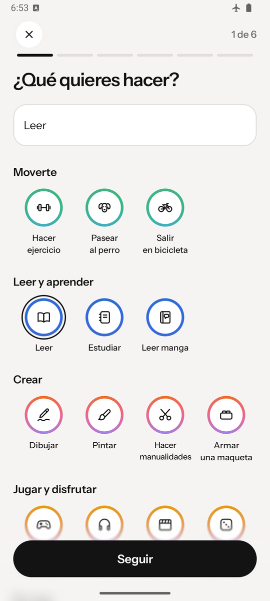 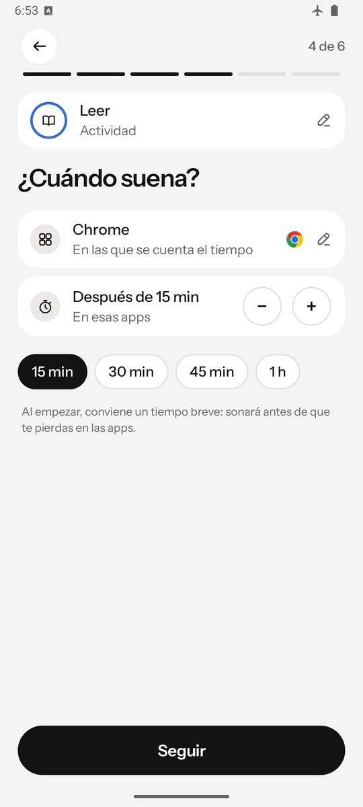 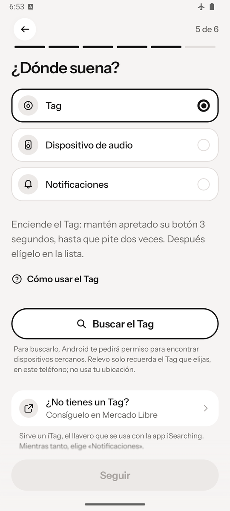 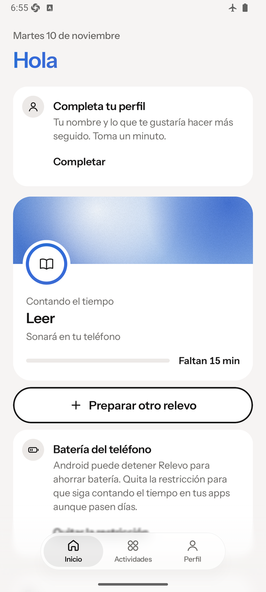 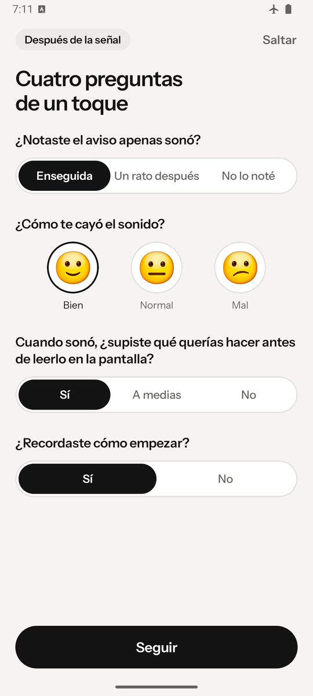 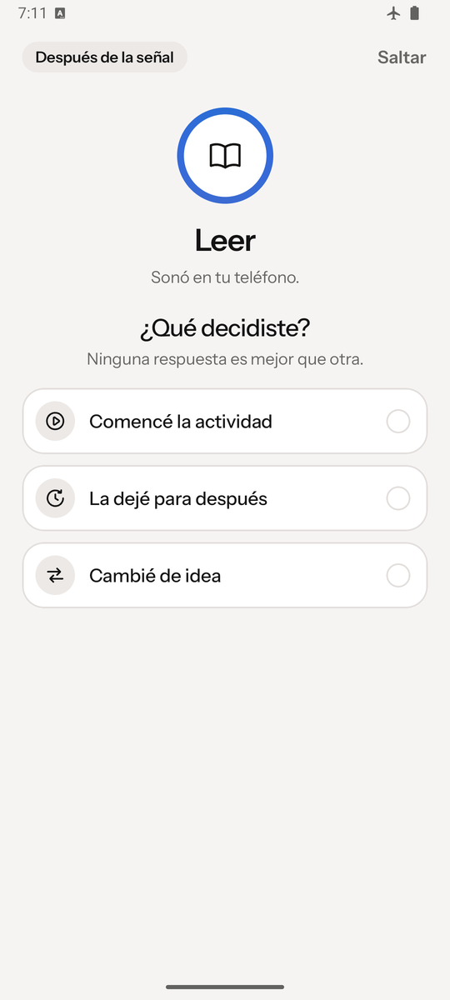

*Nota.* Capturas de la aplicación, con un perfil de prueba. Durante la prueba en los hogares, los pasos eran los mismos y la interfaz era otra (Anexo F).

**Preparar.** Cada actividad preparada con su condición se llama, en la aplicación, un *relevo*. Prepararlo es responder unas pocas preguntas: «¿Qué quieres hacer?», «¿Cómo empiezas la actividad?», «¿En qué lugar empieza?», «¿Cuándo suena?» y «¿Dónde suena?». Las respuestas requieren poco esfuerzo: se eligen entre opciones concretas, como «Abrir el libro» o «En el velador», porque seleccionar cuesta menos que escribir, y cada esfuerzo de más hace menos probable que un recordatorio se prepare (Chiu y Gilbert, 2024); escribir sigue disponible. El botón para seguir está siempre en el mismo lugar, al alcance del pulgar. Antes de activar, la persona hace sonar Relevo desde donde quedó y confirma que lo oye: sabe desde el primer día que la señal la va a alcanzar. Cada dato puede cambiarse después, incluso con el relevo activo, algo que nace de los comentarios de una persona durante la prueba.

**Seguir en el teléfono.** Mientras cuenta el tiempo, Relevo se hace a un lado: la persona usa el teléfono como siempre. El tiempo que se cuenta es el que suman las aplicaciones que ella eligió, de 1 minuto a 6 horas: una regla fácil de entender y de ajustar. Una persona de la prueba bajó su límite de 45 a 35 minutos porque, al sonar, ya estaba demasiado inmersa en un video.

**Oír la señal.** Cuando se cumple el tiempo, Relevo suena desde el lugar de la actividad. El sonido dura unos 30 segundos y termina solo; la persona puede silenciarlo antes desde la aplicación o con el botón del Tag.

**Decidir.** Después vienen unas preguntas breves de un toque, que se pueden saltar, y una decisión: «¿Qué decidiste?». Las tres respuestas —«Comencé la actividad», «La dejé para después» y «Cambié de idea»— tienen el mismo tamaño, el mismo color y el mismo lugar, y ninguna viene marcada de antemano: decide la persona. Si la deja para después, Relevo ofrece dejarla lista para otro momento, sin repetir la señal.

**Primer uso.** Antes del primer relevo, tres pantallas presentan Relevo, piden el consentimiento y el permiso para contar el tiempo en las aplicaciones; después, la aplicación acompaña a preparar el primer relevo, y el perfil queda para más tarde. En la prueba eran once pantallas: las tres personas las completaron, pero el recorrido les resultó largo.

## Arquitectura de información

La aplicación tiene tres destinos, en una barra inferior: Inicio, Actividades y Perfil (Figura 15). Los destinos se nombran con sustantivos y las acciones con verbos —«Preparar un relevo», «Activar el relevo»—, para que la persona distinga dónde está de lo que puede hacer. Inicio pone primero lo más próximo: el relevo que sonará antes o, después de una señal, la actividad con su primer paso y la opción de prepararla de nuevo; debajo quedan los demás relevos y un resumen de la semana que solo cuenta hechos. La pantalla de un relevo activo, que en la prueba mostraba demasiado, deja ahora a la vista solo la actividad, el tiempo que falta y una acción. Al volver después de unos días, saluda con «Hola de nuevo», sin decir cuántos días pasaron: contarlos convertiría el regreso en una falta. Así, la aplicación acompaña sin convertirse en algo que hay que revisar. Actividades reúne las que la persona creó, los pasos de las que quiere sostener en el tiempo y algunas ideas, y Perfil reúne lo que es suyo: sus relevos, sus actividades, sus pasos, sus aplicaciones y los ajustes.

**Figura 15**

*Arquitectura de información de la aplicación*

[FIGURA POR INSERTAR: esquema de arquitectura de información: Inicio | Lo más próximo | Relevo que sonará antes, Otros relevos activos, Preparar otro relevo, Esta semana; Actividades | Lo que la persona quiere hacer | Creadas por ti, Paso a paso, Ideas; Perfil | Lo propio de la persona | Relevos, Actividades, Pasos, Apps, Ajustes, Ayuda]

*Nota.* Elaboración propia, a partir de la aplicación. Las pantallas que se usaron en la prueba están en el Anexo F.

## Lenguaje visual: Apple como referencia

La interfaz de Relevo toma como referencia las Human Interface Guidelines, las pautas con que Apple explica cómo diseñar para sus plataformas. No se eligieron por un efecto en particular, sino por cómo equilibran belleza y legibilidad: en ellas, el diseño está al servicio de lo que la persona quiere hacer. La decisión se tomó el 27 de septiembre de 2026, frente a una primera interfaz plana: se buscaba una interfaz hermosa y fácil, sin sobrediseñar ni sobreexplicar.

Tres principios del sistema de diseño que Apple presentó en 2025 guiaron la interfaz (Apple, 2025a). La *jerarquía* se construye con el orden y la agrupación, no con adornos: los controles se apartan y el contenido —la actividad y su primer paso— queda adelante, mientras el color destaca la acción principal. La *armonía* nace de la concentricidad: las esquinas redondeadas de tarjetas, botones y hojas comparten centro con las del teléfono, y todo se siente parte de una misma forma. La *consistencia* hace que cada componente tenga siempre las mismas partes y aparezca donde la persona lo espera.

Para Relevo, eso significa una aplicación que se aprende sin instrucciones y que sabe apartarse. Se abre pocas veces al día, y su trabajo es devolver la atención a otra actividad, como propone la *calm technology* (Weiser y Brown, 1997). Navegarla se parece a usar las aplicaciones que la persona ya conoce: una barra de pestañas abajo y un botón principal ancho, siempre al pie y cerca del pulgar. Cada uno de esos gestos se apoya en principios conocidos de la interacción: las personas prefieren que una interfaz funcione como las que ya usan, un objetivo grande y cercano se alcanza antes, elegir entre pocas opciones toma menos tiempo y una interfaz que responde sin hacer esperar se siente fluida (Yablonski, s. f.). Incluso la belleza cumple una función, porque lo que se percibe bello tiende a percibirse más fácil de usar (Yablonski, s. f.).

La forma se repite en todas las escalas. Las cápsulas de los botones, las esquinas de las tarjetas y los círculos del logo comparten una misma curva, y por eso la aplicación, la marca y el objeto se reconocen como una familia. El desenfoque, sutil, aparece solo en la barra de navegación y en las hojas que suben desde el borde, nunca sobre el contenido: separa lo que se lee de lo que sirve para moverse, como proponen las pautas de Apple (Apple, 2025a), y junto con una opacidad progresiva deja adivinar que hay más contenido abajo.

La jerarquía también se construye en el tiempo: el color sube con el momento (Figura 16). Al preparar un relevo dominan el blanco y el negro, y el color aparece solo en el anillo de la actividad; en Inicio, la actividad se presenta en una tarjeta con su degradado; cuando suena, ese degradado llena toda la pantalla y, si suena el objeto, el sonido se dibuja en anillos. El color, la herramienta de jerarquía más fuerte de la interfaz, se guarda para el único momento que debe pasar al primer plano, y el resto del tiempo Relevo informa desde el segundo plano, como propone la *calm technology* (Weiser y Brown, 1997).

**Figura 16**

*Calma, presencia y señal: el color sube con el momento*

<!-- doble -->

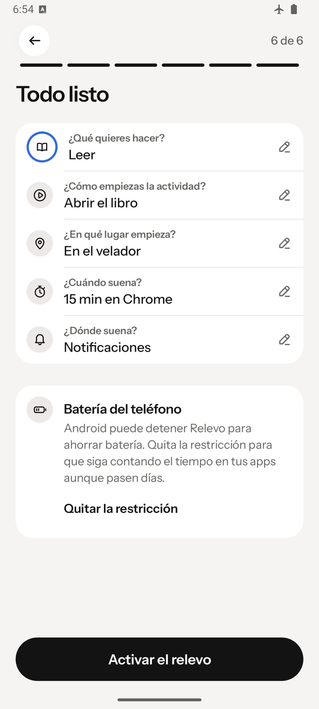 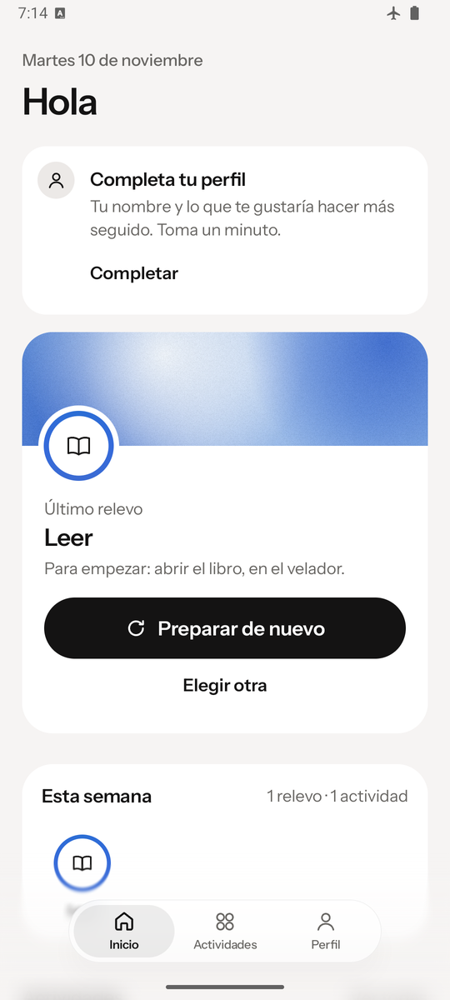 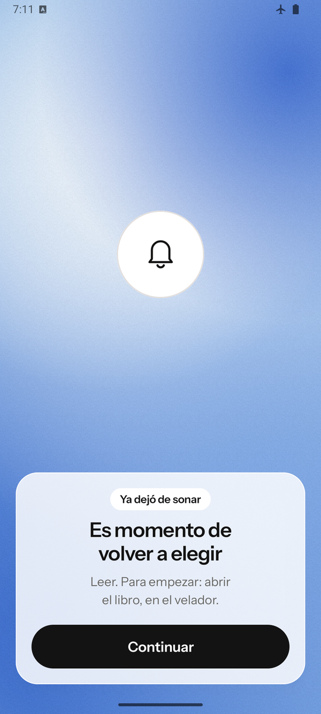

*Nota.* Capturas de la aplicación, con un perfil de prueba.

**Apple frente a Material Design.** La aplicación corre en Android, donde lo conocido es Material Design, el sistema de Google. De Apple se tomaron principios y una escala tipográfica, no una apariencia: la tipografía se lee en el cuerpo que usa iOS, un poco mayor que el de Material, con más interlineado, y los títulos en seminegrita marcan la jerarquía sin recurrir a cajas ni líneas (Android Open Source Project, s. f.; Apple, s. f.-c). Lo que pertenece al sistema —los permisos, las notificaciones y el gesto para volver— se ve como en cualquier Android, para que la persona lo reconozca de inmediato. Material Design completo se descartó porque su escala tipográfica más chica y sus títulos en regular no daban esa jerarquía clara en una aplicación que se abre pocas veces al día.

**Color e imagen.** Cada actividad tiene su ícono, un anillo con el color de su familia y un degradado con grano y volumen, y el perfil, un emoji que la persona elige para identificarse. Las funciones de la interfaz van en blanco y negro, para que el color de una actividad nunca se confunda con el de una función. La tipografía sobre cada color cambia a blanco o negro según qué tan claro u oscuro sea el fondo, para mantener el contraste mínimo que piden las pautas de accesibilidad web (World Wide Web Consortium, 2024).

**Accesibilidad.** La opción «Letra grande» suma un 15 % al cuerpo tipográfico que ya usa la persona; hay tema claro y oscuro; el movimiento se reduce si Android lo pide, por accesibilidad o por ahorro de batería, y el color siempre va acompañado de una palabra y un ícono, como piden las WCAG 2.2 (World Wide Web Consortium, 2024). Una simulación de cómo ven los colores las personas con daltonismo (Machado et al., 2009) muestra que dos pares de fichas se confunden, el celeste con el lila y el rosa con el durazno: por eso el color ayuda, pero el ícono y la palabra informan. La señal, en cambio, es sonora, y lo que depende solo del sonido deja fuera a quien no lo oye (World Wide Web Consortium, 2024). Para una persona sorda o con baja audición, la salida en el teléfono avisa también en la pantalla, aunque pierde el lugar; Relevo, el objeto propio, debería sumar una señal visual y una vibración, y una etapa siguiente tendría que probarlo con personas con baja audición.

## Voz de Relevo

Las palabras también son parte de la interfaz. Los textos de Relevo partieron de un estudio de las guías de escritura de interfaces de Apple (2024, 2025b), Google (s. f.-b) y Microsoft (2021), y de la investigación sobre el lenguaje que presiona y el que deja elegir (Miller et al., 2007; Smit et al., 2019). De ese estudio salió una voz con cuatro rasgos (Figura 17).

**Figura 17**

*Rasgos de la voz de Relevo*

[FIGURA POR INSERTAR: esquema de voz: Cercana y tranquila | Acompaña sin apurar | «Queda anotado. Gracias por decirlo.»; Clara y concreta | Dice qué pasa y qué hacer | «No sonó en el dispositivo de audio. Revisa que esté encendido y conectado.»; Respetuosa de la decisión | Ofrece y no ordena | «Ninguna respuesta es mejor que otra.»; Honesta | Dice qué guarda y qué no ve | «Qué no se ve»]

*Nota.* Elaboración propia a partir de Apple (2024, 2025b), Google (s. f.-b) y Microsoft (2021). Los ejemplos son textos de la aplicación.

La voz es la misma en toda la aplicación; el tono cambia según el momento: acogedor la primera vez, práctico al preparar, sereno mientras cuenta, neutro cuando suena y sobrio al hablar de datos. Relevo habla de tú, en frases cortas y con palabras cotidianas —«querer» antes que «desear», «usar» antes que «utilizar»—, como recomienda la guía de estilo en español de Microsoft (2021), y sigue la regla del equipo de escritura de Apple: tan largo como haga falta y tan corto como se pueda (Apple, 2024). Pregunta en vez de rotular —«¿Cómo empiezas?»—, y sus botones empiezan con un verbo que dice qué va a pasar, como «Activar el relevo» (Apple, 2025b).

El vocabulario también es una decisión. La aplicación habla de «actividad» y de «sonar», palabras que dejan la intención en manos de la persona; *meta*, *tarea* o *alarma* la convertirían en un deber, y por eso se evitan. Por la misma razón evita el lenguaje de la obligación, como «debes» o «tienes que», que despierta rechazo (Miller et al., 2007), y cuando hay opciones las nombra con el mismo peso, porque un texto amable no reemplaza la posibilidad real de que la persona decida (Smit et al., 2019).

## Identidad

**Nombre.** Un relevo es el momento en que algo pasa de una mano a otra, como en una carrera de relevos. El nombre cuenta lo que el sistema busca: que la atención pase de la pantalla a lo que la persona quería hacer, sin que nadie se la quite. Es breve, se pronuncia sin trabas en español y viene del mundo de los traspasos y los turnos, no de las prohibiciones.

**Logo.** Cuatro círculos se pasan el turno en el sentido del reloj, cada uno bajo el siguiente, y dejan el centro abierto: el tiempo, el primer paso, el lugar y la decisión (Figura 18). El centro vacío es el traspaso, de la pantalla a la actividad. Las formas circulares se asocian con suavidad y cuidado (Jiang et al., 2016), y los colores planos, sin transparencias, se reproducen igual en pantalla, en papel o impresos sobre el objeto. Su construcción, paso a paso, y sus variantes están en el Anexo H.

**Figura 18**

*Sistema de identidad de Relevo*

[FIGURA POR INSERTAR: lámina de identidad: logotipo, paleta cromática, tipografía e íconos]

*Nota.* Elaboración propia.

**Paleta cromática.** La paleta se decidió por su función. Seis fichas pastel con el mismo peso visual acompañan cada una un momento: el amarillo, el tiempo; el celeste, el primer paso; el verde, el lugar; el rosa, la decisión, y otros dos, la personalización y lo que viene después de la señal. Las seis tienen casi la misma luminosidad, medida en OKLCH, un espacio de color que la calcula como la percibe el ojo y no como la guarda la pantalla (Ottosson, 2020), así que pesan lo mismo: el color distingue sin jerarquizar, que es la traducción visual del principio de que ningún momento vale más que otro. Albers (2013) mostró que un color cambia de apariencia según los que tiene al lado; igualar su luminosidad mantiene ese peso cuando las fichas aparecen juntas. Son claras y poco saturadas, porque la saturación eleva la activación emocional (Wilms y Oberfeld, 2018), y lo que acompaña no debería activar de más. Cada color significa siempre lo mismo, y la selección va en negro y no en color: si usara el amarillo, el amarillo significaría dos cosas. La tipografía sobre cada ficha mantiene el contraste que piden las WCAG 2.2 (World Wide Web Consortium, 2024). Los círculos del logo (Figura 18) son la versión más intensa de cuatro de esas fichas. Las asociaciones entre colores y emociones cambian según el contexto y la persona (Elliot y Maier, 2014; Jonauskaite et al., 2024), así que no fundan la elección: solo sirvieron para descartar. El rojo, muy ligado a la rabia y el tono que más activa (Wilms y Oberfeld, 2018), queda para los errores, como en la señalética, cuya norma fija colores de seguridad para prevenir accidentes (International Organization for Standardization, 2011); el negro y el gris tampoco se usan para los estados de la persona.

**Tipografía.** La identidad usa dos tipografías sin serifa, cada una con su tarea. El logotipo, «relevo», va siempre en minúsculas y en Chillax Semibold (Indian Type Foundry, s. f.), convertida a trazos. Se eligió entre veinte tipografías sin serifa de Fontshare, el catálogo gratuito de esa fundición, por tres razones: su «o» es casi un círculo y conversa con los círculos del símbolo; la «e» y la «r» terminan en curvas abiertas, que hacen la palabra amable, y en tamaños pequeños no pierde la forma. La aplicación usa Instrument Sans, una grotesca de código abierto codiseñada por Rodrigo Fuenzalida, diseñador radicado en Santiago, y Jordan Egstad (Fuenzalida y Egstad, s. f.). Se eligió porque se lee bien en pantallas y en papel, porque sus pesos y anchos resuelven toda la jerarquía con una sola familia y porque su dibujo sobrio deja el carácter al logotipo. En la aplicación, la jerarquía sigue la de iOS —título grande, título, encabezado, texto y nota—, con títulos en semibold y texto en regular, siempre con mayúscula inicial y sin interletrado abierto, para que cada rótulo se lea como una frase.

**Iconografía.** Los íconos de la aplicación son propios: 118 dibujos de línea en una retícula de 24, con un trazo de 1,6 en su tamaño base y terminaciones redondas. El trazo se afina en los tamaños grandes y se engruesa en los pequeños, para que el ícono pese parecido a la palabra que siempre lo acompaña. Su referente es Lucide, un conjunto de íconos de línea de código abierto, cuya licencia permite usarlos, modificarlos y redistribuirlos siempre que se conserve su aviso (Lucide Contributors, s. f.-b). Partir de sus reglas de construcción agilizó el trabajo (Lucide Contributors, s. f.-a), y cada dibujo se adaptó a Relevo: el sonido son anillos que se abren desde el objeto, y cada actividad se dibuja con el objeto con que empieza, como un libro abierto para leer. Su construcción está en el Anexo H.

**Proceso de la identidad.** Entre septiembre y octubre de 2026 se exploraron más de veinte propuestas de identidad. Un subrayado azul, que venía de «relevar» como resaltar, se descartó porque no decía qué hace Relevo; las tipografías con serifa y las manuscritas se exploraron y se dejaron, y el 11 de octubre quedaron definidos el logo de cuatro círculos, la paleta cromática de seis colores y los primeros íconos, que en noviembre se ajustaron a lo que pide la aplicación. Los bocetos partieron de la R, del gesto de pasar algo de una mano a otra y de los pasos del recorrido, que terminaron en los cuatro círculos (Figura 19); las propuestas anteriores están en el Anexo H.

**Figura 19**

*Bocetos del logo*

<!-- doble -->

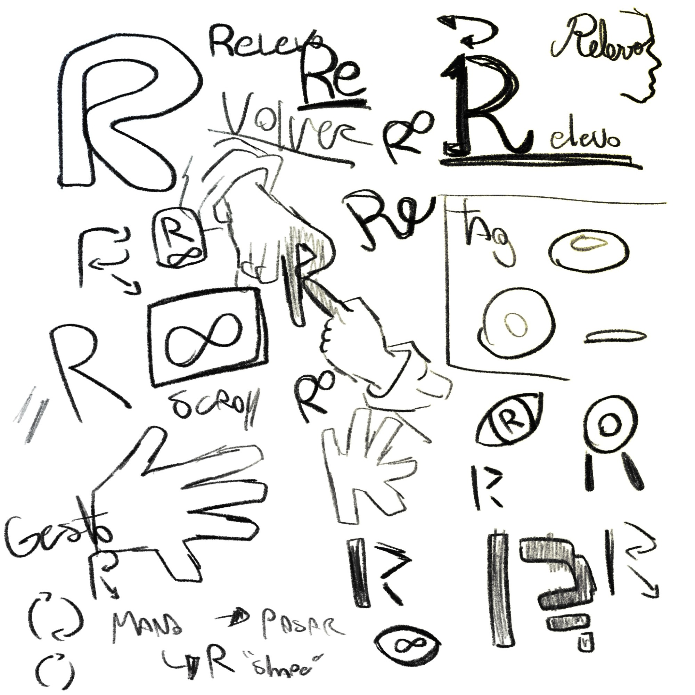 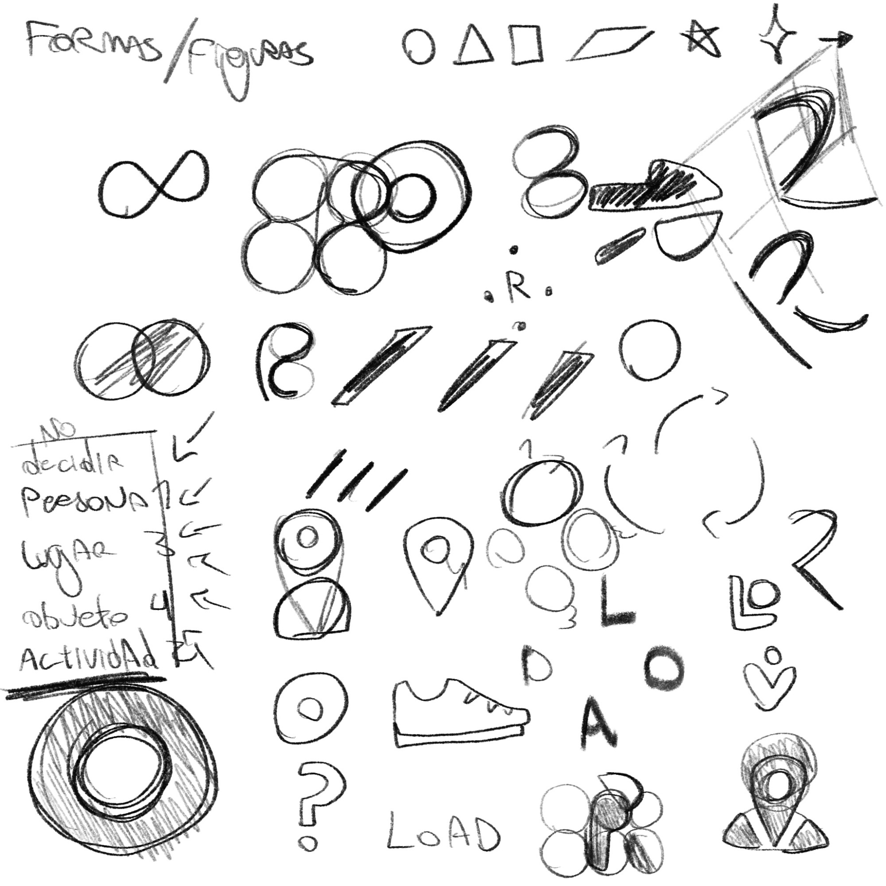 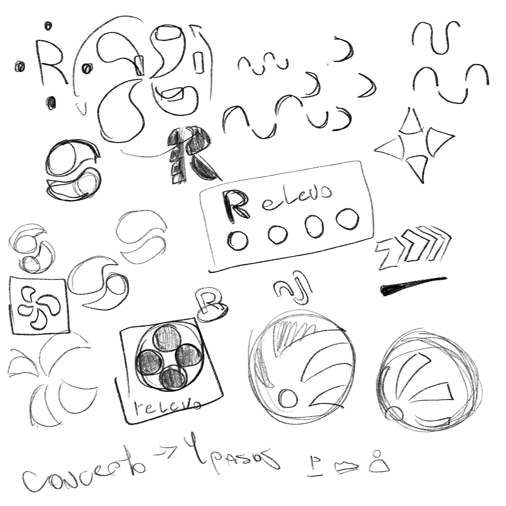

*Nota.* Elaboración propia.

## Objeto

**Proceso.** En sus primeras fases, el objeto era un lugar donde dejar el teléfono; después pasó a ser una señal en el lugar donde empieza la actividad. Los primeros bocetos lo exploraron en tres formatos —un disco, una pastilla y un cilindro— y para dos usos: llevarlo como llavero o dejarlo en el hogar. Los siguientes definieron esas dos variantes, Relevo Home y Relevo Go, con sus vistas y sus piezas: tapa, placa, carcasa y base (Figura 20).

**Figura 20**

*Bocetos del objeto*

<!-- doble -->

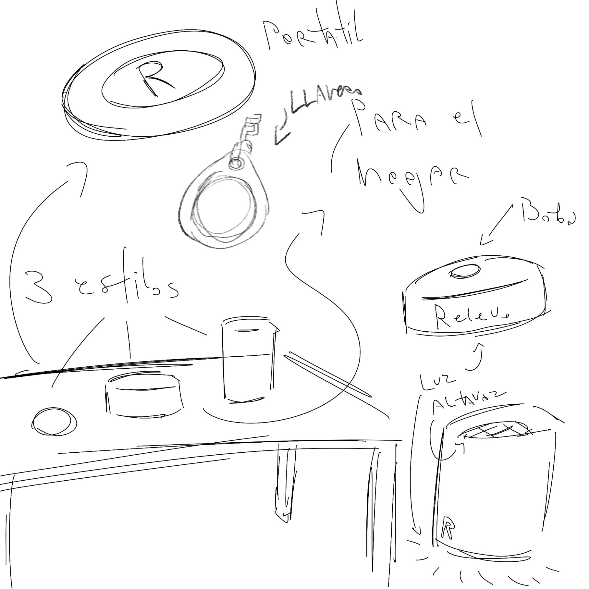 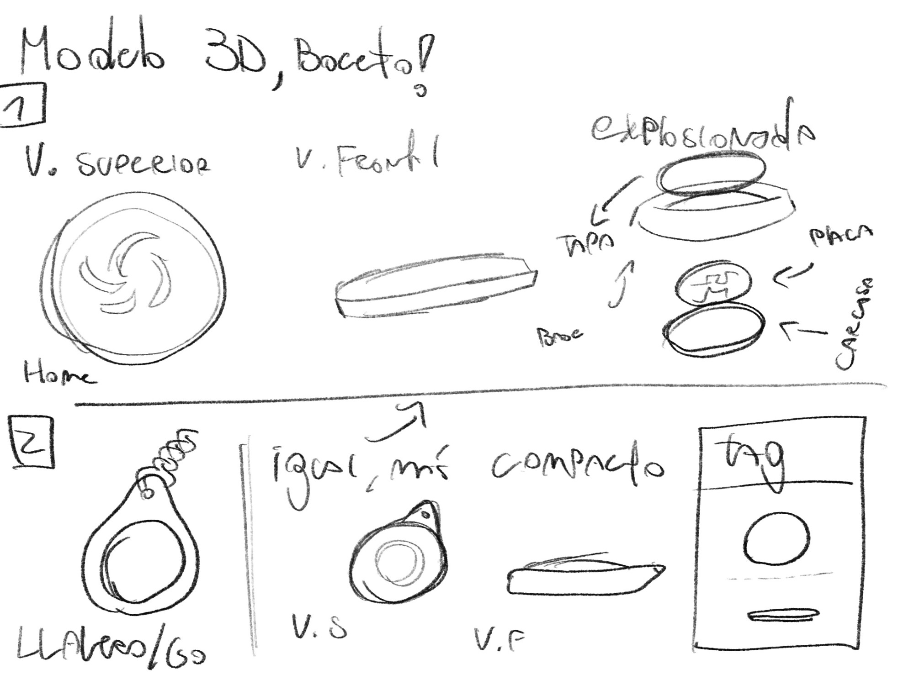

*Nota.* Elaboración propia.

**Tag.** Antes de fabricar el objeto propio había que probar la señal y el lugar. Por eso, el prototipo usa un llavero antipérdida Bluetooth: es barato, se consigue fácilmente y suena cuando la aplicación se lo pide. Un prototipo puede usar medios simples si conserva lo esencial (Nielsen, 1993, pp. 96–97), y aquí lo esencial era el lugar y el sonido.

**Objeto propio.** Relevo es una carcasa que lleva adentro la placa y la pila del Tag: conserva el sonido ya probado y suma forma, control y marca. Su forma sigue la del Tag —un volumen bajo, de canto redondo y cara casi plana— y tiene dos variantes con las mismas piezas interiores. Relevo Home, de 52 mm de diámetro y 13,4 mm de alto, se deja junto al primer paso de una actividad: su base ancha y una goma antideslizante lo mantienen quieto sobre una mesa o un estante. Relevo Go, una gota de 44 × 54,5 mm y 11,4 mm de alto, cuelga de las llaves o de la mochila. En los dos, la cara entera es el botón: se aprieta sobre el logo, que va a ras en sus cuatro colores, baja 0,45 mm y la junta hace de tope para no forzar el botón del Tag. El sonido sale por esa misma junta, y la tapa de abajo se abre con una moneda para cambiar la pila. Una primera propuesta caló el logo y abrió una ranura y ocho agujeros para el sonido: la cara se leía como una rejilla de ventilación, y por eso la actual la deja lisa.

Relevo es más grande que el Tag por tres razones: para encontrarlo, porque un objeto que hay que hallar para silenciarlo no puede quedar tapado sobre una mesa; para controlarlo, porque una persona de la prueba nunca encontró el botón del Tag, y un botón del tamaño de la cara se ve y se siente, y para fabricarlo, porque sus detalles necesitan espacio para imprimirse. Los modelos 3D se hicieron con ayuda de Claude, a partir de los bocetos (Figura 21). Ambas variantes se imprimen en 3D sin soportes, y como solo una pieza depende de la placa, podrían recibir otros localizadores. En esta etapa, Relevo queda como propuesta: la prueba se hizo con el Tag, y el objeto propio se imprimiría para el piloto.

**Figura 21**

*Relevo Home y Relevo Go, con la placa del Tag adentro*

<!-- doble -->

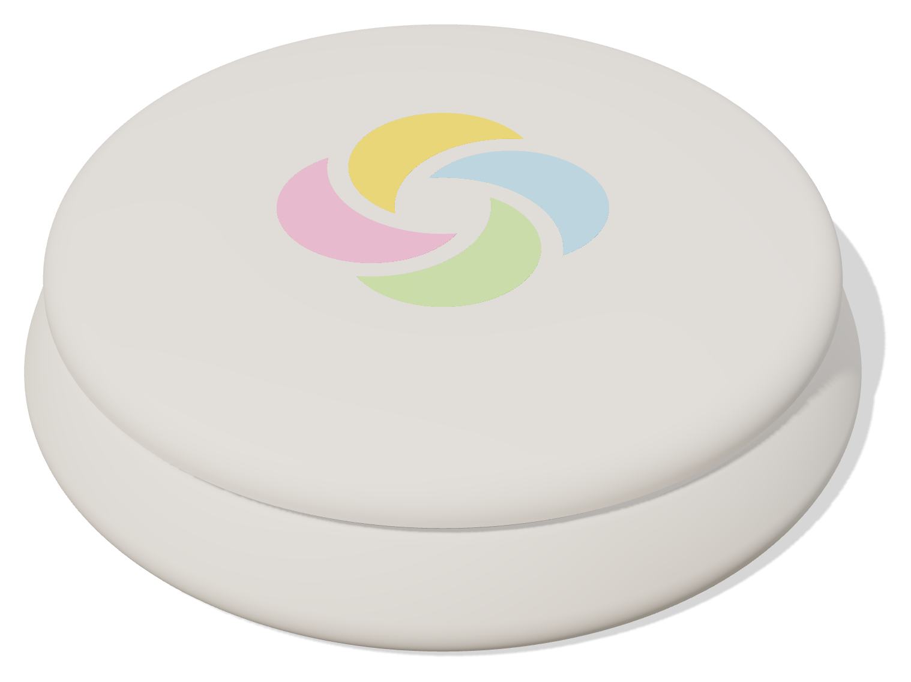 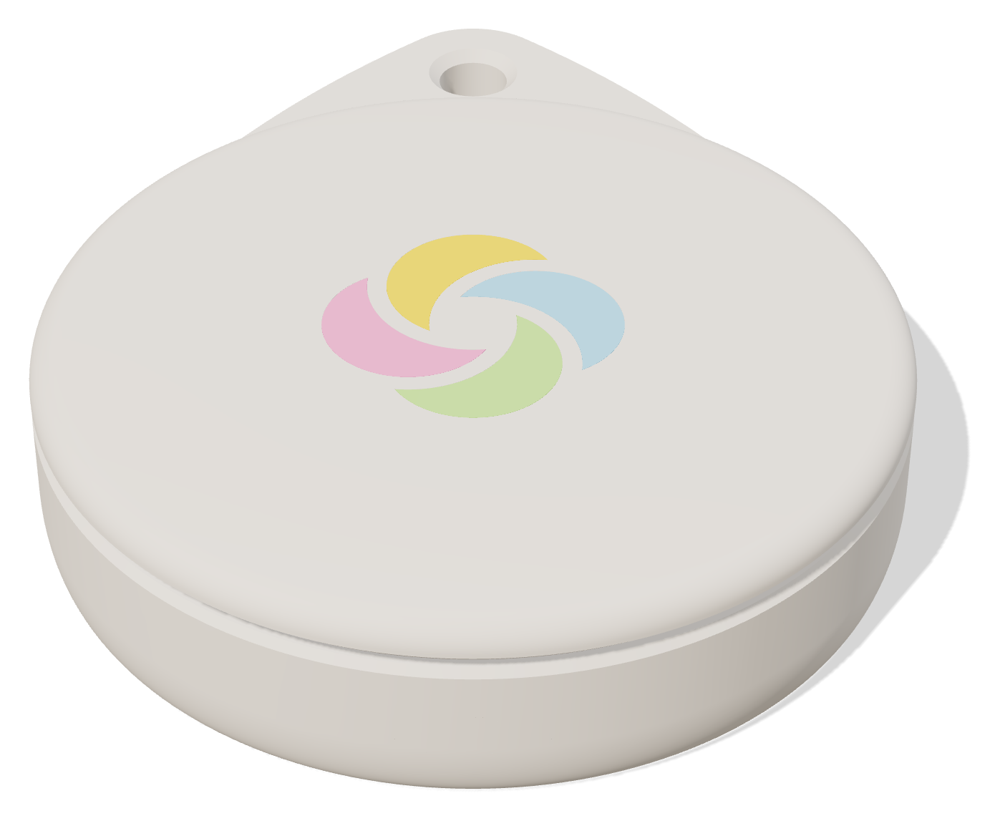 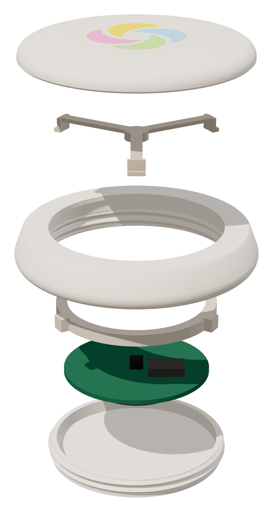

*Nota.* Elaboración propia. Modelos 3D hechos con ayuda de Claude a partir de los bocetos de la Figura 20, aún sin imprimir. Las medidas de la placa del Tag son estimadas.

## Señal

La señal es un sonido porque debe alcanzar a quien mira una pantalla, por ejemplo desde otra habitación: una luz o una imagen piden mirar, y la persona está mirando otra cosa. En las entrevistas, las personas imaginaban señales visuales, pero una señal visual no alcanza a quien mira otra cosa; por eso el sonido se diseñó breve y amable. Dura unos 30 segundos y termina sola o se silencia: tiene más presencia que una notificación y es más amable que una alarma. En el teléfono, Relevo suena con un tono propio, que la persona puede cambiar entre cuatro: el que viene por defecto son dos golpes de madera que bajan de tono y se repiten, más suaves al comienzo; en el Tag suena su pitido de fábrica. Cada rasgo tiene un fundamento: un sonido que desciende y es más grave se percibe menos urgente (Edworthy et al., 1991), menos repeticiones bajan la urgencia (Hellier et al., 1993) y un timbre con muchas frecuencias a la vez ayuda a saber de dónde viene (Middlebrooks y Green, 1991, p. 138). En la encuesta, la mayoría prefirió un sonido de 15 segundos o menos; la duración se mantuvo para la prueba y puede acortarse si el uso lo pide.

## Privacidad y datos

Relevo guarda en el teléfono lo que la persona prepara y sus respuestas, y, con su consentimiento, envía una copia identificada con un código en lugar del nombre. La notificación de la pantalla bloqueada no muestra la actividad, y una sección, «Qué no se ve», explica lo que la aplicación no registra. La persona puede retirar su consentimiento y borrar sus datos desde la aplicación. Responder a la señal siempre es opcional, y el aviso tras una semana sin abrir la aplicación viene desactivado por defecto.

## Iteraciones

En el prototipo, cada cambio respondió a algo aprendido al desarrollarlo o al usarlo. En septiembre, antes de tener un objeto, se resolvió el recorrido: preparar un relevo, contar el tiempo de las aplicaciones elegidas y sonar en un parlante o en el teléfono. La señal pasó a durar unos 30 segundos y a terminar sola, porque una que no se detiene insiste y una de pocos segundos no se oye, y las pautas de Apple se volvieron la referencia visual. A comienzos de octubre llegó el Tag, con una prueba de sonido que confirma que sonó, y las respuestas de un toque para cómo y dónde empezar, porque escribir costaba más; el 12 de octubre, la identidad nueva llegó a toda la interfaz. Durante la prueba, lo que contaron las personas llevó a editar un relevo activo, a callar el Tag con confirmación y a esperar más a un Tag que responde lento, y el 20 de octubre la señal pasó solo al teléfono, para comparar. El registro de cada cambio, con su fecha y su motivo, está en el Anexo G.

Cada una de estas decisiones responde a un criterio y deja atrás otras opciones. La Tabla 1 las reúne, de lo general a lo particular.

**Tabla 1**

*Decisiones de diseño de Relevo*

| Ámbito | Decisión | Fundamento | Opciones descartadas |
| --- | --- | --- | --- |
| Sistema | Aplicación, objeto y lugar. | La señal llega desde fuera de la pantalla. | Bloquear o pausar; solo notificar. |
| Recorrido | Una pregunta por pantalla. | Prepararlo pide poco esfuerzo. | Un formulario único. |
| Condición | Tiempo en las aplicaciones elegidas. | Es fácil de entender y de ajustar. | Uso continuo; franja horaria. |
| Arquitectura | Inicio, Actividades y Perfil. | Acompaña sin pedir que se la revise. | Todo a la vez. |
| Lenguaje visual | Pautas de Apple como referencia. | Equilibran belleza y legibilidad. | Interfaz plana; Material completo. |
| Comunicación | De tú, con preguntas cotidianas. | Una orden presiona; una pregunta, no. | Rachas, puntos y apuros. |
| Identidad | Seis colores pastel de igual peso. | Ningún momento se impone a otro. | Colores por emoción. |
| Objeto | Un Tag comercial y después Relevo. | Probar señal y lugar antes de fabricar. | Localizadores de ecosistema cerrado. |
| Señal | Sonido de unos 30 s que termina solo. | Alcanza a quien mira una pantalla. | Vibración; alarma que insiste. |
| Datos | Código en vez de nombre. | Lo que la persona escribe es privado. | Registrar de más. |

*Nota.* Elaboración propia.

# 12. Factibilidad y límites

## Tecnología

Relevo funciona en teléfonos Android porque ese sistema permite las dos cosas que necesita: saber cuánto tiempo se usan otras aplicaciones, con un permiso que la persona concede en los ajustes, y comunicarse por Bluetooth con un objeto cercano (Google, 2026a, 2026b). El iPhone se descartó en esta etapa, porque allí consultar el uso de otras aplicaciones exige una autorización especial de Apple (Apple, s. f.-a) y trabajar en los dos sistemas habría duplicado el desarrollo. Entre el teléfono y el objeto solo viajan dos órdenes, sonar y callar: lo que la persona escribe se queda en el teléfono. La aplicación se instala como archivo, sin pasar por una tienda, y los datos de la prueba caben en el plan gratuito del servicio que los guarda (Supabase, s. f.), de modo que la escala de esta etapa no exige infraestructura propia.

## Fabricación, mantenimiento y costos

El prototipo no exigió fabricar nada: el Tag es un producto terminado, y su único mantenimiento es cambiar la pila de botón, que según los vendedores dura entre 2 y 8 meses. Relevo, el objeto propio, está modelado para imprimirse en 3D en PLA, sin soportes, con a lo más 20 g de plástico en la variante Home y 13 g en la Go; su forma se genera a partir de medidas, así que basta cambiar una para ajustarlo a otra placa. La Tabla 2 reúne lo que costó el prototipo y lo que costó el proceso de diseño, sin contar el trabajo del autor.

**Tabla 2**

*Presupuesto del prototipo académico y del proceso*

| Ítem | Valor (CLP) | Detalle |
| --- | --- | --- |
| Tag con pila de botón | 10 990 | Una unidad, con envío. |
| Teléfono Android | Sin costo | Cada persona usó el suyo. |
| Base de datos de la aplicación | Sin costo | Plan gratuito de Supabase (Supabase, s. f.). |
| Herramientas de inteligencia artificial | Unos 100 000 | Un mes de Cursor, uno de ChatGPT Plus (Codex) y tres de Claude Pro, a unos 20 dólares al mes. |
| Total desembolsado | Unos 111 000 | — |

*Nota.* CLP = pesos chilenos. Los tres primeros ítems son el prototipo, y las herramientas de inteligencia artificial, el proceso de diseño. Las suscripciones se calcularon al dólar observado del 27 de octubre de 2026 (Mindicador, 2026). El trabajo del autor, unas 186 horas, equivale a entre 1 070 000 y 1 577 000 pesos según el ingreso de quienes se titulan de Diseño en Chile (Ministerio de Educación, s. f.).

## Del prototipo al producto

El proyecto puede crecer en tres etapas, y cada una empieza solo si la anterior entrega evidencia. Un piloto, en seis hogares y con Relevo impreso, mostraría si sonar desde el lugar de la actividad aporta. El producto, por último, podría abrirse en las dos variantes ya modeladas: Relevo Home, para dejar en la casa junto al primer paso de una actividad, y Relevo Go, para llevar consigo. Ambas podrían funcionar con localizadores de otras marcas, de modo que la persona use el que ya tiene, siempre que respondan a la orden estándar de alerta. Aprovechar un dispositivo que ya existe evita desarrollar y fabricar electrónica, aunque puede no ofrecer justo las funciones que se necesitan (Gembali, 2023, p. 53).

El piloto es la cifra que decide el paso siguiente. Cada hogar necesita un localizador, una pila de repuesto y una carcasa impresa, entre 10 100 y 12 150 pesos, y los seis hogares, entre 60 500 y 72 900. La carcasa casi no cuesta material: lo que se paga es el trabajo de impresión, y por eso conviene imprimir las seis de una vez, repartiendo el mínimo que cobra un servicio nacional por trabajo (Rabbit Hole, s. f.). Un producto, en cambio, exigiría cotizar molde, ensamblaje y ensayos, que solo se justifican con volumen. La Figura 22 resume las tres etapas.

**Figura 22**

*Etapas del proyecto*

[FIGURA POR INSERTAR: esquema de etapas: Prototipo académico | Ahora | Tag comprado y aplicación propia, Unos 111 000 pesos y el trabajo del autor, Tres personas en sus hogares; Piloto | Si la prueba lo justifica | Seis hogares con Relevo impreso, Entre 10 100 y 12 150 pesos por hogar, Revisión de accesibilidad y de protección de datos, Fondart Nacional (línea de Investigación); Producto | Si el piloto cumple sus metas | Relevo Home y Relevo Go, Localizadores de otras marcas, Costos de producción por cotizar, Semilla Inicia de Corfo o Capital Semilla de Sercotec]

*Nota.* Elaboración propia. El costo del piloto incluye el localizador, una pila de repuesto y la carcasa impresa en un servicio nacional (MCI Electronics, s. f.; Rabbit Hole, s. f.). Los fondos de cada etapa se describen en «Financiamiento».

## Financiamiento

Hasta ahora, el proyecto se financió con recursos propios: unos 111 000 pesos, entre el Tag y las herramientas de inteligencia artificial, y el trabajo del autor. Las etapas siguientes pueden postular a fondos públicos concursables, que abren una convocatoria al año:

- **Piloto:** la línea de Investigación de Fondart Nacional, del Ministerio de las Culturas, las Artes y el Patrimonio, financia proyectos que aporten al conocimiento en diseño, entre otras disciplinas, con hasta 15 millones de pesos por proyecto; su convocatoria 2027 cerró en septiembre de 2026, así que el piloto podría postular a la siguiente (Ministerio de las Culturas, las Artes y el Patrimonio, s. f.). Probar Relevo impreso con más personas y en más hogares es investigación en diseño.
- **Producto:** Semilla Inicia, de Corfo, cofinancia hasta el 75 % de proyectos de negocio innovadores, con un tope de 15 millones de pesos, para validarlos técnica y comercialmente; pueden postular personas mayores de 18 años que residan en Chile (Corporación de Fomento de la Producción, s. f.). Para formalizar un primer negocio, el Capital Semilla Emprende de Sercotec entrega 3,5 millones de pesos a personas sin inicio de actividades, con un aporte propio del 3 % (Servicio de Cooperación Técnica, s. f.).

Postular exige evidencia, y por eso cada etapa empieza solo si la anterior la entrega.

## Actores del proyecto

El proyecto lo conduce el autor, con la guía de los profesores Sergio Majluf y Simón Gallardo. Las tres personas de la prueba aportaron su uso y sus comentarios, que cambiaron el diseño durante la prueba. Un comercio aportó el Tag, y los datos se guardan en un servicio externo. Un piloto sumaría un servicio de impresión 3D y una revisión especializada en accesibilidad y en protección de datos (Figura 22); un producto, a quien fabrique y distribuya el objeto. El proyecto también toma prestados saberes de otras disciplinas —la psicología de la memoria, la acústica y la electrónica de consumo—. Un especialista en sistemas de recomendación, Denis Parra, ya respondió por escrito a las preguntas del proyecto (capítulo 3), y una etapa siguiente debería consultar también a especialistas de esas disciplinas. Los fondos concursables suman a Corfo, a Sercotec y al Ministerio de las Culturas como posibles financistas.

## Seguridad y alcance

La pila de botón puede llegar a ser peligrosa si se traga: por eso la tapa de Relevo se abre con una moneda u objeto similar. El proyecto se centra en el ocio digital cotidiano de personas adultas que quieren recordar algo que eligieron hacer; la adicción, el tratamiento clínico y el control parental pertenecen a otros campos.

# 13. Plan de desarrollo y validación

Lo diseñado se puso a prueba en el uso real: tres personas usaron Relevo en sus hogares durante cinco semanas. La prueba usó el Tag, un objeto comercial, porque lo que se quería observar era la relación entre la señal, el lugar y lo que la persona quería hacer, no la forma del objeto.

## Procedimiento de la prueba

Cada persona aceptó el consentimiento en la aplicación, preparó su primer relevo y dejó el Tag junto al primer paso de una actividad que quería hacer (Figura 23). La prueba comenzó el 7 de octubre de 2026 y tuvo cuatro etapas (Figura 24). Durante dos semanas usaron Relevo a su gusto, cuando quisieron, y cada una fijó su propio límite; las tres completaron esas dos semanas. Tras cada señal, la aplicación preguntó si supieron qué querían hacer antes de leerlo en la pantalla, si recordaron cómo empezar y qué decidieron. Del 21 de octubre al 8 de noviembre no usaron el Tag: la señal llegó solo como una notificación en el teléfono, para comparar ambos soportes, y la aplicación preguntó además si notaron el aviso. La prueba cerró el 10 de noviembre con un cuestionario y una entrevista a cada persona. El consentimiento y las preguntas de la aplicación están en el Anexo I.

**Figura 23**

*Tag durante la prueba en el hogar*

<!-- doble -->

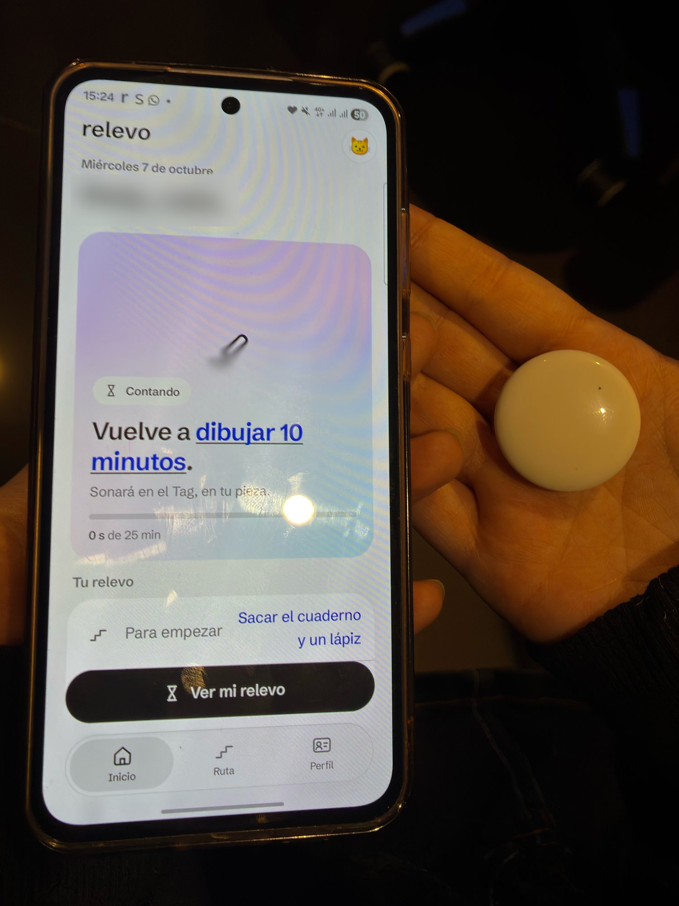 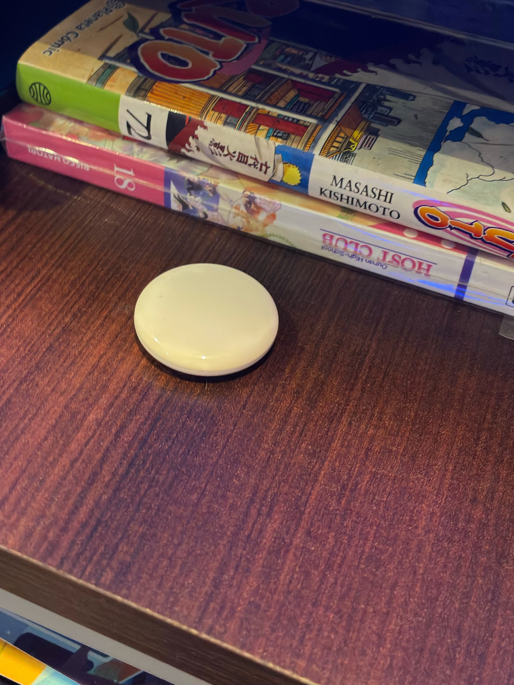 

*Nota.* Fotografías de la prueba en los hogares. En a, la pantalla muestra la actividad, el primer paso y el lugar donde sonará el Tag; se difuminó el nombre de la persona.

**Figura 24**

*Prueba en los hogares*

[FIGURA POR INSERTAR: línea de tiempo de la prueba aplicada: 7 de octubre | Inicio | Consentimiento, primer relevo y Tag junto al primer paso; Semanas 1 y 2 | Con el Tag | Relevo a su gusto y preguntas tras cada señal; 21 de octubre al 8 de noviembre | Con el teléfono | Sin el Tag, la señal llega como notificación; 10 de noviembre | Cierre | Cuestionario y entrevista con cada persona]

*Nota.* Elaboración propia.

## Registro y cuidado de los datos

La aplicación registró cada relevo —cuándo se activó, si sonó y cómo se calló— y las respuestas de cada persona. Esas preguntas completan el registro automático, que muestra qué hizo la persona, pero no por qué (Nielsen, 1993, p. 221). Una señal que falló por un problema de conexión o del objeto no se cuenta, y con tres personas el análisis debe ser por caso y en recuentos.

Para dar el ciclo por logrado, el Tag debía sonar cuando correspondía, la persona debía saber qué quería hacer al oír la señal, sin leer la pantalla, y debía seguir usando Relevo durante las dos semanas.

Las tres personas son mayores de edad; participaron de forma voluntaria y sin pago, y podían omitir preguntas, silenciar la señal o dejar la prueba sin dar razones. El consentimiento, en la aplicación, explica el propósito académico, los datos que se registran, la molestia que el sonido puede causar y cómo retirarse. Los datos se guardan con un código en lugar del nombre, aunque no son anónimos, porque actividades y horarios podrían identificar a alguien. Se tratan según la ley chilena de protección de datos (Ley 19628, 1999; Ley 21719, 2024) y se eliminan cuando la persona lo pide o, a más tardar, el 30 de diciembre de 2026.

## Resultados

Durante las semanas con el Tag, el ciclo completo funcionó en los tres hogares. El Tag sonó en todos los relevos que llegaron a su límite, salvo uno que se cumplió fuera de casa, lejos del objeto. Al oír la señal, casi siempre la persona supo qué quería hacer antes de mirar la pantalla, y siempre recordó cómo empezar. Las tres condiciones para dar el ciclo por logrado se cumplieron, y los fallos técnicos del objeto comprado se corrigieron durante la prueba.

Con tres personas, lo que hizo cada una dice más que las cifras en conjunto (Figura 25). Cada una repitió sus actividades en un mismo lugar, con sus propias aplicaciones y su propio límite, y las tres respondieron el mismo número de veces después de una señal: las diferencias están en lo que hicieron, no en cuánto participaron.

**Figura 25**

*Decisión de cada persona después de la señal*

[FIGURA POR INSERTAR: resultados por persona: Primera persona | Estudiar, ordenar o dibujar · Tag en el escritorio · 15 minutos | 7 | 5; Segunda persona | Tocar guitarra · Tag junto a la guitarra · 45 y luego 35 minutos | 7 | 3; Tercera persona | Dibujar en su croquera · Tag en el escritorio · 25 minutos | 7 | 2]

*Nota.* Elaboración propia, a partir de las respuestas del 8 al 19 de octubre de 2026. Un punto por respuesta posterior a una señal.

**Primera persona.** Quería estudiar, ordenar su pieza o dibujar, y dejó el Tag en su escritorio, con un límite de 15 minutos en Instagram, X o YouTube. Fue la que más empezó: cinco de sus siete respuestas con el Tag y siete de diez con el teléfono, que casi siempre notó enseguida. Pidió corregir un relevo sin borrarlo: «podrían implementar que se pueda actualizar o editar las opciones que uno ya eligió… así no tenemos que borrarlo y crearlo de nuevo». Al cerrar, dijo que el objeto y el teléfono la ayudaron por igual, y fue la única que prefirió que siguiera sonando un objeto.

**Segunda persona.** Quería tocar guitarra y dejó el Tag junto a ella, con 45 minutos de Instagram, YouTube o Reddit. El pitido le pareció demasiado fuerte, como una alarma, y bajó su límite a 35 minutos porque, al sonar, ya estaba inmersa en un video. Empezó tres de siete veces con el Tag y cuatro de siete con el teléfono. Con el teléfono ya no molestaba con el ruido a quien vivía con ella, pero le era más fácil pasar el aviso de largo: «con el celu veia el aviso, decia ya voy y seguia viendo el video». Fue la única que dijo que el objeto la ayudó más a recordar, aunque, por el ruido, prefirió el teléfono.

**Tercera persona.** Quería dibujar en su croquera y dejó el Tag en su escritorio, con 25 minutos de TikTok. Empezó dos de siete veces y, la mayoría, la dejó para después. La señal le sirvió cuando estaba en el escritorio, pero de noche la oía desde la cama y no se levantaba, y el único relevo que no sonó fue suyo, fuera de casa. Con el teléfono usó menos Relevo, cinco relevos frente a nueve, contó que una semana casi no lo abrió y nunca notó el aviso enseguida.

Con el teléfono, recordar fue igual de fácil, pero notar la señal no (Tabla 3). Las tres supieron qué querían hacer y recordaron cómo empezar en todas sus respuestas, aunque el aviso ya trae escrita la actividad, y empezar no dependió del soporte. Cambió el momento de notarlo: la segunda y la tercera persona notaron el aviso tarde o no lo notaron en la mayoría de sus respuestas, y tardaron tres o cuatro veces más en responder que con el Tag.

**Tabla 3**

*Resultados con el Tag y con el teléfono, por persona*

| Persona | Soporte | Sonaron | Supo qué hacer | Recordó cómo empezar | Empezó / después / cambió | Aviso: enseguida / tarde / no | Segundos |
| --- | --- | --- | --- | --- | --- | --- | ---: |
| Primera | Tag | 7 de 7 | 6 de 7, y 1 a medias | 7 de 7 | 5 / 2 / 0 | — | 7 |
| Primera | Teléfono | 11 de 12 | 10 de 10 | 10 de 10 | 7 / 3 / 0 | 8 / 1 / 1 | 4 |
| Segunda | Tag | 8 de 8 | 7 de 7 | 7 de 7 | 3 / 3 / 1 | — | 15 |
| Segunda | Teléfono | 8 de 8 | 7 de 7 | 7 de 7 | 4 / 2 / 1 | 3 / 4 / 0 | 63 |
| Tercera | Tag | 8 de 9 | 6 de 7, y 1 a medias | 7 de 7 | 2 / 4 / 1 | — | 22 |
| Tercera | Teléfono | 5 de 5 | 4 de 4 | 4 de 4 | 2 / 2 / 0 | 0 / 2 / 2 | 69 |

*Nota.* Elaboración propia a partir de los registros de la aplicación: con el Tag, del 8 al 19 de octubre de 2026, y con el teléfono, del 21 de octubre al 8 de noviembre. Cada total es el de respuestas tras una señal; la pregunta sobre el aviso se hizo solo con el teléfono. Segundos: mediana del tiempo hasta responder.

Leídos contra los criterios del capítulo 9, los resultados son compatibles con varias decisiones de diseño, aunque no bastan para probarlas. El primer paso (criterio 2) pudo servir de ancla, porque siempre recordaron cómo empezar. Que casi siempre supieran qué querían hacer antes de mirar la pantalla es compatible con que el lugar y el sonido (criterio 8) lleven el mensaje sin texto, como el objeto que, puesto en el lugar indicado, avisa y dice qué hacer a la vez (Norman, 1988/2002, p. 73). La decisión quedó abierta (criterio 4), como pedía el segundo supuesto, y la preparación (criterio 6) se cumplió a medias: siguieron preparando relevos por su cuenta, pero la primera vez resultó larga.

Lo que hicieron también matiza lo que habían dicho (Figura 6): en las entrevistas nadie pidió una señal sonora, y en la encuesta la mayoría prefirió un sonido breve. En la prueba, el sonido de unos 30 segundos les pareció bueno o neutro casi siempre, pero la mayoría de las veces lo callaron antes de que terminara: una señal más breve bastaría.

Leídos contra el tercer supuesto de la hipótesis —que el objeto ayude al menos tanto como una notificación, sin más molestia—, los resultados lo sostienen en parte. Con el Tag recordaron tanto como con el teléfono, y dos de las tres personas respondieron antes; pero su sonido molestó más a quienes estaban cerca. Como la etapa con el teléfono vino después de las semanas con el Tag, las personas ya sabían qué significaba la señal: la comparación describe lo que vivió cada una, no un efecto del soporte.

El cierre confirmó esa lectura. Las tres contaron que al sonar sabían qué querían hacer y lo situaron en el lugar: el escritorio, la guitarra, la croquera. Con el objeto miraban hacia la actividad; con el teléfono, el aviso llegaba donde ya estaba la atención. Las tres seguirían usando Relevo y ninguna se sintió obligada: empezar dependió de las ganas, la hora y dónde estaban (Anexo I).

Dos hallazgos orientan el diseño. El primero es que la señal pertenece al lugar de la actividad: el único relevo que no sonó ocurrió fuera de casa, lejos del Tag. El segundo es que recordar no obliga a empezar: la intención de hacer algo explica solo en parte lo que una persona hace después (Sheeran y Webb, 2016), y una señal lleva a actuar solo si coincide con la motivación y la capacidad del momento (Fogg, 2009, p. 1; Figura 26). Relevo actúa sobre la facilidad, porque deja la señal junto a un primer paso concreto, y no sobre la motivación: como pide el criterio 4, la señal devuelve la intención y la decisión sigue siendo de la persona.

**Figura 26**

*Recordar no basta para empezar*

[FIGURA POR INSERTAR: (columna) matriz de dos por dos: Motivación | Baja | Alta; Facilidad para empezar | Difícil | Fácil; Mucha motivación y comienzo difícil | Quiere hacerlo, pero el primer paso cuesta; Mucha motivación y comienzo fácil | La señal basta para empezar; Poca motivación y comienzo difícil | La señal recuerda, pero no lleva a empezar; Poca motivación y comienzo fácil | Puede empezar o dejarlo para después]

*Nota.* Elaboración propia a partir de Fogg (2009).

## Alcance de esta etapa

Esta etapa validó el uso real del ciclo con tres personas durante cinco semanas: el ciclo funciona en un hogar, la señal se entiende, los fallos que aparecieron se corrigieron durante la prueba y la comparación con el teléfono mostró en qué se diferencian ambos soportes. Lo que recordaron se conoce por sus propias respuestas, dadas justo después de cada señal, sin una medición previa con que compararlas y por personas que habían preparado el relevo poco antes: saber qué querían hacer puede deberse también a esa preparación, y no solo a la señal. Con tres personas, los resultados describen casos y no permiten generalizar.

## Iterar con los resultados

Lo que mostró la prueba se convierte en cambios, y conviene separar los problemas técnicos —la mayoría, del objeto comprado— de los de uso. Los técnicos se corrigieron durante la prueba; los de uso definen la iteración siguiente. La Tabla 4 reúne los principales hallazgos, su cambio y su estado. Después de la prueba, el rediseño de la aplicación, entre el 5 y el 9 de noviembre, incorporó nueve cambios que salieron de la prueba y de la revisión con los profesores (Anexos D y G).

**Tabla 4**

*Principales hallazgos de la prueba y cambios para la iteración*

| Hallazgo | Cambio | Estado |
| --- | --- | --- |
| El Tag siguió sonando o respondía lento tras horas sin uso. | Callar con confirmación y esperar a un Tag lento. | Hecho durante la prueba |
| Corregir un relevo exigía borrarlo y crearlo de nuevo. | Editar un relevo activo. | Hecho durante la prueba |
| Fuera de casa, el Tag no sonó. | Si el Tag no responde, sonar en el teléfono. | Hecho después de la prueba |
| La primera vez tenía once pantallas y resultó larga. | Tres pantallas y un primer relevo guiado. | Hecho después de la prueba |
| La pantalla del relevo activo mostraba demasiado. | Solo la actividad, el tiempo y una acción. | Hecho después de la prueba |
| Un límite de 45 minutos resultó largo frente a un video. | Proponer un límite breve y sugerir revisarlo. | Hecho después de la prueba |
| De noche, la señal se oye desde la cama y no lleva a levantarse. | Excluir horas del día. | Hecho después de la prueba |
| «La dejé para después» fue una respuesta frecuente. | Dejar la actividad lista para otro momento. | Hecho después de la prueba |
| El pitido del Tag sonó como una alarma y molestó a otros. | Volumen regulable y un sonido más suave. | En el teléfono; en Relevo, por probar |
| El botón del Tag no se encontraba ni se sentía. | La cara de Relevo como botón. | Diseñado en Relevo |
| Con el teléfono, el aviso se notó tarde o no se notó. | Mantener el objeto como señal principal. | Propuesta |

*Nota.* Elaboración propia a partir de la prueba y de la revisión con los profesores del 28 de octubre de 2026. Estados al 9 de noviembre de 2026; todos los cambios están en el Anexo D.

# 14. Conclusiones

El proyecto partió de una situación cotidiana —quedarse en el teléfono más de lo que uno quería— y la convirtió en un problema de diseño preciso: que la persona recuerde a tiempo algo que quería hacer, sin que nadie decida por ella. Con esa base tomó decisiones en todas las escalas —el sistema, el recorrido, la interfaz, la voz, la identidad y el objeto—, y cada una responde a un criterio.

El prototipo funciona en uso real: en los tres hogares, el Tag sonó cuando correspondía, y al oírlo las personas recordaron siempre cómo empezar y, casi siempre, qué querían hacer antes de mirar la pantalla. Los fallos que reportaron se corrigieron durante la prueba, y lo que mostró sobre el uso ya cambió la aplicación. Así, los dos primeros objetivos —entender el problema y diseñar el sistema— se cumplieron; el cuarto, probarlo en hogares, se cumplió con tres personas durante cinco semanas, y el tercero, la comparación con el teléfono, mostró que con la notificación recordaron igual, pero cerca de la mitad de las veces la notaron tarde o no la notaron.

El avance se ve en el propio prototipo. Entre septiembre y noviembre, la propuesta pasó de un objeto donde dejar el teléfono a un sistema probado en tres hogares: un prototipo que cambió con lo que se iba aprendiendo, varias veces a partir de lo que contaron las personas durante la prueba (Anexo G); una identidad completa, con logo, paleta cromática, tipografía e íconos propios; una aplicación rediseñada con lo aprendido, y un objeto propio modelado en dos variantes, Home y Go, listo para imprimirse.

La pregunta de investigación pedía condiciones, y la investigación las precisó: una ayuda debe partir de una actividad que la persona elige, unirla a un primer paso concreto, sonar cuando ella lo decidió y dejar abierta la decisión. Construido así, Relevo devolvió la intención sin decidir por nadie (Figura 27). Una de esas condiciones, que la señal llegue desde el lugar donde la actividad comienza, se formuló como hipótesis. Los resultados son compatibles con su primer supuesto, aunque no bastan para probarlo: al oír la señal, la persona casi siempre supo qué quería hacer antes de leerlo y siempre recordó cómo empezar. El segundo se cumplió: las tres personas usaron las tres respuestas y ninguna se sintió obligada a empezar. El tercero se sostiene en parte: con el teléfono recordaron igual, pero notaron el aviso tarde o no lo notaron cerca de la mitad de las veces, y el sonido del Tag molestó más a quienes estaban cerca. El aporte del proyecto al diseño es haber convertido una tensión cotidiana en decisiones verificables —qué se recuerda, cuándo, dónde, con qué objeto y con qué opciones—, sin reducirla a una cuestión de disciplina.

**Figura 27**

*Condiciones para que una intención vuelva a tiempo*

[FIGURA POR INSERTAR: (columna) esquema de condiciones: Parte de lo que la persona elige | Criterio 1 | Las tres siguieron preparando relevos por su cuenta; Se une a un primer paso | Criterio 2 | Siempre recordaron cómo empezar; Suena cuando la persona lo decidió | Criterio 3 | Cada una fijó su límite y lo ajustó; Deja abierta la decisión | Criterio 4 | Usaron las tres respuestas sin sentirse obligadas]

*Nota.* Elaboración propia a partir de los resultados de la prueba en los hogares.

## Alcances y proyecciones

El trabajo puede seguir en cuatro pasos: seguir aplicando lo que mostró, empezando simple y sumando opciones de control a medida que la persona gana experiencia, como sugirió D. Parra (comunicación personal, 4 de noviembre de 2026); imprimir y probar Relevo; ampliar la prueba a más personas, con un fondo concursable, y explorar Relevo Home y Relevo Go, con localizadores de otras marcas, si sonar desde el lugar mantiene su aporte. Más adelante, un hardware propio permitiría diseñar también el sonido y el control.

# Referencias

Albers, J. (2013). *Interaction of color* (4.ª ed.). Yale University Press.

Android Open Source Project. (s. f.). *TypeScaleTokens.kt* [Código fuente]. AndroidX, Compose Material 3. Recuperado el 2 de noviembre de 2026, de https://github.com/androidx/androidx/blob/androidx-main/compose/material3/material3/src/commonMain/kotlin/androidx/compose/material3/tokens/TypeScaleTokens.kt

Apple. (s. f.-a). *Family Controls App and Website Usage*. Apple Developer Documentation. Recuperado el 25 de agosto de 2026, de https://developer.apple.com/documentation/bundleresources/entitlements/com.apple.developer.family-controls.app-and-website-usage

Apple. (s. f.-b). *Set up Screen Time for yourself on iPhone*. Apple Support. Recuperado el 25 de septiembre de 2026, de https://support.apple.com/en-ie/guide/iphone/iphbfa595995/ios

Apple. (s. f.-c). *Typography*. Human Interface Guidelines. Recuperado el 2 de noviembre de 2026, de https://developer.apple.com/design/human-interface-guidelines/typography

Apple. (2024, 8 de febrero). *Q&A with the Apple UX writing team*. Apple Developer. https://developer.apple.com/news/?id=5mcfho5g

Apple. (2025a). *Get to know the new design system* [Video]. WWDC25. https://developer.apple.com/videos/play/wwdc2025/356/

Apple. (2025b, 16 de diciembre). *Writing*. Human Interface Guidelines. https://developer.apple.com/design/human-interface-guidelines/writing

Ball, B. H., Peper, P. y Robison, M. K. (2025). Reminders eliminate age-related declines in prospective memory. *Psychology and Aging, 40*(1), 54–65. https://doi.org/10.1037/pag0000844

Brick LLC. (s. f.-a). *Brick — Take back control of your screen time*. Recuperado el 24 de agosto de 2026, de https://getbrick.com/

Brick LLC. (s. f.-b). *Brick Zone*. Recuperado el 24 de agosto de 2026, de https://getbrick.com/pages/brick-zone

Chiu, G. y Gilbert, S. J. (2024). Influence of the physical effort of reminder-setting on strategic offloading of delayed intentions. *Quarterly Journal of Experimental Psychology, 77*(6), 1295–1311. https://doi.org/10.1177/17470218231199977

Corporación de Fomento de la Producción. (s. f.). *Semilla Inicia*. Recuperado el 10 de noviembre de 2026, de https://www.corfo.gob.cl/sites/cpp/convocatoria/semilla_inicia/

Covington, P., Adams, J. y Sargin, E. (2016). Deep neural networks for YouTube recommendations. En *Proceedings of the 10th ACM Conference on Recommender Systems* (pp. 191–198). Association for Computing Machinery. https://doi.org/10.1145/2959100.2959190

de Segovia Vicente, D., Van Gaeveren, K., Murphy, S. L. y Vanden Abeele, M. M. P. (2024). Does mindless scrolling hamper well-being? Combining ESM and log-data to examine the link between mindless scrolling, goal conflict, guilt, and daily well-being. *Journal of Computer-Mediated Communication, 29*(1), Artículo zmad056. https://doi.org/10.1093/jcmc/zmad056

Driver, T. J. K. y Nasgowitz, Z. M. (2026). *Electronic device program blocker* (Solicitud de patente de EE. UU. n.º US20260082231A1). Oficina de Patentes y Marcas de Estados Unidos. https://patents.google.com/patent/US20260082231A1/en

Edworthy, J., Loxley, S. y Dennis, I. (1991). Improving auditory warning design: Relationship between warning sound parameters and perceived urgency. *Human Factors, 33*(2), 205–231. https://doi.org/10.1177/001872089103300206

Elliot, A. J. y Maier, M. A. (2014). Color psychology: Effects of perceiving color on psychological functioning in humans. *Annual Review of Psychology, 65*, 95–120. https://doi.org/10.1146/annurev-psych-010213-115035

Focusaur. (s. f.). *Focusaur: The phone-free focus device for deep work & habits*. Recuperado el 24 de agosto de 2026, de https://www.focusaur.com/products/focusaur-the-phone-free-focus-device-for-deep-work-habits

Fogg, B. J. (2009). A behavior model for persuasive design. En *Proceedings of the 4th International Conference on Persuasive Technology* (Artículo 40). Association for Computing Machinery. https://doi.org/10.1145/1541948.1541999

Fuenzalida, R. y Egstad, J. (s. f.). *Instrument Sans* [Tipografía]. Google Fonts. Recuperado el 10 de noviembre de 2026, de https://fonts.google.com/specimen/Instrument+Sans/about

Gembali, S. (2023). *Phygital transformation: Adding physical devices to digital products to improve the user experience* [Tesis de maestría, Massachusetts Institute of Technology]. DSpace@MIT. https://hdl.handle.net/1721.1/151254

Goldsmith, L. J. (2021). Using framework analysis in applied qualitative research. *The Qualitative Report, 26*(6), 2061–2076. https://doi.org/10.46743/2160-3715/2021.5011

Gollwitzer, P. M. y Sheeran, P. (2006). Implementation intentions and goal achievement: A meta-analysis of effects and processes. *Advances in Experimental Social Psychology, 38*, 69–119. https://doi.org/10.1016/S0065-2601(06)38002-1

Google. (s. f.-a). *Manage how you spend time on your Pixel phone or Pixel tablet with Digital Wellbeing*. Pixel Phone Help. Recuperado el 11 de octubre de 2026, de https://support.google.com/pixelphone/answer/9137850?hl=en

Google. (s. f.-b). *Material's communication principles: Intro to UX writing* [Codelab]. Google Codelabs. Recuperado el 10 de noviembre de 2026, de https://codelabs.developers.google.com/codelabs/material-communication-guidance

Google. (2026a, 26 de febrero). *Communicate in the background*. Android Developers. https://developer.android.com/develop/connectivity/bluetooth/ble/background

Google. (2026b, 28 de agosto). *UsageStatsManager*. Android Developers. https://developer.android.com/reference/android/app/usage/UsageStatsManager

Grüning, D. J., Riedel, F. y Lorenz-Spreen, P. (2023). Directing smartphone use through the self-nudge app one sec. *Proceedings of the National Academy of Sciences, 120*(8), Artículo e2213114120. https://doi.org/10.1073/pnas.2213114120

Guynn, M. J., McDaniel, M. A. y Einstein, G. O. (1998). Prospective memory: When reminders fail. *Memory & Cognition, 26*(2), 287–298. https://doi.org/10.3758/BF03201140

Haliburton, L., Grüning, D. J., Riedel, F., Schmidt, A. y Terzimehić, N. (2024). A longitudinal in-the-wild investigation of design frictions to prevent smartphone overuse. En *Proceedings of the CHI Conference on Human Factors in Computing Systems* (Artículo 243). Association for Computing Machinery. https://doi.org/10.1145/3613904.3642370

Hellier, E. J., Edworthy, J. y Dennis, I. (1993). Improving auditory warning design: Quantifying and predicting the effects of different warning parameters on perceived urgency. *Human Factors, 35*(4), 693–706. https://doi.org/10.1177/001872089303500408

Herman, B. K. y Akmal, S. (2023). *Contextual reminders* (Solicitud de patente de EE. UU. n.º US20230267422A1). Oficina de Patentes y Marcas de Estados Unidos. https://patents.google.com/patent/US20230267422A1/en

Hermann, M., Mahler, T., de Melo, G. y Weber, M. (2007). The Tangible Reminder. En *3rd IET International Conference on Intelligent Environments (IE 07)* (pp. 144–151). Institution of Engineering and Technology. https://doi.org/10.1049/cp:20070359

Indian Type Foundry. (s. f.). *Chillax* [Tipografía]. Fontshare. Recuperado el 10 de noviembre de 2026, de https://www.fontshare.com/fonts/chillax

International Organization for Standardization. (2011). *Graphical symbols — Safety colours and safety signs — Part 1: Design principles for safety signs and safety markings* (Norma ISO n.º 3864-1:2011). https://www.iso.org/standard/51021.html

Ishii, H. y Ullmer, B. (1997). Tangible bits: Towards seamless interfaces between people, bits and atoms. En *Proceedings of the ACM SIGCHI Conference on Human Factors in Computing Systems* (pp. 234–241). Association for Computing Machinery. https://doi.org/10.1145/258549.258715

Jiang, Y., Gorn, G. J., Galli, M. y Chattopadhyay, A. (2016). Does your company have the right logo? How and why circular- and angular-logo shapes influence brand attribute judgments. *Journal of Consumer Research, 42*(5), 709–726. https://doi.org/10.1093/jcr/ucv049

Jonauskaite, D., Epicoco, D., Al-Rasheed, A. S., Aruta, J. J. B. R., Bogushevskaya, V., Brederoo, S. G., Corona, V., Fomins, S., Gizdic, A., Griber, Y. A., Havelka, J., Hirnstein, M., John, G., Jopp, D. S., Karlsson, B., Konstantinou, N., Laurent, É., Marquardt, L., Mefoh, P. C., … Mohr, C. (2024). A comparative analysis of colour–emotion associations in 16–88-year-old adults from 31 countries. *British Journal of Psychology, 115*(2), 275–305. https://doi.org/10.1111/bjop.12687

Keppel, J., Strauss, M., Haliburton, L., Weingärtner, H., Dominiak, J., Faltaous, S., Gruenefeld, U., Mayer, S., Woźniak, P. W. y Schneegass, S. (2025). Situated artifacts amplify engagement in physical activity. En *Proceedings of the 2025 ACM Designing Interactive Systems Conference* (pp. 2959–2974). Association for Computing Machinery. https://doi.org/10.1145/3715336.3735690

Kirsh, D. (1995). The intelligent use of space. *Artificial Intelligence, 73*(1–2), 31–68. https://doi.org/10.1016/0004-3702(94)00017-U

Kitchen Safe. (s. f.). *kSafe by Kitchen Safe: The time lock safe*. Recuperado el 25 de septiembre de 2026, de https://www.thekitchensafe.com/

Kleinberg, J., Mullainathan, S. y Raghavan, M. (2024). The challenge of understanding what users want: Inconsistent preferences and engagement optimization. *Management Science, 70*(9), 6336–6355. https://doi.org/10.1287/mnsc.2022.03683

Kolko, J. (2011). *Exposing the magic of design: A practitioner’s guide to the methods and theory of synthesis*. Oxford University Press.

Ley 19628. (1999, 28 de agosto). Sobre protección de la vida privada. Biblioteca del Congreso Nacional de Chile. https://www.bcn.cl/leychile/navegar?idNorma=141599

Ley 21719. (2024, 13 de diciembre). Regula la protección y el tratamiento de los datos personales y crea la Agencia de Protección de Datos Personales. Biblioteca del Congreso Nacional de Chile. https://www.bcn.cl/leychile/navegar?idNorma=1209272

Lucide Contributors. (s. f.-a). *Lucide design language*. Lucide. Recuperado el 10 de noviembre de 2026, de https://lucide.dev/contribute/icons/design-principles

Lucide Contributors. (s. f.-b). *Lucide license*. Lucide. Recuperado el 10 de noviembre de 2026, de https://lucide.dev/license

Lukoff, K., Yu, C., Kientz, J. y Hiniker, A. (2018). What makes smartphone use meaningful or meaningless? *Proceedings of the ACM on Interactive, Mobile, Wearable and Ubiquitous Technologies, 2*(1), Artículo 22. https://doi.org/10.1145/3191754

Lyngs, U., Lukoff, K., Slovak, P., Binns, R., Slack, A., Inzlicht, M., Van Kleek, M. y Shadbolt, N. (2019). Self-control in cyberspace: Applying dual systems theory to a review of digital self-control tools. En *Proceedings of the 2019 CHI Conference on Human Factors in Computing Systems* (Artículo 131). Association for Computing Machinery. https://doi.org/10.1145/3290605.3300361

Machado, G. M., Oliveira, M. M. y Fernandes, L. A. F. (2009). A physiologically-based model for simulation of color vision deficiency. *IEEE Transactions on Visualization and Computer Graphics, 15*(6), 1291–1298. https://doi.org/10.1109/TVCG.2009.113

McDaniel, M. A. y Einstein, G. O. (2000). Strategic and automatic processes in prospective memory retrieval: A multiprocess framework. *Applied Cognitive Psychology, 14*(7), S127–S144. https://doi.org/10.1002/acp.775

MCI Electronics. (s. f.). *Pila botón CR2032 de lithium para reloj*. Recuperado el 27 de octubre de 2026, de https://mcielectronics.cl/shop/product/pila-boton-cr2032-de-lithium-para-reloj-9838/

Meier, A. y Reinecke, L. (2021). Computer-mediated communication, social media, and mental health: A conceptual and empirical meta-review. *Communication Research, 48*(8), 1182–1209. https://doi.org/10.1177/0093650220958224

Microsoft. (2021). *Spanish (Neutral) style guide*. https://download.microsoft.com/download/4/3/1/431d9836-40dc-4f2b-aafc-def5c7b5d0f3/spa-neu-StyleGuide.pdf

Middlebrooks, J. C. y Green, D. M. (1991). Sound localization by human listeners. *Annual Review of Psychology, 42*, 135–159. https://doi.org/10.1146/annurev.ps.42.020191.001031

Miller, C. H., Lane, L. T., Deatrick, L. M., Young, A. M. y Potts, K. A. (2007). Psychological reactance and promotional health messages: The effects of controlling language, lexical concreteness, and the restoration of freedom. *Human Communication Research, 33*(2), 219–240. https://doi.org/10.1111/j.1468-2958.2007.00297.x

Mindicador. (2026). *Dólar observado* [Serie del Banco Central de Chile]. Recuperado el 27 de octubre de 2026, de https://mindicador.cl/api/dolar

Ministerio de Educación. (s. f.). *Estadísticas por carrera: Diseño*. Mi Futuro, Servicio de Información de Educación Superior. Recuperado el 27 de octubre de 2026, de https://www.mifuturo.cl/buscador-de-estadisticas-por-carrera/

Ministerio de las Culturas, las Artes y el Patrimonio. (s. f.). *Investigación: Fondart Nacional 2027*. Fondos de Cultura. Recuperado el 10 de noviembre de 2026, de https://www.fondosdecultura.cl/fondos/fondart-nacional/lineas-de-concurso/investigacion-fondart-nacional-2027/

Monge Roffarello, A. y De Russis, L. (2023). Achieving digital wellbeing through digital self-control tools: A systematic review and meta-analysis. *ACM Transactions on Computer-Human Interaction, 30*(4), Artículo 53. https://doi.org/10.1145/3571810

Montag, C., Lachmann, B., Herrlich, M. y Zweig, K. (2019). Addictive features of social media/messenger platforms and freemium games against the background of psychological and economic theories. *International Journal of Environmental Research and Public Health, 16*(14), Artículo 2612. https://doi.org/10.3390/ijerph16142612

Newman, J. J. y Newman, R. G. (2022). *Action reminder device and method* (Patente de EE. UU. n.º US11321677B1). Oficina de Patentes y Marcas de Estados Unidos. https://patents.google.com/patent/US11321677B1/en

Nielsen, J. (1993). *Usability engineering*. Academic Press.

Norman, D. A. (2002). *The design of everyday things*. Basic Books. (Obra original publicada en 1988)

one sec. (s. f.). *Cut your screen time in half*. Recuperado el 24 de agosto de 2026, de https://one-sec.app/

O’Rear, A. E. y Radvansky, G. A. (2019). Location-based prospective memory. *Quarterly Journal of Experimental Psychology, 72*(3), 491–507. https://doi.org/10.1177/1747021818758608

Ottosson, B. (2020, 23 de diciembre). *A perceptual color space for image processing*. https://bottosson.github.io/posts/oklab/

Peña-Albert, A. K., Ingram, S., Khazaal, Y., Litrico, L., Farah, J. C. y Gillet, D. (2026). Restoring engagement in digital self-control tools using nudge reconfiguration prompts: Quasi-experimental study. *JMIR Formative Research, 10*, Artículo e85349. https://doi.org/10.2196/85349

Rabbit Hole. (s. f.). *Impresión 3D en Chile: resina SLA y FDM*. Recuperado el 27 de octubre de 2026, de https://rabbithole.cl/

Radtke, T., Apel, T., Schenkel, K., Keller, J. y von Lindern, E. (2022). Digital detox: An effective solution in the smartphone era? A systematic literature review. *Mobile Media & Communication, 10*(2), 190–215. https://doi.org/10.1177/20501579211028647

Risko, E. F. y Gilbert, S. J. (2016). Cognitive offloading. *Trends in Cognitive Sciences, 20*(9), 676–688. https://doi.org/10.1016/j.tics.2016.07.002

Riveros Oltra, J. (2023). *BetterHumans: explorando la gamificación y la formación de hábitos en la retención de usuarios: un estudio de caso de Betterfly* [Memoria de título, Universidad de Chile]. Repositorio Académico de la Universidad de Chile. https://doi.org/10.58011/khxf-cq52

Rosenberg, L. B. (2009). *Spatially associated personal reminder system and method* (Patente de EE. UU. n.º US7577522B2). Oficina de Patentes y Marcas de Estados Unidos. https://patents.google.com/patent/US7577522B2/en

Ryan, R. M. y Deci, E. L. (2000). Self-determination theory and the facilitation of intrinsic motivation, social development, and well-being. *American Psychologist, 55*(1), 68–78. https://doi.org/10.1037/0003-066X.55.1.68

Sanders, E. B.-N. y Stappers, P. J. (2012). *Convivial toolbox: Generative research for the front end of design*. BIS Publishers.

Sanders, S. (2026, 12 de mayo). *Reclaim your time with Pause Point*. Google. https://blog.google/products-and-platforms/platforms/android/pause-point/

Screenless. (s. f.). *You know you’re scrolling too much. Take your time back*. Recuperado el 9 de noviembre de 2026, de https://screenlessapp.com/en

Servicio de Cooperación Técnica. (s. f.). *Capital Semilla Emprende Región Metropolitana de Santiago 2026*. Recuperado el 10 de noviembre de 2026, de https://www.sercotec.cl/convocatoria/capital-semilla-emprende-region-metropolitana-de-santiago-2026/

Sheeran, P. y Webb, T. L. (2016). The intention–behavior gap. *Social and Personality Psychology Compass, 10*(9), 503–518. https://doi.org/10.1111/spc3.12265

Silverman, J. y Barasch, A. (2023). On or off track: How (broken) streaks affect consumer decisions. *Journal of Consumer Research, 49*(6), 1095–1117. https://doi.org/10.1093/jcr/ucac029

Smit, E. S., Zeidler, C., Resnicow, K. y de Vries, H. (2019). Identifying the most autonomy-supportive message frame in digital health communication: A 2x2 between-subjects experiment. *Journal of Medical Internet Research, 21*(10), Artículo e14074. https://doi.org/10.2196/14074

Sohn, T., Li, K. A., Lee, G., Smith, I., Scott, J. y Griswold, W. G. (2005). Place-Its: A study of location-based reminders on mobile phones. En M. Beigl, S. Intille, J. Rekimoto y H. Tokuda (Eds.), *Lecture notes in computer science: Vol. 3660. UbiComp 2005: Ubiquitous computing* (pp. 232–250). Springer. https://doi.org/10.1007/11551201_14

Stapley, E., O’Keeffe, S. y Midgley, N. (2022). Developing typologies in qualitative research: The use of ideal-type analysis. *International Journal of Qualitative Methods, 21*, Artículo 16094069221100633. https://doi.org/10.1177/16094069221100633

Subsecretaría de Telecomunicaciones. (2025). *Informe final: Estudio duodécima encuesta sobre acceso, usos y usuarios de internet en Chile*. Ministerio de Transportes y Telecomunicaciones. https://www.subtel.gob.cl/wp-content/uploads/2026/02/Informe-Final-Acceso-y-Uso-Internet-2025_03.pdf

Supabase. (s. f.). *Pricing*. Recuperado el 27 de octubre de 2026, de https://supabase.com/pricing

Terzimehić, N., Haliburton, L., Greiner, P., Schmidt, A., Hussmann, H. y Mäkelä, V. (2022). MindPhone: Mindful reflection at unlock can reduce absentminded smartphone use. En *Proceedings of the 2022 ACM Designing Interactive Systems Conference* (pp. 1818–1830). Association for Computing Machinery. https://doi.org/10.1145/3532106.3533575

Tonietto, G. N., Malkoc, S. A., Reczek, R. W. y Norton, M. I. (2021). Viewing leisure as wasteful undermines enjoyment. *Journal of Experimental Social Psychology, 97*, Artículo 104198. https://doi.org/10.1016/j.jesp.2021.104198

Unpluq. (s. f.). *Unpluq: Stop scrolling. Reduce distractions. Reduce screentime*. Recuperado el 24 de agosto de 2026, de https://www.unpluq.com/

Venegas Álvarez, S. A. (2026). *Gratitud digitalizada: un enfoque en el diseño de aplicaciones para fomentar la gratitud a través de la gamificación narrativa* [Memoria de título, Universidad de Chile]. Repositorio Académico de la Universidad de Chile. https://repositorio.uchile.cl/handle/2250/216623

Waggoner, J., Lucky, S., Redick, S., Rizki, A. y Yu, J.-C. (2026). Going beyond digital libraries: A literature review of phygital user experience research methods. *International Journal on Digital Libraries, 27*(1), Artículo 1. https://doi.org/10.1007/s00799-025-00436-6

Weiser, M. y Brown, J. S. (1997). The coming age of calm technology. En P. J. Denning y R. M. Metcalfe (Eds.), *Beyond calculation: The next fifty years of computing* (pp. 75–85). Copernicus. https://doi.org/10.1007/978-1-4612-0685-9_6

Wilms, L. y Oberfeld, D. (2018). Color and emotion: Effects of hue, saturation, and brightness. *Psychological Research, 82*(5), 896–914. https://doi.org/10.1007/s00426-017-0880-8

World Wide Web Consortium. (2024, 12 de diciembre). *Web content accessibility guidelines (WCAG) 2.2*. https://www.w3.org/TR/2024/REC-WCAG22-20241212/

Yablonski, J. (s. f.). *Laws of UX*. Recuperado el 9 de noviembre de 2026, de https://lawsofux.com/

Zekveld, J., Bakker, S., Zijlema, A. y van den Hoven, E. (2017). Wobble: Shaping unobtrusive reminders for prospective memories in the home context. En *Proceedings of the Eleventh International Conference on Tangible, Embedded, and Embodied Interaction* (pp. 31–35). Association for Computing Machinery. https://doi.org/10.1145/3024969.3024984

Zimmerman, J., Forlizzi, J. y Evenson, S. (2007). Research through design as a method for interaction design research in HCI. En *Proceedings of the SIGCHI Conference on Human Factors in Computing Systems* (pp. 493–502). Association for Computing Machinery. https://doi.org/10.1145/1240624.1240704

# Glosario

**Activación automática.** Opción del prototipo, apagada por defecto, que repite el último ciclo cuando la persona abre una de las aplicaciones seleccionadas, con 30 minutos de pausa. Reduce el esfuerzo de preparar, pero la actividad deja de elegirse en el momento.

**Activar y desactivar.** Confirmar que un ciclo queda vigente para emitir la señal, o retirarlo antes de que suene. En el prototipo se hace desde la aplicación; el diseño original preveía confirmarlo con un control físico.

**Autonomía.** En el sentido de la teoría de la autodeterminación, actuar por voluntad propia. En términos de diseño, depende de comprender la intervención y poder aceptarla, ajustarla o rechazarla.

**Bluetooth.** Comunicación inalámbrica de corto alcance y bajo consumo. En el prototipo lleva órdenes de la aplicación al Tag, no audio.

**_Calm technology_.** Ideal de diseño según el cual una tecnología informa en segundo plano y pasa al primero solo cuando hace falta, para luego volver (Weiser y Brown, 1997). No tiene una traducción fija al español.

**Ciclo.** Periodo en que una intención y su condición de activación están vigentes. La interfaz de la aplicación lo llama «relevo».

**Conflicto entre metas.** Tensión que aparece cuando una actividad dificulta otra también valorada, sin establecer cuál debería prevalecer.

**Criterio de diseño.** Condición que una propuesta debe cumplir para responder al problema y que sirve después para evaluarla. Esta memoria formula ocho.

**Descarga cognitiva.** Recurso a una acción física, como anotar o disponer un objeto, para reducir la demanda cognitiva de una tarea (Risko y Gilbert, 2016).

**Descarga de intenciones.** Uso del entorno para dejar un aviso de una intención que se cumplirá después, como un objeto junto a la puerta (Risko y Gilbert, 2016).

**Desplazamiento infinito.** Patrón de interfaz que carga contenido nuevo a medida que la persona avanza, sin un final de página reconocible.

**Evaluación formativa.** Evaluación que busca identificar dificultades y orientar mejoras del diseño, no medir su eficacia (Nielsen, 1993).

**Fricción.** Esfuerzo adicional introducido en una interfaz, como esperar o confirmar, que puede abrir una ocasión de reconsiderar.

**Gamificación.** Uso de mecánicas propias de los juegos, como rachas, puntos y premios, en actividades que no son juegos.

**Herramienta de autocontrol digital.** Aplicación o función con la que una persona regula su propio uso de dispositivos mediante mediciones, límites, bloqueos, demoras o mensajes. También se la llama herramienta de bienestar digital.

**Intención.** Lo que la persona se propone hacer, como leer o dibujar. En esta memoria, la que quiere mantener presente mientras dura una sesión de ocio digital.

**Intención de implementación.** Plan que especifica de antemano cuándo, dónde y cómo actuar: si se presenta cierta situación, se inicia una respuesta (Gollwitzer y Sheeran, 2006).

**Interacción tangible.** Campo que estudia cómo los objetos y el espacio físico participan en la relación con la información digital. En su formulación inicial, une esa información a objetos que se pueden tomar y a superficies del espacio, y usa medios del ambiente, como la luz y el sonido, para informar en segundo plano (Ishii y Ullmer, 1997).

**Investigación a través del diseño.** Enfoque en que quien diseña integra resultados de investigación en un artefacto, y ese trabajo constituye un aporte (Zimmerman et al., 2007).

**Localizador Bluetooth.** Objeto pequeño y autónomo, vendido también como llavero antipérdida, que suena cuando la persona lo busca desde el teléfono. El prototipo usa uno comercial, circular, con pila de botón y un solo botón.

**Marco multiproceso.** Explicación de la memoria prospectiva según la cual una intención puede volver porque la persona vigila el entorno o porque un evento la trae de vuelta de forma espontánea. Que ocurra lo segundo depende de la señal, de la actividad en curso y de la persona (McDaniel y Einstein, 2000).

**Memoria prospectiva.** Capacidad de recordar una acción que se quiere realizar en el futuro cuando aparece la ocasión adecuada (McDaniel y Einstein, 2000).

**Método Framework.** Método de análisis cualitativo que resume el material codificado en una matriz de unidades de análisis y temas, para identificar patrones dentro de cada caso y entre casos.

**NFC (comunicación de campo cercano).** Tecnología inalámbrica de muy corto alcance. Una etiqueta NFC se lee al acercarle el teléfono.

**Ocio digital.** Actividades que una persona realiza a través de dispositivos en su tiempo disponible para descansar, entretenerse, satisfacer su curiosidad o vincularse con otros.

**_Phygital_.** Término formado por *physical* y *digital* que designa experiencias que integran lo físico y lo digital (Waggoner et al., 2026). En esta memoria nombra el tipo de sistema.

**Precompromiso.** Decisión previa que restringe deliberadamente las opciones futuras, como bloquear aplicaciones hasta volver a un objeto.

**Primer paso.** Acción breve, concreta y disponible con la que comienza una actividad, como abrir el libro o ponerse las zapatillas; la aplicación lo pregunta con «¿Cómo empiezas la actividad?». «Junto al primer paso» significa en el lugar donde ese paso se realiza.

**Racha.** Serie de tres o más repeticiones consecutivas de una conducta, que un registro muestra como intacta o rota.

**Relevo.** Sistema *phygital* propuesto en esta memoria, compuesto por una aplicación Android y un objeto físico. En la interfaz, «relevo» nombra además cada ciclo. También es el nombre del objeto propio.

**Reproducción automática.** Patrón de interfaz en que, al terminar un contenido, comienza otro sin exigir una elección nueva.

**Salida.** Medio por el que suena la señal: el Tag, propuesto por defecto; un dispositivo de audio, o las notificaciones del propio teléfono, que en la prueba sirvieron de comparación.

**Señal.** Término general para el estímulo con que el sistema devuelve la intención al presente. Se distingue de la notificación, que en esta memoria designa solo el aviso visual del teléfono.

**Tag.** Nombre que la aplicación da al localizador Bluetooth comercial que reemplaza a Relevo, el objeto propio, en el prototipo. Emite su propio pitido, continuo y de volumen fijo, y no representa su forma.

**Tipo ideal.** Agrupación analítica de casos semejantes que no pretende coincidir del todo con la realidad (Stapley et al., 2022). En esta memoria agrupa situaciones, no personas.

**Usuario principal y usuario límite.** Tipos ideales de situación, no de persona: en la primera, la sesión continúa sin una nueva decisión y otra cosa que la persona quería hacer deja de estar presente; en la segunda, el ocio digital conserva sentido o no existe otra intención, y no corresponde intervenir.

**WCAG (Pautas de Accesibilidad para el Contenido Web).** Recomendación del World Wide Web Consortium que fija criterios verificables de accesibilidad, como el contraste mínimo del texto o no depender solo del color.

# Anexos

- **Anexo A.** Entrevistas: la pauta, la síntesis de cada entrevista, el método de análisis y los dos tipos de usuario.
- **Anexo B.** Encuesta: las preguntas, el método, los resultados y la codificación de las respuestas.
- **Anexo C.** Estado del arte y referentes: la búsqueda, una ficha por referente y los prototipos y patentes similares.
- **Anexo D.** Trazabilidad: cada criterio de diseño con su evidencia, su aplicación y su resultado, y los cambios en la aplicación.
- **Anexo E.** Uso de inteligencia artificial: las herramientas, lo que apoyaron y el trabajo del autor.
- **Anexo F.** Estados y *wireframes*: los estados del ciclo, los bocetos y las pantallas de la aplicación.
- **Anexo G.** Prototipo y registro de cambios: la aplicación, el Tag, los datos y cómo cambió el prototipo.
- **Anexo H.** Identidad visual: el logo, la tipografía, los íconos y la paleta cromática, con sus bocetos y su construcción.
- **Anexo I.** Prueba en los hogares: el protocolo, el consentimiento, los instrumentos y los resultados por persona.
