<!-- Arriba a la derecha de la portada: -->

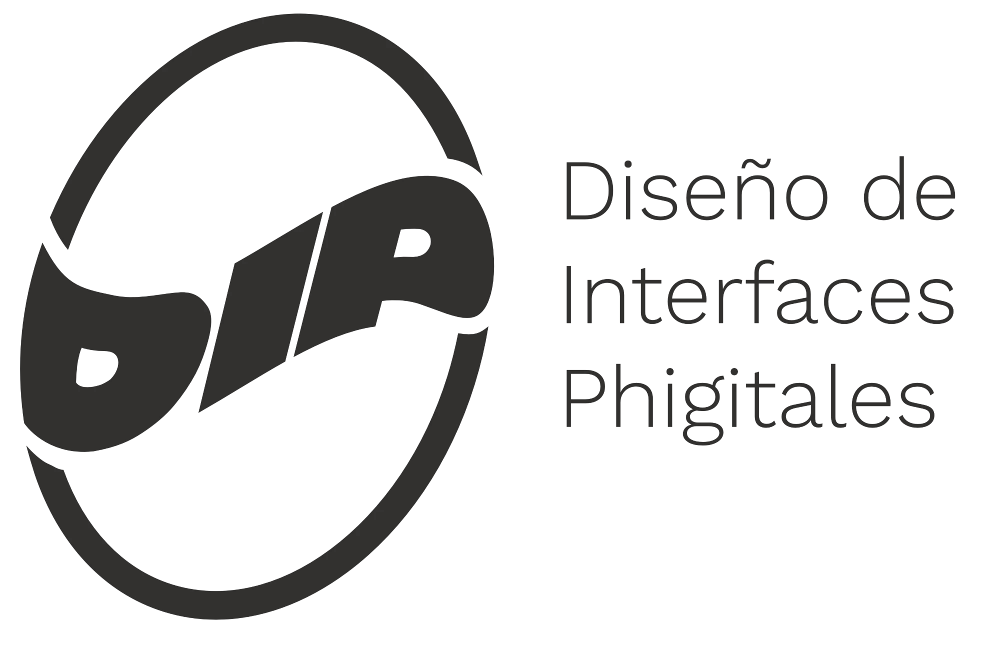

# Relevo

Sistema *phygital* para recuperar intenciones personales durante el ocio digital

Memoria para optar al título profesional de Diseñador, mención Diseño Gráfico

Johan Maximiliano Yantén Acevedo

Profesores guía: Sergio Majluf y Simón Gallardo

Modalidad: Taller de Titulación

Facultad de Arquitectura, Arte y Diseño

Escuela de Diseño

Santiago, Chile, diciembre de 2026

# Agradecimientos

A todos quienes hicieron posible este proyecto.

A mi mamá, por estar siempre presente, por apoyarme y darme todo lo necesario para seguir mis sueños.

A mi abuela, por su compañía eterna, enseñanza y ser un impulso para seguir adelante.

A ambas, por permitir que la creatividad, el arte y la entretención formen parte de mi vida.

A mis profesores guía, por acompañar cada etapa del proyecto y compartir sus valiosos conocimientos.

A las personas que me dieron su tiempo en las entrevistas, en las encuestas y en las pruebas.

# Resumen

El ocio digital es el conjunto de actividades que una persona realiza con dispositivos digitales en su tiempo disponible para descansar, entretenerse, satisfacer su curiosidad o vincularse con otros. A veces una sesión se prolonga sin que la persona haya decidido seguir, y otra actividad que también quería hacer deja de estar presente cuando aún podía empezarla. Este proyecto diseñó y evaluó un sistema *phygital* (físico y digital) para recuperar esa intención a tiempo, sin bloquear el teléfono ni decidir por la persona.

Se entrevistó a ocho personas sobre su última sesión de ocio digital y se encuestó a 53 sobre la última vez que siguieron en una aplicación más de lo que querían. También se revisaron las herramientas existentes y estudios sobre la memoria y la atención. Así se vio que la duración no define la importancia de una sesión, que la mayoría de las herramientas actúan sobre el uso del teléfono y no sobre lo que se deja de hacer, y que no corresponde intervenir cuando el ocio digital tiene sentido para quien lo vive. De esos hallazgos surgieron ocho criterios de diseño, y de ellos, Relevo: una aplicación y un objeto que la persona deja donde empieza su actividad.

Tres personas usaron Relevo en sus hogares durante cinco semanas: primero con un localizador Bluetooth comercial como objeto y luego con una notificación. Con el objeto supieron qué querían hacer antes de mirar la pantalla en 19 de 21 respuestas y siempre recordaron cómo empezar; con la notificación recordaron igual, pero a menudo la notaron tarde o nunca. La prueba muestra que el sistema funciona en el uso cotidiano. Con tres personas y la notificación siempre en segundo lugar, no permite afirmar que el objeto la supere ni que el lugar sea lo que ayuda.

Palabras clave: ocio digital, memoria prospectiva, diseño *phygital*

# Abstract

Digital leisure is the set of activities a person carries out on digital devices in their free time to rest, have fun, satisfy their curiosity or connect with others. Sometimes a session goes on without the person having decided to continue, and another activity they also wanted to do fades from view while it could still be started. This project designed and evaluated a phygital (physical and digital) system to bring that intention back in time, without blocking the phone or deciding for the person.

To understand this, the project interviewed eight people about their last digital leisure session and surveyed 53 people about the last time they stayed in an app longer than they wanted. It also reviewed existing tools in light of studies on memory and attention. This showed that duration alone does not define how much a session matters, that most tools act on phone use rather than on what is left undone, and that no intervention is called for when digital leisure is meaningful to the person. These findings led to eight design criteria, from which Relevo was born: an app and an object that the person places where the activity begins.

Three people used Relevo at home for five weeks: first with a commercial Bluetooth tracker as the object, then with a phone notification. With the object, they knew what they wanted to do before looking at the screen in 19 of 21 responses and always remembered how to start; with the notification, they remembered just as well, but often noticed it late or not at all. The test shows that the system works in everyday use. With three people and the notification always tested second, it cannot show that the object outperforms it or that the place is what helps.

Keywords: digital leisure, prospective memory, phygital design

# Índice

<!-- Las páginas se ponen al diagramar en Affinity. -->

- 1. Motivación personal
- 2. Introducción
- 3. Antecedentes y estado de la cuestión
- 4. Marco teórico por ámbitos
- 5. Planteamiento del problema
- 6. Justificación
- 7. Usuario, contexto y hallazgos de entrevistas
- 8. Estado del arte y referentes
- 9. Criterios de diseño
- 10. Formulación
- 11. Bajada proyectual: decisiones de diseño
- 12. Factibilidad y límites
- 13. Plan de desarrollo y validación
- 14. Conclusiones
- Referencias
- Índice de tablas y figuras
- Glosario
- Anexos

# 1. Motivación personal

Me ocurre con frecuencia abrir una aplicación para descansar unos minutos y quedarme en ella más tiempo del que imaginaba. Al cerrarla noto que otras cosas que también quería hacer —dibujar, leer, salir a caminar o cocinar— dejaron de estar presentes. No decidí abandonarlas; dejaron de tener presencia en lo que hacía.

No pienso que todo uso del teléfono sea negativo. Muchas veces encuentro en él entretención, conversación, información o un descanso que realmente necesitaba. Lo que me inquieta es la diferencia entre elegir seguir en el teléfono y seguir por inercia, como si el dispositivo decidiera por mí.

Me interesa estudiar ese momento sin convertirlo en un juicio sobre disciplina o productividad: ¿por qué algo que quería hacer pierde presencia?, ¿qué lo favorece y cómo podría el diseño ayudar a que vuelva? La pregunta nace de mi experiencia y parte de un límite claro: descansar, cambiar de actividad o seguir frente al teléfono pueden ser decisiones igualmente válidas.

# 2. Introducción

Los teléfonos inteligentes reúnen en un mismo dispositivo la comunicación, la información, el trabajo y el entretenimiento. Con ellos cambió la forma de organizar el tiempo y de descansar: una persona puede conversar, escuchar música, jugar, mirar una serie o recorrer una red social sin cambiar de espacio. Esa variedad impide tratar el uso del teléfono como una sola experiencia y vuelve insuficiente cualquier juicio basado solo en cuánto tiempo se usa.

Aquí se entiende por *ocio digital* el conjunto de actividades que una persona realiza con dispositivos digitales en su tiempo disponible para descansar, entretenerse, satisfacer su curiosidad o vincularse con otros. Su valor no depende solo de la duración: una sesión larga puede ser satisfactoria y una breve puede sentirse inoportuna si pospone algo que la persona consideraba importante. Un estudio siguió durante dos semanas el uso del teléfono de 45 personas. El sentido de cada uso dependió de su motivo y de su tipo: usarlo por hábito para pasar el tiempo se vivió como menos significativo que usarlo con un propósito, aunque incluso ese uso podía servir como un breve escape (Lukoff et al., 2018).

El problema aparece en un momento preciso. Al comenzar una sesión de ocio digital la persona puede tener presente otra actividad que también quiere hacer: leer, dibujar, salir a caminar, ordenar su pieza o llamar a alguien. La sesión continúa y esa intención deja de estar presente; cuando la persona vuelve a pensar en ella, la ocasión puede haber cambiado o queda menos tiempo. La situación tiene dos formas: en una, la otra actividad deja de estar presente y se recuerda tarde; en la otra, sigue presente y aun así no se inicia. Este proyecto llama a ese fenómeno una pérdida del *sentido de agencia* (Lukoff et al., 2021). La sesión sigue sin que la persona vuelva a decidirla, y la actividad que quería hacer deja de orientar lo que hace.

Ese momento no ocurre en el vacío. Muchas aplicaciones están diseñadas para que la actividad continúe: el *desplazamiento infinito* carga contenido nuevo sin un final, y la reproducción automática inicia un contenido apenas termina otro. Estos patrones no determinan la conducta, pero reducen los momentos en que algo termina y aparece la oportunidad de elegir si seguir (Montag et al., 2019).

Las respuestas más difundidas actúan de forma directa y a veces drástica: las herramientas de bienestar digital miden el tiempo, fijan límites, bloquean aplicaciones o ponen una pausa antes de abrirlas (Lyngs et al., 2019; Figura 1). Sirven cuando alguien quiere reducir una conducta concreta. Pero detener lo que se está haciendo no devuelve lo que se quería hacer: un bloqueo puede cerrar una aplicación y dejar igualmente ausente la otra intención, o cortar un descanso que la persona sí quería.

La psicología ofrece un concepto que conviene revisar. La *memoria prospectiva* es la capacidad de recordar una acción que se quiere realizar cuando llega la ocasión de hacerla (McDaniel y Einstein, 2000). Recordar al final del día que se quería leer no equivale a recuperar esa intención cuando todavía era posible abrir el libro. Así planteado, el desafío no es frenar el uso del teléfono, sino lograr que una intención vuelva a tiempo sin convertirse en una obligación.

Este proyecto aborda ese desafío desde el diseño. Busca que una persona vuelva a considerar una actividad que ella misma eligió mientras la sesión continúa, sin prohibir la actividad actual ni decidir por ella qué forma de descanso vale más.

**Figura 1**

*Funciones de 367 herramientas de autocontrol digital*

[FIGURA POR INSERTAR: (doble) esquema de funciones: Bloquear o quitar distracciones | 74 % de las herramientas | Bloquear aplicaciones o sitios, Poner límites de tiempo, Quitar elementos que distraen; Registrar el uso | 38 % de las herramientas | Historial de uso, Gráficos del uso, Temporizador o cuenta regresiva; Avanzar hacia una meta | 35 % de las herramientas | Recordar una meta o una tarea, Recordar valores personales, Fijar metas de tiempo; Premiar o castigar | 22 % de las herramientas | Puntos y rachas, Tablas de posiciones o compartir el uso, Premios o castigos reales]

*Nota.* Elaboración propia a partir de Lyngs et al. (2019, pp. 7–8). Una herramienta puede tener funciones de más de un grupo.

# 3. Antecedentes y estado de la cuestión

Antes de proponer una respuesta conviene saber qué se ha estudiado y qué se ha probado sobre el uso del teléfono, los bloqueos y las pausas, y los recordatorios que se apoyan en un lugar o en un objeto.

## Uso del teléfono y sentido de la experiencia

Meier y Reinecke (2021) reunieron 34 revisiones sobre comunicación digital y salud mental: la asociación entre uso de redes sociales y salud mental fue en general negativa y pequeña, y varió según el tipo de uso y el indicador estudiado. Radtke et al. (2022) revisaron intervenciones de desconexión digital y encontraron resultados positivos, nulos y negativos. Reducir el uso no basta como criterio: no es una solución válida para todos. Importa también la relación entre lo que la persona hace y lo que quería hacer (de Segovia Vicente et al., 2024).

## Bloqueos, límites y pausas

Lyngs et al. (2019) analizaron 367 aplicaciones y extensiones de navegador: tres de cada cuatro bloqueaban o quitaban distracciones y alrededor de un tercio ayudaba a avanzar hacia una meta, por ejemplo recordándola o pidiendo fijarla. La mayoría de los estudios de evaluación que revisaron Monge Roffarello y De Russis (2023) duraron pocas semanas. Su metaanálisis estimó un efecto entre pequeño y mediano sobre el tiempo de uso, una medida que consideran demasiado gruesa para el bienestar.

En un experimento de campo de seis semanas con one sec, que demora la apertura de una aplicación y pide reconsiderarla, las personas desistieron en algo más de un tercio de los intentos. En otro experimento la opción explícita de desistir tuvo el mayor efecto y el mensaje de reflexión por sí solo no fue eficaz (Grüning et al., 2023). En los registros de quienes ya usaban la aplicación, el uso sube cuando la intervención se pausa y vuelve a bajar al retomarla (Haliburton et al., 2024). Uno de los autores de ambos estudios desarrolló la aplicación, como declaran los propios artículos. En cambio, MindPhone preguntaba al desbloquear el teléfono para qué se iba a usar o qué se haría después fuera de él. En un estudio de campo de dos semanas, la segunda pregunta redujo el uso distraído y favoreció volver antes al entorno; la primera aumentó la conciencia de los motivos de uso (Terzimehić et al., 2022).

## Recordatorios, lugares y objetos

Para acordarnos de algo más tarde solemos dejar una señal fuera de la cabeza: una nota, una alarma, un objeto a la vista. Esa señal ayuda: en un experimento, tener los encargos a la vista en la pantalla mejoró su cumplimiento en personas jóvenes y mayores (Ball et al., 2025). Tres estudios muestran de qué depende que sirva.

O’Rear y Radvansky (2019) estudiaron si un lugar recuerda qué hacer en él: mientras repartían mensajes en un centro comercial virtual, las personas debían cumplir una tarea concreta al entrar a cierta tienda, sin aviso. En el primer experimento, entrar solía bastar para recordarla, aunque hubiera pasado tiempo desde el encargo.

Sohn et al. (2005) llevaron esa idea a la vida diaria con Place-Its, una aplicación de teléfono que permitía escribir una nota y dejarla colgada de un lugar conocido para que apareciera al llegar ahí o al irse. Diez personas la usaron durante dos semanas. Hubo que volver a colgar cerca de uno de cada cinco recordatorios, porque aparecían en el lugar equivocado o en el correcto pero en un momento en que no se podía atender.

Chiu y Gilbert (2024) midieron lo que cuesta dejar la señal. En una tarea en el computador la persona podía confiar en su memoria o adelantarse: mover de inmediato un círculo al lado donde debía terminar para que su posición se lo recordara. Cuando adelantarse obligaba a cerrar cinco veces una ventana, las personas usaron menos ese recordatorio y perdieron parte de la precisión que les daba. Los autores lo comparan con una aplicación de recordatorios mal diseñada, que pide clics de más para anotar algo.

Otros trabajos llevaron el recordatorio a un objeto. The Tangible Reminder asociaba cada compromiso a un objeto cotidiano que se dejaba en una bandeja. La bandeja cambiaba de color al acercarse el plazo (Hermann et al., 2007). Servía a citas o tomas de medicamentos, no a intenciones que la persona puede decidir no realizar. Wobble sirvió para investigar en el hogar recordatorios que no reclaman la atención. Según sus autores, esos recordatorios convienen a intenciones que no exigen actuar de inmediato (Zekveld et al., 2017). Keppel et al. (2025) compararon durante nueve semanas un artefacto físico y uno digital que mostraban en el hogar datos de actividad física: ambos sirvieron de recordatorio y el físico generó más involucramiento.

## Alcance de los antecedentes

Las métricas describen el uso, los bloqueos modifican el acceso, las pausas abren una reconsideración y los recordatorios apoyan el recuerdo. Ninguna de estas respuestas muestra bajo qué condiciones lo que la persona quería hacer vuelve a orientar una decisión propia mientras la sesión de ocio digital continúa.

# 4. Marco teórico por ámbitos

Los antecedentes dicen qué se ha intentado, pero no por qué una intención deja de orientar lo que se hace. Tres ámbitos ayudan a entenderlo: la experiencia del ocio digital, las interfaces que sostienen su continuidad y los objetos y lugares que apoyan el recuerdo. Juntos indican qué condiciones debería respetar una ayuda.

## Experiencia del ocio digital

El sentido de una sesión se asocia con el motivo y el tipo de uso (Lukoff et al., 2018). Por eso conviene mirar cada vez la forma en que alguien usa el teléfono —cuándo empezó, qué hacía, para qué y qué más quería hacer— y no el total de horas.

Hay *conflicto entre metas* cuando una actividad dificulta avanzar en otra. De Segovia Vicente et al. (2024) lo midieron como la sensación de que el uso del teléfono impedía avanzar en metas en curso, como trabajar, estudiar o hacer ejercicio.

Abrir una aplicación a propósito no significa que cada minuto que sigue también sea una decisión: el motivo con que se abrió se va perdiendo mientras se usa, y lo que empezó como una elección puede continuar por costumbre (Lukoff et al., 2018). Para volver a decidir hace falta un momento que invite a preguntarse si seguir, cambiar o parar. Ese momento puede llegar cuando termina un video, con una pausa como las de one sec o con una señal del entorno.

## Diseño de la atención

Los patrones de interfaz descritos en la Introducción, como el desplazamiento infinito, orientan lo que se percibe y cómo avanza la interacción. Seguir con un gesto mínimo exige menos preparación que levantarse, ir a buscar algo o cambiar de espacio. Una *fricción* es un esfuerzo adicional, como esperar o confirmar. Agregarla puede abrir una ocasión de reconsiderar (Grüning et al., 2023). Pero también puede estorbar usos legítimos de la misma aplicación, como abrirla rápido para una tarea breve: tomar una nota o responder un mensaje (Haliburton et al., 2024).

En la teoría de la autodeterminación, la *autonomía* es actuar por voluntad propia: elegir fortalece la motivación y las órdenes la debilitan (Ryan y Deci, 2000, p. 70). En este proyecto eso se traduce en que la persona entienda la ayuda y pueda aceptarla, ajustarla o rechazarla. Una ayuda difícil de detener puede presionar a la persona, aunque no bloquee el teléfono.

Preparar el comienzo también ayuda. Las *intenciones de implementación* son planes que especifican de antemano cuándo, dónde y cómo actuar —si se presenta cierta situación, se inicia una respuesta— y acercan la intención a la acción (Gollwitzer y Sheeran, 2006). Pero un plan sirve solo si vuelve a la mente en el momento justo. De eso trata la memoria prospectiva.

## Recordar con objetos y lugares

La memoria prospectiva se distingue del recuerdo de acontecimientos pasados porque nadie pide explícitamente recordar: la intención debe volver por sí misma cuando todavía es posible actuar (McDaniel y Einstein, 2000).

El *marco multiproceso* explica cómo vuelve una intención: la persona puede vigilar el entorno esperando el momento indicado, o un evento puede traerla de vuelta de forma espontánea (McDaniel y Einstein, 2000; Figura 2). Que ocurra lo segundo depende de la señal, de la actividad en curso y de la persona. Los recordatorios que más ayudaron fueron los que nombraban a la vez el momento de actuar y la acción que había que hacer; los que solo nombraban el momento no mejoraron el recuerdo (Guynn et al., 1998, p. 296). Los estudios sobre el lugar evalúan intenciones que se recuperan al estar en el sitio (O’Rear y Radvansky, 2019). Una señal que proviene del lugar donde comienza la actividad podría indicar qué hacer y con qué empezar.

**Figura 2**

*Dos caminos para que vuelva una intención*

[FIGURA POR INSERTAR: (columna) esquema de caminos: Vigilar | La persona revisa si llegó el momento | Exige atención constante, Se vuelve difícil si otra actividad la absorbe; Recordar ante una señal | Algo del entorno trae de vuelta la intención | Puede funcionar aunque la atención esté en otra parte]

*Nota.* Elaboración propia a partir de McDaniel y Einstein (2000).

Una nota, un libro sobre la mesa o una alarma son formas de *descarga cognitiva*: la acción física que reduce la demanda cognitiva de una tarea. Cuando se usa el entorno para dejar un aviso de una intención que se cumplirá después, se habla de *descarga de intenciones* (Risko y Gilbert, 2016). Todo recordatorio reúne una señal que avisa que hay algo que recordar y un mensaje que dice qué es (Figura 3). El ideal tiene los dos (Norman, 1988/2002, p. 73).

**Figura 3**

*Señal y mensaje de un recordatorio*

[FIGURA POR INSERTAR: (columna) esquema de recordatorio: Señal | Avisa que hay algo que recordar | En Relevo: el sonido del objeto; Mensaje | Dice qué es | En Relevo: el lugar donde suena y el primer paso que está ahí]

*Nota.* Elaboración propia a partir de Norman (1988/2002, p. 73).

Kirsh (1995, p. 31) muestra que la disposición de los objetos puede simplificar la elección, la percepción y el cálculo mental. Dejar algo junto a la puerta para no olvidar llevarlo es uno de sus ejemplos: el objeto puesto en el lugar indicado llama la atención en el momento oportuno y trae de vuelta la intención (Kirsh, 1995, p. 38).

La *interacción tangible* lleva la información digital a objetos que se pueden tocar. Ishii y Ullmer (1997) propusieron que la información se integrara en objetos y superficies cotidianos. Distinguieron dos formas de recibirla (Figura 4). En primer plano están los objetos que se usan con atención. En segundo plano están las señales del ambiente que informan sin pedir atención, como una luz, un sonido o una corriente de aire. Para este proyecto es relevante entender que un objeto puede decir algo por dónde está, más que por lo que se hace con él.

**Figura 4**

*Paso de la señal del segundo plano al primero*

[FIGURA POR INSERTAR: (columna) pasos de atención: Antes de la señal | En primer plano: Pantalla | En segundo plano: Objeto junto a un primer paso; Suena el objeto | En primer plano: Sonido y actividad recordada | En segundo plano: Pantalla; Termina la señal | En primer plano: Decisión de la persona | En segundo plano: Objeto y pantalla]

*Nota.* Elaboración propia a partir de Weiser y Brown (1997).

La *calm technology* es un término de Weiser y Brown (1997) que describe el ideal de esas señales: informar en segundo plano, pasar al primero solo cuando hace falta y luego volver (Figura 4).

Una señal sonora tensiona ese ideal. Para alcanzar a alguien absorto en una pantalla, la señal tiene que pasar al primer plano. El sonido lo logra porque se oye aunque la atención esté en otra parte; esa misma virtud lo vuelve intrusivo (Norman, 1988/2002, p. 103).

Cada ámbito deja condiciones para una ayuda (Figura 5): mirar cada sesión por su sentido y respetar el descanso, crear una ocasión de decidir que la persona pueda rechazar, y una señal oportuna que remita a la acción y vuelva al segundo plano.

Juntas, esas condiciones dejan una idea de diseño: una ayuda podría devolver a tiempo lo que la persona quería hacer si llega desde fuera de la pantalla, desde el lugar donde la actividad comienza, y si deja la decisión en sus manos.

**Figura 5**

*Condiciones de cada ámbito y la idea de diseño que dejan*

[FIGURA POR INSERTAR: (doble) esquema de ámbitos: Experiencia del ocio digital | Mirar el sentido de cada sesión | Más que su duración, Respetar el descanso que la persona quería; Diseño de la atención | Crear una ocasión de decidir | Sin una fricción que estorbe, Que la persona acepte, ajuste o rechace la ayuda; Recuerdo de intenciones | Una señal en el momento oportuno | Que remita a la acción y no solo a la ocasión, Que vuelva al segundo plano; Idea de diseño | Devolver a tiempo lo que la persona quería hacer | Desde fuera de la pantalla, Desde el lugar donde la actividad comienza, Con la decisión en sus manos]

*Nota.* Elaboración propia a partir de los tres ámbitos de este capítulo.

# 5. Planteamiento del problema

El proyecto nace de una experiencia del autor, contada en la motivación (capítulo 1): seguir en una aplicación más de lo previsto y notar, al cerrarla, que otra cosa que quería hacer dejó de estar presente (Figura 6).

No es una experiencia aislada. En las entrevistas y en la encuesta del proyecto (capítulo 7), la situación se repitió. La última vez que siguieron en una aplicación más de lo que querían, 43 de 47 personas querían hacer otra cosa y 44 de 47 estaban en casa. Casi todas sabían cómo la habrían empezado.

Además, ocurre en un contexto que la facilita. En Chile el teléfono es el principal medio de acceso a internet: entre los hogares conectados, el teléfono inteligente fue el dispositivo más extendido, presente en el 99,1 % (Subsecretaría de Telecomunicaciones, 2025). Las aplicaciones con que se descansa están hechas para continuar, con desplazamiento infinito y reproducción automática (Montag et al., 2019). En YouTube, la reproducción automática y las recomendaciones reducen el sentido de agencia de quienes la usan (Lukoff et al., 2021). Aun así, descansar con el teléfono puede ser justo lo que la persona necesita (Reinecke y Hofmann, 2016).

## Problemática

Una persona abre una aplicación para descansar unos minutos antes de dibujar, algo que quería hacer desde la tarde. Una hora después la cierra y ya es tarde para empezar. No decidió abandonar el dibujo: mientras la sesión de ocio digital seguía, el dibujo no volvió a aparecer. Que lo recuerde después muestra que la intención no se perdió. Lo que faltó fue que volviera a tiempo, cuando todavía podía orientar la decisión.

**Figura 6**

*Ejemplo de una intención que vuelve tarde*

[FIGURA POR INSERTAR: (columna) esquema de problema: Antes | Hay algo que la persona quiere hacer | Dibujar en la tarde; Durante | Abre una aplicación para descansar | La sesión de ocio digital sigue, El dibujo no vuelve a aparecer; Después | Una hora más tarde | Lo recuerda, Ya es tarde para empezar]

*Nota.* Elaboración propia a partir del ejemplo del texto.

Por eso es un problema. Lo que se pierde no son horas, sino una decisión: una intención propia deja de orientar lo que la persona hace cuando todavía podía hacerlo. Es una pérdida del sentido de agencia, porque la sesión sigue sin que la persona vuelva a decidirla.

Eso también explica cómo se formula. Plantearlo como tiempo de uso llevaría a medir y a bloquear, lo que no devuelve la intención y puede cortar un descanso valioso. Plantearlo como un recuerdo que no llega a tiempo, en cambio, lo vuelve abordable desde el diseño: una intención puede volver cuando aparece una señal asociada a ella (McDaniel y Einstein, 2000). Así, el problema queda formulado de este modo: **durante algunas sesiones de ocio digital, una actividad que la persona también quería realizar deja de estar presente y vuelve cuando la oportunidad ya pasó.**

Hay datos de que una intención pierde fuerza mientras la sesión continúa. Lukoff et al. (2018) preguntaron a 45 personas en distintos momentos de cada uso del teléfono si usaban la aplicación para lograr algo concreto o para pasar el tiempo: la primera respuesta bajó del 65,6 % al abrirla al 51,4 % durante su uso (p. 22:16). Ese estudio mide el propósito del propio uso, no otra actividad fuera del teléfono. Para esta última, la encuesta del proyecto ofrece un primer indicio: casi la mitad de quienes tenían otra cosa que hacer la última vez que siguieron en una aplicación más de lo que querían no la empezó (Anexo B). Es una muestra pequeña, pero apunta en la misma dirección.

## Causas

Tres causas ayudan a explicar por qué una intención deja de volver a tiempo (Figura 7).

**Figura 7**

*Causas de que una intención vuelva tarde*

[FIGURA POR INSERTAR: (columna) esquema de causas: Atención ocupada | La sesión absorbe la atención | Queda poca atención para vigilar el momento, La intención depende de una señal; Continuidad sostenida por la interfaz | El contenido sigue sin un final | Desplazamiento infinito y reproducción automática, Un sistema elige qué viene después; Ocio juzgado con la vara de la productividad | El descanso se vive como tiempo perdido | Se disfruta menos, Se daña lo que se quería cuidar]

*Nota.* Elaboración propia a partir de McDaniel y Einstein (2000), Montag et al. (2019) y Tonietto et al. (2021).

**La atención está ocupada.** Recordar una acción futura exige que la intención vuelva sin que nadie pida recordarla, ya sea porque la persona vigila si llegó el momento o porque algo del entorno la trae de vuelta (McDaniel y Einstein, 2000). Cuando una sesión absorbe la atención, quedan menos recursos para vigilar (McDaniel y Einstein, 2000, p. S138). De ahí la importancia de la señal. Un estudio con más de mil personas adultas combinó cuestionarios breves durante el día con registros del uso del teléfono. Cuanto más se prolongaba el desplazamiento sin propósito por redes sociales, más culpa declaraban las personas. El conflicto con otras metas explicaba parte de esa relación (de Segovia Vicente et al., 2024). En promedio ese conflicto fue bajo: el problema aparece en algunas sesiones, no en todas. El estudio no distingue el olvido de la postergación, pero muestra que otras intenciones pesan en cómo se vive una sesión de ocio digital.

**Continuidad sostenida por la interfaz.** Un capítulo de una serie de TV, una canción o una página tienen un final reconocible. En cambio, el desplazamiento infinito y la reproducción automática mantienen abierta la secuencia y ofrecen una acción siguiente con poco esfuerzo (Montag et al., 2019). La interfaz no actúa sola, pero define cuándo aparecen los cierres y las ocasiones de elegir. Además, detrás de la interfaz un sistema elige qué viene después y aprende más de lo que la persona hace que de lo que dice querer. En YouTube el modelo que ordena las recomendaciones se entrenó para predecir cuánto tiempo se verá cada video (Covington et al., 2016). Denis Parra, especialista en sistemas de recomendación de la Pontificia Universidad Católica de Chile, explica que ver un video completo se ajusta mejor al objetivo de la plataforma aunque no se marque con un “me gusta”. Ese objetivo es “que el usuario pase mucho tiempo viendo videos para poder poner publicidad y monetizar así la plataforma” (D. Parra, comunicación personal, 4 de noviembre de 2026). Lo que una persona elige en el momento no siempre coincide con lo que quiere, y un sistema que solo mira su conducta puede confundir ambas cosas (Kleinberg et al., 2024).

**Ocio juzgado con la vara de la productividad.** Tonietto et al. (2021) observaron que considerar el ocio una pérdida de tiempo disminuye su disfrute, sobre todo cuando la actividad se realiza como un fin en sí misma. El estudio no trata del teléfono, pero advierte que presentar el descanso como tiempo perdido puede dañar lo que pretende cuidar.

## Desafío de diseño

De ahí nace el desafío: **ayudar a que la persona recuerde a tiempo algo que quería hacer, sin bloquear lo que está haciendo, sin decidir por ella y sin intervenir cuando el ocio digital conserva sentido.** Recordar una intención significa aquí devolverle a la persona la oportunidad de tomar una decisión, no convertirla en una obligación.

# 6. Justificación

El teléfono reúne actividades que no pueden evaluarse con una sola regla. Las mediciones de tiempo informan cuánto se usó, pero no si una sesión en el teléfono respondió al propósito de la persona ni si aplazó otra intención. Una revisión de herramientas de autocontrol digital considera el tiempo de pantalla una medida demasiado gruesa para la variedad de metas y usos (Monge Roffarello y De Russis, 2023). Una respuesta más precisa debe reconocer tanto el derecho a cambiar de actividad como el de seguir descansando en el teléfono.

Cuando las alternativas se reducen a bloquear, contabilizar o comparar, una ayuda puede volverse otra fuente de presión. Tener una intención no debería crear una deuda con el sistema: ignorar una señal, cambiar de idea o seguir en el teléfono son resultados legítimos porque la posibilidad de elegir fortalece la motivación propia y las órdenes la debilitan (Ryan y Deci, 2000, p. 70).

La mayoría de las respuestas actuales trabajan dentro de la pantalla, incluso las que recuerdan una meta (Lyngs et al., 2019). Las intervenciones contra el uso distraído del teléfono casi no incluyen el entorno físico de las personas (Terzimehić et al., 2022). Ese vacío corresponde al diseño: la interacción tangible estudia cómo los objetos y el espacio físico participan en la relación con la información digital (Ishii y Ullmer, 1997). Un recordatorio ubicado en el entorno podría devolver una intención desde fuera de la pantalla que concentra la atención, como lo explora Wobble, un objeto que recuerda desde la casa (Zekveld et al., 2017).

El problema involucra variables que el diseño ha creado: continuidad, cierres, momentos, canales, jerarquías, esfuerzo y control.

# 7. Usuario, contexto y hallazgos de entrevistas

## Público del proyecto

Los capítulos anteriores explican el fenómeno en general; faltaba saber cómo lo viven las personas. El proyecto se dirige a personas de 19 a 30 años que usan el teléfono para descansar y que en ciertos momentos quieren hacer otra cosa —leer, dibujar, tocar un instrumento, ordenar— y no la empiezan. El problema no es propio de una edad: le ocurre a quien tiene en mente una actividad propia y la pierde de vista mientras la sesión de ocio digital continúa. Acotar el rango sirve para empezar el estudio con experiencias comparables sin mezclar etapas de la vida muy distintas. También deja abierta su ampliación a otras edades a futuro.

## Fuentes de información

Para entender el problema desde quienes lo viven, el proyecto combinó dos fuentes que se complementan. Las entrevistas dieron profundidad: cómo una actividad que la persona quería hacer —leer, dibujar, ordenar su pieza— se pierde de vista mientras sigue en el teléfono, por qué ocurre y cuándo ese tiempo en el teléfono sí vale la pena. La encuesta mostró qué tan común es esa situación, dónde ocurre y si las personas sabrían cómo empezar lo que dejaron pendiente.

En junio de 2026 se entrevistó a ocho personas de 19 a 27 años sobre su tiempo libre, su última sesión de ocio digital, cómo la valoraban, sus intentos de descansar sin el teléfono y una propuesta de diseño anterior (Anexo A). Las conversaciones se grabaron, se transcribieron y se ordenaron con el método Framework, que cruza personas y temas en una matriz para ver qué se repite y qué cambia de un caso a otro (Goldsmith, 2021; Figura 8). De esa comparación surgieron dos tipos ideales a partir de situaciones típicas que reúnen casos parecidos (Stapley et al., 2022).

**Figura 8**

*Análisis de las entrevistas con el método Framework*

<!-- página -->

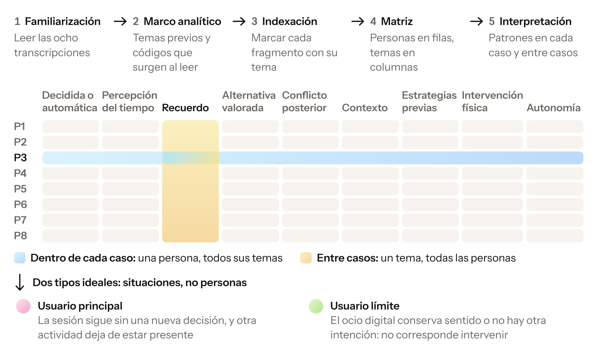

*Nota.* Elaboración propia a partir de Goldsmith (2021), Stapley et al. (2022) y los códigos de cada entrevista (Anexo A, Tabla A4). El color marca los códigos que acercan un caso a cada tipo; un guion, que el código no apareció en esa entrevista.

La encuesta tuvo 16 preguntas y 53 respuestas de personas de 19 a 30 años. Preguntó por la última vez que alguien siguió en una aplicación más tiempo del que quería, qué otra cosa quería hacer en ese momento y cómo la habría empezado. También pidió su opinión sobre una propuesta de diseño. Las respuestas abiertas se agruparon en categorías. Las preguntas, las categorías y los recuentos están en el Anexo B.

Ambas fuentes recogen lo que las personas recuerdan y cuentan, una forma que se completa observando lo que hacen en el momento (E. B.-N. Sanders y Stappers, 2012, p. 69). Por eso sus hallazgos orientan el diseño, y el uso lo pone después a prueba (Figura 9).

**Figura 9**

*Lo que las personas cuentan y lo que hacen*

[FIGURA POR INSERTAR: (columna) esquema de fuentes: Respuestas de las personas | Entrevistas y encuesta | Motivos, Valoraciones, Recuerdos; Lo que hacen | Durante el uso cotidiano | Cuándo ocurre, Qué hacen en el momento, Qué deciden después]

*Nota.* Elaboración propia a partir de E. B.-N. Sanders y Stappers (2012, p. 69).

## Relato de los usuarios

Una persona abrió Instagram al acostarse, reconoció que tenía sueño y aun así siguió. Recordaba bien lo que hizo durante ese tiempo, pero dudó de que hubiera sido un descanso. Otra vio videos humorísticos, perdió la noción del tiempo y reconoció que tenía cosas mejores que hacer, aunque la sesión de ocio digital le sirvió como pausa. Una actividad puede permitir descansar y a la vez competir con otra intención. Una tercera describió entretenimiento seguido de aburrimiento sin una meta concreta: no toda insatisfacción esconde una intención que recuperar. Y dos distinguieron usos dirigidos —leer manga, resolver un sudoku— de otros rutinarios: el problema no pertenece a una persona, sino a ciertos momentos.

No todo el tiempo largo en el teléfono fue un problema. Una persona pasó varias horas en videollamada con una amiga y lo valoró por el vínculo social que conlleva; otra escuchaba un pódcast mientras comía, y otra describió una rutina difícil de explicar que igual consideraba como descanso. Por eso ni la duración ni el tipo de aplicación bastan para saber cuándo intervenir: una alerta que solo mire el tiempo de uso podría cortar justo una conversación o un descanso.

Para descansar sin el teléfono casi todas las personas entrevistadas lo alejan, lo guardan, lo silencian o activan el modo No molestar. Casi siempre lo hacen para proteger otra actividad que querían hacer. Algunas contaron que vuelven a mirarlo si queda cerca. La distancia y el silencio apartan el teléfono, pero no hacen presente otra actividad que quieren recuperar.

Ante una propuesta de proyecto anterior la mayoría pidió señales simples, calmadas, discretas o visuales. Una persona expresó su rechazo ante las calificaciones, rachas y comparaciones entre días de uso en aplicaciones.

La encuesta mostró que el caso estudiado es frecuente y ocurre mayoritariamente en casa (Figura 10). De quienes querían hacer otra cosa la última vez, casi la mitad no la empezó y una de cada tres la empezó, a veces mucho más tarde. El *primer paso* es la acción breve con que la actividad comienza, como abrir un libro para leer o ponerse las zapatillas para salir a correr. Casi todas esas personas sabían cuál habría sido el suyo.

**Figura 10**

*Última vez que siguieron en el teléfono, según la encuesta*

[FIGURA POR INSERTAR: (columna) cuatro datos en tarjetas: 39 de 45, Personas que siguieron en una aplicación más tiempo del que querían al menos un día de la última semana; 43 de 47, Querían hacer otra cosa en ese tiempo; 42 de 43, Sabían cuál habría sido su primer paso; 44 de 47, Estaban en casa]

*Nota.* Elaboración propia a partir de la encuesta en línea del proyecto (53 respuestas). Cada total corresponde a quienes respondieron esa pregunta.

Después de leer la propuesta de diseño casi todas las personas explicaron bien cómo funcionaba. La mayoría pondría un parlante junto a la actividad y preferiría un sonido de 15 segundos o menos. La disposición a probarla quedó repartida (Figura 11). Quienes no la probarían temían sobre todo que sonara en un mal momento, el esfuerzo de prepararla y el ruido que podía causar.

**Figura 11**

*Opiniones sobre la propuesta*

[FIGURA POR INSERTAR: (doble) gráfico de barras: Ubicación preferida del parlante | Junto a la actividad: 36, En un lugar general de la casa: 7, No lo usaría o no sabe dónde: 10; Duración preferida del sonido | 1 a 5 segundos: 16, 6 a 15 segundos: 25, 16 a 30 segundos: 3, Que no sonara: 7, No sabe: 2; Probabilidad de probarlo, de 1 a 5 | 5: 3, 4: 20, 3: 18, 2: 8, 1: 3, No sabe: 1]

*Nota.* Elaboración propia a partir de la encuesta en línea del proyecto (53 respuestas). Número de personas por respuesta.

## Dos situaciones de uso

Los hallazgos dejan ver dos situaciones típicas, o tipos ideales (Stapley et al., 2022): una en la que ayudar tiene sentido y otra en la que no. Por convención cada una se nombra como un usuario: el usuario principal y el usuario límite (Figura 12).

**Figura 12**

*Situaciones de uso*

[FIGURA POR INSERTAR: (columna) esquema de situaciones: Usuario principal | Ocio digital que sigue sin una nueva decisión | Quiere hacer otra cosa y sabe cómo empezar, Necesita recordarla a tiempo; Usuario límite | Ocio digital con sentido | Por ejemplo, la videollamada o el pódcast al comer, Necesita poder no activar o ignorar la señal]

*Nota.* Elaboración propia a partir de las entrevistas y la encuesta.

**Usuario principal:** La sesión sigue sin que la persona lo haya decidido, y algo que quería hacer deja de estar presente. Puede pasar de dos formas: la actividad se recuerda tarde o se recuerda a tiempo y aun así no se empieza. En las entrevistas aparece sobre todo la segunda —una persona sabía que tenía sueño y siguió—. En la encuesta el caso más común es una actividad que la persona quiere hacer y sabe cómo empezar, pero no empieza. Lo que necesita es volver a considerarla a tiempo sin que el dispositivo decida por ella.

**Usuario límite:** El tiempo en el teléfono es una elección y tiene valor: se comparte, como la videollamada con una amiga; acompaña, como el pódcast al comer; da pie al descanso, o simplemente no hay otra cosa que hacer.

Tres personas mostraron que una misma persona puede estar en una u otra situación según el día. Lo que necesita es conservar su autonomía: una ayuda que interviene cuando no corresponde convierte en problema algo valioso. Por eso, poder no usarla, ignorarla o detenerla importa tanto como recibirla.

Ambas situaciones ocurren sobre todo en casa, donde las intenciones y las formas de cuidarlas dependen de objetos, superficies y distancias. Por eso el proyecto se sitúa en el hogar.

## Necesidades de diseño

De ambas situaciones se desprenden necesidades comunes (Figura 13): una intención explícita, una preparación voluntaria, la posibilidad de cambiar de idea, una señal discreta, una salida inmediata y la ausencia de sanciones o sentimientos de culpa. Así, las entrevistas y la encuesta precisan el momento que debe abordarse y cuándo intervenir podría ser un error.

**Figura 13**

*Necesidades de diseño comunes a ambas situaciones*

[FIGURA POR INSERTAR: (doble) esquema de necesidades: Al preparar | Lo que la persona elige | Una intención explícita, Una preparación voluntaria; Cuando suena | Lo que la señal respeta | Una señal discreta, Una salida inmediata; Al decidir | Lo que la persona conserva | La posibilidad de cambiar de idea, Sin sanciones ni culpa]

*Nota.* Elaboración propia a partir de las entrevistas y la encuesta (Anexos A y B).

# 8. Estado del arte y referentes

## Método y criterios de comparación

Con esas necesidades a la vista se compararon productos, servicios y proyectos que abordan el uso del teléfono. La comparación usó seis preguntas: qué problema abordan, qué mecanismo usan, dónde ocurre la interacción principal, qué exigen configurar y mantener, cómo cuidan la autonomía y qué evidencia hay sobre sus resultados.

## Herramientas digitales de medición y pausa

Apple Screen Time y Google Digital Wellbeing miden el uso y fijan límites de tiempo en el teléfono (Apple, s. f.-b; Google, s. f.-a). Las aplicaciones de pausa llevan a una reconsideración al momento de la apertura: one sec la interrumpe con un ejercicio breve (one sec, s. f.). Su evidencia no informa qué hace la persona después de negarse (Grüning et al., 2023; Haliburton et al., 2024). Pause Point impone una espera de 10 segundos al abrir una aplicación que sea considerada distractora (S. Sanders, 2026). Estas herramientas y MindPhone (Terzimehić et al., 2022) intervienen en la pantalla, no en el lugar donde otra actividad puede comenzar.

## Proyectos de diseño en Chile

Dos memorias de diseño de la Universidad de Chile pusieron a prueba la gamificación en aplicaciones de bienestar. Riveros Oltra (2023) probó durante ocho semanas una función de hábitos con misiones, rachas y recompensas para Betterfly: los usuarios activos semanales aumentaron un 6,4 % frente a una meta del 20 %. Venegas Álvarez (2026) diseñó un diario de gratitud que evitaba premiar con puntos o niveles. Tras un mes con 36 personas no pudo demostrar que resolviera la baja adherencia a la aplicación. Ambas buscan que la persona vuelva a la aplicación, mientras que Relevo busca que la deje. El caso de Betterfly es coherente con la decisión de excluir rachas y premios (criterio 4).

## Objetos que restringen o alejan el teléfono

Brick vincula una aplicación con un dispositivo físico que activa o revierte un bloqueo del teléfono (Brick LLC, s. f.-a). Combina alejamiento y un compromiso previo, o *precompromiso*: una decisión que restringe deliberadamente las opciones futuras. Brick Zone bloquea las aplicaciones donde se deja, sin un alcance ni una precisión documentados (Brick LLC, s. f.-b). Allí el lugar es una condición restrictiva, no un recordatorio.

Unpluq (s. f.) y Screenless Breaker (Screenless, s. f.) usan etiquetas o llaves NFC (comunicación de campo cercano). En todos el objeto hace visible el compromiso, pero requiere costos de compra, compatibilidad y aprendizaje. kSafe es un contenedor que se cierra de forma temporizada. Restringe sin conexión con el teléfono, pero es difícil de revertir (Kitchen Safe, s. f.). Alejar o silenciar el teléfono, como relataron las entrevistas, es más reversible que estas opciones y no tiene un costo.

## Objetos de foco y recordatorios en el lugar

Focusaur combina un dispositivo físico con una aplicación, etiquetas NFC, sonidos, funciones de hábito y recompensas (Focusaur, s. f.). Sus recompensas pueden llevar a la persona a actuar para cumplir con el sistema. El producto se orienta a la productividad. The Tangible Reminder y Wobble (capítulo 3) recuerdan una acción sin depender del teléfono. Place-Its la entregaba en la pantalla a partir de una ubicación detectada, que no equivale a una relación personal con el espacio.

Una última familia resuelve el soporte, no el uso del teléfono: los localizadores Bluetooth y llaveros antipérdida. Son objetos pequeños que suenan cuando la persona los busca desde el teléfono. Muestran que una señal sonora cabe en un objeto pequeño y autónomo.

## Evidencia y límites de cada familia

La evidencia es desigual: los estudios sobre herramientas digitales suelen ser breves y medir el tiempo de uso (capítulo 3). En objetos comerciales no se encontró ninguna evaluación. Además, casi la mitad de las personas que habían desactivado los avisos de una herramienta de autocontrol digital aceptaron darle otra oportunidad (Peña-Albert et al., 2026).

## Oportunidad

Lo revisado deja ver una oportunidad: una ayuda que parta de lo que la persona quiere hacer, la una a un primer paso concreto, use una condición que ella entienda, suene desde el lugar donde la actividad empieza y deje la decisión en sus manos. Cada una de esas piezas ya existe por separado, incluso en patentes que vinculan el teléfono o los recordatorios con lugares y objetos (Driver y Nasgowitz, 2026; Herman y Akmal, 2023; Newman y Newman, 2022; Rosenberg, 2009). Lo que no se encontró es un producto, un prototipo ni un estudio que las reúna, ni que compare esa señal con una notificación en el teléfono (Anexo C).

Casi todas las herramientas revisadas limitan el uso del teléfono o trabajan dentro de la pantalla. El opuesto —recordar lo que la persona quería hacer desde fuera de la pantalla— está casi vacío, como muestra el mapa de la Figura 14. Sus dos referentes, The Tangible Reminder y Wobble, son prototipos de investigación que no se pensaron para el ocio digital.

**Figura 14**

*Función y lugar de cada herramienta y de Relevo*

[FIGURA POR INSERTAR: (doble) mapa de posicionamiento: Limita el uso del teléfono | Recuerda lo que la persona quería hacer | En la pantalla | Fuera de la pantalla; Screen Time y Bienestar | 1.2 | 1.5; one sec y Pause Point | 2.2 | 3.1; MindPhone | 5.6 | 2.3; Place-Its | 7.7 | 3.5; Brick y Unpluq | 1.3 | 7.4; kSafe y dejar el teléfono lejos | 1.7 | 8.8; Focusaur | 4.6 | 6.4; The Tangible Reminder | 7.7 | 7.6; Relevo | 9.2 | 9.1]

*Nota.* Elaboración propia. Ubicación aproximada, según la documentación de cada producto y los estudios citados; no busca medir la eficacia. Relevo se ubica por lo que propone, no por resultados. Las fichas de cada referente están en el Anexo C.

De ahí nace una pregunta de diseño: ¿vuelve mejor una intención si la trae una señal desde el lugar donde la actividad comienza que si la trae una notificación?

# 9. Criterios de diseño

De lo investigado surgen ocho criterios de diseño: reglas que guían cada decisión de Relevo y que después sirven para evaluarlo. Kolko (2011, p. 40) llama síntesis a este paso, que traduce en criterios de diseño específicos la oportunidad que describe la investigación. Los criterios se agrupan en tres ideas (Figura 15): partir de la persona, dejarle las decisiones y justificar el esfuerzo.

**Figura 15**

*Ocho criterios de diseño en tres grupos*

[FIGURA POR INSERTAR: (columna) esquema de criterios: Partir de la persona | Criterios 1 y 2 | La persona elige qué quiere hacer, Cada actividad empieza con un paso concreto; Dejarle las decisiones | Criterios 3 a 5 | La persona decide cuándo suena, La persona decide qué hacer cuando suena, El sistema interviene solo cuando hace falta; Justificar el esfuerzo | Criterios 6 a 8 | Prepararlo toma poco esfuerzo, Lo que la persona escribe es privado, El objeto suma algo que el teléfono no da]

*Nota.* Elaboración propia a partir de la revisión bibliográfica, las entrevistas, la encuesta y la comparación de herramientas.

## Partir de la persona

**Criterio 1. La persona elige qué quiere hacer.** Relevo parte de una actividad que la persona anota, no de algo que el sistema deduzca de su uso del teléfono. Como fundamento, el mismo tiempo en una aplicación puede ser descanso o pérdida según el motivo y el tipo de uso (Lukoff et al., 2018). En las entrevistas una sesión parecida fue descanso para unas personas y no para otras. Solo quien usa el teléfono sabe si había otra cosa que quería hacer. Para Parra, partir de lo que la persona declara podría evitar que un sistema premie solo lo inmediato (D. Parra, comunicación personal, 4 de noviembre de 2026).

**Criterio 2. Cada actividad empieza con un paso concreto.** Junto a la actividad la persona anota cómo empieza: una acción breve que puede hacer enseguida, como abrir un libro o sacar la guitarra. Como fundamento, decidir de antemano cuándo, dónde y cómo actuar ayuda a pasar de la intención a la acción (Gollwitzer y Sheeran, 2006). Relevo toma de esa idea el cómo y el dónde, y deja el compromiso a la persona. En la encuesta casi todas las personas que tenían otra cosa que querían hacer supieron decir cómo la habrían empezado.

## Dejarle las decisiones

**Criterio 3. La persona decide cuándo suena.** Relevo suena cuando las aplicaciones que la persona eligió suman el tiempo que ella fijó. Es una regla fácil de entender y de cambiar. El teléfono puede medir cuánto se usa cada aplicación (Google, 2026b), pero no sabe para qué se usa. En la encuesta una de cada tres personas valoró el teléfono para aprender o resolver algo. Por eso la condición la pone la persona, no el sistema.

**Criterio 4. La persona decide qué hacer cuando suena.** Puede empezar su actividad, dejarla para después o cambiar de idea. Las tres respuestas valen lo mismo. Ofrecer una opción real ayuda más que insistir, como mostró one sec (Grüning et al., 2023). Por eso las respuestas tampoco se califican: una racha puede volverse una meta en sí misma y desanimar cuando se rompe (Silverman y Barasch, 2023).

**Criterio 5. El sistema interviene solo cuando hace falta.** Suena solo cuando la persona preparó un relevo. Muchas veces el teléfono es justo lo que la persona quiere: una videollamada larga o un pódcast a la hora de comer. Tratar ese tiempo como perdido le quita disfrute (Tonietto et al., 2021).

## Justificar el esfuerzo

**Criterio 6. Prepararlo toma poco esfuerzo.** Un relevo se prepara con pocas preguntas que se responden eligiendo. Cuanto más esfuerzo exige fijar un recordatorio, menos se usa (Chiu y Gilbert, 2024). En la encuesta el esfuerzo fue uno de los motivos más citados para no probar la propuesta.

**Criterio 7. Lo que la persona escribe es privado.** Relevo guarda la actividad con un código en lugar del nombre, la notificación de la pantalla bloqueada no la muestra y la persona puede borrar sus datos cuando quiera. Lo que alguien quiere hacer es personal. En la encuesta casi una de cada cuatro personas aceptaría solo un registro guardado en su teléfono, o ninguno.

**Criterio 8. El objeto suma algo que el teléfono no da.** Relevo suena desde el lugar donde la actividad empieza. Un objeto cuesta dinero y cuidado, así que debe aportar algo propio. El lugar puede ayudar a recordar una acción futura (O’Rear y Radvansky, 2019). La prueba compara ese aporte con una notificación en el teléfono.

# 10. Formulación

## La tensión en la decisión

Durante una sesión de ocio digital, la persona puede querer dos cosas a la vez: seguir en lo que está y hacer otra actividad que eligió. Es el *conflicto entre metas* del capítulo 4 (de Segovia Vicente et al., 2024), y es común: los deseos de usar medios están entre los que más terminan en fallas de autocontrol (Hofmann et al., 2012). Pero la tensión no siempre se resuelve por preferencia. Seguir cuesta poco y la interfaz siempre ofrece algo más (Montag et al., 2019). Con la atención ocupada, la intención vuelve con dificultad por sí sola (McDaniel y Einstein, 2000). Así, la decisión de seguir deja de tomarse y la persona pierde el sentido de agencia sobre la sesión (Lukoff et al., 2021). Seguir tampoco es siempre un error: el mismo uso puede ser un descanso que la persona necesita (Reinecke y Hofmann, 2016).

Relevo actúa en un punto preciso de esa tensión: cuando la intención debería volver (Figura 16). No restringe el teléfono ni busca convencer. Trae la actividad desde el lugar donde empieza, con su primer paso, para que la decisión vuelva a ser de la persona: empezar, dejarla para después o cambiar de idea.

**Figura 16**

*Dónde actúa Relevo en la tensión de la decisión*

[FIGURA POR INSERTAR: (columna) esquema de tensión: Antes de la sesión | Hay algo que la persona quiere hacer | Una actividad elegida, Su primer paso; Durante la sesión | La decisión deja de tomarse | El contenido sigue sin cierres, La atención está ocupada; La señal | Relevo suena desde el lugar | Vuelven la actividad y su primer paso; La decisión | La persona vuelve a elegir | Empezar, Dejarla para después, Cambiar de idea]

*Nota.* Elaboración propia a partir de McDaniel y Einstein (2000), Montag et al. (2019) y Lukoff et al. (2021).

## Problema de diseño y pregunta de investigación

El estado del arte mostró que medir, pausar o restringir el uso del teléfono no devuelve lo que la persona quería hacer ni le indica por dónde empezar. El problema de diseño es entonces ayudar a que una intención propia vuelva a tiempo, con el teléfono libre y la decisión en manos de la persona. De ahí nace la pregunta que guía el proyecto:

> ¿Cuál es el efecto de un sistema *phygital* que vincula una actividad pendiente con su lugar de inicio sobre el recuerdo oportuno de esa actividad durante el ocio digital?

La pregunta relaciona el sistema con el recuerdo. La investigación y los criterios del capítulo 9 proponen las condiciones que debe cumplir una ayuda así. Una de ellas —que la señal llegue desde el lugar donde la actividad comienza (criterio 8)— se pone a prueba como hipótesis frente a una notificación en el teléfono. El recuerdo oportuno significa que al sonar la señal la persona recuerda qué quería hacer y cómo empezar antes de leerlo en la pantalla, sin que se le exija dejar el teléfono.

## Definición y alcance de Relevo

Relevo es un sistema *phygital*: una aplicación para Android y un objeto que se deja junto al primer paso de una actividad. En la aplicación la persona anota qué quiere hacer, cómo empieza y cuánto tiempo quiere darse en ciertas aplicaciones. Cuando ese tiempo se cumple, el objeto suena unos 30 segundos desde ese lugar y ella decide qué hacer. Para probar la señal y el lugar antes de fabricar el objeto propio, el prototipo usa un llavero Bluetooth comercial, un Tag. El alcance es doméstico y personal: una persona, la actividad, las aplicaciones que ella elige y un lugar de su casa. La aplicación es solo para Android. El capítulo 12 explica por qué se descartó el iPhone.

## Hipótesis y objetivos

> Si se diseña un sistema *phygital* que vincula una actividad que la persona quiere hacer con el lugar donde comienza, entonces la persona la recordará a tiempo durante el ocio digital, porque una intención se recupera cuando aparece una señal asociada a ella.

La hipótesis se apoya en la memoria prospectiva: una intención puede volver sin esfuerzo cuando algo del entorno la trae de vuelta (McDaniel y Einstein, 2000), y el lugar donde debe hacerse una acción puede ofrecer esa señal (Kirsh, 1995; O’Rear y Radvansky, 2019). Se compone de tres supuestos:

1. Asociación: al oír la señal la persona sabe que es Relevo y recuerda su actividad y cómo empezar, sin mirar el teléfono.
2. Decisión: la señal devuelve la intención sin presionar; la persona elige con libertad si empezar, dejarlo para después o cambiar de idea.
3. Soporte: el objeto ayuda al menos tanto como una notificación en el teléfono, sin más molestia.

La prueba en los hogares examina los tres.

El objetivo general es diseñar y evaluar Relevo: un sistema que ayude a recordar a tiempo algo que la persona quería hacer mientras descansa con el teléfono, con una señal junto al primer paso de esa actividad y la decisión en sus manos. La evaluación es formativa: busca encontrar problemas y mejorar el diseño en cada vuelta (Nielsen, 1993, p. 170).

Los objetivos específicos son:

1. Entender cuándo el uso del teléfono desplaza algo que la persona quería hacer, a partir de estudios, entrevistas, una encuesta y herramientas existentes.
2. Diseñar una aplicación y un objeto que lleven esa intención al lugar donde la actividad empieza.
3. Comparar el sonido del objeto junto al primer paso con una notificación en el teléfono.
4. Probar en hogares si las personas reconocen la señal y si les resulta cómoda. El recuerdo oportuno se mide con la proporción de respuestas a la señal en que supieron qué querían hacer antes de mirar la pantalla y recordaron cómo empezar. También se registra en qué proporción de esas respuestas empezaron la actividad.

La Figura 17 muestra cómo se encadenan el problema, la pregunta, la hipótesis, los objetivos, la prueba y las conclusiones.

**Figura 17**

*Cadena de la formulación, del problema a las conclusiones*

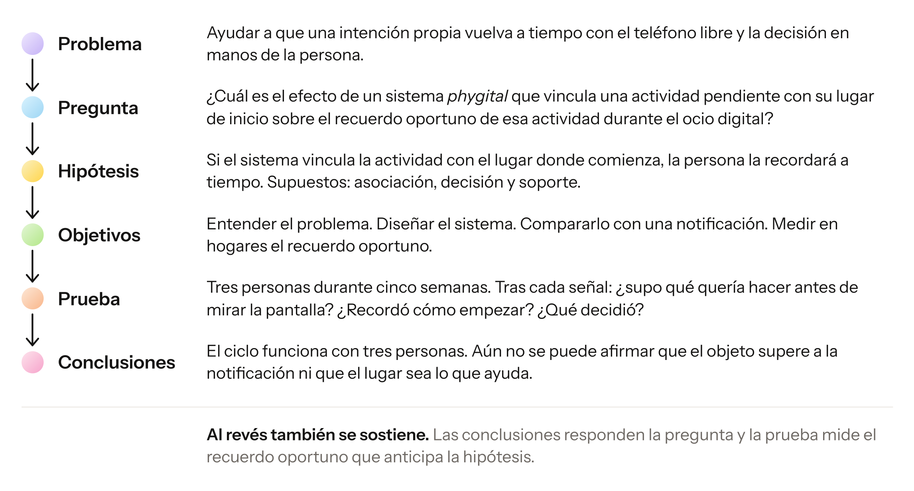

*Nota.* Elaboración propia.

## Enfoque metodológico y plan de trabajo

El proyecto sigue un enfoque de investigación a través del diseño: diseñar el objeto y la aplicación es en sí mismo una forma de investigar, y su resultado es un aporte (Zimmerman et al., 2007; Figura 18).

**Figura 18**

*Método del proyecto, de la investigación a la iteración*

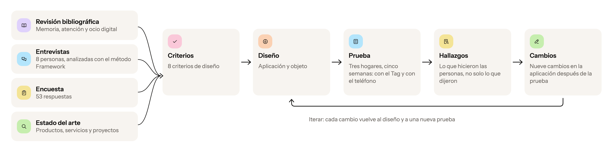

*Nota.* Elaboración propia. Los cambios están en los Anexos D y G.

Para entender mejor una de las causas del problema —el sistema que decide qué contenido viene después— se consultó por escrito a Denis Parra, especialista en sistemas de recomendación de la Pontificia Universidad Católica de Chile. Su respuesta del 4 de noviembre de 2026 suma a los estudios la mirada de quien diseña esos sistemas. Se usa como opinión experta que aporta un valor importante al proyecto.

### Uso de inteligencia artificial

El proyecto usó tres herramientas de inteligencia artificial generativa. Cursor de Anysphere y Codex de OpenAI ayudaron a programar los primeros prototipos de la aplicación. Claude Code de Anthropic la desarrolló a partir de los prototipos, bocetos y *wireframes* del autor. Además, Claude ayudó a modelar el objeto en 3D a partir de los bocetos. Las tres apoyaron la revisión de la redacción y la verificación de citas (Anexo E).

### Proceso del proyecto

La Figura 19 muestra el camino que ha tenido el proyecto: un proceso con cambios de rumbo en que cada decisión respondió a lo que se iba aprendiendo. Probar el prototipo en hogares permitió observar lo que las personas hacen y no solo lo que dicen (E. B.-N. Sanders y Stappers, 2012, p. 66). Cada cambio del prototipo puso a prueba una decisión concreta, con consecuencias visibles en el uso.

**Figura 19**

*Proceso del proyecto, de marzo a noviembre de 2026*

[FIGURA POR INSERTAR: (columna) cronología del proyecto: Marzo a junio | Seminario: un objeto para dejar el teléfono; 11 y 12 de junio | Ocho entrevistas; 20 de julio | Examen: aclarar el objeto, el contexto y el usuario; Fines de agosto | Análisis de entrevistas y criterios; Septiembre | Señal sonora, Tag y primera aplicación; 29 de septiembre | Hipótesis y encuesta; 5 al 7 de octubre | El Tag en el prototipo y comienzo de la prueba; 9 al 20 de octubre | Cambios y mejoras a partir de las sugerencias de los usuarios; 21 de octubre al 8 de noviembre | La señal, solo en el teléfono; 28 de octubre | Modelo de Relevo en 3D; 29 de octubre al 9 de noviembre | Rediseño de la aplicación]

*Nota.* Elaboración propia.

# 11. Bajada proyectual: decisiones de diseño

Con el problema y los criterios claros comienza la etapa de diseño. La meta es que Relevo se sienta liviano: que prepararlo tome poco, que acompañe sin pedir atención y que al sonar devuelva algo que la persona misma eligió (Figura 20). Cada decisión de este capítulo responde a esa idea.

## Funcionamiento de Relevo

Relevo reúne tres piezas: una aplicación, un objeto y un lugar. En la aplicación la persona anota algo que quiere hacer y cómo empezaría. Deja el objeto junto a ese primer paso —sobre el libro o al lado de la guitarra— y elige cuánto tiempo quiere darse en ciertas aplicaciones. Cuando ese tiempo se cumple, Relevo suena desde ese lugar. El sonido llega desde fuera de la pantalla y desde donde la actividad empieza: la persona no necesita leer nada para saber qué era.

**Figura 20**

*Recorrido del usuario*

[FIGURA POR INSERTAR: (doble) esquema de recorrido: Preparar | Una pregunta por pantalla | ¿Qué quieres hacer?, ¿Cómo empiezas la actividad?, ¿En qué lugar empieza?, ¿Cuándo suena?, ¿Dónde suena?; Seguir en el teléfono | Relevo cuenta en segundo plano | Las aplicaciones seleccionadas suman el tiempo fijado; Oír la señal | Desde el lugar de la actividad | Un sonido de unos 30 segundos que termina solo o se puede silenciar; Decidir | Tres opciones del mismo peso | Comencé la actividad, La dejé para después, Cambié de idea]

*Nota.* Elaboración propia. Las preguntas son las de la aplicación.

**Justificación del objeto.** La pantalla es justo lo que tiene la atención de la persona y una notificación llega por ese mismo canal. En cambio, un objeto en el lugar de la actividad une la señal con el comienzo: algo del entorno puede traer de vuelta una intención (McDaniel y Einstein, 2000), y el lugar donde la acción ocurre puede ser esa señal (O’Rear y Radvansky, 2019). Es la idea de la interacción tangible y de la *calm technology*: que los objetos y el entorno informen sin pedir la pantalla (Ishii y Ullmer, 1997; Weiser y Brown, 1997).

**Decisión abierta.** Cuando Relevo suena, la persona puede empezar su actividad, dejarla para después o cambiar de idea. Las tres respuestas valen lo mismo. Hay tres razones. La primera: seguir en el teléfono no siempre es un error; a veces es justo el descanso que la persona eligió, como mostraron las entrevistas. La segunda: los mensajes que parecen ser una orden despiertan rechazo, y recordar que la decisión es de la persona lo reduce (Miller et al., 2007). Además, ofrecer una opción real ayuda más que insistir (criterio 4). La tercera: decidir por uno mismo es una necesidad psicológica básica (Ryan y Deci, 2000). Si Relevo decidiera por la persona, sería una presión más y dejaría de ser una ayuda. Este principio ordena todas las demás decisiones.

## Recorrido del usuario

El recorrido tiene cuatro momentos: preparar, seguir en el teléfono, oír la señal y decidir. Cada uno se diseñó para pedir lo mínimo (Figura 21).

**Figura 21**

*Flujo de la aplicación*

<!-- página -->

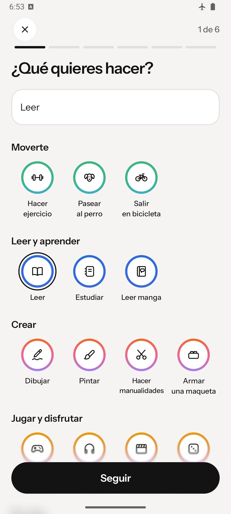 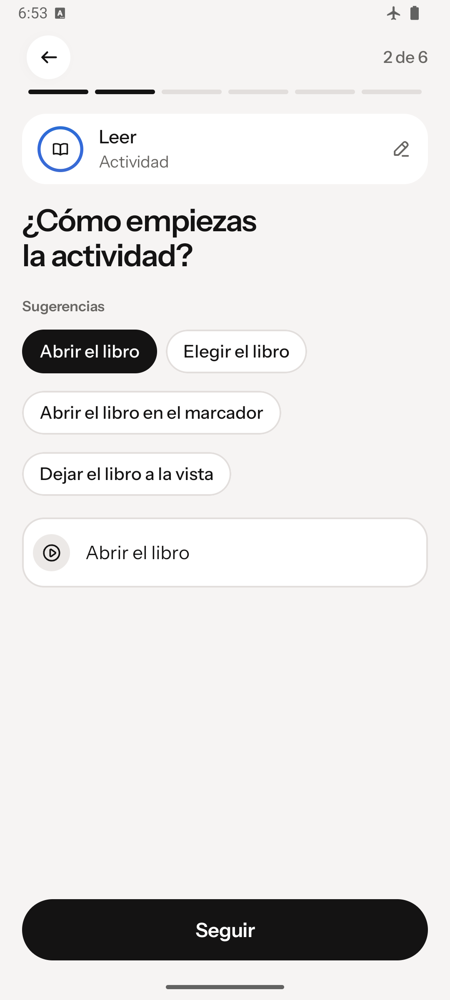 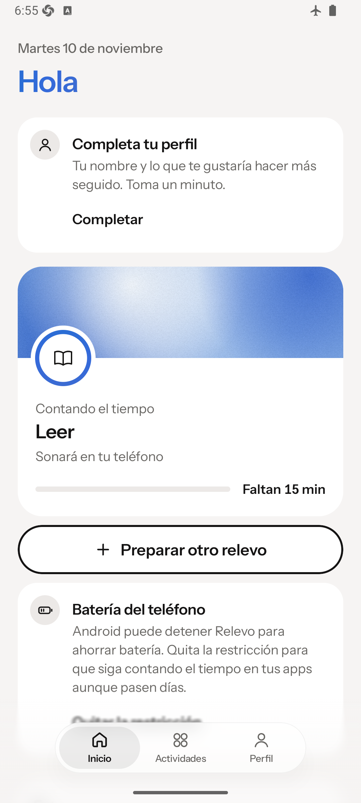  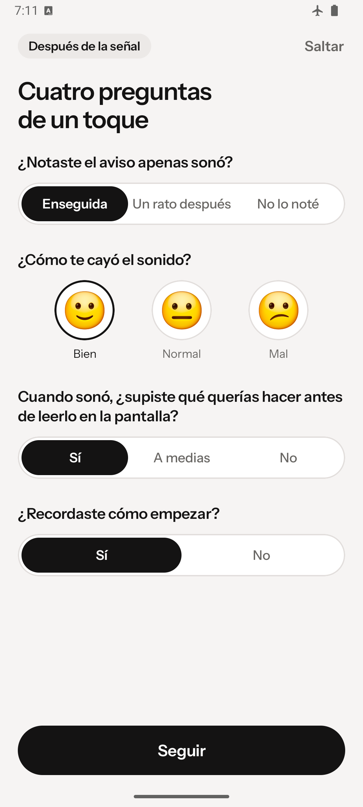 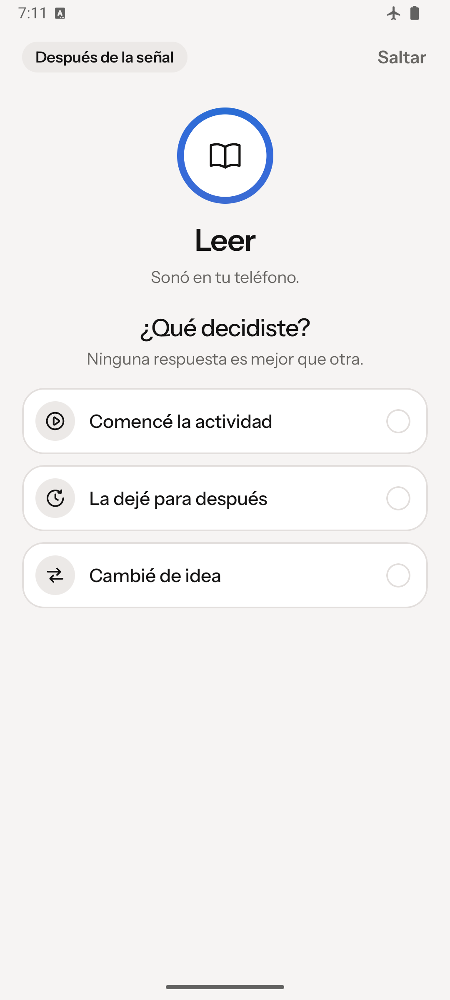

*Nota.* Capturas de la aplicación, con un perfil de prueba. Preparar un relevo toma seis pantallas; aquí se muestran las dos primeras. La señal suena fuera de la pantalla. Durante la prueba en los hogares, los pasos eran los mismos y la interfaz era otra (Anexo F).

**Preparar.** En la aplicación cada actividad preparada con su condición se llama un *relevo*. Prepararlo es responder unas pocas preguntas. Las respuestas requieren poco esfuerzo: se eligen entre opciones concretas, como “Abrir el libro” o “En el velador”, porque seleccionar cuesta menos que escribir. Cada esfuerzo de más hace menos probable que un recordatorio se prepare (Chiu y Gilbert, 2024). Escribir sigue disponible. El botón para seguir está siempre en el mismo lugar. Antes de activar, la persona hace sonar Relevo desde donde quedó y confirma que lo oye: sabe desde el primer día que la señal la va a escuchar. Cada dato de un relevo activo puede cambiarse en cualquier momento. Esta opción surgió de los comentarios de una persona durante la prueba.

**Seguir en el teléfono.** Mientras cuenta el tiempo, Relevo queda en segundo plano: la persona usa el teléfono como siempre. El tiempo que se cuenta es el que suman las aplicaciones que ella eligió, de 1 minuto a 6 horas: una regla fácil de entender y de ajustar. Una persona de la prueba bajó su límite de 45 a 35 minutos porque al sonar ya estaba demasiado inmersa en un video.

**Oír la señal.** Cuando se cumple el tiempo, Relevo suena desde el lugar de la actividad. El sonido dura unos 30 segundos y termina solo. La persona puede silenciarlo antes desde la aplicación o con el botón del Tag.

**Decidir.** Después vienen unas preguntas breves que se responden eligiendo una opción y que se pueden saltar. Al final viene la decisión: “Comencé la actividad”, “La dejé para después” y “Cambié de idea” tienen el mismo tamaño, color y lugar. Ninguna viene marcada de antemano: decide la persona. Con esa respuesta el relevo se cierra; en todo el ciclo pasa por seis estados (Figura 22).

**Figura 22**

*Estados de un relevo*

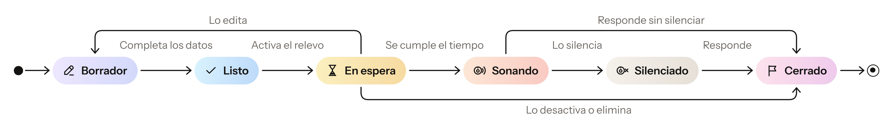

*Nota.* Elaboración propia a partir del código de la aplicación (Anexo G).

**Primer uso.** Antes del primer relevo, tres pantallas presentan Relevo, piden el consentimiento y el permiso para contar el tiempo en las aplicaciones. Después la aplicación acompaña a preparar el primer relevo. En la prueba eran once pantallas: las tres personas las completaron, pero el recorrido les resultó largo.

## Arquitectura de información

La aplicación tiene tres destinos en una barra de navegación inferior: Inicio, Actividades y Perfil. Los destinos se nombran con sustantivos y las acciones con verbos —“Preparar un relevo”, “Activar el relevo”— para que la persona distinga dónde está de lo que puede hacer. Inicio pone primero lo más próximo: el relevo que sonará antes o, después de una señal, la actividad con su primer paso y la opción de prepararla de nuevo. Debajo quedan los demás relevos y un resumen de la semana que solo cuenta hechos. En la prueba la pantalla de un relevo activo mostraba demasiado. Ahora deja a la vista solo la actividad, el tiempo que falta y una acción. Cuando la persona vuelve después de unos días, la aplicación saluda con “Hola de nuevo” sin decir cuántos días pasaron: contarlos convertiría el regreso en una falta o castigo. Así la aplicación acompaña sin convertirse en algo que hay que revisar. Actividades reúne las que la persona creó, los pasos de las que quiere sostener en el tiempo y algunas ideas. Perfil reúne lo que es suyo: sus relevos, sus actividades, sus pasos, sus aplicaciones y los ajustes (Figura 23).

**Figura 23**

*Arquitectura de información de la aplicación*

[FIGURA POR INSERTAR: esquema de arquitectura de información: Inicio | Lo más próximo | Relevo que sonará antes, Otros relevos activos, Preparar otro relevo, Esta semana; Actividades | Lo que la persona quiere hacer | Creadas por ti, Paso a paso, Ideas; Perfil | Lo que es de la persona | Relevos, Actividades, Pasos, Apps, Ajustes, Ayuda]

*Nota.* Elaboración propia a partir de la aplicación. Las pantallas que se usaron en la prueba están en el Anexo F.

## Lenguaje visual: Apple como referencia

La interfaz de Relevo toma como referencia las Human Interface Guidelines, las pautas con que Apple explica cómo diseñar para sus plataformas. No se eligieron por un efecto en particular, sino por cómo equilibran belleza y legibilidad: en ellas el diseño está al servicio de lo que la persona quiere hacer. La decisión se tomó frente a una primera interfaz plana: se buscaba una interfaz hermosa y fácil, sin sobrediseñar ni sobreexplicar.

Tres principios del sistema de diseño que Apple presentó en 2025 guiaron la interfaz (Apple, 2025a). La *jerarquía* se construye con el orden y la agrupación, no con adornos: los controles se apartan y el contenido —la actividad y su primer paso— queda adelante. El color destaca la acción principal. La *armonía* nace de las esquinas redondeadas de tarjetas, botones y ventanas: todo se siente parte de una misma forma. La *consistencia* hace que cada componente tenga siempre las mismas partes y aparezca donde la persona lo espera.

Para Relevo eso significa una aplicación que se aprende sin instrucciones y que se mantiene en segundo plano. Se abre pocas veces al día. Su trabajo es devolver la atención a otra actividad, como propone la *calm technology* (Weiser y Brown, 1997). Navegarla se parece a usar las aplicaciones que la persona ya conoce: una barra de pestañas abajo y un botón principal ancho, siempre al pie y cerca del pulgar. Cada uno de esos gestos se apoya en principios conocidos de la interacción: las personas prefieren que una interfaz funcione como las que ya usan, un objetivo grande y cercano se alcanza antes, elegir entre pocas opciones toma menos tiempo y una interfaz que responde sin hacer esperar se siente fluida (Yablonski, s. f.). Incluso la belleza del diseño de Relevo cumple una función, porque lo que se percibe bello tiende a percibirse más fácil de usar (Yablonski, s. f.).

La forma se repite en todas las escalas. Las cápsulas de los botones, las esquinas de las tarjetas y los círculos del logo comparten una misma curva. Por eso la aplicación, la marca y el objeto se reconocen como una familia. El desenfoque es sutil y aparece solo en la barra de navegación y en las ventanas que suben desde el borde, nunca sobre el contenido. Separa lo que se lee de lo que sirve para moverse, como proponen las pautas de Apple (Apple, 2025a). Junto con una opacidad progresiva sugiere que hay más contenido abajo y evita que el usuario dé por hecho que el contenido termina antes.

La jerarquía también se construye con lo que pasa: el color aparece relacionado con el momento (Figura 24). Al preparar un relevo dominan el blanco y el negro, y el color aparece solo en el anillo de la actividad. En Inicio la actividad se presenta en una tarjeta con su degradado. Cuando suena, ese degradado llena toda la pantalla. Si suena el objeto, el sonido se dibuja en los anillos de la actividad. El color es la herramienta de jerarquía más fuerte de la interfaz y se guarda para el único momento que debe pasar al primer plano. El resto del tiempo Relevo informa desde el segundo plano, como propone la *calm technology* (Weiser y Brown, 1997).

**Figura 24**

*Calma, presencia y señal: el color sube con el momento*

<!-- página -->

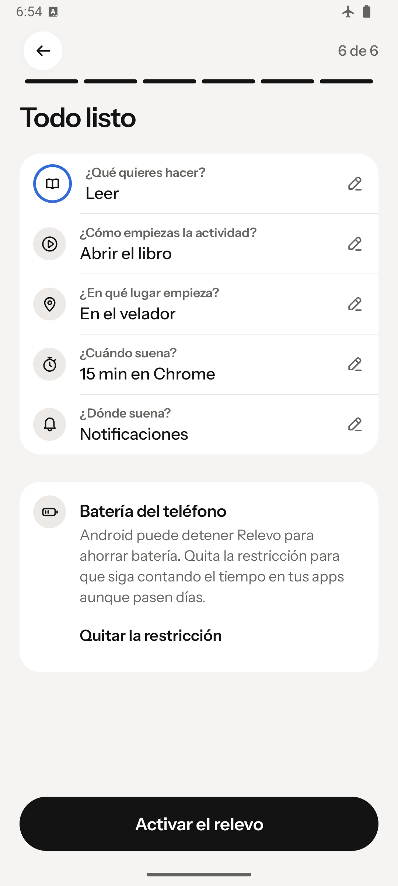 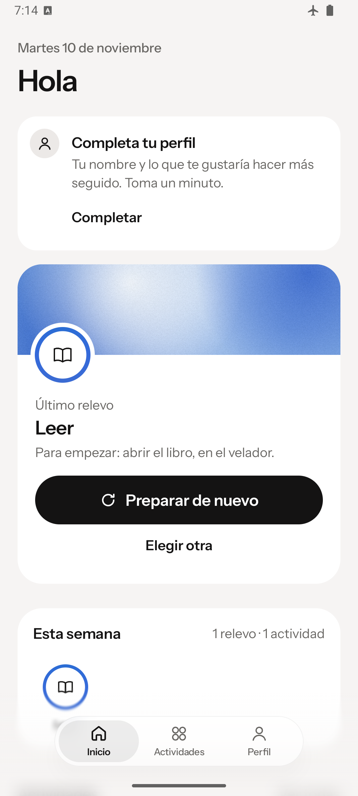 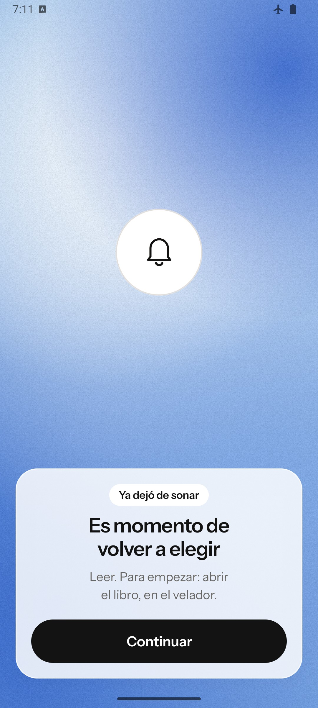

*Nota.* Capturas de la aplicación, con un perfil de prueba.

**Apple frente a Material Design.** La aplicación funciona en Android. Allí lo conocido es Material Design, el sistema de Google. De Apple se tomaron principios y una escala tipográfica, no una apariencia. La tipografía se lee en el cuerpo que usa iOS, un poco mayor que el de Material y con más interlineado, y los títulos en seminegrita marcan la jerarquía sin recurrir a cajas ni líneas (Android Open Source Project, s. f.; Apple, s. f.-c). Lo que pertenece al sistema —los permisos, las notificaciones y el gesto para volver atrás— se ve como en cualquier Android. Material Design completo se descartó porque su escala tipográfica más pequeña y sus títulos en regular no daban esa jerarquía clara en una aplicación que se abre pocas veces al día.

**Color e imagen.** Cada actividad tiene su ícono, un anillo con el color de su familia y un degradado con grano y volumen. El perfil tiene un emoji que la persona elige para identificarse. Las funciones de la interfaz van en blanco y negro para que el color de una actividad nunca se confunda con el de una función. La tipografía sobre cada color cambia a blanco o negro según qué tan claro u oscuro sea el fondo para mantener el contraste mínimo que piden las pautas de accesibilidad web (World Wide Web Consortium, 2024).

**Accesibilidad.** La opción “Letra grande” suma un 15 % al cuerpo tipográfico que ya usa la persona. Hay tema claro y oscuro. El movimiento se reduce si Android lo pide, por accesibilidad o por ahorro de batería. El color siempre va acompañado de una palabra y un ícono, como lo dictan las WCAG 2.2 (World Wide Web Consortium, 2024). Una prueba de cómo ven los colores las personas con daltonismo (Machado et al., 2009) muestra que dos pares de fichas se confunden: el celeste con el lila y el rosa con el durazno. Por eso el color ayuda, pero el ícono y la palabra informan. En cambio, la señal es sonora. Lo que depende solo del sonido deja fuera a quien no lo oye (World Wide Web Consortium, 2024). Para una persona sorda o con baja audición la salida en el teléfono avisa también en la pantalla, aunque pierde el lugar. Relevo, el objeto propio, debería sumar una señal visual y una vibración. Una etapa futura podría probarlo con personas con baja audición.

## Tono de comunicación

Las palabras también son parte de la interfaz. Los textos de Relevo partieron de un estudio de las guías de escritura de interfaces de Apple (2024, 2025b), Google (s. f.-b) y Microsoft (2021), y de la investigación sobre el lenguaje que presiona y el que deja elegir (Miller et al., 2007; Smit et al., 2019). De ese estudio surgió un tono de comunicación con cuatro rasgos (Figura 25).

**Figura 25**

*Rasgos del tono de comunicación de Relevo*

[FIGURA POR INSERTAR: (columna) esquema de tono: Cercano y tranquilo | Busca acompañar al usuario | “Queda anotado. Gracias por decirlo.”; Claro y concreto | Dice qué pasa y qué hacer | “No sonó en el dispositivo de audio. Revisa que esté encendido y conectado.”; Respetuoso de la decisión | Ofrece y no ordena | “Ninguna respuesta es mejor que otra.”; Honesto | Dice qué guarda y qué no ve | “Relevo no lee mensajes, fotos, búsquedas ni lo que hay en la pantalla.”]

*Nota.* Elaboración propia a partir de Apple (2024, 2025b), Google (s. f.-b) y Microsoft (2021). Los ejemplos son textos de la aplicación.

El tono es el mismo en toda la aplicación, pero se ajusta al momento: acogedor la primera vez, práctico al preparar, sereno mientras cuenta, neutro cuando suena y sobrio al hablar de datos. Relevo habla de tú en frases cortas y con palabras cotidianas —“querer” antes que “desear”, “usar” antes que “utilizar”—, como recomienda la guía de estilo en español de Microsoft (2021). Sigue además la regla del equipo de escritura de Apple que dice tan largo como haga falta y tan corto como se pueda (Apple, 2024). También pregunta en vez de rotular (“¿Cómo empiezas?”). Sus botones empiezan con un verbo que dice qué va a pasar, como “Activar el relevo” (Apple, 2025b).

El vocabulario también es una decisión. La aplicación habla de “actividad” y de “sonar”, palabras que dejan la intención en manos de la persona; *meta*, *tarea* o *alarma* la convertirían en un deber y por eso se evitan a toda costa. Por la misma razón evita el lenguaje de la obligación, como “debes” o “tienes que”, que despierta rechazo (Miller et al., 2007). Cuando hay opciones las nombra con el mismo peso porque un texto amable no reemplaza la posibilidad real de que la persona decida (Smit et al., 2019).

## Identidad

**Nombre.** Un relevo es el momento en que algo pasa de una mano a otra, como en una carrera de relevos. El nombre cuenta lo que el sistema busca: que la atención pase de la pantalla a lo que la persona quería hacer, sin que nadie se la quite. Es breve, se pronuncia con facilidad en español y viene del mundo de los traspasos y los turnos, no de las prohibiciones o límites.

**Logo.** Cuatro círculos se pasan el turno en el sentido del reloj y cada uno queda bajo el siguiente. Son el tiempo, el primer paso, el lugar y la decisión (Figura 26). El centro queda abierto: ese vacío es el traspaso de la pantalla a la actividad. Las formas circulares se asocian con suavidad y cuidado (Jiang et al., 2016). Los colores planos y sin transparencias se reproducen igual en pantalla, en papel o impresos sobre el objeto. Su construcción paso a paso y sus variantes están en el Anexo H.

**Figura 26**

*Sistema de identidad de Relevo*

[FIGURA POR INSERTAR: lámina de identidad: logotipo “relevo” con su símbolo; Tiempo #FFD54A; Primer paso #9DD6F4; Lugar #B3E788; Decisión #F6A3CB; Aa Instrument Sans, Regular, Medium y SemiBold; Íconos de Lucide y propios con sus reglas: retícula de 24, trazo de 1,6]

*Nota.* Elaboración propia.

**Paleta cromática.** La paleta se decidió por la función de cada color y no por la emoción que podría despertar, porque las asociaciones entre colores y emociones cambian según el contexto y la persona (Elliot y Maier, 2014; Jonauskaite et al., 2024). En Relevo el color distingue las partes de un relevo sin decir cuál importa más: es la traducción visual del principio de que ningún momento vale más que otro. Por eso las seis fichas son pastel y tienen casi la misma luminosidad, medida en OKLCH, un espacio de color que calcula cómo lo percibe el ojo y no cómo lo guarda la pantalla (Ottosson, 2020). Así pesan lo mismo cuando aparecen juntas, porque un color cambia de apariencia según los que tiene al lado (Albers, 2013). Son claras y poco saturadas porque la saturación eleva la activación emocional (Wilms y Oberfeld, 2018), y una ayuda que acompaña no debería sobresaltar. Cada color significa siempre lo mismo. Por eso la selección va en negro: si fuera amarilla, el amarillo significaría dos cosas. El color tampoco informa solo, porque siempre va con una palabra y un ícono, y la tipografía negra sobre cualquier ficha supera el contraste que piden las WCAG 2.2 (World Wide Web Consortium, 2024).

**Cada color.** Donde existe, la asignación sigue la señalética de seguridad, cuya norma da un significado estable a cuatro colores (International Organization for Standardization, 2011). Los códigos de cada color están en el Anexo H.

- **Amarillo, el tiempo**, la condición que hace sonar la señal. En la señalética pide atención sin prohibir, y es el color más asociado con la alegría (Jonauskaite et al., 2024).
- **Celeste, el primer paso.** En la señalética, el azul indica una acción que hay que realizar.
- **Verde, el lugar** donde empieza la actividad. En la señalética, el verde indica dónde está algo, como una salida o un botiquín.
- **Rosa, la decisión.** Conserva el amor que se asocia al rojo sin su asociación con la rabia, para que ninguna respuesta se sienta juzgada (Jonauskaite et al., 2024).

El lila y el durazno completan la paleta; su uso y sus códigos están en el Anexo H. Los círculos del logo son la versión más intensa de los cuatro colores de la lista (Figura 26). El rojo, el tono que más activa y muy ligado a la rabia (Wilms y Oberfeld, 2018), queda solo para los errores, como en la señalética. El negro y el gris no se usan para los estados de la persona.

**Tipografía.** La identidad usa dos tipografías sin serifa y cada una tiene su propio fin. El logotipo “relevo” va siempre en minúsculas y en Chillax Semibold (Indian Type Foundry, s. f.), convertida a trazos. Se eligió entre veinte tipografías sin serifa de Fontshare, el catálogo gratuito de esa fundición. Hubo tres razones: su “o” es casi un círculo y se relaciona con los círculos del símbolo; la “e” y la “r” terminan en curvas abiertas que hacen la palabra amable, y en tamaños pequeños no pierde la forma. La aplicación usa Instrument Sans, una grotesca de código abierto codiseñada por Rodrigo Fuenzalida, diseñador radicado en Santiago, y Jordan Egstad (Fuenzalida y Egstad, s. f.). Se eligió porque se lee bien en pantallas y en papel, porque sus pesos y anchos resuelven toda la jerarquía con una sola familia y su forma sobria deja el carácter al logotipo. En la aplicación la jerarquía sigue la de iOS: título grande, título, encabezado, texto y nota. Los títulos van en semibold y el texto en regular, siempre con una mayúscula inicial y sin interletrado abierto para que cada línea se lea como una frase.

**Iconografía.** Los íconos de la aplicación salen de Lucide, un conjunto de íconos de línea de código abierto cuya licencia permite usarlos, modificarlos y redistribuirlos siempre que se conserve su aviso (Lucide Contributors, s. f.-b). De los 118, 109 son de Lucide tal cual. Seis se adaptaron, como Suena, que lleva el Tag en lugar del parlante, y tres se dibujaron con sus reglas de construcción (Lucide Contributors, s. f.-a) porque Lucide no los tiene: el Tag, la colchoneta y la flor de loto. Su tamaño se ajustó a la vista, no a la medida: cada uno pesa como sus vecinos de Lucide cuando se lo desenfoca. Así, el dibujo propio queda para lo que es de Relevo, y todos los íconos comparten un mismo estilo. Entre las opciones de Lucide, cada actividad se dibuja con el objeto con que empieza, como un libro abierto para leer. El trazo, de 1,6 en el tamaño base, se afina en los tamaños grandes y se engruesa en los pequeños, para que el ícono pese parecido a la palabra que siempre lo acompaña. Su construcción está en el Anexo H.

**Proceso de la identidad.** Entre septiembre y octubre de 2026 se exploraron más de veinte propuestas de identidad. Un subrayado azul, que venía de “relevar” como resaltar, se descartó porque no decía qué hace Relevo. Las tipografías con serifa y las manuscritas se exploraron y se dejaron. El 11 de octubre quedaron definidos el logo de cuatro círculos, la paleta cromática de seis colores y los primeros íconos, que en noviembre se ajustaron a lo que pide la aplicación. Los bocetos partieron de la R, del gesto de pasar algo de una mano a otra y de los pasos del recorrido, que terminaron en los cuatro círculos (Figura 27). Las propuestas anteriores están en el Anexo H.

**Figura 27**

*Bocetos del logo*

<!-- doble -->

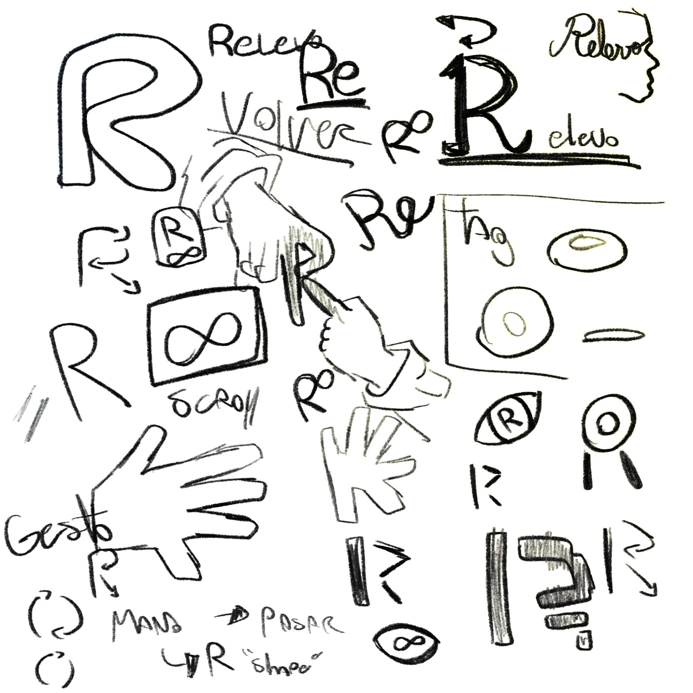 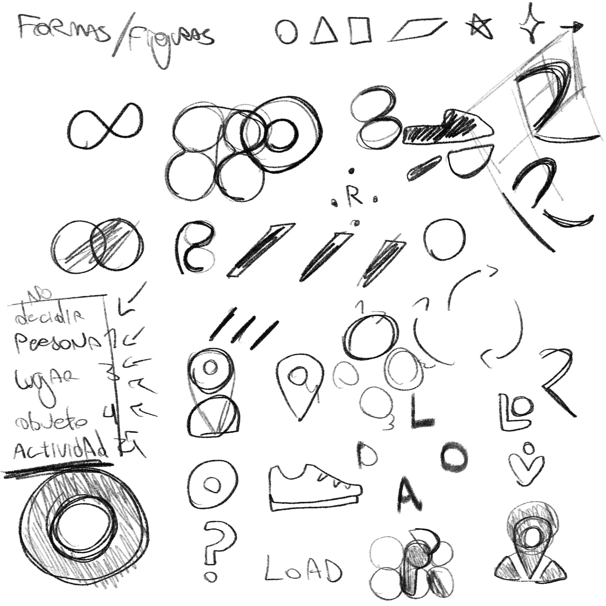 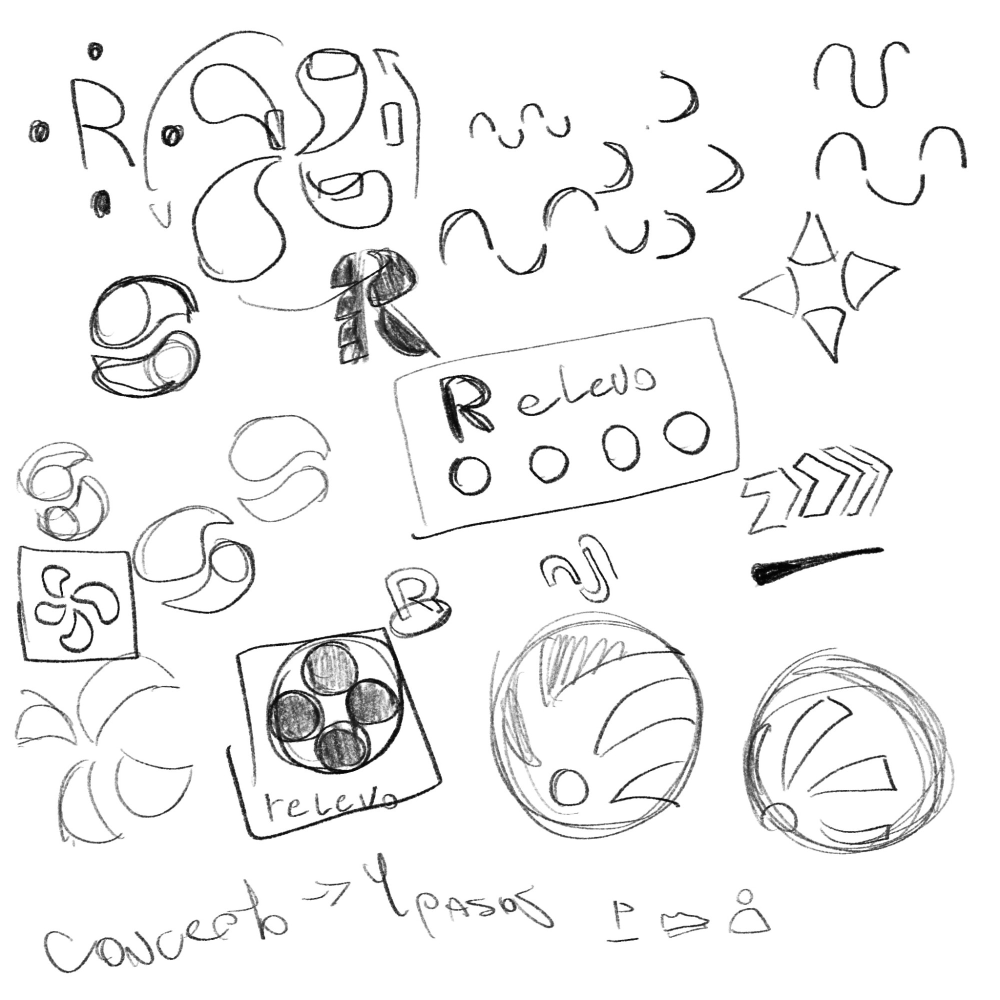

*Nota.* Elaboración propia.

## Objeto

**Proceso.** En sus primeras fases el objeto era un lugar donde dejar el teléfono. Después pasó a ser una señal en el lugar donde empieza la actividad. Los primeros bocetos lo exploraron en tres formatos —un disco, una pastilla y un cilindro— y para dos usos: llevarlo como llavero o dejarlo en el hogar. Los siguientes definieron las dos variantes Relevo Home y Relevo Go con sus vistas y sus piezas: tapa, placa, carcasa y base (Figura 28).

**Figura 28**

*Bocetos del objeto*

<!-- doble -->

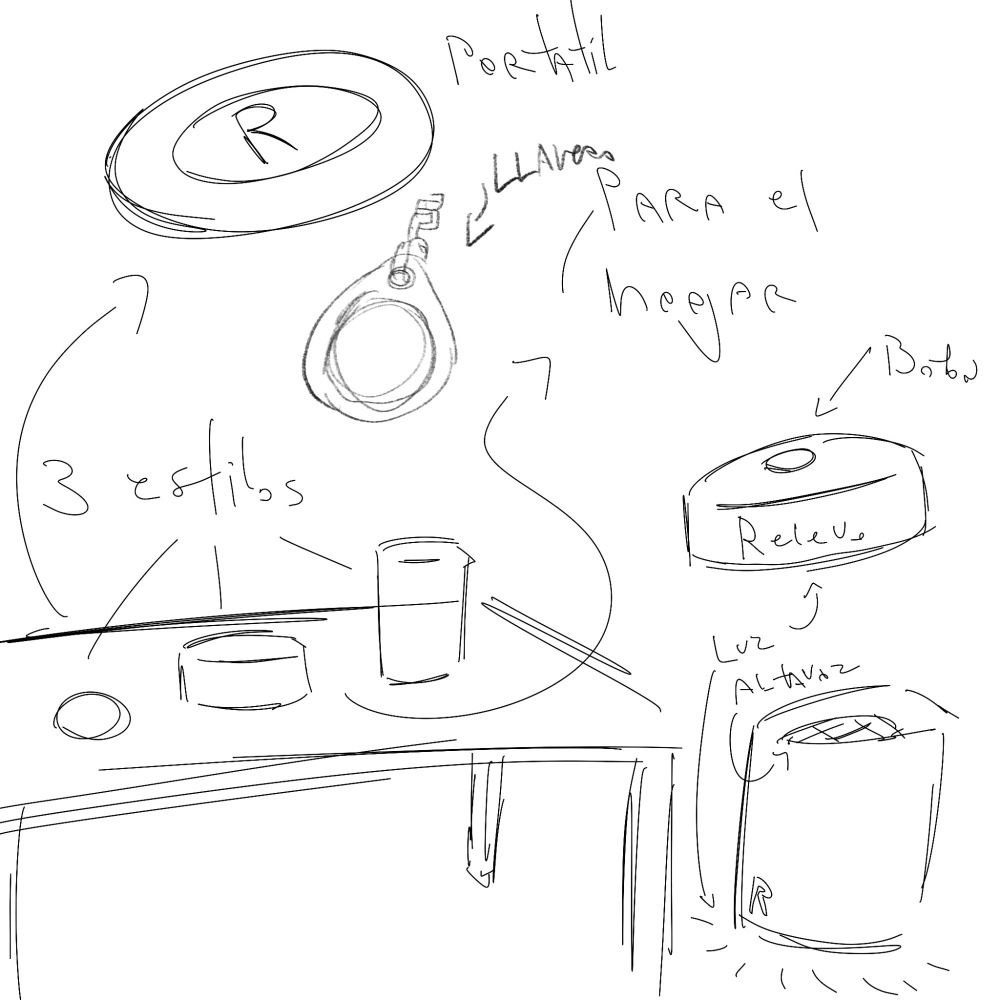 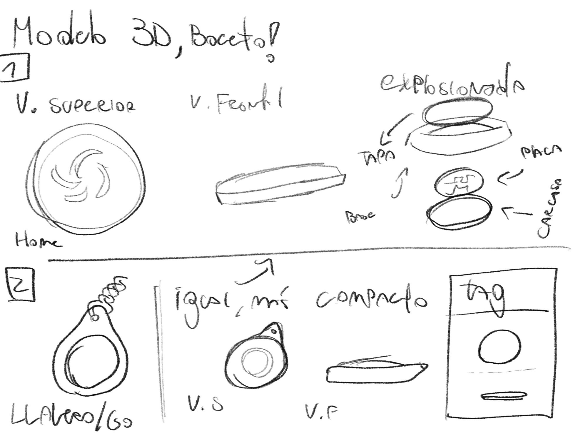

*Nota.* Elaboración propia.

**Tag.** Antes de fabricar el objeto propio había que probar la señal y el lugar. Por eso el prototipo usa un llavero antipérdida Bluetooth. Resultó ser barato, se consigue fácilmente y suena cuando la aplicación se lo pide. Un prototipo puede usar medios simples si conserva lo esencial (Nielsen, 1993, pp. 96–97). Aquí lo esencial es el lugar y el sonido.

**Objeto propio.** Relevo es una carcasa que lleva adentro la placa y la pila del Tag: conserva el sonido ya probado y suma forma, control y marca. Su forma sigue la del Tag: redonda y de cara casi plana. Tiene dos variantes con las mismas piezas interiores. Relevo Home mide 52 mm de diámetro y 13,4 mm de alto. Se deja junto al primer paso de una actividad: su base ancha y una goma antideslizante lo mantienen quieto sobre una mesa o un estante. Relevo Go mide 44 × 54,5 mm y 11,4 mm de alto. Es más portátil y sirve a quienes cambian de lugar sus actividades constantemente. En los dos la cara entera es el botón para silenciar que se aprieta sobre el logo. El sonido sale por esa misma zona. La tapa de abajo se abre con una moneda para cambiar la pila.

Relevo es más grande que el Tag por tres razones. La primera es encontrarlo: un objeto que hay que hallar para silenciarlo no puede quedar tapado sobre una mesa. La segunda es controlarlo: una persona de la prueba nunca encontró el botón del Tag, y un botón del tamaño de la cara se ve y se siente. La tercera es fabricarlo: sus detalles necesitan espacio para imprimirse. Los modelos 3D se hicieron con ayuda de Claude a partir de los bocetos (Figura 29). Ambas variantes se imprimen en 3D sin soportes. Como solo una pieza depende de la placa, podrían recibir otros localizadores. En esta etapa el objeto Relevo queda como propuesta: la prueba se hizo con el Tag.

**Figura 29**

*Relevo Home y Relevo Go, con la placa del Tag adentro*

<!-- doble -->

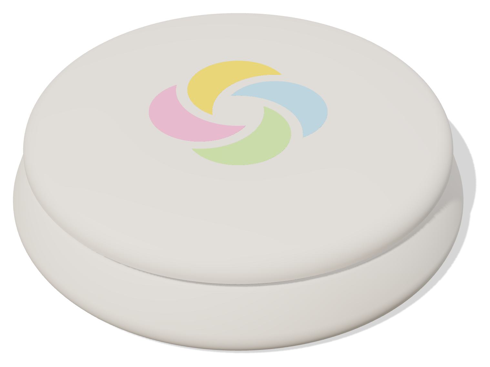 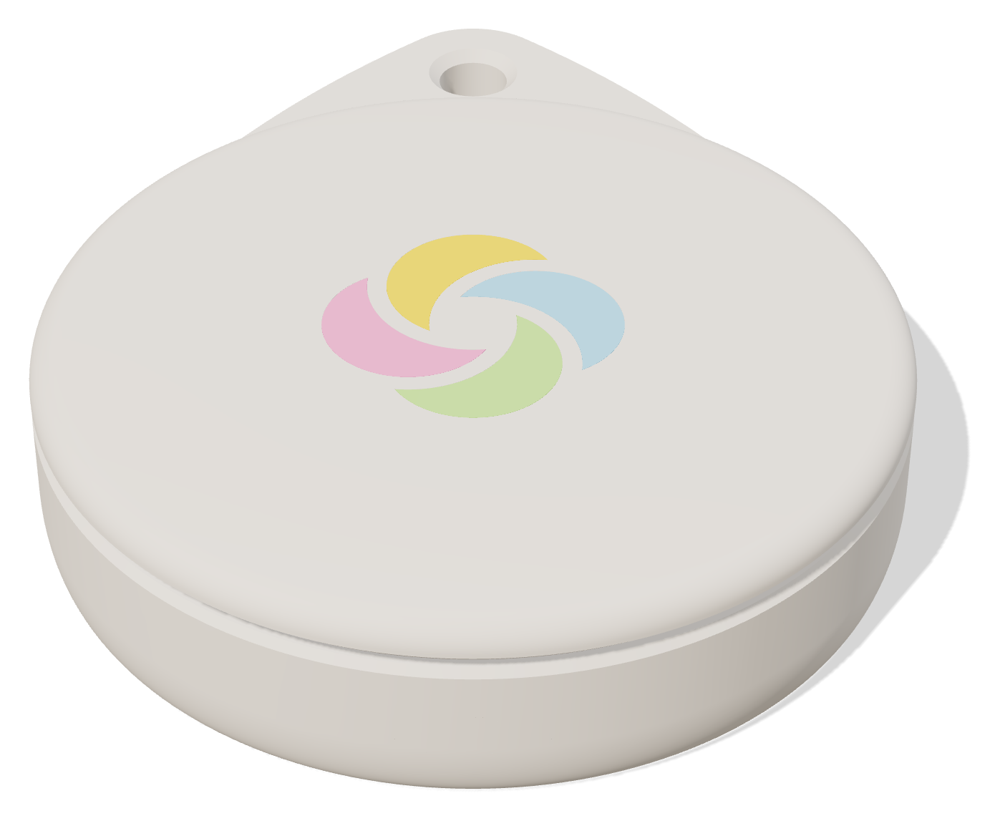 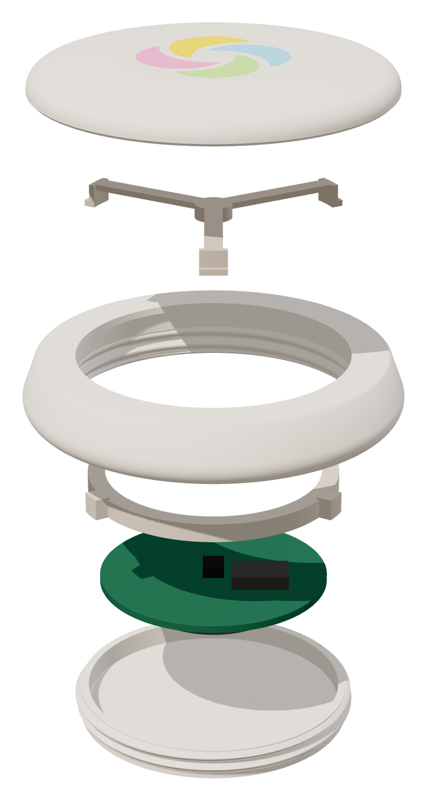

*Nota.* Elaboración propia. Modelos 3D hechos con ayuda de Claude a partir de los bocetos de la Figura 28. Las medidas de la placa del Tag son estimadas.

## Señal

La señal es un sonido porque debe alcanzar a quien mira una pantalla, por ejemplo desde otra habitación: una luz o una imagen piden mirar, y la persona está mirando otra cosa. En las entrevistas las personas imaginaban señales visuales, pero una señal visual no alcanza a quien mira otra cosa. Por eso el sonido se diseñó breve y amable. Dura unos 30 segundos y termina sola o se silencia: tiene más presencia que una notificación y es más amable que una alarma. En el teléfono Relevo suena con un tono propio que la persona puede cambiar entre cuatro. El que viene por defecto son dos golpes de madera que bajan de tono y se repiten, más suaves al comienzo. En el Tag suena su pitido de fábrica. Cada sonido se fundamenta: un sonido que desciende y es más grave se percibe menos urgente (Edworthy et al., 1991), menos repeticiones bajan la urgencia (Hellier et al., 1993) y un timbre con muchas frecuencias a la vez ayuda a saber de dónde viene (Middlebrooks y Green, 1991, p. 138). En la encuesta la mayoría prefirió un sonido de 15 segundos o menos. La duración se mantuvo para la prueba y puede acortarse si el uso lo pide.

## Privacidad y datos

Relevo guarda en el teléfono lo que la persona prepara y sus respuestas. Con su consentimiento envía una copia identificada con un código en lugar del nombre de la persona. La notificación de la pantalla bloqueada no muestra la actividad. La sección “Qué no se ve” explica lo que la aplicación no registra. La persona puede retirar su consentimiento y borrar sus datos desde la aplicación. Responder a la señal siempre es opcional. El aviso tras una semana sin abrir la aplicación viene desactivado por defecto.

## Iteraciones

En el prototipo cada cambio respondió a algo aprendido al desarrollarlo o al usarlo. En septiembre se resolvió el recorrido antes de tener un objeto: preparar un relevo, contar el tiempo de las aplicaciones elegidas y sonar en un parlante o en el teléfono. La señal pasó a durar unos 30 segundos y a terminar sola, porque una que no se detiene insiste y una de pocos segundos no se escucha. Las pautas de Apple se volvieron la referencia visual. A comienzos de octubre llegó el Tag con una prueba de sonido que confirma que sonó. También llegaron opciones para elegir cómo y dónde empezar porque escribir costaba más. El 12 de octubre la identidad nueva llegó a toda la interfaz. Durante la prueba, lo que contaron las personas llevó a editar un relevo activo, a callar el Tag con confirmación y a esperar más a un Tag que responde lento. El 20 de octubre la señal pasó solo al teléfono para comparar. El registro de cada cambio con su fecha y su motivo está en el Anexo G.

Cada una de estas decisiones responde a un criterio y deja atrás otras opciones. La Tabla 1 las reúne de lo general a lo particular.

**Tabla 1**

*Decisiones de diseño de Relevo*

| Ámbito | Decisión | Fundamento | Opciones descartadas |
| --- | --- | --- | --- |
| Sistema | Aplicación, objeto y lugar. | La señal llega desde fuera de la pantalla. | Bloquear o pausar; solo notificar. |
| Recorrido | Una pregunta por pantalla. | Prepararlo pide poco esfuerzo. | Un formulario único. |
| Condición | Tiempo en las aplicaciones elegidas. | Es fácil de entender y de ajustar. | Uso continuo y franjas horarias. |
| Arquitectura | Inicio, Actividades y Perfil. | Acompaña a lo esencial del usuario. | Todo a la vez, al mismo tiempo. |
| Lenguaje visual | Pautas de Apple como referencia. | Equilibran belleza y legibilidad. | Interfaz plana. |
| Comunicación | De tú, con preguntas cotidianas. | Una orden presiona; una pregunta, no. | Rachas, puntos y apuros. |
| Identidad | Seis colores pastel de igual peso. | Ningún momento se impone a otro. | Colores por emoción. |
| Objeto | Un Tag comercial. | Probar señal y lugar antes de fabricar. | Localizadores de ecosistema cerrado. |
| Señal | Sonido de unos 30 s que termina solo. | Alcanza a quien mira una pantalla. | Vibración o una alarma que insiste. |
| Datos | Código en vez de nombre. | Lo que la persona escribe es privado. | Registrar datos innecesarios y personales. |

*Nota.* Elaboración propia.

# 12. Factibilidad y límites

## Tecnología

Relevo funciona en teléfonos Android porque ese sistema permite las dos cosas que necesita: saber cuánto tiempo se usan otras aplicaciones, con un permiso que la persona concede en los ajustes, y comunicarse por Bluetooth con un objeto cercano (Google, 2026a, 2026b; Figura 30). El iPhone se descartó en esta etapa porque allí consultar el uso de otras aplicaciones exige una autorización especial de Apple (Apple, s. f.-a) y trabajar en los dos sistemas habría duplicado el desarrollo. Entre el teléfono y el objeto solo viajan dos órdenes: sonar y callar. Lo que la persona escribe se queda en el teléfono. La aplicación se instala como archivo sin pasar por una tienda. Los datos de la prueba caben en el plan gratuito del servicio que los guarda (Supabase, s. f.), de modo que la escala de esta etapa no exige infraestructura propia.

**Figura 30**

*Cómo funciona Relevo: la persona, la aplicación y el objeto*

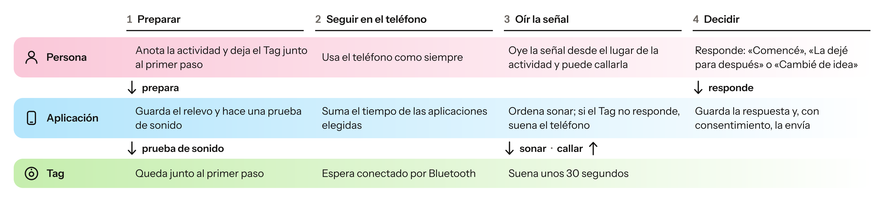

*Nota.* Elaboración propia a partir de la aplicación (Anexo G).

## Fabricación, mantenimiento y costos

El prototipo no exigió fabricar nada: el Tag es un producto terminado. Su único mantenimiento es cambiar la pila de botón, que según los vendedores dura entre 2 y 8 meses. Relevo, el objeto propio, está modelado para imprimirse en 3D en PLA sin soportes. Usa a lo más 20 g de plástico en la variante Home y 13 g en la Go. Su forma se genera a partir de medidas, así que basta cambiar una para ajustarlo a otra placa. La Tabla 2 reúne lo que costó el prototipo y lo que costó el proceso de diseño.

**Tabla 2**

*Presupuesto del prototipo académico y del proceso*

| Ítem | Valor (CLP) | Detalle |
| --- | --- | --- |
| Tag con pila de botón | 10 990 | Una unidad, con envío. |
| Teléfono Android | Sin costo | Cada persona usó el suyo. |
| Base de datos de la aplicación | Sin costo | Plan gratuito de Supabase (Supabase, s. f.). |
| Herramientas de inteligencia artificial | Unos 100 000 | Un mes de Cursor, uno de ChatGPT Plus (Codex) y tres de Claude Pro, a unos 20 dólares al mes. |
| Total desembolsado | Unos 111 000 | — |

*Nota.* CLP = pesos chilenos. Los tres primeros ítems son el prototipo, y las herramientas de inteligencia artificial, el proceso de diseño. Las suscripciones se calcularon al dólar observado del 27 de octubre de 2026 (Mindicador, 2026). El trabajo del autor, unas 186 horas, equivale a entre 1 070 000 y 1 577 000 pesos según el ingreso de quienes se titulan de Diseño en Chile (Ministerio de Educación, s. f.).

## Del prototipo al producto

El proyecto puede crecer en tres etapas. Cada una empieza solo si la anterior entrega evidencia. Un piloto en seis hogares y con Relevo impreso mostraría si sonar desde el lugar de la actividad aporta. Por último, el producto podría abrirse en las dos variantes ya modeladas. Relevo Home se deja en la casa junto al primer paso de una actividad. Relevo Go es para quienes son más “desordenados”. Ambas podrían funcionar con localizadores de otras marcas que respondan a la orden estándar de alerta que Relevo usa. Así la persona podría usar el que ya tiene. Aprovechar un dispositivo que ya existe evita desarrollar y fabricar electrónica, aunque puede no ofrecer justo las funciones que se necesitan (Gembali, 2023, p. 53).

El costo del piloto es la cifra que decide el paso siguiente. Cada hogar necesita un localizador, una pila de repuesto y una carcasa impresa: entre 10 100 y 12 150 pesos. Los seis hogares suman entre 60 500 y 72 900 en total. La carcasa casi no cuesta material: lo que se paga es el trabajo de impresión. Por eso conviene imprimir las seis de una vez y repartir el mínimo que cobra un servicio por trabajo. En cambio, un producto exigiría cotizar molde, ensamblaje y ensayos, que solo se justifican con volumen. La Figura 31 resume las tres etapas.

**Figura 31**

*Etapas del proyecto*

[FIGURA POR INSERTAR: (doble) esquema de etapas: Prototipo académico | Actualmente | Tag comprado y aplicación propia, Unos 111 000 pesos y el trabajo del autor, Tres personas en sus hogares; Piloto | Si la prueba lo justifica | Seis hogares con Relevo impreso, Entre 10 100 y 12 150 pesos por hogar, Revisión de accesibilidad y de protección de datos, Fondart Nacional (línea de Investigación); Producto | Si el piloto cumple sus metas | Relevo Home y Relevo Go, Localizadores de otras marcas o propios, Costos de producción por cotizar, Semilla Inicia de Corfo o Capital Semilla de Sercotec]

*Nota.* Elaboración propia. El costo del piloto incluye el localizador, una pila de repuesto y la carcasa impresa en un servicio nacional (MCI Electronics, s. f.; Rabbit Hole, s. f.). Los fondos de cada etapa se describen en “Financiamiento”.

## Financiamiento

Hasta ahora el proyecto se financió con recursos propios: unos 111 000 pesos entre el Tag y las herramientas de inteligencia artificial para el desarrollo de la aplicación, además del trabajo del autor. Las etapas siguientes pueden postular a fondos públicos concursables, que abren una convocatoria al año:

- **Fondart:** la línea de Investigación de Fondart Nacional, del Ministerio de las Culturas, las Artes y el Patrimonio, financia proyectos que aporten al conocimiento en diseño, entre otras disciplinas. Entrega hasta 15 millones de pesos por proyecto. Su convocatoria 2027 cerró en septiembre de 2026, así que el piloto de Relevo podría postular a la siguiente (Ministerio de las Culturas, las Artes y el Patrimonio, s. f.). Probar Relevo impreso con más personas y en más hogares es investigación en diseño.
- **Semilla Inicia:** Semilla Inicia de Corfo cofinancia hasta el 75 % de proyectos de negocio innovadores para validarlos técnica y comercialmente, con un tope de 15 millones de pesos. Pueden postular personas mayores de 18 años que residan en Chile (Corporación de Fomento de la Producción, s. f.). Para formalizar un primer negocio el Capital Semilla Emprende de Sercotec entrega 3,5 millones de pesos a personas sin inicio de actividades, con un aporte propio del 3 % (Servicio de Cooperación Técnica, s. f.).

## Actores del proyecto

Las tres personas de la prueba aportaron su uso y sus comentarios, que cambiaron el diseño durante la prueba. Un comercio vendió el Tag y los datos se guardan en un servicio externo. Un objeto piloto sumaría un servicio de impresión 3D y una revisión especializada en accesibilidad y en protección de datos (Figura 31). El proyecto también toma prestados saberes de otras disciplinas, como la psicología de la memoria, la acústica y la electrónica de consumo. El especialista en sistemas de recomendación Denis Parra respondió preguntas del proyecto (capítulo 5).

## Seguridad y alcance

La pila de botón puede llegar a ser peligrosa si se traga: por eso la tapa de Relevo se abre con una moneda u objeto similar. El proyecto se centra en el ocio digital cotidiano de personas adultas que quieren recordar algo que eligieron hacer. La adicción, el tratamiento clínico y el control parental pertenecen a otros campos que Relevo no aborda ni estudia.

# 13. Plan de desarrollo y validación

Lo diseñado se puso a prueba en el uso real: tres personas usaron Relevo en sus hogares durante cinco semanas. La prueba usó el Tag, un objeto comercial, porque se quería observar la relación entre la señal, el lugar y lo que la persona quería hacer, no la forma del objeto.

## Procedimiento de la prueba

Cada persona preparó su primer relevo y dejó el Tag junto al primer paso de una actividad que quería hacer (Figura 32). La prueba comenzó el 7 de octubre de 2026 y tuvo cuatro etapas. Durante dos semanas usaron Relevo a su gusto y cuando quisieron. Cada una fijó su propio límite. Las tres completaron esas dos semanas. Tras cada señal la aplicación preguntó si supieron qué querían hacer antes de leerlo en la pantalla, si recordaron cómo empezar y qué decidieron. Del 21 de octubre al 8 de noviembre no usaron el Tag: la señal llegó solo como una notificación en el teléfono para comparar ambos soportes (Figura 33). La aplicación preguntó además si notaron el aviso. La prueba cerró el 10 de noviembre con un cuestionario y una entrevista a cada persona. Las preguntas de la aplicación están en el Anexo I.

**Figura 32**

*Tag durante la prueba en el hogar*

<!-- doble -->

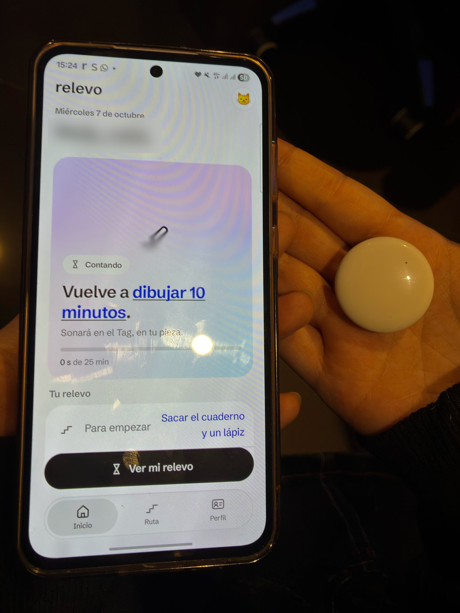 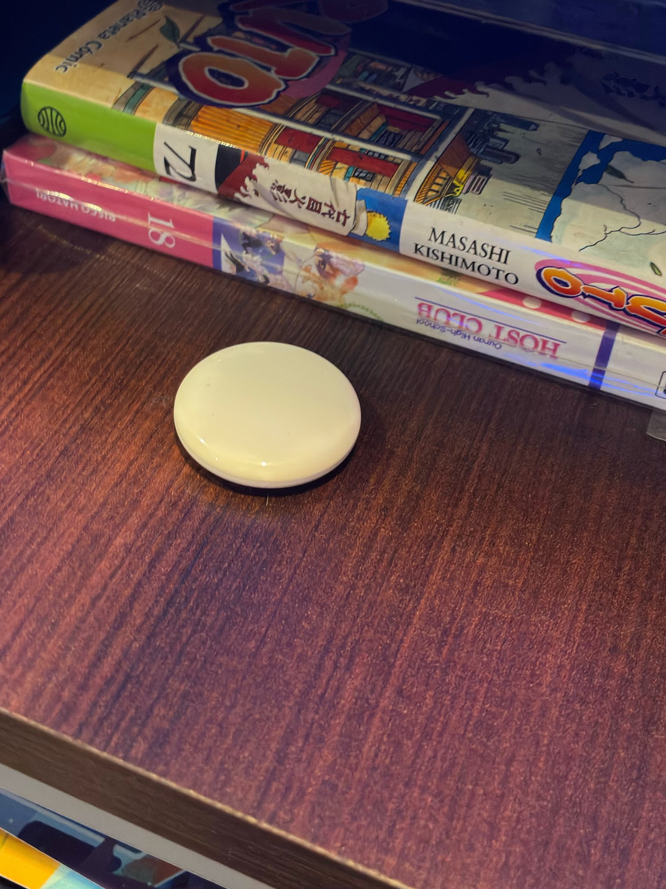 

*Nota.* Fotografías de la prueba en los hogares. En a, la pantalla muestra la actividad, el primer paso y el lugar donde sonará el Tag; se difuminó el nombre de la persona.

**Figura 33**

*Prueba en los hogares*

[FIGURA POR INSERTAR: línea de tiempo de la prueba aplicada: 7 de octubre | Inicio | Consentimiento, primer relevo y Tag junto al primer paso; Semanas 1 y 2 | Con el Tag | Relevo a su gusto y preguntas tras cada señal; 21 de octubre al 8 de noviembre | Con el teléfono | Sin el Tag, la señal llega como notificación; 10 de noviembre | Cierre | Análisis de cuestionario y entrevista con cada persona]

*Nota.* Elaboración propia.

## Registro y cuidado de los datos

La aplicación registró cada relevo: cuándo se activó, si sonó y cómo se calló. También registró las respuestas de cada persona (Figura 34). Esas preguntas completan el registro automático, que muestra qué hizo la persona, pero no por qué (Nielsen, 1993, p. 221). Una señal que falló por un problema de conexión o del objeto no se cuenta.

Para dar el ciclo por logrado se debían cumplir tres condiciones: que el Tag sonara cuando correspondía; que al oír la señal la persona supiera qué quería hacer sin leer la pantalla y recordara cómo empezar, y que siguiera usando Relevo durante las dos semanas.

**Figura 34**

*Qué se registró en cada relevo*

<!-- página -->

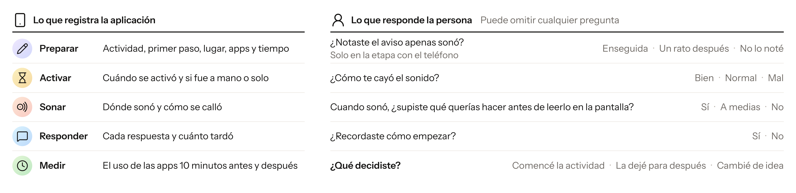

*Nota.* Elaboración propia. Las preguntas son las de la aplicación (Anexo I).

Las tres personas son mayores de edad y participaron de forma voluntaria y sin pago. Podían omitir preguntas, silenciar la señal o dejar la prueba sin dar razones. Las tres aceptaron el consentimiento en la aplicación antes de empezar (Anexo I). Los datos se guardan con un código en lugar del nombre, aunque no son anónimos. Se tratan según la ley chilena de protección de datos (Ley 19628, 1999; Ley 21719, 2024) y se eliminan cuando la persona lo pide o a más tardar el 30 de diciembre de 2026.

## Resultados

Durante las semanas con el Tag el ciclo completo funcionó con las tres personas. El Tag sonó en todos los relevos que llegaron a su límite, salvo uno que se cumplió fuera de casa y lejos del objeto. Al oír la señal, la persona supo qué quería hacer antes de mirar la pantalla en 19 de 21 respuestas y recordó cómo empezar en las 21. Empezó la actividad en 10 de esas 21 respuestas. Las tres condiciones para dar el ciclo por logrado se cumplieron. Los fallos técnicos del objeto comprado se corrigieron durante la prueba.

Con tres personas, lo que hizo cada una dice más que las cifras en conjunto (Figura 35). Cada una repitió sus actividades en un mismo lugar con sus propias aplicaciones y su propio límite. Las tres respondieron el mismo número de veces después de una señal: las diferencias están en lo que hicieron, no en cuánto participaron.

**Figura 35**

*Decisión de cada persona después de la señal*

[FIGURA POR INSERTAR: resultados por persona, un punto por respuesta: Primera persona | Estudiar, ordenar o dibujar · Tag en el escritorio · 15 minutos | 5 de 7; Segunda persona | Tocar guitarra · Tag junto a la guitarra · 45 y luego 35 minutos | 3 de 7; Tercera persona | Dibujar en su croquera · Tag en el escritorio · 25 minutos | 2 de 7; leyenda | Empezó la actividad | La dejó para después o cambió de idea]

*Nota.* Elaboración propia a partir de las respuestas del 8 al 19 de octubre de 2026. Un punto por respuesta posterior a una señal.

Con el teléfono recordar fue igual de fácil, pero notar la señal no (Tabla 3). Las tres supieron qué querían hacer y recordaron cómo empezar en todas sus respuestas, aunque el aviso ya trae escrita la actividad. Empezar no dependió del soporte. Cambió el momento de notarlo: la segunda y la tercera persona notaron el aviso tarde o no lo notaron en la mayoría de sus respuestas. También tardaron tres o cuatro veces más en responder que con el Tag.

**Tabla 3**

*Resultados con el Tag y con el teléfono, por persona*

| Persona | Soporte | Sonaron | Supo qué hacer | Recordó cómo empezar | Empezó / después / cambió | Aviso: enseguida / tarde / no | Segundos |
| --- | --- | --- | --- | --- | --- | --- | --- |
| Primera | Tag | 7 de 7 | 6 de 7, y 1 a medias | 7 de 7 | 5 / 2 / 0 | — | 7 |
| Primera | Teléfono | 11 de 12 | 10 de 10 | 10 de 10 | 7 / 3 / 0 | 8 / 1 / 1 | 4 |
| Segunda | Tag | 8 de 8 | 7 de 7 | 7 de 7 | 3 / 3 / 1 | — | 15 |
| Segunda | Teléfono | 8 de 8 | 7 de 7 | 7 de 7 | 4 / 2 / 1 | 3 / 4 / 0 | 63 |
| Tercera | Tag | 8 de 9 | 6 de 7, y 1 a medias | 7 de 7 | 2 / 4 / 1 | — | 22 |
| Tercera | Teléfono | 5 de 5 | 4 de 4 | 4 de 4 | 2 / 2 / 0 | 0 / 2 / 2 | 69 |

*Nota.* Elaboración propia a partir de los registros de la aplicación: con el Tag, del 8 al 19 de octubre de 2026, y con el teléfono, del 21 de octubre al 8 de noviembre. Cada total es el de respuestas tras una señal; la pregunta sobre el aviso se hizo solo con el teléfono. Segundos: mediana del tiempo hasta responder.

## Hallazgos

**Primera persona.** Quería estudiar, ordenar su pieza o dibujar, y dejó el Tag en su escritorio. Su límite fue de 15 minutos en Instagram, X o YouTube. Fue la que más empezó: cinco de sus siete respuestas con el Tag y siete de diez con el teléfono, que casi siempre notó enseguida. Sugirió corregir un relevo sin borrarlo: “podrían implementar que se pueda actualizar o editar las opciones que uno ya eligió… así no tenemos que borrarlo y crearlo de nuevo”. Al cerrar dijo que el objeto y el teléfono la ayudaron por igual. Fue la única que prefirió que siguiera sonando un objeto.

**Segunda persona.** Quería tocar guitarra y dejó el Tag junto a ella. Su límite fue de 45 minutos en Instagram, YouTube o Reddit. El pitido le pareció demasiado fuerte, como una alarma. Bajó su límite a 35 minutos porque al sonar ya estaba inmersa en un video. Empezó tres de siete veces con el Tag y cuatro de siete con el teléfono. Con el teléfono ya no molestaba con el ruido a quien vivía con ella, pero le era más fácil pasar el aviso de largo: “con el celu veia el aviso, decia ya voy y seguia viendo el video”. Fue la única que dijo que el objeto la ayudó más a recordar, aunque prefirió el teléfono por el ruido.

**Tercera persona.** Quería dibujar en su croquera y dejó el Tag en su escritorio. Su límite fue de 25 minutos en TikTok. Empezó dos de siete veces y la mayoría de las veces la dejó para después. La señal le sirvió cuando estaba en el escritorio, pero de noche la oía desde la cama y no se levantaba. El único relevo que no sonó fue suyo, fuera de casa. Con el teléfono usó menos Relevo: cinco relevos frente a nueve. Contó que una semana casi no lo abrió y nunca notó el aviso enseguida.

**Criterios de diseño.** Contrastados con los criterios del capítulo 9, los resultados son compatibles con varias decisiones de diseño. El primer paso (criterio 2) pudo servir de ancla porque siempre recordaron cómo empezar. Que casi siempre supieran qué querían hacer antes de mirar la pantalla es compatible con que el lugar y el sonido (criterio 8) lleven el mensaje sin texto. Es lo que hace el objeto puesto en el lugar indicado: avisa y dice qué hacer a la vez (Norman, 1988/2002, p. 73). La decisión quedó abierta (criterio 4). La preparación (criterio 6) se cumplió a medias: siguieron preparando relevos por su cuenta, pero la primera vez resultó larga.

**Sonido.** Lo que hicieron también matiza lo que habían dicho (Figura 9): en las entrevistas nadie pidió una señal sonora y en la encuesta la mayoría prefirió un sonido breve. En la prueba el sonido de unos 30 segundos les pareció bueno o neutro casi siempre, pero la mayoría de las veces lo callaron antes de que terminara. Una señal más breve podría bastar, y queda por probar.

**Objeto frente a notificación.** Contrastados con el tercer supuesto de la hipótesis —que el objeto ayude al menos tanto como una notificación, sin más molestia—, los resultados lo sostienen en parte. Con el Tag recordaron tanto como con el teléfono y dos de las tres personas respondieron antes. Pero su sonido molestó más a quienes estaban cerca. Como la etapa con el teléfono vino después de las semanas con el Tag, las personas ya sabían qué significaba la señal: la comparación describe lo que vivió cada una, no un efecto del soporte.

**Cierre de la prueba.** Las tres contaron que al sonar sabían qué querían hacer y lo situaron en el lugar: el escritorio, la guitarra, la croquera. Con el objeto miraban hacia la actividad; con el teléfono el aviso llegaba donde ya estaba la atención. Las tres seguirían usando Relevo y ninguna se sintió obligada: empezar dependió de las ganas, la hora y dónde estaban (Anexo I).

**Dos hallazgos para el diseño.** El primero es que la señal depende del objeto: el único relevo que no sonó ocurrió fuera de casa y lejos del Tag. El segundo es que recordar no obliga a empezar (Figura 36): la intención de hacer algo explica solo en parte lo que una persona hace después (Sheeran y Webb, 2016), y una señal lleva a actuar solo si coincide con la motivación y la capacidad del momento (Fogg, 2009, p. 1). Fogg lo representa en dos ejes, la motivación y la capacidad: cuanto más altas, más probable es que una señal lleve a la conducta. Relevo actúa sobre la facilidad porque deja la señal junto a un primer paso concreto. No actúa sobre la motivación: como pide el criterio 4, la señal devuelve la intención y la decisión sigue siendo de la persona.

**Figura 36**

*Recordar no basta para empezar algo*

[FIGURA POR INSERTAR: (columna) matriz de dos por dos: Motivación: de baja (abajo) a alta (arriba) | Facilidad para empezar: de difícil (izquierda) a fácil (derecha); Mucha motivación y comienzo difícil | Quiere hacerlo, pero el primer paso cuesta; Mucha motivación y comienzo fácil | La señal basta para empezar; Poca motivación y comienzo difícil | La señal recuerda, pero no lleva a empezar; Poca motivación y comienzo fácil | Puede empezar o dejarlo para después]

*Nota.* Elaboración propia a partir de Fogg (2009).

## Alcance de esta etapa

Esta etapa probó el ciclo en uso real con tres personas durante cinco semanas: el ciclo funciona en un hogar, la señal se entiende, los fallos que aparecieron se corrigieron durante la prueba y la comparación con el teléfono mostró cómo vivió cada persona ambos soportes. Lo que recordaron se conoce por sus propias respuestas, dadas justo después de cada señal. No hubo una medición previa con que compararlas y quienes respondieron habían preparado el relevo poco antes. Saber qué querían hacer puede deberse también a esa preparación y no solo a la señal. Con tres personas los resultados describen casos y no permiten generalizar.

## Iterar con los resultados

Lo que mostró la prueba se convierte en cambios. Conviene separar los problemas técnicos —la mayoría, del objeto comprado— de los de uso. Los técnicos se corrigieron durante la prueba; los de uso definen la iteración siguiente. La Tabla 4 reúne los principales hallazgos, su cambio y su estado.

**Tabla 4**

*Principales hallazgos de la prueba y cambios para la iteración*

| Hallazgo | Frecuencia | Cambio | Estado |
| --- | --- | --- | --- |
| El Tag siguió sonando o respondía lento tras horas sin uso. | No frecuente (2 casos, Anexo G) | Callar con confirmación y esperar a un Tag lento. | Hecho durante la prueba |
| Corregir un relevo exigía borrarlo y crearlo de nuevo. | No frecuente (1 de 3 personas) | Editar un relevo activo. | Hecho durante la prueba |
| Fuera de casa, el Tag no sonó. | No frecuente (1 de 24 relevos) | Si el Tag no responde, sonar en el teléfono. | Hecho después de la prueba |
| La primera vez tenía once pantallas y resultó larga. | Revisión del 28 de octubre | Tres pantallas y un primer relevo guiado. | Hecho después de la prueba |
| La pantalla del relevo activo mostraba demasiado. | Revisión del 28 de octubre | Solo la actividad, el tiempo y una acción. | Hecho después de la prueba |
| Un límite de 45 minutos resultó largo frente a un video. | No frecuente (1 de 3 personas) | Proponer un límite breve y sugerir revisarlo. | Hecho después de la prueba |
| De noche, la señal se oye desde la cama y no lleva a levantarse. | No frecuente (1 de 3 personas) | Excluir horas del día. | Hecho después de la prueba |
| “La dejé para después” fue una respuesta frecuente. | Frecuente (9 de 21 respuestas con el Tag) | Dejar la actividad lista para otro momento. | Hecho después de la prueba |
| El pitido del Tag sonó como una alarma y molestó a otros. | No frecuente (2 de 21 respuestas con el Tag) | Volumen regulable y un sonido más suave. | En el teléfono; en Relevo, por probar |
| El botón del Tag no se encontraba ni se sentía. | No frecuente (1 de 3 personas) | La cara de Relevo como botón. | Diseñado en Relevo |
| Con el teléfono, el aviso se notó tarde o no se notó. | Frecuente (10 de 21 respuestas con el teléfono) | Mantener el objeto como señal principal. | Propuesta |

*Nota.* Elaboración propia a partir de la prueba y de la revisión con los profesores del 28 de octubre de 2026. La frecuencia se cuenta sobre la base que indica cada fila, de preferencia las 21 respuestas a la señal de cada etapa: no ocurre, ninguna vez; no frecuente, hasta un tercio; frecuente, más de un tercio y hasta dos tercios, y muy frecuente, más de dos tercios. Estados al 9 de noviembre de 2026; todos los cambios están en el Anexo D.

Después de la prueba, el rediseño de la aplicación incorporó nueve cambios que surgieron de ella (Anexos D y G). Se hizo entre el 5 y el 9 de noviembre.

# 14. Conclusiones

El proyecto partió de una situación cotidiana —quedarse en el teléfono más de lo que uno quería— y la convirtió en un problema de diseño: que la persona recuerde a tiempo algo que quería hacer, sin que nadie decida por ella. Con esa base tomó decisiones en todas las escalas: el sistema, el recorrido, la interfaz, el tono de comunicación, la identidad y el objeto. Cada una responde a un criterio.

El prototipo funciona en uso real. Con las tres personas el Tag sonó cuando correspondía, y al oírlo las personas recordaron siempre cómo empezar y casi siempre qué querían hacer antes de mirar la pantalla. Los fallos que reportaron se corrigieron durante la prueba. Lo que la prueba mostró sobre el uso ya cambió la aplicación. Así se cumplieron los dos primeros objetivos: entender el problema y diseñar el sistema. El cuarto era medir en hogares el recuerdo oportuno y se cumplió con tres personas durante cinco semanas. Con el Tag, la persona recordó a tiempo en 19 de 21 respuestas y empezó la actividad en 10. El tercero era la comparación con el teléfono y se cumplió en parte: con la notificación recordaron igual y cerca de la mitad de las veces la notaron tarde o no la notaron, pero esa comparación no permite decir cuál de los dos ayuda más.

El avance se ve en el propio prototipo. Entre septiembre y noviembre la propuesta pasó de un objeto donde dejar el teléfono a un sistema probado por tres personas: un prototipo que cambió con lo que se iba aprendiendo, varias veces a partir de lo que contaron las personas durante la prueba (Anexo G); una identidad completa con logo, paleta cromática, tipografía e íconos propios; una aplicación rediseñada con lo aprendido, y un objeto propio modelado en dos variantes que responden al usuario.

La pregunta de investigación indagaba el efecto de vincular una actividad pendiente con su lugar de inicio sobre el recuerdo oportuno. La prueba permite afirmar que el ciclo funciona en el uso cotidiano de tres personas, con el objeto en ese lugar: al oír la señal, la persona casi siempre supo qué quería hacer antes de leerlo, siempre recordó cómo empezar y decidió con libertad. Esos resultados son compatibles con la hipótesis, aunque no bastan para probarla. No permiten afirmar que el objeto supere a la notificación: con el teléfono recordaron igual. Aunque notaron el aviso tarde o no lo notaron cerca de la mitad de las veces, la pregunta sobre el aviso se hizo solo con el teléfono. Además, esa etapa vino siempre después de las semanas con el Tag. En ambas etapas las personas habían preparado el relevo poco antes de que sonara. Por su parte, el sonido del Tag molestó más a quienes estaban cerca. Tampoco permiten afirmar que el lugar sea lo que ayuda, porque ninguna etapa dejó el objeto lejos de la actividad.

La investigación sí precisó las condiciones que debe cumplir una ayuda así: partir de una actividad que la persona elige, unirla a un primer paso concreto, sonar cuando ella lo decidió y dejar abierta la decisión. Construido así, Relevo devolvió la intención sin decidir por nadie (Figura 37). El aporte del proyecto al diseño es haber convertido una tensión cotidiana en decisiones verificables: qué se recuerda, cuándo, dónde, con qué objeto y con qué opciones, sin reducirla a una cuestión de disciplina.

**Figura 37**

*Condiciones para que una intención vuelva a tiempo*

[FIGURA POR INSERTAR: (columna) esquema de condiciones: Parte de lo que la persona elige | Criterio 1 | Las tres siguieron preparando relevos por su cuenta; Se une a un primer paso | Criterio 2 | Siempre recordaron cómo empezar; Suena cuando la persona lo decidió | Criterio 3 | Cada una fijó su límite y lo ajustó; Deja abierta la decisión | Criterio 4 | Usaron las tres respuestas sin sentirse obligadas]

*Nota.* Elaboración propia a partir de los resultados de la prueba en los hogares.

## Alcances y proyecciones

El trabajo puede seguir en cuatro pasos: seguir aplicando lo que mostró la prueba, sumando opciones de control a medida que la persona gana experiencia, como sugirió D. Parra (comunicación personal, 4 de noviembre de 2026); imprimir y probar Relevo (Figura 38); repetir la prueba con más personas y una comparación sin los sesgos de esta, con un fondo concursable, y explorar Relevo Home y Relevo Go con localizadores de otras marcas.

**Figura 38**

*El Tag, Relevo Home y Relevo Go, a la misma escala*

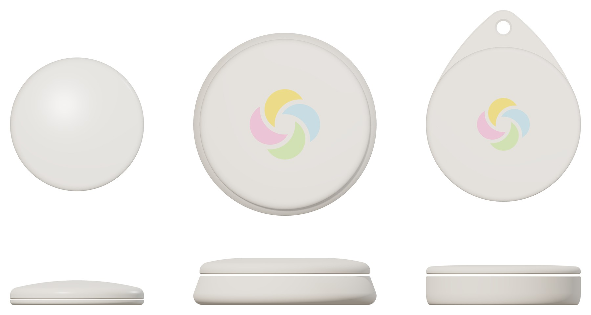

*Nota.* Elaboración propia. Vistas desde arriba y de costado del modelo 3D.

Para validar Relevo, el objeto propio, la etapa siguiente debe probar tres aspectos que el Tag no permitió decidir. El primero es la forma: si la persona lo encuentra, lo silencia y halla su botón sin ayuda. El segundo es el sonido: si se reconoce como Relevo y molesta menos a quienes están cerca, con un volumen regulable y un tono más suave. El tercero es la ubicación: si sonar junto al primer paso ayuda más que sonar en otro lugar de la casa. Los tres se miden con las mismas preguntas de la aplicación.

La comparación con más personas debe evitar dos sesgos de esta prueba. El primero es que la etapa con el teléfono viniera siempre después, cuando las personas ya conocían la señal. El segundo es que pudieran recordar por haber preparado el relevo poco antes y no por la señal. El protocolo de 21 días del Anexo I resuelve el primero. Seis personas pasan por tres semanas en un orden distinto cada una: el objeto junto al primer paso, el mismo objeto en un lugar sin relación con la actividad y una notificación genérica en el teléfono (Figura 39). Para el segundo se pueden sumar algunos relevos en que el tiempo se cumpla sin señal: lo que la persona haga entonces mostrará cuánto se debe solo a haberlo preparado. Con el mismo sonido y las mismas preguntas en todas las condiciones, la diferencia entre ellas podrá atribuirse con más confianza a la señal y al lugar. Más adelante, un hardware propio permitiría diseñar también el sonido y el control.

**Figura 39**

*Comparación propuesta para la etapa siguiente*

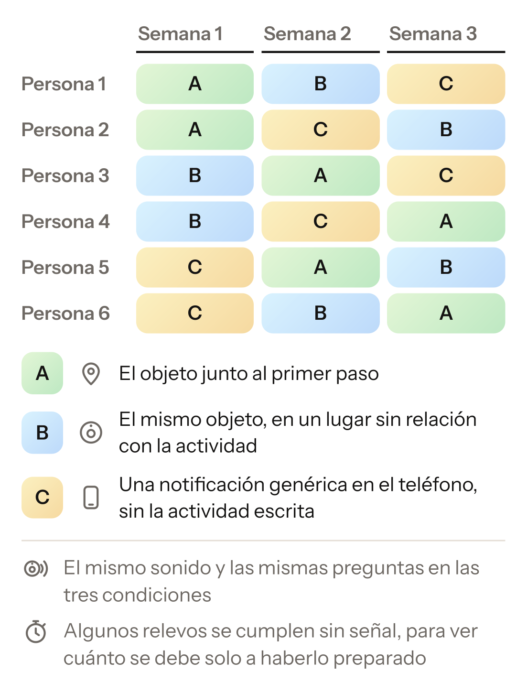

*Nota.* Elaboración propia a partir del protocolo de 21 días (Anexo I).

# Referencias

Albers, J. (2013). *Interaction of color* (4.ª ed.). Yale University Press.

Android Open Source Project. (s. f.). *TypeScaleTokens.kt* [Código fuente]. AndroidX, Compose Material 3. Recuperado el 2 de noviembre de 2026, de https://github.com/androidx/androidx/blob/androidx-main/compose/material3/material3/src/commonMain/kotlin/androidx/compose/material3/tokens/TypeScaleTokens.kt

Apple. (2024, 8 de febrero). *Q&A with the Apple UX writing team*. Apple Developer. https://developer.apple.com/news/?id=5mcfho5g

Apple. (2025a). *Get to know the new design system* [Video]. WWDC25. https://developer.apple.com/videos/play/wwdc2025/356/

Apple. (2025b, 16 de diciembre). *Writing*. Human Interface Guidelines. https://developer.apple.com/design/human-interface-guidelines/writing

Apple. (s. f.-a). *Family Controls App and Website Usage*. Apple Developer Documentation. Recuperado el 25 de agosto de 2026, de https://developer.apple.com/documentation/bundleresources/entitlements/com.apple.developer.family-controls.app-and-website-usage

Apple. (s. f.-b). *Set up Screen Time for yourself on iPhone*. Apple Support. Recuperado el 25 de septiembre de 2026, de https://support.apple.com/en-ie/guide/iphone/iphbfa595995/ios

Apple. (s. f.-c). *Typography*. Human Interface Guidelines. Recuperado el 2 de noviembre de 2026, de https://developer.apple.com/design/human-interface-guidelines/typography

Ball, B. H., Peper, P. y Robison, M. K. (2025). Reminders eliminate age-related declines in prospective memory. *Psychology and Aging, 40*(1), 54–65. https://doi.org/10.1037/pag0000844

Brick LLC. (s. f.-a). *Brick — Take back control of your screen time*. Recuperado el 24 de agosto de 2026, de https://getbrick.com/

Brick LLC. (s. f.-b). *Brick Zone*. Recuperado el 24 de agosto de 2026, de https://getbrick.com/pages/brick-zone

Chiu, G. y Gilbert, S. J. (2024). Influence of the physical effort of reminder-setting on strategic offloading of delayed intentions. *Quarterly Journal of Experimental Psychology, 77*(6), 1295–1311. https://doi.org/10.1177/17470218231199977

Corporación de Fomento de la Producción. (s. f.). *Semilla Inicia*. Recuperado el 10 de noviembre de 2026, de https://www.corfo.gob.cl/sites/cpp/convocatoria/semilla_inicia/

Covington, P., Adams, J. y Sargin, E. (2016). Deep neural networks for YouTube recommendations. En *Proceedings of the 10th ACM Conference on Recommender Systems* (pp. 191–198). Association for Computing Machinery. https://doi.org/10.1145/2959100.2959190

de Segovia Vicente, D., Van Gaeveren, K., Murphy, S. L. y Vanden Abeele, M. M. P. (2024). Does mindless scrolling hamper well-being? Combining ESM and log-data to examine the link between mindless scrolling, goal conflict, guilt, and daily well-being. *Journal of Computer-Mediated Communication, 29*(1), Artículo zmad056. https://doi.org/10.1093/jcmc/zmad056

Driver, T. J. K. y Nasgowitz, Z. M. (2026). *Electronic device program blocker* (Solicitud de patente de EE. UU. n.º US20260082231A1). Oficina de Patentes y Marcas de Estados Unidos. https://patents.google.com/patent/US20260082231A1/en

Edworthy, J., Loxley, S. y Dennis, I. (1991). Improving auditory warning design: Relationship between warning sound parameters and perceived urgency. *Human Factors, 33*(2), 205–231. https://doi.org/10.1177/001872089103300206

Elliot, A. J. y Maier, M. A. (2014). Color psychology: Effects of perceiving color on psychological functioning in humans. *Annual Review of Psychology, 65*, 95–120. https://doi.org/10.1146/annurev-psych-010213-115035

Focusaur. (s. f.). *Focusaur: The phone-free focus device for deep work & habits*. Recuperado el 24 de agosto de 2026, de https://www.focusaur.com/products/focusaur-the-phone-free-focus-device-for-deep-work-habits

Fogg, B. J. (2009). A behavior model for persuasive design. En *Proceedings of the 4th International Conference on Persuasive Technology* (Artículo 40). Association for Computing Machinery. https://doi.org/10.1145/1541948.1541999

Fuenzalida, R. y Egstad, J. (s. f.). *Instrument Sans* [Tipografía]. Google Fonts. Recuperado el 10 de noviembre de 2026, de https://fonts.google.com/specimen/Instrument+Sans/about

Gembali, S. (2023). *Phygital transformation: Adding physical devices to digital products to improve the user experience* [Tesis de maestría, Massachusetts Institute of Technology]. DSpace@MIT. https://hdl.handle.net/1721.1/151254

Goldsmith, L. J. (2021). Using framework analysis in applied qualitative research. *The Qualitative Report, 26*(6), 2061–2076. https://doi.org/10.46743/2160-3715/2021.5011

Gollwitzer, P. M. y Sheeran, P. (2006). Implementation intentions and goal achievement: A meta-analysis of effects and processes. *Advances in Experimental Social Psychology, 38*, 69–119. https://doi.org/10.1016/S0065-2601(06)38002-1

Google. (2026a, 26 de febrero). *Communicate in the background*. Android Developers. https://developer.android.com/develop/connectivity/bluetooth/ble/background

Google. (2026b, 28 de agosto). *UsageStatsManager*. Android Developers. https://developer.android.com/reference/android/app/usage/UsageStatsManager

Google. (s. f.-a). *Manage how you spend time on your Pixel phone or Pixel tablet with Digital Wellbeing*. Pixel Phone Help. Recuperado el 11 de octubre de 2026, de https://support.google.com/pixelphone/answer/9137850?hl=en

Google. (s. f.-b). *Material's communication principles: Intro to UX writing* [Codelab]. Google Codelabs. Recuperado el 10 de noviembre de 2026, de https://codelabs.developers.google.com/codelabs/material-communication-guidance

Grüning, D. J., Riedel, F. y Lorenz-Spreen, P. (2023). Directing smartphone use through the self-nudge app one sec. *Proceedings of the National Academy of Sciences, 120*(8), Artículo e2213114120. https://doi.org/10.1073/pnas.2213114120

Guynn, M. J., McDaniel, M. A. y Einstein, G. O. (1998). Prospective memory: When reminders fail. *Memory & Cognition, 26*(2), 287–298. https://doi.org/10.3758/BF03201140

Haliburton, L., Grüning, D. J., Riedel, F., Schmidt, A. y Terzimehić, N. (2024). A longitudinal in-the-wild investigation of design frictions to prevent smartphone overuse. En *Proceedings of the CHI Conference on Human Factors in Computing Systems* (Artículo 243). Association for Computing Machinery. https://doi.org/10.1145/3613904.3642370

Hellier, E. J., Edworthy, J. y Dennis, I. (1993). Improving auditory warning design: Quantifying and predicting the effects of different warning parameters on perceived urgency. *Human Factors, 35*(4), 693–706. https://doi.org/10.1177/001872089303500408

Herman, B. K. y Akmal, S. (2023). *Contextual reminders* (Solicitud de patente de EE. UU. n.º US20230267422A1). Oficina de Patentes y Marcas de Estados Unidos. https://patents.google.com/patent/US20230267422A1/en

Hermann, M., Mahler, T., de Melo, G. y Weber, M. (2007). The Tangible Reminder. En *3rd IET International Conference on Intelligent Environments (IE 07)* (pp. 144–151). Institution of Engineering and Technology. https://doi.org/10.1049/cp:20070359

Hofmann, W., Vohs, K. D. y Baumeister, R. F. (2012). What people desire, feel conflicted about, and try to resist in everyday life. *Psychological Science, 23*(6), 582–588. https://doi.org/10.1177/0956797612437426

Indian Type Foundry. (s. f.). *Chillax* [Tipografía]. Fontshare. Recuperado el 10 de noviembre de 2026, de https://www.fontshare.com/fonts/chillax

International Organization for Standardization. (2011). *Graphical symbols — Safety colours and safety signs — Part 1: Design principles for safety signs and safety markings* (Norma ISO n.º 3864-1:2011). https://www.iso.org/standard/51021.html

Ishii, H. y Ullmer, B. (1997). Tangible bits: Towards seamless interfaces between people, bits and atoms. En *Proceedings of the ACM SIGCHI Conference on Human Factors in Computing Systems* (pp. 234–241). Association for Computing Machinery. https://doi.org/10.1145/258549.258715

Jiang, Y., Gorn, G. J., Galli, M. y Chattopadhyay, A. (2016). Does your company have the right logo? How and why circular- and angular-logo shapes influence brand attribute judgments. *Journal of Consumer Research, 42*(5), 709–726. https://doi.org/10.1093/jcr/ucv049

Jonauskaite, D., Epicoco, D., Al-Rasheed, A. S., Aruta, J. J. B. R., Bogushevskaya, V., Brederoo, S. G., Corona, V., Fomins, S., Gizdic, A., Griber, Y. A., Havelka, J., Hirnstein, M., John, G., Jopp, D. S., Karlsson, B., Konstantinou, N., Laurent, É., Marquardt, L., Mefoh, P. C., … Mohr, C. (2024). A comparative analysis of colour–emotion associations in 16–88-year-old adults from 31 countries. *British Journal of Psychology, 115*(2), 275–305. https://doi.org/10.1111/bjop.12687

Keppel, J., Strauss, M., Haliburton, L., Weingärtner, H., Dominiak, J., Faltaous, S., Gruenefeld, U., Mayer, S., Woźniak, P. W. y Schneegass, S. (2025). Situated artifacts amplify engagement in physical activity. En *Proceedings of the 2025 ACM Designing Interactive Systems Conference* (pp. 2959–2974). Association for Computing Machinery. https://doi.org/10.1145/3715336.3735690

Kirsh, D. (1995). The intelligent use of space. *Artificial Intelligence, 73*(1–2), 31–68. https://doi.org/10.1016/0004-3702(94)00017-U

Kitchen Safe. (s. f.). *kSafe by Kitchen Safe: The time lock safe*. Recuperado el 25 de septiembre de 2026, de https://www.thekitchensafe.com/

Kleinberg, J., Mullainathan, S. y Raghavan, M. (2024). The challenge of understanding what users want: Inconsistent preferences and engagement optimization. *Management Science, 70*(9), 6336–6355. https://doi.org/10.1287/mnsc.2022.03683

Kolko, J. (2011). *Exposing the magic of design: A practitioner’s guide to the methods and theory of synthesis*. Oxford University Press.

Ley 19628. (1999, 28 de agosto). Sobre protección de la vida privada. Biblioteca del Congreso Nacional de Chile. https://www.bcn.cl/leychile/navegar?idNorma=141599

Ley 21719. (2024, 13 de diciembre). Regula la protección y el tratamiento de los datos personales y crea la Agencia de Protección de Datos Personales. Biblioteca del Congreso Nacional de Chile. https://www.bcn.cl/leychile/navegar?idNorma=1209272

Lucide Contributors. (s. f.-a). *Lucide design language*. Lucide. Recuperado el 10 de noviembre de 2026, de https://lucide.dev/contribute/icons/design-principles

Lucide Contributors. (s. f.-b). *Lucide license*. Lucide. Recuperado el 10 de noviembre de 2026, de https://lucide.dev/license

Lukoff, K., Lyngs, U., Zade, H., Liao, J. V., Choi, J., Fan, K., Munson, S. A. y Hiniker, A. (2021). How the design of YouTube influences user sense of agency. En *Proceedings of the 2021 CHI Conference on Human Factors in Computing Systems* (pp. 1–17). Association for Computing Machinery. https://doi.org/10.1145/3411764.3445467

Lukoff, K., Yu, C., Kientz, J. y Hiniker, A. (2018). What makes smartphone use meaningful or meaningless? *Proceedings of the ACM on Interactive, Mobile, Wearable and Ubiquitous Technologies, 2*(1), Artículo 22. https://doi.org/10.1145/3191754

Lyngs, U., Lukoff, K., Slovak, P., Binns, R., Slack, A., Inzlicht, M., Van Kleek, M. y Shadbolt, N. (2019). Self-control in cyberspace: Applying dual systems theory to a review of digital self-control tools. En *Proceedings of the 2019 CHI Conference on Human Factors in Computing Systems* (Artículo 131). Association for Computing Machinery. https://doi.org/10.1145/3290605.3300361

Machado, G. M., Oliveira, M. M. y Fernandes, L. A. F. (2009). A physiologically-based model for simulation of color vision deficiency. *IEEE Transactions on Visualization and Computer Graphics, 15*(6), 1291–1298. https://doi.org/10.1109/TVCG.2009.113

McDaniel, M. A. y Einstein, G. O. (2000). Strategic and automatic processes in prospective memory retrieval: A multiprocess framework. *Applied Cognitive Psychology, 14*(7), S127–S144. https://doi.org/10.1002/acp.775

MCI Electronics. (s. f.). *Pila botón CR2032 de lithium para reloj*. Recuperado el 27 de octubre de 2026, de https://mcielectronics.cl/shop/product/pila-boton-cr2032-de-lithium-para-reloj-9838/

Meier, A. y Reinecke, L. (2021). Computer-mediated communication, social media, and mental health: A conceptual and empirical meta-review. *Communication Research, 48*(8), 1182–1209. https://doi.org/10.1177/0093650220958224

Microsoft. (2021). *Spanish (Neutral) style guide*. https://download.microsoft.com/download/4/3/1/431d9836-40dc-4f2b-aafc-def5c7b5d0f3/spa-neu-StyleGuide.pdf

Middlebrooks, J. C. y Green, D. M. (1991). Sound localization by human listeners. *Annual Review of Psychology, 42*, 135–159. https://doi.org/10.1146/annurev.ps.42.020191.001031

Miller, C. H., Lane, L. T., Deatrick, L. M., Young, A. M. y Potts, K. A. (2007). Psychological reactance and promotional health messages: The effects of controlling language, lexical concreteness, and the restoration of freedom. *Human Communication Research, 33*(2), 219–240. https://doi.org/10.1111/j.1468-2958.2007.00297.x

Mindicador. (2026). *Dólar observado* [Serie del Banco Central de Chile]. Recuperado el 27 de octubre de 2026, de https://mindicador.cl/api/dolar

Ministerio de Educación. (s. f.). *Estadísticas por carrera: Diseño*. Mi Futuro, Servicio de Información de Educación Superior. Recuperado el 27 de octubre de 2026, de https://www.mifuturo.cl/buscador-de-estadisticas-por-carrera/

Ministerio de las Culturas, las Artes y el Patrimonio. (s. f.). *Investigación: Fondart Nacional 2027*. Fondos de Cultura. Recuperado el 10 de noviembre de 2026, de https://www.fondosdecultura.cl/fondos/fondart-nacional/lineas-de-concurso/investigacion-fondart-nacional-2027/

Monge Roffarello, A. y De Russis, L. (2023). Achieving digital wellbeing through digital self-control tools: A systematic review and meta-analysis. *ACM Transactions on Computer-Human Interaction, 30*(4), Artículo 53. https://doi.org/10.1145/3571810

Montag, C., Lachmann, B., Herrlich, M. y Zweig, K. (2019). Addictive features of social media/messenger platforms and freemium games against the background of psychological and economic theories. *International Journal of Environmental Research and Public Health, 16*(14), Artículo 2612. https://doi.org/10.3390/ijerph16142612

Moore, J. W. (2016). What is the sense of agency and why does it matter? *Frontiers in Psychology, 7*, Artículo 1272. https://doi.org/10.3389/fpsyg.2016.01272

Newman, J. J. y Newman, R. G. (2022). *Action reminder device and method* (Patente de EE. UU. n.º US11321677B1). Oficina de Patentes y Marcas de Estados Unidos. https://patents.google.com/patent/US11321677B1/en

Nielsen, J. (1993). *Usability engineering*. Academic Press.

Norman, D. A. (2002). *The design of everyday things*. Basic Books. (Obra original publicada en 1988)

one sec. (s. f.). *Cut your screen time in half*. Recuperado el 24 de agosto de 2026, de https://one-sec.app/

O’Rear, A. E. y Radvansky, G. A. (2019). Location-based prospective memory. *Quarterly Journal of Experimental Psychology, 72*(3), 491–507. https://doi.org/10.1177/1747021818758608

Ottosson, B. (2020, 23 de diciembre). *A perceptual color space for image processing*. https://bottosson.github.io/posts/oklab/

Peña-Albert, A. K., Ingram, S., Khazaal, Y., Litrico, L., Farah, J. C. y Gillet, D. (2026). Restoring engagement in digital self-control tools using nudge reconfiguration prompts: Quasi-experimental study. *JMIR Formative Research, 10*, Artículo e85349. https://doi.org/10.2196/85349

Rabbit Hole. (s. f.). *Impresión 3D en Chile: resina SLA y FDM*. Recuperado el 27 de octubre de 2026, de https://rabbithole.cl/

Radtke, T., Apel, T., Schenkel, K., Keller, J. y von Lindern, E. (2022). Digital detox: An effective solution in the smartphone era? A systematic literature review. *Mobile Media & Communication, 10*(2), 190–215. https://doi.org/10.1177/20501579211028647

Reinecke, L. y Hofmann, W. (2016). Slacking off or winding down? An experience sampling study on the drivers and consequences of media use for recovery versus procrastination. *Human Communication Research, 42*(3), 441–461. https://doi.org/10.1111/hcre.12082

Risko, E. F. y Gilbert, S. J. (2016). Cognitive offloading. *Trends in Cognitive Sciences, 20*(9), 676–688. https://doi.org/10.1016/j.tics.2016.07.002

Riveros Oltra, J. (2023). *BetterHumans: explorando la gamificación y la formación de hábitos en la retención de usuarios: un estudio de caso de Betterfly* [Memoria de título, Universidad de Chile]. Repositorio Académico de la Universidad de Chile. https://doi.org/10.58011/khxf-cq52

Rosenberg, L. B. (2009). *Spatially associated personal reminder system and method* (Patente de EE. UU. n.º US7577522B2). Oficina de Patentes y Marcas de Estados Unidos. https://patents.google.com/patent/US7577522B2/en

Ryan, R. M. y Deci, E. L. (2000). Self-determination theory and the facilitation of intrinsic motivation, social development, and well-being. *American Psychologist, 55*(1), 68–78. https://doi.org/10.1037/0003-066X.55.1.68

Sanders, E. B.-N. y Stappers, P. J. (2012). *Convivial toolbox: Generative research for the front end of design*. BIS Publishers.

Sanders, S. (2026, 12 de mayo). *Reclaim your time with Pause Point*. Google. https://blog.google/products-and-platforms/platforms/android/pause-point/

Screenless. (s. f.). *You know you’re scrolling too much. Take your time back*. Recuperado el 9 de noviembre de 2026, de https://screenlessapp.com/en

Servicio de Cooperación Técnica. (s. f.). *Capital Semilla Emprende Región Metropolitana de Santiago 2026*. Recuperado el 10 de noviembre de 2026, de https://www.sercotec.cl/convocatoria/capital-semilla-emprende-region-metropolitana-de-santiago-2026/

Sheeran, P. y Webb, T. L. (2016). The intention–behavior gap. *Social and Personality Psychology Compass, 10*(9), 503–518. https://doi.org/10.1111/spc3.12265

Silverman, J. y Barasch, A. (2023). On or off track: How (broken) streaks affect consumer decisions. *Journal of Consumer Research, 49*(6), 1095–1117. https://doi.org/10.1093/jcr/ucac029

Smit, E. S., Zeidler, C., Resnicow, K. y de Vries, H. (2019). Identifying the most autonomy-supportive message frame in digital health communication: A 2x2 between-subjects experiment. *Journal of Medical Internet Research, 21*(10), Artículo e14074. https://doi.org/10.2196/14074

Sohn, T., Li, K. A., Lee, G., Smith, I., Scott, J. y Griswold, W. G. (2005). Place-Its: A study of location-based reminders on mobile phones. En M. Beigl, S. Intille, J. Rekimoto y H. Tokuda (Eds.), *Lecture notes in computer science: Vol. 3660. UbiComp 2005: Ubiquitous computing* (pp. 232–250). Springer. https://doi.org/10.1007/11551201_14

Stapley, E., O’Keeffe, S. y Midgley, N. (2022). Developing typologies in qualitative research: The use of ideal-type analysis. *International Journal of Qualitative Methods, 21*, Artículo 16094069221100633. https://doi.org/10.1177/16094069221100633

Subsecretaría de Telecomunicaciones. (2025). *Informe final: Estudio duodécima encuesta sobre acceso, usos y usuarios de internet en Chile*. Ministerio de Transportes y Telecomunicaciones. https://www.subtel.gob.cl/wp-content/uploads/2026/02/Informe-Final-Acceso-y-Uso-Internet-2025_03.pdf

Supabase. (s. f.). *Pricing*. Recuperado el 27 de octubre de 2026, de https://supabase.com/pricing

Terzimehić, N., Haliburton, L., Greiner, P., Schmidt, A., Hussmann, H. y Mäkelä, V. (2022). MindPhone: Mindful reflection at unlock can reduce absentminded smartphone use. En *Proceedings of the 2022 ACM Designing Interactive Systems Conference* (pp. 1818–1830). Association for Computing Machinery. https://doi.org/10.1145/3532106.3533575

Tonietto, G. N., Malkoc, S. A., Reczek, R. W. y Norton, M. I. (2021). Viewing leisure as wasteful undermines enjoyment. *Journal of Experimental Social Psychology, 97*, Artículo 104198. https://doi.org/10.1016/j.jesp.2021.104198

Unpluq. (s. f.). *Unpluq: Stop scrolling. Reduce distractions. Reduce screentime*. Recuperado el 24 de agosto de 2026, de https://www.unpluq.com/

Venegas Álvarez, S. A. (2026). *Gratitud digitalizada: un enfoque en el diseño de aplicaciones para fomentar la gratitud a través de la gamificación narrativa* [Memoria de título, Universidad de Chile]. Repositorio Académico de la Universidad de Chile. https://repositorio.uchile.cl/handle/2250/216623

Waggoner, J., Lucky, S., Redick, S., Rizki, A. y Yu, J.-C. (2026). Going beyond digital libraries: A literature review of phygital user experience research methods. *International Journal on Digital Libraries, 27*(1), Artículo 1. https://doi.org/10.1007/s00799-025-00436-6

Weiser, M. y Brown, J. S. (1997). The coming age of calm technology. En P. J. Denning y R. M. Metcalfe (Eds.), *Beyond calculation: The next fifty years of computing* (pp. 75–85). Copernicus. https://doi.org/10.1007/978-1-4612-0685-9_6

Wilms, L. y Oberfeld, D. (2018). Color and emotion: Effects of hue, saturation, and brightness. *Psychological Research, 82*(5), 896–914. https://doi.org/10.1007/s00426-017-0880-8

World Wide Web Consortium. (2024, 12 de diciembre). *Web content accessibility guidelines (WCAG) 2.2*. https://www.w3.org/TR/2024/REC-WCAG22-20241212/

Yablonski, J. (s. f.). *Laws of UX*. Recuperado el 9 de noviembre de 2026, de https://lawsofux.com/

Zekveld, J., Bakker, S., Zijlema, A. y van den Hoven, E. (2017). Wobble: Shaping unobtrusive reminders for prospective memories in the home context. En *Proceedings of the Eleventh International Conference on Tangible, Embedded, and Embodied Interaction* (pp. 31–35). Association for Computing Machinery. https://doi.org/10.1145/3024969.3024984

Zimmerman, J., Forlizzi, J. y Evenson, S. (2007). Research through design as a method for interaction design research in HCI. En *Proceedings of the SIGCHI Conference on Human Factors in Computing Systems* (pp. 493–502). Association for Computing Machinery. https://doi.org/10.1145/1240624.1240704

# Índice de tablas y figuras

<!-- Las páginas se ponen al diagramar en Affinity. -->

## Tablas

- Tabla 1. Decisiones de diseño de Relevo
- Tabla 2. Presupuesto del prototipo académico y del proceso
- Tabla 3. Resultados con el Tag y con el teléfono, por persona
- Tabla 4. Principales hallazgos de la prueba y cambios para la iteración

## Figuras

- Figura 1. Funciones de 367 herramientas de autocontrol digital
- Figura 2. Dos caminos para que vuelva una intención
- Figura 3. Señal y mensaje de un recordatorio
- Figura 4. Paso de la señal del segundo plano al primero
- Figura 5. Condiciones de cada ámbito y la idea de diseño que dejan
- Figura 6. Ejemplo de una intención que vuelve tarde
- Figura 7. Causas de que una intención vuelva tarde
- Figura 8. Análisis de las entrevistas con el método Framework
- Figura 9. Lo que las personas cuentan y lo que hacen
- Figura 10. Última vez que siguieron en el teléfono, según la encuesta
- Figura 11. Opiniones sobre la propuesta
- Figura 12. Situaciones de uso
- Figura 13. Necesidades de diseño comunes a ambas situaciones
- Figura 14. Función y lugar de cada herramienta y de Relevo
- Figura 15. Ocho criterios de diseño en tres grupos
- Figura 16. Dónde actúa Relevo en la tensión de la decisión
- Figura 17. Cadena de la formulación, del problema a las conclusiones
- Figura 18. Método del proyecto, de la investigación a la iteración
- Figura 19. Proceso del proyecto, de marzo a noviembre de 2026
- Figura 20. Recorrido del usuario
- Figura 21. Flujo de la aplicación
- Figura 22. Estados de un relevo
- Figura 23. Arquitectura de información de la aplicación
- Figura 24. Calma, presencia y señal: el color sube con el momento
- Figura 25. Rasgos del tono de comunicación de Relevo
- Figura 26. Sistema de identidad de Relevo
- Figura 27. Bocetos del logo
- Figura 28. Bocetos del objeto
- Figura 29. Relevo Home y Relevo Go, con la placa del Tag adentro
- Figura 30. Cómo funciona Relevo: la persona, la aplicación y el objeto
- Figura 31. Etapas del proyecto
- Figura 32. Tag durante la prueba en el hogar
- Figura 33. Prueba en los hogares
- Figura 34. Qué se registró en cada relevo
- Figura 35. Decisión de cada persona después de la señal
- Figura 36. Recordar no basta para empezar algo
- Figura 37. Condiciones para que una intención vuelva a tiempo
- Figura 38. El Tag, Relevo Home y Relevo Go, a la misma escala
- Figura 39. Comparación propuesta para la etapa siguiente

# Glosario

Este glosario explica el sentido que tiene cada término en esta memoria. Cuando un término viene de una lectura, la definición se apoya en esa fuente y la cita. Cuando es propio del proyecto, como Relevo, Tag o primer paso, se define por su uso en el sistema y no lleva cita. No se usó el diccionario de la RAE, porque casi todos son términos técnicos o propios del proyecto y su sentido aquí es más preciso que el general.

**Autonomía.** En el sentido de la teoría de la autodeterminación, actuar por voluntad propia (Ryan y Deci, 2000). En términos de diseño, depende de comprender la intervención y poder aceptarla, ajustarla o rechazarla.

**Bluetooth.** Comunicación inalámbrica de corto alcance y bajo consumo. En el prototipo lleva órdenes de la aplicación al Tag, no audio.

**_Calm technology_.** Ideal de diseño según el cual una tecnología informa en segundo plano y pasa al primero solo cuando hace falta, para luego volver (Weiser y Brown, 1997). No tiene una traducción fija al español.

**Ciclo.** Recorrido completo de un relevo: prepararlo, seguir en el teléfono mientras cuenta el tiempo, oír la señal y decidir. La interfaz de la aplicación llama “relevo” a cada uno.

**Conflicto entre metas.** Tensión que aparece cuando una actividad dificulta otra también valorada, sin establecer cuál debería prevalecer (de Segovia Vicente et al., 2024).

**Criterio de diseño.** Condición que una propuesta debe cumplir para responder al problema y que sirve después para evaluarla. Esta memoria formula ocho.

**Descarga cognitiva.** Recurso a una acción física, como anotar o disponer un objeto, para reducir la demanda cognitiva de una tarea (Risko y Gilbert, 2016).

**Descarga de intenciones.** Uso del entorno para dejar un aviso de una intención que se cumplirá después, como un objeto junto a la puerta (Risko y Gilbert, 2016).

**Desplazamiento infinito.** Patrón de interfaz que carga contenido nuevo a medida que la persona avanza, sin un final de página reconocible (Montag et al., 2019).

**Evaluación formativa.** Evaluación que busca identificar dificultades y orientar mejoras del diseño, no medir su eficacia (Nielsen, 1993).

**Fricción.** Esfuerzo adicional introducido en una interfaz, como esperar o confirmar, que puede abrir una ocasión de reconsiderar (Grüning et al., 2023).

**Gamificación.** Uso de mecánicas propias de los juegos, como rachas, puntos y premios, en actividades que no son juegos.

**Herramienta de autocontrol digital.** Aplicación o función con la que una persona regula su propio uso de dispositivos mediante mediciones, límites, bloqueos, demoras o mensajes (Lyngs et al., 2019). También se la llama herramienta de bienestar digital.

**Intención.** Lo que la persona se propone hacer, como leer o dibujar. En esta memoria, la que quiere mantener presente mientras dura una sesión de ocio digital.

**Intención de implementación.** Plan que especifica de antemano cuándo, dónde y cómo actuar: si se presenta cierta situación, se inicia una respuesta (Gollwitzer y Sheeran, 2006).

**Interacción tangible.** Campo que estudia cómo los objetos y el espacio físico participan en la relación con la información digital. En su formulación inicial, une esa información a objetos que se pueden tomar y a superficies del espacio, y usa medios del ambiente, como la luz y el sonido, para informar en segundo plano (Ishii y Ullmer, 1997).

**Investigación a través del diseño.** Enfoque en que quien diseña integra resultados de investigación en un artefacto, y ese trabajo constituye un aporte (Zimmerman et al., 2007).

**Localizador Bluetooth.** Objeto pequeño y autónomo, vendido también como llavero antipérdida, que suena cuando la persona lo busca desde el teléfono. El prototipo usa uno comercial, circular, con pila de botón y un solo botón.

**Marco multiproceso.** Explicación de la memoria prospectiva según la cual una intención puede volver porque la persona vigila el entorno o porque un evento la trae de vuelta de forma espontánea. Que ocurra lo segundo depende de la señal, de la actividad en curso y de la persona (McDaniel y Einstein, 2000).

**Memoria prospectiva.** Capacidad de recordar una acción que se quiere realizar en el futuro cuando aparece la ocasión adecuada (McDaniel y Einstein, 2000).

**Método Framework.** Método de análisis cualitativo que resume el material codificado en una matriz de unidades de análisis y temas, para identificar patrones dentro de cada caso y entre casos (Goldsmith, 2021).

**Ocio digital.** Actividades que una persona realiza con dispositivos digitales en su tiempo disponible para descansar, entretenerse, satisfacer su curiosidad o vincularse con otros.

**_Phygital_.** Término formado por *physical* y *digital* que designa experiencias que integran lo físico y lo digital (Waggoner et al., 2026). En esta memoria nombra el tipo de sistema.

**Precompromiso.** Decisión previa que restringe deliberadamente las opciones futuras, como bloquear aplicaciones hasta volver a un objeto.

**Primer paso.** Acción breve, concreta y disponible con la que comienza una actividad, como abrir el libro o ponerse las zapatillas; la aplicación lo pregunta con “¿Cómo empiezas la actividad?”. “Junto al primer paso” significa en el lugar donde ese paso se realiza.

**Racha.** Serie de tres o más repeticiones consecutivas de una conducta, que un registro muestra como intacta o rota (Silverman y Barasch, 2023).

**Recuerdo oportuno.** Recuerdo de una intención cuando todavía se puede actuar; es lo que estudia la memoria prospectiva. En esta memoria, significa que, al sonar la señal, la persona sabe qué quería hacer y cómo empezar antes de leerlo en la pantalla.

**Relevo.** Sistema *phygital* propuesto en esta memoria, compuesto por una aplicación Android y un objeto físico. En la interfaz, “relevo” nombra además cada ciclo. También es el nombre del objeto propio.

**Reproducción automática.** Patrón de interfaz en que, al terminar un contenido, comienza otro sin exigir una elección nueva (Montag et al., 2019).

**Salida.** Medio por el que suena la señal: el Tag, propuesto por defecto; un dispositivo de audio, o las notificaciones del propio teléfono, que en la prueba sirvieron de comparación.

**Sentido de agencia.** Experiencia de ser quien inicia las propias acciones y controla lo que sigue de ellas (Lukoff et al., 2021; Moore, 2016). Se distingue la sensación de agencia, en el momento, del juicio de agencia, que se hace después, al recordar lo que se hizo.

**Señal.** Término general para el estímulo con que el sistema devuelve la intención al presente. Se distingue de la notificación, que en esta memoria designa solo el aviso visual del teléfono.

**Sesión de ocio digital.** Rato continuo en que una persona usa aplicaciones del teléfono en su tiempo libre, desde que abre una hasta que deja el teléfono.

**Sistema de recomendación.** Sistema que elige qué contenido mostrar a continuación a partir de lo que la persona hizo antes, como los videos que vio y cuánto tiempo los miró (Covington et al., 2016).

**Tag.** Nombre que la aplicación da al localizador Bluetooth comercial que reemplaza a Relevo, el objeto propio, en el prototipo. Emite su propio pitido, continuo y de volumen fijo, y no representa su forma.

**Tipo ideal.** Agrupación analítica de casos semejantes que no pretende coincidir del todo con la realidad (Stapley et al., 2022). En esta memoria agrupa situaciones, no personas.

**Usuario principal y usuario límite.** Tipos ideales de situación, no de persona: en la primera, la sesión continúa sin una nueva decisión y otra cosa que la persona quería hacer deja de estar presente; en la segunda, el ocio digital conserva sentido o no existe otra intención, y no corresponde intervenir.

**WCAG (Pautas de Accesibilidad para el Contenido Web).** Recomendación del World Wide Web Consortium que fija criterios verificables de accesibilidad, como el contraste mínimo del texto o no depender solo del color (World Wide Web Consortium, 2024).

# Anexos

- **A** Entrevistas: la pauta, la síntesis de cada entrevista, el método de análisis y los dos tipos de usuario.
- **B** Encuesta: las preguntas, el método, los resultados y la codificación de las respuestas.
- **C** Estado del arte y referentes: la búsqueda, una ficha por referente y los prototipos y patentes similares.
- **D** Trazabilidad: cada criterio de diseño con su evidencia, su aplicación y su resultado, y los cambios en la aplicación.
- **E** Uso de inteligencia artificial: las herramientas, lo que apoyaron y el trabajo del autor.
- **F** Estados y *wireframes*: los primeros conceptos, los estados del ciclo, los bocetos y las pantallas de la aplicación.
- **G** Prototipo y registro de cambios: la aplicación, el Tag, los datos y cómo cambió el prototipo.
- **H** Identidad visual: el logo y sus variantes, la tipografía, los íconos y la paleta cromática, con sus bocetos y su construcción.
- **I** Prueba en los hogares: el protocolo, el consentimiento, los instrumentos y los resultados por persona.

## Registro de cambios (disclaimer)

### 2026-11-25 — Lo pedido en el Pase

- **Qué cambió:**
  - el objetivo 4 mide como proporciones el recuerdo oportuno y el inicio de la actividad, y los resultados y las conclusiones dan las dos cifras: 19 de 21 y 10 de 21;
  - el resumen y el abstract dicen qué permite afirmar la prueba y qué no, sin pasar de 300 palabras;
  - “Alcances y proyecciones” dice cómo validar Relevo, el objeto propio: su forma, su sonido y su ubicación;
  - el capítulo 13 solo remite al consentimiento, que se muestra en el Anexo I con la aceptación de cada persona.

  Todos los cambios, con su antes y su después, están en los [cambios tras el Pase](cambios-tras-el-pase-2026-11-25.md).
- **Cómo estaba antes:** el objetivo 4 contaba respuestas sin hablar de proporción. El resumen solo decía que no podía afirmarse que el objeto superara a la notificación. El plan siguiente decía “imprimir y probar Relevo” sin decir qué probar. El capítulo 13 explicaba qué decía el consentimiento.
- **Por qué:** la pauta escrita de los profesores para la entrega final y las notas del autor después del Pase del 25 de noviembre ([feedback del Pase](../01_contexto_y_fuentes/feedback-pase-2026-11-25/README.md)).

### 2026-11-25 — Segunda revisión del autor: figuras junto a su mención, figuras propias y textos

- **Qué cambió:**
  - cada figura queda en la página donde se nombra. Las capturas del flujo y del color, el método Framework, la formulación y la Tabla 1 van a página completa, en la página siguiente. Para lograrlo, algunas referencias “(Figura N)” pasaron a otra oración del mismo párrafo o del siguiente, sin cambiar el contenido; el proceso del proyecto pasó al final del capítulo 10, con el subtítulo “Proceso del proyecto”, y el mapa pasó al cierre de la oportunidad del capítulo 8;
  - salen las figuras tomadas de otras fuentes: la foto de Wobble, el esquema de Sanders y Stappers y el modelo de Fogg, que se siguen citando en el texto. La Figura 1 es propia, con las cifras de Lyngs et al. (2019, pp. 7–8) verificadas en el texto completo. Sale también la patente de Rosenberg (2009);
  - figuras nuevas: la síntesis de los tres ámbitos (Figura 5), que cierra el capítulo 4 y resume en una oración el párrafo que enumeraba sus condiciones, y las necesidades de diseño (Figura 13), que cierra el capítulo 7. Son 39 figuras;
  - figuras rehechas: el método Framework, con los códigos de cada entrevista (Anexo A, Tabla A4); los estados de un relevo, con “En preparación” en vez de “Borrador”; cómo funciona Relevo, en ocho pasos numerados; el flujo de la aplicación, con capturas grandes de la 4.7.2 en sus cuatro momentos; el mapa, con la marca de Relevo;
  - “Voz de Relevo” pasa a “Tono de comunicación”; sale la frase sobre el lila; las comillas angulares pasan a “ ”; “tres hogares” pasa a “tres personas”, también en las figuras de la formulación y del método;
  - el glosario explica en qué se basan sus definiciones, cita la fuente de las que vienen de una lectura y deja fuera dos términos que la memoria no usa;
  - el capítulo 12 deja una oración que repetía la lista de fondos, y el capítulo 14 une su última oración al párrafo anterior.
- **Cómo estaba antes:** 41 figuras, varias en la página siguiente a su mención y cinco tomadas de otras fuentes; el capítulo 4 terminaba en una columna sola y la matriz del método Framework iba vacía.
- **Por qué:** el autor revisó la memoria el 25 de noviembre (D-193, D-194).

### 2026-11-25 — Sentido de agencia, el universo del problema, la tensión en la decisión e íconos de Lucide

- **Qué cambió:**
  - la Introducción nombra el fenómeno como una pérdida del *sentido de agencia*, y el glosario define ese término, *sesión de ocio digital* y *sistema de recomendación*;
  - el capítulo 5 abre con el universo del problema: la experiencia del autor, la de otras personas y el contexto. Después del ejemplo dice por qué es un problema y por qué se formula así, y termina en el mismo enunciado. La cifra de hogares con internet pagado (96,6 %) salió y queda la del teléfono en los hogares conectados (99,1 %); la frase «No se trata de cuánto tiempo se usa el teléfono…» pasó a «Lo que se pierde no son horas, sino una decisión»;
  - el capítulo 10 abre con «La tensión en la decisión» y la nueva Figura 16. Las figuras siguientes suben un número: son 41. El párrafo sobre la consulta a Denis Parra pasa antes del proceso del proyecto, para que cada figura quede junto a su mención;
  - el párrafo «Iconografía» y la lámina de identidad hablan de los íconos de Lucide de la app 4.8.2;
  - las referencias suman Hofmann et al. (2012), Lukoff et al. (2021), Moore (2016) y Reinecke y Hofmann (2016);
  - la lista de anexos dice que el Anexo F muestra los primeros conceptos;
  - este registro llama D-190 a la decisión de las figuras claras, como el registro de decisiones.
- **Cómo estaba antes:** el fenómeno no tenía nombre, el capítulo 5 partía con las cifras de Chile, la Formulación no explicaba la tensión en la decisión, los íconos se describían como propios y había 40 figuras.
- **Por qué:** el autor decidió los tres puntos de fondo que pidieron los profesores después del Pase (D-191) y llevar a la memoria los íconos de la 4.8.2, con las pantallas de la prueba en 4.7.2 (D-192).

### 2026-11-24 — Menos comas, imágenes reales, paleta explicada y esquemas más claros

- **Qué cambió:**
  - el cuerpo, del Resumen a las Conclusiones, tiene frases más cortas y directas: se quitaron incisos entre comas, se partieron las oraciones encadenadas y se cambiaron giros poéticos o informales («la puerta principal a internet», «conversa con», «se hace a un lado», «chica», «un toque»). Las comas del cuerpo bajaron de 942 a unas 540. Las citas, las cifras, las referencias y las afirmaciones quedan iguales;
  - la paleta cromática explica la decisión y cada color, con la señalética de seguridad y las asociaciones del Anexo H;
  - seis figuras nuevas con imágenes reales de las fuentes y del objeto, al final de los capítulos que terminaban en una columna corta: las funciones de las herramientas de autocontrol (Lyngs et al., 2019; Figura 1), Wobble (Zekveld et al., 2017; Figura 7), una patente de recordatorios asociados a un lugar (Rosenberg, 2009; Figura 14), decir, hacer y crear (E. B.-N. Sanders y Stappers, 2012; Figura 19), el modelo de Fogg (2009; Figura 37) y el Tag con Relevo Home y Go a escala (Figura 39). Cada una se menciona en el texto, y las figuras se renumeraron por su primera mención: ahora son 40;
  - los esquemas dicen con claridad lo que muestran: la Figura 3 nombra la señal y el mensaje en Relevo; la 20 dice que las tres respuestas tienen el mismo peso; la 23 usa las bajadas del texto y deja «Ideas» sin barra; la 31 deja «y/o»;
  - la nota de la Figura 22 suma que un relevo en espera que se edita conserva el tiempo contado si las aplicaciones son las mismas;
  - la Figura 22 se cita en «Oír la señal», donde el texto habla de silenciarla, y no en «Preparar»: así las Figuras 21 y 22 quedan en orden, cada una en su página o en la siguiente;
  - la lista de anexos dice que el Anexo H trae las variantes del logo;
  - el glosario deja «NFC», que el capítulo 8 ya explica en su primera mención, para no terminar en una columna diminuta;
  - marcas de diagramación: la Figura 10 va en una columna, en lista, y la 20 en dos columnas; las imágenes de cierre llevan `<!-- cola -->`, que las pone bajo la última columna de su capítulo.
- **Cómo estaba antes:** muchas oraciones encadenaban ideas con comas e incisos; la paleta nombraba los colores sin explicar cada uno; cinco capítulos y el glosario terminaban en una columna corta; algunos esquemas tenían elementos sin explicar, como «Objeto» en la Figura 3; eran 34 figuras.
- **Por qué:** el autor señaló que se abusa de las comas y que algunas frases suenan poéticas o informales; pidió explicar mejor la cromática, que ninguna página quede con una columna diminuta de texto y rellenar con imágenes reales de libros, autores, objetos o referentes (D-190).

### 2026-11-21 — Marcas de diagramación

- **Qué cambió:** solo marcas para componer la memoria, sin cambios de texto. Vuelven las marcas de dos columnas del Pase en las Figuras 11, 17, 20, 23, 24 y 25; la 9 (opiniones de la encuesta) pasa a dos columnas; la 15 (proceso del proyecto) y la 32 (motivación y facilidad), a una, y la 28 (el Tag en la prueba) vuelve a dos columnas.
- **Cómo estaba antes:** la v8 venía del texto del PDF del Pase, que no conserva esas marcas.
- **Por qué:** para componer la v8 con el generador, con cada figura junto a su mención (D-186).

### 2026-11-21 — Figuras nuevas, logo DIP, «con dispositivos digitales» e iOS

- **Qué cambió:**
  - siete figuras nuevas explican los sistemas y los métodos complejos: el análisis Framework, la cadena de la formulación, el método del proyecto, los estados de un relevo, cómo funcionan juntos la persona, la aplicación y el objeto, qué se registró en cada relevo y la comparación propuesta. Las figuras pasan de 27 a 34, numeradas por su primera mención;
  - la portada suma el logo DIP;
  - «a través de dispositivos» pasa a «con dispositivos digitales»;
  - iOS deja de ser una proyección, y el capítulo 10 aclara que la aplicación es solo para Android.
- **Cómo estaba antes:** la primera versión de la v8 tenía 27 figuras, decía «hoy para Android» y proponía una versión para iOS.
- **Por qué:** el autor pidió más figuras que expliquen los sistemas y los métodos, para la memoria y la presentación. También pidió cambiar «a través de dispositivos» y quitar iOS, porque la aplicación no es para iOS y eso ya se explica. El logo es el que el profesor Gallardo pidió en la portada.

### 2026-11-21 — Borrador v8: los comentarios de los profesores

- **Qué cambió:** se aplicaron los comentarios que los profesores dejaron sobre el PDF del Pase y en la revisión del 18 de noviembre, y se corrigieron los errores de ortografía, puntuación, gramática y exactitud de la tarea 15. Los principales cambios son estos:
  - la pregunta de investigación es la que propuso el profesor Gallardo;
  - el objetivo 4 nombra sus indicadores;
  - el marco teórico va antes del planteamiento del problema;
  - el capítulo 13 tiene una sección «Hallazgos»;
  - la Tabla 4 suma la frecuencia de cada hallazgo;
  - las Conclusiones separan lo que la prueba permite afirmar de lo que no;
  - el índice de tablas y figuras pasa al final.

  Todos los cambios, con su antes y su después, están en los [cambios de la v8](cambios-v8-2026-11-21.md).
- **Cómo estaba antes:** el texto era el del PDF del Pase ([borrador v7](borrador-memoria-v7-2026-11-11.md)), con sus erratas y en el orden de capítulos anterior.
- **Por qué:** el autor pidió escribir la memoria con los cambios solicitados, respetando su forma de escribir y corrigiendo solo los errores.
