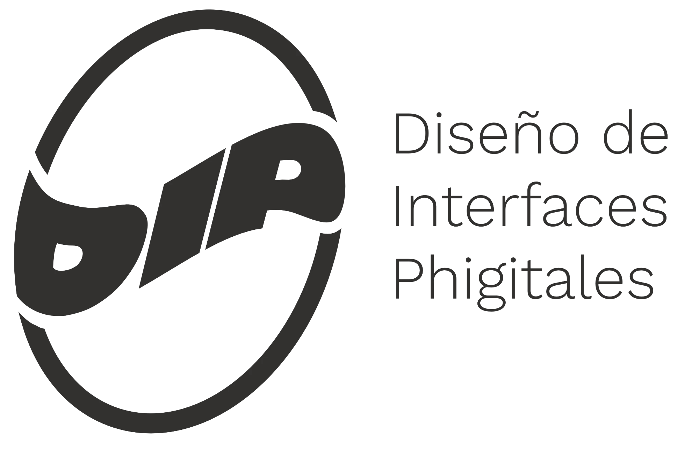

# Cambios del borrador v8 de la memoria

**Fecha:** 21 de noviembre de 2026.
**Base:** el [borrador v7](borrador-memoria-v7-2026-11-11.md), que es el texto de la memoria del Pase, con tus cambios.
**Resultado:** el [borrador v8](borrador-memoria-v8-2026-11-21.md).
**Fuentes:** los [comentarios de los profesores](comentarios-de-los-profesores-2026-11-18.md), con las notas del PDF y del miércoles 18; la [respuesta a los profesores](respuesta-a-los-profesores-2026-11-21.md), y las tareas 15 y 16 de [Por hacer](../00_gobernanza/por-hacer.md).

## Cómo se hizo

- **Tu forma de escribir se respetó.** Solo cambió lo que pidieron los profesores, lo que había que ajustar por esos cambios y los errores: ortografía, puntuación, gramática y frases que no decían lo que pasó. No se simplificó ni se reescribió tu redacción, y las citas de las personas quedan tal como las dijeron.
- **Todo está comprobado:**
  - el Resumen tiene 299 palabras y el Abstract 290 (la pauta pide de 200 a 300);
  - las 34 figuras y las 4 tablas se citan en orden y antes de aparecer;
  - cada cita tiene su referencia y cada referencia se cita;
  - el corrector ortográfico en español no encontró errores; solo marcó nombres propios, términos en inglés y palabras válidas, como «pódcast» o «croquera»;
  - no quedan comillas inglesas, dobles puntos, espacios dobles ni paréntesis sin cerrar.
- **Son 105 cambios.** Cada uno dice la página del PDF del Pase donde está el texto de antes, para encontrarlo en Affinity con Buscar y reemplazar.

## Cómo respondí a cada comentario de los profesores

### Las notas del PDF

M: Sergio Majluf. G: el profesor Gallardo.

| N.º | Pág. | Prof. | Comentario | Qué se hizo |
| --- | --- | --- | --- | --- |
| 1 | 1 | G | «Logo diip», en el rincón vacío de la portada | Es el logo DIP, Diseño de Interfaces Phigitales, que entregaste: va arriba a la derecha de la portada, con fondo transparente. |
| 2 | 3 | M | «al contar su último rato» es informal y «contar» confunde | Resumen: «se entrevistó a ocho personas sobre su última sesión de ocio digital». Igual en el Abstract. |
| 3 | 3 | G | «Definiciones», sobre «ocio digital» | El Resumen y el Abstract empiezan con la definición de tu Introducción, con tus mismas palabras. |
| 4 | 3 | G | «.», sobre «phygital» | Se mantuvo tu «(físico y digital)», que ya lo define, y la palabra va en cursiva. Va en las preguntas, por si pedía algo más. |
| 5 | 3 | G | «lo sacaría», sobre el ejemplo del libro y el final de la oración | Se quitó todo lo marcado. Cuándo suena Relevo lo explica el capítulo 10. |
| 6 | 5 | M | Más margen dentro de las cajas del índice general | Es de diseño: se hace en Affinity (abajo, «Lo que hay que hacer en Affinity»). |
| 7 | 6 | M | El índice de tablas y figuras: solo texto, sin cajas | Pasa al final, después de las referencias, solo con texto y con el título real de cada figura (D-180). Las cajas se quitan en Affinity. |
| 8 | 16 | G | «Lo pondría antes», sobre el marco teórico | Orden nuevo: 3 Antecedentes, 4 Marco teórico, 5 Planteamiento del problema y 6 Justificación, como en la pauta de la Escuela. Se renumeran las Figuras 1 a 5 y tres remisiones, y cambian una oración del marco teórico y la primera del capítulo 7. |
| 9 | 19 | G | «y no y no» | El párrafo quedó sin la repetición y dice lo mismo. |
| 10 | 30 | G | «y iOS» | La aplicación no es para iOS: se descartó, y el capítulo 12 lo explica. Para que quede claro desde la definición, el capítulo 10 dice: «La aplicación es solo para Android; el capítulo 12 explica por qué se descartó el iPhone». |
| 11 | 30 | G | «Reformular», con una pregunta propuesta | Su pregunta, tal cual. Se ajustaron el párrafo que la sigue y las Conclusiones, y el glosario suma «Recuerdo oportuno». |
| 12 | 31 | M | «probar si funciona» es muy general: un indicador explícito | Objetivo 4: medir el recuerdo oportuno (en cuántas respuestas supieron qué querían hacer y recordaron cómo empezar) y registrar en cuántas empezaron. La condición del ciclo, en el capítulo 13, suma «recordar cómo empezar». |
| 13 | 31 | G | Tomar la hipótesis para hacer la pregunta | La pregunta nueva sale de la hipótesis. La hipótesis no cambia. |
| 14 | 54 | G | «irá a los hallazgos» | Nueva sección «Hallazgos» en el capítulo 13, con tu texto y etiquetas cortas. «Resultados» queda con los datos. |
| 15 | 57 | G | Una escala de frecuencia en la Tabla 4 | Columna «Frecuencia» con su escala —no ocurre, no frecuente, frecuente, muy frecuente— y la base de cada fila, de preferencia las 21 respuestas de cada etapa. |
| 16 | 58 | M | Separar lo que la prueba permite afirmar de lo que no, y una comparación sin el sesgo de preparación previa | Dos párrafos en las Conclusiones (qué se puede afirmar y qué no; las condiciones y el aporte) y la comparación futura en «Alcances y proyecciones». También cambian la última oración del Resumen y «Alcance de esta etapa». |
| 17 | 58 | G | Quitar «preciso» | Se quitó. |

### Las notas del miércoles 18

| Nota | Qué se hizo |
| --- | --- |
| Anexo con todas las pantallas del apk | Pendiente: es trabajo de los anexos. Las capturas de la app 4.7.2 ya están en el repositorio. |
| La documentación y la memoria se leen bien | — |
| Diagramas estandarizados | Hecho en la memoria compuesta desde la v8 (D-186): las siete figuras nuevas comparten un mismo sistema —diagramas simples, la letra de la memoria y degradados sutiles—, y los colores de las figuras del generador llevan los mismos degradados. |
| Figuras en bibliografías, al final | Hecho: el índice de tablas y figuras va después de las referencias. |
| Antes del planteamiento del problema | Hecho: el marco teórico va antes del planteamiento. |
| El planteamiento del problema es mi universo | No se reescribió: es un cambio de fondo y tendría que ser con tus palabras. Hoy el capítulo ya parte de tu ejemplo (el dibujo), de datos de otras personas y del contexto en Chile. |
| Formulación: cómo funciona el sistema de tensión en la decisión | Pendiente: pide un párrafo nuevo en la Formulación, que conviene que escribas tú o que se proponga aparte. |
| Reformular desde la hipótesis, los objetivos y el proyecto | En parte: la pregunta sale de la hipótesis y el objetivo 4 nombra sus indicadores. El párrafo que presenta el proyecto como consecuencia de los objetivos está en la propuesta de formulación del 19 de noviembre, sin aplicar. |
| Leer la memoria al revés | Hecho como comprobación: las Conclusiones responden el objetivo 4; el objetivo 4 mide la variable de la hipótesis, y la pregunta sale de la hipótesis. La cadena calza. |
| Definir el fenómeno: agencia | Pendiente: hay que elegir la palabra (agencia, autonomía u otra) con una fuente que la defina. La propuesta de formulación del 19 de noviembre las compara. |
| El objetivo 4 es demasiado general | Hecho, con la nota de Majluf. |
| La redacción es compleja | Solo se corrigieron las frases con errores. No se simplificó tu redacción, como pediste. |
| Los hallazgos, muy específicos, podrían ir a los anexos | No se movieron: quedan en «Hallazgos», como pide la nota del PDF. Si quieres, los relatos de cada persona pueden pasar al Anexo I. |
| Usar los bocetos como fondo o textura | Pendiente, en Affinity. |
| Relevo, explorar el color | Pendiente, en Affinity. |
| Probar externamente con Martin Bravo | Pendiente: proyección. |
| Actividad pendiente con su lugar de inicio | Hecho: es la pregunta nueva. |
| *Taskscape* | Pendiente: hay que leer a Ingold (1993) antes de citarlo. |
| Diseñar cómo se publica la app | Pendiente: proyección. |

## Figuras nuevas

Pediste más figuras que expliquen los sistemas y los métodos complejos, como las de los anexos. Son siete diagramas simples —líneas, puntos, flechas y texto—, con tu tipografía, tu paleta con degradados sutiles como los de la app y los íconos de la app 4.7.2. Cada una tiene su mención en el texto, su título y su nota en APA, y está en [figuras/v8](figuras/v8/README.md) en PDF vectorial, para Affinity, en SVG, para el generador, y en PNG, para verla. Cada una se diseñó a su ancho real en la página —una columna, dos o el ancho del texto—, con la letra de las demás figuras (20,6 pt): se colocan al 100 %, sin escalar. [construir-figuras.py](figuras/v8/construir-figuras.py) las vuelve a generar.

| Figura | Ancho | Dónde va | Para qué sirve |
| --- | --- | --- | --- |
| Figura 8. Análisis de las entrevistas con el método Framework | Dos columnas | Capítulo 7, «Fuentes de información» | Muestra cómo se analizaron las entrevistas: los cinco momentos del método, la matriz de personas y temas, y los dos tipos ideales que salieron de ella. |
| Figura 16. Cadena de la formulación, del problema a las conclusiones | Dos columnas | Capítulo 10, después de los objetivos | Responde a «leer la memoria al revés» y «reformular en cadena»: cada parte se apoya en la anterior. |
| Figura 17. Método del proyecto, de la investigación a la iteración | Una columna | Capítulo 10, «Enfoque metodológico» | Muestra la investigación a través del diseño: las cuatro fuentes, los criterios, el diseño, la prueba, los hallazgos y los cambios, que vuelven al diseño. |
| Figura 22. Estados de un relevo | Ancho del texto | Capítulo 11, «Recorrido del usuario» | Muestra la lógica interna de la aplicación: los seis estados de un relevo y lo que lleva de uno a otro. Se lee de izquierda a derecha. |
| Figura 30. Cómo funciona Relevo: la persona, la aplicación y el objeto | Dos columnas | Capítulo 12, «Tecnología» | Separa el recorrido de la persona del funcionamiento técnico, en los mismos cuatro momentos del recorrido del usuario: lo que la comisión de julio pidió ver por separado. |
| Figura 34. Qué se registró en cada relevo | Ancho del texto | Capítulo 13, «Registro y cuidado de los datos» | Muestra cómo se midió la prueba: lo que la aplicación registró sola y las preguntas que respondió la persona con sus opciones. |
| Figura 40. Comparación propuesta para la etapa siguiente | Una columna | Capítulo 14, «Alcances y proyecciones» | Muestra la comparación sin los sesgos de esta prueba: tres condiciones, seis órdenes y relevos sin señal. |

## Numeración de las figuras

El número de la izquierda es el del PDF del Pase y el de la derecha, el de la v8 desde el 24 de noviembre, cuando la v8 sumó seis figuras con imágenes de las fuentes y del objeto (Figuras 1, 7, 14, 19, 37 y 39). Las siete figuras nuevas de la v8 son ahora las 8, 16, 17, 22, 30, 34 y 40. En Affinity cambian el rótulo de cada figura y sus menciones.

| Pase | v8 | Pase | v8 | Pase | v8 |
| --- | --- | --- | --- | --- | --- |
| 1 | 5 | 2 | 6 | 3 | 2 |
| 4 | 3 | 5 | 4 | 6 | 9 |
| 7 | 10 | 8 | 11 | 9 | 12 |
| 10 | 13 | 11 | 15 | 12 | 18 |
| 13 | 20 | 14 | 21 | 15 | 23 |
| 16 | 24 | 17 | 25 | 18 | 26 |
| 19 | 27 | 20 | 28 | 21 | 29 |
| 22 | 31 | 23 | 32 | 24 | 33 |
| 25 | 35 | 26 | 36 | 27 | 38 |

## Todos los cambios, por página del PDF del Pase

«Fig.» marca los cambios dentro de una figura, una tabla o su nota; en Affinity se editan en la figura. El símbolo ¶ marca un párrafo nuevo.

| Pág. | Dónde | Tipo | Antes | Después | Por qué |
| --- | --- | --- | --- | --- | --- |
| 1 | Portada | Comentario de los profesores |  |  ¶ <!-- Arriba a la derecha de la portada: --> ¶  | Gallardo marcó el rincón vacío de la portada y escribió «Logo diip» (p. 1): es el logo DIP, Diseño de Interfaces Phigitales, que entregaste. Va arriba a la derecha, frente al de la Facultad. |
| 2 | Agradecimientos | Ortografía y puntuación | A mis profesores guía por acompañar | A mis profesores guía, por acompañar | Coma, como en las otras dedicatorias («A mi mamá, por…»). |
| 3 | Resumen, párrafo 1 | Comentario de los profesores | A veces una sesión de ocio digital se prolonga sin que la persona haya decidido seguir, y otra actividad que también quería hacer —leer, dibujar, salir a caminar— deja de estar presente cuando aún podía empezarla. Este proyecto diseñó y evaluó un sistema phygital (físico y digital) para recuperar esa intención a tiempo, sin bloquear el teléfono ni decidir por la persona. | El ocio digital es el conjunto de actividades que una persona realiza con dispositivos digitales en su tiempo disponible para descansar, entretenerse, satisfacer su curiosidad o vincularse con otros. A veces una sesión se prolonga sin que la persona haya decidido seguir, y otra actividad que también quería hacer —leer, dibujar, salir a caminar— deja de estar presente cuando aún podía empezarla. Este proyecto diseñó y evaluó un sistema *phygital* (físico y digital) para recuperar esa intención a tiempo, sin bloquear el teléfono ni decidir por la persona. | Gallardo pidió «Definiciones» sobre «ocio digital» (p. 3). La definición es la de tu Introducción, con «con dispositivos digitales» en vez de «a través de dispositivos», como pediste. «De ocio digital» sale de la segunda oración para no repetirlo. *Phygital* queda con tu paréntesis, «(físico y digital)», que ya lo define, y en cursiva, como en el resto de la memoria. |
| 3 | Resumen, párrafo 2 | Comentario de los profesores | Para entenderlo, se examinó la experiencia de ocho personas al contar su último rato con el teléfono. Además, se encuestó a 53 personas por la última vez | Para entenderlo, se entrevistó a ocho personas sobre su última sesión de ocio digital. Además, se encuestó a 53 personas sobre la última vez | Majluf: «esa frase es muy informal y la palabra contar es confusa» (p. 3). «Se entrevistó» nombra el método. De paso, «por la última vez» pasa a «sobre la última vez». |
| 3 | Resumen, párrafo 2 | Comentario de los profesores | una aplicación y un objeto que la persona deja donde empieza su actividad —por ejemplo, junto a un libro, si quiere leer— y que suena cuando se cumple el tiempo que ella fijó para ciertas aplicaciones. | una aplicación y un objeto que la persona deja donde empieza su actividad. | Gallardo marcó el ejemplo y el final de la oración y escribió «lo sacaría» (p. 3). Se quita todo lo marcado; cuándo suena lo explica el capítulo 10. |
| 3 | Resumen, párrafo 3 | Extensión | y después con una notificación en el teléfono, para comparar. Con el objeto, | y después con una notificación en el teléfono. Con el objeto, | Para quedar dentro de las 300 palabras que pide la pauta: la comparación ya se ve en la oración siguiente. |
| 3 | Resumen, párrafo 3 | Comentario de los profesores | La prueba validó el ciclo en el uso cotidiano; la notificación, en cambio, era más fácil de pasar por alto. | El sistema funcionó en el uso cotidiano, aunque con tres personas no puede afirmarse que el objeto supere a la notificación. | Majluf pidió separar lo que la prueba permite afirmar de lo que no (p. 58). «Validó» prometía más de lo que muestran tres personas, y la pregunta sobre el aviso solo se hizo con el teléfono. |
| 3 | Resumen, palabras clave | Coherencia con otro cambio | Palabras clave: ocio digital, memoria prospectiva, diseño phygital | Palabras clave: ocio digital, memoria prospectiva, diseño *phygital* | La palabra va en cursiva en toda la memoria, como extranjerismo. |
| 4 | Abstract, párrafo 3 | Extensión | then with a phone notification, for comparison. With the object, | then with a phone notification. With the object, | Lo mismo que en el Resumen. |
| 4 | Abstract, párrafo 1 | Comentario de los profesores | Sometimes a digital leisure session goes on without the person having decided to continue, and another activity they also wanted to do—reading, drawing, going for a walk—fades from view while it could still be started. This project designed and evaluated a phygital (physical and digital) system to bring that intention back in time, without blocking the phone or deciding for the person. | Digital leisure is the set of activities a person carries out on digital devices in their free time to rest, have fun, satisfy their curiosity or connect with others. Sometimes a session goes on without the person having decided to continue, and another activity they also wanted to do—reading, drawing, going for a walk—fades from view while it could still be started. This project designed and evaluated a phygital (physical and digital) system to bring that intention back in time, without blocking the phone or deciding for the person. | Los mismos cambios del Resumen. |
| 4 | Abstract, párrafo 2 | Comentario de los profesores | To understand this, the project examined the experience of eight people as they described their last stretch on the phone. | To understand this, the project interviewed eight people about their last digital leisure session. | Los mismos cambios del Resumen. |
| 4 | Abstract, párrafo 2 | Comentario de los profesores | an app and an object that the person places where the activity begins—for example, next to a book, if they want to read—and that sounds once the time they set for certain apps has run out. | an app and an object that the person places where the activity begins. | Los mismos cambios del Resumen. |
| 4 | Abstract, párrafo 3 | Comentario de los profesores | The test validated the cycle in everyday use; the notification, in contrast, was easier to overlook. | The system worked in everyday use, although with three people it cannot be claimed that the object outperforms the notification. | Los mismos cambios del Resumen. |
| 5 | Índice general | Comentario de los profesores | Capítulos en el orden anterior, con las páginas del PDF. | Capítulos en el orden nuevo, más «Índice de tablas y figuras». Las páginas se ponen en Affinity. | Orden nuevo de los capítulos. El margen interior de las cajas (Majluf, p. 5) se ajusta en Affinity. |
| 6 | Índice de tablas y figuras | Comentario de los profesores | Después del índice general, en cajas blancas, con títulos que no coincidían con las figuras (6, 11, 14 y 26) y páginas corridas desde la Tabla 1. | Al final, después de las referencias, solo con texto, con el título real de cada figura y la numeración nueva. Las páginas se ponen en Affinity. | Majluf: «Sería más limpio y claro usar sólo textos sin las cajas blancas» (p. 6). Notas del miércoles: «Figuras en bibliografías, al final» (D-180). |
| 7 | Capítulo 1, Motivación personal | Ortografía y puntuación | Lo que me inquieta, es la diferencia | Lo que me inquieta es la diferencia | No va coma entre el sujeto y el verbo. |
| 8 | Capítulo 2, Introducción | Pedido tuyo | el conjunto de actividades que una persona realiza a través de dispositivos en su tiempo disponible | el conjunto de actividades que una persona realiza con dispositivos digitales en su tiempo disponible | Pediste cambiar «a través de dispositivos». Se usa igual en el Resumen, la Introducción y el glosario. |
| 11 | Planteamiento del problema, «Problemática» | Gramática | no la empezó (Anexo B): una muestra pequeña que nos da un indicio de que la situación no es solo una experiencia personal. | no la empezó (Anexo B). Es una muestra pequeña, pero sugiere que la situación no es solo una experiencia personal. | La oración tenía dos veces dos puntos y repetía «indicio»; «nos» era la única primera persona plural fuera de la Motivación. |
| 14 | Antecedentes, «Uso del teléfono y sentido de la experiencia» | Ortografía y puntuación | Reducir el uso no basta como criterio, no es una solución valida para todos. | Reducir el uso no basta como criterio: no es una solución válida para todos. | Tilde en «válida»; dos puntos en vez de coma entre dos oraciones. |
| 14 | Antecedentes, «Bloqueos, límites y pausas» | Exactitud | por ejemplo recordándola o creando hábitos. | por ejemplo recordándola o pidiendo fijarla. | Lyngs et al. (2019) no hablan de «crear hábitos»: las herramientas de metas recordaban una meta o pedían fijarla (verificación de los capítulos 1 a 6, pp. 7–8 del artículo). |
| 15 | Antecedentes, «Recordatorios, lugares y objetos» | Ortografía y puntuación | aunque hubiera pasado tiempo desde el encargo (Sohn et al. (2005) llevaron esa idea | aunque hubiera pasado tiempo desde el encargo. ¶ Sohn et al. (2005) llevaron esa idea | Faltaba el punto, el paréntesis quedaba abierto y se juntaban dos párrafos. |
| 16 | Marco teórico, «Experiencia del ocio digital» | Ortografía y puntuación | (Lukoff et al., 2018), por eso conviene | (Lukoff et al., 2018); por eso conviene | Punto y coma entre dos oraciones. |
| 16 | Orden de los capítulos | Comentario de los profesores | 3. Planteamiento del problema · 4. Justificación · 5. Antecedentes y estado de la cuestión · 6. Marco teórico por ámbitos | 3. Antecedentes y estado de la cuestión · 4. Marco teórico por ámbitos · 5. Planteamiento del problema · 6. Justificación | Gallardo, sobre el marco teórico: «Lo pondría antes» (p. 16). Es el orden de la pauta de la Escuela: antecedentes y marco teórico, y después la fundamentación. Los capítulos 7 a 14 no cambian de número. |
| 17 | Marco teórico, «Diseño de la atención» | Coherencia con otro cambio | Los patrones de interfaz descritos en el capítulo 3, como | Los patrones de interfaz descritos en la Introducción, como | Con el orden nuevo, el planteamiento va después del marco teórico; la Introducción ya describe esos patrones, con la misma cita. |
| 17 | Marco teórico, «Diseño de la atención» | Gramática | como abrirla rápido para una tarea breve, como puede ser tomar una nota o responder un mensaje | como abrirla rápido para una tarea breve: tomar una nota o responder un mensaje | Se repetía «como». |
| 19 | Marco teórico, cierre | Comentario de los profesores | La experiencia del ocio digital pide mirar cada sesión por su sentido y no por su duración, y no intervenir cuando el descanso es justo lo que la persona quería. El diseño de la atención pide crear una ocasión de decidir sin una fricción que estorbe, y dejar que la persona acepte, ajuste o rechace la ayuda. El recuerdo de intenciones pide una señal que llegue en el momento oportuno, que remita a la acción y no solo a la ocasión, y que vuelva al segundo plano después de aparecer. | La experiencia del ocio digital pide mirar cada sesión por su sentido más que por su duración, y respetar el descanso cuando es justo lo que la persona quería. El diseño de la atención pide crear una ocasión de decidir sin una fricción que estorbe, y dejar que la persona acepte, ajuste o rechace la ayuda. El recuerdo de intenciones pide una señal que llegue en el momento oportuno, que remita a la acción, no solo a la ocasión, y que vuelva al segundo plano después de aparecer. | Gallardo: «y no y no» (p. 19). Salen las tres repeticiones; el sentido no cambia. |
| 20 | Capítulo 7, primera oración | Coherencia con otro cambio | La teoría explica el fenómeno en general; faltaba saber cómo lo viven las personas. | Los capítulos anteriores explican el fenómeno en general; faltaba saber cómo lo viven las personas. | Con el orden nuevo, el capítulo 7 ya no sigue al marco teórico, sino a la Justificación. |
| 20 | Capítulo 7, «Fuentes de información» | Gramática | De esa comparación salieron dos tipos ideales en base a situaciones típicas | De esa comparación salieron dos tipos ideales, a partir de situaciones típicas | La RAE desaconseja «en base a». |
| 20 | Capítulo 7, «Fuentes de información» | Coherencia con otro cambio | y cómo la habría empezado (Figura 7), y pidió su opinión | y cómo la habría empezado, y pidió su opinión | APA numera las figuras por su primera mención: la 7 se citaba antes que la 6. La figura se sigue citando unas líneas más abajo. |
| 21 | Figura 6 (texto de la figura) (Fig.) | Ortografía y puntuación | Qupe deciden después | Qué deciden después | Errata dentro de la figura. |
| 22 | Capítulo 7, Figura 7 (Fig.) | Coherencia con otro cambio | La Figura 7 iba antes de la Figura 6. | La Figura 7 va después del párrafo que la cita, «La encuesta mostró que el caso estudiado es frecuente…». | Orden de las figuras por su primera mención (APA). En Affinity ya estaban en ese orden. |
| 24 | Figura 9 (texto de la figura) (Fig.) | Ortografía y puntuación | Por ejemplo, la videollamada o pódcast al comer. | Por ejemplo, la videollamada o el pódcast al comer | Falta «el», y es la única línea de las tarjetas con punto final. |
| 26 | Capítulo 8, «Evidencia y límites de cada familia» | Ortografía y puntuación | La evidencia es desigual, los estudios | La evidencia es desigual: los estudios | Dos puntos entre dos oraciones. |
| 26 | Capítulo 8, «Oportunidad» | Exactitud | está casi vacío, y su único referente, The Tangible Reminder, se pensó para citas y medicamentos, no para el ocio digital. | está casi vacío, y sus dos referentes, The Tangible Reminder y Wobble, son prototipos de investigación que no se pensaron para el ocio digital. | Wobble también recuerda desde fuera de la pantalla, en el hogar, como dicen el capítulo 3 y el Anexo C: no era el único referente. |
| 26 y 50 | Remisiones a capítulos | Coherencia con otro cambio | «(capítulo 5)» dos veces en el capítulo 8 y «(capítulo 3)» en «Actores del proyecto» | «(capítulo 3)» dos veces en el capítulo 8 y «(capítulo 5)» en «Actores del proyecto» | Los capítulos cambiaron de número con el orden nuevo. |
| 28 | Figura 11 (texto de la figura) (Fig.) | Ortografía y puntuación | Esfuerzo \| Criterios 6 a 8 | Justificar el esfuerzo \| Criterios 6 a 8 | El grupo se llama «Justificar el esfuerzo» en el capítulo. |
| 29 | Capítulo 9, criterio 2 | Gramática | El fundamento parte de decidir de antemano cuándo, dónde y cómo actuar ayuda a pasar de la intención a la acción | Como fundamento, decidir de antemano cuándo, dónde y cómo actuar ayuda a pasar de la intención a la acción | La oración no se entendía. «Como fundamento» es la fórmula del criterio 1. |
| 30 | Capítulo 10, pregunta de investigación | Comentario de los profesores | ¿Bajo qué condiciones lo que una persona quería hacer vuelve a estar presente a tiempo, y la decisión sigue siendo suya, mientras una sesión de ocio digital continúa? | ¿Cuál es el efecto de un sistema *phygital* que vincula una actividad pendiente con su lugar de inicio sobre el recuerdo oportuno de esa actividad durante el ocio digital? | Gallardo: «Reformular», con esta pregunta, y sobre la hipótesis: «tomar esta para hacer la pregunta» (pp. 30 y 31). Es su pregunta, tal cual. |
| 30 | Capítulo 10, párrafo que sigue a la pregunta | Comentario de los profesores | La pregunta pide condiciones. La investigación y los criterios del capítulo 9 las proponen, y una de ellas —que la señal llegue desde el lugar donde la actividad comienza (criterio 8)— se pone a prueba como hipótesis frente a una notificación en el teléfono. Que una intención vuelva a tiempo significa que al sonar la señal, la persona recuerda qué quería hacer y cómo empezar antes de leerlo en la pantalla, sin que se le exija dejar el teléfono. | La pregunta relaciona el sistema con el recuerdo. La investigación y los criterios del capítulo 9 proponen las condiciones que debe cumplir una ayuda así, y una de ellas —que la señal llegue desde el lugar donde la actividad comienza (criterio 8)— se pone a prueba como hipótesis frente a una notificación en el teléfono. El recuerdo oportuno significa que, al sonar la señal, la persona recuerda qué quería hacer y cómo empezar antes de leerlo en la pantalla, sin que se le exija dejar el teléfono. | Con la pregunta nueva, el párrafo ya no puede decir que la pregunta «pide condiciones». Se conservan dos de sus tres oraciones, y se corrige la coma de «al sonar la señal». |
| 30 | Capítulo 10, «Definición y alcance de Relevo» | Comentario de los profesores | las aplicaciones que ella elige y un lugar de su casa. | las aplicaciones que ella elige y un lugar de su casa. La aplicación es solo para Android; el capítulo 12 explica por qué se descartó el iPhone. | Gallardo escribió «y iOS» (p. 30). La aplicación no es para iOS: se descartó, y el capítulo 12 lo explica. Aquí se adelanta, para que quede claro desde la definición. |
| 31 | Capítulo 10, objetivo específico 4 | Comentario de los profesores | 4. Probar en hogares si las personas entienden la señal, si les resulta cómoda y si el sistema funciona. | 4. Probar en hogares si las personas entienden la señal y si les resulta cómoda, medir el recuerdo oportuno —en cuántas respuestas a la señal supieron qué querían hacer antes de mirar la pantalla y recordaron cómo empezar— y registrar en cuántas empezaron la actividad. | Majluf: «"probar si funciona" es muy general»; pidió un indicador explícito (p. 31). El miércoles: «qué señales concretas nos dicen que el sistema funciona». |
| 31 | Capítulo 10, «Enfoque metodológico» | Ortografía y puntuación | es en sí mismo, una forma de investigar | es, en sí mismo, una forma de investigar | El inciso va entre dos comas. |
| 32 | Figura 12 (texto de la figura) (Fig.) | Ortografía y puntuación | Cambios y mejoras en base a las sugerencias de los usuarios | Cambios y mejoras a partir de las sugerencias de los usuarios | La RAE desaconseja «en base a». |
| 32 | Capítulo 10, «Uso de inteligencia artificial» | Ortografía y puntuación | Cursor, de Anysphere y Codex, de OpenAI, | Cursor, de Anysphere, y Codex, de OpenAI, | Falta la coma que cierra el inciso «de Anysphere». |
| 34 | Capítulo 11, «Preparar» | Ortografía y puntuación | como “Abrir el libro” o “En el velador” | como «Abrir el libro» o «En el velador» | Comillas latinas, como en el resto de la memoria. |
| 34 | Capítulo 11, «Preparar» | Ortografía y puntuación | Cada dato de un Relevo activo | Cada dato de un relevo activo | Con minúscula es cada actividad preparada; con mayúscula, el sistema o el objeto (glosario). |
| 35 | Figura 14, título (Fig.) | Ortografía y puntuación | *Flujo de la aplicación.* | *Flujo de la aplicación* | Los títulos de figura no llevan punto final. |
| 35 | Capítulo 11, «Decidir» | Ortografía y puntuación | “Comencé la actividad”, “La dejé para después” y “Cambié de idea” | «Comencé la actividad», «La dejé para después» y «Cambié de idea» | Comillas latinas. |
| 35 | Capítulo 11, «Primer uso» | Exactitud |  Más adelante, se logró comprimir más los pasos iniciales, haciendo la experiencia más fluida y rápida. |  | Lo que cambió ya lo dice la oración anterior (de once pantallas a tres), y «más fluida y rápida» no se midió. |
| 36 | Capítulo 11, «Arquitectura de información» | Ortografía y puntuación | con verbos “Preparar un relevo”, “Activar el relevo”, para que | con verbos —«Preparar un relevo», «Activar el relevo»—, para que | Los ejemplos van entre rayas para que la oración se lea completa. |
| 36 | Capítulo 11, «Lenguaje visual» | Ortografía y puntuación | tarjetas, botones y ventanas, todo se siente parte de una misma forma. | tarjetas, botones y ventanas: todo se siente parte de una misma forma. | Dos puntos entre dos oraciones. |
| 38 | Capítulo 11, «Apple frente a Material Design» | Ortografía y puntuación | Lo que pertenece al sistema; los permisos, las notificaciones y el gesto para volver atrás, se ve | Lo que pertenece al sistema —los permisos, las notificaciones y el gesto para volver atrás— se ve | El inciso va entre rayas. |
| 39 | Capítulo 11, «Accesibilidad» | Ortografía y puntuación | una señal visual y una vibración, una etapa futura podría | una señal visual y una vibración; una etapa futura podría | Punto y coma entre dos oraciones. |
| 39 | Capítulo 11, «Voz de Relevo» | Gramática | De ese estudio salió una tono de voz/comunicacional con cuatro rasgos | De ese estudio salió una voz con cuatro rasgos | Concordancia («una tono») y barra. Se usa «voz» porque el párrafo siguiente distingue la voz, que no cambia, del tono, que sí, y la Figura 17 se titula «Rasgos de la voz». |
| 39 | Capítulo 11, «Voz de Relevo» | Ortografía y puntuación | con palabras cotidianas “querer” antes que “desear”, “usar” antes que “utilizar”, como recomienda | con palabras cotidianas —«querer» antes que «desear», «usar» antes que «utilizar»—, como recomienda | Los ejemplos van entre rayas; comillas latinas. |
| 39 | Capítulo 11, «Voz de Relevo» | Ortografía y puntuación | Tambien pregunta en vez de rotular “¿Cómo empiezas?” sus botones empiezan con un verbo que dice qué va a pasar, como “Activar el relevo” (Apple, 2025b). | También pregunta en vez de rotular («¿Cómo empiezas?»), y sus botones empiezan con un verbo que dice qué va a pasar, como «Activar el relevo» (Apple, 2025b). | Tilde en «También»; faltaba unir las dos oraciones. |
| 39 | Capítulo 11, «Voz de Relevo» | Ortografía y puntuación | como “debes” o “tienes que” | como «debes» o «tienes que» | Comillas latinas. |
| 40 | Figura 17 (texto de la figura) (Fig.) | Exactitud | “Anotado, Gracias por tu sugerencia.” | «Queda anotado. Gracias por decirlo.» | La nota dice que los ejemplos son textos de la aplicación; este no lo era. El real, cuando la persona empieza, es «Queda anotado. Gracias por decirlo.». |
| 40 | Figura 17 (texto de la figura) (Fig.) | Ortografía y puntuación | “No sonó en el dispositivo de audio. Revisa que esté encendido y conectado.” | «No sonó en el dispositivo de audio. Revisa que esté encendido y conectado.» | Comillas latinas. |
| 40 | Figura 17 (texto de la figura) (Fig.) | Ortografía y puntuación | “Ninguna respuesta es mejor que otra.” | «Ninguna respuesta es mejor que otra.» | Comillas latinas. |
| 40 | Figura 17 (texto de la figura) (Fig.) | Exactitud | Honesta \| Dice qué guarda y qué no ve \| Como los datos que recopila la app. | Honesta \| Dice qué guarda y qué no ve \| «Relevo no lee mensajes, fotos, búsquedas ni lo que hay en la pantalla.» | Tampoco era un texto de la aplicación. Este es de la sección «Qué no se ve» del consentimiento. |
| 40 | Capítulo 11, «Paleta cromática» | Gramática | permite calcular como lo percibe el ojo y no como la guarda la pantalla | permite calcular cómo lo percibe el ojo y no cómo lo guarda la pantalla | Tilde en «cómo» (interrogativo indirecto) y «lo», porque se refiere al color. |
| 41 | Capítulo 11, «Tipografía» | Ortografía y puntuación | El logotipo, “relevo”, va siempre | El logotipo, «relevo», va siempre | Comillas latinas. |
| 42 | Capítulo 11, «Tipografía» | Ortografía y puntuación | la jerarquía sigue la de iOS; título grande, título, encabezado, texto y nota | la jerarquía sigue la de iOS: título grande, título, encabezado, texto y nota | Dos puntos antes de una enumeración. |
| 42 | Capítulo 11, «Tag» | Ortografía y puntuación | un llavero antipérdida Bluetooth: que resultó ser barato, | un llavero antipérdida Bluetooth, que resultó ser barato, | Sobraban los dos puntos. |
| 42 | Capítulo 11, «Objeto propio» | Gramática | conserva el sonido ya probado, el objeto suma forma, control y marca. Su forma sigue la del Tag, redondo y cara casi plana, | conserva el sonido ya probado y suma forma, control y marca. Su forma sigue la del Tag: redonda y de cara casi plana, | Dos oraciones unidas por una coma, y concordancia («la forma… redonda»). |
| 42 | Capítulo 11, «Objeto propio» | Gramática | Relevo Go, de 44 × 54,5 mm y 11,4 mm de alto, permitiendo una mayor portabilidad, | Relevo Go, de 44 × 54,5 mm y 11,4 mm de alto, permite una mayor portabilidad, | La oración no tenía verbo principal. |
| 43 | Capítulo 11, «Objeto propio» | Ortografía y puntuación | sobre el logo,El sonido sale | sobre el logo. El sonido sale | Faltaban el punto y el espacio. |
| 43 | Capítulo 11, «Objeto» | Gramática | y un botón del tamaño de la cara se ve y se siente y porque sus detalles necesitan espacio para imprimirse. | y un botón del tamaño de la cara se ve y se siente, y para fabricarlo, porque sus detalles necesitan espacio para imprimirse. | Faltaba la tercera razón: las otras dos empiezan con «para». |
| 45 | Figura 21, nota (Fig.) | Exactitud | Modelos 3D hechos con ayuda de Claude a partir de los bocetos de la Figura 20. | Modelos 3D hechos con ayuda de Claude a partir de los bocetos de la Figura 20. Las medidas de la placa del Tag son estimadas. | Las medidas de Home y Go salen de un modelo con la placa del Tag sin medir. |
| 45 | Capítulo 11, «Privacidad y datos» | Ortografía y puntuación | la sección “Qué no se ve”, explica | la sección «Qué no se ve» explica | No va coma entre el sujeto y el verbo; comillas latinas. |
| 46 | Tabla 1, fila «Datos» | Ortografía y puntuación | \| Registrar datos innecesarios y personales \| | \| Registrar datos innecesarios y personales. \| | Las demás celdas terminan en punto. |
| 47 | Capítulo 12, «Del prototipo al producto» | Exactitud | mostraría si sonar desde el lugar de la actividad aporta en una escala mayor. | mostraría si sonar desde el lugar de la actividad aporta. | «En una escala mayor» daba por probado un aporte del lugar que la prueba no aisló. |
| 47 | Capítulo 12, «Del prototipo al producto» | Ortografía y puntuación | para quienes son más “desordenados” | para quienes son más «desordenados» | Comillas latinas. |
| 48 | Capítulo 12, «Del prototipo al producto» | Gramática | El piloto es la cifra que decide el paso siguiente. | El costo del piloto es la cifra que decide el paso siguiente. | La cifra es el costo, no el piloto. |
| 48 | Capítulo 12, «Del prototipo al producto» | Ortografía y puntuación | entre 10.100 y 12.150 pesos, y los seis hogares, en total entre 60.500 y 72.900. | entre 10 100 y 12 150 pesos, y los seis hogares, en total entre 60 500 y 72 900. | Las cifras de cinco dígitos llevan espacio, como en la Tabla 2 y en la Figura 22. |
| 48 | Capítulo 12, «Financiamiento» | Exactitud | unos 111 000 pesos, entre el Tag. las herramientas de inteligencia artificial para el desarrollo de la app, y el trabajo del autor. | unos 111 000 pesos entre el Tag y las herramientas de inteligencia artificial para el desarrollo de la app, además del trabajo del autor. | Sobraba un punto, y los 111 000 pesos son el Tag y las herramientas: el trabajo del autor se valora aparte, en la nota de la Tabla 2. |
| 51 | Capítulo 13, «Registro y cuidado de los datos» | Comentario de los profesores | Para dar el ciclo por logrado, el Tag debía sonar cuando correspondía, la persona debía saber qué quería hacer al oír la señal, sin leer la pantalla, y debía seguir usando Relevo durante las dos semanas. | Para dar el ciclo por logrado, el Tag debía sonar cuando correspondía; al oír la señal, la persona debía saber qué quería hacer sin leer la pantalla y recordar cómo empezar, y debía seguir usando Relevo durante las dos semanas. | Para que la cadena calce al leerla al revés: el objetivo 4 nuevo mide también recordar cómo empezar, que el primer supuesto ya incluía. El resultado no cambia: recordaron cómo empezar en 21 de 21 respuestas. |
| 52 | Figura 23 (pie de la foto b) (Fig.) | Ortografía y puntuación | ![b. Tag sobre un mueble junto mangas.] | ![b. Tag sobre un mueble, junto a unos mangas] | Faltaba «a», y los demás pies no llevan punto. |
| 53 | Capítulo 13, hallazgos, «Primera persona» | Ortografía y puntuación | “podrían implementar que se pueda actualizar o editar las opciones que uno ya eligió… así no tenemos que borrarlo y crearlo de nuevo” | «podrían implementar que se pueda actualizar o editar las opciones que uno ya eligió… así no tenemos que borrarlo y crearlo de nuevo» | Comillas latinas, como las demás citas de las personas. |
| 54 | Capítulo 13, hallazgos, «Sonido» | Exactitud | antes de que terminara: la solución es que una señal más breve bastaría. | antes de que terminara: una señal más breve podría bastar, y queda por probar. | No se probó una señal más breve. |
| 54 | Capítulo 13, nueva sección «Hallazgos» | Comentario de los profesores | «Resultados» reunía los datos, el relato de cada persona y su lectura. | «Resultados» queda con los datos (Figura 25, la comparación con el teléfono y la Tabla 3), y una sección nueva, «Hallazgos», reúne, con su texto, el relato de cada persona y las lecturas, cada párrafo con una etiqueta corta: «Criterios de diseño», «Sonido», «Objeto frente a notificación», «Cierre de la prueba» y «Dos hallazgos para el diseño». | Gallardo, sobre el texto de la p. 54: «ira a los hallazgos». Los relatos se quedan en la memoria, como pidieron el 28 de octubre; la nota del miércoles dice que «podrían» ir a los anexos. |
| 55 | Capítulo 13, hallazgos, «Cierre de la prueba» | Exactitud | El cierre confirmó esa teoría. Las tres contaron | Las tres contaron | No había una teoría a la que referirse. |
| 55 | Capítulo 13, hallazgos | Exactitud | Dos hallazgos orientan el diseño. El primero es que la señal pertenece al lugar de la actividad: el único relevo | El primero es que la señal depende del objeto: el único relevo | «Pertenece al lugar» afirmaba más de lo que muestra un relevo que no sonó lejos del Tag. «Dos hallazgos orientan el diseño» pasa a ser la etiqueta del párrafo. |
| 56 | Figura 26, título (Fig.) | Ortografía y puntuación | *Recordar no basta para empezar algo.* | *Recordar no basta para empezar algo* | Los títulos de figura no llevan punto final. |
| 56 | Capítulo 13, «Alcance de esta etapa» | Comentario de los profesores | Esta etapa validó el uso real del ciclo con tres personas durante cinco semanas: el ciclo funciona en un hogar, la señal se entiende, los fallos que aparecieron se corrigieron durante la prueba y la comparación con el teléfono mostró en qué se diferencian ambos soportes. | Esta etapa probó el ciclo en uso real con tres personas durante cinco semanas: el ciclo funciona en un hogar, la señal se entiende, los fallos que aparecieron se corrigieron durante la prueba y la comparación con el teléfono mostró cómo vivió cada persona ambos soportes. | Majluf (p. 58): la comparación no mide un efecto del soporte; describe lo que vivió cada persona. «Validó» prometía más. |
| 56 | Capítulo 13, «Alcance de esta etapa» | Comentario de los profesores | los resultados describen casos y no permiten generalizar a gran escala. | los resultados describen casos y no permiten generalizar. | Con tres personas no se puede generalizar a ninguna escala. |
| 56 | Capítulo 13, «Iterar con los resultados» | Ortografía y puntuación | nueve cambios que salieron de la prueba.(Anexos D y G). | nueve cambios que salieron de la prueba (Anexos D y G). | El paréntesis va antes del punto. |
| 57 | Tabla 4 | Comentario de los profesores | Tres columnas: hallazgo, cambio y estado. | Una columna nueva, «Frecuencia», con la escala del profesor y su base en cada fila; la nota explica la escala. | Gallardo: «podrías poner una escala según el n de las respuestas; no ocurre, no frecuentemente, frecuentemente o muy frecuentemente» (p. 57). Los recuentos salen de la Tabla 3, de la Tabla I6 y del Anexo G. Dos filas vienen de la revisión del 28 de octubre y no llevan frecuencia. |
| 58 | Capítulo 14, primer párrafo | Comentario de los profesores | en un problema de diseño preciso: que la persona | en un problema de diseño: que la persona | Gallardo: quitar «preciso» (p. 58). |
| 58 | Capítulo 14, primer párrafo | Ortografía y puntuación | tomó decisiones en todas las escalas; el sistema, el recorrido, la interfaz, la voz, la identidad y el objeto, y cada una responde a un criterio. | tomó decisiones en todas las escalas —el sistema, el recorrido, la interfaz, la voz, la identidad y el objeto—, y cada una responde a un criterio. | La enumeración va entre rayas, para que se distinga del final de la oración. |
| 58 | Capítulo 14, segundo párrafo | Comentario de los profesores | Así, los dos primeros objetivos: entender el problema y diseñar el sistema, se cumplieron; el cuarto, probarlo en hogares, se cumplió con tres personas durante cinco semanas, y el tercero, la comparación con el teléfono, mostró que con la notificación recordaron igual, pero cerca de la mitad de las veces la notaron tarde o no la notaron. | Así, los dos primeros objetivos —entender el problema y diseñar el sistema— se cumplieron; el cuarto, medir en hogares el recuerdo oportuno, se cumplió con tres personas durante cinco semanas, y el tercero, la comparación con el teléfono, se cumplió en parte: con la notificación recordaron igual y cerca de la mitad de las veces la notaron tarde o no la notaron, pero esa comparación no permite decir cuál de los dos ayuda más. | Majluf: separar lo que la prueba permite afirmar de lo que no (p. 58). Se nombra el objetivo 4 nuevo y se corrige el uso de los dos puntos. |
| 58 | Capítulo 14, cuarto párrafo | Comentario de los profesores | La pregunta de investigación pedía condiciones, y la investigación las precisó: una ayuda debe partir de una actividad que la persona elige, unirla a un primer paso concreto, sonar cuando ella lo decidió y dejar abierta la decisión. Construido así, Relevo devolvió la intención sin decidir por nadie (Figura 27). Una de esas condiciones, que la señal llegue desde el lugar donde la actividad comienza, se formuló como hipótesis. Los resultados son compatibles con su primer supuesto, aunque no bastan para probarlo: al oír la señal, la persona casi siempre supo qué quería hacer antes de leerlo y siempre recordó cómo empezar. El tercero se sostiene en parte: con el teléfono recordaron igual, pero notaron el aviso tarde o no lo notaron cerca de la mitad de las veces, y el sonido del Tag molestó más a quienes estaban cerca. El aporte del proyecto al diseño es haber convertido una tensión cotidiana en decisiones verificables: qué se recuerda, cuándo, dónde, con qué objeto y con qué opciones, sin reducirla a una cuestión de disciplina. | La pregunta de investigación indagaba el efecto de vincular una actividad pendiente con su lugar de inicio sobre el recuerdo oportuno. La prueba permite afirmar que, con el objeto en ese lugar, el ciclo funciona en el uso cotidiano de tres hogares: al oír la señal, la persona casi siempre supo qué quería hacer antes de leerlo, siempre recordó cómo empezar y decidió con libertad. Esos resultados son compatibles con la hipótesis, aunque no bastan para probarla. No permiten afirmar que el objeto supere a la notificación: con el teléfono recordaron igual, y aunque notaron el aviso tarde o no lo notaron cerca de la mitad de las veces, la pregunta sobre el aviso se hizo solo con el teléfono. Además, esa etapa vino siempre después de las semanas con el Tag, y en las dos las personas habían preparado el relevo poco antes de que sonara. El sonido del Tag, por su parte, molestó más a quienes estaban cerca. Tampoco permiten afirmar que el lugar sea lo que ayuda, porque ninguna etapa dejó el objeto lejos de la actividad. ¶ La investigación sí precisó las condiciones que debe cumplir una ayuda así: partir de una actividad que la persona elige, unirla a un primer paso concreto, sonar cuando ella lo decidió y dejar abierta la decisión. Construido así, Relevo devolvió la intención sin decidir por nadie (Figura 27). El aporte del proyecto al diseño es haber convertido una tensión cotidiana en decisiones verificables: qué se recuerda, cuándo, dónde, con qué objeto y con qué opciones, sin reducirla a una cuestión de disciplina. | Majluf: separar lo que la prueba permite afirmar (el ciclo funciona en tres hogares) de lo que no (superioridad sobre la notificación) (p. 58). Un párrafo dice qué se puede afirmar y qué no; el otro conserva tus frases sobre las condiciones y el aporte. |
| 59 | Capítulo 14, «Alcances y proyecciones» | Comentario de los profesores | El trabajo puede seguir en cuatro pasos: seguir aplicando lo que mostró, sumando opciones de control a medida que la persona gana experiencia, como sugirió D. Parra (comunicación personal, 4 de noviembre de 2026); imprimir y probar Relevo; ampliar la prueba a más personas, con un fondo concursable, explorar Relevo Home y Relevo Go, con localizadores de otras marcas, si sonar desde el lugar mantiene su aporte. Más adelante, un hardware propio permitiría diseñar también el sonido y el control. | El trabajo puede seguir en cuatro pasos: seguir aplicando lo que mostró la prueba, sumando opciones de control a medida que la persona gana experiencia, como sugirió D. Parra (comunicación personal, 4 de noviembre de 2026); imprimir y probar Relevo; repetir la prueba con más personas y una comparación sin los sesgos de esta, con un fondo concursable, y explorar Relevo Home y Relevo Go con localizadores de otras marcas. ¶ Esa comparación debe evitar dos sesgos de esta prueba: que la etapa con el teléfono viniera siempre después, cuando las personas ya conocían la señal, y que pudieran recordar por haber preparado el relevo poco antes, y no por la señal. El protocolo de 21 días del Anexo I resuelve el primero: seis personas pasan por tres semanas —el objeto junto al primer paso, el mismo objeto en un lugar sin relación con la actividad y una notificación genérica en el teléfono—, cada una en un orden distinto. Para el segundo, se pueden sumar algunos relevos en que el tiempo se cumpla sin señal: lo que la persona haga entonces mostrará cuánto se debe solo a haberlo preparado. Con el mismo sonido y las mismas preguntas en todas las condiciones, la diferencia entre ellas podrá atribuirse con más confianza a la señal y al lugar. ¶ Más adelante, un hardware propio permitiría diseñar también el sonido y el control. | Majluf: «sugiere un diseño de comparación sin el sesgo de preparación previa» (p. 58). Se cubren los dos sesgos que la memoria ya nombra. También faltaba la «y» del último paso. |
| 64 | Glosario, «Ciclo» | Exactitud | **Ciclo.** Periodo en que una intención y su condición de activación están vigentes. La interfaz de la aplicación lo llama «relevo». | **Ciclo.** Recorrido completo de un relevo: prepararlo, seguir en el teléfono mientras cuenta el tiempo, oír la señal y decidir. La interfaz de la aplicación llama «relevo» a cada uno. | La memoria usa «ciclo» para el recorrido completo («el ciclo completo funcionó», «para dar el ciclo por logrado»), no solo para el periodo en que está vigente. |
| 65 | Glosario, «Ocio digital» | Pedido tuyo | **Ocio digital.** Actividades que una persona realiza a través de dispositivos en su tiempo disponible | **Ocio digital.** Actividades que una persona realiza con dispositivos digitales en su tiempo disponible | Igual que en el Resumen y la Introducción. |
| 65 | Glosario, «Recuerdo oportuno» (nuevo) | Comentario de los profesores | **Relevo.** Sistema *phygital* propuesto en esta memoria, compuesto por una aplicación Android y un objeto físico. | **Recuerdo oportuno.** Recuerdo de una intención cuando todavía se puede actuar; es lo que estudia la memoria prospectiva. En esta memoria, significa que, al sonar la señal, la persona sabe qué quería hacer y cómo empezar antes de leerlo en la pantalla. ¶ **Relevo.** Sistema *phygital* propuesto en esta memoria, compuesto por una aplicación Android y un objeto físico. | La pregunta nueva usa «recuerdo oportuno», así que entra al glosario. |
| todas | Numeración de las figuras (Fig.) | Coherencia con otro cambio | Las 27 figuras del PDF del Pase, numeradas del 1 al 27. | 34 figuras, numeradas por su primera mención. Cambian: 1 → 4; 2 → 5; 3 → 1; 4 → 2; 5 → 3; 6 → 7; 7 → 8; 8 → 9; 9 → 10; 10 → 11; 11 → 12; 12 → 15; 13 → 16; 14 → 17; 15 → 19; 16 → 20; 17 → 21; 18 → 22; 19 → 23; 20 → 24; 21 → 25; 22 → 27; 23 → 28; 24 → 29; 25 → 31; 26 → 32; 27 → 33. | El marco teórico pasa antes del planteamiento y entran siete figuras nuevas; APA numera las figuras en el orden en que se citan. |
| — | Capítulo 7, «Fuentes de información» (Fig.) | Figura nueva | — | Figura 8. Análisis de las entrevistas con el método Framework | Muestra cómo se analizaron las entrevistas: los cinco momentos del método, la matriz de personas y temas, y los dos tipos ideales que salieron de ella. |
| — | Capítulo 10, después de los objetivos (Fig.) | Figura nueva | — | Figura 16. Cadena de la formulación, del problema a las conclusiones | Responde a «leer la memoria al revés» y «reformular en cadena»: cada parte se apoya en la anterior. |
| — | Capítulo 10, «Enfoque metodológico» (Fig.) | Figura nueva | — | Figura 17. Método del proyecto, de la investigación a la iteración | Muestra la investigación a través del diseño: las cuatro fuentes, los criterios, el diseño, la prueba, los hallazgos y los cambios, que vuelven al diseño. |
| — | Capítulo 11, «Recorrido del usuario» (Fig.) | Figura nueva | — | Figura 22. Estados de un relevo | Muestra la lógica interna de la aplicación: los seis estados de un relevo y lo que lleva de uno a otro. |
| — | Capítulo 12, «Tecnología» (Fig.) | Figura nueva | — | Figura 30. Cómo funciona Relevo: la persona, la aplicación y el objeto | Separa el recorrido de la persona del funcionamiento técnico, en los mismos cuatro momentos del recorrido del usuario: lo que la comisión de julio pidió ver por separado. |
| — | Capítulo 13, «Registro y cuidado de los datos» (Fig.) | Figura nueva | — | Figura 34. Qué se registró en cada relevo | Muestra cómo se midió la prueba: lo que la aplicación registró sola y lo que respondió la persona. Las condiciones para dar el ciclo por logrado están en el texto. |
| — | Capítulo 14, «Alcances y proyecciones» (Fig.) | Figura nueva | — | Figura 40. Comparación propuesta para la etapa siguiente | Muestra la comparación sin los sesgos de esta prueba: tres condiciones, seis órdenes y relevos sin señal. |

## Lo que no se cambió, y por qué

**Sugerencias de estilo que no se aplicaron, para respetar tu forma de escribir:**

- «Para alcanzar a alguien atrapado en una pantalla» (p. 18): «atrapado» juzga un poco el ocio digital; «absorto» sería más neutro.
- «para quienes son más «desordenados»» (p. 47): coloquial, pero va entre comillas a propósito.
- «se usa como opinión experta que aporta un valor importante al proyecto» (p. 32).
- «una luz o una imagen piden mirar, y la persona está mirando otra cosa», y en la oración siguiente, «una señal visual no alcanza a quien mira otra cosa» (p. 43): dicen casi lo mismo.
- «semibold» y «seminegrita» conviven para lo mismo (pp. 38 y 42).

**Puntos de la tarea 15 que no se cambiaron:**

- «cada uno se diseñó para pedir lo mínimo (Figura 14)» (p. 34): la tarea proponía la Figura 13, pero es la única mención de la Figura 14, y esa figura muestra justamente las pantallas de cada momento.
- «**Usuario principal:** La sesión…» (p. 23): la mayúscula después de los dos puntos es correcta cuando lo anterior funciona como un título.
- La Figura 10 no ubica a Wobble, aunque el texto ahora lo nombra: se puede sumar al mapa en Affinity, cerca de The Tangible Reminder, o dejarlo así.

**Lo que necesita información tuya o una decisión:**

- **Las tres personas:** cómo se las eligió y si conocían al autor (tarea 15, E).
- **Consentimiento:** si se renovó para la etapa con el teléfono, porque el texto aceptado hablaba de 21 días y de un parlante (tarea 15, E; Anexo I).
- **Entrevistas:** decir en el capítulo 7 que la pauta se escribió para una idea anterior (tarea 15, E).
- **Fogg (2009):** buscar una fuente más reciente para la Figura 26 (tarea 15, E).
- **Extensión:** la Introducción (unas 540 palabras) y la Justificación (unas 260) siguen bajo lo que pide la pauta de Seminario (600 y 300). No se alargaron, para no escribir por ti (tareas 14 y 15, C).
- **O’Rear y Radvansky (2019):** «entrar solía bastar para recordarla» coincide con la tesis que reprodujo el estudio, pero falta leer el artículo completo.
- **El nombre del profesor Gallardo:** la portada dice «Simón» y sus notas, «Manuel».
- **Pedidos tuyos del 21 de noviembre:** «a través de dispositivos» pasa a «con dispositivos digitales» en el Resumen, el Abstract, la Introducción y el glosario, e iOS deja de aparecer como proyección.

**Anexos:** la v8 cambia la pregunta, así que el Anexo I, I.1, que la cita, debe usar la nueva, y la Tabla I1 debe decir «las semanas con el teléfono». Los anexos no se tocaron en este paso.

## Lo que hay que hacer en Affinity

**Desde la tarde del 21 de noviembre ya no hace falta hacerlo a mano:** la memoria v8 está compuesta, con las figuras puestas junto a su mención, en [memoria-relevo-v8-1920x1080.pdf](memoria-1920x1080/memoria-relevo-v8-1920x1080.pdf), y su IDML se abre en Affinity (D-186). Si hiciste ajustes de diseño a mano en tu Affinity del Pase, hay que repetirlos en esa versión. Si prefieres seguir en tu documento del Pase, estos son los pasos:

1. **Mover los capítulos 5 y 6 (Antecedentes y Marco teórico) antes del 3 (Planteamiento)**, y cambiar los números de los cuatro: en la apertura, en el encabezado de cada página y en el índice.
2. **Las figuras:** colocar las siete nuevas (los PDF de figuras/v8) al 100 %, con el ancho de la tabla «Figuras nuevas», junto al texto que las nombra, y renumerar todas según la tabla «Numeración de las figuras».
3. **Portada:** el logo DIP arriba a la derecha (figuras/logo-dip/logo-dip-transparente.png, con fondo transparente).
4. **Índice general:** el orden nuevo, más margen interior en las cajas, a la izquierda y a la derecha, y las páginas nuevas.
5. **Índice de tablas y figuras:** moverlo al final, después de las referencias, sin cajas, con el interlineado del índice general y con los títulos de la v8.
6. **Tabla 4:** sumar la columna «Frecuencia».
7. **Dentro de las figuras:** los textos de las Figuras 6, 9, 11, 12 y 17; la nota de la 21; el pie de la foto b de la 23, y los títulos de la 14 y la 26, sin punto final.
8. **El texto:** cada cambio de la tabla de arriba, buscando el «antes».
9. **Al final:** revisar que ninguna página quede casi vacía o con un párrafo cortado, y que cada figura quede en la página de su mención o en la siguiente.

## Registro de cambios (disclaimer)

### 2026-11-24 — Numeración con las imágenes de las fuentes

- **Qué cambió:** la tabla de numeración y la de figuras nuevas usan los números de la v8 con las seis imágenes de las fuentes: 40 figuras.
- **Cómo estaba antes:** la v8 tenía 34 figuras.
- **Por qué:** el autor pidió rellenar con imágenes reales los capítulos que terminaban en una columna corta (D-187).

### 2026-11-24 — Figuras más claras y menos comas

- **Qué cambió:** la Figura 18 pasa a lo ancho y la 26 a dos columnas; la descripción de la Figura 30 deja de decir «en cada tramo».
- **Cómo estaba antes:** la Figura 18 iba en una columna y la 26 a lo ancho; la Figura 30 se describía con una frase poco directa.
- **Por qué:** el autor pidió figuras con un orden de lectura claro y una redacción directa, con menos comas (D-187).

### 2026-11-21 — La memoria v8 compuesta

- **Qué cambió:** «Figuras nuevas» suma el ancho de cada figura y su nuevo estilo; «Diagramas estandarizados» pasa a hecho; «Lo que hay que hacer en Affinity» dice que la memoria v8 ya está compuesta, con su IDML.
- **Cómo estaba antes:** las figuras medían todas el ancho del texto, y los cambios se pasaban a mano a Affinity.
- **Por qué:** el autor pidió figuras más claras y del tamaño correcto en la memoria real, junto a su mención (D-186).

### 2026-11-21 — Creación

- **Qué cambió:** se registraron, uno por uno, los cambios del borrador v8 y cómo responde cada uno a los profesores.
- **Cómo estaba antes:** los cambios estaban propuestos en la respuesta a los profesores y en las tareas 15 y 16, sin aplicar.
- **Por qué:** el autor pidió escribir la memoria con los cambios solicitados, respetando su forma de escribir, y saber qué se cambió y cómo se respondió a sus profesores.
