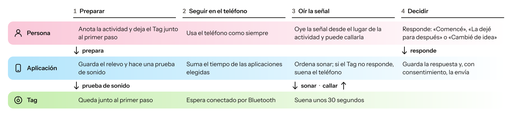

# Figuras nuevas del borrador v8

**Fecha:** 21 de noviembre de 2026 (tercera versión, el mismo día).
**Para qué:** el autor pidió más figuras en la memoria, como las de los anexos, que expliquen de forma simple los sistemas y los métodos complejos. También sirven para la presentación del examen.

## Las siete figuras

| N.º en la v8 | Figura | Ancho en la página | Dónde va | Archivos |
| --- | --- | --- | --- | --- |
| 6 | Análisis de las entrevistas con el método Framework | Dos columnas (1146 pt) | Capítulo 7, «Fuentes de información» | [PDF](figura-v8-framework.pdf) · [SVG](figura-v8-framework.svg) · [PNG](figura-v8-framework.png) |
| 13 | Cadena de la formulación, del problema a las conclusiones | Dos columnas | Capítulo 10, después de los objetivos | [PDF](figura-v8-formulacion.pdf) · [SVG](figura-v8-formulacion.svg) · [PNG](figura-v8-formulacion.png) |
| 14 | Método del proyecto, de la investigación a la iteración | Una columna (551 pt) | Capítulo 10, «Enfoque metodológico» | [PDF](figura-v8-metodo.pdf) · [SVG](figura-v8-metodo.svg) · [PNG](figura-v8-metodo.png) |
| 18 | Estados de un relevo | Una columna | Capítulo 11, «Recorrido del usuario» | [PDF](figura-v8-estados.pdf) · [SVG](figura-v8-estados.svg) · [PNG](figura-v8-estados.png) |
| 26 | Cómo funciona Relevo: la persona, la aplicación y el objeto | Ancho del texto (1742 pt) | Capítulo 12, «Tecnología» | [PDF](figura-v8-sistema.pdf) · [SVG](figura-v8-sistema.svg) · [PNG](figura-v8-sistema.png) |
| 30 | Qué se registró en cada relevo | Ancho del texto | Capítulo 13, «Registro y cuidado de los datos» | [PDF](figura-v8-registro.pdf) · [SVG](figura-v8-registro.svg) · [PNG](figura-v8-registro.png) |
| 34 | Comparación propuesta para la etapa siguiente | Una columna | Capítulo 14, «Alcances y proyecciones» | [PDF](figura-v8-comparacion.pdf) · [SVG](figura-v8-comparacion.svg) · [PNG](figura-v8-comparacion.png) |



## Cómo están hechas

- **Tamaño real:** cada figura se diseña al ancho que ocupa en la página de 1920 × 1080 pt —una columna, dos o el ancho del texto— y se coloca al 100 %, sin escalar. Por eso su letra es la de las demás figuras de la memoria, medida en el PDF del Pase: 20,6 pt en el texto y 19,9 pt en los rótulos, nunca menos. El texto corrido de la memoria mide 23,9 pt.
- **Diagramas simples:** líneas, puntos, flechas y texto; sin cajas que no expliquen nada. Los números van sueltos, sin círculos.
- **Color:** degradados sutiles, como los de la app: dos tonos vecinos de cada color para las superficies, y del papel al tono intenso en puntos y barras. Los degradados quedan como vectores en el PDF y en el SVG, sin imágenes.
- **Íconos:** los de la app 4.7.2 (`../../memoria-1920x1080/marca-e-iconos.json`), de 28 a 34 pt.
- **Sin título ni nota dentro:** los pone la memoria, en APA 7, como pide el autor para todas las figuras.
- **Datos:** solo los que dicen la memoria, los anexos y el código de la app. Los estados del relevo son los de la app (`DRAFT`, `READY`, `WAITING`, `SIGNALLED`, `SILENCED`, `CLOSED`); las preguntas y sus opciones, las del Anexo I (I.5). La matriz del método Framework muestra la forma del análisis, con las personas en filas y los temas en columnas, como el Anexo A, y no las respuestas. La comparación futura es una propuesta.

## Archivos

- **HTML:** la fuente de cada figura.
- **PDF:** vectorial, con el texto vivo, para colocar en Affinity al 100 %.
- **SVG:** el que usa el generador de la memoria (`../../memoria-1920x1080/construir-idml.js`).
- **PNG:** para verla en el repositorio.
- **`medidas.json`:** el ancho y el alto de cada figura, en puntos. El generador lee el ancho para saber si la figura va en una columna, en dos o a lo ancho.

## Cómo volver a generarlas

En esta carpeta, con Google Chrome y `pdftocairo` (de Poppler) instalados:

```bash
python3 construir-figuras.py
```

Con una clave, solo esa figura, por ejemplo `python3 construir-figuras.py sistema`. Las claves son framework, formulacion, metodo, estados, sistema, registro y comparacion. Después, para verlas en la memoria, se vuelve a componer con `node construir-idml.js` en `../../memoria-1920x1080/`.

## Registro de cambios (disclaimer)

### 2026-11-21 — Diagramas simples y degradados

- **Qué cambió:** las figuras dejan las cajas y los cuadros: son diagramas de líneas, puntos, flechas y texto, con degradados sutiles como los de la app. «Estados de un relevo» y «Método del proyecto» pasan a una columna, de arriba abajo; «Qué se registró en cada relevo» queda en dos listas. Los degradados se imprimen como vectores (antes, Chrome los convertía en imágenes de baja resolución).
- **Cómo estaba antes:** la segunda versión, de esa misma tarde, usaba cuadros de color con íconos, fichas y cápsulas.
- **Por qué:** el autor pidió diagramas normales y simples, fáciles de leer, y degradados sutiles acordes a cada color, como en la app.

### 2026-11-21 — Tamaño real, íconos más grandes y anchos variados

- **Qué cambió:** cada figura se diseña a su ancho en la página (una columna, dos o el ancho del texto) y con la letra de las demás figuras de la memoria (20,6 pt); los íconos crecen de 22–26 pt a 28–40 pt; se quitaron los números en círculos; se agrega el SVG para el generador y `medidas.json`.
- **Cómo estaba antes:** las siete figuras medían 1742 pt de ancho, con letra de 13,5 a 19 pt, más chica que la de las demás figuras.
- **Por qué:** el autor pidió íconos más grandes, figuras que usen mejor la página, con anchos de 1/3 o 2/3, y revisar su tamaño en la memoria real.

### 2026-11-21 — Creación

- **Qué cambió:** se crearon siete figuras nuevas para el borrador v8, con su generador.
- **Cómo estaba antes:** la memoria tenía 27 figuras, casi todas fichas de texto, sin esquemas del sistema ni de los métodos.
- **Por qué:** el autor pidió figuras que ayuden a entender lo complejo, en la memoria y en la presentación.
