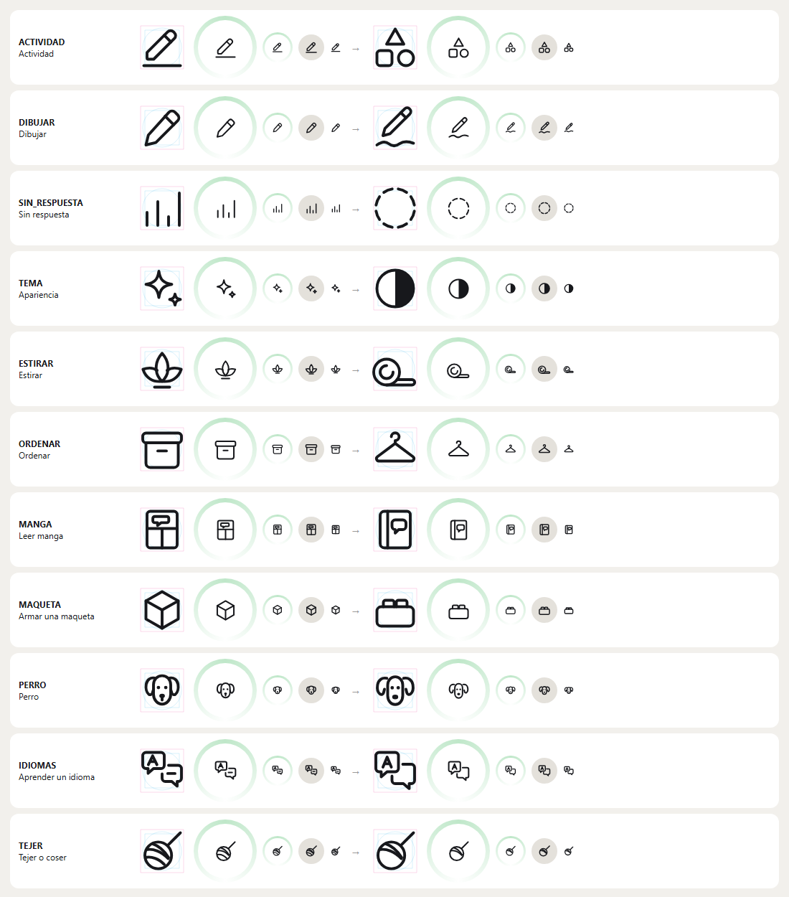

# Íconos que responden a lo que pide la app

**Fecha:** 6 de noviembre de 2026. **Decisión:** [D-162](../09_decisiones/registro-de-decisiones.md). **Rama:** `iconos-propios`, sobre la 4.4. **Imagen:** [antes y después](iconos-2026-11-06/antes-y-despues.png). **Datos:** [los 11 íconos en JSON](iconos-2026-11-06/iconos-d162.json), con su porqué. **Fundamento general:** [documento 43](43_por-que-iconos-propios-2026-11-06.md).

## Qué pide la app

Antes de dibujar se contó qué íconos usa la app 4.4, dónde y a qué tamaño, leyendo el código:

- **El kit tiene 117 íconos y la app usa 96.** Los otros 21 quedan en el kit sin aparecer en pantalla: accesibilidad, ajustes, cerrar sesión, desbloqueado, entrevistas, estrella media, exportar, filtrar, hipótesis, investigación, menú, mostrar, ocultar, primer paso, siguiente, sin conexión, sistema, uso, usuario, validación y ruta.
- **Tamaños:**
  - **Interfaz:** filas, botones y campos piden íconos de 18 a 20 px. Los de las filas van en un círculo de 34 o 36 px.
  - **Pestañas:** 22 px.
  - **Actividades:** van dentro de su anillo de color, al 42 % del anillo. Los anillos miden de 40 a 88 px, así que el ícono va de **17** a 37 px.
- **Actividades:** las 19 ideas de P1–P8 y los 34 conceptos del catastro, que se eligen en siete familias de color. Para cada concepto, la app sugiere con qué empezar: «Desenrollar la colchoneta», «Sacar el tomo del estante», «Juntar la ropa en el canasto».
- **Estados de un relevo:** comencé, la dejé para después, cambié de idea y sin respuesta.

## Reglas que salen de eso

1. **Un significado, un dibujo.** Ningún dibujo dice dos cosas y ninguna cosa tiene dos dibujos.
2. **Cada actividad se dibuja con el objeto con que empieza.** La app ya lo nombra en su pregunta «¿Cómo empiezas?», y un dibujo directo de un objeto conocido se entiende más rápido (Hou y Pan, 2025; Shen et al., 2018).
3. **Legible a 17 px,** el tamaño más chico al que la app pide una actividad. Son pocos trazos, con espacio entre ellos.
4. **Neutro donde la app no juzga.** No responder no es un error. Y nada de signos que hoy significan otra cosa, como los destellos, que se leen como inteligencia artificial.
5. **La construcción de siempre:** retícula de 24, área viva de 20, puntas redondas y trazo según el tamaño (D-124 y 4.1).

## Qué se encontró

| Problema | Íconos |
| --- | --- |
| Tres significados con el mismo lápiz | Actividad (la de reserva), Editar y Dibujar |
| Dos íconos idénticos | Meditar y Estirar (la flor de loto); Historial y Avance (las barras) |
| El dibujo dice otra cosa | Salir era una huella de mascota; Apariencia, destellos; Ordenar, una caja de archivo; Maqueta, un cubo de paquete; Sin respuesta, un gráfico de barras |
| Ilegibles a 17 px | Leer manga, Perro, Aprender un idioma, Tejer |

## Qué cambió

| Ícono | Qué pide la app | Antes | Ahora | Regla |
| --- | --- | --- | --- | --- |
| **Actividad** | Una actividad propia que el catastro no reconoce | Lápiz sobre un renglón | Triángulo, cuadrado y círculo: las formas de base de la retícula, «cualquier actividad» | 1, 4 |
| **Dibujar** | La idea de P2 «Dibujar» | Lápiz, igual a Editar | El lápiz con el trazo que deja | 1 |
| **Sin respuesta** (nuevo) | Un relevo que sonó y no se respondió, en la lista de relevos terminados | Las barras de Historial | Círculo punteado: el signo habitual de «sin estado» | 1, 4 |
| **Apariencia** | Fila de tema claro u oscuro | Destellos | Círculo mitad lleno, el signo de contraste | 4 |
| **Estirar** | «Desenrollar la colchoneta» | La flor de loto de Meditar | La colchoneta a medio desenrollar | 1, 2 |
| **Ordenar** | «Juntar la ropa en el canasto», «doblar la ropa», clóset | Caja de archivo | Colgador de ropa | 2 |
| **Leer manga** | «Sacar el tomo del estante», de P1 | Página con viñetas | Un tomo con un globo de diálogo | 2, 3 |
| **Armar una maqueta** | Maqueta, modelismo, lego; «Ordenar las piezas», de P6 | Cubo | Una pieza para armar | 2 |
| **Perro** | «Pasear al perro», de P1 y P4 | Orejas pegadas a la cara y boca | Orejas separadas, sin boca | 3 |
| **Aprender un idioma** | Idiomas | Dos globos con letra y línea | El globo con la «A» delante y otro detrás | 3 |
| **Tejer o coser** | Tejer, coser, lana | Ovillo con tres hebras | Dos hebras | 3 |

Además, la foto «Salir», que la app usa para el interés de moverse, ya no lleva la huella. Lleva el ícono de Caminar, como la ilustración de la zapatilla que la acompaña.

## Qué no cambió, y por qué

- **Los otros 85 íconos en uso** cumplen las cinco reglas. Lo que hace cualquier app (volver, cerrar, buscar, agregar, borrar) mantiene las formas conocidas.
- **Comencé y Reproducir** usan los dos un triángulo, pero no se confunden. Comencé va en un círculo y aparece en los relevos, como «¿Cómo empiezas?». Reproducir es el botón de un sonido.
- **Los 21 íconos sin uso** siguen en el kit, porque borrar no es necesario para la app y se conservan los archivos. Historial queda entre ellos.
- **El grosor y el radio de las esquinas** son los de siempre. Engrosar la línea a 2, como ChatGPT, queda como prueba pendiente (documento 43).

## Verificación

Se revisaron en una hoja con cada ícono en su retícula, en anillos de 88 y 42 px, en una fila de 36 px y a 16 px. Así se rehicieron dos que no funcionaban en el primer intento:

- **Sin respuesta:** era un guion en un círculo, que se leía «quitar».
- **Ordenar:** era un canasto, que se leía «canasto de compras».

En la app:

- **Compilación y pruebas:** compila sin errores y pasan las 90 pruebas unitarias.
- **Emulador, sin conexión y sobre los datos del autor**, que se respaldaron y después se restauraron idénticos:
  - «Nueva actividad» muestra el perro, el tomo, el lápiz con su trazo, la pieza y el colgador.
  - «Elige un ícono» muestra las 34 actividades, con Meditar y Estirar distintas ([captura](iconos-2026-11-06/en-la-app-elige-un-icono.png)).
  - Una actividad nueva muestra las formas de base, y ya no se confunde con los lápices de editar de su misma pantalla.
  - En Ajustes, Apariencia lleva el signo de contraste.
- **Sin ver en la app:** «Sin respuesta», porque los datos del emulador no tienen un relevo sin responder.

**Falta:** medir con personas si se entienden sin su palabra (ISO 9186-1; documento 43) y la revisión del autor.

## Referencias

Hou, G. y Pan, Y. (2025). What's behind the graphic? The impact of pictogram-semantic mapping structure on icon understanding. *International Journal of Human–Computer Interaction, 41*(20), 12959–12969. https://doi.org/10.1080/10447318.2025.2466063

Shen, Z., Xue, C. y Wang, H. (2018). Effects of users' familiarity with the objects depicted in icons on the cognitive performance of icon identification. *i-Perception, 9*(3), Artículo 2041669518780807. https://doi.org/10.1177/2041669518780807

## Registro de cambios (disclaimer)

### 2026-11-06 — Creación

- **Qué cambió:** se documenta, con su verificación en el emulador, el inventario de íconos de la app, las cinco reglas que salen de él y los once íconos que cambiaron, con su porqué.
- **Cómo estaba antes:** los íconos se habían dibujado por grupos (D-073, D-124 y D-158), sin revisar juntos si cada dibujo respondía a lo que la app pide de él.
- **Por qué:** el autor pidió justificar los íconos y diseñarlos respondiendo a lo que solicita la app.
