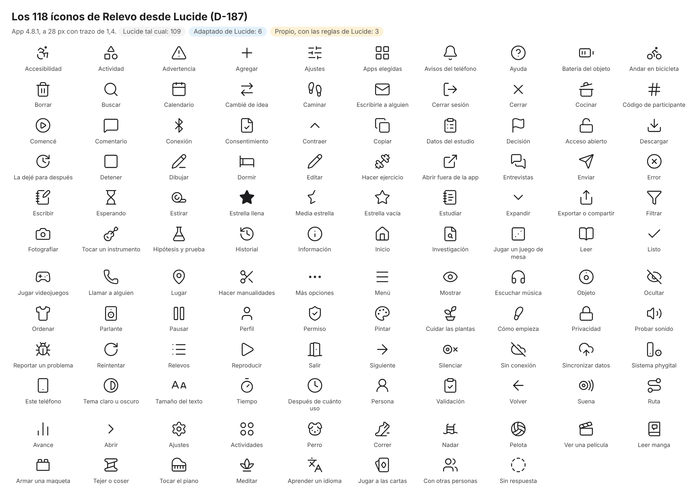
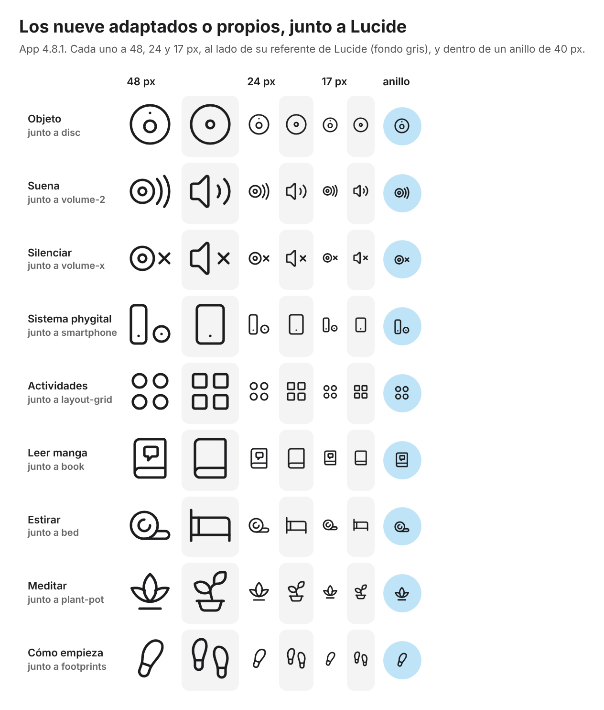
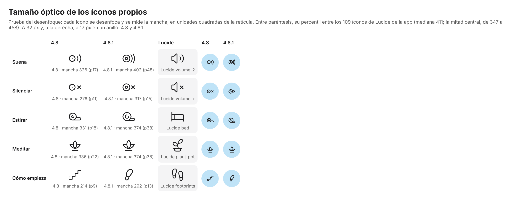
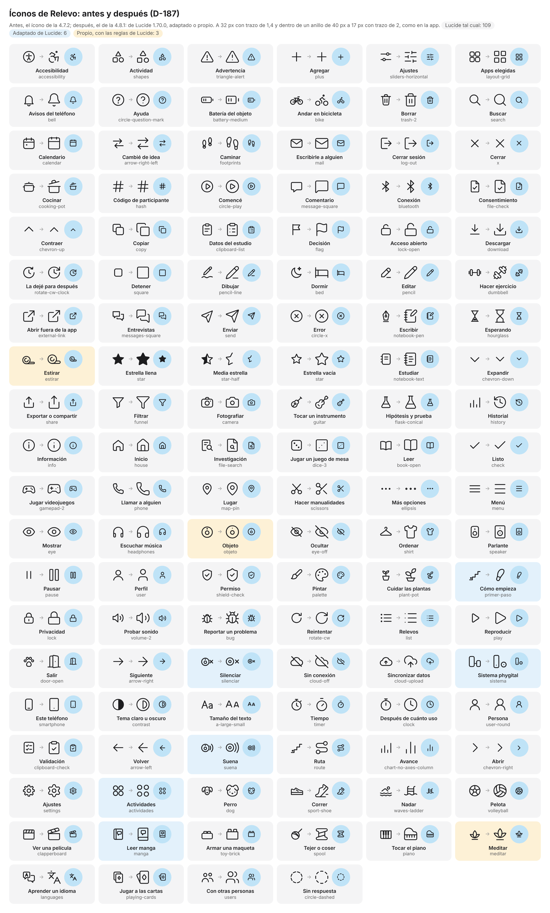

# Íconos desde Lucide

**Fecha:** 22 de noviembre de 2026. **Decisión:** [D-187](../09_decisiones/registro-de-decisiones.md). **Rama:** `iconos-lucide`. **App:** [4.8](../06_desarrollo_y_factibilidad/app-android/version-4.8-iconos-de-lucide-2026-11-22.md) y [4.8.1](../06_desarrollo_y_factibilidad/app-android/version-4.8.1-tamano-optico-y-primer-paso-2026-11-22.md). **Carpeta:** [iconos-lucide](iconos-lucide/README.md), con el mapeo, los SVG, el generador y la licencia. **Imágenes:** [antes y después](iconos-lucide/antes-y-despues.png), [los 118 íconos](iconos-lucide/set-completo.png) y [los propios junto a Lucide](iconos-lucide/propios-junto-a-lucide.png) y [el tamaño óptico](iconos-lucide/tamano-optico.png).

## Qué se pidió

El autor propuso usar los íconos de Lucide, que son de código abierto, adaptar los que lo requieran y crear nuevos siguiendo cómo funcionan los de Lucide: «si nuestro usuario hace algo, pero Lucide no tiene un ícono de ese algo, habría que crearlo». Al revisar la 4.8 pidió dos ajustes: que el primer paso no fuera una escalera y que el tamaño de los íconos propios fuera «perfecto, óptico, no matemático», porque algunos se veían muy pequeños.

## Qué cambió

Hasta la 4.7.2, Relevo dibujaba sus 118 íconos a mano, con las reglas de construcción de Lucide como referencia ([documento 43](43_por-que-iconos-propios-2026-11-06.md)). Desde la 4.8, cada ícono sale de Lucide 1.70.0. Así quedan en la 4.8.1:

| Origen | Cuántos | Cuáles |
| --- | --- | --- |
| **Lucide tal cual** | 109 | Todos los demás: la interfaz, la prueba y 31 de las 34 actividades. |
| **Adaptado de Lucide** | 6 | Suena, Silenciar, Sistema phygital, Actividades, Leer manga y Cómo empieza. |
| **Propio, con las reglas de Lucide** | 3 | El Tag (Objeto), Estirar y Meditar. |

Ninguna pantalla cambia de texto ni de orden. Siguen el trazo según el tamaño, de 2,0 a 16 px a 1,3 a 48 px (D-124); el centro óptico (D-156), y la palabra que acompaña a cada ícono.

## Cómo se eligió cada ícono

1. **Lucide primero.** Se buscó en Lucide el ícono que dice lo mismo, por nombre y por sus etiquetas.
2. **Con las reglas de D-162:** un significado por dibujo; cada actividad con el objeto con que empieza, como lo sugiere la app; legible a 17 px, y neutro donde la app no juzga.
3. **Si Lucide tenía varios,** se compararon a los tamaños de la app. Si tenía una pieza, se adaptó. Si no tenía el objeto, se dibujó.

Los casos con más de una opción:

| Ícono | Lucide | Por qué |
| --- | --- | --- |
| La dejé para después | `rotate-cw-clock` | Es el mismo dibujo de antes: un reloj con la flecha hacia adelante. |
| Dibujar y Editar | `pencil-line` y `pencil` | El lápiz con el trazo que deja es Dibujar; el lápiz solo, Editar (D-162). |
| Escribir | `notebook-pen` | «Dejar un lápiz sobre el cuaderno», como sugiere la app. |
| Estudiar | `notebook-text` | «Abrir los apuntes», como sugiere la app. |
| Pintar | `palette` | «Preparar las acuarelas». El pincel se parecía al lápiz de Dibujar. |
| Dormir | `bed` | La cama, el objeto de la actividad. La luna llevaba un destello, y D-162 evitó los destellos, que se leen como inteligencia artificial. |
| Ordenar | `shirt` | Lucide no tiene un colgador. La polera dice «Juntar la ropa en el canasto», la primera sugerencia de la app. |
| Tejer o coser | `spool` | Lucide no tiene un ovillo. El carrete dice «Enhebrar la aguja». |
| Pelota | `volleyball` | Una pelota genérica: el concepto reúne fútbol, básquetbol, vóleibol, tenis y otros. |
| Nadar | `waves-ladder` | La escalera de la piscina. |
| Correr | `sport-shoe` | «Ponerte las zapatillas». |
| Salir | `door-open` | Salir de la casa. La huella de mascota de antes decía otra cosa (D-162). |
| Actividad, Sin respuesta y Tema | `shapes`, `circle-dashed` y `contrast` | Lucide tiene los mismos signos que eligió D-162: las formas de base, el círculo punteado y el contraste. |

El mapeo completo, con el origen y la nota de cada ícono, está en [`mapeo.json`](iconos-lucide/mapeo.json).

## Los nueve que no son de Lucide tal cual

| Ícono | Origen | Qué dibuja | Por qué |
| --- | --- | --- | --- |
| **Objeto** | Propio | El Tag visto desde arriba: el cuerpo, el botón y el agujero de la argolla. | Lucide no tiene un llavero localizador. El objeto físico y la pantalla se nombran igual: es lo *phygital* del proyecto. |
| **Suena** | Adaptado de `volume-2` | El Tag, con su botón, y dos anillos concéntricos que se abren desde él. | El Tag reemplaza al parlante, porque suena el objeto; los anillos son el sonido que se abre desde el objeto, como en la memoria. |
| **Silenciar** | Adaptado de `volume-x` | El mismo Tag, con una cruz de 5, como la de `volume-x`. | Callar el Tag, como explica la guía del Tag. |
| **Sistema phygital** | Adaptado de `smartphone` | El teléfono, más angosto, junto al Tag. | Sin uso en pantalla; se conserva. |
| **Actividades** | Adaptado de `layout-grid` | Cuatro círculos en vez de cuatro cuadrados. | Son los círculos del logo (D-155); Apps elegidas conserva los cuadrados. |
| **Leer manga** | Adaptado de `book` | El libro con un globo de diálogo en la tapa. | «Sacar el tomo del estante» (D-162). |
| **Estirar** | Propio | La colchoneta a medio desenrollar. | «Desenrollar la colchoneta» (D-162). Lucide no tiene colchoneta. |
| **Meditar** | Propio | La flor de loto sobre una base. | Lucide no tiene un ícono de meditar. |
| **Cómo empieza** | Adaptado de `footprints` | Una sola huella, más grande e inclinada hacia adelante. | El primer paso, literal: dar el paso. Se distingue de Caminar, que son dos huellas rectas. Sin uso en pantalla todavía; hasta la 4.8 era una escalera. |

**Cómo se dibujaron.** Con la [especificación de Lucide](https://lucide.dev/contribute/icons/specification): lienzo de 24 con 1 de margen, trazo de 2 en el diseño, puntas y uniones redondas, esquinas de 2 en las formas de 8 o más y de 1 en las menores, y 2 de aire entre trazos. Los puntos son trazos de largo casi nulo («h.01»), como los de Lucide. La especificación no basta para el tamaño: en la 4.8, cumplirla al pie de la letra dejó chicos a Suena y Silenciar, porque el Tag tuvo que encogerse para dejar 2 de aire con los anillos. En la 4.8.1 prima la vista: el Tag tiene radio 6 y su botón; los anillos de Suena son concéntricos, con 2 de aire parejo, y la cruz de Silenciar queda a 1 del Tag (sección «Tamaño óptico»).

## Tamaño óptico

Un ícono se ve del tamaño correcto cuando pesa como sus vecinos, aunque sus medidas no coincidan. Lucide lo comprueba desenfocando el ícono y comparándolo con su círculo y su cuadrado de base. Aquí se hizo con todos los íconos de la app. Cada uno se dibuja a 480 px con trazo de 2 y se desenfoca dos unidades de la retícula. Después se mide su **mancha**: cuántas unidades cuadradas quedan con al menos un 12 % de tinta. Lo hace [`medir_tamano_optico.js`](iconos-lucide/medir_tamano_optico.js).

Entre los 109 íconos de Lucide de la app, la mancha mediana es 411, y la mitad central va de 347 a 458. Así se movieron los que se veían chicos; entre paréntesis, su percentil entre esos 109:

| Ícono | 4.8 | 4.8.1 | Su equivalente en Lucide | Qué cambió |
| --- | --- | --- | --- | --- |
| Suena | 326 (17 %) | 402 (48 %) | `volume-2`, 379 | El Tag, de radio 5 a 6, con su botón; los anillos, concéntricos. |
| Silenciar | 276 (11 %) | 317 (15 %) | `volume-x`, 329 | El mismo Tag y una cruz de 5. La cruz es liviana por naturaleza: queda a la par de `volume-x`. |
| Estirar | 331 (18 %) | 374 (38 %) | `bed`, 372 | El rollo, de radio 6 a 7; la colchoneta, más alta. |
| Meditar | 336 (22 %) | 374 (38 %) | `plant-pot`, 379 | Los pétalos más llenos y la base más ancha. |
| Cómo empieza | 214 (9 %) | 292 (13 %) | `footprints`, 429 | La escalera pasó a ser una huella. Es angosta, como Bluetooth o el visto, y ocupa todo el alto del lienzo. |

La hoja de abajo muestra cada uno a 32 px y a 17 px dentro de un anillo. Objeto (503), Actividades (491) y Leer manga (520) quedan sobre la mediana porque son formas llenas, como sus equivalentes en Lucide; no se achicaron.

## Antes y después

## Verificación

- **Los dibujos:** cada trazado generado se dibujó junto a su SVG de origen, a 96 px, y los 118 coincidieron píxel a píxel, en la 4.8 y en la 4.8.1.
- **El tamaño:** la prueba del desenfoque de la sección «Tamaño óptico», repetible con `medir_tamano_optico.js`.
- **En Android:** las 110 pruebas unitarias pasan. Cuatro son nuevas y comprueban que el lector de trazados de Android lee cada paso de cada trazado, que las banderas de los arcos van separadas y que ningún ícono repite el dibujo de otro.
- **Un detalle técnico:** seis SVG de Lucide escriben pegadas las banderas de sus arcos («A5 5 0 0012 5»), como permite el estándar. El generador las separa, porque Android podría leer «0012» como un solo número.
- **APK 4.8 y 4.8.1:** firmados con la clave de siempre y con el aviso de licencia de Lucide adentro.
- **No se vio en un teléfono** ni en un emulador.

## Por revisar con el autor

1. **En el teléfono:** los íconos a 17 px dentro de los anillos, en tema claro y oscuro y con letra grande.
2. **Cinco elecciones:** Ordenar (la polera), Tejer (el carrete), Pelota (la de vóleibol), Dormir (la cama), y Escribir y Estudiar, que son dos cuadernos.
3. **La huella del primer paso:** inclinada hacia adelante. Hay también una versión recta y una más ancha, si se prefieren.
4. **El trazo:** la app dibuja los íconos de Lucide con su trazo según el tamaño (1,6 a 24 px), no con el de 2 de Lucide. Probar la línea de 2 sigue pendiente desde el documento 43.

## Lo que arrastra el cambio

Nada de esto se cambió todavía, porque depende de que el autor apruebe los íconos:

- **Memoria v8, «Iconografía»:** dice que los íconos «son propios: 118 dibujos de línea». Texto propuesto más abajo.
- **Memoria v8, lámina de identidad:** dice «Íconos propios: retícula de 24, trazo de 1,6». Propuesta: «Íconos de Lucide y propios con sus reglas: retícula de 24, trazo de 1,6».
- **Anexo H, H.3:**
  - el texto;
  - la Tabla H2: retícula, esquinas, color y relleno, y el número de íconos que corre el centro óptico;
  - la Figura H6, el conjunto;
  - la Figura H7, la construcción con Suena y Leer;
  - la Figura H8, Lucide y Relevo.
- **Figuras de la memoria:** toman los íconos de [`marca-e-iconos.json`](../08_memoria/memoria-1920x1080/marca-e-iconos.json), los de la app 4.7.2. Hay que pasarlos a los de la 4.8 y volver a componer. Ese archivo tiene además seis íconos que no son de la app: `tag`, `decidir`, `empece`, `contando`, `pasear-perro` y `aura`.
- **Capturas de la app:** las de la 4.7.2 y las figuras que las usan muestran los íconos anteriores.
- **Documentos 43 y 44:** quedan como el fundamento de la etapa anterior. Sus reglas para elegir siguen vigentes.
- **El kit de marca** en [`marca-a-tiempo/iconos`](marca-a-tiempo/iconos) queda como antecedente. La fuente de los íconos es ahora [`iconos-lucide`](iconos-lucide/README.md).

### Texto propuesto para la memoria

> **Iconografía.** Los íconos de la aplicación salen de Lucide, un conjunto de íconos de línea de código abierto cuya licencia permite usarlos, modificarlos y redistribuirlos siempre que se conserve su aviso (Lucide Contributors, s. f.-b). De los 118, 109 son de Lucide tal cual. Seis se adaptaron, como Suena, que lleva el Tag en lugar del parlante, y tres se dibujaron con sus reglas de construcción (Lucide Contributors, s. f.-a) porque Lucide no los tiene: el Tag, la colchoneta y la flor de loto. Su tamaño se ajustó a la vista, no a la medida: cada uno pesa como sus vecinos de Lucide cuando se lo desenfoca. Así, el dibujo propio queda para lo que es de Relevo, y todos los íconos hablan con una sola voz. Entre las opciones de Lucide, cada actividad se dibuja con el objeto con que empieza, como un libro abierto para leer. El trazo, de 1,6 en el tamaño base, se afina en los tamaños grandes y se engruesa en los pequeños, para que el ícono pese parecido a la palabra que siempre lo acompaña. Su construcción está en el Anexo H.

Usa las dos referencias de Lucide que la memoria ya tiene, así que no suma citas.

### Texto propuesto para el Anexo H, H.3

> Los íconos de Relevo salen de Lucide, un conjunto abierto de íconos de línea: 118 dibujos en una retícula de 24, de un solo color y siempre acompañados de su palabra. De ellos, 109 son de Lucide tal cual, seis se adaptaron y tres se dibujaron con sus reglas de construcción, porque lo que la app tiene que mostrar —el Tag y algunas actividades que nombraron las personas entrevistadas— no está en Lucide (Figura H6).

En la Tabla H2 cambian tres filas. La retícula y el margen pasan a ser los de Lucide: lienzo de 24, con el trazo a 1 o más del borde. Las esquinas, 2 en las formas de 8 o más y 1 en las menores. En color y relleno, contorno y un solo color; solo se rellenan los puntos de la paleta, como en Lucide, y la estrella llena. Las filas del trazo, los tamaños ópticos y el equilibrio no cambian. Hay que recontar cuántos íconos corre el centro óptico.

## Referencias

Lucide Contributors. (s. f.-a). *Lucide design language*. Lucide. Recuperado el 10 de noviembre de 2026, de https://lucide.dev/contribute/icons/design-principles

Lucide Contributors. (s. f.-b). *Lucide license*. Lucide. Recuperado el 10 de noviembre de 2026, de https://lucide.dev/license

Lucide Contributors. (2026). *lucide-static* (Versión 1.70.0) [Software]. npm. https://www.npmjs.com/package/lucide-static/v/1.70.0

## Registro de cambios (disclaimer)

### 2026-11-22 — Tamaño óptico y primer paso

- **Qué cambió:** se suma la sección «Tamaño óptico», con la prueba del desenfoque y cómo crecieron Suena, Silenciar, Estirar y Meditar en la 4.8.1. El primer paso pasa de una escalera propia a una huella adaptada de `footprints`: quedan seis adaptados y tres propios. Se ajustan las tablas, el párrafo sobre cómo se dibujaron, la verificación, lo que hay que revisar y los textos propuestos para la memoria y el Anexo H.
- **Cómo estaba antes:** el primer paso era una escalera, cuatro íconos propios se veían chicos y el tamaño se cuidaba solo con las medidas de la especificación.
- **Por qué:** el autor pidió que el primer paso no fuera una escalera y que el tamaño fuera óptico, no matemático.

### 2026-11-22 — Creación

- **Qué cambió:** se documenta el paso de los íconos a Lucide: cómo se eligió cada uno, los nueve que no son de Lucide tal cual, la verificación, lo que falta revisar y lo que arrastra el cambio, con textos propuestos para la memoria y el Anexo H.
- **Cómo estaba antes:** los íconos eran dibujos propios con las reglas de Lucide ([documentos 43](43_por-que-iconos-propios-2026-11-06.md) y [44](44_iconos-desde-lo-que-pide-la-app-2026-11-06.md)).
- **Por qué:** el autor propuso usar los íconos de Lucide y dibujar solo lo que Lucide no tiene (D-187).
