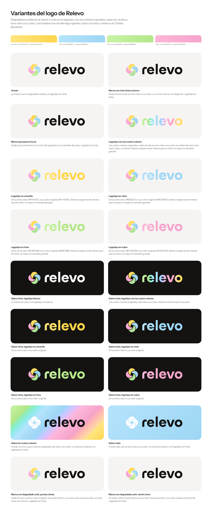

# Variantes del logo de Relevo con degradados sutiles

Revisión del [logo vigente](../logo-relevo-2026-10-11/) pedida por el autor el 23 de noviembre de 2026: degradados sutiles en los colores de la marca y color en el logotipo, que hasta ahora va en tinta. Son variantes para elegir; el logo vigente no cambia hasta que el autor escoja una.

Los trazados son los mismos del logo vigente (los cuatro círculos y «relevo» en Chillax Semibold, en curvas). Solo cambian los rellenos y el fondo.



## Qué hay en la carpeta

- **`lamina-variantes.png` y `lamina-variantes.html`:** las 18 variantes lado a lado, con una nota por cada una.
- **`svg/`:** cada variante como SVG del logo horizontal, con el mismo número y nombre que en la lámina. Las que van sobre tinta o sobre color traen su fondo.
- **`gif/relevo-colores-papel.gif`:** el logotipo pasa por los cuatro colores, con un degradado sutil, sobre el papel. Dura 6,4 segundos y se repite sin corte.
- **`gif/relevo-colores-tinta.gif`:** lo mismo sobre la tinta.
- **`gif/*.mp4`:** los mismos movimientos en video, más nítidos y livianos.
- **`animacion-logo/`:** la familia de animaciones del logo: la marca se despliega y el logotipo aparece, y el turno pasa de un círculo al siguiente, con el texto en varios colores. En GIF y MP4.
- **`scripts/`:** lo que genera todo, para rehacerlo o ajustar un color.

## Las variantes

| Archivo | Variante |
| --- | --- |
| `relevo-logo-01-actual.svg` | El logo vigente: la marca con su degradado radial y el logotipo en tinta. Sirve para comparar. |
| `relevo-logo-02-marca-tres-tonos.svg` | Cada círculo va de su tono claro a su color y a un tono vecino, en diagonal. Logotipo en tinta. |
| `relevo-logo-03-marca-pasa-el-turno.svg` | Cada círculo termina en el color del siguiente, en el sentido del reloj. Logotipo en tinta. |
| `relevo-logo-04-logotipo-cuatro-colores.svg` | «relevo» con los cuatro colores, cada uno de su tono claro a su color, en orden de tono: lima, cielo, rubor y amarillo. |
| `relevo-logo-05` a `08-logotipo-<color>.svg` | «relevo» en amarillo, cielo, lima o rubor, de su tono claro a su color. |
| `relevo-logo-09-fondo-tinta-logotipo-blanco.svg` | Sobre tinta: la marca en color y el logotipo en blanco. |
| `relevo-logo-10-fondo-tinta-logotipo-cuatro-colores.svg` | Sobre tinta: el logotipo con los cuatro colores. |
| `relevo-logo-11` a `14-fondo-tinta-logotipo-<color>.svg` | Sobre tinta: el logotipo en amarillo, cielo, lima o rubor. |
| `relevo-logo-15-fondo-cuatro-colores.svg` | Fondo con los cuatro colores, la marca en blanco y el logotipo en tinta. |
| `relevo-logo-16-fondo-cielo.svg` | Fondo cielo, la marca en blanco y el logotipo en tinta. |
| `relevo-logo-17-marca-sutil-puntas-claras.svg` | Degradado sutil de un solo color: cada círculo va de su color original, cerca del centro, a su tono claro en las puntas. Logotipo en tinta. |
| `relevo-logo-18-marca-sutil-centro-claro.svg` | Al revés: cada círculo tiene su tono claro hacia el centro y su color original en el borde. Logotipo en tinta. |

## Los colores

Se usan los cuatro colores originales de la marca, sin oscurecer. Cada degradado va de su tono claro al color original:

| Color | Claro | Original |
| --- | --- | --- |
| amarillo | `#FFE57E` | `#FFD54A` |
| cielo | `#B5E3FC` | `#9DD6F4` |
| lima | `#C8F3A6` | `#B3E788` |
| rubor | `#FDB7D8` | `#F6A3CB` |

- **Sobre el papel** (`#F6F4F3`), un logotipo en estos colores se lee menos que en tinta, con un contraste de 1,3 a 1,7. Funciona en tamaño grande, como en una portada o una lámina. En tamaño chico conviene la tinta o el fondo oscuro.
- **Sobre la tinta** (`#141312`), los cuatro colores se leen muy bien.

## Cómo se mueve el GIF

- La marca queda quieta, con los tres tonos vecinos de la variante 02.
- Cada color se queda quieto un momento y luego se desliza hacia el siguiente, de izquierda a derecha.
- Mientras está quieto, el logotipo va de su tono claro a su color original. Nunca muestra los cuatro colores a la vez.

## Animaciones del logo

Cada círculo es una parte del relevo, en el sentido del reloj desde arriba: tu tiempo (amarillo), tu primer paso (cielo), el lugar (lima) y lo que decides (rubor). Las animaciones cuentan que el turno pasa de uno al siguiente.

### Cómo se pensó el movimiento

Antes de animar se revisó cómo se trabaja hoy el movimiento de marca:

- **Una familia, no una sola animación:** cada marca tiene una versión larga para abrir, una corta que se repite y una versión quieta. También se piensa en la marca sola, sin el logotipo (Renderforest, 2026).
- **Un solo gesto memorable:** se anima una idea, no cada pieza por separado. Lo que delata un trabajo amateur son las explosiones de partículas, los efectos sin motivo de marca y el texto que se tuerce y rebota antes de quedarse quieto (Renderforest, 2026).
- **Arcos y aceleración natural:** el movimiento sigue un arco, gana velocidad y se frena al llegar (Google Design, «Making motion meaningful»).
- **Duración y curvas medidas:** se usan las curvas expresivas del sistema Carbon de IBM: entrada `cubic-bezier(0, 0, .3, 1)`, salida `cubic-bezier(.4, .14, 1, 1)` y estándar `cubic-bezier(.4, .14, .3, 1)`. Las salidas son más cortas que las entradas (Carbon; Creative Boom).
- **Legibilidad:** el logotipo aparece y se queda quieto el tiempo suficiente para leerse (Renderforest, 2026).

### Cómo se aplicó

- **Resortes suaves:** cada círculo llega con un resorte amortiguado que se pasa un 8 % y se asienta, sin rebotar varias veces.
- **Acciones que se superponen:** cada círculo sale 90 ms después del anterior. Las letras empiezan a subir mientras la marca todavía se asienta.
- **Logotipo desde su línea base:** cada letra sube desde una máscara en la línea base, una tras otra, cada 45 ms. Las letras no giran ni rebotan.
- **Anticipación:** antes de pasar el turno, la marca se recoge 6° hacia atrás.
- **Se dibuja a 50 cuadros por segundo y al doble de resolución.** El GIF va a 25 cuadros por segundo; cada cuadro mezcla dos, lo que da un desenfoque de movimiento leve. El MP4 queda a 50.

### Las animaciones

**Revela** (4,6 s, se repite):

1. La marca se despliega desde el centro, girando en arco.
2. Las letras suben una tras otra.
3. Todo se queda quieto casi dos segundos.
4. Sale más rápido de lo que entró.

Sirve para abrir una presentación, un video o la app.

| Archivo | Texto | Fondo |
| --- | --- | --- |
| `relevo-revela-texto-tinta` | tinta | papel |
| `relevo-revela-texto-cuatro-colores` | los cuatro colores, del claro al original | papel |
| `relevo-revela-texto-amarillo`, `-cielo`, `-lima`, `-rubor` | un color, del claro al original | papel |
| `relevo-revela-fondo-tinta-texto-cuatro-colores` | los cuatro colores | tinta |
| `relevo-revela-fondo-tinta-texto-blanco` | blanco | tinta |
| `relevo-marca-revela` | solo la marca | papel |

**Pasa el turno** (5,2 s, se repite sin corte). La marca armada se recoge apenas y gira un cuarto de vuelta. El círculo que sigue sube a tomar el turno y crece apenas al llegar arriba. Con «color del turno», el texto toma el color de quien llega arriba: amarillo, cielo, lima y rubor. Sirve para esperas, para cuando suena un relevo o para un fondo de pantalla.

| Archivo | Texto | Fondo |
| --- | --- | --- |
| `relevo-turno-texto-color-del-turno` | cambia con el turno | papel |
| `relevo-turno-fondo-tinta-texto-color-del-turno` | cambia con el turno | tinta |
| `relevo-turno-texto-tinta` | tinta | papel |
| `relevo-marca-turno` | solo la marca | papel |

**Pasa el turno con degradado sutil.** Es el mismo movimiento con otro color. Cada círculo tiene un degradado de un solo color: de su color original a su tono claro, sin pasar a un tono vecino. El texto va de su color original en la línea base a su tono claro arriba. El degradado se ordena en torno al centro de la marca, así que se ve igual mientras la marca gira.

- **Puntas claras:** el color original va cerca del centro y el tono claro en las puntas. Es la versión principal.
- **Centro claro:** al revés, el tono claro hacia el centro y el color original en el borde.

| Archivo | Texto | Fondo |
| --- | --- | --- |
| `relevo-turno-sutil-puntas-claras-texto-color-del-turno` | cambia con el turno | papel |
| `relevo-turno-sutil-puntas-claras-fondo-tinta-texto-color-del-turno` | cambia con el turno | tinta |
| `relevo-turno-sutil-puntas-claras-texto-tinta` | tinta | papel |
| `relevo-marca-turno-sutil-puntas-claras` | solo la marca | papel |
| `relevo-turno-sutil-centro-claro-texto-color-del-turno` | cambia con el turno | papel |
| `relevo-marca-turno-sutil-centro-claro` | solo la marca | papel |

**Pasa el turno, sin fondo (la versión final).** Es la versión pulida de «pasa el turno» con puntas claras. Va sin fondo, para ponerla sobre una lámina.

- **Giro más fino:** el resorte casi no rebota; se pasa un 2 % y se asienta. La anticipación es de 4°, y cada turno dura 1,5 s, lo que da un ritmo más calmo.
- **El color del texto pasa con un barrido:** el color nuevo recorre la palabra de izquierda a derecha, con un borde suave, mientras la marca gira. Antes se mezclaba en toda la palabra a la vez y pasaba por un tono turbio.
- **Formatos:** el GIF sin fondo va a 25 cuadros por segundo, nítido, sin mezclar cuadros: la mezcla dejaba imágenes dobles en los movimientos rápidos. Tiene los bordes preparados para fondo blanco o claro. La versión «para fondo oscuro» tiene los bordes preparados para la tinta. El WebM tiene transparencia real y se ve bien sobre cualquier fondo.

| Archivo | Texto | Para |
| --- | --- | --- |
| `relevo-turno-sin-fondo.gif` y `.webm` | cambia con el turno | fondo claro (el WebM, cualquiera) |
| `relevo-turno-sin-fondo-para-fondo-oscuro.gif` | cambia con el turno | fondo oscuro |
| `relevo-turno-texto-tinta-sin-fondo.gif` y `.webm` | tinta | fondo claro |
| `relevo-marca-turno-sin-fondo.gif` y `.webm` | solo la marca | fondo claro |

Las animaciones que explican la app sin palabras están en [animaciones-de-relevo-2026-11-23](../animaciones-de-relevo-2026-11-23/README.md).

### Fuentes

- Renderforest. (2026). *Logo animation trends 2026: 10 styles that work*. https://www.renderforest.com/blog/logo-animation-trends
- Google Design. *Making motion meaningful*. https://design.google/library/making-motion-meaningful
- IBM. *Carbon Design System: Motion*. https://carbondesignsystem.com/elements/motion/overview/
- Creative Boom. *How to do motion-first branding better*. https://www.creativeboom.com/insight/how-to-do-motion-first-branding-better/

## Cómo rehacerlo

Se necesitan Node, Google Chrome y ffmpeg. Desde esta carpeta:

```
node scripts/gen.js
bash scripts/render-gif.sh papel
bash scripts/render-gif.sh tinta
bash scripts/render-familia.sh
# pasa el turno, sin fondo (GIF, GIF para fondo oscuro y WebM)
cd scripts && node render.js motion.js relevo-turno-sin-fondo ../animacion-logo --gif 720 --mates claro,oscuro --webm -- turno turno transparente horizontal puntas-claras
```

- **`gen.js`:** escribe los SVG y la lámina HTML. La lámina se pasa a PNG abriéndola en Chrome a 1600 px de ancho.
- **`render-gif.sh`:** dibuja los 160 cuadros en una carpeta temporal y deja el GIF y el MP4 en `gif/`.
- **`render.js`:** renderiza con fondo transparente. Arma el GIF sin fondo, con los bordes fundidos en blanco o en tinta, y opcionalmente un WebM con transparencia y un MP4 sobre blanco.
- **`motion.js`, `render-motion.sh` y `render-familia.sh`:** la familia de animaciones del logo. `render-familia.sh` rehace todas y las deja en `animacion-logo/`.
- **`color.js`:** las conversiones a OKLCH y el cálculo de contraste.

## Registro de cambios (disclaimer)

### 2026-11-23 — Pasa el turno pulido y sin fondo

- **Qué cambió:** se sumó la versión final de «pasa el turno», sin fondo. El giro es más fino: resorte que se pasa un 2 %, anticipación de 4° y un turno cada 1,5 s. El color del texto pasa con un barrido de izquierda a derecha. Está en GIF para fondo claro y para fondo oscuro, y en WebM con transparencia. También se sumó `render.js`, que renderiza con fondo transparente.
- **Cómo estaba antes:** los GIF tenían fondo de papel o de tinta. El color del texto se mezclaba en toda la palabra a la vez.
- **Por qué:** el autor pidió perfeccionar «pasa el turno» y recordó que los GIF van sin fondo.

### 2026-11-23 — Degradado sutil de un solo color

- **Qué cambió:** se sumaron seis animaciones de «pasa el turno» y dos variantes del logo (17 y 18) con un degradado sutil de un solo color. Cada círculo va de su color original a su tono claro, con las puntas claras o el centro claro. El texto va de su color original a su tono claro, de abajo hacia arriba. Los scripts aceptan este estilo como opción.
- **Cómo estaba antes:** los círculos iban de su tono claro a su color y a un tono vecino, y el texto se aclaraba de izquierda a derecha.
- **Por qué:** al autor le gustó «pasa el turno» y preguntó cómo se vería con un degradado sutil de cada color, del original a uno un poco más claro. Pidió subir el resultado.

### 2026-11-23 — Familia de animaciones del logo

- **Qué cambió:** las dos animaciones de la marca se rehicieron como una familia de 13, en `animacion-logo/`. Ahora la marca se despliega en arco con resortes suaves, el logotipo aparece letra por letra desde su línea base, y el turno pasa con anticipación. El texto va en tinta, blanco, los cuatro colores, un color o el color de quien tiene el turno. Se sumó cómo se pensó el movimiento, con sus fuentes.
- **Cómo estaba antes:** había dos animaciones de la marca en `animacion-marca/`, con círculos que aparecían uno por uno y el logotipo quieto en tinta.
- **Por qué:** el autor las encontró mejorables. Pidió estudiar el motion graphics actual antes de rehacerlas, dar color al texto y hacer variantes del GIF.

### 2026-11-23 — Animaciones de la marca

- **Qué se añadió:** dos animaciones de los cuatro círculos, «se arma» y «pasa el turno», sola y junto al logotipo, en GIF y MP4, con los scripts que las generan.
- **Cómo estaba antes:** solo se animaba el color del logotipo; la marca quedaba quieta.
- **Por qué:** el autor pidió animar la forma del logo, no el texto, con una animación que tenga sentido.

### 2026-11-23 — Colores originales y nombres

- **Qué cambió:** el logotipo usa ahora los cuatro colores originales, cada uno con un degradado de su tono claro a su color, en la lámina, en los SVG y en los dos GIF. Las variantes pasaron a ser 16, numeradas del 01 al 16 y con nombres que dicen qué tienen. Se sumaron las del logotipo en un color sobre tinta y las de fondo de color con logotipo en tinta. Los SVG con fondo lo traen incluido.
- **Cómo estaba antes:** el logotipo usaba tonos oscurecidos para leerse sobre el papel, y había 14 variantes con números y letras (06a–d).
- **Por qué:** el autor vio los colores muy apagados y distintos de los de la marca. Pidió un degradado más claro, con el color original, y cada variante en SVG bien nombrada en el repositorio.

### 2026-11-23 — Creación

- **Qué se añadió:** 14 variantes del logo horizontal con degradados sutiles y color en el logotipo, una lámina para compararlas, dos GIF del logotipo pasando por los cuatro colores (sobre papel y sobre tinta) y los scripts que los generan.
- **Cómo estaba antes:** el logo vigente tenía la marca con un degradado radial y el logotipo solo en tinta o en blanco.
- **Por qué:** el autor pidió revisar el logo: agregar degradados sutiles a los colores, dar color al logotipo (los cuatro colores, uno solo o blanco), probar variantes y hacer un GIF del texto «relevo» pasando por los cuatro colores.
